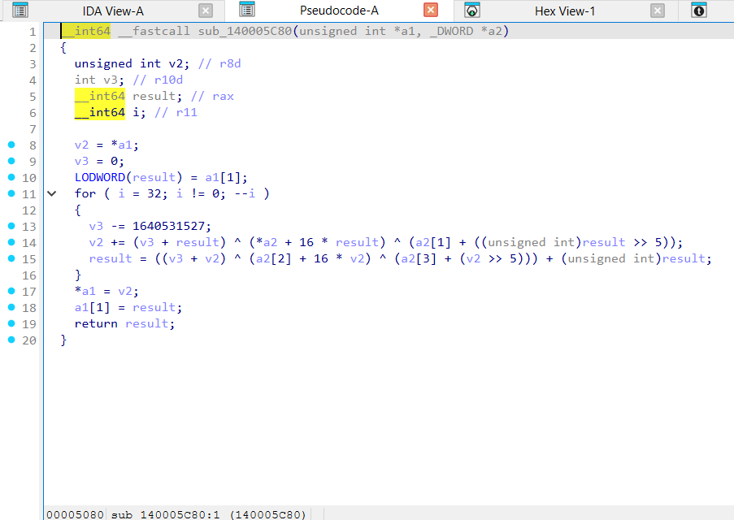
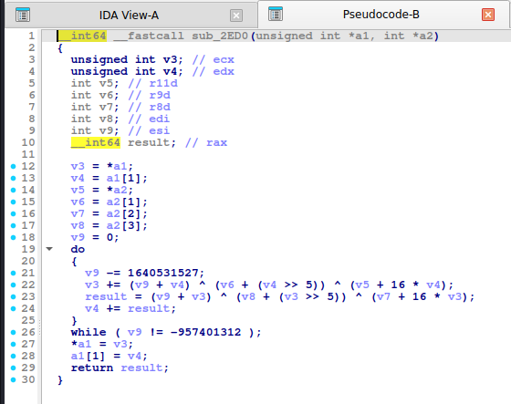
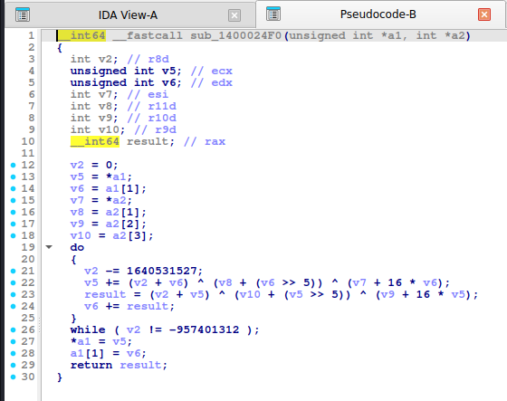

# 02. Đọc pseudo-code bản strip (không symbol)

> Đề thật hầu như luôn **strip**: không có tên hàm, không có PDB. Trang này ghi lại **cái gì mất đi, cái gì còn lại**, và cách lần ra thuật toán khi IDA chỉ cho `sub_XXXX`. Mọi nhận xét dưới đây đã quan sát trên 3 binary strip tự build (gcc `-O2` ELF, mingw `-O2` PE, MSVC `/O2` PE không PDB); trong mỗi trang thuật toán có **text** và **ảnh chụp màn hình IDA** của cả ba.

## 1. Cái gì mất, cái gì còn

| Thứ | Bản có symbol | Bản strip |
|---|---|---|
| Tên hàm | `b64_encode`, `tea_encrypt` | **`sub_<địa chỉ>`**, ví dụ `sub_2ED0` (ELF), `sub_140005C80` (PE) |
| Tên/ kiểu tham số | `const unsigned __int8 *in, size_t n, char *out` | **`__int64 a1, unsigned __int64 a2, _BYTE *a3`**: kiểu bị mất, chỉ còn dạng "số nguyên/ con trỏ chung" |
| Tên biến cục bộ | `sum`, `v0`, `i`, `o` (nếu có PDB) | **`v1, v2, …`** kèm chú thích thanh ghi `// rax` |
| Bảng hằng | `AES_SBOX`, `T_6`, `MD5_K` | **`byte_6DC0`**, **`dword_1400184D0`**, **`unk_66C0`**, **`xmmword_6F30`** (tên theo kiểu + địa chỉ) |
| Chuỗi | `"ABC…"` | giữ nguyên chuỗi; biến chuỗi tên **`aAbcdefghijklmn`** (IDA đặt `a` + vài ký tự đầu) |
| Hàm thư viện **liên kết động** (gcc ELF) | `memcpy`, `strchr`, … | **vẫn còn tên** (qua PLT): `strchr(s: "ABC…", c: v3)`, `memset(v19, 0, 300)` |
| Hàm thư viện **liên kết tĩnh** (mingw `-static`, MSVC `/MT`) | `memset`, `memmove` | **mất tên** thành `sub_XXXX(a1: buf, a2: 0, a3: 320)`: đoán từ tham số (`0` + kích thước bộ đệm = `memset`) |
| `main` | `main` | **vẫn được IDA nhận ra** (từ `__libc_start_main` hoặc chữ ký CRT) |
| Hằng số, cấu trúc vòng lặp, phép toán | | **giữ nguyên** → cách nhận diện ở các trang thuật toán vẫn dùng được |

> Quy tắc vàng: **đừng dựa vào tên, hãy dựa vào hằng số và hình dạng vòng lặp.**

## 2. Quy trình lần ra thuật toán trong bản strip

1. `Shift+F12` (Strings): tìm chuỗi bảng chữ cái (Base64/Base58…), thông điệp ("Correct"/"Wrong"). Từ chuỗi, `x` (xref) tới hàm dùng nó.
2. `Alt+I` (Immediate value) / `Alt+B` (Bytes): tìm hằng đặc trưng trong [00-nhan-dien-nhanh.md](00-nhan-dien-nhanh.md) (`0x9E3779B9`, `0x67452301`, S-box `63 7C 77 7B`…). Dạng số có dấu (`-1640531527`) cũng phải tìm.
3. Mở `main`, xem **thứ tự gọi hàm**: các hàm được gọi lần lượt thường tương ứng thứ tự thuật toán áp dụng (mã hóa → so sánh).
4. Với mỗi hàm lạ: xem **số tham số, kiểu**, vòng lặp lồng nhau, số vòng (32, 64, 80, 256, 10), bảng tra tĩnh (`byte_…`).
5. **Đặt tên ngay**: `n` (rename) cho hàm, bảng, biến; `y` (set type) để sửa kiểu tham số (đặc biệt `a1` → `const uint8_t *`). Pseudo-code sau khi đặt tên/kiểu dễ đọc hơn hẳn.
6. Hàm thư viện tĩnh không tên (`memset`, `memcpy`, `strlen`…): đặt tên theo ngữ cảnh để các hàm sau dễ đọc; với MSVC có thể nạp chữ ký (FLIRT) phù hợp: `File → Load file → FLIRT signature file`.

## 3. Những khác biệt đáng chú ý giữa các bản strip

- **Strip chỉ bỏ tên, không đổi thuật toán/mã máy**: cấu trúc vòng lặp của bản strip giống bản có symbol cùng trình biên dịch và mức tối ưu (ví dụ MSVC `/O2` bung MD5 4 bước/lần và XTEA 16 vòng/lần ở **cả hai** bản, số dòng pseudo-code chỉ chênh vài dòng). Các đặc điểm theo trình biên dịch ghi ở trang thuật toán vì vậy vẫn áp dụng.
- **ELF PIE strip**: địa chỉ ngắn (`sub_2ED0`), dữ liệu `byte_6DC0`. **PE x64 strip**: địa chỉ dài (`sub_140005C80`), dữ liệu `byte_1400182D0`.
- Hằng 32-bit vẫn hiện số có dấu (`-957401312`), phép xoay vẫn là `__ROL4__`/`__ROR4__`, SSE vẫn là `_mm_*` ở các bản tối ưu.
- Nhiều hàm nhỏ (`op_add`, `op_sub`…) khi strip **không còn phân biệt được bằng tên**: chỉ khác ở phép toán trong thân vòng lặp. Đừng nhầm `op_add`/`op_sub` (cộng/trừ hằng) khi đảo ngược; luôn kiểm tra dấu.

## 4. Bảng đối chiếu tên hàm gốc ↔ `sub_XXXX` (trong 3 binary thí nghiệm)

Dùng bảng này để biết **ảnh nào** trong các trang thuật toán ứng với hàm nào.

| Hàm gốc | MSVC /O2 | gcc -O2 | mingw-w64 -O2 -static |
|---|---|---|---|
| `a85_encode` | `sub_140001010` | `sub_2510` | `sub_140001A60` |
| `adler32_hash` | `sub_1400012A0` | `sub_5330` | `sub_140004BB0` |
| `aes128_decrypt_block` | `sub_140001310` | `sub_3520` | `sub_140002B90` |
| `aes128_encrypt_block` | `sub_140001A20` | `sub_33B0` | `sub_140002A20` |
| `aes128_key_expand` | `sub_140001F00` | `sub_3310` | `sub_140002970` |
| `b32_encode` | `sub_140001FE0` | `sub_2250` | `sub_140001740` |
| `b58_encode` | `sub_1400020B0` | `sub_2330` | `sub_140001840` |
| `b64_decode` | `sub_140002220` | `sub_2190` | `sub_1400016A0` |
| `b64_encode` | `sub_1400022C0` | `sub_2020` | `sub_140001520` |
| `chacha20_block` | `sub_140002430` | `sub_3A10` | `sub_140003090` |
| `chacha20_xor` | `sub_1400027B0` | `sub_3CA0` | `sub_140003350` |
| `crc32_bitwise` | `sub_1400028D0` | `sub_52D0` | `sub_140004B50` |
| `crc32_table` | `sub_1400029A0` | `sub_5280` | `sub_140004B00` |
| `djb2_hash` | `sub_140002A00` | `sub_5420` | `sub_140004C70` |
| `fnv1a_hash` | `sub_140002A30` | `sub_53E0` | `sub_140004C30` |
| `hex_encode` | `sub_140002A60` | `sub_2670` | `sub_140001BF0` |
| `md5_hash` | `sub_1400039C0` | `sub_40C0` | `sub_1400037A0` |
| `mix_chain` | `sub_140003D40` | `sub_2CA0` | `sub_1400022A0` |
| `op_add` | `sub_140003D80` | `sub_2880` | `sub_140001DE0` |
| `op_not` | `sub_140003E20` | `sub_29C0` | `sub_140001F60` |
| `op_reverse` | `sub_140003EC0` | `sub_2C60` | `sub_140002270` |
| `op_rol32` | `sub_140003EF0` | `sub_2C40` | `sub_140002250` |
| `op_rol8` | `sub_140003F00` | `sub_2A60` | `sub_140002020` |
| `op_ror32` | `sub_140003F30` | `sub_2C50` | `sub_140002260` |
| `op_ror8` | `sub_140003F40` | `sub_2B50` | `sub_140002130` |
| `op_sub` | `sub_140003F70` | `sub_2920` | `sub_140001EA0` |
| `rc4_crypt` | `sub_140004070` | `sub_2CE0` | `sub_1400022E0` |
| `rot13` | `sub_140004170` | `sub_2700` | `sub_140001C40` |
| `salsa20_block` | `sub_1400041F0` | `sub_3D40` | `sub_140003400` |
| `salsa20_xor` | `sub_140004600` | `sub_4020` | `sub_140003700` |
| `sha1_hash` | `sub_140004720` | `sub_42B0` | `sub_1400039B0` |
| `sha256_hash` | `sub_140004DD0` | `sub_4770` | `sub_140003EF0` |
| `sha512_hash` | `sub_1400056C0` | `sub_4E30` | `sub_140004670` |
| `tea_decrypt` | `sub_140005BE0` | `sub_2F50` | `sub_140002560` |
| `tea_encrypt` | `sub_140005C80` | `sub_2ED0` | `sub_1400024F0` |
| `xor_repeat` | `sub_140005D10` | `sub_2840` | `sub_140001DA0` |
| `xor_single` | `sub_140005D40` | `sub_27A0` | `sub_140001CE0` |
| `xtea_decrypt` | `sub_140005DE0` | `sub_3040` | `sub_140002680` |
| `xtea_encrypt` | `sub_140006360` | `sub_2FD0` | `sub_140002610` |
| `xxtea_decrypt` | `sub_140006890` | `sub_31F0` | `sub_140002850` |
| `xxtea_encrypt` | `sub_1400069D0` | `sub_30B0` | `sub_140002700` |

## 5. Ví dụ: `tea_encrypt` ở 3 build strip

<details><summary>MSVC /O2 - PE x64 (có PDB)</summary>

```c
void __fastcall tea_encrypt(unsigned int *v, const unsigned int *k)
{
  unsigned int v2; // r8d
  int v3; // r10d
  unsigned int v4; // eax
  __int64 i; // r11

  v2 = *v;
  v3 = 0;
  v4 = v[1];
  for ( i = 32; i != 0; --i )
  {
    v3 -= 1640531527;
    v2 += (v3 + v4) ^ (*k + 16 * v4) ^ (k[1] + (v4 >> 5));
    v4 += (v3 + v2) ^ (k[2] + 16 * v2) ^ (k[3] + (v2 >> 5));
  }
  *v = v2;
  v[1] = v4;
}
```

</details>

<details><summary>MSVC /Od - PE x64 (có PDB)</summary>

```c
void __fastcall tea_encrypt(unsigned int *v, const unsigned int *k)
{
  unsigned int v0; // [rsp+0h] [rbp-28h]
  unsigned int v1; // [rsp+4h] [rbp-24h]
  unsigned int sum; // [rsp+8h] [rbp-20h]
  int i; // [rsp+Ch] [rbp-1Ch]

  v0 = *v;
  v1 = v[1];
  sum = 0;
  for ( i = 0; i < 32; ++i )
  {
    sum -= 1640531527;
    v0 += (k[1] + (v1 >> 5)) ^ (sum + v1) ^ (*k + 16 * v1);
    v1 += (k[3] + (v0 >> 5)) ^ (sum + v0) ^ (k[2] + 16 * v0);
  }
  *v = v0;
  v[1] = v1;
}
```

</details>

<details><summary>gcc -O2 - ELF x86-64 (chưa strip)</summary>

```c
__int64 __fastcall tea_encrypt(unsigned int *a1, int *a2)
{
  unsigned int v3; // ecx
  unsigned int v4; // edx
  int v5; // r11d
  int v6; // r9d
  int v7; // r8d
  int v8; // edi
  int v9; // esi
  __int64 result; // rax

  v3 = *a1;
  v4 = a1[1];
  v5 = *a2;
  v6 = a2[1];
  v7 = a2[2];
  v8 = a2[3];
  v9 = 0;
  do
  {
    v9 -= 1640531527;
    v3 += (v9 + v4) ^ (v6 + (v4 >> 5)) ^ (v5 + 16 * v4);
    result = (v9 + v3) ^ (v8 + (v3 >> 5)) ^ (v7 + 16 * v3);
    v4 += result;
  }
  while ( v9 != -957401312 );
  *a1 = v3;
  a1[1] = v4;
  return result;
}
```

</details>

<details><summary>gcc -O0 - ELF x86-64 (chưa strip)</summary>

```c
__int64 __fastcall tea_encrypt(unsigned int *a1, _DWORD *a2)
{
  int i; // [rsp+20h] [rbp-10h]
  int v4; // [rsp+24h] [rbp-Ch]
  unsigned int v5; // [rsp+28h] [rbp-8h]
  unsigned int v6; // [rsp+2Ch] [rbp-4h]

  v6 = *a1;
  v5 = a1[1];
  v4 = 0;
  for ( i = 0; i <= 31; ++i )
  {
    v4 -= 1640531527;
    v6 += (v5 + v4) ^ (16 * v5 + *a2) ^ ((v5 >> 5) + a2[1]);
    v5 += (v6 + v4) ^ (16 * v6 + a2[2]) ^ ((v6 >> 5) + a2[3]);
  }
  *a1 = v6;
  a1[1] = v5;
  return v5;
}
```

</details>

<details><summary>mingw-w64 gcc -O2 - PE x64 (-static)</summary>

```c
__int64 __fastcall tea_encrypt(unsigned int *a1, int *a2)
{
  int v2; // r8d
  unsigned int v5; // ecx
  unsigned int v6; // edx
  int v7; // esi
  int v8; // r11d
  int v9; // r10d
  int v10; // r9d
  __int64 result; // rax

  v2 = 0;
  v5 = *a1;
  v6 = a1[1];
  v7 = *a2;
  v8 = a2[1];
  v9 = a2[2];
  v10 = a2[3];
  do
  {
    v2 -= 1640531527;
    v5 += (v2 + v6) ^ (v8 + (v6 >> 5)) ^ (v7 + 16 * v6);
    result = (v2 + v5) ^ (v10 + (v5 >> 5)) ^ (v9 + 16 * v5);
    v6 += result;
  }
  while ( v2 != -957401312 );
  *a1 = v5;
  a1[1] = v6;
  return result;
}
```

</details>

<details><summary>mingw-w64 gcc -O0 - PE x64 (-static)</summary>

```c
__int64 __fastcall tea_encrypt(unsigned int *a1, _DWORD *a2)
{
  int i; // [rsp+10h] [rbp-10h]
  int v4; // [rsp+14h] [rbp-Ch]
  unsigned int v5; // [rsp+18h] [rbp-8h]
  unsigned int v6; // [rsp+1Ch] [rbp-4h]

  v6 = *a1;
  v5 = a1[1];
  v4 = 0;
  for ( i = 0; i <= 31; ++i )
  {
    v4 -= 1640531527;
    v6 += (v5 + v4) ^ (16 * v5 + *a2) ^ ((v5 >> 5) + a2[1]);
    v5 += (v6 + v4) ^ (16 * v6 + a2[2]) ^ ((v6 >> 5) + a2[3]);
  }
  *a1 = v6;
  a1[1] = v5;
  return v5;
}
```

</details>

**Bản strip (không symbol)** – IDA chỉ thấy `sub_XXXX`, `a1`, `a2`, `byte_XXXX`; hàm này tên là MSVC /O2 → `sub_140005C80`, gcc -O2 → `sub_2ED0`, mingw-w64 -O2 -static → `sub_1400024F0`:

<details><summary>MSVC /O2 – PE x64, không PDB (strip) – bản STRIP: <code>tea_encrypt</code> = <code>sub_140005C80</code></summary>

```c
__int64 __fastcall sub_140005C80(unsigned int *a1, _DWORD *a2)
{
  unsigned int v2; // r8d
  int v3; // r10d
  __int64 result; // rax
  __int64 i; // r11

  v2 = *a1;
  v3 = 0;
  LODWORD(result) = a1[1];
  for ( i = 32; i != 0; --i )
  {
    v3 -= 1640531527;
    v2 += (v3 + result) ^ (*a2 + 16 * result) ^ (a2[1] + ((unsigned int)result >> 5));
    result = ((v3 + v2) ^ (a2[2] + 16 * v2) ^ (a2[3] + (v2 >> 5))) + (unsigned int)result;
  }
  *a1 = v2;
  a1[1] = result;
  return result;
}
```

</details>

<details><summary>gcc -O2 – ELF, đã `strip -s` – bản STRIP: <code>tea_encrypt</code> = <code>sub_2ED0</code></summary>

```c
__int64 __fastcall sub_2ED0(unsigned int *a1, int *a2)
{
  unsigned int v3; // ecx
  unsigned int v4; // edx
  int v5; // r11d
  int v6; // r9d
  int v7; // r8d
  int v8; // edi
  int v9; // esi
  __int64 result; // rax

  v3 = *a1;
  v4 = a1[1];
  v5 = *a2;
  v6 = a2[1];
  v7 = a2[2];
  v8 = a2[3];
  v9 = 0;
  do
  {
    v9 -= 1640531527;
    v3 += (v9 + v4) ^ (v6 + (v4 >> 5)) ^ (v5 + 16 * v4);
    result = (v9 + v3) ^ (v8 + (v3 >> 5)) ^ (v7 + 16 * v3);
    v4 += result;
  }
  while ( v9 != -957401312 );
  *a1 = v3;
  a1[1] = v4;
  return result;
}
```

</details>

<details><summary>mingw-w64 -O2 -static – PE, đã `strip -s` – bản STRIP: <code>tea_encrypt</code> = <code>sub_1400024F0</code></summary>

```c
__int64 __fastcall sub_1400024F0(unsigned int *a1, int *a2)
{
  int v2; // r8d
  unsigned int v5; // ecx
  unsigned int v6; // edx
  int v7; // esi
  int v8; // r11d
  int v9; // r10d
  int v10; // r9d
  __int64 result; // rax

  v2 = 0;
  v5 = *a1;
  v6 = a1[1];
  v7 = *a2;
  v8 = a2[1];
  v9 = a2[2];
  v10 = a2[3];
  do
  {
    v2 -= 1640531527;
    v5 += (v2 + v6) ^ (v8 + (v6 >> 5)) ^ (v7 + 16 * v6);
    result = (v2 + v5) ^ (v10 + (v5 >> 5)) ^ (v9 + 16 * v5);
    v6 += result;
  }
  while ( v2 != -957401312 );
  *a1 = v5;
  a1[1] = v6;
  return result;
}
```

</details>

**Ảnh chụp màn hình IDA (bản strip)** – mở từng mục để xem; hàm dài chia thành nhiều trang, mỗi trang là một màn hình IDA:

<details><summary>MSVC /O2 – PE x64, không PDB (strip) – tea_encrypt = <code>sub_140005C80</code> – 1 ảnh</summary>



</details>

<details><summary>gcc -O2 – ELF, đã `strip -s` – tea_encrypt = <code>sub_2ED0</code> – 1 ảnh</summary>



</details>

<details><summary>mingw-w64 -O2 -static – PE, đã `strip -s` – tea_encrypt = <code>sub_1400024F0</code> – 1 ảnh</summary>



</details>
