# ChaCha20

> Mã dòng của Bernstein: khóa 256-bit, nonce 96-bit (IETF), bộ đếm 32-bit, tạo keystream **64 byte/khối**, XOR với dữ liệu. Chỉ dùng cộng 32-bit, XOR, xoay → không có bảng.

## 1. Dấu hiệu nhận biết

- 4 hằng "**expand 32-byte k**" (ASCII): `0x61707865`, `0x3320646E`, `0x79622D32`, `0x6B206574`. IDA hay hiện dạng **thập phân**: `1634760805`, `857760878`, `2036477234`, `1797285236`.
- Trạng thái **16 từ 32-bit**: 4 hằng + 8 từ khóa + 1 bộ đếm + 3 từ nonce.
- **Quarter-round** (chữ ký): cộng, XOR, xoay với các lượng **16, 12, 8, 7** (`__ROL4__(x, 16)`, `12`, `8`, `7`), tám quarter-round mỗi lần lặp (4 cột + 4 đường chéo), lặp **10 lần** (= 20 vòng). Biến đếm `10` / `v72 = 10`.
- Cuối khối: cộng **trạng thái ban đầu** vào trạng thái sau xáo (`x[i] + s[i]`), ghi 64 byte little-endian.
- Bộ đếm khối tăng `+1` mỗi 64 byte; vòng XOR `buf[i] ^= keystream[i % 64]`.
- Phân biệt với Salsa20: ChaCha xoay **16/12/8/7** và cột/đường chéo theo `(0,4,8,12)`; Salsa xoay **7/9/13/18**.

## 2. Thuật toán (mã giả)

```
state = [0x61707865, 0x3320646E, 0x79622D32, 0x6B206574,
         key[0..7],  counter,  nonce[0..2]]
x = state
repeat 10:
    QR(x0,x4,x8,x12) QR(x1,x5,x9,x13) QR(x2,x6,x10,x14) QR(x3,x7,x11,x15)   # cột
    QR(x0,x5,x10,x15) QR(x1,x6,x11,x12) QR(x2,x7,x8,x13) QR(x3,x4,x9,x14)   # đường chéo
keystream = (x + state) serialize little-endian        # 64 byte
QR(a,b,c,d): a+=b; d^=a; d=rol(d,16); c+=d; b^=c; b=rol(b,12);
             a+=b; d^=a; d=rol(d,8);  c+=d; b^=c; b=rol(b,7)
```

## 3. Mã hóa / giải mã

Mã hóa = giải mã = `data XOR keystream`. Cần đủ: **key 32 byte**, **nonce 12 byte**, **counter đầu** (thường `0` hoặc `1`). Nếu sai counter, keystream lệch hẳn.

## 4. Mã nguồn gốc (C)

```c
#define CC_QR(a, b, c, d)                                              \
    a += b; d ^= a; d = ROL32(d, 16);                                  \
    c += d; b ^= c; b = ROL32(b, 12);                                  \
    a += b; d ^= a; d = ROL32(d, 8);                                   \
    c += d; b ^= c; b = ROL32(b, 7);
```

```c
void chacha20_block(const uint32_t key[8], uint32_t counter, const uint32_t nonce[3], uint8_t out[64])
{
    uint32_t s[16] = {0x61707865, 0x3320646e, 0x79622d32, 0x6b206574};
    uint32_t x[16];
    for (int i = 0; i < 8; i++) s[4 + i] = key[i];
    s[12] = counter;
    s[13] = nonce[0]; s[14] = nonce[1]; s[15] = nonce[2];
    memcpy(x, s, sizeof(x));
    for (int i = 0; i < 10; i++) {
        CC_QR(x[0], x[4], x[8], x[12])
        CC_QR(x[1], x[5], x[9], x[13])
        CC_QR(x[2], x[6], x[10], x[14])
        CC_QR(x[3], x[7], x[11], x[15])
        CC_QR(x[0], x[5], x[10], x[15])
        CC_QR(x[1], x[6], x[11], x[12])
        CC_QR(x[2], x[7], x[8], x[13])
        CC_QR(x[3], x[4], x[9], x[14])
    }
    for (int i = 0; i < 16; i++) {
        uint32_t v = x[i] + s[i];
        memcpy(out + 4 * i, &v, 4);
    }
}

void chacha20_xor(const uint32_t key[8], const uint32_t nonce[3], uint8_t *buf, size_t n)
{
    uint8_t ks[64];
    uint32_t ctr = 0;
    for (size_t off = 0; off < n; off += 64, ctr++) {
        chacha20_block(key, ctr, nonce, ks);
        for (size_t i = 0; i < 64 && off + i < n; i++) buf[off + i] ^= ks[i];
    }
}
```

## 5. Pseudo-code IDA thực tế

**Một khối:**

<details><summary>MSVC /O2 - PE x64 (có PDB)</summary>

```c
void __fastcall chacha20_block(const unsigned int *key, unsigned int counter, unsigned int *nonce, char *out)
{
  unsigned int v4; // eax
  __int128 v5; // xmm1
  __int128 v6; // xmm2
  unsigned int v7; // eax
  int v8; // r13d
  unsigned int v9; // r12d
  unsigned int v10; // r15d
  unsigned int v11; // r11d
  unsigned int v12; // esi
  unsigned int v13; // edi
  unsigned int v14; // ebx
  unsigned int v15; // r14d
  unsigned int v16; // r8d
  unsigned int v17; // r10d
  unsigned int v18; // r9d
  unsigned int v19; // eax
  int v20; // r10d
  int v21; // ecx
  int v22; // edi
  int v23; // edx
  int v24; // r15d
  unsigned int v25; // eax
  int v26; // r8d
  int v27; // ecx
  int v28; // esi
  int v29; // edi
  unsigned int v30; // eax
  int v31; // r14d
  int v32; // r12d
  int v33; // r8d
  int v34; // r11d
  int v35; // r10d
  int v36; // esi
  int v37; // r10d
  unsigned int v38; // eax
  int v39; // r13d
  int v40; // ebx
  int v41; // r8d
  int v42; // r11d
  int v43; // r14d
  int v44; // eax
  int v45; // r9d
  int v46; // ecx
  int v47; // ebx
  int v48; // edx
  int v49; // eax
  int v50; // r8d
  int v51; // eax
  int v52; // r10d
  int v53; // ecx
  int v54; // r11d
  int v55; // eax
  int v56; // r8d
  int v57; // ecx
  int v58; // r9d
  unsigned int v59; // eax
  int v60; // r8d
  int v61; // eax
  int v62; // eax
  int v63; // ecx
  __int64 v64; // r8
  __int64 v65; // r10
  __int64 v66; // r9
  char *v67; // rax
  __int64 v68; // r11
  __int64 i; // rdx
  int v70; // [rsp+0h] [rbp-99h]
  unsigned int v71; // [rsp+4h] [rbp-95h]
  int v72; // [rsp+4h] [rbp-95h]
  int v73; // [rsp+8h] [rbp-91h]
  int v74; // [rsp+Ch] [rbp-8Dh]
  int v75; // [rsp+10h] [rbp-89h]
  int v76; // [rsp+14h] [rbp-85h]
  int v77; // [rsp+18h] [rbp-81h]
  __int64 v78; // [rsp+28h] [rbp-71h]
  unsigned int x[16]; // [rsp+40h] [rbp-59h] BYREF
  unsigned int s[16]; // [rsp+80h] [rbp-19h] BYREF

  v4 = *nonce;
  v5 = *((_OWORD *)key + 1);
  qmemcpy(s, "expand 32-byte k", 16);
  v6 = *(_OWORD *)key;
  *(_OWORD *)&s[12] = 0;
  s[13] = v4;
  s[14] = nonce[1];
  v7 = nonce[2];
  *(_OWORD *)&x[8] = v5;
  v8 = DWORD2(v5);
  v9 = DWORD1(v5);
  v10 = v5;
  *(_OWORD *)&x[4] = v6;
  v11 = DWORD2(v6);
  v12 = DWORD1(v6);
  v13 = v6;
  s[15] = v7;
  *(_OWORD *)x = *(_OWORD *)s;
  s[12] = counter;
  *(_OWORD *)&x[12] = *(_OWORD *)&s[12];
  v14 = v7;
  v15 = s[14];
  v16 = s[13];
  v17 = counter;
  v74 = HIDWORD(v5);
  v18 = HIDWORD(v6);
  v71 = 1797285236;
  *(_OWORD *)&s[4] = v6;
  *(_OWORD *)&s[8] = v5;
  v78 = 10;
  v70 = 2036477234;
  do
  {
    v19 = v13 + x[0];
    v20 = __ROL4__((v13 + x[0]) ^ v17, 16);
    v21 = v10 + v20;
    v22 = __ROL4__((v10 + v20) ^ v13, 12);
    v23 = v22 + v19;
    v24 = __ROL4__(v20 ^ (v22 + v19), 8);
    v75 = v21 + v24;
    v76 = __ROL4__(v22 ^ (v21 + v24), 7);
    v25 = v12 + x[1];
    v26 = __ROL4__((v12 + x[1]) ^ v16, 16);
    v27 = v9 + v26;
    v28 = __ROL4__((v9 + v26) ^ v12, 12);
    v29 = v28 + v25;
    v30 = v11 + v70;
    v31 = __ROL4__((v11 + v70) ^ v15, 16);
    v32 = __ROL4__(v26 ^ v29, 8);
    v33 = v31 + v8;
    v34 = __ROL4__((v31 + v8) ^ v11, 12);
    v77 = v32 + v27;
    v35 = v28 ^ (v32 + v27);
    v36 = v34 + v30;
    v37 = __ROL4__(v35, 7);
    v38 = v18 + v71;
    v39 = __ROL4__(v31 ^ v36, 8);
    v40 = __ROL4__((v18 + v71) ^ v14, 16);
    v41 = v39 + v33;
    v72 = __ROL4__((v40 + v74) ^ v18, 12);
    v42 = __ROL4__(v34 ^ v41, 7);
    v43 = v72 + v38;
    v44 = __ROL4__(v40 ^ (v72 + v38), 8);
    v45 = v44 + v40 + v74;
    v46 = v23 + v37;
    v47 = __ROL4__(v72 ^ v45, 7);
    v48 = __ROL4__(v44 ^ (v23 + v37), 16);
    v49 = v41 + v48;
    v50 = __ROL4__(v37 ^ (v41 + v48), 12);
    x[0] = v50 + v46;
    x[15] = __ROL4__(v48 ^ (v50 + v46), 8);
    v73 = x[15] + v49;
    x[10] = x[15] + v49;
    x[5] = __ROL4__(v50 ^ (x[15] + v49), 7);
    v51 = v29 + v42;
    v52 = __ROL4__(v24 ^ (v29 + v42), 16);
    v53 = v52 + v45;
    v54 = __ROL4__(v42 ^ (v52 + v45), 12);
    x[1] = v54 + v51;
    v17 = __ROL4__((v54 + v51) ^ v52, 8);
    v74 = v53 + v17;
    x[11] = v53 + v17;
    v55 = v36 + v47;
    v12 = x[5];
    v11 = __ROL4__((v53 + v17) ^ v54, 7);
    v56 = __ROL4__(v32 ^ v55, 16);
    v57 = v56 + v75;
    x[6] = v11;
    v58 = __ROL4__(v47 ^ (v56 + v75), 12);
    v59 = v58 + v55;
    v60 = v59 ^ v56;
    v70 = v59;
    x[2] = v59;
    v61 = v39 ^ (v76 + v43);
    v16 = __ROL4__(v60, 8);
    v8 = v73;
    v62 = __ROL4__(v61, 16);
    v10 = v57 + v16;
    v63 = __ROL4__(v76 ^ (v62 + v77), 12);
    v18 = __ROL4__(v10 ^ v58, 7);
    v71 = v63 + v76 + v43;
    x[3] = v71;
    v14 = x[15];
    v15 = __ROL4__(v62 ^ v71, 8);
    v9 = v15 + v62 + v77;
    x[7] = v18;
    x[9] = v9;
    v13 = __ROL4__(v63 ^ v9, 7);
    --v78;
  }
  while ( v78 != 0 );
  x[13] = v16;
  x[12] = v17;
  x[4] = v13;
  v64 = (char *)x - out;
  x[14] = v15;
  v65 = (char *)&x[1] - out;
  x[8] = v10;
  v66 = (char *)s - out;
  v67 = out + 8;
  v68 = (char *)&s[1] - out;
  for ( i = 4; i != 0; --i )
  {
    *((_DWORD *)v67 - 2) = *(_DWORD *)&v67[v64 - 8] + *(_DWORD *)&v67[v66 - 8];
    *((_DWORD *)v67 - 1) = *(_DWORD *)&v67[v65 - 8] + *(_DWORD *)&v67[v68 - 8];
    *(_DWORD *)v67 = *(_DWORD *)&v67[v64] + *(_DWORD *)&v67[v66];
    *((_DWORD *)v67 + 1) = *(_DWORD *)&v67[v65] + *(_DWORD *)&v67[v68];
    v67 += 16;
  }
}
```

</details>

<details><summary>MSVC /Od - PE x64 (có PDB)</summary>

```c
void __fastcall chacha20_block(
        const unsigned int *key,
        unsigned int counter,
        unsigned int *nonce,
        unsigned __int8 *out)
{
  int k; // [rsp+20h] [rbp-A8h]
  int i; // [rsp+24h] [rbp-A4h]
  int j; // [rsp+28h] [rbp-A0h]
  unsigned int v; // [rsp+2Ch] [rbp-9Ch] BYREF
  unsigned int x[16]; // [rsp+30h] [rbp-98h] BYREF
  unsigned int s[16]; // [rsp+70h] [rbp-58h] BYREF

  qmemcpy(s, "expand 32-byte k", 16);
  memset(&s[4], 0, 0x30u);
  for ( i = 0; i < 8; ++i )
    s[i + 4] = key[i];
  s[12] = counter;
  s[13] = *nonce;
  s[14] = nonce[1];
  s[15] = nonce[2];
  memmove(a1: x, Src: s, Size: 0x40u);
  for ( j = 0; j < 10; ++j )
  {
    x[0] += x[4];
    x[12] ^= x[0];
    x[12] = HIWORD(x[12]) | (x[12] << 16);
    x[8] += x[12];
    x[4] ^= x[8];
    x[4] = (x[4] >> 20) | (x[4] << 12);
    x[0] += x[4];
    x[12] ^= x[0];
    x[12] = HIBYTE(x[12]) | (x[12] << 8);
    x[8] += x[12];
    x[4] ^= x[8];
    x[4] = (x[4] >> 25) | (x[4] << 7);
    x[1] += x[5];
    x[13] ^= x[1];
    x[13] = HIWORD(x[13]) | (x[13] << 16);
    x[9] += x[13];
    x[5] ^= x[9];
    x[5] = (x[5] >> 20) | (x[5] << 12);
    x[1] += x[5];
    x[13] ^= x[1];
    x[13] = HIBYTE(x[13]) | (x[13] << 8);
    x[9] += x[13];
    x[5] ^= x[9];
    x[5] = (x[5] >> 25) | (x[5] << 7);
    x[2] += x[6];
    x[14] ^= x[2];
    x[14] = HIWORD(x[14]) | (x[14] << 16);
    x[10] += x[14];
    x[6] ^= x[10];
    x[6] = (x[6] >> 20) | (x[6] << 12);
    x[2] += x[6];
    x[14] ^= x[2];
    x[14] = HIBYTE(x[14]) | (x[14] << 8);
    x[10] += x[14];
    x[6] ^= x[10];
    x[6] = (x[6] >> 25) | (x[6] << 7);
    x[3] += x[7];
    x[15] ^= x[3];
    x[15] = HIWORD(x[15]) | (x[15] << 16);
    x[11] += x[15];
    x[7] ^= x[11];
    x[7] = (x[7] >> 20) | (x[7] << 12);
    x[3] += x[7];
    x[15] ^= x[3];
    x[15] = HIBYTE(x[15]) | (x[15] << 8);
    x[11] += x[15];
    x[7] ^= x[11];
    x[7] = (x[7] >> 25) | (x[7] << 7);
    x[0] += x[5];
    x[15] ^= x[0];
    x[15] = HIWORD(x[15]) | (x[15] << 16);
    x[10] += x[15];
    x[5] ^= x[10];
    x[5] = (x[5] >> 20) | (x[5] << 12);
    x[0] += x[5];
    x[15] ^= x[0];
    x[15] = HIBYTE(x[15]) | (x[15] << 8);
    x[10] += x[15];
    x[5] ^= x[10];
    x[5] = (x[5] >> 25) | (x[5] << 7);
    x[1] += x[6];
    x[12] ^= x[1];
    x[12] = HIWORD(x[12]) | (x[12] << 16);
    x[11] += x[12];
    x[6] ^= x[11];
    x[6] = (x[6] >> 20) | (x[6] << 12);
    x[1] += x[6];
    x[12] ^= x[1];
    x[12] = HIBYTE(x[12]) | (x[12] << 8);
    x[11] += x[12];
    x[6] ^= x[11];
    x[6] = (x[6] >> 25) | (x[6] << 7);
    x[2] += x[7];
    x[13] ^= x[2];
    x[13] = HIWORD(x[13]) | (x[13] << 16);
    x[8] += x[13];
    x[7] ^= x[8];
    x[7] = (x[7] >> 20) | (x[7] << 12);
    x[2] += x[7];
    x[13] ^= x[2];
    x[13] = HIBYTE(x[13]) | (x[13] << 8);
    x[8] += x[13];
    x[7] ^= x[8];
    x[7] = (x[7] >> 25) | (x[7] << 7);
    x[3] += x[4];
    x[14] ^= x[3];
    x[14] = HIWORD(x[14]) | (x[14] << 16);
    x[9] += x[14];
    x[4] ^= x[9];
    x[4] = (x[4] >> 20) | (x[4] << 12);
    x[3] += x[4];
    x[14] ^= x[3];
    x[14] = HIBYTE(x[14]) | (x[14] << 8);
    x[9] += x[14];
    x[4] ^= x[9];
    x[4] = (x[4] >> 25) | (x[4] << 7);
  }
  for ( k = 0; k < 16; ++k )
  {
    v = s[k] + x[k];
    memmove(a1: &out[4 * k], Src: &v, Size: 4u);
  }
}
```

</details>

<details><summary>gcc -O2 - ELF x86-64 (chưa strip)</summary>

```c
__int64 __fastcall chacha20_block(const __m128i *a1, int a2, int *a3, __int64 a4)
{
  int v4; // eax
  unsigned int v5; // r10d
  unsigned int v6; // r11d
  unsigned int v7; // r13d
  __m128i v8; // xmm1
  int v9; // r14d
  int v10; // ecx
  int v11; // edx
  int v12; // ebp
  __int32 v13; // ebx
  __int32 v14; // r9d
  int v15; // edi
  __int32 v16; // esi
  __int32 v17; // r12d
  __int32 v18; // r15d
  unsigned int v19; // r8d
  unsigned int v20; // r13d
  unsigned __int32 v21; // r11d
  unsigned __int32 v22; // r8d
  int v23; // eax
  int v24; // ecx
  int v25; // edi
  int v26; // r9d
  int v27; // edx
  int v28; // r12d
  int v29; // ebp
  int v30; // ebx
  int v31; // r13d
  int v32; // r11d
  int v33; // esi
  int v34; // r8d
  int v35; // eax
  int v36; // ecx
  int v37; // r9d
  int v38; // ebp
  int v39; // ebx
  int v40; // edx
  unsigned __int32 v41; // r10d
  int v42; // r13d
  int v43; // r12d
  int v44; // edi
  int v45; // esi
  int v46; // r9d
  int v47; // r11d
  int v48; // r15d
  int v49; // eax
  int v50; // r10d
  int v51; // edi
  int v52; // r9d
  int v53; // edi
  int v54; // r15d
  int v55; // r9d
  int v56; // r12d
  int v57; // r15d
  int v58; // ebx
  int v59; // esi
  int v60; // r8d
  int v61; // r10d
  int v62; // ecx
  int v63; // edx
  int v64; // r9d
  int v65; // edi
  int v66; // ebp
  int v67; // r15d
  __int64 result; // rax
  int v69; // [rsp+0h] [rbp-D0h]
  int v70; // [rsp+4h] [rbp-CCh]
  __int32 v71; // [rsp+8h] [rbp-C8h]
  int v72; // [rsp+Ch] [rbp-C4h]
  _QWORD v74[6]; // [rsp+18h] [rbp-B8h] BYREF
  int v75; // [rsp+48h] [rbp-88h]
  int v76; // [rsp+4Ch] [rbp-84h]
  int v77; // [rsp+50h] [rbp-80h]
  int v78; // [rsp+54h] [rbp-7Ch]
  __m128i v79; // [rsp+58h] [rbp-78h]
  __m128i v80; // [rsp+68h] [rbp-68h]
  __m128i v81; // [rsp+78h] [rbp-58h]
  int v82; // [rsp+88h] [rbp-48h]
  int v83; // [rsp+8Ch] [rbp-44h]
  int v84; // [rsp+90h] [rbp-40h]
  int v85; // [rsp+94h] [rbp-3Ch]

  v4 = a2;
  v5 = 1797285236;
  v6 = 857760878;
  v7 = 1634760805;
  v8 = _mm_loadu_si128(a1);
  v9 = a3[2];
  v10 = *a3;
  *(__m128i *)v74 = _mm_load_si128((const __m128i *)&xmmword_6ED0);
  v11 = a3[1];
  v12 = _mm_cvtsi128_si32(v8);
  v80 = v8;
  v13 = v8.m128i_i32[1];
  v75 = a2;
  v81 = _mm_loadu_si128(a1 + 1);
  v14 = v81.m128i_i32[1];
  v15 = _mm_cvtsi128_si32(v81);
  v76 = v10;
  v77 = v11;
  v78 = v9;
  *(__m128i *)&v74[2] = v8;
  *(__m128i *)&v74[4] = v81;
  v16 = v8.m128i_i32[2];
  v72 = 10;
  v17 = v81.m128i_i32[2];
  v18 = v8.m128i_i32[3];
  v71 = v81.m128i_i32[3];
  v19 = 2036477234;
  do
  {
    v20 = v12 + v7;
    v21 = v13 + v6;
    v22 = v16 + v19;
    v23 = __ROL4__(v20 ^ v4, 16);
    v24 = __ROL4__(v21 ^ v10, 16);
    v25 = v23 + v15;
    v26 = v24 + v14;
    v27 = __ROL4__(v22 ^ v11, 16);
    v28 = v27 + v17;
    v29 = __ROL4__(v25 ^ v12, 12);
    v30 = __ROL4__(v26 ^ v13, 12);
    v31 = v29 + v20;
    v32 = v30 + v21;
    v33 = __ROL4__(v28 ^ v16, 12);
    v34 = v33 + v22;
    v35 = __ROL4__(v31 ^ v23, 8);
    v36 = __ROL4__(v32 ^ v24, 8);
    v37 = v36 + v26;
    v69 = v35 + v25;
    v38 = __ROL4__((v35 + v25) ^ v29, 7);
    v39 = __ROL4__(v37 ^ v30, 7);
    v70 = v37;
    v40 = __ROL4__(v34 ^ v27, 8);
    v41 = v18 + v5;
    v42 = v39 + v31;
    v43 = v40 + v28;
    v44 = __ROL4__(v41 ^ v9, 16);
    v45 = __ROL4__(v43 ^ v33, 7);
    v46 = v71 + v44;
    v47 = v45 + v32;
    v48 = __ROL4__((v71 + v44) ^ v18, 12);
    v49 = __ROL4__(v47 ^ v35, 16);
    v50 = v48 + v41;
    v51 = __ROL4__(v50 ^ v44, 8);
    v52 = v51 + v46;
    v53 = __ROL4__(v42 ^ v51, 16);
    v54 = v52 ^ v48;
    v55 = v49 + v52;
    v56 = v53 + v43;
    v57 = __ROL4__(v54, 7);
    v58 = __ROL4__(v56 ^ v39, 12);
    v7 = v58 + v42;
    v9 = __ROL4__(v7 ^ v53, 8);
    v17 = v9 + v56;
    v13 = __ROL4__(v17 ^ v58, 7);
    v59 = __ROL4__(v55 ^ v45, 12);
    v60 = v57 + v34;
    v61 = v38 + v50;
    v6 = v59 + v47;
    v62 = __ROL4__(v60 ^ v36, 16);
    v63 = __ROL4__(v61 ^ v40, 16);
    v4 = __ROL4__(v6 ^ v49, 8);
    v71 = v55 + v4;
    v64 = v63 + v70;
    v16 = __ROL4__(v71 ^ v59, 7);
    v65 = v62 + v69;
    v66 = __ROL4__((v63 + v70) ^ v38, 12);
    v67 = __ROL4__((v62 + v69) ^ v57, 12);
    v5 = v66 + v61;
    v19 = v67 + v60;
    v11 = __ROL4__(v5 ^ v63, 8);
    v10 = __ROL4__(v19 ^ v62, 8);
    v14 = v11 + v64;
    v15 = v10 + v65;
    v12 = __ROL4__(v14 ^ v66, 7);
    v18 = __ROL4__(v15 ^ v67, 7);
    --v72;
  }
  while ( v72 != 0 );
  v82 = v4;
  v85 = v9;
  *(__int64 *)((char *)v80.m128i_i64 + 4) = __PAIR64__(v16, v13);
  v83 = v10;
  v81.m128i_i32[0] = v15;
  v80.m128i_i32[3] = v18;
  *(__int64 *)((char *)v81.m128i_i64 + 4) = __PAIR64__(v17, v14);
  v80.m128i_i32[0] = v12;
  v84 = v11;
  v81.m128i_i32[3] = v71;
  result = 0;
  v79 = _mm_unpacklo_epi64(
          _mm_unpacklo_epi32(_mm_cvtsi32_si128(v7), _mm_cvtsi32_si128(v6)),
          _mm_unpacklo_epi32(_mm_cvtsi32_si128(v19), _mm_cvtsi32_si128(v5)));
  do
  {
    *(__m128i *)(a4 + result * 8) = _mm_add_epi32(
                                      _mm_load_si128((const __m128i *)&v74[result]),
                                      *(__m128i *)((char *)&v79 + result * 8));
    result += 2;
  }
  while ( result != 8 );
  return result * 8;
}
```

</details>

<details><summary>gcc -O0 - ELF x86-64 (chưa strip)</summary>

```c
__int64 __fastcall chacha20_block(__int64 a1, int a2, __int64 a3, __int64 a4)
{
  __int64 result; // rax
  unsigned int v5; // [rsp+2Ch] [rbp-94h]
  _QWORD v6[2]; // [rsp+30h] [rbp-90h]
  __int128 v7; // [rsp+40h] [rbp-80h]
  __int128 v8; // [rsp+50h] [rbp-70h]
  __int128 v9; // [rsp+60h] [rbp-60h]
  _QWORD v10[2]; // [rsp+70h] [rbp-50h] BYREF
  __int128 v11; // [rsp+80h] [rbp-40h]
  __int128 v12; // [rsp+90h] [rbp-30h]
  __int128 v13; // [rsp+A0h] [rbp-20h]
  int k; // [rsp+B4h] [rbp-Ch]
  int j; // [rsp+B8h] [rbp-8h]
  int i; // [rsp+BCh] [rbp-4h]

  v11 = 0;
  v12 = 0;
  v13 = 0;
  qmemcpy(v10, "expand 32-byte k", sizeof(v10));
  for ( i = 0; i <= 7; ++i )
    *((_DWORD *)&v10[2] + i) = *(_DWORD *)(4LL * i + a1);
  LODWORD(v13) = a2;
  *(_QWORD *)((char *)&v13 + 4) = *(_QWORD *)a3;
  HIDWORD(v13) = *(_DWORD *)(a3 + 8);
  *(_OWORD *)v6 = *(_OWORD *)v10;
  v7 = v11;
  v8 = v12;
  result = v13;
  v9 = v13;
  for ( j = 0; j <= 9; ++j )
  {
    LODWORD(v6[0]) += v7;
    LODWORD(v9) = __ROL4__(v9 ^ LODWORD(v6[0]), 16);
    LODWORD(v8) = v8 + v9;
    LODWORD(v7) = __ROL4__(v7 ^ v8, 12);
    LODWORD(v6[0]) += v7;
    LODWORD(v9) = __ROL4__(v9 ^ LODWORD(v6[0]), 8);
    LODWORD(v8) = v8 + v9;
    LODWORD(v7) = __ROL4__(v7 ^ v8, 7);
    HIDWORD(v6[0]) += DWORD1(v7);
    DWORD1(v9) = __ROL4__(DWORD1(v9) ^ HIDWORD(v6[0]), 16);
    DWORD1(v8) += DWORD1(v9);
    DWORD1(v7) = __ROL4__(DWORD1(v7) ^ DWORD1(v8), 12);
    HIDWORD(v6[0]) += DWORD1(v7);
    DWORD1(v9) = __ROL4__(DWORD1(v9) ^ HIDWORD(v6[0]), 8);
    DWORD1(v8) += DWORD1(v9);
    DWORD1(v7) = __ROL4__(DWORD1(v7) ^ DWORD1(v8), 7);
    LODWORD(v6[1]) += DWORD2(v7);
    DWORD2(v9) = __ROL4__(DWORD2(v9) ^ LODWORD(v6[1]), 16);
    DWORD2(v8) += DWORD2(v9);
    DWORD2(v7) = __ROL4__(DWORD2(v7) ^ DWORD2(v8), 12);
    LODWORD(v6[1]) += DWORD2(v7);
    DWORD2(v9) = __ROL4__(DWORD2(v9) ^ LODWORD(v6[1]), 8);
    DWORD2(v8) += DWORD2(v9);
    DWORD2(v7) = __ROL4__(DWORD2(v7) ^ DWORD2(v8), 7);
    HIDWORD(v6[1]) += HIDWORD(v7);
    HIDWORD(v9) = __ROL4__(HIDWORD(v9) ^ HIDWORD(v6[1]), 16);
    HIDWORD(v8) += HIDWORD(v9);
    HIDWORD(v7) = __ROL4__(HIDWORD(v7) ^ HIDWORD(v8), 12);
    HIDWORD(v6[1]) += HIDWORD(v7);
    HIDWORD(v9) = __ROL4__(HIDWORD(v9) ^ HIDWORD(v6[1]), 8);
    HIDWORD(v8) += HIDWORD(v9);
    HIDWORD(v7) = __ROL4__(HIDWORD(v7) ^ HIDWORD(v8), 7);
    LODWORD(v6[0]) += DWORD1(v7);
    HIDWORD(v9) = __ROL4__(HIDWORD(v9) ^ LODWORD(v6[0]), 16);
    DWORD2(v8) += HIDWORD(v9);
    DWORD1(v7) = __ROL4__(DWORD1(v7) ^ DWORD2(v8), 12);
    LODWORD(v6[0]) += DWORD1(v7);
    HIDWORD(v9) = __ROL4__(HIDWORD(v9) ^ LODWORD(v6[0]), 8);
    DWORD2(v8) += HIDWORD(v9);
    HIDWORD(v6[0]) += DWORD2(v7);
    LODWORD(v9) = __ROL4__(v9 ^ HIDWORD(v6[0]), 16);
    HIDWORD(v8) += v9;
    DWORD2(v7) = __ROL4__(DWORD2(v7) ^ HIDWORD(v8), 12);
    HIDWORD(v6[0]) += DWORD2(v7);
    LODWORD(v9) = __ROL4__(v9 ^ HIDWORD(v6[0]), 8);
    HIDWORD(v8) += v9;
    DWORD2(v7) = __ROL4__(DWORD2(v7) ^ HIDWORD(v8), 7);
    LODWORD(v6[1]) += HIDWORD(v7);
    DWORD1(v9) = __ROL4__(DWORD1(v9) ^ LODWORD(v6[1]), 16);
    LODWORD(v8) = v8 + DWORD1(v9);
    HIDWORD(v7) = __ROL4__(HIDWORD(v7) ^ v8, 12);
    LODWORD(v6[1]) += HIDWORD(v7);
    DWORD1(v9) = __ROL4__(DWORD1(v9) ^ LODWORD(v6[1]), 8);
    LODWORD(v8) = v8 + DWORD1(v9);
    HIDWORD(v7) = __ROL4__(HIDWORD(v7) ^ v8, 7);
    HIDWORD(v6[1]) += v7;
    DWORD2(v9) = __ROL4__(DWORD2(v9) ^ HIDWORD(v6[1]), 16);
    DWORD1(v8) += DWORD2(v9);
    *(_QWORD *)&v7 = __PAIR64__(__ROL4__(DWORD1(v7) ^ DWORD2(v8), 7), __ROL4__(v7 ^ DWORD1(v8), 12));
    HIDWORD(v6[1]) += v7;
    DWORD2(v9) = __ROL4__(DWORD2(v9) ^ HIDWORD(v6[1]), 8);
    DWORD1(v8) += DWORD2(v9);
    result = (unsigned int)__ROL4__(v7 ^ DWORD1(v8), 7);
    LODWORD(v7) = result;
  }
  for ( k = 0; k <= 15; ++k )
  {
    v5 = *((_DWORD *)v6 + k) + *((_DWORD *)v10 + k);
    result = v5;
    *(_DWORD *)(a4 + 4 * k) = v5;
  }
  return result;
}
```

</details>

<details><summary>mingw-w64 gcc -O2 - PE x64 (-static)</summary>

```c
__int64 __fastcall chacha20_block(unsigned __int64 *a1, int a2, int *a3, __int64 a4)
{
  unsigned int v4; // esi
  unsigned int v5; // r13d
  unsigned __int64 v6; // r11
  unsigned __int64 v7; // r10
  unsigned __int64 v8; // rbp
  int v9; // r14d
  int v10; // eax
  unsigned __int64 v11; // r9
  int v12; // ecx
  int v13; // edx
  unsigned int v14; // r12d
  unsigned int v15; // r8d
  unsigned int v16; // r15d
  unsigned int v17; // edi
  unsigned int v18; // r11d
  unsigned int v19; // r10d
  unsigned int v20; // ebx
  int v21; // r13d
  unsigned int v22; // esi
  unsigned int v23; // r10d
  int v24; // eax
  int v25; // ecx
  int v26; // r9d
  int v27; // r11d
  int v28; // edx
  int v29; // r12d
  int v30; // ebp
  int v31; // edi
  int v32; // r13d
  int v33; // esi
  int v34; // r8d
  int v35; // r10d
  int v36; // eax
  int v37; // ecx
  int v38; // r11d
  int v39; // ebp
  int v40; // edi
  int v41; // edx
  unsigned int v42; // ebx
  int v43; // r13d
  int v44; // r12d
  int v45; // r9d
  int v46; // r8d
  int v47; // r11d
  int v48; // esi
  int v49; // r15d
  int v50; // eax
  int v51; // ebx
  int v52; // r9d
  int v53; // r11d
  int v54; // r9d
  int v55; // r15d
  int v56; // r11d
  int v57; // r12d
  int v58; // r15d
  int v59; // edi
  int v60; // r8d
  int v61; // r10d
  int v62; // ebx
  int v63; // ecx
  int v64; // edx
  int v65; // r9d
  int v66; // r15d
  int v67; // r11d
  int v68; // ebp
  __int64 result; // rax
  int v70; // [rsp+0h] [rbp-D8h]
  int v71; // [rsp+4h] [rbp-D4h]
  unsigned int v72; // [rsp+8h] [rbp-D0h]
  int v73; // [rsp+Ch] [rbp-CCh]
  __m128i v74; // [rsp+10h] [rbp-C8h] BYREF
  unsigned __int64 v75; // [rsp+20h] [rbp-B8h]
  unsigned __int64 v76; // [rsp+28h] [rbp-B0h]
  unsigned __int64 v77; // [rsp+30h] [rbp-A8h]
  unsigned __int64 v78; // [rsp+38h] [rbp-A0h]
  int v79; // [rsp+40h] [rbp-98h]
  int v80; // [rsp+44h] [rbp-94h]
  int v81; // [rsp+48h] [rbp-90h]
  int v82; // [rsp+4Ch] [rbp-8Ch]
  __m128i v83; // [rsp+50h] [rbp-88h]
  unsigned __int64 v84; // [rsp+60h] [rbp-78h]
  unsigned __int64 v85; // [rsp+68h] [rbp-70h]
  unsigned __int64 v86; // [rsp+70h] [rbp-68h]
  unsigned __int64 v87; // [rsp+78h] [rbp-60h]
  int v88; // [rsp+80h] [rbp-58h]
  int v89; // [rsp+84h] [rbp-54h]
  int v90; // [rsp+88h] [rbp-50h]
  int v91; // [rsp+8Ch] [rbp-4Ch]

  v4 = 857760878;
  v5 = 1634760805;
  v6 = a1[1];
  v7 = a1[3];
  v8 = *a1;
  v9 = a3[2];
  v10 = a2;
  v11 = a1[2];
  v79 = a2;
  v12 = *a3;
  v13 = a3[1];
  v87 = v7;
  v75 = v8;
  v77 = v11;
  v14 = v7;
  v80 = v12;
  v81 = v13;
  v82 = v9;
  v73 = 10;
  v85 = v6;
  v15 = v6;
  v76 = v6;
  v16 = HIDWORD(v6);
  v84 = v8;
  v17 = HIDWORD(v8);
  v86 = v11;
  v18 = HIDWORD(v11);
  v78 = v7;
  v19 = 2036477234;
  v72 = HIDWORD(v7);
  v20 = 1797285236;
  v74 = _mm_loadu_si128((const __m128i *)&xmmword_14000FEF0);
  do
  {
    v21 = v8 + v5;
    v22 = v17 + v4;
    v23 = v15 + v19;
    v24 = __ROL4__(v21 ^ v10, 16);
    v25 = __ROL4__(v22 ^ v12, 16);
    v26 = v24 + v11;
    v27 = v25 + v18;
    v28 = __ROL4__(v23 ^ v13, 16);
    v29 = v28 + v14;
    v30 = __ROL4__(v26 ^ v8, 12);
    v31 = __ROL4__(v27 ^ v17, 12);
    v32 = v30 + v21;
    v33 = v31 + v22;
    v34 = __ROL4__(v29 ^ v15, 12);
    v35 = v34 + v23;
    v36 = __ROL4__(v32 ^ v24, 8);
    v37 = __ROL4__(v33 ^ v25, 8);
    v38 = v37 + v27;
    v70 = v36 + v26;
    v39 = __ROL4__((v36 + v26) ^ v30, 7);
    v40 = __ROL4__(v38 ^ v31, 7);
    v71 = v38;
    v41 = __ROL4__(v35 ^ v28, 8);
    v42 = v16 + v20;
    v43 = v40 + v32;
    v44 = v41 + v29;
    v45 = __ROL4__(v42 ^ v9, 16);
    v46 = __ROL4__(v44 ^ v34, 7);
    v47 = v72 + v45;
    v48 = v46 + v33;
    v49 = __ROL4__((v72 + v45) ^ v16, 12);
    v50 = __ROL4__(v48 ^ v36, 16);
    v51 = v49 + v42;
    v52 = __ROL4__(v51 ^ v45, 8);
    v53 = v52 + v47;
    v54 = __ROL4__(v43 ^ v52, 16);
    v55 = v53 ^ v49;
    v56 = v50 + v53;
    v57 = v54 + v44;
    v58 = __ROL4__(v55, 7);
    v59 = __ROL4__(v57 ^ v40, 12);
    v5 = v59 + v43;
    v9 = __ROL4__(v5 ^ v54, 8);
    v14 = v9 + v57;
    v17 = __ROL4__(v14 ^ v59, 7);
    v60 = __ROL4__(v56 ^ v46, 12);
    v61 = v58 + v35;
    v62 = v39 + v51;
    v4 = v60 + v48;
    v63 = __ROL4__(v61 ^ v37, 16);
    v64 = __ROL4__(v62 ^ v41, 16);
    v10 = __ROL4__(v4 ^ v50, 8);
    v65 = v63 + v70;
    v72 = v10 + v56;
    v66 = __ROL4__((v63 + v70) ^ v58, 12);
    v19 = v66 + v61;
    v15 = __ROL4__((v10 + v56) ^ v60, 7);
    v67 = v64 + v71;
    v12 = __ROL4__(v19 ^ v63, 8);
    v68 = __ROL4__((v64 + v71) ^ v39, 12);
    LODWORD(v11) = v12 + v65;
    v20 = v68 + v62;
    v16 = __ROL4__(v11 ^ v66, 7);
    v13 = __ROL4__(v20 ^ v64, 8);
    v18 = v13 + v67;
    LODWORD(v8) = __ROL4__(v18 ^ v68, 7);
    --v73;
  }
  while ( v73 != 0 );
  v88 = v10;
  v91 = v9;
  v87 = __PAIR64__(v72, v14);
  v85 = __PAIR64__(v16, v15);
  v89 = v12;
  v86 = __PAIR64__(v18, v11);
  v84 = __PAIR64__(v17, v8);
  v90 = v13;
  result = 0;
  v83 = _mm_unpacklo_epi64(
          _mm_unpacklo_epi32(_mm_cvtsi32_si128(v5), _mm_cvtsi32_si128(v4)),
          _mm_unpacklo_epi32(_mm_cvtsi32_si128(v19), _mm_cvtsi32_si128(v20)));
  do
  {
    *(__m128i *)(a4 + result) = _mm_add_epi32(
                                  _mm_loadu_si128((__m128i *)((char *)&v74 + result)),
                                  *(__m128i *)((char *)&v83 + result));
    result += 16;
  }
  while ( result != 64 );
  return result;
}
```

</details>

<details><summary>mingw-w64 gcc -O0 - PE x64 (-static)</summary>

```c
__int64 __fastcall chacha20_block(__int64 a1, int a2, __int64 a3, __int64 a4)
{
  __int64 result; // rax
  unsigned int v5; // [rsp+Ch] [rbp-94h]
  _QWORD v6[2]; // [rsp+10h] [rbp-90h]
  __int128 v7; // [rsp+20h] [rbp-80h]
  __int128 v8; // [rsp+30h] [rbp-70h]
  __int128 v9; // [rsp+40h] [rbp-60h]
  _QWORD v10[2]; // [rsp+50h] [rbp-50h] BYREF
  __int128 v11; // [rsp+60h] [rbp-40h]
  __int128 v12; // [rsp+70h] [rbp-30h]
  __int128 v13; // [rsp+80h] [rbp-20h]
  int k; // [rsp+94h] [rbp-Ch]
  int j; // [rsp+98h] [rbp-8h]
  int i; // [rsp+9Ch] [rbp-4h]

  v11 = 0;
  v12 = 0;
  v13 = 0;
  qmemcpy(v10, "expand 32-byte k", sizeof(v10));
  for ( i = 0; i <= 7; ++i )
    *((_DWORD *)&v10[2] + i) = *(_DWORD *)(4LL * i + a1);
  LODWORD(v13) = a2;
  *(_QWORD *)((char *)&v13 + 4) = *(_QWORD *)a3;
  HIDWORD(v13) = *(_DWORD *)(a3 + 8);
  *(_OWORD *)v6 = *(_OWORD *)v10;
  v7 = v11;
  v8 = v12;
  result = v13;
  v9 = v13;
  for ( j = 0; j <= 9; ++j )
  {
    LODWORD(v6[0]) += v7;
    LODWORD(v9) = __ROL4__(v9 ^ LODWORD(v6[0]), 16);
    LODWORD(v8) = v8 + v9;
    LODWORD(v7) = __ROL4__(v7 ^ v8, 12);
    LODWORD(v6[0]) += v7;
    LODWORD(v9) = __ROL4__(v9 ^ LODWORD(v6[0]), 8);
    LODWORD(v8) = v8 + v9;
    LODWORD(v7) = __ROL4__(v7 ^ v8, 7);
    HIDWORD(v6[0]) += DWORD1(v7);
    DWORD1(v9) = __ROL4__(DWORD1(v9) ^ HIDWORD(v6[0]), 16);
    DWORD1(v8) += DWORD1(v9);
    DWORD1(v7) = __ROL4__(DWORD1(v7) ^ DWORD1(v8), 12);
    HIDWORD(v6[0]) += DWORD1(v7);
    DWORD1(v9) = __ROL4__(DWORD1(v9) ^ HIDWORD(v6[0]), 8);
    DWORD1(v8) += DWORD1(v9);
    DWORD1(v7) = __ROL4__(DWORD1(v7) ^ DWORD1(v8), 7);
    LODWORD(v6[1]) += DWORD2(v7);
    DWORD2(v9) = __ROL4__(DWORD2(v9) ^ LODWORD(v6[1]), 16);
    DWORD2(v8) += DWORD2(v9);
    DWORD2(v7) = __ROL4__(DWORD2(v7) ^ DWORD2(v8), 12);
    LODWORD(v6[1]) += DWORD2(v7);
    DWORD2(v9) = __ROL4__(DWORD2(v9) ^ LODWORD(v6[1]), 8);
    DWORD2(v8) += DWORD2(v9);
    DWORD2(v7) = __ROL4__(DWORD2(v7) ^ DWORD2(v8), 7);
    HIDWORD(v6[1]) += HIDWORD(v7);
    HIDWORD(v9) = __ROL4__(HIDWORD(v9) ^ HIDWORD(v6[1]), 16);
    HIDWORD(v8) += HIDWORD(v9);
    HIDWORD(v7) = __ROL4__(HIDWORD(v7) ^ HIDWORD(v8), 12);
    HIDWORD(v6[1]) += HIDWORD(v7);
    HIDWORD(v9) = __ROL4__(HIDWORD(v9) ^ HIDWORD(v6[1]), 8);
    HIDWORD(v8) += HIDWORD(v9);
    HIDWORD(v7) = __ROL4__(HIDWORD(v7) ^ HIDWORD(v8), 7);
    LODWORD(v6[0]) += DWORD1(v7);
    HIDWORD(v9) = __ROL4__(HIDWORD(v9) ^ LODWORD(v6[0]), 16);
    DWORD2(v8) += HIDWORD(v9);
    DWORD1(v7) = __ROL4__(DWORD1(v7) ^ DWORD2(v8), 12);
    LODWORD(v6[0]) += DWORD1(v7);
    HIDWORD(v9) = __ROL4__(HIDWORD(v9) ^ LODWORD(v6[0]), 8);
    DWORD2(v8) += HIDWORD(v9);
    HIDWORD(v6[0]) += DWORD2(v7);
    LODWORD(v9) = __ROL4__(v9 ^ HIDWORD(v6[0]), 16);
    HIDWORD(v8) += v9;
    DWORD2(v7) = __ROL4__(DWORD2(v7) ^ HIDWORD(v8), 12);
    HIDWORD(v6[0]) += DWORD2(v7);
    LODWORD(v9) = __ROL4__(v9 ^ HIDWORD(v6[0]), 8);
    HIDWORD(v8) += v9;
    DWORD2(v7) = __ROL4__(DWORD2(v7) ^ HIDWORD(v8), 7);
    LODWORD(v6[1]) += HIDWORD(v7);
    DWORD1(v9) = __ROL4__(DWORD1(v9) ^ LODWORD(v6[1]), 16);
    LODWORD(v8) = v8 + DWORD1(v9);
    HIDWORD(v7) = __ROL4__(HIDWORD(v7) ^ v8, 12);
    LODWORD(v6[1]) += HIDWORD(v7);
    DWORD1(v9) = __ROL4__(DWORD1(v9) ^ LODWORD(v6[1]), 8);
    LODWORD(v8) = v8 + DWORD1(v9);
    HIDWORD(v7) = __ROL4__(HIDWORD(v7) ^ v8, 7);
    HIDWORD(v6[1]) += v7;
    DWORD2(v9) = __ROL4__(DWORD2(v9) ^ HIDWORD(v6[1]), 16);
    DWORD1(v8) += DWORD2(v9);
    *(_QWORD *)&v7 = __PAIR64__(__ROL4__(DWORD1(v7) ^ DWORD2(v8), 7), __ROL4__(v7 ^ DWORD1(v8), 12));
    HIDWORD(v6[1]) += v7;
    DWORD2(v9) = __ROL4__(DWORD2(v9) ^ HIDWORD(v6[1]), 8);
    DWORD1(v8) += DWORD2(v9);
    result = (unsigned int)__ROL4__(v7 ^ DWORD1(v8), 7);
    LODWORD(v7) = result;
  }
  for ( k = 0; k <= 15; ++k )
  {
    v5 = *((_DWORD *)v6 + k) + *((_DWORD *)v10 + k);
    result = v5;
    *(_DWORD *)(a4 + 4 * k) = v5;
  }
  return result;
}
```

</details>

**Bản strip (không symbol)** – IDA chỉ thấy `sub_XXXX`, `a1`, `a2`, `byte_XXXX`; hàm này tên là MSVC /O2 → `sub_140002430`, gcc -O2 → `sub_3A10`, mingw-w64 -O2 -static → `sub_140003090`:

<details><summary>MSVC /O2 – PE x64, không PDB (strip) – bản STRIP: <code>chacha20_block</code> = <code>sub_140002430</code></summary>

```c
_DWORD *__fastcall sub_140002430(__int128 *a1, unsigned int a2, int *a3, __int64 a4)
{
  int v4; // eax
  __int128 v5; // xmm1
  __int128 v6; // xmm2
  int v7; // eax
  int v8; // r13d
  int v9; // r12d
  int v10; // r15d
  int v11; // r11d
  int v12; // esi
  int v13; // edi
  int v14; // ebx
  int v15; // r14d
  unsigned int v16; // r8d
  unsigned int v17; // r10d
  int v18; // r9d
  int v19; // eax
  int v20; // r10d
  int v21; // ecx
  int v22; // edi
  int v23; // edx
  int v24; // r15d
  int v25; // eax
  int v26; // r8d
  int v27; // ecx
  int v28; // esi
  int v29; // edi
  int v30; // eax
  int v31; // r14d
  int v32; // r12d
  int v33; // r8d
  int v34; // r11d
  int v35; // r10d
  int v36; // esi
  int v37; // r10d
  int v38; // eax
  int v39; // r13d
  int v40; // ebx
  int v41; // r8d
  int v42; // r11d
  int v43; // r14d
  int v44; // eax
  int v45; // r9d
  int v46; // ecx
  int v47; // ebx
  int v48; // edx
  int v49; // eax
  int v50; // r8d
  int v51; // eax
  int v52; // r10d
  int v53; // ecx
  int v54; // r11d
  int v55; // eax
  int v56; // r8d
  int v57; // ecx
  int v58; // r9d
  int v59; // eax
  int v60; // r8d
  int v61; // eax
  int v62; // eax
  int v63; // ecx
  char *v64; // r8
  char *v65; // r10
  char *v66; // r9
  _DWORD *result; // rax
  char *v68; // r11
  __int64 i; // rdx
  int v70; // [rsp+0h] [rbp-99h]
  int v71; // [rsp+4h] [rbp-95h]
  int v72; // [rsp+4h] [rbp-95h]
  int v73; // [rsp+8h] [rbp-91h]
  int v74; // [rsp+Ch] [rbp-8Dh]
  int v75; // [rsp+10h] [rbp-89h]
  int v76; // [rsp+14h] [rbp-85h]
  int v77; // [rsp+18h] [rbp-81h]
  __int64 v78; // [rsp+28h] [rbp-71h]
  __int128 v80; // [rsp+40h] [rbp-59h] BYREF
  __int128 v81; // [rsp+50h] [rbp-49h]
  __int128 v82; // [rsp+60h] [rbp-39h]
  __int128 v83; // [rsp+70h] [rbp-29h]
  _QWORD v84[6]; // [rsp+80h] [rbp-19h] BYREF
  __int128 v85; // [rsp+B0h] [rbp+17h]

  v4 = *a3;
  v5 = a1[1];
  qmemcpy(v84, "expand 32-byte k", 16);
  v6 = *a1;
  v85 = 0;
  DWORD1(v85) = v4;
  DWORD2(v85) = a3[1];
  v7 = a3[2];
  v82 = v5;
  v8 = DWORD2(v5);
  v9 = DWORD1(v5);
  v10 = v5;
  v81 = v6;
  v11 = DWORD2(v6);
  v12 = DWORD1(v6);
  v13 = v6;
  HIDWORD(v85) = v7;
  v80 = *(_OWORD *)v84;
  LODWORD(v85) = a2;
  v83 = v85;
  v14 = v7;
  v15 = DWORD2(v85);
  v16 = DWORD1(v85);
  v17 = a2;
  v74 = HIDWORD(v5);
  v18 = HIDWORD(v6);
  v71 = 1797285236;
  *(_OWORD *)&v84[2] = v6;
  *(_OWORD *)&v84[4] = v5;
  v78 = 10;
  v70 = 2036477234;
  do
  {
    v19 = v13 + v80;
    v20 = __ROL4__((v13 + v80) ^ v17, 16);
    v21 = v10 + v20;
    v22 = __ROL4__((v10 + v20) ^ v13, 12);
    v23 = v22 + v19;
    v24 = __ROL4__(v20 ^ (v22 + v19), 8);
    v75 = v21 + v24;
    v76 = __ROL4__(v22 ^ (v21 + v24), 7);
    v25 = v12 + DWORD1(v80);
    v26 = __ROL4__((v12 + DWORD1(v80)) ^ v16, 16);
    v27 = v9 + v26;
    v28 = __ROL4__((v9 + v26) ^ v12, 12);
    v29 = v28 + v25;
    v30 = v11 + v70;
    v31 = __ROL4__((v11 + v70) ^ v15, 16);
    v32 = __ROL4__(v26 ^ v29, 8);
    v33 = v31 + v8;
    v34 = __ROL4__((v31 + v8) ^ v11, 12);
    v77 = v32 + v27;
    v35 = v28 ^ (v32 + v27);
    v36 = v34 + v30;
    v37 = __ROL4__(v35, 7);
    v38 = v18 + v71;
    v39 = __ROL4__(v31 ^ v36, 8);
    v40 = __ROL4__((v18 + v71) ^ v14, 16);
    v41 = v39 + v33;
    v72 = __ROL4__((v40 + v74) ^ v18, 12);
    v42 = __ROL4__(v34 ^ v41, 7);
    v43 = v72 + v38;
    v44 = __ROL4__(v40 ^ (v72 + v38), 8);
    v45 = v44 + v40 + v74;
    v46 = v23 + v37;
    v47 = __ROL4__(v72 ^ v45, 7);
    v48 = __ROL4__(v44 ^ (v23 + v37), 16);
    v49 = v41 + v48;
    v50 = __ROL4__(v37 ^ (v41 + v48), 12);
    LODWORD(v80) = v50 + v46;
    HIDWORD(v83) = __ROL4__(v48 ^ (v50 + v46), 8);
    v73 = HIDWORD(v83) + v49;
    DWORD2(v82) = HIDWORD(v83) + v49;
    DWORD1(v81) = __ROL4__(v50 ^ (HIDWORD(v83) + v49), 7);
    v51 = v29 + v42;
    v52 = __ROL4__(v24 ^ (v29 + v42), 16);
    v53 = v52 + v45;
    v54 = __ROL4__(v42 ^ (v52 + v45), 12);
    DWORD1(v80) = v54 + v51;
    v17 = __ROL4__((v54 + v51) ^ v52, 8);
    v74 = v53 + v17;
    HIDWORD(v82) = v53 + v17;
    v55 = v36 + v47;
    v12 = DWORD1(v81);
    v11 = __ROL4__((v53 + v17) ^ v54, 7);
    v56 = __ROL4__(v32 ^ v55, 16);
    v57 = v56 + v75;
    DWORD2(v81) = v11;
    v58 = __ROL4__(v47 ^ (v56 + v75), 12);
    v59 = v58 + v55;
    v60 = v59 ^ v56;
    v70 = v59;
    DWORD2(v80) = v59;
    v61 = v39 ^ (v76 + v43);
    v16 = __ROL4__(v60, 8);
    v8 = v73;
    v62 = __ROL4__(v61, 16);
    v10 = v57 + v16;
    v63 = __ROL4__(v76 ^ (v62 + v77), 12);
    v18 = __ROL4__(v10 ^ v58, 7);
    v71 = v63 + v76 + v43;
    HIDWORD(v80) = v71;
    v14 = HIDWORD(v83);
    v15 = __ROL4__(v62 ^ v71, 8);
    v9 = v15 + v62 + v77;
    HIDWORD(v81) = v18;
    DWORD1(v82) = v9;
    v13 = __ROL4__(v63 ^ v9, 7);
    --v78;
  }
  while ( v78 != 0 );
  *(_QWORD *)&v83 = __PAIR64__(v16, v17);
  LODWORD(v81) = v13;
  v64 = (char *)&v80 - a4;
  DWORD2(v83) = v15;
  v65 = (char *)&v80 - a4 + 4;
  LODWORD(v82) = v10;
  v66 = (char *)v84 - a4;
  result = (_DWORD *)(a4 + 8);
  v68 = (char *)v84 - a4 + 4;
  for ( i = 4; i != 0; --i )
  {
    *(result - 2) = *(_DWORD *)((char *)result + (_QWORD)v64 - 8) + *(_DWORD *)((char *)result + (_QWORD)v66 - 8);
    *(result - 1) = *(_DWORD *)((char *)result + (_QWORD)v65 - 8) + *(_DWORD *)((char *)result + (_QWORD)v68 - 8);
    *result = *(_DWORD *)((char *)result + (_QWORD)v64) + *(_DWORD *)((char *)result + (_QWORD)v66);
    result[1] = *(_DWORD *)((char *)result + (_QWORD)v65) + *(_DWORD *)((char *)result + (_QWORD)v68);
    result += 4;
  }
  return result;
}
```

</details>

<details><summary>gcc -O2 – ELF, đã `strip -s` – bản STRIP: <code>chacha20_block</code> = <code>sub_3A10</code></summary>

```c
__int64 __fastcall sub_3A10(const __m128i *a1, int a2, int *a3, __int64 a4)
{
  int v4; // eax
  unsigned int v5; // r10d
  unsigned int v6; // r11d
  unsigned int v7; // r13d
  __m128i v8; // xmm1
  int v9; // r14d
  int v10; // ecx
  int v11; // edx
  int v12; // ebp
  __int32 v13; // ebx
  __int32 v14; // r9d
  int v15; // edi
  __int32 v16; // esi
  __int32 v17; // r12d
  __int32 v18; // r15d
  unsigned int v19; // r8d
  unsigned int v20; // r13d
  unsigned __int32 v21; // r11d
  unsigned __int32 v22; // r8d
  int v23; // eax
  int v24; // ecx
  int v25; // edi
  int v26; // r9d
  int v27; // edx
  int v28; // r12d
  int v29; // ebp
  int v30; // ebx
  int v31; // r13d
  int v32; // r11d
  int v33; // esi
  int v34; // r8d
  int v35; // eax
  int v36; // ecx
  int v37; // r9d
  int v38; // ebp
  int v39; // ebx
  int v40; // edx
  unsigned __int32 v41; // r10d
  int v42; // r13d
  int v43; // r12d
  int v44; // edi
  int v45; // esi
  int v46; // r9d
  int v47; // r11d
  int v48; // r15d
  int v49; // eax
  int v50; // r10d
  int v51; // edi
  int v52; // r9d
  int v53; // edi
  int v54; // r15d
  int v55; // r9d
  int v56; // r12d
  int v57; // r15d
  int v58; // ebx
  int v59; // esi
  int v60; // r8d
  int v61; // r10d
  int v62; // ecx
  int v63; // edx
  int v64; // r9d
  int v65; // edi
  int v66; // ebp
  int v67; // r15d
  __int64 result; // rax
  int v69; // [rsp+0h] [rbp-D0h]
  int v70; // [rsp+4h] [rbp-CCh]
  __int32 v71; // [rsp+8h] [rbp-C8h]
  int v72; // [rsp+Ch] [rbp-C4h]
  _QWORD v74[6]; // [rsp+18h] [rbp-B8h] BYREF
  int v75; // [rsp+48h] [rbp-88h]
  int v76; // [rsp+4Ch] [rbp-84h]
  int v77; // [rsp+50h] [rbp-80h]
  int v78; // [rsp+54h] [rbp-7Ch]
  __m128i v79; // [rsp+58h] [rbp-78h]
  __m128i v80; // [rsp+68h] [rbp-68h]
  __m128i v81; // [rsp+78h] [rbp-58h]
  int v82; // [rsp+88h] [rbp-48h]
  int v83; // [rsp+8Ch] [rbp-44h]
  int v84; // [rsp+90h] [rbp-40h]
  int v85; // [rsp+94h] [rbp-3Ch]

  v4 = a2;
  v5 = 1797285236;
  v6 = 857760878;
  v7 = 1634760805;
  v8 = _mm_loadu_si128(a1);
  v9 = a3[2];
  v10 = *a3;
  *(__m128i *)v74 = _mm_load_si128((const __m128i *)&xmmword_6ED0);
  v11 = a3[1];
  v12 = _mm_cvtsi128_si32(v8);
  v80 = v8;
  v13 = v8.m128i_i32[1];
  v75 = a2;
  v81 = _mm_loadu_si128(a1 + 1);
  v14 = v81.m128i_i32[1];
  v15 = _mm_cvtsi128_si32(v81);
  v76 = v10;
  v77 = v11;
  v78 = v9;
  *(__m128i *)&v74[2] = v8;
  *(__m128i *)&v74[4] = v81;
  v16 = v8.m128i_i32[2];
  v72 = 10;
  v17 = v81.m128i_i32[2];
  v18 = v8.m128i_i32[3];
  v71 = v81.m128i_i32[3];
  v19 = 2036477234;
  do
  {
    v20 = v12 + v7;
    v21 = v13 + v6;
    v22 = v16 + v19;
    v23 = __ROL4__(v20 ^ v4, 16);
    v24 = __ROL4__(v21 ^ v10, 16);
    v25 = v23 + v15;
    v26 = v24 + v14;
    v27 = __ROL4__(v22 ^ v11, 16);
    v28 = v27 + v17;
    v29 = __ROL4__(v25 ^ v12, 12);
    v30 = __ROL4__(v26 ^ v13, 12);
    v31 = v29 + v20;
    v32 = v30 + v21;
    v33 = __ROL4__(v28 ^ v16, 12);
    v34 = v33 + v22;
    v35 = __ROL4__(v31 ^ v23, 8);
    v36 = __ROL4__(v32 ^ v24, 8);
    v37 = v36 + v26;
    v69 = v35 + v25;
    v38 = __ROL4__((v35 + v25) ^ v29, 7);
    v39 = __ROL4__(v37 ^ v30, 7);
    v70 = v37;
    v40 = __ROL4__(v34 ^ v27, 8);
    v41 = v18 + v5;
    v42 = v39 + v31;
    v43 = v40 + v28;
    v44 = __ROL4__(v41 ^ v9, 16);
    v45 = __ROL4__(v43 ^ v33, 7);
    v46 = v71 + v44;
    v47 = v45 + v32;
    v48 = __ROL4__((v71 + v44) ^ v18, 12);
    v49 = __ROL4__(v47 ^ v35, 16);
    v50 = v48 + v41;
    v51 = __ROL4__(v50 ^ v44, 8);
    v52 = v51 + v46;
    v53 = __ROL4__(v42 ^ v51, 16);
    v54 = v52 ^ v48;
    v55 = v49 + v52;
    v56 = v53 + v43;
    v57 = __ROL4__(v54, 7);
    v58 = __ROL4__(v56 ^ v39, 12);
    v7 = v58 + v42;
    v9 = __ROL4__(v7 ^ v53, 8);
    v17 = v9 + v56;
    v13 = __ROL4__(v17 ^ v58, 7);
    v59 = __ROL4__(v55 ^ v45, 12);
    v60 = v57 + v34;
    v61 = v38 + v50;
    v6 = v59 + v47;
    v62 = __ROL4__(v60 ^ v36, 16);
    v63 = __ROL4__(v61 ^ v40, 16);
    v4 = __ROL4__(v6 ^ v49, 8);
    v71 = v55 + v4;
    v64 = v63 + v70;
    v16 = __ROL4__(v71 ^ v59, 7);
    v65 = v62 + v69;
    v66 = __ROL4__((v63 + v70) ^ v38, 12);
    v67 = __ROL4__((v62 + v69) ^ v57, 12);
    v5 = v66 + v61;
    v19 = v67 + v60;
    v11 = __ROL4__(v5 ^ v63, 8);
    v10 = __ROL4__(v19 ^ v62, 8);
    v14 = v11 + v64;
    v15 = v10 + v65;
    v12 = __ROL4__(v14 ^ v66, 7);
    v18 = __ROL4__(v15 ^ v67, 7);
    --v72;
  }
  while ( v72 != 0 );
  v82 = v4;
  v85 = v9;
  *(__int64 *)((char *)v80.m128i_i64 + 4) = __PAIR64__(v16, v13);
  v83 = v10;
  v81.m128i_i32[0] = v15;
  v80.m128i_i32[3] = v18;
  *(__int64 *)((char *)v81.m128i_i64 + 4) = __PAIR64__(v17, v14);
  v80.m128i_i32[0] = v12;
  v84 = v11;
  v81.m128i_i32[3] = v71;
  result = 0;
  v79 = _mm_unpacklo_epi64(
          _mm_unpacklo_epi32(_mm_cvtsi32_si128(v7), _mm_cvtsi32_si128(v6)),
          _mm_unpacklo_epi32(_mm_cvtsi32_si128(v19), _mm_cvtsi32_si128(v5)));
  do
  {
    *(__m128i *)(a4 + result * 8) = _mm_add_epi32(
                                      _mm_load_si128((const __m128i *)&v74[result]),
                                      *(__m128i *)((char *)&v79 + result * 8));
    result += 2;
  }
  while ( result != 8 );
  return result * 8;
}
```

</details>

<details><summary>mingw-w64 -O2 -static – PE, đã `strip -s` – bản STRIP: <code>chacha20_block</code> = <code>sub_140003090</code></summary>

```c
__int64 __fastcall sub_140003090(unsigned __int64 *a1, int a2, int *a3, __int64 a4)
{
  unsigned int v4; // esi
  unsigned int v5; // r13d
  unsigned __int64 v6; // r11
  unsigned __int64 v7; // r10
  unsigned __int64 v8; // rbp
  int v9; // r14d
  int v10; // eax
  unsigned __int64 v11; // r9
  int v12; // ecx
  int v13; // edx
  unsigned int v14; // r12d
  unsigned int v15; // r8d
  unsigned int v16; // r15d
  unsigned int v17; // edi
  unsigned int v18; // r11d
  unsigned int v19; // r10d
  unsigned int v20; // ebx
  int v21; // r13d
  unsigned int v22; // esi
  unsigned int v23; // r10d
  int v24; // eax
  int v25; // ecx
  int v26; // r9d
  int v27; // r11d
  int v28; // edx
  int v29; // r12d
  int v30; // ebp
  int v31; // edi
  int v32; // r13d
  int v33; // esi
  int v34; // r8d
  int v35; // r10d
  int v36; // eax
  int v37; // ecx
  int v38; // r11d
  int v39; // ebp
  int v40; // edi
  int v41; // edx
  unsigned int v42; // ebx
  int v43; // r13d
  int v44; // r12d
  int v45; // r9d
  int v46; // r8d
  int v47; // r11d
  int v48; // esi
  int v49; // r15d
  int v50; // eax
  int v51; // ebx
  int v52; // r9d
  int v53; // r11d
  int v54; // r9d
  int v55; // r15d
  int v56; // r11d
  int v57; // r12d
  int v58; // r15d
  int v59; // edi
  int v60; // r8d
  int v61; // r10d
  int v62; // ebx
  int v63; // ecx
  int v64; // edx
  int v65; // r9d
  int v66; // r15d
  int v67; // r11d
  int v68; // ebp
  __int64 result; // rax
  int v70; // [rsp+0h] [rbp-D8h]
  int v71; // [rsp+4h] [rbp-D4h]
  unsigned int v72; // [rsp+8h] [rbp-D0h]
  int v73; // [rsp+Ch] [rbp-CCh]
  __m128i v74; // [rsp+10h] [rbp-C8h] BYREF
  unsigned __int64 v75; // [rsp+20h] [rbp-B8h]
  unsigned __int64 v76; // [rsp+28h] [rbp-B0h]
  unsigned __int64 v77; // [rsp+30h] [rbp-A8h]
  unsigned __int64 v78; // [rsp+38h] [rbp-A0h]
  int v79; // [rsp+40h] [rbp-98h]
  int v80; // [rsp+44h] [rbp-94h]
  int v81; // [rsp+48h] [rbp-90h]
  int v82; // [rsp+4Ch] [rbp-8Ch]
  __m128i v83; // [rsp+50h] [rbp-88h]
  unsigned __int64 v84; // [rsp+60h] [rbp-78h]
  unsigned __int64 v85; // [rsp+68h] [rbp-70h]
  unsigned __int64 v86; // [rsp+70h] [rbp-68h]
  unsigned __int64 v87; // [rsp+78h] [rbp-60h]
  int v88; // [rsp+80h] [rbp-58h]
  int v89; // [rsp+84h] [rbp-54h]
  int v90; // [rsp+88h] [rbp-50h]
  int v91; // [rsp+8Ch] [rbp-4Ch]

  v4 = 857760878;
  v5 = 1634760805;
  v6 = a1[1];
  v7 = a1[3];
  v8 = *a1;
  v9 = a3[2];
  v10 = a2;
  v11 = a1[2];
  v79 = a2;
  v12 = *a3;
  v13 = a3[1];
  v87 = v7;
  v75 = v8;
  v77 = v11;
  v14 = v7;
  v80 = v12;
  v81 = v13;
  v82 = v9;
  v73 = 10;
  v85 = v6;
  v15 = v6;
  v76 = v6;
  v16 = HIDWORD(v6);
  v84 = v8;
  v17 = HIDWORD(v8);
  v86 = v11;
  v18 = HIDWORD(v11);
  v78 = v7;
  v19 = 2036477234;
  v72 = HIDWORD(v7);
  v20 = 1797285236;
  v74 = _mm_loadu_si128((const __m128i *)&xmmword_14000FEF0);
  do
  {
    v21 = v8 + v5;
    v22 = v17 + v4;
    v23 = v15 + v19;
    v24 = __ROL4__(v21 ^ v10, 16);
    v25 = __ROL4__(v22 ^ v12, 16);
    v26 = v24 + v11;
    v27 = v25 + v18;
    v28 = __ROL4__(v23 ^ v13, 16);
    v29 = v28 + v14;
    v30 = __ROL4__(v26 ^ v8, 12);
    v31 = __ROL4__(v27 ^ v17, 12);
    v32 = v30 + v21;
    v33 = v31 + v22;
    v34 = __ROL4__(v29 ^ v15, 12);
    v35 = v34 + v23;
    v36 = __ROL4__(v32 ^ v24, 8);
    v37 = __ROL4__(v33 ^ v25, 8);
    v38 = v37 + v27;
    v70 = v36 + v26;
    v39 = __ROL4__((v36 + v26) ^ v30, 7);
    v40 = __ROL4__(v38 ^ v31, 7);
    v71 = v38;
    v41 = __ROL4__(v35 ^ v28, 8);
    v42 = v16 + v20;
    v43 = v40 + v32;
    v44 = v41 + v29;
    v45 = __ROL4__(v42 ^ v9, 16);
    v46 = __ROL4__(v44 ^ v34, 7);
    v47 = v72 + v45;
    v48 = v46 + v33;
    v49 = __ROL4__((v72 + v45) ^ v16, 12);
    v50 = __ROL4__(v48 ^ v36, 16);
    v51 = v49 + v42;
    v52 = __ROL4__(v51 ^ v45, 8);
    v53 = v52 + v47;
    v54 = __ROL4__(v43 ^ v52, 16);
    v55 = v53 ^ v49;
    v56 = v50 + v53;
    v57 = v54 + v44;
    v58 = __ROL4__(v55, 7);
    v59 = __ROL4__(v57 ^ v40, 12);
    v5 = v59 + v43;
    v9 = __ROL4__(v5 ^ v54, 8);
    v14 = v9 + v57;
    v17 = __ROL4__(v14 ^ v59, 7);
    v60 = __ROL4__(v56 ^ v46, 12);
    v61 = v58 + v35;
    v62 = v39 + v51;
    v4 = v60 + v48;
    v63 = __ROL4__(v61 ^ v37, 16);
    v64 = __ROL4__(v62 ^ v41, 16);
    v10 = __ROL4__(v4 ^ v50, 8);
    v65 = v63 + v70;
    v72 = v10 + v56;
    v66 = __ROL4__((v63 + v70) ^ v58, 12);
    v19 = v66 + v61;
    v15 = __ROL4__((v10 + v56) ^ v60, 7);
    v67 = v64 + v71;
    v12 = __ROL4__(v19 ^ v63, 8);
    v68 = __ROL4__((v64 + v71) ^ v39, 12);
    LODWORD(v11) = v12 + v65;
    v20 = v68 + v62;
    v16 = __ROL4__(v11 ^ v66, 7);
    v13 = __ROL4__(v20 ^ v64, 8);
    v18 = v13 + v67;
    LODWORD(v8) = __ROL4__(v18 ^ v68, 7);
    --v73;
  }
  while ( v73 != 0 );
  v88 = v10;
  v91 = v9;
  v87 = __PAIR64__(v72, v14);
  v85 = __PAIR64__(v16, v15);
  v89 = v12;
  v86 = __PAIR64__(v18, v11);
  v84 = __PAIR64__(v17, v8);
  v90 = v13;
  result = 0;
  v83 = _mm_unpacklo_epi64(
          _mm_unpacklo_epi32(_mm_cvtsi32_si128(v5), _mm_cvtsi32_si128(v4)),
          _mm_unpacklo_epi32(_mm_cvtsi32_si128(v19), _mm_cvtsi32_si128(v20)));
  do
  {
    *(__m128i *)(a4 + result) = _mm_add_epi32(
                                  _mm_loadu_si128((__m128i *)((char *)&v74 + result)),
                                  *(__m128i *)((char *)&v83 + result));
    result += 16;
  }
  while ( result != 64 );
  return result;
}
```

</details>

**Ảnh chụp màn hình IDA (bản strip)** – mở từng mục để xem; hàm dài chia thành nhiều trang, mỗi trang là một màn hình IDA:

<details><summary>MSVC /O2 – PE x64, không PDB (strip) – chacha20_block = <code>sub_140002430</code> – 8 ảnh</summary>

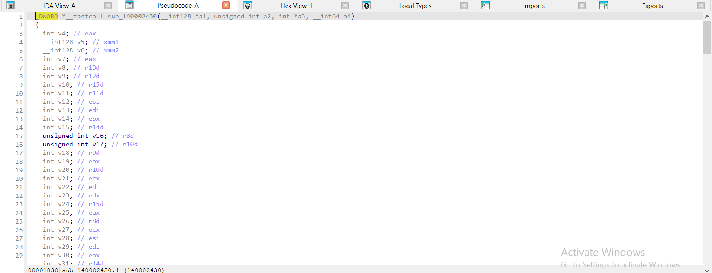

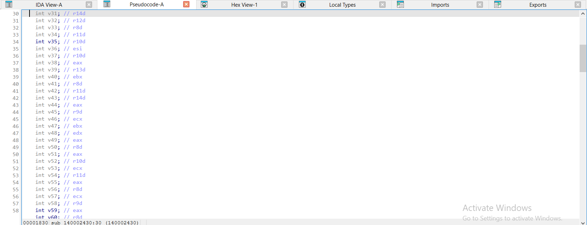

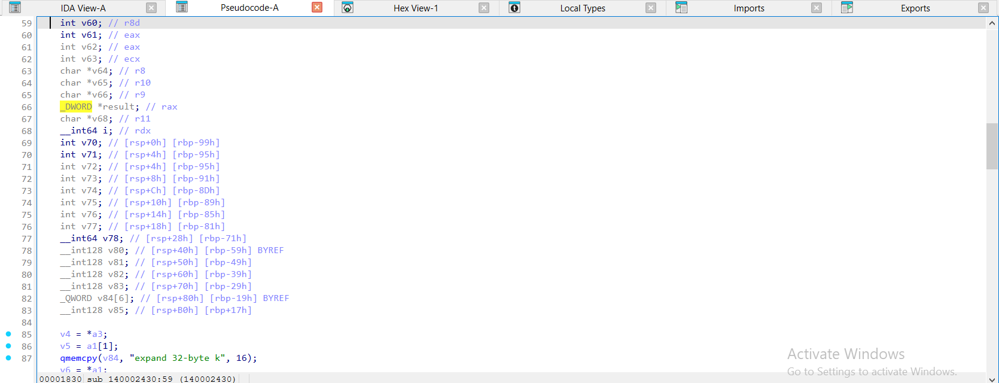

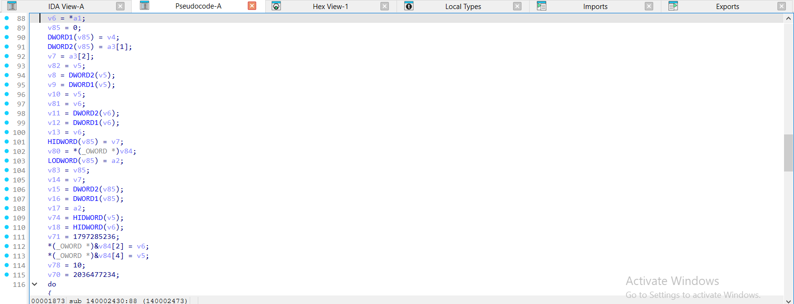

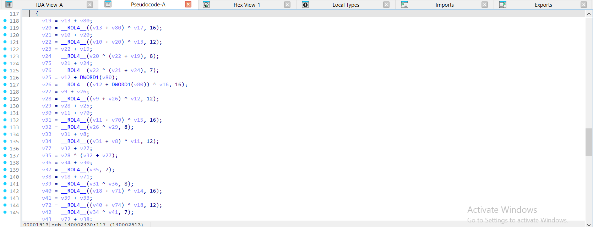

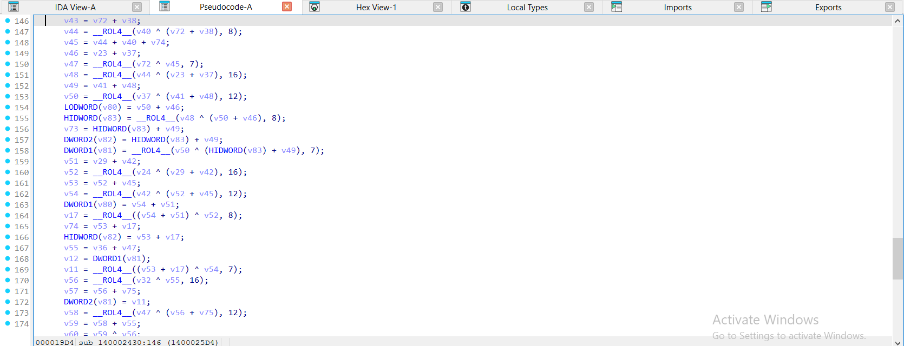

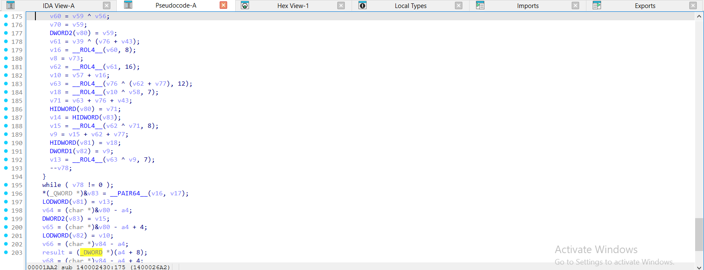

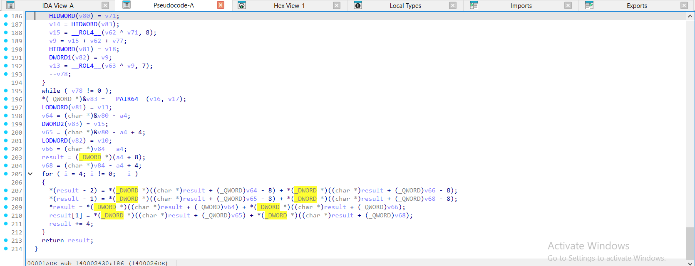

</details>

<details><summary>gcc -O2 – ELF, đã `strip -s` – chacha20_block = <code>sub_3A10</code> – 5 ảnh</summary>

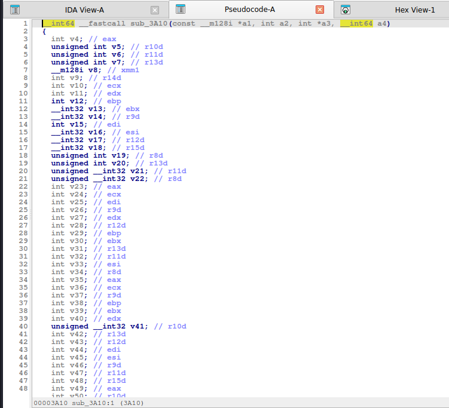

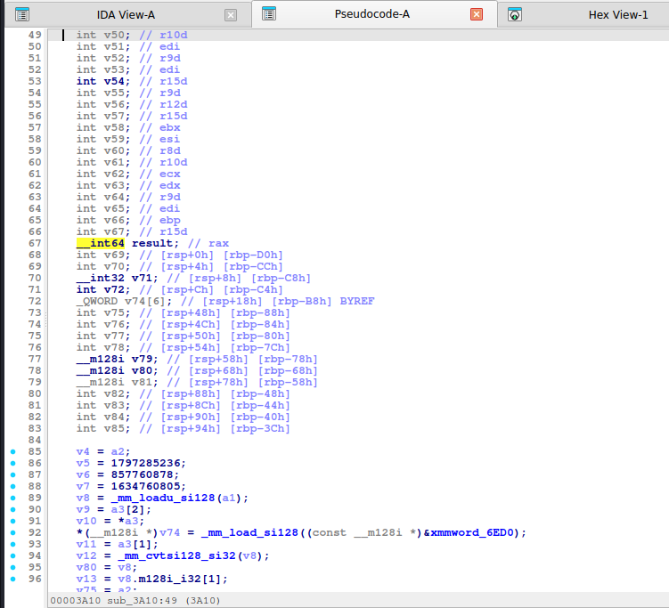

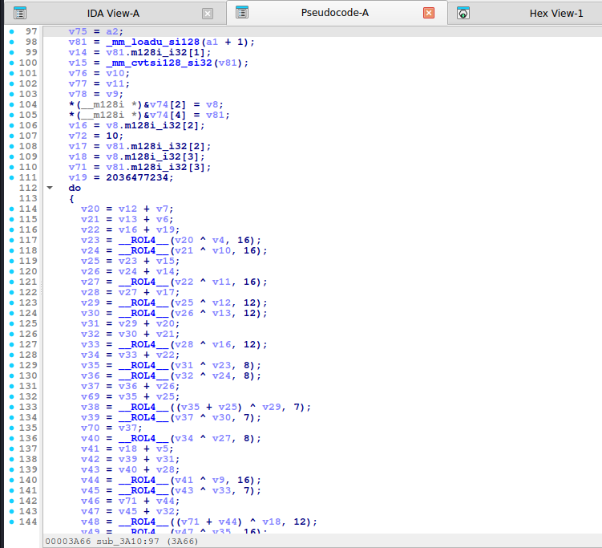

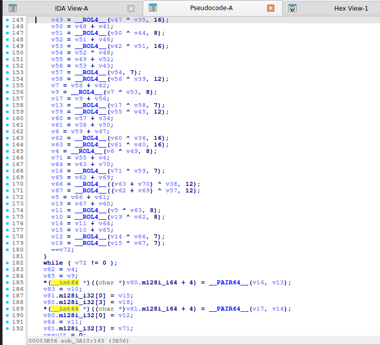

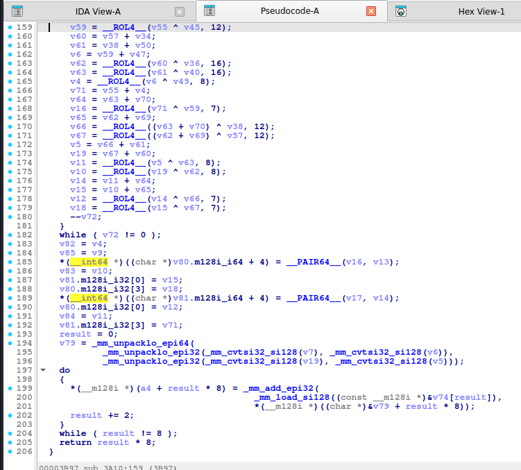

</details>

<details><summary>mingw-w64 -O2 -static – PE, đã `strip -s` – chacha20_block = <code>sub_140003090</code> – 5 ảnh</summary>

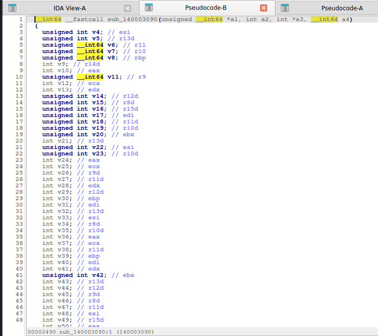

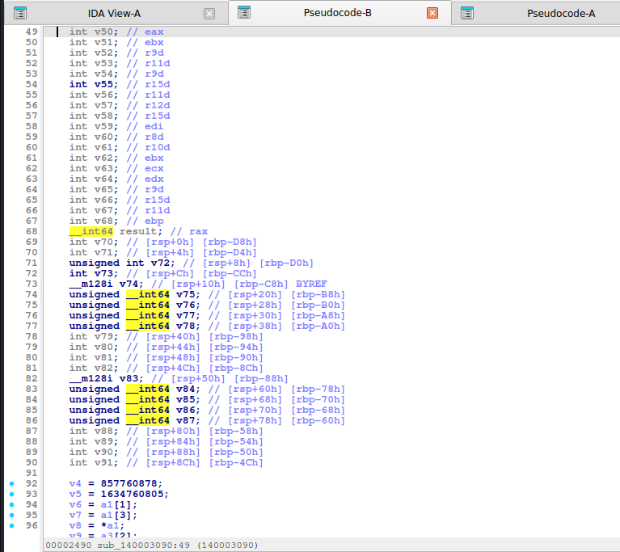

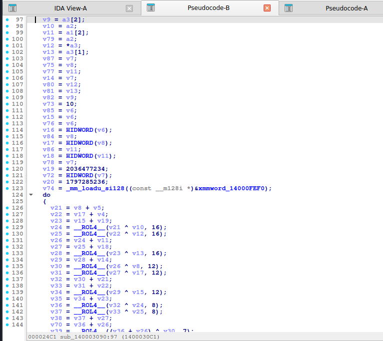

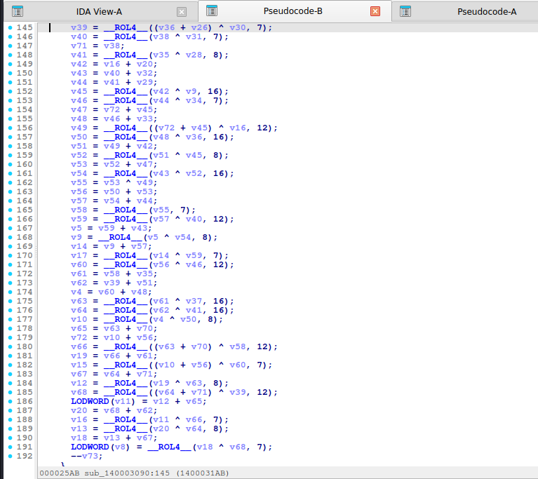

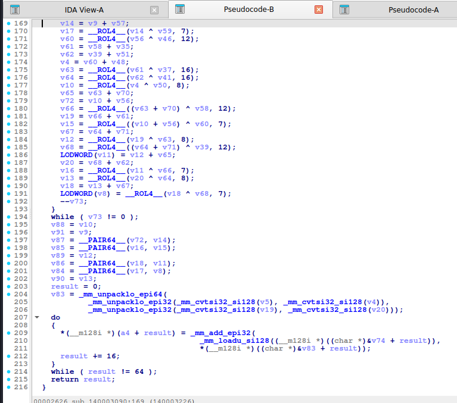

</details>

**Hàm XOR theo khối:**

<details><summary>MSVC /O2 - PE x64 (có PDB)</summary>

```c
void __fastcall chacha20_xor(const unsigned int *key, unsigned int *nonce, unsigned __int8 *buf, unsigned __int64 n)
{
  unsigned int v4; // r15d
  __int64 v5; // rsi
  char *v6; // rbx
  unsigned __int64 v8; // r14
  unsigned __int64 i; // r8
  unsigned __int64 v13; // rax
  unsigned __int8 *v14; // rdx
  __int64 v15; // [rsp+0h] [rbp-A8h] BYREF
  unsigned __int8 ks[64]; // [rsp+20h] [rbp-88h] BYREF

  if ( n != 0 )
  {
    v4 = 0;
    v5 = 2;
    v6 = (char *)&v15 + 31;
    v8 = ((n - 1) >> 6) + 1;
    do
    {
      chacha20_block(key, counter: v4, nonce, out: (char *)ks);
      for ( i = 0; i < 0x40; i += 4LL )
      {
        v13 = v5 + i;
        if ( v5 + i - 2 >= n )
          break;
        buf[v5 - 2 + i] ^= v6[v13 - 1];
        if ( v13 - 1 >= n )
          break;
        v14 = &buf[v5];
        buf[v5 - 1 + i] ^= v6[v13];
        if ( v13 >= n )
          break;
        v14[i] ^= v6[v13 + 1];
        if ( v13 + 1 >= n )
          break;
        v14[i + 1] ^= v6[v13 + 2];
      }
      v6 -= 64;
      v5 += 64;
      ++v4;
      --v8;
    }
    while ( v8 != 0 );
  }
}
```

</details>

<details><summary>MSVC /Od - PE x64 (có PDB)</summary>

```c
void __fastcall chacha20_xor(const unsigned int *key, unsigned int *nonce, unsigned __int8 *buf, unsigned __int64 n)
{
  unsigned int ctr; // [rsp+20h] [rbp-78h]
  unsigned __int64 i; // [rsp+28h] [rbp-70h]
  unsigned __int64 off; // [rsp+30h] [rbp-68h]
  unsigned __int8 ks[64]; // [rsp+40h] [rbp-58h] BYREF

  ctr = 0;
  for ( off = 0; off < n; off += 64LL )
  {
    chacha20_block(key, counter: ctr, nonce, out: ks);
    for ( i = 0; i < 0x40 && i + off < n; ++i )
      buf[i + off] ^= ks[i];
    ++ctr;
  }
}
```

</details>

<details><summary>gcc -O2 - ELF x86-64 (chưa strip)</summary>

```c
__int64 __fastcall chacha20_xor(const __m128i *a1, int *a2, __int64 a3, unsigned __int64 a4)
{
  unsigned __int64 v4; // r15
  int v6; // r12d
  _BYTE *v8; // r13
  unsigned __int64 v9; // rbx
  __int64 result; // rax
  _BYTE v13[120]; // [rsp+18h] [rbp-78h] BYREF

  if ( a4 != 0 )
  {
    v4 = 64;
    v6 = 0;
    v8 = v13;
    while ( 1 )
    {
      v9 = v4 - 64;
      result = chacha20_block(a1, a2: v6, a3: a2, a4: (__int64)v13);
      do
      {
        if ( v9 >= a4 )
          break;
        result = (unsigned __int8)v8[v9];
        *(_BYTE *)(a3 + v9++) ^= result;
      }
      while ( v9 != v4 );
      ++v6;
      v8 -= 64;
      if ( v4 >= a4 )
        break;
      v4 += 64LL;
    }
  }
  return result;
}
```

</details>

<details><summary>gcc -O0 - ELF x86-64 (chưa strip)</summary>

```c
unsigned __int64 __fastcall chacha20_xor(__int64 a1, __int64 a2, __int64 a3, unsigned __int64 a4)
{
  unsigned __int64 result; // rax
  _BYTE v9[72]; // [rsp+20h] [rbp-60h] BYREF
  unsigned __int64 i; // [rsp+68h] [rbp-18h]
  unsigned __int64 v11; // [rsp+70h] [rbp-10h]
  int v12; // [rsp+7Ch] [rbp-4h]

  v12 = 0;
  v11 = 0;
  while ( 1 )
  {
    result = v11;
    if ( v11 >= a4 )
      break;
    chacha20_block(a1, a2: v12, a3: a2, a4: (__int64)v9);
    for ( i = 0; i <= 0x3F && v11 + i < a4; ++i )
      *(_BYTE *)(i + v11 + a3) ^= v9[i];
    v11 += 64LL;
    ++v12;
  }
  return result;
}
```

</details>

<details><summary>mingw-w64 gcc -O2 - PE x64 (-static)</summary>

```c
__int64 __fastcall chacha20_xor(unsigned __int64 *a1, int *a2, __int64 a3, unsigned __int64 a4)
{
  _BYTE *v7; // r15
  unsigned __int64 v8; // rdi
  int v9; // r12d
  unsigned __int64 v10; // rbx
  __int64 result; // rax
  _BYTE v12[136]; // [rsp+20h] [rbp-88h] BYREF

  if ( a4 != 0 )
  {
    v7 = v12;
    v8 = 64;
    v9 = 0;
    while ( 1 )
    {
      v10 = v8 - 64;
      result = chacha20_block(a1, a2: v9, a3: a2, a4: (__int64)v12);
      do
      {
        if ( v10 >= a4 )
          break;
        result = (unsigned __int8)v7[v10];
        *(_BYTE *)(a3 + v10++) ^= result;
      }
      while ( v10 != v8 );
      ++v9;
      v7 -= 64;
      if ( v8 >= a4 )
        break;
      v8 += 64LL;
    }
  }
  return result;
}
```

</details>

<details><summary>mingw-w64 gcc -O0 - PE x64 (-static)</summary>

```c
unsigned __int64 __fastcall chacha20_xor(__int64 a1, __int64 a2, __int64 a3, unsigned __int64 a4)
{
  unsigned __int64 result; // rax
  _BYTE v5[72]; // [rsp+20h] [rbp-60h] BYREF
  unsigned __int64 i; // [rsp+68h] [rbp-18h]
  unsigned __int64 v7; // [rsp+70h] [rbp-10h]
  int v8; // [rsp+7Ch] [rbp-4h]

  v8 = 0;
  v7 = 0;
  while ( 1 )
  {
    result = v7;
    if ( v7 >= a4 )
      break;
    chacha20_block(a1, a2: v8, a3: a2, a4: (__int64)v5);
    for ( i = 0; i <= 0x3F && v7 + i < a4; ++i )
      *(_BYTE *)(i + v7 + a3) ^= v5[i];
    v7 += 64LL;
    ++v8;
  }
  return result;
}
```

</details>

**Bản strip (không symbol)** – IDA chỉ thấy `sub_XXXX`, `a1`, `a2`, `byte_XXXX`; hàm này tên là MSVC /O2 → `sub_1400027B0`, gcc -O2 → `sub_3CA0`, mingw-w64 -O2 -static → `sub_140003350`:

<details><summary>MSVC /O2 – PE x64, không PDB (strip) – bản STRIP: <code>chacha20_xor</code> = <code>sub_1400027B0</code></summary>

```c
void __fastcall sub_1400027B0(__int128 *a1, int *a2, __int64 a3, unsigned __int64 a4)
{
  unsigned int v4; // r15d
  __int64 v5; // rsi
  char *v6; // rbx
  unsigned __int64 v8; // r14
  unsigned __int64 i; // r8
  unsigned __int64 v13; // rax
  __int64 v14; // rdx
  __int64 v15; // [rsp+0h] [rbp-A8h] BYREF
  char v16; // [rsp+20h] [rbp-88h] BYREF

  if ( a4 != 0 )
  {
    v4 = 0;
    v5 = 2;
    v6 = (char *)&v15 + 31;
    v8 = ((a4 - 1) >> 6) + 1;
    do
    {
      sub_140002430(a1, a2: v4, a3: a2, a4: (__int64)&v16);
      for ( i = 0; i < 0x40; i += 4LL )
      {
        v13 = v5 + i;
        if ( v5 + i - 2 >= a4 )
          break;
        *(_BYTE *)(v5 + a3 + i - 2) ^= v6[v13 - 1];
        if ( v13 - 1 >= a4 )
          break;
        v14 = v5 + a3;
        *(_BYTE *)(v5 + a3 + i - 1) ^= v6[v13];
        if ( v13 >= a4 )
          break;
        *(_BYTE *)(v14 + i) ^= v6[v13 + 1];
        if ( v13 + 1 >= a4 )
          break;
        *(_BYTE *)(v14 + i + 1) ^= v6[v13 + 2];
      }
      v6 -= 64;
      v5 += 64;
      ++v4;
      --v8;
    }
    while ( v8 != 0 );
  }
}
```

</details>

<details><summary>gcc -O2 – ELF, đã `strip -s` – bản STRIP: <code>chacha20_xor</code> = <code>sub_3CA0</code></summary>

```c
__int64 __fastcall sub_3CA0(const __m128i *a1, int *a2, __int64 a3, unsigned __int64 a4)
{
  unsigned __int64 v4; // r15
  int v6; // r12d
  _BYTE *v8; // r13
  unsigned __int64 v9; // rbx
  __int64 result; // rax
  _BYTE v13[120]; // [rsp+18h] [rbp-78h] BYREF

  if ( a4 != 0 )
  {
    v4 = 64;
    v6 = 0;
    v8 = v13;
    while ( 1 )
    {
      v9 = v4 - 64;
      result = sub_3A10(a1, a2: v6, a3: a2, a4: (__int64)v13);
      do
      {
        if ( v9 >= a4 )
          break;
        result = (unsigned __int8)v8[v9];
        *(_BYTE *)(a3 + v9++) ^= result;
      }
      while ( v9 != v4 );
      ++v6;
      v8 -= 64;
      if ( v4 >= a4 )
        break;
      v4 += 64LL;
    }
  }
  return result;
}
```

</details>

<details><summary>mingw-w64 -O2 -static – PE, đã `strip -s` – bản STRIP: <code>chacha20_xor</code> = <code>sub_140003350</code></summary>

```c
__int64 __fastcall sub_140003350(unsigned __int64 *a1, int *a2, __int64 a3, unsigned __int64 a4)
{
  _BYTE *v7; // r15
  unsigned __int64 v8; // rdi
  int v9; // r12d
  unsigned __int64 v10; // rbx
  __int64 result; // rax
  _BYTE v12[136]; // [rsp+20h] [rbp-88h] BYREF

  if ( a4 != 0 )
  {
    v7 = v12;
    v8 = 64;
    v9 = 0;
    while ( 1 )
    {
      v10 = v8 - 64;
      result = sub_140003090(a1, a2: v9, a3: a2, a4: (__int64)v12);
      do
      {
        if ( v10 >= a4 )
          break;
        result = (unsigned __int8)v7[v10];
        *(_BYTE *)(a3 + v10++) ^= result;
      }
      while ( v10 != v8 );
      ++v9;
      v7 -= 64;
      if ( v8 >= a4 )
        break;
      v8 += 64LL;
    }
  }
  return result;
}
```

</details>

**Ảnh chụp màn hình IDA (bản strip)** – mở từng mục để xem; hàm dài chia thành nhiều trang, mỗi trang là một màn hình IDA:

<details><summary>MSVC /O2 – PE x64, không PDB (strip) – chacha20_xor = <code>sub_1400027B0</code> – 2 ảnh</summary>

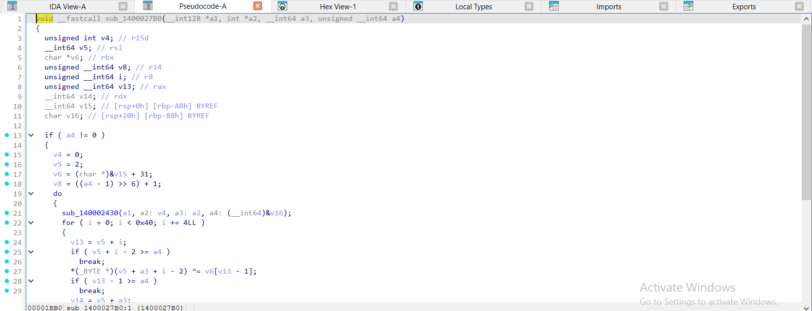

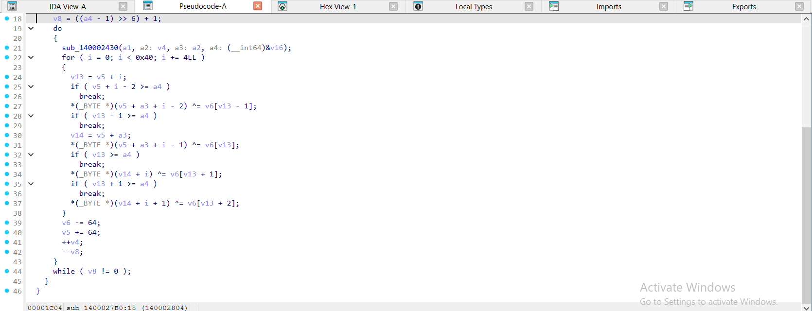

</details>

<details><summary>gcc -O2 – ELF, đã `strip -s` – chacha20_xor = <code>sub_3CA0</code> – 1 ảnh</summary>

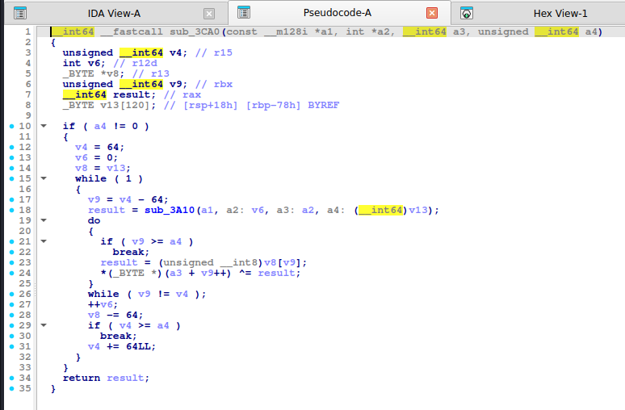

</details>

<details><summary>mingw-w64 -O2 -static – PE, đã `strip -s` – chacha20_xor = <code>sub_140003350</code> – 1 ảnh</summary>

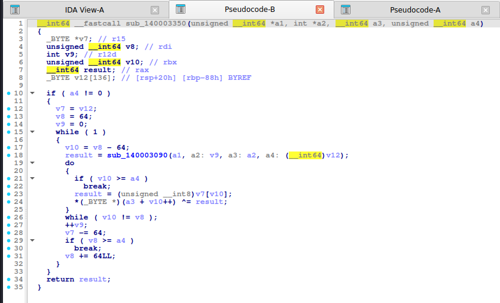

</details>

Nhận xét: **MSVC `/Od` không dùng `__ROL4__`**: mỗi phép xoay hiện thành **cặp dịch** `(x >> 16) | (x << 16)`, `(x >> 20) | (x << 12)`, `(x >> 24) | (x << 8)`, `(x >> 25) | (x << 7)` (hai lượng dịch cộng lại bằng 32). Các bản còn lại (gcc, mingw, MSVC `/O2`) hiện `__ROL4__(x, 16/12/8/7)`. gcc `-O2` bung cả 4 quarter-round liền nhau thành chuỗi `__ROL4__(.. ^ .., 16)` → `12` → `8` → `7` lặp, dùng ~50 biến cục bộ. Không cần đọc hết: **bốn hằng thập phân ở đầu**, **bốn mức xoay 16/12/8/7** và vòng `10` là đủ kết luận.

## 6. Code giải mã

**Python (thuần):**

```python
M32 = 0xFFFFFFFF
def rol32(x, k): return ((x << k) | (x >> (32 - k))) & M32


def _u32(b): return [int.from_bytes(b[i:i + 4], "little") for i in range(0, len(b), 4)]


def _p32(v): return b"".join(x.to_bytes(4, "little") for x in v)


def _chacha_block(key, counter, nonce):
    k = _u32(key)
    n = _u32(nonce)
    s = [0x61707865, 0x3320646E, 0x79622D32, 0x6B206574] + k + [counter] + n
    x = list(s)

    def qr(a, b, c, d):
        x[a] = (x[a] + x[b]) & M32; x[d] = rol32(x[d] ^ x[a], 16)
        x[c] = (x[c] + x[d]) & M32; x[b] = rol32(x[b] ^ x[c], 12)
        x[a] = (x[a] + x[b]) & M32; x[d] = rol32(x[d] ^ x[a], 8)
        x[c] = (x[c] + x[d]) & M32; x[b] = rol32(x[b] ^ x[c], 7)

    for _ in range(10):
        qr(0, 4, 8, 12); qr(1, 5, 9, 13); qr(2, 6, 10, 14); qr(3, 7, 11, 15)
        qr(0, 5, 10, 15); qr(1, 6, 11, 12); qr(2, 7, 8, 13); qr(3, 4, 9, 14)
    return _p32([(x[i] + s[i]) & M32 for i in range(16)])


def chacha20_xor(key, nonce12, data, counter=0):
    out = bytearray()
    for off in range(0, len(data), 64):
        ks = _chacha_block(key, counter + off // 64, nonce12)
        out += bytes(a ^ b for a, b in zip(data[off:off + 64], ks))
    return bytes(out)
```

```python
chacha20_xor(bytes(range(32)), bytes(range(12)), bytes.fromhex("585f9d7daea774de4046eac22e05a3ddf4bcbea9"))
# b'Hello, CyberSeaGame!'
```

**Python (thư viện):** `ChaCha20.new(key=key, nonce=nonce12).decrypt(ct)` (PyCryptodome; với nonce 8 byte là bản gốc 64-bit counter).

**C:** `ctf_chacha20_xor` trong [`code/ctfdec.h`](../code/ctfdec.h).

## 7. Biến thể & bẫy

- **IETF (nonce 12 byte, counter 32-bit)** vs **gốc (nonce 8 byte, counter 64-bit)**: khác cách bố trí `s[12..15]`.
- **Counter đầu = 1** (RFC 8439 khi dùng với Poly1305).
- **XChaCha20** dùng nonce 24 byte và hàm HChaCha20 tạo subkey.
- **Số vòng 8/12** (ChaCha8/12) – đổi `10` thành `4`/`6` trong vòng ngoài.
- Hằng "expand 16-byte k" (`0x61707865 0x3120646E 0x79622D36 0x6B206574`) khi khóa 128-bit.
