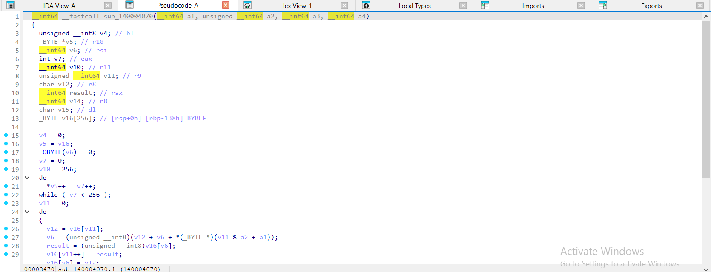
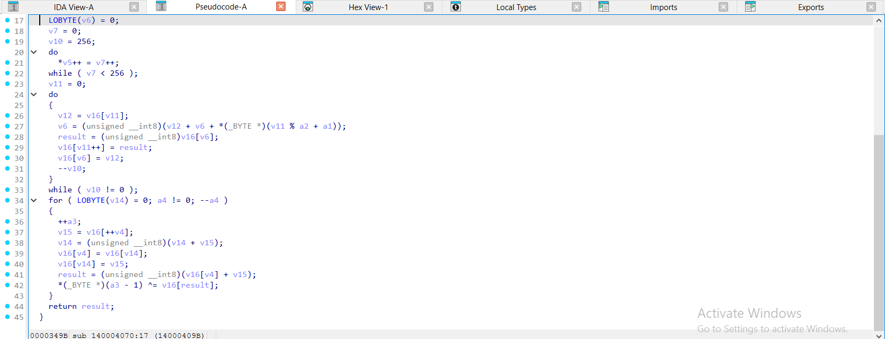
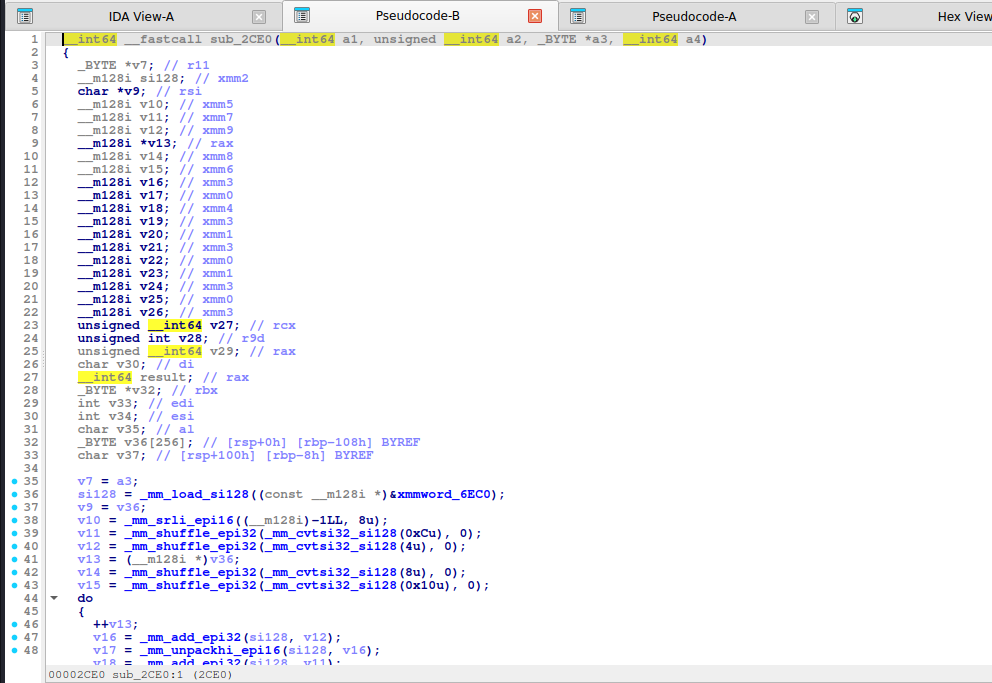
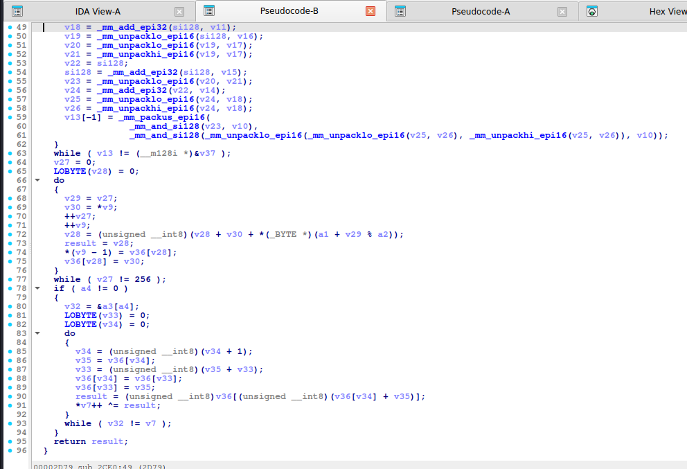
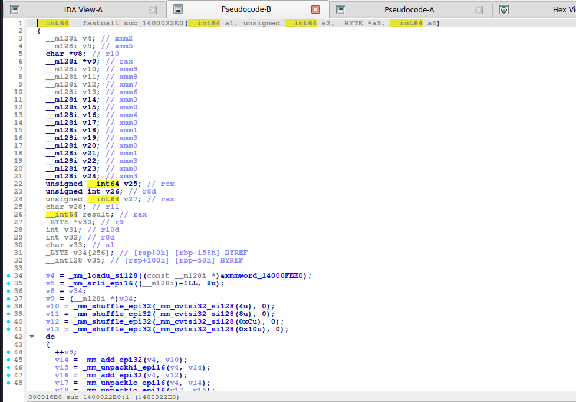

# RC4

> Mã dòng (stream cipher) khóa 1–256 byte. Trạng thái là **mảng hoán vị S[256]**. Mã hóa và giải mã giống hệt nhau (XOR với keystream).

## 1. Dấu hiệu nhận biết

- Mảng **256 byte** (`_BYTE v5[256]`, hoặc `v36[256]`) khởi tạo **`S[i] = i`** cho `i = 0..255`. Ở gcc `-O2` vòng này bị vector hóa bằng SSE (`_mm_add_epi32`, `_mm_packus_epi16` … điền 16 byte/lần) – cứ thấy khối SSE lạ ngay đầu hàm cùng mảng 256 byte là RC4.
- **KSA** (key scheduling): vòng `i = 0..255`, `j = (j + S[i] + key[i % keylen]) & 255`, rồi **hoán vị `S[i]` và `S[j]`**.
- **PRGA**: `i = (i + 1) & 255; j = (j + S[i]) & 255; swap(S[i], S[j]); out = S[(S[i] + S[j]) & 255]`.
- Toàn bộ chỉ có **`& 255`** (hiện thành `(unsigned __int8)(...)` ép kiểu byte), không có hằng số lạ nào. Chữ ký là **ba vòng lặp** (init, KSA, PRGA) và phép **`i % key_len`**.
- Dữ liệu vào/ra cùng kích thước, `buf[k] ^= keystream`.
- Chương trình hay dùng RC4 để giấu flag: ciphertext là mảng hằng + key chuỗi ngắn trong `.rdata`.

## 2. Thuật toán (mã giả)

```
S = [0..255]; j = 0
for i in 0..255:
    j = (j + S[i] + key[i % len(key)]) & 255
    swap(S[i], S[j])
i = j = 0
for mỗi byte p:
    i = (i + 1) & 255
    j = (j + S[i]) & 255
    swap(S[i], S[j])
    out = p ^ S[(S[i] + S[j]) & 255]
```

## 3. Mã hóa / giải mã

Cùng một hàm: `rc4(key, data)` cho cả hai chiều. Điều cần tìm là **key** (chuỗi ngắn, đôi khi sinh bằng phép biến đổi trước khi vào KSA). Khi không có key: nếu biết một đoạn plaintext (known-plaintext) thì `keystream = cipher ^ plain` nhưng RC4 key không suy ngược từ keystream dễ dàng, cần tìm key trong binary.

## 4. Mã nguồn gốc (C)

```c
void rc4_crypt(const uint8_t *key, size_t kl, uint8_t *buf, size_t n)
{
    uint8_t S[256], t;
    int i, j = 0;
    for (i = 0; i < 256; i++) S[i] = (uint8_t)i;
    for (i = 0; i < 256; i++) {
        j = (j + S[i] + key[i % kl]) & 255;
        t = S[i]; S[i] = S[j]; S[j] = t;
    }
    i = 0; j = 0;
    for (size_t k = 0; k < n; k++) {
        i = (i + 1) & 255;
        j = (j + S[i]) & 255;
        t = S[i]; S[i] = S[j]; S[j] = t;
        buf[k] ^= S[(S[i] + S[j]) & 255];
    }
}
```

## 5. Pseudo-code IDA thực tế

<details><summary>MSVC /O2 - PE x64 (có PDB)</summary>

```c
void __fastcall rc4_crypt(const unsigned __int8 *key, unsigned __int64 kl, unsigned __int8 *buf, unsigned __int64 n)
{
  unsigned __int8 v4; // bl
  unsigned __int8 *v5; // r10
  __int64 v6; // rsi
  int v7; // eax
  __int64 v10; // r11
  unsigned __int64 v11; // r9
  unsigned __int8 v12; // r8
  __int64 v13; // r8
  unsigned __int8 v14; // dl
  unsigned __int8 S[256]; // [rsp+0h] [rbp-138h] BYREF

  v4 = 0;
  v5 = S;
  LOBYTE(v6) = 0;
  v7 = 0;
  v10 = 256;
  do
    *v5++ = v7++;
  while ( v7 < 256 );
  v11 = 0;
  do
  {
    v12 = S[v11];
    v6 = (unsigned __int8)(v12 + v6 + key[v11 % kl]);
    S[v11++] = S[v6];
    S[v6] = v12;
    --v10;
  }
  while ( v10 != 0 );
  for ( LOBYTE(v13) = 0; n != 0; --n )
  {
    ++buf;
    v14 = S[++v4];
    v13 = (unsigned __int8)(v13 + v14);
    S[v4] = S[v13];
    S[v13] = v14;
    *(buf - 1) ^= S[(unsigned __int8)(S[v4] + v14)];
  }
}
```

</details>

<details><summary>MSVC /Od - PE x64 (có PDB)</summary>

```c
void __fastcall rc4_crypt(const unsigned __int8 *key, unsigned __int64 kl, unsigned __int8 *buf, unsigned __int64 n)
{
  unsigned __int64 v4; // rdx
  int i; // [rsp+0h] [rbp-138h]
  int ia; // [rsp+0h] [rbp-138h]
  int ib; // [rsp+0h] [rbp-138h]
  unsigned __int8 t; // [rsp+4h] [rbp-134h]
  unsigned __int8 ta; // [rsp+4h] [rbp-134h]
  int j; // [rsp+8h] [rbp-130h]
  int ja; // [rsp+8h] [rbp-130h]
  unsigned __int64 k; // [rsp+10h] [rbp-128h]
  char v13; // [rsp+18h] [rbp-120h]
  unsigned __int8 S[256]; // [rsp+20h] [rbp-118h]

  LOBYTE(j) = 0;
  for ( i = 0; i < 256; ++i )
    S[i] = i;
  for ( ia = 0; ia < 256; ++ia )
  {
    v13 = S[ia] + j;
    v4 = ia % kl;
    j = (unsigned __int8)(key[v4] + v13);
    t = S[ia];
    S[ia] = S[(unsigned __int8)(key[v4] + v13)];
    S[j] = t;
  }
  LOBYTE(ib) = 0;
  LOBYTE(ja) = 0;
  for ( k = 0; k < n; ++k )
  {
    ib = (unsigned __int8)(ib + 1);
    ja = (unsigned __int8)(S[ib] + ja);
    ta = S[ib];
    S[ib] = S[ja];
    S[ja] = ta;
    buf[k] ^= S[(unsigned __int8)(S[ja] + S[ib])];
  }
}
```

</details>

<details><summary>gcc -O2 - ELF x86-64 (chưa strip)</summary>

```c
__int64 __fastcall rc4_crypt(__int64 a1, unsigned __int64 a2, _BYTE *a3, __int64 a4)
{
  _BYTE *v7; // r11
  __m128i si128; // xmm2
  char *v9; // rsi
  __m128i v10; // xmm5
  __m128i v11; // xmm7
  __m128i v12; // xmm9
  __m128i *v13; // rax
  __m128i v14; // xmm8
  __m128i v15; // xmm6
  __m128i v16; // xmm3
  __m128i v17; // xmm0
  __m128i v18; // xmm4
  __m128i v19; // xmm3
  __m128i v20; // xmm1
  __m128i v21; // xmm3
  __m128i v22; // xmm0
  __m128i v23; // xmm1
  __m128i v24; // xmm3
  __m128i v25; // xmm0
  __m128i v26; // xmm3
  unsigned __int64 v27; // rcx
  unsigned int v28; // r9d
  unsigned __int64 v29; // rax
  char v30; // di
  __int64 result; // rax
  _BYTE *v32; // rbx
  int v33; // edi
  int v34; // esi
  char v35; // al
  _BYTE v36[256]; // [rsp+0h] [rbp-108h] BYREF
  char v37; // [rsp+100h] [rbp-8h] BYREF

  v7 = a3;
  si128 = _mm_load_si128((const __m128i *)&xmmword_6EC0);
  v9 = v36;
  v10 = _mm_srli_epi16((__m128i)-1LL, 8u);
  v11 = _mm_shuffle_epi32(_mm_cvtsi32_si128(0xCu), 0);
  v12 = _mm_shuffle_epi32(_mm_cvtsi32_si128(4u), 0);
  v13 = (__m128i *)v36;
  v14 = _mm_shuffle_epi32(_mm_cvtsi32_si128(8u), 0);
  v15 = _mm_shuffle_epi32(_mm_cvtsi32_si128(0x10u), 0);
  do
  {
    ++v13;
    v16 = _mm_add_epi32(si128, v12);
    v17 = _mm_unpackhi_epi16(si128, v16);
    v18 = _mm_add_epi32(si128, v11);
    v19 = _mm_unpacklo_epi16(si128, v16);
    v20 = _mm_unpacklo_epi16(v19, v17);
    v21 = _mm_unpackhi_epi16(v19, v17);
    v22 = si128;
    si128 = _mm_add_epi32(si128, v15);
    v23 = _mm_unpacklo_epi16(v20, v21);
    v24 = _mm_add_epi32(v22, v14);
    v25 = _mm_unpacklo_epi16(v24, v18);
    v26 = _mm_unpackhi_epi16(v24, v18);
    v13[-1] = _mm_packus_epi16(
                _mm_and_si128(v23, v10),
                _mm_and_si128(_mm_unpacklo_epi16(_mm_unpacklo_epi16(v25, v26), _mm_unpackhi_epi16(v25, v26)), v10));
  }
  while ( v13 != (__m128i *)&v37 );
  v27 = 0;
  LOBYTE(v28) = 0;
  do
  {
    v29 = v27;
    v30 = *v9;
    ++v27;
    ++v9;
    v28 = (unsigned __int8)(v28 + v30 + *(_BYTE *)(a1 + v29 % a2));
    result = v28;
    *(v9 - 1) = v36[v28];
    v36[v28] = v30;
  }
  while ( v27 != 256 );
  if ( a4 != 0 )
  {
    v32 = &a3[a4];
    LOBYTE(v33) = 0;
    LOBYTE(v34) = 0;
    do
    {
      v34 = (unsigned __int8)(v34 + 1);
      v35 = v36[v34];
      v33 = (unsigned __int8)(v35 + v33);
      v36[v34] = v36[v33];
      v36[v33] = v35;
      result = (unsigned __int8)v36[(unsigned __int8)(v36[v34] + v35)];
      *v7++ ^= result;
    }
    while ( v32 != v7 );
  }
  return result;
}
```

</details>

<details><summary>gcc -O0 - ELF x86-64 (chưa strip)</summary>

```c
unsigned __int64 __fastcall rc4_crypt(__int64 a1, unsigned __int64 a2, __int64 a3, unsigned __int64 a4)
{
  unsigned __int64 result; // rax
  _BYTE v5[271]; // [rsp+20h] [rbp-120h]
  char v6; // [rsp+12Fh] [rbp-11h]
  unsigned __int64 j; // [rsp+130h] [rbp-10h]
  int v8; // [rsp+138h] [rbp-8h]
  int i; // [rsp+13Ch] [rbp-4h]

  v8 = 0;
  for ( i = 0; i <= 255; ++i )
    v5[i] = i;
  for ( i = 0; i <= 255; ++i )
  {
    v8 = (unsigned __int8)(v5[i] + v8 + *(_BYTE *)(i % a2 + a1));
    v6 = v5[i];
    v5[i] = v5[v8];
    v5[v8] = v6;
  }
  i = 0;
  v8 = 0;
  for ( j = 0; ; ++j )
  {
    result = j;
    if ( j >= a4 )
      break;
    i = (unsigned __int8)(i + 1);
    v8 = (unsigned __int8)(v5[i] + v8);
    v6 = v5[i];
    v5[i] = v5[v8];
    v5[v8] = v6;
    *(_BYTE *)(a3 + j) ^= v5[(unsigned __int8)(v5[i] + v5[v8])];
  }
  return result;
}
```

</details>

<details><summary>mingw-w64 gcc -O2 - PE x64 (-static)</summary>

```c
__int64 __fastcall rc4_crypt(__int64 a1, unsigned __int64 a2, _BYTE *a3, __int64 a4)
{
  __m128i v4; // xmm2
  __m128i v5; // xmm5
  char *v8; // r10
  __m128i *v9; // rax
  __m128i v10; // xmm9
  __m128i v11; // xmm8
  __m128i v12; // xmm7
  __m128i v13; // xmm6
  __m128i v14; // xmm3
  __m128i v15; // xmm0
  __m128i v16; // xmm4
  __m128i v17; // xmm3
  __m128i v18; // xmm1
  __m128i v19; // xmm3
  __m128i v20; // xmm0
  __m128i v21; // xmm1
  __m128i v22; // xmm3
  __m128i v23; // xmm0
  __m128i v24; // xmm3
  unsigned __int64 v25; // rcx
  unsigned int v26; // r8d
  unsigned __int64 v27; // rax
  char v28; // r11
  __int64 result; // rax
  _BYTE *v30; // r9
  int v31; // r10d
  int v32; // r8d
  char v33; // al
  _BYTE v34[256]; // [rsp+0h] [rbp-158h] BYREF
  __int128 v35; // [rsp+100h] [rbp-58h] BYREF

  v4 = _mm_loadu_si128((const __m128i *)&xmmword_14000FEE0);
  v5 = _mm_srli_epi16((__m128i)-1LL, 8u);
  v8 = v34;
  v9 = (__m128i *)v34;
  v10 = _mm_shuffle_epi32(_mm_cvtsi32_si128(4u), 0);
  v11 = _mm_shuffle_epi32(_mm_cvtsi32_si128(8u), 0);
  v12 = _mm_shuffle_epi32(_mm_cvtsi32_si128(0xCu), 0);
  v13 = _mm_shuffle_epi32(_mm_cvtsi32_si128(0x10u), 0);
  do
  {
    ++v9;
    v14 = _mm_add_epi32(v4, v10);
    v15 = _mm_unpackhi_epi16(v4, v14);
    v16 = _mm_add_epi32(v4, v12);
    v17 = _mm_unpacklo_epi16(v4, v14);
    v18 = _mm_unpacklo_epi16(v17, v15);
    v19 = _mm_unpackhi_epi16(v17, v15);
    v20 = v4;
    v4 = _mm_add_epi32(v4, v13);
    v21 = _mm_unpacklo_epi16(v18, v19);
    v22 = _mm_add_epi32(v20, v11);
    v23 = _mm_unpacklo_epi16(v22, v16);
    v24 = _mm_unpackhi_epi16(v22, v16);
    v9[-1] = _mm_packus_epi16(
               _mm_and_si128(v21, v5),
               _mm_and_si128(_mm_unpacklo_epi16(_mm_unpacklo_epi16(v23, v24), _mm_unpackhi_epi16(v23, v24)), v5));
  }
  while ( v9 != (__m128i *)&v35 );
  v25 = 0;
  LOBYTE(v26) = 0;
  do
  {
    v27 = v25;
    v28 = *v8;
    ++v25;
    ++v8;
    v26 = (unsigned __int8)(v26 + v28 + *(_BYTE *)(a1 + v27 % a2));
    result = v26;
    *(v8 - 1) = v34[v26];
    v34[v26] = v28;
  }
  while ( v25 != 256 );
  if ( a4 != 0 )
  {
    v30 = &a3[a4];
    LOBYTE(v31) = 0;
    LOBYTE(v32) = 0;
    do
    {
      v32 = (unsigned __int8)(v32 + 1);
      v33 = v34[v32];
      v31 = (unsigned __int8)(v33 + v31);
      v34[v32] = v34[v31];
      v34[v31] = v33;
      result = (unsigned __int8)v34[(unsigned __int8)(v34[v32] + v33)];
      *a3++ ^= result;
    }
    while ( v30 != a3 );
  }
  return result;
}
```

</details>

<details><summary>mingw-w64 gcc -O0 - PE x64 (-static)</summary>

```c
unsigned __int64 __fastcall rc4_crypt(__int64 a1, unsigned __int64 a2, __int64 a3, unsigned __int64 a4)
{
  unsigned __int64 result; // rax
  _BYTE v5[271]; // [rsp+0h] [rbp-80h]
  char v6; // [rsp+10Fh] [rbp+8Fh]
  unsigned __int64 j; // [rsp+110h] [rbp+90h]
  int v8; // [rsp+118h] [rbp+98h]
  int i; // [rsp+11Ch] [rbp+9Ch]

  v8 = 0;
  for ( i = 0; i <= 255; ++i )
    v5[i] = i;
  for ( i = 0; i <= 255; ++i )
  {
    v8 = (unsigned __int8)(v5[i] + v8 + *(_BYTE *)(i % a2 + a1));
    v6 = v5[i];
    v5[i] = v5[v8];
    v5[v8] = v6;
  }
  i = 0;
  v8 = 0;
  for ( j = 0; ; ++j )
  {
    result = j;
    if ( j >= a4 )
      break;
    i = (unsigned __int8)(i + 1);
    v8 = (unsigned __int8)(v5[i] + v8);
    v6 = v5[i];
    v5[i] = v5[v8];
    v5[v8] = v6;
    *(_BYTE *)(a3 + j) ^= v5[(unsigned __int8)(v5[i] + v5[v8])];
  }
  return result;
}
```

</details>

**Bản strip (không symbol)** – IDA chỉ thấy `sub_XXXX`, `a1`, `a2`, `byte_XXXX`; hàm này tên là MSVC /O2 → `sub_140004070`, gcc -O2 → `sub_2CE0`, mingw-w64 -O2 -static → `sub_1400022E0`:

<details><summary>MSVC /O2 – PE x64, không PDB (strip) – bản STRIP: <code>rc4_crypt</code> = <code>sub_140004070</code></summary>

```c
__int64 __fastcall sub_140004070(__int64 a1, unsigned __int64 a2, __int64 a3, __int64 a4)
{
  unsigned __int8 v4; // bl
  _BYTE *v5; // r10
  __int64 v6; // rsi
  int v7; // eax
  __int64 v10; // r11
  unsigned __int64 v11; // r9
  char v12; // r8
  __int64 result; // rax
  __int64 v14; // r8
  char v15; // dl
  _BYTE v16[256]; // [rsp+0h] [rbp-138h] BYREF

  v4 = 0;
  v5 = v16;
  LOBYTE(v6) = 0;
  v7 = 0;
  v10 = 256;
  do
    *v5++ = v7++;
  while ( v7 < 256 );
  v11 = 0;
  do
  {
    v12 = v16[v11];
    v6 = (unsigned __int8)(v12 + v6 + *(_BYTE *)(v11 % a2 + a1));
    result = (unsigned __int8)v16[v6];
    v16[v11++] = result;
    v16[v6] = v12;
    --v10;
  }
  while ( v10 != 0 );
  for ( LOBYTE(v14) = 0; a4 != 0; --a4 )
  {
    ++a3;
    v15 = v16[++v4];
    v14 = (unsigned __int8)(v14 + v15);
    v16[v4] = v16[v14];
    v16[v14] = v15;
    result = (unsigned __int8)(v16[v4] + v15);
    *(_BYTE *)(a3 - 1) ^= v16[result];
  }
  return result;
}
```

</details>

<details><summary>gcc -O2 – ELF, đã `strip -s` – bản STRIP: <code>rc4_crypt</code> = <code>sub_2CE0</code></summary>

```c
__int64 __fastcall sub_2CE0(__int64 a1, unsigned __int64 a2, _BYTE *a3, __int64 a4)
{
  _BYTE *v7; // r11
  __m128i si128; // xmm2
  char *v9; // rsi
  __m128i v10; // xmm5
  __m128i v11; // xmm7
  __m128i v12; // xmm9
  __m128i *v13; // rax
  __m128i v14; // xmm8
  __m128i v15; // xmm6
  __m128i v16; // xmm3
  __m128i v17; // xmm0
  __m128i v18; // xmm4
  __m128i v19; // xmm3
  __m128i v20; // xmm1
  __m128i v21; // xmm3
  __m128i v22; // xmm0
  __m128i v23; // xmm1
  __m128i v24; // xmm3
  __m128i v25; // xmm0
  __m128i v26; // xmm3
  unsigned __int64 v27; // rcx
  unsigned int v28; // r9d
  unsigned __int64 v29; // rax
  char v30; // di
  __int64 result; // rax
  _BYTE *v32; // rbx
  int v33; // edi
  int v34; // esi
  char v35; // al
  _BYTE v36[256]; // [rsp+0h] [rbp-108h] BYREF
  char v37; // [rsp+100h] [rbp-8h] BYREF

  v7 = a3;
  si128 = _mm_load_si128((const __m128i *)&xmmword_6EC0);
  v9 = v36;
  v10 = _mm_srli_epi16((__m128i)-1LL, 8u);
  v11 = _mm_shuffle_epi32(_mm_cvtsi32_si128(0xCu), 0);
  v12 = _mm_shuffle_epi32(_mm_cvtsi32_si128(4u), 0);
  v13 = (__m128i *)v36;
  v14 = _mm_shuffle_epi32(_mm_cvtsi32_si128(8u), 0);
  v15 = _mm_shuffle_epi32(_mm_cvtsi32_si128(0x10u), 0);
  do
  {
    ++v13;
    v16 = _mm_add_epi32(si128, v12);
    v17 = _mm_unpackhi_epi16(si128, v16);
    v18 = _mm_add_epi32(si128, v11);
    v19 = _mm_unpacklo_epi16(si128, v16);
    v20 = _mm_unpacklo_epi16(v19, v17);
    v21 = _mm_unpackhi_epi16(v19, v17);
    v22 = si128;
    si128 = _mm_add_epi32(si128, v15);
    v23 = _mm_unpacklo_epi16(v20, v21);
    v24 = _mm_add_epi32(v22, v14);
    v25 = _mm_unpacklo_epi16(v24, v18);
    v26 = _mm_unpackhi_epi16(v24, v18);
    v13[-1] = _mm_packus_epi16(
                _mm_and_si128(v23, v10),
                _mm_and_si128(_mm_unpacklo_epi16(_mm_unpacklo_epi16(v25, v26), _mm_unpackhi_epi16(v25, v26)), v10));
  }
  while ( v13 != (__m128i *)&v37 );
  v27 = 0;
  LOBYTE(v28) = 0;
  do
  {
    v29 = v27;
    v30 = *v9;
    ++v27;
    ++v9;
    v28 = (unsigned __int8)(v28 + v30 + *(_BYTE *)(a1 + v29 % a2));
    result = v28;
    *(v9 - 1) = v36[v28];
    v36[v28] = v30;
  }
  while ( v27 != 256 );
  if ( a4 != 0 )
  {
    v32 = &a3[a4];
    LOBYTE(v33) = 0;
    LOBYTE(v34) = 0;
    do
    {
      v34 = (unsigned __int8)(v34 + 1);
      v35 = v36[v34];
      v33 = (unsigned __int8)(v35 + v33);
      v36[v34] = v36[v33];
      v36[v33] = v35;
      result = (unsigned __int8)v36[(unsigned __int8)(v36[v34] + v35)];
      *v7++ ^= result;
    }
    while ( v32 != v7 );
  }
  return result;
}
```

</details>

<details><summary>mingw-w64 -O2 -static – PE, đã `strip -s` – bản STRIP: <code>rc4_crypt</code> = <code>sub_1400022E0</code></summary>

```c
__int64 __fastcall sub_1400022E0(__int64 a1, unsigned __int64 a2, _BYTE *a3, __int64 a4)
{
  __m128i v4; // xmm2
  __m128i v5; // xmm5
  char *v8; // r10
  __m128i *v9; // rax
  __m128i v10; // xmm9
  __m128i v11; // xmm8
  __m128i v12; // xmm7
  __m128i v13; // xmm6
  __m128i v14; // xmm3
  __m128i v15; // xmm0
  __m128i v16; // xmm4
  __m128i v17; // xmm3
  __m128i v18; // xmm1
  __m128i v19; // xmm3
  __m128i v20; // xmm0
  __m128i v21; // xmm1
  __m128i v22; // xmm3
  __m128i v23; // xmm0
  __m128i v24; // xmm3
  unsigned __int64 v25; // rcx
  unsigned int v26; // r8d
  unsigned __int64 v27; // rax
  char v28; // r11
  __int64 result; // rax
  _BYTE *v30; // r9
  int v31; // r10d
  int v32; // r8d
  char v33; // al
  _BYTE v34[256]; // [rsp+0h] [rbp-158h] BYREF
  __int128 v35; // [rsp+100h] [rbp-58h] BYREF

  v4 = _mm_loadu_si128((const __m128i *)&xmmword_14000FEE0);
  v5 = _mm_srli_epi16((__m128i)-1LL, 8u);
  v8 = v34;
  v9 = (__m128i *)v34;
  v10 = _mm_shuffle_epi32(_mm_cvtsi32_si128(4u), 0);
  v11 = _mm_shuffle_epi32(_mm_cvtsi32_si128(8u), 0);
  v12 = _mm_shuffle_epi32(_mm_cvtsi32_si128(0xCu), 0);
  v13 = _mm_shuffle_epi32(_mm_cvtsi32_si128(0x10u), 0);
  do
  {
    ++v9;
    v14 = _mm_add_epi32(v4, v10);
    v15 = _mm_unpackhi_epi16(v4, v14);
    v16 = _mm_add_epi32(v4, v12);
    v17 = _mm_unpacklo_epi16(v4, v14);
    v18 = _mm_unpacklo_epi16(v17, v15);
    v19 = _mm_unpackhi_epi16(v17, v15);
    v20 = v4;
    v4 = _mm_add_epi32(v4, v13);
    v21 = _mm_unpacklo_epi16(v18, v19);
    v22 = _mm_add_epi32(v20, v11);
    v23 = _mm_unpacklo_epi16(v22, v16);
    v24 = _mm_unpackhi_epi16(v22, v16);
    v9[-1] = _mm_packus_epi16(
               _mm_and_si128(v21, v5),
               _mm_and_si128(_mm_unpacklo_epi16(_mm_unpacklo_epi16(v23, v24), _mm_unpackhi_epi16(v23, v24)), v5));
  }
  while ( v9 != (__m128i *)&v35 );
  v25 = 0;
  LOBYTE(v26) = 0;
  do
  {
    v27 = v25;
    v28 = *v8;
    ++v25;
    ++v8;
    v26 = (unsigned __int8)(v26 + v28 + *(_BYTE *)(a1 + v27 % a2));
    result = v26;
    *(v8 - 1) = v34[v26];
    v34[v26] = v28;
  }
  while ( v25 != 256 );
  if ( a4 != 0 )
  {
    v30 = &a3[a4];
    LOBYTE(v31) = 0;
    LOBYTE(v32) = 0;
    do
    {
      v32 = (unsigned __int8)(v32 + 1);
      v33 = v34[v32];
      v31 = (unsigned __int8)(v33 + v31);
      v34[v32] = v34[v31];
      v34[v31] = v33;
      result = (unsigned __int8)v34[(unsigned __int8)(v34[v32] + v33)];
      *a3++ ^= result;
    }
    while ( v30 != a3 );
  }
  return result;
}
```

</details>

**Ảnh chụp màn hình IDA (bản strip)** – mở từng mục để xem; hàm dài chia thành nhiều trang, mỗi trang là một màn hình IDA:

<details><summary>MSVC /O2 – PE x64, không PDB (strip) – rc4_crypt = <code>sub_140004070</code> – 2 ảnh</summary>





</details>

<details><summary>gcc -O2 – ELF, đã `strip -s` – rc4_crypt = <code>sub_2CE0</code> – 2 ảnh</summary>





</details>

<details><summary>mingw-w64 -O2 -static – PE, đã `strip -s` – rc4_crypt = <code>sub_1400022E0</code> – 2 ảnh</summary>




</details>

Nhận xét:

- `-O0`: dễ đọc, có đủ ba vòng `for`. Biến `v5[271]` (kích thước lớn hơn 256 do căn lề stack) là mảng S.
- gcc `-O2`: vòng khởi tạo S thành khối SSE dài; KSA gọn: `v28 = (unsigned __int8)(v28 + v30 + *(_BYTE *)(a1 + v29 % a2))` rồi `swap`. Nhận biết bằng `% a2` (độ dài key) và `& 0xFF` ngầm (`(unsigned __int8)`).
- MSVC `/Od` và `/O2`: dễ đọc hơn gcc `-O2`: `S[256]` khởi tạo bằng `do *v5++ = v7++; while ( v7 < 256 )`, KSA có **`key[v11 % kl]`** và hoán vị qua biến tạm, PRGA `buf[k] ^= S[(unsigned __int8)(S[ja] + S[ib])]` (MSVC `/O2`: `*(buf - 1) ^= S[(unsigned __int8)(S[v4] + v14)]`).
- Tên tham số: `(key, keylen, buf, n)`; hàm trả/viết đè trực tiếp lên `buf`.

## 6. Code giải mã

**Python:**

```python
def rc4(key, data):
    """RC4 (ma hoa va giai ma giong het nhau)."""
    S = list(range(256))
    j = 0
    for i in range(256):
        j = (j + S[i] + key[i % len(key)]) & 0xFF
        S[i], S[j] = S[j], S[i]
    i = j = 0
    out = bytearray()
    for c in data:
        i = (i + 1) & 0xFF
        j = (j + S[i]) & 0xFF
        S[i], S[j] = S[j], S[i]
        out.append(c ^ S[(S[i] + S[j]) & 0xFF])
    return bytes(out)
```

```python
rc4(b"CyberSea", bytes.fromhex("65c669cb4b6aeb217e5bef8147c271c5924aa6c8"))   # b'Hello, CyberSeaGame!'
```

**C:**

```c
#include <stdint.h>
#include <stddef.h>
#include <string.h>

static inline void ctf_rc4(const uint8_t *key, size_t kl, uint8_t *buf, size_t n)
{
    uint8_t S[256], t;
    int i, j = 0;
    for (i = 0; i < 256; i++) S[i] = (uint8_t)i;
    for (i = 0; i < 256; i++) { j = (j + S[i] + key[i % kl]) & 255; t = S[i]; S[i] = S[j]; S[j] = t; }
    i = j = 0;
    for (size_t k = 0; k < n; k++) {
        i = (i + 1) & 255; j = (j + S[i]) & 255;
        t = S[i]; S[i] = S[j]; S[j] = t;
        buf[k] ^= S[(S[i] + S[j]) & 255];
    }
}
```

## 7. Biến thể & bẫy

- **RC4-drop[n]**: bỏ `n` byte keystream đầu (hay `n = 768`/`3072`): thêm vòng PRGA chạy `n` lần trước khi XOR.
- **Key biến đổi**: key được XOR/hash trước khi đưa vào KSA (ví dụ `MD5(key)`); đọc kỹ hàm tạo key.
- **Nhầm với RC4 sửa đổi**: nếu `S` khởi tạo không phải `0..255` thì bảng S bị xáo trước (custom RC4).
- Dễ nhầm với **S-box swap** trong thuật toán khác: RC4 có hoán vị *đồng thời* với cập nhật `i`, `j` trong PRGA.
