# Salsa20

> Tiền thân của ChaCha20: khóa 256-bit, nonce 64-bit, bộ đếm 64-bit, 20 vòng, keystream 64 byte/khối. Cũng dùng "expand 32-byte k" nhưng **bố trí trạng thái và lượng xoay khác**.

## 1. Dấu hiệu nhận biết

- 4 hằng "expand 32-byte k" như ChaCha20 (`0x61707865`, `0x3320646E`, `0x79622D32`, `0x6B206574`) nhưng đặt ở **vị trí 0, 5, 10, 15** của trạng thái (đường chéo), khóa ở 1–4 và 11–14.
- **Lượng xoay 7, 9, 13, 18** (`__ROL4__(.., 7)`, `9`, `13`, và `18` → IDA hay hiện **`__ROR4__(.., 14)`**, vì ROL 18 = ROR 14).
- Quarter-round **không có phép cộng-vào-chính-nó**: `y1 ^= rol(y0 + y3, 7); y2 ^= rol(y1 + y0, 9); y3 ^= rol(y2 + y1, 13); y0 ^= rol(y3 + y2, 18)`.
- **Double-round**: một lần xử lý cột rồi một lần xử lý hàng; lặp **10 lần** (= 20 vòng).
- Cuối khối cộng trạng thái ban đầu (như ChaCha).

## 2. Thuật toán (mã giả)

```
s = [C0, k0,k1,k2,k3, C1, n0,n1, ctr_lo,ctr_hi, C2, k4,k5,k6,k7, C3]
x = s
repeat 10:
    # cột
    x4 ^= rol(x0+x12, 7);  x8 ^= rol(x4+x0, 9);   x12 ^= rol(x8+x4, 13); x0 ^= rol(x12+x8, 18)
    x9 ^= rol(x5+x1, 7);   x13 ^= rol(x9+x5, 9);  x1 ^= rol(x13+x9, 13); x5 ^= rol(x1+x13, 18)
    x14 ^= rol(x10+x6, 7); x2 ^= rol(x14+x10, 9); x6 ^= rol(x2+x14, 13); x10 ^= rol(x6+x2, 18)
    x3 ^= rol(x15+x11, 7); x7 ^= rol(x3+x15, 9);  x11 ^= rol(x7+x3, 13); x15 ^= rol(x11+x7, 18)
    # hàng (tương tự với (0,1,2,3), (5,6,7,4), (10,11,8,9), (15,12,13,14))
keystream = (x + s) little-endian
```

## 3. Mã hóa / giải mã

`data XOR keystream` cho cả hai chiều. Cần key 32 byte, nonce 8 byte, counter đầu (thường 0).

## 4. Mã nguồn gốc (C)

```c
void salsa20_block(const uint32_t key[8], const uint32_t nonce[2], uint64_t counter, uint8_t out[64])
{
    uint32_t s[16], x[16];
    s[0] = 0x61707865; s[5] = 0x3320646e; s[10] = 0x79622d32; s[15] = 0x6b206574;
    for (int i = 0; i < 4; i++) { s[1 + i] = key[i]; s[11 + i] = key[4 + i]; }
    s[6] = nonce[0]; s[7] = nonce[1];
    s[8] = (uint32_t)counter; s[9] = (uint32_t)(counter >> 32);
    memcpy(x, s, sizeof(x));
    for (int i = 0; i < 10; i++) {
        x[ 4] ^= ROL32(x[ 0] + x[12],  7); x[ 8] ^= ROL32(x[ 4] + x[ 0],  9);
        x[12] ^= ROL32(x[ 8] + x[ 4], 13); x[ 0] ^= ROL32(x[12] + x[ 8], 18);
        x[ 9] ^= ROL32(x[ 5] + x[ 1],  7); x[13] ^= ROL32(x[ 9] + x[ 5],  9);
        x[ 1] ^= ROL32(x[13] + x[ 9], 13); x[ 5] ^= ROL32(x[ 1] + x[13], 18);
        x[14] ^= ROL32(x[10] + x[ 6],  7); x[ 2] ^= ROL32(x[14] + x[10],  9);
        x[ 6] ^= ROL32(x[ 2] + x[14], 13); x[10] ^= ROL32(x[ 6] + x[ 2], 18);
        x[ 3] ^= ROL32(x[15] + x[11],  7); x[ 7] ^= ROL32(x[ 3] + x[15],  9);
        x[11] ^= ROL32(x[ 7] + x[ 3], 13); x[15] ^= ROL32(x[11] + x[ 7], 18);
        x[ 1] ^= ROL32(x[ 0] + x[ 3],  7); x[ 2] ^= ROL32(x[ 1] + x[ 0],  9);
        x[ 3] ^= ROL32(x[ 2] + x[ 1], 13); x[ 0] ^= ROL32(x[ 3] + x[ 2], 18);
        x[ 6] ^= ROL32(x[ 5] + x[ 4],  7); x[ 7] ^= ROL32(x[ 6] + x[ 5],  9);
        x[ 4] ^= ROL32(x[ 7] + x[ 6], 13); x[ 5] ^= ROL32(x[ 4] + x[ 7], 18);
        x[11] ^= ROL32(x[10] + x[ 9],  7); x[ 8] ^= ROL32(x[11] + x[10],  9);
        x[ 9] ^= ROL32(x[ 8] + x[11], 13); x[10] ^= ROL32(x[ 9] + x[ 8], 18);
        x[12] ^= ROL32(x[15] + x[14],  7); x[13] ^= ROL32(x[12] + x[15],  9);
        x[14] ^= ROL32(x[13] + x[12], 13); x[15] ^= ROL32(x[14] + x[13], 18);
    }
    for (int i = 0; i < 16; i++) {
        uint32_t v = x[i] + s[i];
        memcpy(out + 4 * i, &v, 4);
    }
}

void salsa20_xor(const uint32_t key[8], const uint32_t nonce[2], uint8_t *buf, size_t n)
{
    uint8_t ks[64];
    uint64_t ctr = 0;
    for (size_t off = 0; off < n; off += 64, ctr++) {
        salsa20_block(key, nonce, ctr, ks);
        for (size_t i = 0; i < 64 && off + i < n; i++) buf[off + i] ^= ks[i];
    }
}
```

## 5. Pseudo-code IDA thực tế

<details><summary>MSVC /O2 - PE x64 (có PDB)</summary>

```c
void __fastcall salsa20_block(
        const unsigned int *key,
        const unsigned int *nonce,
        unsigned __int64 counter,
        unsigned __int8 *out)
{
  __int64 v4; // kr00_8
  int v5; // r11d
  int v6; // r13d
  int v7; // r10d
  int v8; // r12d
  int v9; // r14d
  int v10; // edi
  int v11; // edx
  int v12; // esi
  int v13; // ebx
  int v14; // r9d
  int v15; // r15d
  int v16; // ebx
  int v17; // r12d
  int v18; // r8d
  int v19; // edi
  int v20; // eax
  int v21; // r13d
  int v22; // edx
  int v23; // ecx
  int v24; // r10d
  int v25; // r11d
  int v26; // esi
  int v27; // r14d
  int v28; // ecx
  int v29; // r15d
  int v30; // eax
  int v31; // r11d
  int v32; // esi
  int v33; // r8d
  bool v34; // zf
  int v35; // [rsp+0h] [rbp-100h]
  int v36; // [rsp+4h] [rbp-FCh]
  __int64 v37; // [rsp+8h] [rbp-F8h]
  int v38; // [rsp+10h] [rbp-F0h]
  int v39; // [rsp+14h] [rbp-ECh]
  int v40; // [rsp+18h] [rbp-E8h]
  int v41; // [rsp+1Ch] [rbp-E4h]
  unsigned int v42; // [rsp+20h] [rbp-E0h]
  int v43; // [rsp+24h] [rbp-DCh]
  int v44; // [rsp+28h] [rbp-D8h]
  int v45; // [rsp+34h] [rbp-CCh]
  int v46; // [rsp+38h] [rbp-C8h]
  int v47; // [rsp+3Ch] [rbp-C4h]
  int v48; // [rsp+48h] [rbp-B8h]
  unsigned int v49; // [rsp+54h] [rbp-ACh]
  unsigned int v50; // [rsp+58h] [rbp-A8h]
  unsigned int v51; // [rsp+5Ch] [rbp-A4h]
  unsigned int v52; // [rsp+60h] [rbp-A0h]
  __int64 v53; // [rsp+68h] [rbp-98h]
  int v55; // [rsp+78h] [rbp-88h]
  unsigned __int64 v56; // [rsp+80h] [rbp-80h]
  __int64 s_8; // [rsp+98h] [rbp-68h]

  v55 = counter;
  v47 = *key;
  v56 = HIDWORD(counter);
  v49 = key[4];
  s_8 = *(_QWORD *)(key + 1);
  v50 = key[5];
  v51 = key[6];
  v52 = key[7];
  v4 = *(_QWORD *)nonce;
  v5 = *nonce;
  v6 = 857760878;
  v7 = *key;
  v8 = 1634760805;
  v9 = 1797285236;
  v10 = v51;
  v11 = v50;
  v42 = v52;
  v12 = 2036477234;
  v13 = counter;
  v40 = HIDWORD(counter);
  v39 = HIDWORD(v4);
  v38 = key[3];
  v14 = v49;
  v37 = s_8;
  v48 = v38;
  v53 = 10;
  v36 = 1797285236;
  v35 = 2036477234;
  while ( 1 )
  {
    v15 = v38 ^ __ROL4__(v8 + v11, 7);
    v45 = v13 ^ __ROL4__(v15 + v8, 9);
    v46 = v11 ^ __ROL4__(v45 + v15, 13);
    v16 = v8 ^ __ROR4__(v46 + v45, 14);
    v17 = v40 ^ __ROL4__(v7 + v6, 7);
    v41 = v10 ^ __ROL4__(v17 + v6, 9);
    v18 = v7 ^ __ROL4__(v41 + v17, 13);
    v19 = v6 ^ __ROR4__(v18 + v41, 14);
    v20 = HIDWORD(v37) ^ __ROL4__(v14 + v9, 7);
    v21 = v42 ^ __ROL4__(v5 + v12, 7);
    v22 = v39 ^ __ROL4__(v20 + v9, 9);
    v23 = v37 ^ __ROL4__(v12 + v21, 9);
    v24 = v5 ^ __ROL4__(v23 + v21, 13);
    v25 = v14 ^ __ROL4__(v22 + v20, 13);
    v26 = v35 ^ __ROR4__(v24 + v23, 14);
    v27 = v36 ^ __ROR4__(v25 + v22, 14);
    v44 = v18 ^ __ROL4__(v16 + v20, 7);
    LODWORD(v37) = v23 ^ __ROL4__(v16 + v44, 9);
    HIDWORD(v37) = v20 ^ __ROL4__(v44 + v37, 13);
    v28 = v24 ^ __ROL4__(v19 + v15, 7);
    v43 = v16 ^ __ROR4__(HIDWORD(v37) + v37, 14);
    v39 = v22 ^ __ROL4__(v28 + v19, 9);
    v38 = v15 ^ __ROL4__(v39 + v28, 13);
    v7 = v44;
    v29 = v19 ^ __ROR4__(v38 + v39, 14);
    v14 = v25 ^ __ROL4__(v26 + v17, 7);
    v11 = v46 ^ __ROL4__(v27 + v21, 7);
    v13 = v45 ^ __ROL4__(v14 + v26, 9);
    v10 = v41 ^ __ROL4__(v27 + v11, 9);
    v30 = v17 ^ __ROL4__(v13 + v14, 13);
    v8 = v43;
    v40 = v30;
    v31 = v26 ^ __ROR4__(v30 + v13, 14);
    v32 = v21 ^ __ROL4__(v10 + v11, 13);
    v35 = v31;
    v42 = v32;
    v33 = v27 ^ __ROR4__(v10 + v32, 14);
    v34 = v53-- == 1;
    v36 = v33;
    if ( v34 )
      break;
    v5 = v28;
    v9 = v33;
    v12 = v35;
    v6 = v29;
  }
  *(_DWORD *)out = v43 + 1634760805;
  *((_DWORD *)out + 1) = v44 + v47;
  *((_DWORD *)out + 2) = s_8 + v37;
  *((_DWORD *)out + 3) = HIDWORD(v37) + HIDWORD(s_8);
  *((_DWORD *)out + 4) = v38 + v48;
  *((_DWORD *)out + 5) = v29 + 857760878;
  *((_DWORD *)out + 6) = v28 + v4;
  *((_DWORD *)out + 7) = v39 + HIDWORD(v4);
  *((_DWORD *)out + 8) = v13 + v55;
  *((_DWORD *)out + 9) = v30 + v56;
  *((_DWORD *)out + 10) = v31 + 2036477234;
  *((_DWORD *)out + 11) = v49 + v14;
  *((_DWORD *)out + 12) = v11 + v50;
  *((_DWORD *)out + 13) = v10 + v51;
  *((_DWORD *)out + 14) = v32 + v52;
  *((_DWORD *)out + 15) = v33 + 1797285236;
}
```

</details>

<details><summary>MSVC /Od - PE x64 (có PDB)</summary>

```c
void __fastcall salsa20_block(
        const unsigned int *key,
        unsigned int *nonce,
        unsigned __int64 counter,
        unsigned __int8 *out)
{
  int i; // [rsp+20h] [rbp-A8h]
  int k; // [rsp+24h] [rbp-A4h]
  int j; // [rsp+28h] [rbp-A0h]
  unsigned int v; // [rsp+2Ch] [rbp-9Ch] BYREF
  unsigned int x[16]; // [rsp+30h] [rbp-98h] BYREF
  unsigned int s[16]; // [rsp+70h] [rbp-58h] BYREF

  s[0] = 1634760805;
  s[5] = 857760878;
  s[10] = 2036477234;
  s[15] = 1797285236;
  for ( i = 0; i < 4; ++i )
  {
    s[i + 1] = key[i];
    s[i + 11] = key[i + 4];
  }
  s[6] = *nonce;
  s[7] = nonce[1];
  *(_QWORD *)&s[8] = counter;
  memmove(a1: x, Src: s, Size: 0x40u);
  for ( j = 0; j < 10; ++j )
  {
    x[4] ^= ((x[12] + x[0]) >> 25) | ((x[12] + x[0]) << 7);
    x[8] ^= ((x[0] + x[4]) >> 23) | ((x[0] + x[4]) << 9);
    x[12] ^= ((x[4] + x[8]) >> 19) | ((x[4] + x[8]) << 13);
    x[0] ^= ((x[8] + x[12]) >> 14) | ((x[8] + x[12]) << 18);
    x[9] ^= ((x[1] + x[5]) >> 25) | ((x[1] + x[5]) << 7);
    x[13] ^= ((x[5] + x[9]) >> 23) | ((x[5] + x[9]) << 9);
    x[1] ^= ((x[9] + x[13]) >> 19) | ((x[9] + x[13]) << 13);
    x[5] ^= ((x[13] + x[1]) >> 14) | ((x[13] + x[1]) << 18);
    x[14] ^= ((x[6] + x[10]) >> 25) | ((x[6] + x[10]) << 7);
    x[2] ^= ((x[10] + x[14]) >> 23) | ((x[10] + x[14]) << 9);
    x[6] ^= ((x[14] + x[2]) >> 19) | ((x[14] + x[2]) << 13);
    x[10] ^= ((x[2] + x[6]) >> 14) | ((x[2] + x[6]) << 18);
    x[3] ^= ((x[11] + x[15]) >> 25) | ((x[11] + x[15]) << 7);
    x[7] ^= ((x[15] + x[3]) >> 23) | ((x[15] + x[3]) << 9);
    x[11] ^= ((x[3] + x[7]) >> 19) | ((x[3] + x[7]) << 13);
    x[15] ^= ((x[7] + x[11]) >> 14) | ((x[7] + x[11]) << 18);
    x[1] ^= ((x[3] + x[0]) >> 25) | ((x[3] + x[0]) << 7);
    x[2] ^= ((x[0] + x[1]) >> 23) | ((x[0] + x[1]) << 9);
    x[3] ^= ((x[1] + x[2]) >> 19) | ((x[1] + x[2]) << 13);
    x[0] ^= ((x[2] + x[3]) >> 14) | ((x[2] + x[3]) << 18);
    x[6] ^= ((x[4] + x[5]) >> 25) | ((x[4] + x[5]) << 7);
    x[7] ^= ((x[5] + x[6]) >> 23) | ((x[5] + x[6]) << 9);
    x[4] ^= ((x[6] + x[7]) >> 19) | ((x[6] + x[7]) << 13);
    x[5] ^= ((x[7] + x[4]) >> 14) | ((x[7] + x[4]) << 18);
    x[11] ^= ((x[9] + x[10]) >> 25) | ((x[9] + x[10]) << 7);
    x[8] ^= ((x[10] + x[11]) >> 23) | ((x[10] + x[11]) << 9);
    x[9] ^= ((x[11] + x[8]) >> 19) | ((x[11] + x[8]) << 13);
    x[10] ^= ((x[8] + x[9]) >> 14) | ((x[8] + x[9]) << 18);
    x[12] ^= ((x[14] + x[15]) >> 25) | ((x[14] + x[15]) << 7);
    x[13] ^= ((x[15] + x[12]) >> 23) | ((x[15] + x[12]) << 9);
    x[14] ^= ((x[12] + x[13]) >> 19) | ((x[12] + x[13]) << 13);
    x[15] ^= ((x[13] + x[14]) >> 14) | ((x[13] + x[14]) << 18);
  }
  for ( k = 0; k < 16; ++k )
  {
    v = s[k] + x[k];
    memmove(a1: &out[4 * k], Src: &v, Size: 4u);
  }
}
```

</details>

<details><summary>gcc -O2 - ELF x86-64 (chưa strip)</summary>

```c
__int64 __fastcall salsa20_block(__int64 *a1, int *a2, __int64 a3, __int64 a4)
{
  int v4; // r14d
  int v5; // r13d
  int v6; // r12d
  int v7; // ebx
  __int64 v8; // r8
  unsigned __int64 v9; // rax
  __int64 v10; // r10
  __int64 v11; // r9
  int v12; // edi
  int v13; // esi
  int v14; // r15d
  int v15; // rsi^4
  unsigned __int64 v16; // rdx
  int v17; // esi
  int v18; // r10d
  int v19; // r8d
  int v20; // eax
  int v21; // ecx
  int v22; // ebp
  int v23; // r11d
  int v24; // r9d
  int v25; // r14d
  int v26; // r10d
  int v27; // r8d
  int v28; // r12d
  int v29; // ecx
  int v30; // r13d
  int v31; // edi
  int v32; // esi
  int v33; // edx
  int v34; // ebx
  int v35; // eax
  __int64 result; // rax
  int v37; // [rsp+0h] [rbp-DCh]
  int v38; // [rsp+4h] [rbp-D8h]
  unsigned __int64 v39; // [rsp+8h] [rbp-D4h]
  int v40; // [rsp+10h] [rbp-CCh]
  int v41; // [rsp+14h] [rbp-C8h]
  int v42; // [rsp+18h] [rbp-C4h]
  _DWORD v44[8]; // [rsp+24h] [rbp-B8h] BYREF
  __int64 v45; // [rsp+44h] [rbp-98h]
  int v46; // [rsp+4Ch] [rbp-90h]
  unsigned __int64 v47; // [rsp+50h] [rbp-8Ch]
  __int64 v48; // [rsp+58h] [rbp-84h]
  int v49; // [rsp+60h] [rbp-7Ch]
  _DWORD v50[2]; // [rsp+64h] [rbp-78h]
  unsigned __int64 v51; // [rsp+6Ch] [rbp-70h]
  int v52; // [rsp+74h] [rbp-68h]
  int v53; // [rsp+78h] [rbp-64h]
  int v54; // [rsp+7Ch] [rbp-60h]
  int v55; // [rsp+80h] [rbp-5Ch]
  int v56; // [rsp+84h] [rbp-58h]
  int v57; // [rsp+88h] [rbp-54h]
  int v58; // [rsp+8Ch] [rbp-50h]
  int v59; // [rsp+90h] [rbp-4Ch]
  int v60; // [rsp+94h] [rbp-48h]
  int v61; // [rsp+98h] [rbp-44h]
  int v62; // [rsp+9Ch] [rbp-40h]
  int v63; // [rsp+A0h] [rbp-3Ch]

  v4 = a3;
  v5 = 857760878;
  v6 = 1634760805;
  v7 = 2036477234;
  v8 = a1[1];
  v9 = a1[2];
  v10 = *a1;
  v11 = a1[3];
  v45 = a3;
  v12 = *a2;
  v13 = a2[1];
  *(_QWORD *)&v44[3] = v8;
  *(_QWORD *)&v44[1] = v10;
  v14 = v10;
  v40 = v13;
  v44[7] = v13;
  v15 = HIDWORD(a3);
  v47 = v9;
  v16 = HIDWORD(v9);
  v48 = v11;
  v44[0] = 1634760805;
  v44[5] = 857760878;
  v17 = v11;
  v46 = 2036477234;
  v49 = 1797285236;
  v44[6] = v12;
  v39 = __PAIR64__(v8, HIDWORD(v10));
  v18 = HIDWORD(v11);
  v42 = 10;
  v19 = HIDWORD(v8);
  v41 = v9;
  v20 = 1797285236;
  v21 = v15;
  do
  {
    v22 = v19 ^ __ROL4__(v16 + v6, 7);
    v23 = v21 ^ __ROL4__(v5 + v14, 7);
    v24 = v18 ^ __ROL4__(v12 + v7, 7);
    v25 = __ROL4__(v22 + v6, 9) ^ v4;
    v26 = v39 ^ __ROL4__(v24 + v7, 9);
    v37 = v16 ^ __ROL4__(v22 + v25, 13);
    v27 = v6 ^ __ROR4__(v25 + v37, 14);
    v38 = v17 ^ __ROL4__(v23 + v5, 9);
    v28 = v14 ^ __ROL4__(v23 + v38, 13);
    v29 = v5 ^ __ROR4__(v38 + v28, 14);
    v30 = v12 ^ __ROL4__(v24 + v26, 13);
    v31 = HIDWORD(v39) ^ __ROL4__(v41 + v20, 7);
    v32 = v40 ^ __ROL4__(v31 + v20, 9);
    v33 = v7 ^ __ROR4__(v26 + v30, 14);
    v34 = v41 ^ __ROL4__(v31 + v32, 13);
    v35 = __ROR4__(v32 + v34, 14) ^ v20;
    v14 = v28 ^ __ROL4__(v27 + v31, 7);
    LODWORD(v39) = v26 ^ __ROL4__(v27 + v14, 9);
    HIDWORD(v39) = v31 ^ __ROL4__(v14 + v39, 13);
    v12 = v30 ^ __ROL4__(v22 + v29, 7);
    v6 = v27 ^ __ROR4__(HIDWORD(v39) + v39, 14);
    v40 = v32 ^ __ROL4__(v29 + v12, 9);
    v19 = v22 ^ __ROL4__(v12 + v40, 13);
    v5 = v29 ^ __ROR4__(v40 + v19, 14);
    v41 = v34 ^ __ROL4__(v23 + v33, 7);
    v4 = __ROL4__(v33 + v41, 9) ^ v25;
    v21 = v23 ^ __ROL4__(v41 + v4, 13);
    v7 = v33 ^ __ROR4__(v4 + v21, 14);
    LODWORD(v16) = v37 ^ __ROL4__(v24 + v35, 7);
    v17 = v38 ^ __ROL4__(v35 + v16, 9);
    v18 = v24 ^ __ROL4__(v16 + v17, 13);
    v20 = __ROR4__(v17 + v18, 14) ^ v35;
    --v42;
  }
  while ( v42 != 0 );
  v50[1] = v14;
  v54 = v12;
  v51 = v39;
  v55 = v40;
  v50[0] = v6;
  v52 = v19;
  v53 = v5;
  v59 = v41;
  v56 = v4;
  v57 = v21;
  v58 = v7;
  v60 = v16;
  v61 = v17;
  v62 = v18;
  v63 = v20;
  for ( result = 0; result != 16; result += 4 )
    *(__m128i *)(a4 + result * 4) = _mm_add_epi32(
                                      _mm_load_si128((const __m128i *)&v44[result]),
                                      *(__m128i *)&v50[result]);
  return result * 4;
}
```

</details>

<details><summary>gcc -O0 - ELF x86-64 (chưa strip)</summary>

```c
__int64 __fastcall salsa20_block(__int64 a1, __int64 *a2, __int64 a3, __int64 a4)
{
  __int64 result; // rax
  unsigned int v5; // edx
  unsigned int v6; // [rsp+2Ch] [rbp-94h]
  __int64 v7; // [rsp+30h] [rbp-90h]
  __int64 v8; // [rsp+38h] [rbp-88h]
  __int64 v9; // [rsp+40h] [rbp-80h]
  __int64 v10; // [rsp+48h] [rbp-78h]
  __int64 v11; // [rsp+50h] [rbp-70h]
  __int64 v12; // [rsp+58h] [rbp-68h]
  __int64 v13; // [rsp+60h] [rbp-60h]
  __int64 v14; // [rsp+68h] [rbp-58h]
  _QWORD v15[2]; // [rsp+70h] [rbp-50h]
  __int64 v16; // [rsp+80h] [rbp-40h]
  __int64 v17; // [rsp+88h] [rbp-38h]
  __int64 v18; // [rsp+90h] [rbp-30h]
  __int64 v19; // [rsp+98h] [rbp-28h]
  __int64 v20; // [rsp+A0h] [rbp-20h]
  __int64 v21; // [rsp+A8h] [rbp-18h]
  int k; // [rsp+B4h] [rbp-Ch]
  int j; // [rsp+B8h] [rbp-8h]
  int i; // [rsp+BCh] [rbp-4h]

  LODWORD(v15[0]) = 1634760805;
  HIDWORD(v16) = 857760878;
  LODWORD(v19) = 2036477234;
  HIDWORD(v21) = 1797285236;
  for ( i = 0; i <= 3; ++i )
  {
    *((_DWORD *)v15 + i + 1) = *(_DWORD *)(4LL * i + a1);
    *((_DWORD *)&v15[5] + i + 1) = *(_DWORD *)(4LL * (i + 4) + a1);
  }
  v17 = *a2;
  v18 = a3;
  v7 = v15[0];
  v8 = v15[1];
  v9 = v16;
  v10 = v17;
  v11 = a3;
  v12 = v19;
  result = v20;
  v13 = v20;
  v14 = v21;
  for ( j = 0; j <= 9; ++j )
  {
    LODWORD(v9) = __ROL4__(v7 + v13, 7) ^ v9;
    LODWORD(v11) = __ROL4__(v9 + v7, 9) ^ v11;
    LODWORD(v13) = __ROL4__(v11 + v9, 13) ^ v13;
    LODWORD(v7) = __ROR4__(v13 + v11, 14) ^ v7;
    HIDWORD(v11) ^= __ROL4__(HIDWORD(v9) + HIDWORD(v7), 7);
    HIDWORD(v13) ^= __ROL4__(HIDWORD(v11) + HIDWORD(v9), 9);
    HIDWORD(v7) ^= __ROL4__(HIDWORD(v13) + HIDWORD(v11), 13);
    HIDWORD(v9) ^= __ROR4__(HIDWORD(v7) + HIDWORD(v13), 14);
    LODWORD(v14) = __ROL4__(v12 + v10, 7) ^ v14;
    LODWORD(v8) = __ROL4__(v14 + v12, 9) ^ v8;
    LODWORD(v10) = __ROL4__(v8 + v14, 13) ^ v10;
    LODWORD(v12) = __ROR4__(v10 + v8, 14) ^ v12;
    HIDWORD(v8) ^= __ROL4__(HIDWORD(v14) + HIDWORD(v12), 7);
    HIDWORD(v10) ^= __ROL4__(HIDWORD(v8) + HIDWORD(v14), 9);
    HIDWORD(v12) ^= __ROL4__(HIDWORD(v10) + HIDWORD(v8), 13);
    HIDWORD(v14) ^= __ROR4__(HIDWORD(v12) + HIDWORD(v10), 14);
    HIDWORD(v7) ^= __ROL4__(v7 + HIDWORD(v8), 7);
    LODWORD(v8) = __ROL4__(HIDWORD(v7) + v7, 9) ^ v8;
    HIDWORD(v8) ^= __ROL4__(v8 + HIDWORD(v7), 13);
    LODWORD(v7) = __ROR4__(HIDWORD(v8) + v8, 14) ^ v7;
    LODWORD(v10) = __ROL4__(HIDWORD(v9) + v9, 7) ^ v10;
    HIDWORD(v10) ^= __ROL4__(v10 + HIDWORD(v9), 9);
    LODWORD(v9) = __ROL4__(HIDWORD(v10) + v10, 13) ^ v9;
    HIDWORD(v9) ^= __ROR4__(v9 + HIDWORD(v10), 14);
    HIDWORD(v12) ^= __ROL4__(v12 + HIDWORD(v11), 7);
    LODWORD(v11) = __ROL4__(HIDWORD(v12) + v12, 9) ^ v11;
    HIDWORD(v11) ^= __ROL4__(v11 + HIDWORD(v12), 13);
    LODWORD(v12) = __ROR4__(HIDWORD(v11) + v11, 14) ^ v12;
    LODWORD(v13) = __ROL4__(HIDWORD(v14) + v14, 7) ^ v13;
    HIDWORD(v13) ^= __ROL4__(v13 + HIDWORD(v14), 9);
    LODWORD(v14) = __ROL4__(HIDWORD(v13) + v13, 13) ^ v14;
    v5 = __ROR4__(v14 + HIDWORD(v13), 14);
    result = v5 ^ HIDWORD(v14);
    HIDWORD(v14) ^= v5;
  }
  for ( k = 0; k <= 15; ++k )
  {
    v6 = *((_DWORD *)&v7 + k) + *((_DWORD *)v15 + k);
    result = v6;
    *(_DWORD *)(a4 + 4 * k) = v6;
  }
  return result;
}
```

</details>

<details><summary>mingw-w64 gcc -O2 - PE x64 (-static)</summary>

```c
__int64 __fastcall salsa20_block(__int64 *a1, int *a2, __int64 a3, __int64 a4)
{
  int v4; // edi
  int v5; // r13d
  int v6; // r12d
  __int64 v7; // r10
  unsigned __int64 v8; // rax
  __int64 v9; // rbx
  unsigned __int64 v10; // r11
  int v11; // r15d
  int v12; // r9d
  int v13; // r14d
  unsigned __int64 v14; // rdx
  int v15; // ecx
  int v16; // r8d
  unsigned __int64 v17; // r11
  int v18; // ebx
  int v19; // r10d
  int v20; // ebp
  int v21; // esi
  int v22; // r14d
  int v23; // ebx
  int v24; // r12d
  int v25; // ecx
  int v26; // r11d
  int v27; // r13d
  int v28; // r9d
  int v29; // r8d
  int v30; // edx
  int v31; // edi
  int v32; // eax
  __int64 result; // rax
  int v34; // [rsp+0h] [rbp-E8h]
  int v35; // [rsp+4h] [rbp-E4h]
  int v36; // [rsp+8h] [rbp-E0h]
  unsigned __int64 v37; // [rsp+Ch] [rbp-DCh]
  int v38; // [rsp+14h] [rbp-D4h]
  int v39; // [rsp+18h] [rbp-D0h]
  int v40; // [rsp+1Ch] [rbp-CCh]
  _DWORD v41[8]; // [rsp+20h] [rbp-C8h] BYREF
  __int64 v42; // [rsp+40h] [rbp-A8h]
  int v43; // [rsp+48h] [rbp-A0h]
  unsigned __int64 v44; // [rsp+4Ch] [rbp-9Ch]
  unsigned __int64 v45; // [rsp+54h] [rbp-94h]
  int v46; // [rsp+5Ch] [rbp-8Ch]
  _DWORD v47[2]; // [rsp+60h] [rbp-88h]
  unsigned __int64 v48; // [rsp+68h] [rbp-80h]
  int v49; // [rsp+70h] [rbp-78h]
  int v50; // [rsp+74h] [rbp-74h]
  int v51; // [rsp+78h] [rbp-70h]
  int v52; // [rsp+7Ch] [rbp-6Ch]
  int v53; // [rsp+80h] [rbp-68h]
  int v54; // [rsp+84h] [rbp-64h]
  int v55; // [rsp+88h] [rbp-60h]
  int v56; // [rsp+8Ch] [rbp-5Ch]
  int v57; // [rsp+90h] [rbp-58h]
  int v58; // [rsp+94h] [rbp-54h]
  int v59; // [rsp+98h] [rbp-50h]
  int v60; // [rsp+9Ch] [rbp-4Ch]

  v4 = 2036477234;
  v5 = 857760878;
  v6 = 1634760805;
  v7 = a1[1];
  v8 = a1[2];
  v9 = *a1;
  v10 = a1[3];
  v11 = *a1;
  v12 = *a2;
  v13 = a3;
  v38 = a2[1];
  v41[7] = v38;
  v41[0] = 1634760805;
  v14 = HIDWORD(v8);
  v41[5] = 857760878;
  v15 = HIDWORD(a3);
  v43 = 2036477234;
  v46 = 1797285236;
  v44 = v8;
  v41[6] = v12;
  v39 = v8;
  v40 = 10;
  *(_QWORD *)&v41[1] = v9;
  *(_QWORD *)&v41[3] = v7;
  v45 = v10;
  v42 = a3;
  v16 = v10;
  v17 = HIDWORD(v10);
  v37 = __PAIR64__(v7, HIDWORD(v9));
  v18 = HIDWORD(v7);
  v19 = 1797285236;
  do
  {
    v20 = v18 ^ __ROL4__(v14 + v6, 7);
    v21 = v15 ^ __ROL4__(v5 + v11, 7);
    v22 = __ROL4__(v20 + v6, 9) ^ v13;
    v34 = v14 ^ __ROL4__(v20 + v22, 13);
    v23 = v6 ^ __ROR4__(v22 + v34, 14);
    v35 = v16 ^ __ROL4__(v21 + v5, 9);
    v24 = v11 ^ __ROL4__(v21 + v35, 13);
    v25 = v5 ^ __ROR4__(v35 + v24, 14);
    v36 = v17 ^ __ROL4__(v12 + v4, 7);
    v26 = v37 ^ __ROL4__(v36 + v4, 9);
    v27 = v12 ^ __ROL4__(v36 + v26, 13);
    v28 = HIDWORD(v37) ^ __ROL4__(v39 + v19, 7);
    v29 = v38 ^ __ROL4__(v28 + v19, 9);
    v30 = v4 ^ __ROR4__(v26 + v27, 14);
    v31 = v39 ^ __ROL4__(v28 + v29, 13);
    v32 = v19 ^ __ROR4__(v29 + v31, 14);
    v11 = v24 ^ __ROL4__(v23 + v28, 7);
    LODWORD(v37) = v26 ^ __ROL4__(v23 + v11, 9);
    HIDWORD(v37) = v28 ^ __ROL4__(v11 + v37, 13);
    v12 = v27 ^ __ROL4__(v20 + v25, 7);
    v6 = v23 ^ __ROR4__(HIDWORD(v37) + v37, 14);
    v38 = v29 ^ __ROL4__(v25 + v12, 9);
    v18 = v20 ^ __ROL4__(v12 + v38, 13);
    v5 = v25 ^ __ROR4__(v38 + v18, 14);
    v39 = v31 ^ __ROL4__(v21 + v30, 7);
    v13 = __ROL4__(v30 + v39, 9) ^ v22;
    v15 = v21 ^ __ROL4__(v39 + v13, 13);
    v4 = v30 ^ __ROR4__(v13 + v15, 14);
    LODWORD(v14) = v34 ^ __ROL4__(v36 + v32, 7);
    v16 = v35 ^ __ROL4__(v32 + v14, 9);
    LODWORD(v17) = v36 ^ __ROL4__(v14 + v16, 13);
    v19 = v32 ^ __ROR4__(v16 + v17, 14);
    --v40;
  }
  while ( v40 != 0 );
  v47[1] = v11;
  v47[0] = v6;
  v48 = v37;
  v51 = v12;
  v49 = v18;
  v52 = v38;
  v50 = v5;
  v53 = v13;
  v54 = v15;
  v55 = v4;
  v58 = v16;
  v59 = v17;
  v60 = v19;
  v57 = v14;
  v56 = v39;
  for ( result = 0; result != 16; result += 4 )
    *(__m128i *)(a4 + result * 4) = _mm_add_epi32(
                                      _mm_loadu_si128((const __m128i *)&v41[result]),
                                      *(__m128i *)&v47[result]);
  return result * 4;
}
```

</details>

<details><summary>mingw-w64 gcc -O0 - PE x64 (-static)</summary>

```c
__int64 __fastcall salsa20_block(__int64 a1, __int64 *a2, __int64 a3, __int64 a4)
{
  __int64 result; // rax
  unsigned int v5; // edx
  unsigned int v6; // [rsp+Ch] [rbp-94h]
  __int64 v7; // [rsp+10h] [rbp-90h]
  __int64 v8; // [rsp+18h] [rbp-88h]
  __int64 v9; // [rsp+20h] [rbp-80h]
  __int64 v10; // [rsp+28h] [rbp-78h]
  __int64 v11; // [rsp+30h] [rbp-70h]
  __int64 v12; // [rsp+38h] [rbp-68h]
  __int64 v13; // [rsp+40h] [rbp-60h]
  __int64 v14; // [rsp+48h] [rbp-58h]
  _QWORD v15[2]; // [rsp+50h] [rbp-50h]
  __int64 v16; // [rsp+60h] [rbp-40h]
  __int64 v17; // [rsp+68h] [rbp-38h]
  __int64 v18; // [rsp+70h] [rbp-30h]
  __int64 v19; // [rsp+78h] [rbp-28h]
  __int64 v20; // [rsp+80h] [rbp-20h]
  __int64 v21; // [rsp+88h] [rbp-18h]
  int k; // [rsp+94h] [rbp-Ch]
  int j; // [rsp+98h] [rbp-8h]
  int i; // [rsp+9Ch] [rbp-4h]

  LODWORD(v15[0]) = 1634760805;
  HIDWORD(v16) = 857760878;
  LODWORD(v19) = 2036477234;
  HIDWORD(v21) = 1797285236;
  for ( i = 0; i <= 3; ++i )
  {
    *((_DWORD *)v15 + i + 1) = *(_DWORD *)(4LL * i + a1);
    *((_DWORD *)&v15[5] + i + 1) = *(_DWORD *)(4LL * (i + 4) + a1);
  }
  v17 = *a2;
  v18 = a3;
  v7 = v15[0];
  v8 = v15[1];
  v9 = v16;
  v10 = v17;
  v11 = a3;
  v12 = v19;
  result = v20;
  v13 = v20;
  v14 = v21;
  for ( j = 0; j <= 9; ++j )
  {
    LODWORD(v9) = __ROL4__(v7 + v13, 7) ^ v9;
    LODWORD(v11) = __ROL4__(v9 + v7, 9) ^ v11;
    LODWORD(v13) = __ROL4__(v11 + v9, 13) ^ v13;
    LODWORD(v7) = __ROR4__(v13 + v11, 14) ^ v7;
    HIDWORD(v11) ^= __ROL4__(HIDWORD(v9) + HIDWORD(v7), 7);
    HIDWORD(v13) ^= __ROL4__(HIDWORD(v11) + HIDWORD(v9), 9);
    HIDWORD(v7) ^= __ROL4__(HIDWORD(v13) + HIDWORD(v11), 13);
    HIDWORD(v9) ^= __ROR4__(HIDWORD(v7) + HIDWORD(v13), 14);
    LODWORD(v14) = __ROL4__(v12 + v10, 7) ^ v14;
    LODWORD(v8) = __ROL4__(v14 + v12, 9) ^ v8;
    LODWORD(v10) = __ROL4__(v8 + v14, 13) ^ v10;
    LODWORD(v12) = __ROR4__(v10 + v8, 14) ^ v12;
    HIDWORD(v8) ^= __ROL4__(HIDWORD(v14) + HIDWORD(v12), 7);
    HIDWORD(v10) ^= __ROL4__(HIDWORD(v8) + HIDWORD(v14), 9);
    HIDWORD(v12) ^= __ROL4__(HIDWORD(v10) + HIDWORD(v8), 13);
    HIDWORD(v14) ^= __ROR4__(HIDWORD(v12) + HIDWORD(v10), 14);
    HIDWORD(v7) ^= __ROL4__(v7 + HIDWORD(v8), 7);
    LODWORD(v8) = __ROL4__(HIDWORD(v7) + v7, 9) ^ v8;
    HIDWORD(v8) ^= __ROL4__(v8 + HIDWORD(v7), 13);
    LODWORD(v7) = __ROR4__(HIDWORD(v8) + v8, 14) ^ v7;
    LODWORD(v10) = __ROL4__(HIDWORD(v9) + v9, 7) ^ v10;
    HIDWORD(v10) ^= __ROL4__(v10 + HIDWORD(v9), 9);
    LODWORD(v9) = __ROL4__(HIDWORD(v10) + v10, 13) ^ v9;
    HIDWORD(v9) ^= __ROR4__(v9 + HIDWORD(v10), 14);
    HIDWORD(v12) ^= __ROL4__(v12 + HIDWORD(v11), 7);
    LODWORD(v11) = __ROL4__(HIDWORD(v12) + v12, 9) ^ v11;
    HIDWORD(v11) ^= __ROL4__(v11 + HIDWORD(v12), 13);
    LODWORD(v12) = __ROR4__(HIDWORD(v11) + v11, 14) ^ v12;
    LODWORD(v13) = __ROL4__(HIDWORD(v14) + v14, 7) ^ v13;
    HIDWORD(v13) ^= __ROL4__(v13 + HIDWORD(v14), 9);
    LODWORD(v14) = __ROL4__(HIDWORD(v13) + v13, 13) ^ v14;
    v5 = __ROR4__(v14 + HIDWORD(v13), 14);
    result = v5 ^ HIDWORD(v14);
    HIDWORD(v14) ^= v5;
  }
  for ( k = 0; k <= 15; ++k )
  {
    v6 = *((_DWORD *)&v7 + k) + *((_DWORD *)v15 + k);
    result = v6;
    *(_DWORD *)(a4 + 4 * k) = v6;
  }
  return result;
}
```

</details>

**Bản strip (không symbol)** – IDA chỉ thấy `sub_XXXX`, `a1`, `a2`, `byte_XXXX`; hàm này tên là MSVC /O2 → `sub_1400041F0`, gcc -O2 → `sub_3D40`, mingw-w64 -O2 -static → `sub_140003400`:

<details><summary>MSVC /O2 – PE x64, không PDB (strip) – bản STRIP: <code>salsa20_block</code> = <code>sub_1400041F0</code></summary>

```c
__int64 __fastcall sub_1400041F0(int *a1, __int64 *a2, unsigned __int64 a3, _DWORD *a4)
{
  __int64 v4; // kr00_8
  int v5; // r11d
  int v6; // r13d
  int v7; // r10d
  int v8; // r12d
  int v9; // r14d
  int v10; // edi
  int v11; // edx
  int v12; // esi
  int v13; // ebx
  int v14; // r9d
  int v15; // r15d
  int v16; // ebx
  int v17; // r12d
  int v18; // r8d
  int v19; // edi
  int v20; // eax
  int v21; // r13d
  int v22; // edx
  int v23; // ecx
  int v24; // r10d
  int v25; // r11d
  int v26; // esi
  int v27; // r14d
  int v28; // ecx
  int v29; // r15d
  int v30; // eax
  int v31; // r11d
  int v32; // esi
  int v33; // r8d
  bool v34; // zf
  __int64 result; // rax
  int v36; // [rsp+0h] [rbp-100h]
  int v37; // [rsp+4h] [rbp-FCh]
  __int64 v38; // [rsp+8h] [rbp-F8h]
  int v39; // [rsp+10h] [rbp-F0h]
  int v40; // [rsp+14h] [rbp-ECh]
  int v41; // [rsp+18h] [rbp-E8h]
  int v42; // [rsp+1Ch] [rbp-E4h]
  int v43; // [rsp+20h] [rbp-E0h]
  int v44; // [rsp+24h] [rbp-DCh]
  int v45; // [rsp+28h] [rbp-D8h]
  int v46; // [rsp+34h] [rbp-CCh]
  int v47; // [rsp+38h] [rbp-C8h]
  int v48; // [rsp+3Ch] [rbp-C4h]
  int v49; // [rsp+48h] [rbp-B8h]
  int v50; // [rsp+54h] [rbp-ACh]
  int v51; // [rsp+58h] [rbp-A8h]
  int v52; // [rsp+5Ch] [rbp-A4h]
  int v53; // [rsp+60h] [rbp-A0h]
  __int64 v54; // [rsp+68h] [rbp-98h]
  int v56; // [rsp+78h] [rbp-88h]
  unsigned __int64 v57; // [rsp+80h] [rbp-80h]
  __int64 v58; // [rsp+98h] [rbp-68h]

  v56 = a3;
  v48 = *a1;
  v57 = HIDWORD(a3);
  v50 = a1[4];
  v58 = *(_QWORD *)(a1 + 1);
  v51 = a1[5];
  v52 = a1[6];
  v53 = a1[7];
  v4 = *a2;
  v5 = *(_DWORD *)a2;
  v6 = 857760878;
  v7 = *a1;
  v8 = 1634760805;
  v9 = 1797285236;
  v10 = v52;
  v11 = v51;
  v43 = v53;
  v12 = 2036477234;
  v13 = a3;
  v41 = HIDWORD(a3);
  v40 = HIDWORD(v4);
  v39 = a1[3];
  v14 = v50;
  v38 = v58;
  v49 = v39;
  v54 = 10;
  v37 = 1797285236;
  v36 = 2036477234;
  while ( 1 )
  {
    v15 = v39 ^ __ROL4__(v8 + v11, 7);
    v46 = v13 ^ __ROL4__(v15 + v8, 9);
    v47 = v11 ^ __ROL4__(v46 + v15, 13);
    v16 = v8 ^ __ROR4__(v47 + v46, 14);
    v17 = v41 ^ __ROL4__(v7 + v6, 7);
    v42 = v10 ^ __ROL4__(v17 + v6, 9);
    v18 = v7 ^ __ROL4__(v42 + v17, 13);
    v19 = v6 ^ __ROR4__(v18 + v42, 14);
    v20 = HIDWORD(v38) ^ __ROL4__(v14 + v9, 7);
    v21 = v43 ^ __ROL4__(v5 + v12, 7);
    v22 = v40 ^ __ROL4__(v20 + v9, 9);
    v23 = v38 ^ __ROL4__(v12 + v21, 9);
    v24 = v5 ^ __ROL4__(v23 + v21, 13);
    v25 = v14 ^ __ROL4__(v22 + v20, 13);
    v26 = v36 ^ __ROR4__(v24 + v23, 14);
    v27 = v37 ^ __ROR4__(v25 + v22, 14);
    v45 = v18 ^ __ROL4__(v16 + v20, 7);
    LODWORD(v38) = v23 ^ __ROL4__(v16 + v45, 9);
    HIDWORD(v38) = v20 ^ __ROL4__(v45 + v38, 13);
    v28 = v24 ^ __ROL4__(v19 + v15, 7);
    v44 = v16 ^ __ROR4__(HIDWORD(v38) + v38, 14);
    v40 = v22 ^ __ROL4__(v28 + v19, 9);
    v39 = v15 ^ __ROL4__(v40 + v28, 13);
    v7 = v45;
    v29 = v19 ^ __ROR4__(v39 + v40, 14);
    v14 = v25 ^ __ROL4__(v26 + v17, 7);
    v11 = v47 ^ __ROL4__(v27 + v21, 7);
    v13 = v46 ^ __ROL4__(v14 + v26, 9);
    v10 = v42 ^ __ROL4__(v27 + v11, 9);
    v30 = v17 ^ __ROL4__(v13 + v14, 13);
    v8 = v44;
    v41 = v30;
    v31 = v26 ^ __ROR4__(v30 + v13, 14);
    v32 = v21 ^ __ROL4__(v10 + v11, 13);
    v36 = v31;
    v43 = v32;
    v33 = v27 ^ __ROR4__(v10 + v32, 14);
    v34 = v54-- == 1;
    v37 = v33;
    if ( v34 )
      break;
    v5 = v28;
    v9 = v33;
    v12 = v36;
    v6 = v29;
  }
  *a4 = v44 + 1634760805;
  a4[1] = v45 + v48;
  a4[2] = v58 + v38;
  a4[3] = HIDWORD(v38) + HIDWORD(v58);
  a4[4] = v39 + v49;
  a4[5] = v29 + 857760878;
  a4[6] = v28 + v4;
  a4[7] = v40 + HIDWORD(v4);
  a4[8] = v13 + v56;
  a4[9] = v30 + v57;
  a4[10] = v31 + 2036477234;
  a4[11] = v50 + v14;
  a4[12] = v11 + v51;
  a4[13] = v10 + v52;
  a4[14] = v32 + v53;
  result = (unsigned int)(v33 + 1797285236);
  a4[15] = result;
  return result;
}
```

</details>

<details><summary>gcc -O2 – ELF, đã `strip -s` – bản STRIP: <code>salsa20_block</code> = <code>sub_3D40</code></summary>

```c
__int64 __fastcall sub_3D40(__int64 *a1, int *a2, __int64 a3, __int64 a4)
{
  int v4; // r14d
  int v5; // r13d
  int v6; // r12d
  int v7; // ebx
  __int64 v8; // r8
  unsigned __int64 v9; // rax
  __int64 v10; // r10
  __int64 v11; // r9
  int v12; // edi
  int v13; // esi
  int v14; // r15d
  int v15; // rsi^4
  unsigned __int64 v16; // rdx
  int v17; // esi
  int v18; // r10d
  int v19; // r8d
  int v20; // eax
  int v21; // ecx
  int v22; // ebp
  int v23; // r11d
  int v24; // r9d
  int v25; // r14d
  int v26; // r10d
  int v27; // r8d
  int v28; // r12d
  int v29; // ecx
  int v30; // r13d
  int v31; // edi
  int v32; // esi
  int v33; // edx
  int v34; // ebx
  int v35; // eax
  __int64 result; // rax
  int v37; // [rsp+0h] [rbp-DCh]
  int v38; // [rsp+4h] [rbp-D8h]
  unsigned __int64 v39; // [rsp+8h] [rbp-D4h]
  int v40; // [rsp+10h] [rbp-CCh]
  int v41; // [rsp+14h] [rbp-C8h]
  int v42; // [rsp+18h] [rbp-C4h]
  _DWORD v44[8]; // [rsp+24h] [rbp-B8h] BYREF
  __int64 v45; // [rsp+44h] [rbp-98h]
  int v46; // [rsp+4Ch] [rbp-90h]
  unsigned __int64 v47; // [rsp+50h] [rbp-8Ch]
  __int64 v48; // [rsp+58h] [rbp-84h]
  int v49; // [rsp+60h] [rbp-7Ch]
  _DWORD v50[2]; // [rsp+64h] [rbp-78h]
  unsigned __int64 v51; // [rsp+6Ch] [rbp-70h]
  int v52; // [rsp+74h] [rbp-68h]
  int v53; // [rsp+78h] [rbp-64h]
  int v54; // [rsp+7Ch] [rbp-60h]
  int v55; // [rsp+80h] [rbp-5Ch]
  int v56; // [rsp+84h] [rbp-58h]
  int v57; // [rsp+88h] [rbp-54h]
  int v58; // [rsp+8Ch] [rbp-50h]
  int v59; // [rsp+90h] [rbp-4Ch]
  int v60; // [rsp+94h] [rbp-48h]
  int v61; // [rsp+98h] [rbp-44h]
  int v62; // [rsp+9Ch] [rbp-40h]
  int v63; // [rsp+A0h] [rbp-3Ch]

  v4 = a3;
  v5 = 857760878;
  v6 = 1634760805;
  v7 = 2036477234;
  v8 = a1[1];
  v9 = a1[2];
  v10 = *a1;
  v11 = a1[3];
  v45 = a3;
  v12 = *a2;
  v13 = a2[1];
  *(_QWORD *)&v44[3] = v8;
  *(_QWORD *)&v44[1] = v10;
  v14 = v10;
  v40 = v13;
  v44[7] = v13;
  v15 = HIDWORD(a3);
  v47 = v9;
  v16 = HIDWORD(v9);
  v48 = v11;
  v44[0] = 1634760805;
  v44[5] = 857760878;
  v17 = v11;
  v46 = 2036477234;
  v49 = 1797285236;
  v44[6] = v12;
  v39 = __PAIR64__(v8, HIDWORD(v10));
  v18 = HIDWORD(v11);
  v42 = 10;
  v19 = HIDWORD(v8);
  v41 = v9;
  v20 = 1797285236;
  v21 = v15;
  do
  {
    v22 = v19 ^ __ROL4__(v16 + v6, 7);
    v23 = v21 ^ __ROL4__(v5 + v14, 7);
    v24 = v18 ^ __ROL4__(v12 + v7, 7);
    v25 = __ROL4__(v22 + v6, 9) ^ v4;
    v26 = v39 ^ __ROL4__(v24 + v7, 9);
    v37 = v16 ^ __ROL4__(v22 + v25, 13);
    v27 = v6 ^ __ROR4__(v25 + v37, 14);
    v38 = v17 ^ __ROL4__(v23 + v5, 9);
    v28 = v14 ^ __ROL4__(v23 + v38, 13);
    v29 = v5 ^ __ROR4__(v38 + v28, 14);
    v30 = v12 ^ __ROL4__(v24 + v26, 13);
    v31 = HIDWORD(v39) ^ __ROL4__(v41 + v20, 7);
    v32 = v40 ^ __ROL4__(v31 + v20, 9);
    v33 = v7 ^ __ROR4__(v26 + v30, 14);
    v34 = v41 ^ __ROL4__(v31 + v32, 13);
    v35 = __ROR4__(v32 + v34, 14) ^ v20;
    v14 = v28 ^ __ROL4__(v27 + v31, 7);
    LODWORD(v39) = v26 ^ __ROL4__(v27 + v14, 9);
    HIDWORD(v39) = v31 ^ __ROL4__(v14 + v39, 13);
    v12 = v30 ^ __ROL4__(v22 + v29, 7);
    v6 = v27 ^ __ROR4__(HIDWORD(v39) + v39, 14);
    v40 = v32 ^ __ROL4__(v29 + v12, 9);
    v19 = v22 ^ __ROL4__(v12 + v40, 13);
    v5 = v29 ^ __ROR4__(v40 + v19, 14);
    v41 = v34 ^ __ROL4__(v23 + v33, 7);
    v4 = __ROL4__(v33 + v41, 9) ^ v25;
    v21 = v23 ^ __ROL4__(v41 + v4, 13);
    v7 = v33 ^ __ROR4__(v4 + v21, 14);
    LODWORD(v16) = v37 ^ __ROL4__(v24 + v35, 7);
    v17 = v38 ^ __ROL4__(v35 + v16, 9);
    v18 = v24 ^ __ROL4__(v16 + v17, 13);
    v20 = __ROR4__(v17 + v18, 14) ^ v35;
    --v42;
  }
  while ( v42 != 0 );
  v50[1] = v14;
  v54 = v12;
  v51 = v39;
  v55 = v40;
  v50[0] = v6;
  v52 = v19;
  v53 = v5;
  v59 = v41;
  v56 = v4;
  v57 = v21;
  v58 = v7;
  v60 = v16;
  v61 = v17;
  v62 = v18;
  v63 = v20;
  for ( result = 0; result != 16; result += 4 )
    *(__m128i *)(a4 + result * 4) = _mm_add_epi32(
                                      _mm_load_si128((const __m128i *)&v44[result]),
                                      *(__m128i *)&v50[result]);
  return result * 4;
}
```

</details>

<details><summary>mingw-w64 -O2 -static – PE, đã `strip -s` – bản STRIP: <code>salsa20_block</code> = <code>sub_140003400</code></summary>

```c
__int64 __fastcall sub_140003400(__int64 *a1, int *a2, __int64 a3, __int64 a4)
{
  int v4; // edi
  int v5; // r13d
  int v6; // r12d
  __int64 v7; // r10
  unsigned __int64 v8; // rax
  __int64 v9; // rbx
  unsigned __int64 v10; // r11
  int v11; // r15d
  int v12; // r9d
  int v13; // r14d
  unsigned __int64 v14; // rdx
  int v15; // ecx
  int v16; // r8d
  unsigned __int64 v17; // r11
  int v18; // ebx
  int v19; // r10d
  int v20; // ebp
  int v21; // esi
  int v22; // r14d
  int v23; // ebx
  int v24; // r12d
  int v25; // ecx
  int v26; // r11d
  int v27; // r13d
  int v28; // r9d
  int v29; // r8d
  int v30; // edx
  int v31; // edi
  int v32; // eax
  __int64 result; // rax
  int v34; // [rsp+0h] [rbp-E8h]
  int v35; // [rsp+4h] [rbp-E4h]
  int v36; // [rsp+8h] [rbp-E0h]
  unsigned __int64 v37; // [rsp+Ch] [rbp-DCh]
  int v38; // [rsp+14h] [rbp-D4h]
  int v39; // [rsp+18h] [rbp-D0h]
  int v40; // [rsp+1Ch] [rbp-CCh]
  _DWORD v41[8]; // [rsp+20h] [rbp-C8h] BYREF
  __int64 v42; // [rsp+40h] [rbp-A8h]
  int v43; // [rsp+48h] [rbp-A0h]
  unsigned __int64 v44; // [rsp+4Ch] [rbp-9Ch]
  unsigned __int64 v45; // [rsp+54h] [rbp-94h]
  int v46; // [rsp+5Ch] [rbp-8Ch]
  _DWORD v47[2]; // [rsp+60h] [rbp-88h]
  unsigned __int64 v48; // [rsp+68h] [rbp-80h]
  int v49; // [rsp+70h] [rbp-78h]
  int v50; // [rsp+74h] [rbp-74h]
  int v51; // [rsp+78h] [rbp-70h]
  int v52; // [rsp+7Ch] [rbp-6Ch]
  int v53; // [rsp+80h] [rbp-68h]
  int v54; // [rsp+84h] [rbp-64h]
  int v55; // [rsp+88h] [rbp-60h]
  int v56; // [rsp+8Ch] [rbp-5Ch]
  int v57; // [rsp+90h] [rbp-58h]
  int v58; // [rsp+94h] [rbp-54h]
  int v59; // [rsp+98h] [rbp-50h]
  int v60; // [rsp+9Ch] [rbp-4Ch]

  v4 = 2036477234;
  v5 = 857760878;
  v6 = 1634760805;
  v7 = a1[1];
  v8 = a1[2];
  v9 = *a1;
  v10 = a1[3];
  v11 = *a1;
  v12 = *a2;
  v13 = a3;
  v38 = a2[1];
  v41[7] = v38;
  v41[0] = 1634760805;
  v14 = HIDWORD(v8);
  v41[5] = 857760878;
  v15 = HIDWORD(a3);
  v43 = 2036477234;
  v46 = 1797285236;
  v44 = v8;
  v41[6] = v12;
  v39 = v8;
  v40 = 10;
  *(_QWORD *)&v41[1] = v9;
  *(_QWORD *)&v41[3] = v7;
  v45 = v10;
  v42 = a3;
  v16 = v10;
  v17 = HIDWORD(v10);
  v37 = __PAIR64__(v7, HIDWORD(v9));
  v18 = HIDWORD(v7);
  v19 = 1797285236;
  do
  {
    v20 = v18 ^ __ROL4__(v14 + v6, 7);
    v21 = v15 ^ __ROL4__(v5 + v11, 7);
    v22 = __ROL4__(v20 + v6, 9) ^ v13;
    v34 = v14 ^ __ROL4__(v20 + v22, 13);
    v23 = v6 ^ __ROR4__(v22 + v34, 14);
    v35 = v16 ^ __ROL4__(v21 + v5, 9);
    v24 = v11 ^ __ROL4__(v21 + v35, 13);
    v25 = v5 ^ __ROR4__(v35 + v24, 14);
    v36 = v17 ^ __ROL4__(v12 + v4, 7);
    v26 = v37 ^ __ROL4__(v36 + v4, 9);
    v27 = v12 ^ __ROL4__(v36 + v26, 13);
    v28 = HIDWORD(v37) ^ __ROL4__(v39 + v19, 7);
    v29 = v38 ^ __ROL4__(v28 + v19, 9);
    v30 = v4 ^ __ROR4__(v26 + v27, 14);
    v31 = v39 ^ __ROL4__(v28 + v29, 13);
    v32 = v19 ^ __ROR4__(v29 + v31, 14);
    v11 = v24 ^ __ROL4__(v23 + v28, 7);
    LODWORD(v37) = v26 ^ __ROL4__(v23 + v11, 9);
    HIDWORD(v37) = v28 ^ __ROL4__(v11 + v37, 13);
    v12 = v27 ^ __ROL4__(v20 + v25, 7);
    v6 = v23 ^ __ROR4__(HIDWORD(v37) + v37, 14);
    v38 = v29 ^ __ROL4__(v25 + v12, 9);
    v18 = v20 ^ __ROL4__(v12 + v38, 13);
    v5 = v25 ^ __ROR4__(v38 + v18, 14);
    v39 = v31 ^ __ROL4__(v21 + v30, 7);
    v13 = __ROL4__(v30 + v39, 9) ^ v22;
    v15 = v21 ^ __ROL4__(v39 + v13, 13);
    v4 = v30 ^ __ROR4__(v13 + v15, 14);
    LODWORD(v14) = v34 ^ __ROL4__(v36 + v32, 7);
    v16 = v35 ^ __ROL4__(v32 + v14, 9);
    LODWORD(v17) = v36 ^ __ROL4__(v14 + v16, 13);
    v19 = v32 ^ __ROR4__(v16 + v17, 14);
    --v40;
  }
  while ( v40 != 0 );
  v47[1] = v11;
  v47[0] = v6;
  v48 = v37;
  v51 = v12;
  v49 = v18;
  v52 = v38;
  v50 = v5;
  v53 = v13;
  v54 = v15;
  v55 = v4;
  v58 = v16;
  v59 = v17;
  v60 = v19;
  v57 = v14;
  v56 = v39;
  for ( result = 0; result != 16; result += 4 )
    *(__m128i *)(a4 + result * 4) = _mm_add_epi32(
                                      _mm_loadu_si128((const __m128i *)&v41[result]),
                                      *(__m128i *)&v47[result]);
  return result * 4;
}
```

</details>

**Ảnh chụp màn hình IDA (bản strip)** – mở từng mục để xem; hàm dài chia thành nhiều trang, mỗi trang là một màn hình IDA:

<details><summary>MSVC /O2 – PE x64, không PDB (strip) – salsa20_block = <code>sub_1400041F0</code> – 6 ảnh</summary>

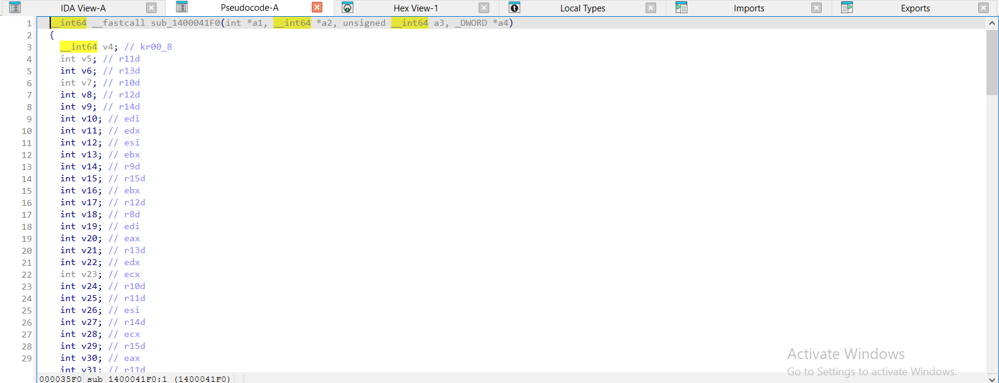

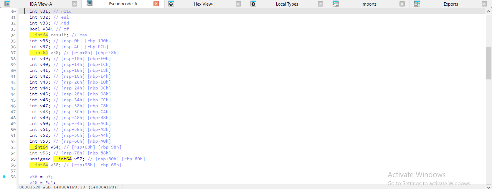

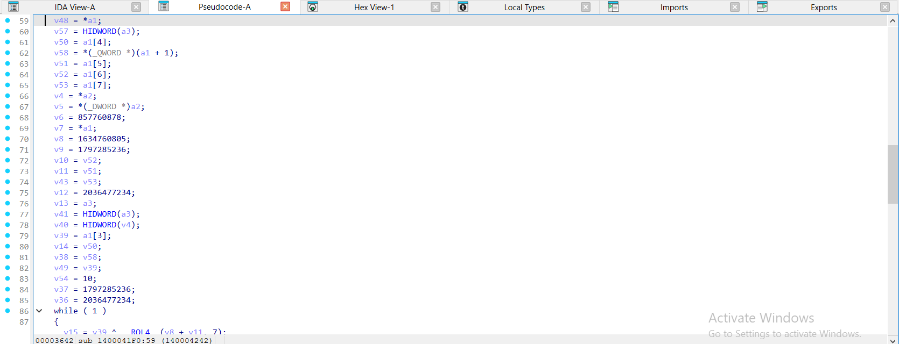

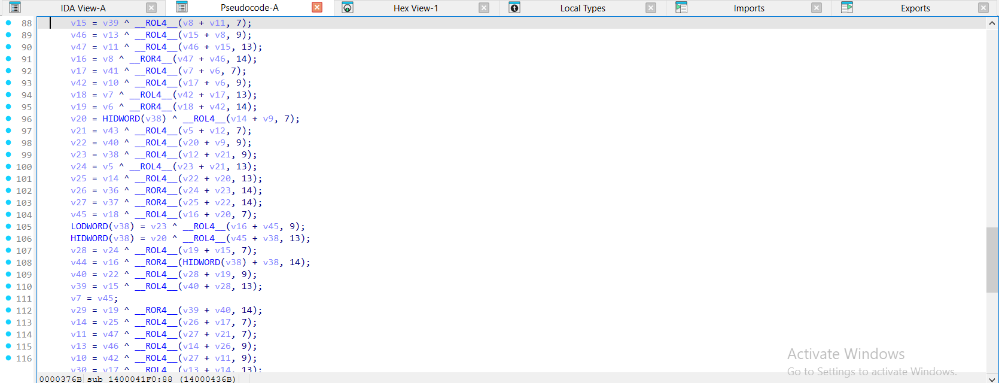

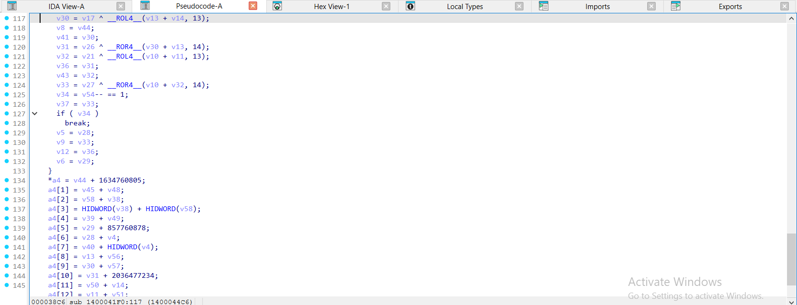

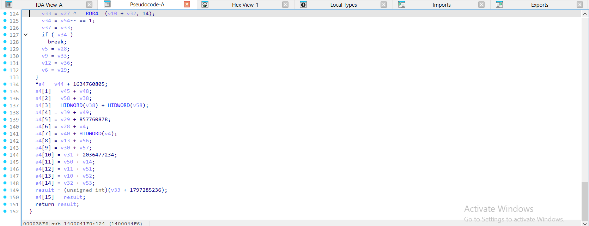

</details>

<details><summary>gcc -O2 – ELF, đã `strip -s` – salsa20_block = <code>sub_3D40</code> – 4 ảnh</summary>

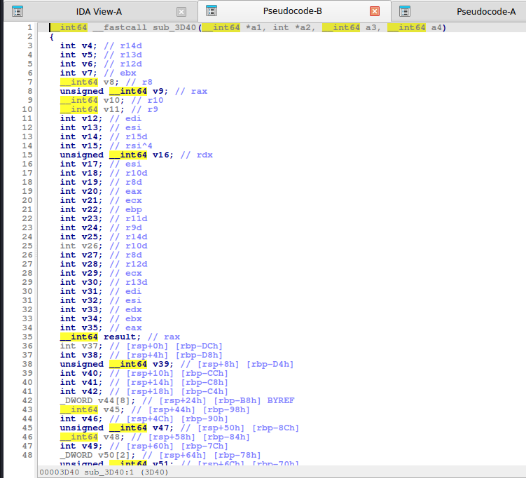

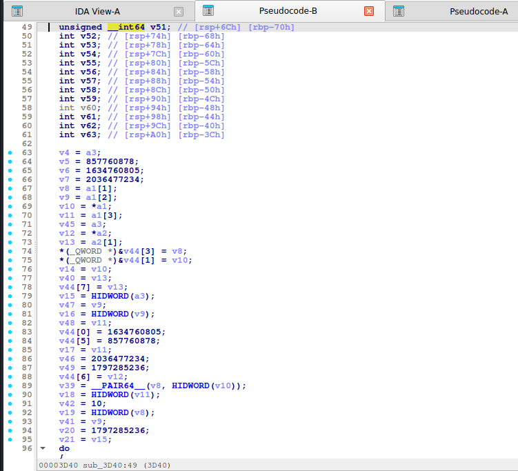

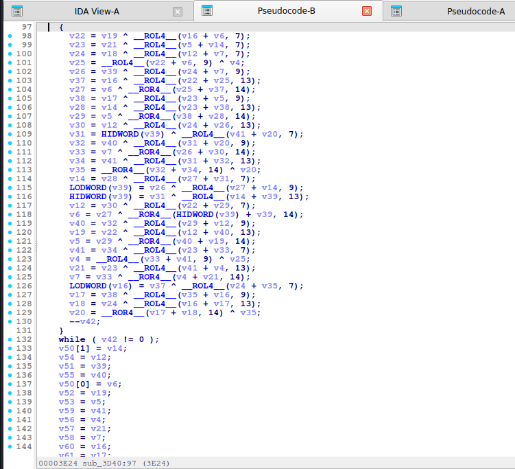

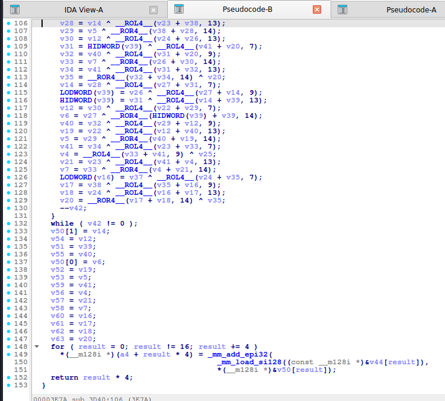

</details>

<details><summary>mingw-w64 -O2 -static – PE, đã `strip -s` – salsa20_block = <code>sub_140003400</code> – 4 ảnh</summary>

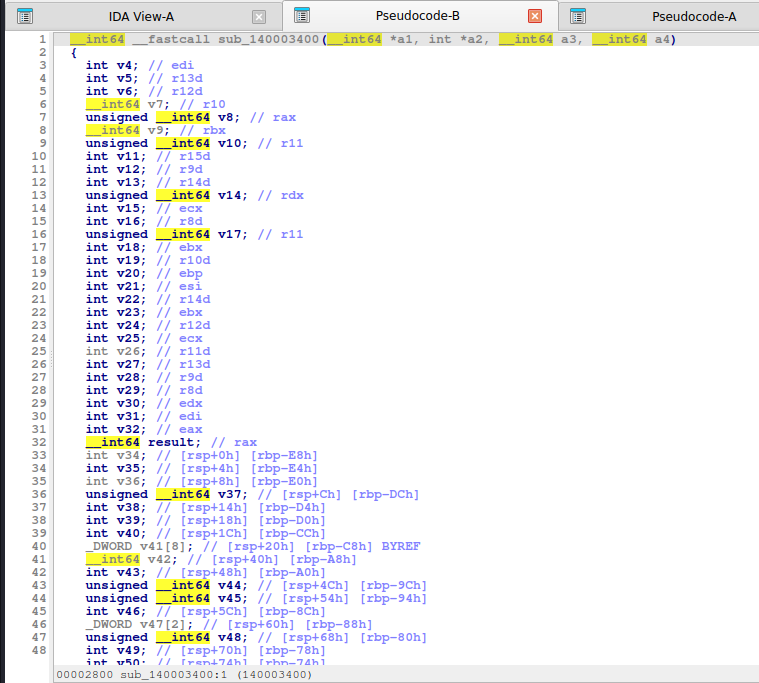

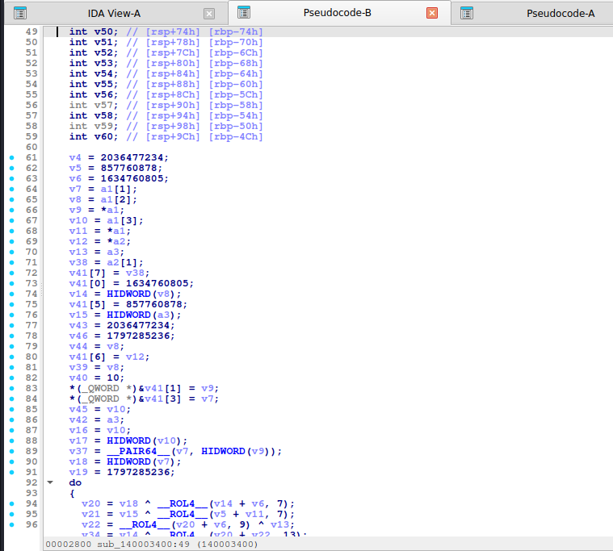

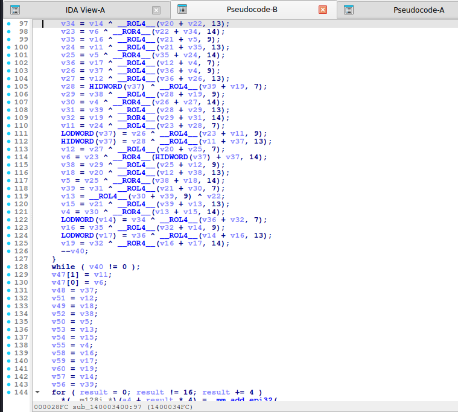

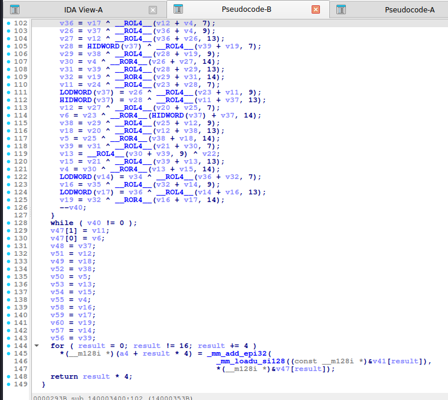

</details>

Nhận xét: **MSVC `/Od` không dùng `__ROL4__`/`__ROR4__`** mà viết **cặp dịch**: `x[4] ^= ((x[12] + x[0]) >> 25) | ((x[12] + x[0]) << 7)`, rồi `>> 23 | << 9`, `>> 19 | << 13` và **`>> 14 | << 18`** (ROL 18 viết thẳng, không đổi thành ROR). gcc `-O2` gộp thành khoảng 40 dòng liên tiếp dạng `v22 = v19 ^ __ROL4__(v16 + v6, 7);` … `__ROR4__(..., 14)`. Hai điểm nhận diện: (1) ba lượng xoay **7, 9, 13**, (2) lượng thứ tư hiện là **ROR 14** (tức ROL 18).

## 6. Code giải mã

**Python (thuần):**

```python
M32 = 0xFFFFFFFF
def rol32(x, k): return ((x << k) | (x >> (32 - k))) & M32


def _u32(b): return [int.from_bytes(b[i:i + 4], "little") for i in range(0, len(b), 4)]


def _p32(v): return b"".join(x.to_bytes(4, "little") for x in v)


def _salsa_block(key, nonce8, counter):
    k = _u32(key)
    n = _u32(nonce8)
    s = [0x61707865, k[0], k[1], k[2], k[3], 0x3320646E, n[0], n[1],
         counter & M32, counter >> 32, 0x79622D32, k[4], k[5], k[6], k[7], 0x6B206574]
    x = list(s)
    for _ in range(10):
        x[4] ^= rol32((x[0] + x[12]) & M32, 7);  x[8] ^= rol32((x[4] + x[0]) & M32, 9)
        x[12] ^= rol32((x[8] + x[4]) & M32, 13); x[0] ^= rol32((x[12] + x[8]) & M32, 18)
        x[9] ^= rol32((x[5] + x[1]) & M32, 7);   x[13] ^= rol32((x[9] + x[5]) & M32, 9)
        x[1] ^= rol32((x[13] + x[9]) & M32, 13); x[5] ^= rol32((x[1] + x[13]) & M32, 18)
        x[14] ^= rol32((x[10] + x[6]) & M32, 7); x[2] ^= rol32((x[14] + x[10]) & M32, 9)
        x[6] ^= rol32((x[2] + x[14]) & M32, 13); x[10] ^= rol32((x[6] + x[2]) & M32, 18)
        x[3] ^= rol32((x[15] + x[11]) & M32, 7); x[7] ^= rol32((x[3] + x[15]) & M32, 9)
        x[11] ^= rol32((x[7] + x[3]) & M32, 13); x[15] ^= rol32((x[11] + x[7]) & M32, 18)
        x[1] ^= rol32((x[0] + x[3]) & M32, 7);   x[2] ^= rol32((x[1] + x[0]) & M32, 9)
        x[3] ^= rol32((x[2] + x[1]) & M32, 13);  x[0] ^= rol32((x[3] + x[2]) & M32, 18)
        x[6] ^= rol32((x[5] + x[4]) & M32, 7);   x[7] ^= rol32((x[6] + x[5]) & M32, 9)
        x[4] ^= rol32((x[7] + x[6]) & M32, 13);  x[5] ^= rol32((x[4] + x[7]) & M32, 18)
        x[11] ^= rol32((x[10] + x[9]) & M32, 7); x[8] ^= rol32((x[11] + x[10]) & M32, 9)
        x[9] ^= rol32((x[8] + x[11]) & M32, 13); x[10] ^= rol32((x[9] + x[8]) & M32, 18)
        x[12] ^= rol32((x[15] + x[14]) & M32, 7); x[13] ^= rol32((x[12] + x[15]) & M32, 9)
        x[14] ^= rol32((x[13] + x[12]) & M32, 13); x[15] ^= rol32((x[14] + x[13]) & M32, 18)
    return _p32([(x[i] + s[i]) & M32 for i in range(16)])


def salsa20_xor(key, nonce8, data, counter=0):
    out = bytearray()
    for off in range(0, len(data), 64):
        ks = _salsa_block(key, nonce8, counter + off // 64)
        out += bytes(a ^ b for a, b in zip(data[off:off + 64], ks))
    return bytes(out)
```

```python
salsa20_xor(bytes(range(32)), bytes(range(8)), bytes.fromhex("66c86333777b098daf10d6db7b8135b04eb62189"))
# b'Hello, CyberSeaGame!'
```

**C:** `ctf_salsa20_xor` trong [`code/ctfdec.h`](../code/ctfdec.h).

## 7. Biến thể & bẫy

- **Salsa20/8, /12**: số lần lặp ngoài nhỏ hơn.
- **XSalsa20**: nonce 24 byte, subkey từ HSalsa20.
- Hằng cho khóa 16 byte: `expand 16-byte k` (`0x61707865 0x3120646E 0x79622D36 0x6B206574`) và khóa được lặp hai lần.
- **Salsa20 vs ChaCha20**: kiểm tra lượng xoay (7/9/13/18 ↔ 16/12/8/7) và vị trí các hằng (đường chéo ↔ hàng đầu).
