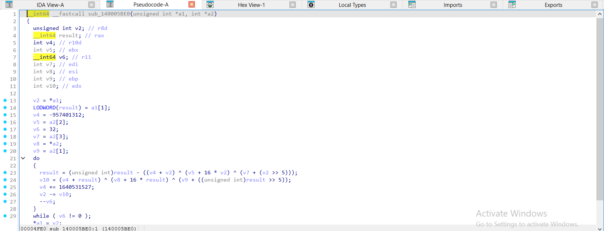
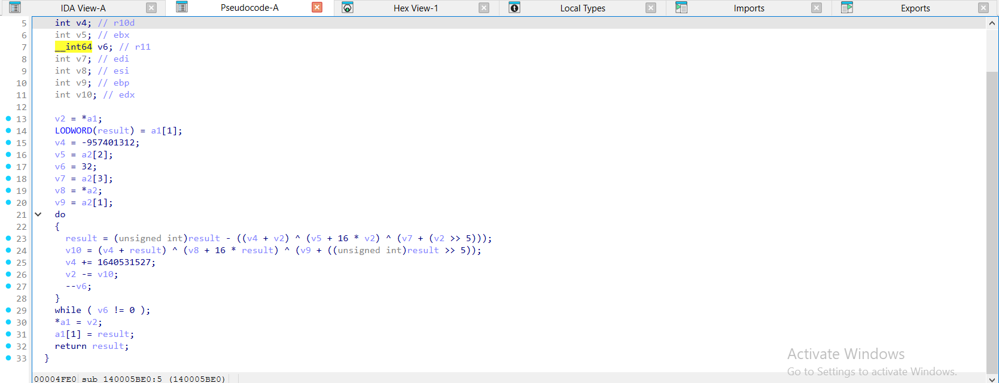
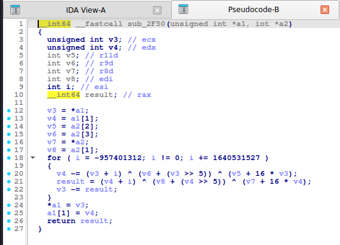
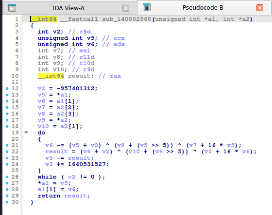

# TEA (Tiny Encryption Algorithm)

> Mã khối 64-bit, khóa 128-bit, 32 vòng Feistel, hằng **delta = `0x9E3779B9`**. Rất ngắn, rất hay xuất hiện trong đề rev vì dễ cài.

## 1. Dấu hiệu nhận biết

- Hằng **`0x9E3779B9`** (`2654435769`). IDA hay hiện nó thành **`-1640531527`** (signed 32-bit) và viết **`v -= 1640531527`** thay vì `+= 0x9E3779B9` (vì `-1640531527 = -0x61C88647`). Gặp `1640531527` hay `0x61C88647` cũng là TEA/XTEA/XXTEA.
- Điều kiện dừng vòng lặp: hằng **`0xC6EF3720`** (`-957401312`) = `32 × delta` (gcc `-O2` đổi `i < 32` thành `sum != 0xC6EF3720`), hoặc `i <= 31` ở gcc `-O0`, hoặc `i < 32` ở MSVC `/Od`, hoặc đếm ngược `i = 32; i != 0` ở MSVC `/O2`. **Nên thấy đủ ba dạng dừng để không bỏ sót.**
- Cốt lõi mỗi vòng:
  `v0 += ((v1 << 4) + k0) ^ (v1 + sum) ^ ((v1 >> 5) + k1)` rồi
  `v1 += ((v0 << 4) + k2) ^ (v0 + sum) ^ ((v0 >> 5) + k3)`. IDA hiện `16 * v5` thay cho `v5 << 4`.
- Hai biến 32-bit từ `a1[0]`, `a1[1]` (khối 8 byte) và **4 từ khóa** `a2[0..3]`.
- Chỉ có `+`, `^`, `<<4`, `>>5`: **không có bảng tra**.

## 2. Thuật toán (mã giả)

```
encrypt(v0, v1, k[4]):
    sum = 0
    repeat 32:
        sum += 0x9E3779B9
        v0 += ((v1 << 4) + k[0]) ^ (v1 + sum) ^ ((v1 >> 5) + k[1])
        v1 += ((v0 << 4) + k[2]) ^ (v0 + sum) ^ ((v0 >> 5) + k[3])
decrypt(v0, v1, k[4]):
    sum = 0xC6EF3720
    repeat 32:
        v1 -= ((v0 << 4) + k[2]) ^ (v0 + sum) ^ ((v0 >> 5) + k[3])
        v0 -= ((v1 << 4) + k[0]) ^ (v1 + sum) ^ ((v1 >> 5) + k[1])
        sum -= 0x9E3779B9
```

## 3. Mã hóa / giải mã

Khóa 128-bit = 4 từ `uint32` little-endian từ 16 byte khóa. Mỗi khối 8 byte mã hóa độc lập (ECB) trừ khi đề dùng chế độ CBC/CTR. Giải mã: chạy ngược như mã giả. Với dữ liệu: đọc 2 từ little-endian mỗi khối (`struct.unpack("<2I", ...)`).

## 4. Mã nguồn gốc (C)

```c
void tea_encrypt(uint32_t v[2], const uint32_t k[4])
{
    uint32_t v0 = v[0], v1 = v[1], sum = 0, delta = 0x9E3779B9;
    for (int i = 0; i < 32; i++) {
        sum += delta;
        v0 += ((v1 << 4) + k[0]) ^ (v1 + sum) ^ ((v1 >> 5) + k[1]);
        v1 += ((v0 << 4) + k[2]) ^ (v0 + sum) ^ ((v0 >> 5) + k[3]);
    }
    v[0] = v0; v[1] = v1;
}

void tea_decrypt(uint32_t v[2], const uint32_t k[4])
{
    uint32_t v0 = v[0], v1 = v[1], sum = 0xC6EF3720, delta = 0x9E3779B9;
    for (int i = 0; i < 32; i++) {
        v1 -= ((v0 << 4) + k[2]) ^ (v0 + sum) ^ ((v0 >> 5) + k[3]);
        v0 -= ((v1 << 4) + k[0]) ^ (v1 + sum) ^ ((v1 >> 5) + k[1]);
        sum -= delta;
    }
    v[0] = v0; v[1] = v1;
}
```

## 5. Pseudo-code IDA thực tế

**tea_encrypt:**

<details><summary>MSVC /O2 - PE x64 (có PDB)</summary>

```c
void __fastcall tea_encrypt(unsigned int *v, const unsigned int *k)
{
  unsigned int v2; // r8d
  int v3; // r10d
  unsigned int v4; // eax
  __int64 i; // r11

  v2 = *v;
  v3 = 0;
  v4 = v[1];
  for ( i = 32; i != 0; --i )
  {
    v3 -= 1640531527;
    v2 += (v3 + v4) ^ (*k + 16 * v4) ^ (k[1] + (v4 >> 5));
    v4 += (v3 + v2) ^ (k[2] + 16 * v2) ^ (k[3] + (v2 >> 5));
  }
  *v = v2;
  v[1] = v4;
}
```

</details>

<details><summary>MSVC /Od - PE x64 (có PDB)</summary>

```c
void __fastcall tea_encrypt(unsigned int *v, const unsigned int *k)
{
  unsigned int v0; // [rsp+0h] [rbp-28h]
  unsigned int v1; // [rsp+4h] [rbp-24h]
  unsigned int sum; // [rsp+8h] [rbp-20h]
  int i; // [rsp+Ch] [rbp-1Ch]

  v0 = *v;
  v1 = v[1];
  sum = 0;
  for ( i = 0; i < 32; ++i )
  {
    sum -= 1640531527;
    v0 += (k[1] + (v1 >> 5)) ^ (sum + v1) ^ (*k + 16 * v1);
    v1 += (k[3] + (v0 >> 5)) ^ (sum + v0) ^ (k[2] + 16 * v0);
  }
  *v = v0;
  v[1] = v1;
}
```

</details>

<details><summary>gcc -O2 - ELF x86-64 (chưa strip)</summary>

```c
__int64 __fastcall tea_encrypt(unsigned int *a1, int *a2)
{
  unsigned int v3; // ecx
  unsigned int v4; // edx
  int v5; // r11d
  int v6; // r9d
  int v7; // r8d
  int v8; // edi
  int v9; // esi
  __int64 result; // rax

  v3 = *a1;
  v4 = a1[1];
  v5 = *a2;
  v6 = a2[1];
  v7 = a2[2];
  v8 = a2[3];
  v9 = 0;
  do
  {
    v9 -= 1640531527;
    v3 += (v9 + v4) ^ (v6 + (v4 >> 5)) ^ (v5 + 16 * v4);
    result = (v9 + v3) ^ (v8 + (v3 >> 5)) ^ (v7 + 16 * v3);
    v4 += result;
  }
  while ( v9 != -957401312 );
  *a1 = v3;
  a1[1] = v4;
  return result;
}
```

</details>

<details><summary>gcc -O0 - ELF x86-64 (chưa strip)</summary>

```c
__int64 __fastcall tea_encrypt(unsigned int *a1, _DWORD *a2)
{
  int i; // [rsp+20h] [rbp-10h]
  int v4; // [rsp+24h] [rbp-Ch]
  unsigned int v5; // [rsp+28h] [rbp-8h]
  unsigned int v6; // [rsp+2Ch] [rbp-4h]

  v6 = *a1;
  v5 = a1[1];
  v4 = 0;
  for ( i = 0; i <= 31; ++i )
  {
    v4 -= 1640531527;
    v6 += (v5 + v4) ^ (16 * v5 + *a2) ^ ((v5 >> 5) + a2[1]);
    v5 += (v6 + v4) ^ (16 * v6 + a2[2]) ^ ((v6 >> 5) + a2[3]);
  }
  *a1 = v6;
  a1[1] = v5;
  return v5;
}
```

</details>

<details><summary>mingw-w64 gcc -O2 - PE x64 (-static)</summary>

```c
__int64 __fastcall tea_encrypt(unsigned int *a1, int *a2)
{
  int v2; // r8d
  unsigned int v5; // ecx
  unsigned int v6; // edx
  int v7; // esi
  int v8; // r11d
  int v9; // r10d
  int v10; // r9d
  __int64 result; // rax

  v2 = 0;
  v5 = *a1;
  v6 = a1[1];
  v7 = *a2;
  v8 = a2[1];
  v9 = a2[2];
  v10 = a2[3];
  do
  {
    v2 -= 1640531527;
    v5 += (v2 + v6) ^ (v8 + (v6 >> 5)) ^ (v7 + 16 * v6);
    result = (v2 + v5) ^ (v10 + (v5 >> 5)) ^ (v9 + 16 * v5);
    v6 += result;
  }
  while ( v2 != -957401312 );
  *a1 = v5;
  a1[1] = v6;
  return result;
}
```

</details>

<details><summary>mingw-w64 gcc -O0 - PE x64 (-static)</summary>

```c
__int64 __fastcall tea_encrypt(unsigned int *a1, _DWORD *a2)
{
  int i; // [rsp+10h] [rbp-10h]
  int v4; // [rsp+14h] [rbp-Ch]
  unsigned int v5; // [rsp+18h] [rbp-8h]
  unsigned int v6; // [rsp+1Ch] [rbp-4h]

  v6 = *a1;
  v5 = a1[1];
  v4 = 0;
  for ( i = 0; i <= 31; ++i )
  {
    v4 -= 1640531527;
    v6 += (v5 + v4) ^ (16 * v5 + *a2) ^ ((v5 >> 5) + a2[1]);
    v5 += (v6 + v4) ^ (16 * v6 + a2[2]) ^ ((v6 >> 5) + a2[3]);
  }
  *a1 = v6;
  a1[1] = v5;
  return v5;
}
```

</details>

**Bản strip (không symbol)** – IDA chỉ thấy `sub_XXXX`, `a1`, `a2`, `byte_XXXX`; hàm này tên là MSVC /O2 → `sub_140005C80`, gcc -O2 → `sub_2ED0`, mingw-w64 -O2 -static → `sub_1400024F0`:

<details><summary>MSVC /O2 – PE x64, không PDB (strip) – bản STRIP: <code>tea_encrypt</code> = <code>sub_140005C80</code></summary>

```c
__int64 __fastcall sub_140005C80(unsigned int *a1, _DWORD *a2)
{
  unsigned int v2; // r8d
  int v3; // r10d
  __int64 result; // rax
  __int64 i; // r11

  v2 = *a1;
  v3 = 0;
  LODWORD(result) = a1[1];
  for ( i = 32; i != 0; --i )
  {
    v3 -= 1640531527;
    v2 += (v3 + result) ^ (*a2 + 16 * result) ^ (a2[1] + ((unsigned int)result >> 5));
    result = ((v3 + v2) ^ (a2[2] + 16 * v2) ^ (a2[3] + (v2 >> 5))) + (unsigned int)result;
  }
  *a1 = v2;
  a1[1] = result;
  return result;
}
```

</details>

<details><summary>gcc -O2 – ELF, đã `strip -s` – bản STRIP: <code>tea_encrypt</code> = <code>sub_2ED0</code></summary>

```c
__int64 __fastcall sub_2ED0(unsigned int *a1, int *a2)
{
  unsigned int v3; // ecx
  unsigned int v4; // edx
  int v5; // r11d
  int v6; // r9d
  int v7; // r8d
  int v8; // edi
  int v9; // esi
  __int64 result; // rax

  v3 = *a1;
  v4 = a1[1];
  v5 = *a2;
  v6 = a2[1];
  v7 = a2[2];
  v8 = a2[3];
  v9 = 0;
  do
  {
    v9 -= 1640531527;
    v3 += (v9 + v4) ^ (v6 + (v4 >> 5)) ^ (v5 + 16 * v4);
    result = (v9 + v3) ^ (v8 + (v3 >> 5)) ^ (v7 + 16 * v3);
    v4 += result;
  }
  while ( v9 != -957401312 );
  *a1 = v3;
  a1[1] = v4;
  return result;
}
```

</details>

<details><summary>mingw-w64 -O2 -static – PE, đã `strip -s` – bản STRIP: <code>tea_encrypt</code> = <code>sub_1400024F0</code></summary>

```c
__int64 __fastcall sub_1400024F0(unsigned int *a1, int *a2)
{
  int v2; // r8d
  unsigned int v5; // ecx
  unsigned int v6; // edx
  int v7; // esi
  int v8; // r11d
  int v9; // r10d
  int v10; // r9d
  __int64 result; // rax

  v2 = 0;
  v5 = *a1;
  v6 = a1[1];
  v7 = *a2;
  v8 = a2[1];
  v9 = a2[2];
  v10 = a2[3];
  do
  {
    v2 -= 1640531527;
    v5 += (v2 + v6) ^ (v8 + (v6 >> 5)) ^ (v7 + 16 * v6);
    result = (v2 + v5) ^ (v10 + (v5 >> 5)) ^ (v9 + 16 * v5);
    v6 += result;
  }
  while ( v2 != -957401312 );
  *a1 = v5;
  a1[1] = v6;
  return result;
}
```

</details>

**Ảnh chụp màn hình IDA (bản strip)** – mở từng mục để xem; hàm dài chia thành nhiều trang, mỗi trang là một màn hình IDA:

<details><summary>MSVC /O2 – PE x64, không PDB (strip) – tea_encrypt = <code>sub_140005C80</code> – 1 ảnh</summary>


</details>

<details><summary>gcc -O2 – ELF, đã `strip -s` – tea_encrypt = <code>sub_2ED0</code> – 1 ảnh</summary>


</details>

<details><summary>mingw-w64 -O2 -static – PE, đã `strip -s` – tea_encrypt = <code>sub_1400024F0</code> – 1 ảnh</summary>


</details>

**tea_decrypt:**

<details><summary>MSVC /O2 - PE x64 (có PDB)</summary>

```c
void __fastcall tea_decrypt(unsigned int *v, const unsigned int *k)
{
  unsigned int v2; // r8d
  unsigned int v3; // eax
  int v4; // r10d
  unsigned int v5; // ebx
  __int64 v6; // r11
  unsigned int v7; // edi
  int v8; // esi
  unsigned int v9; // ebp
  int v10; // edx

  v2 = *v;
  v3 = v[1];
  v4 = -957401312;
  v5 = k[2];
  v6 = 32;
  v7 = k[3];
  v8 = *k;
  v9 = k[1];
  do
  {
    v3 -= (v4 + v2) ^ (v5 + 16 * v2) ^ (v7 + (v2 >> 5));
    v10 = (v4 + v3) ^ (v8 + 16 * v3) ^ (v9 + (v3 >> 5));
    v4 += 1640531527;
    v2 -= v10;
    --v6;
  }
  while ( v6 != 0 );
  *v = v2;
  v[1] = v3;
}
```

</details>

<details><summary>MSVC /Od - PE x64 (có PDB)</summary>

```c
void __fastcall tea_decrypt(unsigned int *v, const unsigned int *k)
{
  unsigned int v0; // [rsp+0h] [rbp-28h]
  unsigned int v1; // [rsp+4h] [rbp-24h]
  unsigned int sum; // [rsp+8h] [rbp-20h]
  int i; // [rsp+Ch] [rbp-1Ch]

  v0 = *v;
  v1 = v[1];
  sum = -957401312;
  for ( i = 0; i < 32; ++i )
  {
    v1 -= (k[3] + (v0 >> 5)) ^ (sum + v0) ^ (k[2] + 16 * v0);
    v0 -= (k[1] + (v1 >> 5)) ^ (sum + v1) ^ (*k + 16 * v1);
    sum += 1640531527;
  }
  *v = v0;
  v[1] = v1;
}
```

</details>

<details><summary>gcc -O2 - ELF x86-64 (chưa strip)</summary>

```c
__int64 __fastcall tea_decrypt(unsigned int *a1, int *a2)
{
  unsigned int v3; // ecx
  unsigned int v4; // edx
  int v5; // r11d
  int v6; // r9d
  int v7; // r8d
  int v8; // edi
  int i; // esi
  __int64 result; // rax

  v3 = *a1;
  v4 = a1[1];
  v5 = a2[2];
  v6 = a2[3];
  v7 = *a2;
  v8 = a2[1];
  for ( i = -957401312; i != 0; i += 1640531527 )
  {
    v4 -= (v3 + i) ^ (v6 + (v3 >> 5)) ^ (v5 + 16 * v3);
    result = (v4 + i) ^ (v8 + (v4 >> 5)) ^ (v7 + 16 * v4);
    v3 -= result;
  }
  *a1 = v3;
  a1[1] = v4;
  return result;
}
```

</details>

<details><summary>gcc -O0 - ELF x86-64 (chưa strip)</summary>

```c
__int64 __fastcall tea_decrypt(unsigned int *a1, _DWORD *a2)
{
  int i; // [rsp+20h] [rbp-10h]
  int v4; // [rsp+24h] [rbp-Ch]
  unsigned int v5; // [rsp+28h] [rbp-8h]
  unsigned int v6; // [rsp+2Ch] [rbp-4h]

  v6 = *a1;
  v5 = a1[1];
  v4 = -957401312;
  for ( i = 0; i <= 31; ++i )
  {
    v5 -= (v6 + v4) ^ (16 * v6 + a2[2]) ^ ((v6 >> 5) + a2[3]);
    v6 -= (v5 + v4) ^ (16 * v5 + *a2) ^ ((v5 >> 5) + a2[1]);
    v4 += 1640531527;
  }
  *a1 = v6;
  a1[1] = v5;
  return v5;
}
```

</details>

<details><summary>mingw-w64 gcc -O2 - PE x64 (-static)</summary>

```c
__int64 __fastcall tea_decrypt(unsigned int *a1, int *a2)
{
  int v2; // r8d
  unsigned int v5; // ecx
  unsigned int v6; // edx
  int v7; // esi
  int v8; // r11d
  int v9; // r10d
  int v10; // r9d
  __int64 result; // rax

  v2 = -957401312;
  v5 = *a1;
  v6 = a1[1];
  v7 = a2[2];
  v8 = a2[3];
  v9 = *a2;
  v10 = a2[1];
  do
  {
    v6 -= (v5 + v2) ^ (v8 + (v5 >> 5)) ^ (v7 + 16 * v5);
    result = (v6 + v2) ^ (v10 + (v6 >> 5)) ^ (v9 + 16 * v6);
    v5 -= result;
    v2 += 1640531527;
  }
  while ( v2 != 0 );
  *a1 = v5;
  a1[1] = v6;
  return result;
}
```

</details>

<details><summary>mingw-w64 gcc -O0 - PE x64 (-static)</summary>

```c
__int64 __fastcall tea_decrypt(unsigned int *a1, _DWORD *a2)
{
  int i; // [rsp+10h] [rbp-10h]
  int v4; // [rsp+14h] [rbp-Ch]
  unsigned int v5; // [rsp+18h] [rbp-8h]
  unsigned int v6; // [rsp+1Ch] [rbp-4h]

  v6 = *a1;
  v5 = a1[1];
  v4 = -957401312;
  for ( i = 0; i <= 31; ++i )
  {
    v5 -= (v6 + v4) ^ (16 * v6 + a2[2]) ^ ((v6 >> 5) + a2[3]);
    v6 -= (v5 + v4) ^ (16 * v5 + *a2) ^ ((v5 >> 5) + a2[1]);
    v4 += 1640531527;
  }
  *a1 = v6;
  a1[1] = v5;
  return v5;
}
```

</details>

**Bản strip (không symbol)** – IDA chỉ thấy `sub_XXXX`, `a1`, `a2`, `byte_XXXX`; hàm này tên là MSVC /O2 → `sub_140005BE0`, gcc -O2 → `sub_2F50`, mingw-w64 -O2 -static → `sub_140002560`:

<details><summary>MSVC /O2 – PE x64, không PDB (strip) – bản STRIP: <code>tea_decrypt</code> = <code>sub_140005BE0</code></summary>

```c
__int64 __fastcall sub_140005BE0(unsigned int *a1, int *a2)
{
  unsigned int v2; // r8d
  __int64 result; // rax
  int v4; // r10d
  int v5; // ebx
  __int64 v6; // r11
  int v7; // edi
  int v8; // esi
  int v9; // ebp
  int v10; // edx

  v2 = *a1;
  LODWORD(result) = a1[1];
  v4 = -957401312;
  v5 = a2[2];
  v6 = 32;
  v7 = a2[3];
  v8 = *a2;
  v9 = a2[1];
  do
  {
    result = (unsigned int)result - ((v4 + v2) ^ (v5 + 16 * v2) ^ (v7 + (v2 >> 5)));
    v10 = (v4 + result) ^ (v8 + 16 * result) ^ (v9 + ((unsigned int)result >> 5));
    v4 += 1640531527;
    v2 -= v10;
    --v6;
  }
  while ( v6 != 0 );
  *a1 = v2;
  a1[1] = result;
  return result;
}
```

</details>

<details><summary>gcc -O2 – ELF, đã `strip -s` – bản STRIP: <code>tea_decrypt</code> = <code>sub_2F50</code></summary>

```c
__int64 __fastcall sub_2F50(unsigned int *a1, int *a2)
{
  unsigned int v3; // ecx
  unsigned int v4; // edx
  int v5; // r11d
  int v6; // r9d
  int v7; // r8d
  int v8; // edi
  int i; // esi
  __int64 result; // rax

  v3 = *a1;
  v4 = a1[1];
  v5 = a2[2];
  v6 = a2[3];
  v7 = *a2;
  v8 = a2[1];
  for ( i = -957401312; i != 0; i += 1640531527 )
  {
    v4 -= (v3 + i) ^ (v6 + (v3 >> 5)) ^ (v5 + 16 * v3);
    result = (v4 + i) ^ (v8 + (v4 >> 5)) ^ (v7 + 16 * v4);
    v3 -= result;
  }
  *a1 = v3;
  a1[1] = v4;
  return result;
}
```

</details>

<details><summary>mingw-w64 -O2 -static – PE, đã `strip -s` – bản STRIP: <code>tea_decrypt</code> = <code>sub_140002560</code></summary>

```c
__int64 __fastcall sub_140002560(unsigned int *a1, int *a2)
{
  int v2; // r8d
  unsigned int v5; // ecx
  unsigned int v6; // edx
  int v7; // esi
  int v8; // r11d
  int v9; // r10d
  int v10; // r9d
  __int64 result; // rax

  v2 = -957401312;
  v5 = *a1;
  v6 = a1[1];
  v7 = a2[2];
  v8 = a2[3];
  v9 = *a2;
  v10 = a2[1];
  do
  {
    v6 -= (v5 + v2) ^ (v8 + (v5 >> 5)) ^ (v7 + 16 * v5);
    result = (v6 + v2) ^ (v10 + (v6 >> 5)) ^ (v9 + 16 * v6);
    v5 -= result;
    v2 += 1640531527;
  }
  while ( v2 != 0 );
  *a1 = v5;
  a1[1] = v6;
  return result;
}
```

</details>

**Ảnh chụp màn hình IDA (bản strip)** – mở từng mục để xem; hàm dài chia thành nhiều trang, mỗi trang là một màn hình IDA:

<details><summary>MSVC /O2 – PE x64, không PDB (strip) – tea_decrypt = <code>sub_140005BE0</code> – 2 ảnh</summary>





</details>

<details><summary>gcc -O2 – ELF, đã `strip -s` – tea_decrypt = <code>sub_2F50</code> – 1 ảnh</summary>



</details>

<details><summary>mingw-w64 -O2 -static – PE, đã `strip -s` – tea_decrypt = <code>sub_140002560</code> – 1 ảnh</summary>



</details>

Nhận xét:

- `-O0`: hiện `v4 -= 1640531527;` và `i <= 31` – dễ nhận.
- `-O2` (gcc): các từ khóa được **nạp sẵn vào biến** (`v5 = *a2`, `v6 = a2[1]`, …) trước vòng lặp, điều kiện dừng là `v9 != -957401312`; phần thân giữ `(v9 + v4) ^ (v6 + (v4 >> 5)) ^ (v5 + 16 * v4)`.
- MSVC `/O2`: vòng **đếm ngược** `for ( i = 32; i != 0; --i )` với thân `v3 -= 1640531527; v2 += (v3 + v4) ^ (*k + 16 * v4) ^ (k[1] + (v4 >> 5));`. Không có hằng `0xC6EF3720` ở bản encrypt này (số vòng là biến đếm 32), nên nhận biết bằng **`1640531527`** + **`16 *`** + **`>> 5`**.
- MSVC `/Od`: hiện `for ( i = 0; i < 32; ++i )` và các thành phần của khóa theo `*k`, `k[1]`, `k[2]`, `k[3]` (thứ tự toán hạng có thể đảo so với C gốc: phép `^`, `+` giao hoán).
- Khi **round count** khác 32 (16 hay 64) thì điều kiện dừng đổi: nhân `delta` với số vòng để suy ra hằng dừng.

## 6. Code giải mã

**Python** (key 4 từ little-endian, ECB):

```python
M32 = 0xFFFFFFFF
DELTA = 0x9E3779B9
def _u32(b): return [int.from_bytes(b[i:i + 4], "little") for i in range(0, len(b), 4)]


def _p32(v): return b"".join(x.to_bytes(4, "little") for x in v)


def tea_decrypt_block(v0, v1, k, rounds=32):
    s = (DELTA * rounds) & M32
    for _ in range(rounds):
        v1 = (v1 - (((v0 << 4) + k[2]) ^ (v0 + s) ^ ((v0 >> 5) + k[3]))) & M32
        v0 = (v0 - (((v1 << 4) + k[0]) ^ (v1 + s) ^ ((v1 >> 5) + k[1]))) & M32
        s = (s - DELTA) & M32
    return v0, v1


def tea_encrypt_block(v0, v1, k, rounds=32):
    s = 0
    for _ in range(rounds):
        s = (s + DELTA) & M32
        v0 = (v0 + (((v1 << 4) + k[0]) ^ (v1 + s) ^ ((v1 >> 5) + k[1]))) & M32
        v1 = (v1 + (((v0 << 4) + k[2]) ^ (v0 + s) ^ ((v0 >> 5) + k[3]))) & M32
    return v0, v1


def tea_decrypt(data, key4):
    w, out = _u32(data), []
    for i in range(0, len(w), 2):
        out += tea_decrypt_block(w[i], w[i + 1], key4)
    return _p32(out)
```

```python
TK = [0x01234567, 0x89abcdef, 0xfedcba98, 0x76543210]
tea_decrypt(bytes.fromhex("d71369a988fdf9e79d5bf50b3bc388a5a28f36d3ef97db0b"), TK)
# b'Hello, CyberSeaGame!\x00\x00\x00\x00'
```

**C:**

```c
#include <stdint.h>
#include <stddef.h>
#include <string.h>

#define CTF_DELTA 0x9E3779B9u

static inline void ctf_tea_decrypt(uint32_t v[2], const uint32_t k[4])
{
    uint32_t v0 = v[0], v1 = v[1], sum = CTF_DELTA * 32;
    for (int i = 0; i < 32; i++) {
        v1 -= ((v0 << 4) + k[2]) ^ (v0 + sum) ^ ((v0 >> 5) + k[3]);
        v0 -= ((v1 << 4) + k[0]) ^ (v1 + sum) ^ ((v1 >> 5) + k[1]);
        sum -= CTF_DELTA;
    }
    v[0] = v0; v[1] = v1;
}
```

## 7. Biến thể & bẫy

- **Delta khác** (đề đổi `0x9E3779B9` thành số khác) hoặc **số vòng khác**: đọc từ pseudo-code, đừng giả định.
- **Thứ tự key**: một số cài đặt dùng `k[0],k[1]` ở bước hai: kiểm tra từng chỉ số.
- **Endianness**: dữ liệu và khóa thường little-endian nhưng cài đặt "big-endian" cũng tồn tại.
- TEA có **equivalent keys** (mỗi khóa có 3 khóa tương đương) – không ảnh hưởng giải mã.
- Dễ nhầm giữa TEA/XTEA/XXTEA: xem [xtea.md](xtea.md) và [xxtea.md](xxtea.md).
