# XTEA

> Sửa lỗi của TEA: cùng **delta `0x9E3779B9`**, 32 vòng, khối 64-bit, khóa 128-bit, nhưng **chọn từ khóa theo `sum`** (`k[sum & 3]`, `k[(sum >> 11) & 3]`).

## 1. Dấu hiệu nhận biết

- Cùng hằng delta `0x9E3779B9` (`-1640531527` trong IDA) và `0xC6EF3720` (`-957401312`) như TEA.
- Khác TEA ở **cách dùng khóa**: truy cập khóa bằng **chỉ số động**: `k[sum & 3]` và `k[(sum >> 11) & 3]`. Trong IDA: `*(_DWORD *)(a2 + 4LL * ((result >> 11) & 3))`.
- Mỗi vòng:
  `v0 += (((v1 << 4) ^ (v1 >> 5)) + v1) ^ (sum + k[sum & 3]);`
  `sum += delta;`
  `v1 += (((v0 << 4) ^ (v0 >> 5)) + v0) ^ (sum + k[(sum >> 11) & 3]);`
- **`(x << 4) ^ (x >> 5)`** (dùng `^` ở giữa, không phải `+`) và hằng **`>> 11`**, **`& 3`** là chữ ký riêng của XTEA.

## 2. Thuật toán (mã giả)

```
encrypt(v0, v1, k[4]):
    sum = 0
    repeat 32:
        v0 += (((v1 << 4) ^ (v1 >> 5)) + v1) ^ (sum + k[sum & 3])
        sum += 0x9E3779B9
        v1 += (((v0 << 4) ^ (v0 >> 5)) + v0) ^ (sum + k[(sum >> 11) & 3])
decrypt(v0, v1, k[4]):
    sum = 0x9E3779B9 * 32
    repeat 32:
        v1 -= (((v0 << 4) ^ (v0 >> 5)) + v0) ^ (sum + k[(sum >> 11) & 3])
        sum -= 0x9E3779B9
        v0 -= (((v1 << 4) ^ (v1 >> 5)) + v1) ^ (sum + k[sum & 3])
```

## 3. Mã hóa / giải mã

Như TEA: chia dữ liệu thành khối 8 byte, 2 từ little-endian mỗi khối, key là 4 từ little-endian. Giải mã chạy ngược (mã giả trên).

## 4. Mã nguồn gốc (C)

```c
void xtea_encrypt(uint32_t v[2], const uint32_t k[4])
{
    uint32_t v0 = v[0], v1 = v[1], sum = 0, delta = 0x9E3779B9;
    for (int i = 0; i < 32; i++) {
        v0 += (((v1 << 4) ^ (v1 >> 5)) + v1) ^ (sum + k[sum & 3]);
        sum += delta;
        v1 += (((v0 << 4) ^ (v0 >> 5)) + v0) ^ (sum + k[(sum >> 11) & 3]);
    }
    v[0] = v0; v[1] = v1;
}

void xtea_decrypt(uint32_t v[2], const uint32_t k[4])
{
    uint32_t v0 = v[0], v1 = v[1], delta = 0x9E3779B9, sum = delta * 32;
    for (int i = 0; i < 32; i++) {
        v1 -= (((v0 << 4) ^ (v0 >> 5)) + v0) ^ (sum + k[(sum >> 11) & 3]);
        sum -= delta;
        v0 -= (((v1 << 4) ^ (v1 >> 5)) + v1) ^ (sum + k[sum & 3]);
    }
    v[0] = v0; v[1] = v1;
}
```

## 5. Pseudo-code IDA thực tế

**xtea_encrypt:**

<details><summary>MSVC /O2 - PE x64 (có PDB)</summary>

```c
void __fastcall xtea_encrypt(unsigned int *v, const unsigned int *k)
{
  unsigned int v2; // r9d
  unsigned int v3; // r10d
  unsigned int v4; // eax
  char v7; // si
  __int64 i; // rdi
  unsigned int v9; // ecx
  unsigned int v10; // r10d
  unsigned int v11; // r9d
  unsigned int v12; // eax
  unsigned int v13; // edx
  unsigned int v14; // r9d
  unsigned int v15; // eax
  unsigned int v16; // edx
  unsigned int v17; // r9d
  unsigned int v18; // eax
  unsigned int v19; // ecx
  unsigned int v20; // r9d
  unsigned int v21; // eax
  unsigned int v22; // edx
  unsigned int v23; // r9d
  unsigned int v24; // eax
  unsigned int v25; // edx
  unsigned int v26; // r9d
  unsigned int v27; // eax
  unsigned int v28; // ecx
  unsigned int v29; // r9d
  unsigned int v30; // eax
  unsigned int v31; // edx
  unsigned int v32; // r9d
  unsigned int v33; // eax
  unsigned int v34; // edx
  unsigned int v35; // r9d
  unsigned int v36; // eax
  unsigned int v37; // edx
  unsigned int v38; // r9d
  unsigned int v39; // eax
  unsigned int v40; // edx
  unsigned int v41; // r9d
  unsigned int v42; // eax
  unsigned int v43; // edx
  unsigned int v44; // r9d
  unsigned int v45; // eax
  unsigned int v46; // r9d
  unsigned int v47; // eax
  unsigned int v48; // edx
  unsigned int v49; // r9d
  unsigned int v50; // eax
  unsigned int v51; // edx
  unsigned int v52; // r9d
  unsigned int v53; // eax
  unsigned int v54; // edx

  v2 = *v;
  v3 = 0;
  v4 = v[1];
  v7 = 0;
  for ( i = 2; i != 0; --i )
  {
    v9 = v3 + k[v7 & 3];
    v10 = v3 - 1640531527;
    v11 = (v9 ^ (v4 + ((16 * v4) ^ (v4 >> 5)))) + v2;
    v12 = ((v10 + k[(v10 >> 11) & 3]) ^ (v11 + ((16 * v11) ^ (v11 >> 5)))) + v4;
    v13 = (v10 + k[v10 & 3]) ^ (v12 + ((16 * v12) ^ (v12 >> 5)));
    v10 -= 1640531527;
    v14 = v13 + v11;
    v15 = ((v10 + k[(v10 >> 11) & 3]) ^ (v14 + ((16 * v14) ^ (v14 >> 5)))) + v12;
    v16 = (v10 + k[v10 & 3]) ^ (v15 + ((16 * v15) ^ (v15 >> 5)));
    v10 -= 1640531527;
    v17 = v16 + v14;
    v18 = ((v10 + k[(v10 >> 11) & 3]) ^ (v17 + ((16 * v17) ^ (v17 >> 5)))) + v15;
    v19 = v10 + k[v10 & 3];
    v10 -= 1640531527;
    v20 = (v19 ^ (v18 + ((16 * v18) ^ (v18 >> 5)))) + v17;
    v21 = ((v10 + k[(v10 >> 11) & 3]) ^ (v20 + ((16 * v20) ^ (v20 >> 5)))) + v18;
    v22 = (v10 + k[v10 & 3]) ^ (v21 + ((16 * v21) ^ (v21 >> 5)));
    v10 -= 1640531527;
    v23 = v22 + v20;
    v24 = ((v10 + k[(v10 >> 11) & 3]) ^ (v23 + ((16 * v23) ^ (v23 >> 5)))) + v21;
    v25 = (v10 + k[v10 & 3]) ^ (v24 + ((16 * v24) ^ (v24 >> 5)));
    v10 -= 1640531527;
    v26 = v25 + v23;
    v27 = ((v10 + k[(v10 >> 11) & 3]) ^ (v26 + ((16 * v26) ^ (v26 >> 5)))) + v24;
    v28 = v10 + k[v10 & 3];
    v10 -= 1640531527;
    v29 = (v28 ^ (v27 + ((16 * v27) ^ (v27 >> 5)))) + v26;
    v30 = ((v10 + k[(v10 >> 11) & 3]) ^ (v29 + ((16 * v29) ^ (v29 >> 5)))) + v27;
    v31 = (v10 + k[v10 & 3]) ^ (v30 + ((16 * v30) ^ (v30 >> 5)));
    v10 -= 1640531527;
    v32 = v31 + v29;
    v33 = ((v10 + k[(v10 >> 11) & 3]) ^ (v32 + ((16 * v32) ^ (v32 >> 5)))) + v30;
    v34 = (v10 + k[v10 & 3]) ^ (v33 + ((16 * v33) ^ (v33 >> 5)));
    v10 -= 1640531527;
    v35 = v34 + v32;
    v36 = ((v10 + k[(v10 >> 11) & 3]) ^ (v35 + ((16 * v35) ^ (v35 >> 5)))) + v33;
    v37 = (v10 + k[v10 & 3]) ^ (v36 + ((16 * v36) ^ (v36 >> 5)));
    v10 -= 1640531527;
    v38 = v37 + v35;
    v39 = ((v10 + k[(v10 >> 11) & 3]) ^ (v38 + ((16 * v38) ^ (v38 >> 5)))) + v36;
    v40 = (v10 + k[v10 & 3]) ^ (v39 + ((16 * v39) ^ (v39 >> 5)));
    v10 -= 1640531527;
    v41 = v40 + v38;
    v42 = ((v10 + k[(v10 >> 11) & 3]) ^ (v41 + ((16 * v41) ^ (v41 >> 5)))) + v39;
    v43 = (v10 + k[v10 & 3]) ^ (v42 + ((16 * v42) ^ (v42 >> 5)));
    v10 -= 1640531527;
    v44 = v43 + v41;
    v45 = ((v10 + k[(v10 >> 11) & 3]) ^ (v44 + ((16 * v44) ^ (v44 >> 5)))) + v42;
    v46 = ((v10 + k[v10 & 3]) ^ (v45 + ((16 * v45) ^ (v45 >> 5)))) + v44;
    v10 -= 1640531527;
    v47 = ((v10 + k[(v10 >> 11) & 3]) ^ (v46 + ((16 * v46) ^ (v46 >> 5)))) + v45;
    v48 = (v10 + k[v10 & 3]) ^ (v47 + ((16 * v47) ^ (v47 >> 5)));
    v10 -= 1640531527;
    v49 = v48 + v46;
    v50 = ((v10 + k[(v10 >> 11) & 3]) ^ (v49 + ((16 * v49) ^ (v49 >> 5)))) + v47;
    v51 = (v10 + k[v10 & 3]) ^ (v50 + ((16 * v50) ^ (v50 >> 5)));
    v10 -= 1640531527;
    v52 = v51 + v49;
    v53 = ((v10 + k[(v10 >> 11) & 3]) ^ (v52 + ((16 * v52) ^ (v52 >> 5)))) + v50;
    v54 = (v10 + k[v10 & 3]) ^ (v53 + ((16 * v53) ^ (v53 >> 5)));
    v3 = v10 - 1640531527;
    v2 = v54 + v52;
    v7 = v3;
    v4 = ((v3 + k[(v3 >> 11) & 3]) ^ (v2 + ((16 * v2) ^ (v2 >> 5)))) + v53;
  }
  *v = v2;
  v[1] = v4;
}
```

</details>

<details><summary>MSVC /Od - PE x64 (có PDB)</summary>

```c
void __fastcall xtea_encrypt(unsigned int *v, const unsigned int *k)
{
  unsigned int sum; // [rsp+0h] [rbp-28h]
  unsigned int v0; // [rsp+4h] [rbp-24h]
  unsigned int v1; // [rsp+8h] [rbp-20h]
  int i; // [rsp+Ch] [rbp-1Ch]

  v0 = *v;
  v1 = v[1];
  sum = 0;
  for ( i = 0; i < 32; ++i )
  {
    v0 += (k[sum & 3] + sum) ^ (v1 + ((v1 >> 5) ^ (16 * v1)));
    sum -= 1640531527;
    v1 += (k[(sum >> 11) & 3] + sum) ^ (v0 + ((v0 >> 5) ^ (16 * v0)));
  }
  *v = v0;
  v[1] = v1;
}
```

</details>

<details><summary>gcc -O2 - ELF x86-64 (chưa strip)</summary>

```c
__int64 __fastcall xtea_encrypt(unsigned int *a1, __int64 a2)
{
  unsigned int v3; // ecx
  unsigned int v4; // esi
  __int64 result; // rax
  int v7; // edi

  v3 = a1[1];
  v4 = *a1;
  LODWORD(result) = 0;
  do
  {
    v7 = result + *(_DWORD *)(a2 + 4 * (result & 3));
    result = (unsigned int)(result - 1640531527);
    v4 += v7 ^ (v3 + ((v3 >> 5) ^ (16 * v3)));
    v3 += (result + *(_DWORD *)(a2 + 4LL * (((unsigned int)result >> 11) & 3))) ^ (v4 + ((v4 >> 5) ^ (16 * v4)));
  }
  while ( (_DWORD)result != -957401312 );
  *a1 = v4;
  a1[1] = v3;
  return result;
}
```

</details>

<details><summary>gcc -O0 - ELF x86-64 (chưa strip)</summary>

```c
__int64 __fastcall xtea_encrypt(unsigned int *a1, __int64 a2)
{
  int i; // [rsp+20h] [rbp-10h]
  unsigned int v4; // [rsp+24h] [rbp-Ch]
  unsigned int v5; // [rsp+28h] [rbp-8h]
  unsigned int v6; // [rsp+2Ch] [rbp-4h]

  v6 = *a1;
  v5 = a1[1];
  v4 = 0;
  for ( i = 0; i <= 31; ++i )
  {
    v6 += (((v5 >> 5) ^ (16 * v5)) + v5) ^ (*(_DWORD *)(4LL * (v4 & 3) + a2) + v4);
    v4 -= 1640531527;
    v5 += (((v6 >> 5) ^ (16 * v6)) + v6) ^ (*(_DWORD *)(4LL * ((v4 >> 11) & 3) + a2) + v4);
  }
  *a1 = v6;
  a1[1] = v5;
  return v5;
}
```

</details>

<details><summary>mingw-w64 gcc -O2 - PE x64 (-static)</summary>

```c
__int64 __fastcall xtea_encrypt(unsigned int *a1, __int64 a2)
{
  __int64 result; // rax
  unsigned int v3; // r8d
  unsigned int v5; // ecx
  int v6; // r9d

  LODWORD(result) = 0;
  v3 = *a1;
  v5 = a1[1];
  do
  {
    v6 = result + *(_DWORD *)(a2 + 4 * (result & 3));
    result = (unsigned int)(result - 1640531527);
    v3 += v6 ^ (v5 + ((v5 >> 5) ^ (16 * v5)));
    v5 += (result + *(_DWORD *)(a2 + 4LL * (((unsigned int)result >> 11) & 3))) ^ (v3 + ((v3 >> 5) ^ (16 * v3)));
  }
  while ( (_DWORD)result != -957401312 );
  *a1 = v3;
  a1[1] = v5;
  return result;
}
```

</details>

<details><summary>mingw-w64 gcc -O0 - PE x64 (-static)</summary>

```c
__int64 __fastcall xtea_encrypt(unsigned int *a1, __int64 a2)
{
  int i; // [rsp+10h] [rbp-10h]
  unsigned int v4; // [rsp+14h] [rbp-Ch]
  unsigned int v5; // [rsp+18h] [rbp-8h]
  unsigned int v6; // [rsp+1Ch] [rbp-4h]

  v6 = *a1;
  v5 = a1[1];
  v4 = 0;
  for ( i = 0; i <= 31; ++i )
  {
    v6 += (((v5 >> 5) ^ (16 * v5)) + v5) ^ (*(_DWORD *)(4LL * (v4 & 3) + a2) + v4);
    v4 -= 1640531527;
    v5 += (((v6 >> 5) ^ (16 * v6)) + v6) ^ (*(_DWORD *)(4LL * ((v4 >> 11) & 3) + a2) + v4);
  }
  *a1 = v6;
  a1[1] = v5;
  return v5;
}
```

</details>

**Bản strip (không symbol)** – IDA chỉ thấy `sub_XXXX`, `a1`, `a2`, `byte_XXXX`; hàm này tên là MSVC /O2 → `sub_140006360`, gcc -O2 → `sub_2FD0`, mingw-w64 -O2 -static → `sub_140002610`:

<details><summary>MSVC /O2 – PE x64, không PDB (strip) – bản STRIP: <code>xtea_encrypt</code> = <code>sub_140006360</code></summary>

```c
__int64 __fastcall sub_140006360(unsigned int *a1, __int64 a2)
{
  unsigned int v2; // r9d
  unsigned int v3; // r10d
  __int64 result; // rax
  char v7; // si
  __int64 i; // rdi
  unsigned int v9; // ecx
  unsigned int v10; // r10d
  unsigned int v11; // r9d
  unsigned int v12; // eax
  int v13; // edx
  unsigned int v14; // r9d
  unsigned int v15; // eax
  int v16; // edx
  unsigned int v17; // r9d
  unsigned int v18; // eax
  unsigned int v19; // ecx
  unsigned int v20; // r9d
  unsigned int v21; // eax
  int v22; // edx
  unsigned int v23; // r9d
  unsigned int v24; // eax
  int v25; // edx
  unsigned int v26; // r9d
  unsigned int v27; // eax
  unsigned int v28; // ecx
  unsigned int v29; // r9d
  unsigned int v30; // eax
  int v31; // edx
  unsigned int v32; // r9d
  unsigned int v33; // eax
  int v34; // edx
  unsigned int v35; // r9d
  unsigned int v36; // eax
  int v37; // edx
  unsigned int v38; // r9d
  unsigned int v39; // eax
  int v40; // edx
  unsigned int v41; // r9d
  unsigned int v42; // eax
  int v43; // edx
  unsigned int v44; // r9d
  unsigned int v45; // eax
  unsigned int v46; // r9d
  unsigned int v47; // eax
  int v48; // edx
  unsigned int v49; // r9d
  unsigned int v50; // eax
  int v51; // edx
  unsigned int v52; // r9d
  unsigned int v53; // eax
  int v54; // edx

  v2 = *a1;
  v3 = 0;
  LODWORD(result) = a1[1];
  v7 = 0;
  for ( i = 2; i != 0; --i )
  {
    v9 = v3 + *(_DWORD *)(a2 + 4LL * (v7 & 3));
    v10 = v3 - 1640531527;
    v11 = (v9 ^ (result + ((16 * result) ^ ((unsigned int)result >> 5)))) + v2;
    v12 = ((v10 + *(_DWORD *)(a2 + 4LL * ((v10 >> 11) & 3))) ^ (v11 + ((16 * v11) ^ (v11 >> 5)))) + result;
    v13 = (v10 + *(_DWORD *)(a2 + 4LL * (v10 & 3))) ^ (v12 + ((16 * v12) ^ (v12 >> 5)));
    v10 -= 1640531527;
    v14 = v13 + v11;
    v15 = ((v10 + *(_DWORD *)(a2 + 4LL * ((v10 >> 11) & 3))) ^ (v14 + ((16 * v14) ^ (v14 >> 5)))) + v12;
    v16 = (v10 + *(_DWORD *)(a2 + 4LL * (v10 & 3))) ^ (v15 + ((16 * v15) ^ (v15 >> 5)));
    v10 -= 1640531527;
    v17 = v16 + v14;
    v18 = ((v10 + *(_DWORD *)(a2 + 4LL * ((v10 >> 11) & 3))) ^ (v17 + ((16 * v17) ^ (v17 >> 5)))) + v15;
    v19 = v10 + *(_DWORD *)(a2 + 4LL * (v10 & 3));
    v10 -= 1640531527;
    v20 = (v19 ^ (v18 + ((16 * v18) ^ (v18 >> 5)))) + v17;
    v21 = ((v10 + *(_DWORD *)(a2 + 4LL * ((v10 >> 11) & 3))) ^ (v20 + ((16 * v20) ^ (v20 >> 5)))) + v18;
    v22 = (v10 + *(_DWORD *)(a2 + 4LL * (v10 & 3))) ^ (v21 + ((16 * v21) ^ (v21 >> 5)));
    v10 -= 1640531527;
    v23 = v22 + v20;
    v24 = ((v10 + *(_DWORD *)(a2 + 4LL * ((v10 >> 11) & 3))) ^ (v23 + ((16 * v23) ^ (v23 >> 5)))) + v21;
    v25 = (v10 + *(_DWORD *)(a2 + 4LL * (v10 & 3))) ^ (v24 + ((16 * v24) ^ (v24 >> 5)));
    v10 -= 1640531527;
    v26 = v25 + v23;
    v27 = ((v10 + *(_DWORD *)(a2 + 4LL * ((v10 >> 11) & 3))) ^ (v26 + ((16 * v26) ^ (v26 >> 5)))) + v24;
    v28 = v10 + *(_DWORD *)(a2 + 4LL * (v10 & 3));
    v10 -= 1640531527;
    v29 = (v28 ^ (v27 + ((16 * v27) ^ (v27 >> 5)))) + v26;
    v30 = ((v10 + *(_DWORD *)(a2 + 4LL * ((v10 >> 11) & 3))) ^ (v29 + ((16 * v29) ^ (v29 >> 5)))) + v27;
    v31 = (v10 + *(_DWORD *)(a2 + 4LL * (v10 & 3))) ^ (v30 + ((16 * v30) ^ (v30 >> 5)));
    v10 -= 1640531527;
    v32 = v31 + v29;
    v33 = ((v10 + *(_DWORD *)(a2 + 4LL * ((v10 >> 11) & 3))) ^ (v32 + ((16 * v32) ^ (v32 >> 5)))) + v30;
    v34 = (v10 + *(_DWORD *)(a2 + 4LL * (v10 & 3))) ^ (v33 + ((16 * v33) ^ (v33 >> 5)));
    v10 -= 1640531527;
    v35 = v34 + v32;
    v36 = ((v10 + *(_DWORD *)(a2 + 4LL * ((v10 >> 11) & 3))) ^ (v35 + ((16 * v35) ^ (v35 >> 5)))) + v33;
    v37 = (v10 + *(_DWORD *)(a2 + 4LL * (v10 & 3))) ^ (v36 + ((16 * v36) ^ (v36 >> 5)));
    v10 -= 1640531527;
    v38 = v37 + v35;
    v39 = ((v10 + *(_DWORD *)(a2 + 4LL * ((v10 >> 11) & 3))) ^ (v38 + ((16 * v38) ^ (v38 >> 5)))) + v36;
    v40 = (v10 + *(_DWORD *)(a2 + 4LL * (v10 & 3))) ^ (v39 + ((16 * v39) ^ (v39 >> 5)));
    v10 -= 1640531527;
    v41 = v40 + v38;
    v42 = ((v10 + *(_DWORD *)(a2 + 4LL * ((v10 >> 11) & 3))) ^ (v41 + ((16 * v41) ^ (v41 >> 5)))) + v39;
    v43 = (v10 + *(_DWORD *)(a2 + 4LL * (v10 & 3))) ^ (v42 + ((16 * v42) ^ (v42 >> 5)));
    v10 -= 1640531527;
    v44 = v43 + v41;
    v45 = ((v10 + *(_DWORD *)(a2 + 4LL * ((v10 >> 11) & 3))) ^ (v44 + ((16 * v44) ^ (v44 >> 5)))) + v42;
    v46 = ((v10 + *(_DWORD *)(a2 + 4LL * (v10 & 3))) ^ (v45 + ((16 * v45) ^ (v45 >> 5)))) + v44;
    v10 -= 1640531527;
    v47 = ((v10 + *(_DWORD *)(a2 + 4LL * ((v10 >> 11) & 3))) ^ (v46 + ((16 * v46) ^ (v46 >> 5)))) + v45;
    v48 = (v10 + *(_DWORD *)(a2 + 4LL * (v10 & 3))) ^ (v47 + ((16 * v47) ^ (v47 >> 5)));
    v10 -= 1640531527;
    v49 = v48 + v46;
    v50 = ((v10 + *(_DWORD *)(a2 + 4LL * ((v10 >> 11) & 3))) ^ (v49 + ((16 * v49) ^ (v49 >> 5)))) + v47;
    v51 = (v10 + *(_DWORD *)(a2 + 4LL * (v10 & 3))) ^ (v50 + ((16 * v50) ^ (v50 >> 5)));
    v10 -= 1640531527;
    v52 = v51 + v49;
    v53 = ((v10 + *(_DWORD *)(a2 + 4LL * ((v10 >> 11) & 3))) ^ (v52 + ((16 * v52) ^ (v52 >> 5)))) + v50;
    v54 = (v10 + *(_DWORD *)(a2 + 4LL * (v10 & 3))) ^ (v53 + ((16 * v53) ^ (v53 >> 5)));
    v3 = v10 - 1640531527;
    v2 = v54 + v52;
    v7 = v3;
    result = ((v3 + *(_DWORD *)(a2 + 4LL * ((v3 >> 11) & 3))) ^ (v2 + ((16 * v2) ^ (v2 >> 5)))) + v53;
  }
  *a1 = v2;
  a1[1] = result;
  return result;
}
```

</details>

<details><summary>gcc -O2 – ELF, đã `strip -s` – bản STRIP: <code>xtea_encrypt</code> = <code>sub_2FD0</code></summary>

```c
__int64 __fastcall sub_2FD0(unsigned int *a1, __int64 a2)
{
  unsigned int v3; // ecx
  unsigned int v4; // esi
  __int64 result; // rax
  int v7; // edi

  v3 = a1[1];
  v4 = *a1;
  LODWORD(result) = 0;
  do
  {
    v7 = result + *(_DWORD *)(a2 + 4 * (result & 3));
    result = (unsigned int)(result - 1640531527);
    v4 += v7 ^ (v3 + ((v3 >> 5) ^ (16 * v3)));
    v3 += (result + *(_DWORD *)(a2 + 4LL * (((unsigned int)result >> 11) & 3))) ^ (v4 + ((v4 >> 5) ^ (16 * v4)));
  }
  while ( (_DWORD)result != -957401312 );
  *a1 = v4;
  a1[1] = v3;
  return result;
}
```

</details>

<details><summary>mingw-w64 -O2 -static – PE, đã `strip -s` – bản STRIP: <code>xtea_encrypt</code> = <code>sub_140002610</code></summary>

```c
__int64 __fastcall sub_140002610(unsigned int *a1, __int64 a2)
{
  __int64 result; // rax
  unsigned int v3; // r8d
  unsigned int v5; // ecx
  int v6; // r9d

  LODWORD(result) = 0;
  v3 = *a1;
  v5 = a1[1];
  do
  {
    v6 = result + *(_DWORD *)(a2 + 4 * (result & 3));
    result = (unsigned int)(result - 1640531527);
    v3 += v6 ^ (v5 + ((v5 >> 5) ^ (16 * v5)));
    v5 += (result + *(_DWORD *)(a2 + 4LL * (((unsigned int)result >> 11) & 3))) ^ (v3 + ((v3 >> 5) ^ (16 * v3)));
  }
  while ( (_DWORD)result != -957401312 );
  *a1 = v3;
  a1[1] = v5;
  return result;
}
```

</details>

**Ảnh chụp màn hình IDA (bản strip)** – mở từng mục để xem; hàm dài chia thành nhiều trang, mỗi trang là một màn hình IDA:

<details><summary>MSVC /O2 – PE x64, không PDB (strip) – xtea_encrypt = <code>sub_140006360</code> – 5 ảnh</summary>

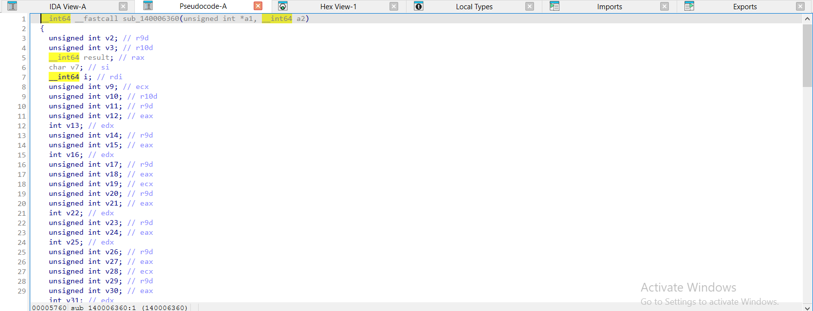

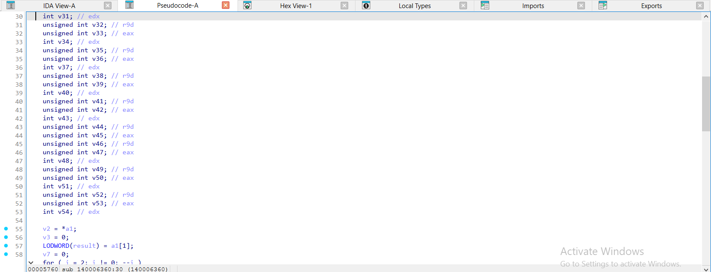

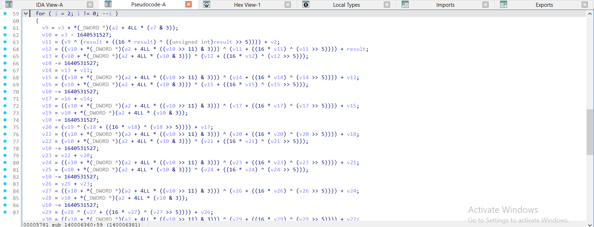

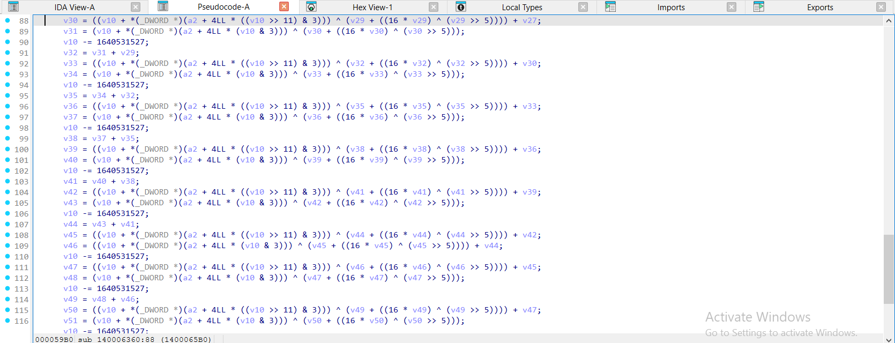

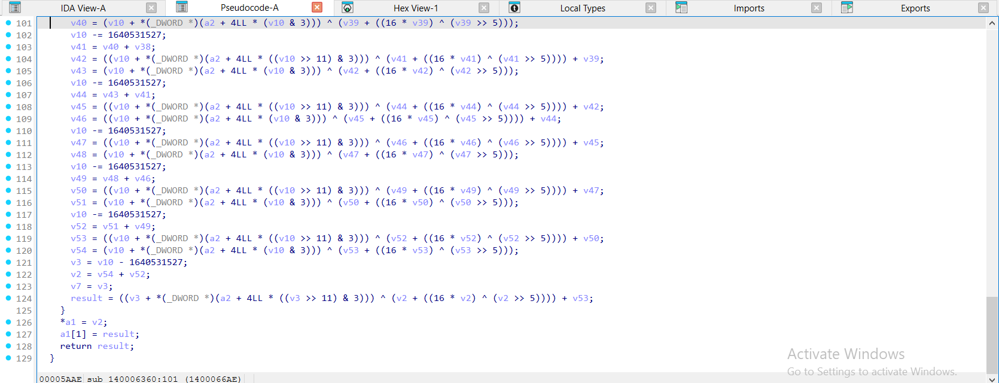

</details>

<details><summary>gcc -O2 – ELF, đã `strip -s` – xtea_encrypt = <code>sub_2FD0</code> – 1 ảnh</summary>

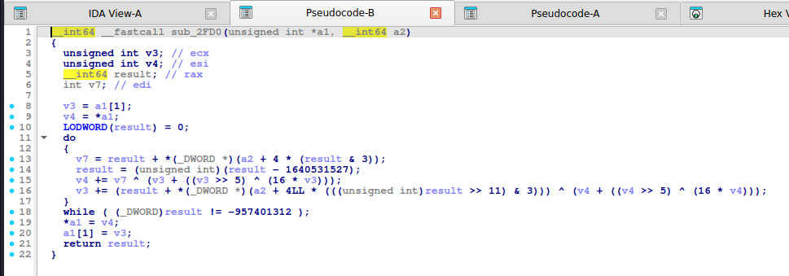

</details>

<details><summary>mingw-w64 -O2 -static – PE, đã `strip -s` – xtea_encrypt = <code>sub_140002610</code> – 1 ảnh</summary>

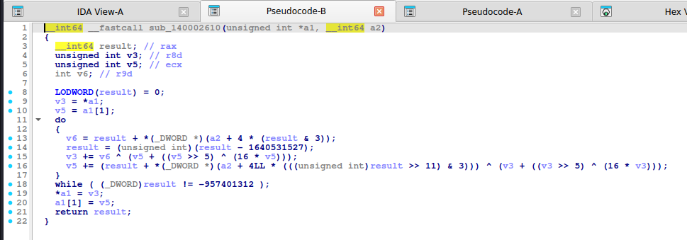

</details>

**xtea_decrypt:**

<details><summary>MSVC /O2 - PE x64 (có PDB)</summary>

```c
void __fastcall xtea_decrypt(unsigned int *v, const unsigned int *k)
{
  unsigned int v2; // r10d
  unsigned int v3; // r11d
  unsigned int v4; // eax
  unsigned __int64 v5; // r9
  __int64 i; // rsi
  unsigned int v9; // ecx
  unsigned int v10; // r11d
  unsigned int v11; // eax
  unsigned int v12; // r10d
  unsigned int v13; // edx
  unsigned int v14; // eax
  unsigned int v15; // r10d
  unsigned int v16; // edx
  unsigned int v17; // eax
  unsigned int v18; // r10d
  unsigned int v19; // ecx
  unsigned int v20; // eax
  unsigned int v21; // r10d
  unsigned int v22; // edx
  unsigned int v23; // eax
  unsigned int v24; // r10d
  unsigned int v25; // edx
  unsigned int v26; // eax
  unsigned int v27; // r10d
  unsigned int v28; // ecx
  unsigned int v29; // eax
  unsigned int v30; // r10d
  unsigned int v31; // edx
  unsigned int v32; // eax
  unsigned int v33; // r10d
  unsigned int v34; // edx
  unsigned int v35; // eax
  unsigned int v36; // r10d
  unsigned int v37; // ecx
  unsigned int v38; // eax
  unsigned int v39; // r10d
  unsigned int v40; // edx
  unsigned int v41; // eax
  unsigned int v42; // r10d
  unsigned int v43; // edx
  unsigned int v44; // eax
  unsigned int v45; // r10d
  unsigned int v46; // eax
  unsigned int v47; // r10d
  unsigned int v48; // edx
  unsigned int v49; // eax
  unsigned int v50; // r10d
  unsigned int v51; // edx
  unsigned int v52; // eax
  unsigned int v53; // r10d

  v2 = *v;
  v3 = -957401312;
  v4 = v[1];
  v5 = 3337565984LL;
  for ( i = 2; i != 0; --i )
  {
    v9 = v3 + k[(v5 >> 11) & 3];
    v10 = v3 + 1640531527;
    v11 = v4 - (v9 ^ (v2 + ((16 * v2) ^ (v2 >> 5))));
    v12 = v2 - ((v10 + k[v10 & 3]) ^ (v11 + ((16 * v11) ^ (v11 >> 5))));
    v13 = (v10 + k[(v10 >> 11) & 3]) ^ (v12 + ((16 * v12) ^ (v12 >> 5)));
    v10 += 1640531527;
    v14 = v11 - v13;
    v15 = v12 - ((v10 + k[v10 & 3]) ^ (v14 + ((16 * v14) ^ (v14 >> 5))));
    v16 = (v10 + k[(v10 >> 11) & 3]) ^ (v15 + ((16 * v15) ^ (v15 >> 5)));
    v10 += 1640531527;
    v17 = v14 - v16;
    v18 = v15 - ((v10 + k[v10 & 3]) ^ (v17 + ((16 * v17) ^ (v17 >> 5))));
    v19 = v10 + k[(v10 >> 11) & 3];
    v10 += 1640531527;
    v20 = v17 - (v19 ^ (v18 + ((16 * v18) ^ (v18 >> 5))));
    v21 = v18 - ((v10 + k[v10 & 3]) ^ (v20 + ((16 * v20) ^ (v20 >> 5))));
    v22 = (v10 + k[(v10 >> 11) & 3]) ^ (v21 + ((16 * v21) ^ (v21 >> 5)));
    v10 += 1640531527;
    v23 = v20 - v22;
    v24 = v21 - ((v10 + k[v10 & 3]) ^ (v23 + ((16 * v23) ^ (v23 >> 5))));
    v25 = (v10 + k[(v10 >> 11) & 3]) ^ (v24 + ((16 * v24) ^ (v24 >> 5)));
    v10 += 1640531527;
    v26 = v23 - v25;
    v27 = v24 - ((v10 + k[v10 & 3]) ^ (v26 + ((16 * v26) ^ (v26 >> 5))));
    v28 = v10 + k[(v10 >> 11) & 3];
    v10 += 1640531527;
    v29 = v26 - (v28 ^ (v27 + ((16 * v27) ^ (v27 >> 5))));
    v30 = v27 - ((v10 + k[v10 & 3]) ^ (v29 + ((16 * v29) ^ (v29 >> 5))));
    v31 = (v10 + k[(v10 >> 11) & 3]) ^ (v30 + ((16 * v30) ^ (v30 >> 5)));
    v10 += 1640531527;
    v32 = v29 - v31;
    v33 = v30 - ((v10 + k[v10 & 3]) ^ (v32 + ((16 * v32) ^ (v32 >> 5))));
    v34 = (v10 + k[(v10 >> 11) & 3]) ^ (v33 + ((16 * v33) ^ (v33 >> 5)));
    v10 += 1640531527;
    v35 = v32 - v34;
    v36 = v33 - ((v10 + k[v10 & 3]) ^ (v35 + ((16 * v35) ^ (v35 >> 5))));
    v37 = v10 + k[(v10 >> 11) & 3];
    v10 += 1640531527;
    v38 = v35 - (v37 ^ (v36 + ((16 * v36) ^ (v36 >> 5))));
    v39 = v36 - ((v10 + k[v10 & 3]) ^ (v38 + ((16 * v38) ^ (v38 >> 5))));
    v40 = (v10 + k[(v10 >> 11) & 3]) ^ (v39 + ((16 * v39) ^ (v39 >> 5)));
    v10 += 1640531527;
    v41 = v38 - v40;
    v42 = v39 - ((v10 + k[v10 & 3]) ^ (v41 + ((16 * v41) ^ (v41 >> 5))));
    v43 = (v10 + k[(v10 >> 11) & 3]) ^ (v42 + ((16 * v42) ^ (v42 >> 5)));
    v10 += 1640531527;
    v44 = v41 - v43;
    v45 = v42 - ((v10 + k[v10 & 3]) ^ (v44 + ((16 * v44) ^ (v44 >> 5))));
    v46 = v44 - ((v10 + k[(v10 >> 11) & 3]) ^ (v45 + ((16 * v45) ^ (v45 >> 5))));
    v10 += 1640531527;
    v47 = v45 - ((v10 + k[v10 & 3]) ^ (v46 + ((16 * v46) ^ (v46 >> 5))));
    v48 = (v10 + k[(v10 >> 11) & 3]) ^ (v47 + ((16 * v47) ^ (v47 >> 5)));
    v10 += 1640531527;
    v49 = v46 - v48;
    v50 = v47 - ((v10 + k[v10 & 3]) ^ (v49 + ((16 * v49) ^ (v49 >> 5))));
    v51 = (v10 + k[(v10 >> 11) & 3]) ^ (v50 + ((16 * v50) ^ (v50 >> 5)));
    v10 += 1640531527;
    v52 = v49 - v51;
    v53 = v50 - ((v10 + k[v10 & 3]) ^ (v52 + ((16 * v52) ^ (v52 >> 5))));
    v4 = v52 - ((v10 + k[(v10 >> 11) & 3]) ^ (v53 + ((16 * v53) ^ (v53 >> 5))));
    v3 = v10 + 1640531527;
    v5 = v3;
    v2 = v53 - ((v3 + k[v3 & 3]) ^ (v4 + ((16 * v4) ^ (v4 >> 5))));
  }
  *v = v2;
  v[1] = v4;
}
```

</details>

<details><summary>MSVC /Od - PE x64 (có PDB)</summary>

```c
void __fastcall xtea_decrypt(unsigned int *v, const unsigned int *k)
{
  unsigned int sum; // [rsp+0h] [rbp-28h]
  unsigned int v0; // [rsp+4h] [rbp-24h]
  unsigned int v1; // [rsp+8h] [rbp-20h]
  int i; // [rsp+Ch] [rbp-1Ch]

  v0 = *v;
  v1 = v[1];
  sum = -957401312;
  for ( i = 0; i < 32; ++i )
  {
    v1 -= (k[(sum >> 11) & 3] + sum) ^ (v0 + ((v0 >> 5) ^ (16 * v0)));
    sum += 1640531527;
    v0 -= (k[sum & 3] + sum) ^ (v1 + ((v1 >> 5) ^ (16 * v1)));
  }
  *v = v0;
  v[1] = v1;
}
```

</details>

<details><summary>gcc -O2 - ELF x86-64 (chưa strip)</summary>

```c
__int64 __fastcall xtea_decrypt(unsigned int *a1, __int64 a2)
{
  unsigned int v3; // ecx
  unsigned int v4; // esi
  __int64 result; // rax
  int v7; // edi

  v3 = a1[1];
  v4 = *a1;
  LODWORD(result) = -957401312;
  do
  {
    v7 = result + *(_DWORD *)(a2 + 4LL * (((unsigned int)result >> 11) & 3));
    result = (unsigned int)(result + 1640531527);
    v3 -= v7 ^ (v4 + ((v4 >> 5) ^ (16 * v4)));
    v4 -= (result + *(_DWORD *)(a2 + 4 * (result & 3))) ^ (v3 + ((v3 >> 5) ^ (16 * v3)));
  }
  while ( (_DWORD)result != 0 );
  *a1 = v4;
  a1[1] = v3;
  return result;
}
```

</details>

<details><summary>gcc -O0 - ELF x86-64 (chưa strip)</summary>

```c
__int64 __fastcall xtea_decrypt(unsigned int *a1, __int64 a2)
{
  int i; // [rsp+20h] [rbp-10h]
  unsigned int v4; // [rsp+24h] [rbp-Ch]
  unsigned int v5; // [rsp+28h] [rbp-8h]
  unsigned int v6; // [rsp+2Ch] [rbp-4h]

  v6 = *a1;
  v5 = a1[1];
  v4 = -957401312;
  for ( i = 0; i <= 31; ++i )
  {
    v5 -= (((v6 >> 5) ^ (16 * v6)) + v6) ^ (*(_DWORD *)(4LL * ((v4 >> 11) & 3) + a2) + v4);
    v4 += 1640531527;
    v6 -= (((v5 >> 5) ^ (16 * v5)) + v5) ^ (*(_DWORD *)(4LL * (v4 & 3) + a2) + v4);
  }
  *a1 = v6;
  a1[1] = v5;
  return v5;
}
```

</details>

<details><summary>mingw-w64 gcc -O2 - PE x64 (-static)</summary>

```c
__int64 __fastcall xtea_decrypt(unsigned int *a1, __int64 a2)
{
  __int64 result; // rax
  unsigned int v3; // r8d
  unsigned int v5; // ecx
  int v6; // r9d

  LODWORD(result) = -957401312;
  v3 = *a1;
  v5 = a1[1];
  do
  {
    v6 = result + *(_DWORD *)(a2 + 4LL * (((unsigned int)result >> 11) & 3));
    result = (unsigned int)(result + 1640531527);
    v5 -= v6 ^ (v3 + ((v3 >> 5) ^ (16 * v3)));
    v3 -= (result + *(_DWORD *)(a2 + 4 * (result & 3))) ^ (v5 + ((v5 >> 5) ^ (16 * v5)));
  }
  while ( (_DWORD)result != 0 );
  *a1 = v3;
  a1[1] = v5;
  return result;
}
```

</details>

<details><summary>mingw-w64 gcc -O0 - PE x64 (-static)</summary>

```c
__int64 __fastcall xtea_decrypt(unsigned int *a1, __int64 a2)
{
  int i; // [rsp+10h] [rbp-10h]
  unsigned int v4; // [rsp+14h] [rbp-Ch]
  unsigned int v5; // [rsp+18h] [rbp-8h]
  unsigned int v6; // [rsp+1Ch] [rbp-4h]

  v6 = *a1;
  v5 = a1[1];
  v4 = -957401312;
  for ( i = 0; i <= 31; ++i )
  {
    v5 -= (((v6 >> 5) ^ (16 * v6)) + v6) ^ (*(_DWORD *)(4LL * ((v4 >> 11) & 3) + a2) + v4);
    v4 += 1640531527;
    v6 -= (((v5 >> 5) ^ (16 * v5)) + v5) ^ (*(_DWORD *)(4LL * (v4 & 3) + a2) + v4);
  }
  *a1 = v6;
  a1[1] = v5;
  return v5;
}
```

</details>

**Bản strip (không symbol)** – IDA chỉ thấy `sub_XXXX`, `a1`, `a2`, `byte_XXXX`; hàm này tên là MSVC /O2 → `sub_140005DE0`, gcc -O2 → `sub_3040`, mingw-w64 -O2 -static → `sub_140002680`:

<details><summary>MSVC /O2 – PE x64, không PDB (strip) – bản STRIP: <code>xtea_decrypt</code> = <code>sub_140005DE0</code></summary>

```c
__int64 __fastcall sub_140005DE0(unsigned int *a1, __int64 a2)
{
  unsigned int v2; // r10d
  unsigned int v3; // r11d
  __int64 result; // rax
  unsigned __int64 v5; // r9
  __int64 i; // rsi
  unsigned int v9; // ecx
  unsigned int v10; // r11d
  unsigned int v11; // eax
  unsigned int v12; // r10d
  int v13; // edx
  unsigned int v14; // eax
  unsigned int v15; // r10d
  int v16; // edx
  unsigned int v17; // eax
  unsigned int v18; // r10d
  unsigned int v19; // ecx
  unsigned int v20; // eax
  unsigned int v21; // r10d
  int v22; // edx
  unsigned int v23; // eax
  unsigned int v24; // r10d
  int v25; // edx
  unsigned int v26; // eax
  unsigned int v27; // r10d
  unsigned int v28; // ecx
  unsigned int v29; // eax
  unsigned int v30; // r10d
  int v31; // edx
  unsigned int v32; // eax
  unsigned int v33; // r10d
  int v34; // edx
  unsigned int v35; // eax
  unsigned int v36; // r10d
  unsigned int v37; // ecx
  unsigned int v38; // eax
  unsigned int v39; // r10d
  int v40; // edx
  unsigned int v41; // eax
  unsigned int v42; // r10d
  int v43; // edx
  unsigned int v44; // eax
  unsigned int v45; // r10d
  unsigned int v46; // eax
  unsigned int v47; // r10d
  int v48; // edx
  unsigned int v49; // eax
  unsigned int v50; // r10d
  int v51; // edx
  unsigned int v52; // eax
  unsigned int v53; // r10d

  v2 = *a1;
  v3 = -957401312;
  LODWORD(result) = a1[1];
  v5 = 3337565984LL;
  for ( i = 2; i != 0; --i )
  {
    v9 = v3 + *(_DWORD *)(a2 + 4 * ((v5 >> 11) & 3));
    v10 = v3 + 1640531527;
    v11 = result - (v9 ^ (v2 + ((16 * v2) ^ (v2 >> 5))));
    v12 = v2 - ((v10 + *(_DWORD *)(a2 + 4LL * (v10 & 3))) ^ (v11 + ((16 * v11) ^ (v11 >> 5))));
    v13 = (v10 + *(_DWORD *)(a2 + 4LL * ((v10 >> 11) & 3))) ^ (v12 + ((16 * v12) ^ (v12 >> 5)));
    v10 += 1640531527;
    v14 = v11 - v13;
    v15 = v12 - ((v10 + *(_DWORD *)(a2 + 4LL * (v10 & 3))) ^ (v14 + ((16 * v14) ^ (v14 >> 5))));
    v16 = (v10 + *(_DWORD *)(a2 + 4LL * ((v10 >> 11) & 3))) ^ (v15 + ((16 * v15) ^ (v15 >> 5)));
    v10 += 1640531527;
    v17 = v14 - v16;
    v18 = v15 - ((v10 + *(_DWORD *)(a2 + 4LL * (v10 & 3))) ^ (v17 + ((16 * v17) ^ (v17 >> 5))));
    v19 = v10 + *(_DWORD *)(a2 + 4LL * ((v10 >> 11) & 3));
    v10 += 1640531527;
    v20 = v17 - (v19 ^ (v18 + ((16 * v18) ^ (v18 >> 5))));
    v21 = v18 - ((v10 + *(_DWORD *)(a2 + 4LL * (v10 & 3))) ^ (v20 + ((16 * v20) ^ (v20 >> 5))));
    v22 = (v10 + *(_DWORD *)(a2 + 4LL * ((v10 >> 11) & 3))) ^ (v21 + ((16 * v21) ^ (v21 >> 5)));
    v10 += 1640531527;
    v23 = v20 - v22;
    v24 = v21 - ((v10 + *(_DWORD *)(a2 + 4LL * (v10 & 3))) ^ (v23 + ((16 * v23) ^ (v23 >> 5))));
    v25 = (v10 + *(_DWORD *)(a2 + 4LL * ((v10 >> 11) & 3))) ^ (v24 + ((16 * v24) ^ (v24 >> 5)));
    v10 += 1640531527;
    v26 = v23 - v25;
    v27 = v24 - ((v10 + *(_DWORD *)(a2 + 4LL * (v10 & 3))) ^ (v26 + ((16 * v26) ^ (v26 >> 5))));
    v28 = v10 + *(_DWORD *)(a2 + 4LL * ((v10 >> 11) & 3));
    v10 += 1640531527;
    v29 = v26 - (v28 ^ (v27 + ((16 * v27) ^ (v27 >> 5))));
    v30 = v27 - ((v10 + *(_DWORD *)(a2 + 4LL * (v10 & 3))) ^ (v29 + ((16 * v29) ^ (v29 >> 5))));
    v31 = (v10 + *(_DWORD *)(a2 + 4LL * ((v10 >> 11) & 3))) ^ (v30 + ((16 * v30) ^ (v30 >> 5)));
    v10 += 1640531527;
    v32 = v29 - v31;
    v33 = v30 - ((v10 + *(_DWORD *)(a2 + 4LL * (v10 & 3))) ^ (v32 + ((16 * v32) ^ (v32 >> 5))));
    v34 = (v10 + *(_DWORD *)(a2 + 4LL * ((v10 >> 11) & 3))) ^ (v33 + ((16 * v33) ^ (v33 >> 5)));
    v10 += 1640531527;
    v35 = v32 - v34;
    v36 = v33 - ((v10 + *(_DWORD *)(a2 + 4LL * (v10 & 3))) ^ (v35 + ((16 * v35) ^ (v35 >> 5))));
    v37 = v10 + *(_DWORD *)(a2 + 4LL * ((v10 >> 11) & 3));
    v10 += 1640531527;
    v38 = v35 - (v37 ^ (v36 + ((16 * v36) ^ (v36 >> 5))));
    v39 = v36 - ((v10 + *(_DWORD *)(a2 + 4LL * (v10 & 3))) ^ (v38 + ((16 * v38) ^ (v38 >> 5))));
    v40 = (v10 + *(_DWORD *)(a2 + 4LL * ((v10 >> 11) & 3))) ^ (v39 + ((16 * v39) ^ (v39 >> 5)));
    v10 += 1640531527;
    v41 = v38 - v40;
    v42 = v39 - ((v10 + *(_DWORD *)(a2 + 4LL * (v10 & 3))) ^ (v41 + ((16 * v41) ^ (v41 >> 5))));
    v43 = (v10 + *(_DWORD *)(a2 + 4LL * ((v10 >> 11) & 3))) ^ (v42 + ((16 * v42) ^ (v42 >> 5)));
    v10 += 1640531527;
    v44 = v41 - v43;
    v45 = v42 - ((v10 + *(_DWORD *)(a2 + 4LL * (v10 & 3))) ^ (v44 + ((16 * v44) ^ (v44 >> 5))));
    v46 = v44 - ((v10 + *(_DWORD *)(a2 + 4LL * ((v10 >> 11) & 3))) ^ (v45 + ((16 * v45) ^ (v45 >> 5))));
    v10 += 1640531527;
    v47 = v45 - ((v10 + *(_DWORD *)(a2 + 4LL * (v10 & 3))) ^ (v46 + ((16 * v46) ^ (v46 >> 5))));
    v48 = (v10 + *(_DWORD *)(a2 + 4LL * ((v10 >> 11) & 3))) ^ (v47 + ((16 * v47) ^ (v47 >> 5)));
    v10 += 1640531527;
    v49 = v46 - v48;
    v50 = v47 - ((v10 + *(_DWORD *)(a2 + 4LL * (v10 & 3))) ^ (v49 + ((16 * v49) ^ (v49 >> 5))));
    v51 = (v10 + *(_DWORD *)(a2 + 4LL * ((v10 >> 11) & 3))) ^ (v50 + ((16 * v50) ^ (v50 >> 5)));
    v10 += 1640531527;
    v52 = v49 - v51;
    v53 = v50 - ((v10 + *(_DWORD *)(a2 + 4LL * (v10 & 3))) ^ (v52 + ((16 * v52) ^ (v52 >> 5))));
    result = v52 - ((v10 + *(_DWORD *)(a2 + 4LL * ((v10 >> 11) & 3))) ^ (v53 + ((16 * v53) ^ (v53 >> 5))));
    v3 = v10 + 1640531527;
    v5 = v3;
    v2 = v53 - ((v3 + *(_DWORD *)(a2 + 4LL * (v3 & 3))) ^ (result + ((16 * result) ^ ((unsigned int)result >> 5))));
  }
  *a1 = v2;
  a1[1] = result;
  return result;
}
```

</details>

<details><summary>gcc -O2 – ELF, đã `strip -s` – bản STRIP: <code>xtea_decrypt</code> = <code>sub_3040</code></summary>

```c
__int64 __fastcall sub_3040(unsigned int *a1, __int64 a2)
{
  unsigned int v3; // ecx
  unsigned int v4; // esi
  __int64 result; // rax
  int v7; // edi

  v3 = a1[1];
  v4 = *a1;
  LODWORD(result) = -957401312;
  do
  {
    v7 = result + *(_DWORD *)(a2 + 4LL * (((unsigned int)result >> 11) & 3));
    result = (unsigned int)(result + 1640531527);
    v3 -= v7 ^ (v4 + ((v4 >> 5) ^ (16 * v4)));
    v4 -= (result + *(_DWORD *)(a2 + 4 * (result & 3))) ^ (v3 + ((v3 >> 5) ^ (16 * v3)));
  }
  while ( (_DWORD)result != 0 );
  *a1 = v4;
  a1[1] = v3;
  return result;
}
```

</details>

<details><summary>mingw-w64 -O2 -static – PE, đã `strip -s` – bản STRIP: <code>xtea_decrypt</code> = <code>sub_140002680</code></summary>

```c
__int64 __fastcall sub_140002680(unsigned int *a1, __int64 a2)
{
  __int64 result; // rax
  unsigned int v3; // r8d
  unsigned int v5; // ecx
  int v6; // r9d

  LODWORD(result) = -957401312;
  v3 = *a1;
  v5 = a1[1];
  do
  {
    v6 = result + *(_DWORD *)(a2 + 4LL * (((unsigned int)result >> 11) & 3));
    result = (unsigned int)(result + 1640531527);
    v5 -= v6 ^ (v3 + ((v3 >> 5) ^ (16 * v3)));
    v3 -= (result + *(_DWORD *)(a2 + 4 * (result & 3))) ^ (v5 + ((v5 >> 5) ^ (16 * v5)));
  }
  while ( (_DWORD)result != 0 );
  *a1 = v3;
  a1[1] = v5;
  return result;
}
```

</details>

**Ảnh chụp màn hình IDA (bản strip)** – mở từng mục để xem; hàm dài chia thành nhiều trang, mỗi trang là một màn hình IDA:

<details><summary>MSVC /O2 – PE x64, không PDB (strip) – xtea_decrypt = <code>sub_140005DE0</code> – 5 ảnh</summary>

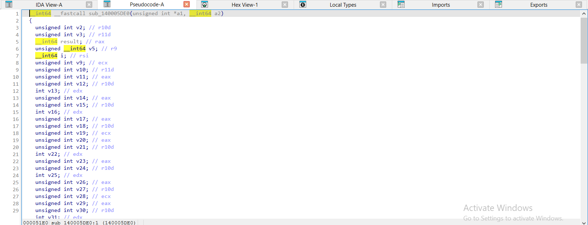

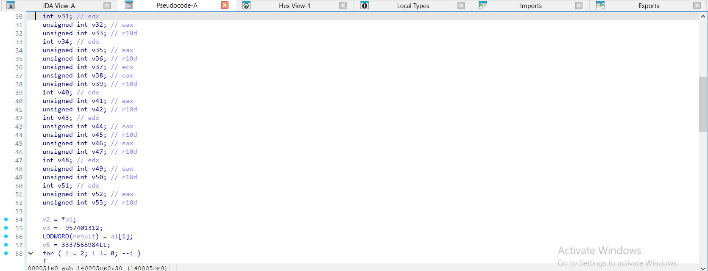

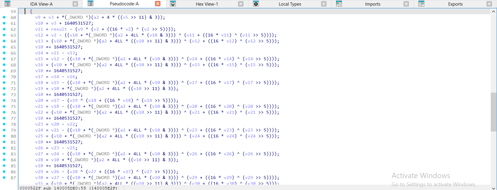

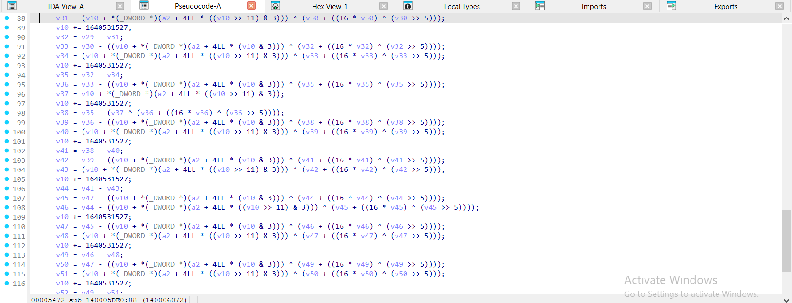

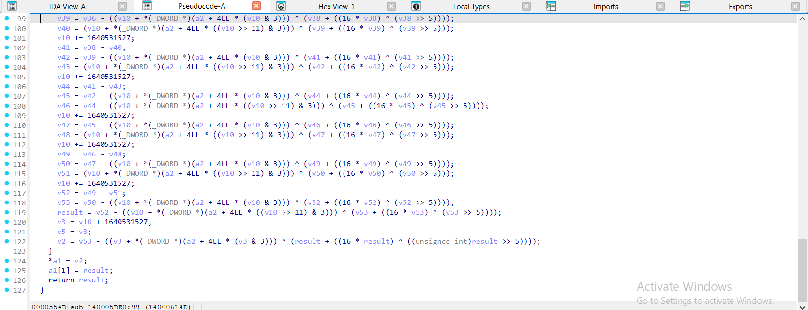

</details>

<details><summary>gcc -O2 – ELF, đã `strip -s` – xtea_decrypt = <code>sub_3040</code> – 1 ảnh</summary>

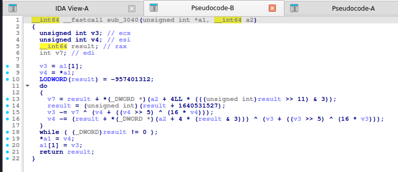

</details>

<details><summary>mingw-w64 -O2 -static – PE, đã `strip -s` – xtea_decrypt = <code>sub_140002680</code> – 1 ảnh</summary>

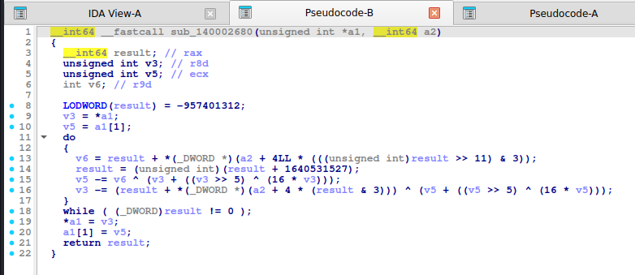

</details>

Nhận xét:

- **MSVC `/O2` bung vòng**: 32 vòng thành **`for ( i = 2; i != 0; --i )` × 16 vòng viết liền nhau** (`v10 -= 1640531527;` lặp 16 lần, hàng chục biến `v9..v54`). Đừng đọc hết: đếm số lần xuất hiện `v10 -= 1640531527` (16 lần × 2 vòng ngoài = 32) và các mảnh `k[v10 & 3]`, `k[(v10 >> 11) & 3]` là đủ kết luận XTEA.
- gcc `-O2`: biến `result` (chính là `sum`) được dùng luôn làm giá trị trả về; điều kiện dừng `(_DWORD)result != -957401312` (encrypt) hoặc `!= 0` (decrypt, vì giải mã đếm `sum` về 0). Nhận diện bằng `(x >> 11) & 3` và `& 3` truy cập mảng khóa.

## 6. Code giải mã

**Python:**

```python
M32 = 0xFFFFFFFF
DELTA = 0x9E3779B9
def _u32(b): return [int.from_bytes(b[i:i + 4], "little") for i in range(0, len(b), 4)]


def _p32(v): return b"".join(x.to_bytes(4, "little") for x in v)


def xtea_decrypt_block(v0, v1, k, rounds=32):
    s = (DELTA * rounds) & M32
    for _ in range(rounds):
        v1 = (v1 - ((((v0 << 4) ^ (v0 >> 5)) + v0) ^ (s + k[(s >> 11) & 3]))) & M32
        s = (s - DELTA) & M32
        v0 = (v0 - ((((v1 << 4) ^ (v1 >> 5)) + v1) ^ (s + k[s & 3]))) & M32
    return v0, v1


def xtea_decrypt(data, key4):
    w, out = _u32(data), []
    for i in range(0, len(w), 2):
        out += xtea_decrypt_block(w[i], w[i + 1], key4)
    return _p32(out)
```

**C:**

```c
#include <stdint.h>
#include <stddef.h>
#include <string.h>

#define CTF_DELTA 0x9E3779B9u

static inline void ctf_xtea_decrypt(uint32_t v[2], const uint32_t k[4])
{
    uint32_t v0 = v[0], v1 = v[1], sum = CTF_DELTA * 32;
    for (int i = 0; i < 32; i++) {
        v1 -= (((v0 << 4) ^ (v0 >> 5)) + v0) ^ (sum + k[(sum >> 11) & 3]);
        sum -= CTF_DELTA;
        v0 -= (((v1 << 4) ^ (v1 >> 5)) + v1) ^ (sum + k[sum & 3]);
    }
    v[0] = v0; v[1] = v1;
}
```

## 7. Biến thể & bẫy

- Số vòng 64 (khuyến nghị) hoặc 32: số vòng chính là **hằng dừng** (`delta × số_vòng`).
- Nhầm TEA ↔ XTEA: giải bằng sai thuật toán cho rác. Kiểm tra `k[sum & 3]` (XTEA) so với `k[0..3]` cố định (TEA).
- Có biến thể **XTEA big-endian** (đọc `uint32` big-endian); thử cả hai nếu ra rác.
