# XXTEA (Corrected Block TEA, "btea")

> Mã khối **kích thước biến đổi** (n ≥ 2 từ 32-bit): xử lý cả mảng như một vòng tròn; số vòng `6 + 52/n`; cùng delta `0x9E3779B9`; khóa 128-bit.

## 1. Dấu hiệu nhận biết

- Hằng delta `0x9E3779B9` (`-1640531527`) kèm **`52 / n + 6`** (`52 / a2 + 6`) tính số vòng ở đầu hàm – **chữ ký quan trọng nhất**.
- Hàm nhận **con trỏ mảng `uint32_t*` + độ dài `n`** (không cố định 2 từ), key 4 từ.
- Biến **`e = (sum >> 2) & 3`** và truy cập khóa **`key[(p & 3) ^ e]`** (`4LL * (v7 ^ j & 3u)`).
- Công thức "MX" (đặt tên trong C gốc):
  `(((z >> 5) ^ (y << 2)) + ((y >> 3) ^ (z << 4))) ^ ((sum ^ y) + (key[(p & 3) ^ e] ^ z))`.
  IDA hiện `4 * y`, `16 * z`, `>> 5`, `>> 3`, trộn bằng `^` và `+`.
- Vòng lặp **lồng**: ngoài lặp `rounds` lần (và `sum += delta`), trong lặp `p = 0..n-2`, cuối cùng xử lý phần tử cuối với phần tử đầu (`v[n-1]` và `v[0]`).
- Dữ liệu cần **ít nhất 8 byte** và bội 4 byte.

## 2. Thuật toán (mã giả)

```
MX(y, z, sum, p, e) = (((z>>5) ^ (y<<2)) + ((y>>3) ^ (z<<4))) ^ ((sum^y) + (key[(p&3)^e] ^ z))

encrypt(v[0..n-1], key[4]):
    rounds = 6 + 52/n;  sum = 0;  z = v[n-1]
    repeat rounds:
        sum += 0x9E3779B9;  e = (sum >> 2) & 3
        for p in 0..n-2:  y = v[p+1];  z = v[p] += MX(y, z, sum, p, e)
        y = v[0];         z = v[n-1] += MX(y, z, sum, n-1, e)

decrypt:
    rounds = 6 + 52/n;  sum = rounds * 0x9E3779B9;  y = v[0]
    repeat rounds:
        e = (sum >> 2) & 3
        for p in n-1 .. 1:  z = v[p-1];  y = v[p] -= MX(y, z, sum, p, e)
        z = v[n-1];  y = v[0] -= MX(y, z, sum, 0, e);  sum -= 0x9E3779B9
```

## 3. Mã hóa / giải mã

Cả buffer là **một khối duy nhất** (không chia khối 8 byte); `n = len/4`. Độ dài thông điệp ảnh hưởng số vòng nên **không được cắt/bỏ padding trước khi giải**.

## 4. Mã nguồn gốc (C)

```c
#define MX (((z >> 5 ^ y << 2) + (y >> 3 ^ z << 4)) ^ ((sum ^ y) + (key[(p & 3) ^ e] ^ z)))
```

```c
void xxtea_encrypt(uint32_t *v, int n, const uint32_t key[4])
{
    uint32_t y, z, sum = 0, e, delta = 0x9E3779B9;
    int p, rounds = 6 + 52 / n;
    z = v[n - 1];
    while (rounds-- > 0) {
        sum += delta;
        e = (sum >> 2) & 3;
        for (p = 0; p < n - 1; p++) {
            y = v[p + 1];
            z = v[p] += MX;
        }
        y = v[0];
        z = v[n - 1] += MX;
    }
}

void xxtea_decrypt(uint32_t *v, int n, const uint32_t key[4])
{
    uint32_t y, z, sum, e, delta = 0x9E3779B9;
    int p, rounds = 6 + 52 / n;
    sum = (uint32_t)rounds * delta;
    y = v[0];
    do {
        e = (sum >> 2) & 3;
        for (p = n - 1; p > 0; p--) {
            z = v[p - 1];
            y = v[p] -= MX;
        }
        z = v[n - 1];
        y = v[0] -= MX;
        sum -= delta;
    } while (--rounds);
}
```

## 5. Pseudo-code IDA thực tế

**xxtea_encrypt:**

<details><summary>MSVC /O2 - PE x64 (có PDB)</summary>

```c
void __fastcall xxtea_encrypt(unsigned int *v, int n, const unsigned int *key)
{
  unsigned int v3; // ebx
  unsigned int v4; // r11d
  int v6; // r12d
  int v7; // esi
  int v8; // edi
  __int64 v9; // rax
  unsigned int v10; // ebp
  unsigned int *v11; // r14
  unsigned int v12; // r10d
  __int64 v13; // rcx
  unsigned int *v14; // [rsp+30h] [rbp+8h]

  v3 = 0;
  v4 = v[n - 1];
  v6 = n - 1;
  v7 = 52 / n + 6;
  if ( v7 > 0 )
  {
    v14 = &v[n - 1];
    do
    {
      v3 -= 1640531527;
      --v7;
      v8 = 0;
      v9 = (v3 >> 2) & 3;
      if ( v6 > 0 )
      {
        v10 = *v;
        v11 = v;
        do
        {
          v12 = v11[1];
          ++v11;
          v13 = v9 ^ v8++ & 3;
          v4 = v10 + ((((16 * v4) ^ (v12 >> 3)) + ((v4 >> 5) ^ (4 * v12))) ^ ((v3 ^ v12) + (key[v13] ^ v4)));
          v10 = v12;
          *(v11 - 1) = v4;
        }
        while ( v8 < v6 );
      }
      *v14 += ((v3 ^ *v) + (v4 ^ key[v9 ^ v8 & 3])) ^ (((16 * v4) ^ (*v >> 3)) + ((v4 >> 5) ^ (4 * *v)));
      v4 = *v14;
    }
    while ( v7 > 0 );
  }
}
```

</details>

<details><summary>MSVC /Od - PE x64 (có PDB)</summary>

```c
void __fastcall xxtea_encrypt(unsigned int *v, int n, const unsigned int *key)
{
  int p; // [rsp+0h] [rbp-38h]
  unsigned int z; // [rsp+4h] [rbp-34h]
  unsigned int y; // [rsp+8h] [rbp-30h]
  unsigned int sum; // [rsp+Ch] [rbp-2Ch]
  int rounds; // [rsp+10h] [rbp-28h]
  unsigned int v8; // [rsp+14h] [rbp-24h]
  unsigned int e; // [rsp+18h] [rbp-20h]
  unsigned int v10; // [rsp+1Ch] [rbp-1Ch]
  int v11; // [rsp+20h] [rbp-18h]

  sum = 0;
  rounds = 52 / n + 6;
  for ( z = v[n - 1]; ; z = v10 )
  {
    v11 = rounds--;
    if ( v11 <= 0 )
      break;
    sum -= 1640531527;
    e = (sum >> 2) & 3;
    for ( p = 0; p < n - 1; ++p )
    {
      y = v[p + 1];
      v8 = (((z ^ key[e ^ p & 3]) + (y ^ sum)) ^ (((16 * z) ^ (y >> 3)) + ((4 * y) ^ (z >> 5)))) + v[p];
      v[p] = v8;
      z = v8;
    }
    v10 = (((z ^ key[e ^ p & 3]) + (*v ^ sum)) ^ (((16 * z) ^ (*v >> 3)) + ((4 * *v) ^ (z >> 5)))) + v[n - 1];
    v[n - 1] = v10;
  }
}
```

</details>

<details><summary>gcc -O2 - ELF x86-64 (chưa strip)</summary>

```c
__int64 __fastcall xxtea_encrypt(unsigned int *a1, int a2, __int64 a3)
{
  __int64 result; // rax
  unsigned int *v6; // r15
  unsigned int v7; // r11d
  __int64 v8; // r12
  unsigned int v10; // edx
  unsigned __int8 v11; // di
  int v12; // esi
  __int64 v13; // r13
  unsigned int v14; // r8d
  __int64 v15; // rax
  unsigned int v16; // r15d
  unsigned int *v17; // [rsp+0h] [rbp-40h]

  result = (unsigned int)(52 / a2);
  if ( (int)result >= -5 )
  {
    v6 = &a1[a2 - 1];
    v7 = 0;
    v8 = (unsigned int)(a2 - 1);
    v10 = *v6;
    v11 = a2 - 1;
    v12 = -1640531527 * result - 1253254570;
    do
    {
      v7 -= 1640531527;
      v13 = (v7 >> 2) & 3;
      if ( a2 > 1 )
      {
        v17 = v6;
        v14 = *a1;
        v15 = 0;
        do
        {
          v16 = v14;
          v14 = a1[v15 + 1];
          v10 = ((((16 * v10) ^ (v14 >> 3)) + ((4 * v14) ^ (v10 >> 5)))
               ^ ((v14 ^ v7) + (v10 ^ *(_DWORD *)(a3 + 4LL * (((v7 >> 2) & 3 ^ (unsigned __int8)v15) & 3)))))
              + v16;
          a1[v15++] = v10;
        }
        while ( v15 != v8 );
        v6 = v17;
        v13 = (v11 ^ (unsigned __int8)(v7 >> 2)) & 3;
      }
      result = *v6
             + (((v7 ^ *a1) + (*(_DWORD *)(a3 + 4 * v13) ^ v10)) ^ (((4 * *a1) ^ (v10 >> 5)) + ((16 * v10) ^ (*a1 >> 3))));
      *v6 = result;
      v10 = result;
    }
    while ( v7 != v12 );
  }
  return result;
}
```

</details>

<details><summary>gcc -O0 - ELF x86-64 (chưa strip)</summary>

```c
__int64 __fastcall xxtea_encrypt(_DWORD *a1, int a2, __int64 a3)
{
  unsigned int *v3; // rax
  unsigned int *v4; // rax
  __int64 result; // rax
  unsigned int v6; // [rsp+1Ch] [rbp-1Ch]
  int v7; // [rsp+20h] [rbp-18h]
  unsigned int v8; // [rsp+28h] [rbp-10h]
  int j; // [rsp+2Ch] [rbp-Ch]
  unsigned int v10; // [rsp+30h] [rbp-8h]
  unsigned int i; // [rsp+34h] [rbp-4h]

  v10 = 0;
  v8 = 52 / a2 + 6;
  for ( i = a1[a2 - 1]; ; i = *v4 )
  {
    result = v8--;
    if ( (int)result <= 0 )
      break;
    v10 -= 1640531527;
    v7 = (v10 >> 2) & 3;
    for ( j = 0; j < a2 - 1; ++j )
    {
      v6 = a1[j + 1];
      v3 = &a1[j];
      *v3 += ((v6 ^ v10) + (i ^ *(_DWORD *)(4LL * (v7 ^ j & 3u) + a3)))
           ^ (((4 * v6) ^ (i >> 5)) + ((v6 >> 3) ^ (16 * i)));
      i = *v3;
    }
    v4 = &a1[a2 - 1];
    *v4 += ((*a1 ^ v10) + (i ^ *(_DWORD *)(4LL * (v7 ^ j & 3u) + a3)))
         ^ (((4 * *a1) ^ (i >> 5)) + ((*a1 >> 3) ^ (16 * i)));
  }
  return result;
}
```

</details>

<details><summary>mingw-w64 gcc -O2 - PE x64 (-static)</summary>

```c
__int64 __fastcall xxtea_encrypt(unsigned int *a1, int a2, __int64 a3)
{
  char v3; // r12
  __int64 result; // rax
  unsigned int v6; // esi
  unsigned int *v8; // r15
  __int64 v9; // r13
  unsigned int v10; // edx
  unsigned __int8 v11; // r8
  int v12; // r9d
  __int64 v13; // r12
  unsigned int v14; // r10d
  __int64 v15; // rax
  unsigned int v16; // r15d
  unsigned int *v17; // [rsp+0h] [rbp-58h]

  v3 = a2;
  result = (unsigned int)(52 / a2);
  if ( (int)result >= -5 )
  {
    v6 = 0;
    v8 = &a1[a2 - 1];
    v9 = (unsigned int)(a2 - 1);
    v10 = *v8;
    v11 = v3 - 1;
    v12 = -1640531527 * result - 1253254570;
    do
    {
      v6 -= 1640531527;
      v13 = (v6 >> 2) & 3;
      if ( a2 > 1 )
      {
        v17 = v8;
        v14 = *a1;
        v15 = 0;
        do
        {
          v16 = v14;
          v14 = a1[v15 + 1];
          v10 = ((((16 * v10) ^ (v14 >> 3)) + ((4 * v14) ^ (v10 >> 5)))
               ^ ((v14 ^ v6) + (v10 ^ *(_DWORD *)(a3 + 4LL * (((v6 >> 2) & 3 ^ (unsigned __int8)v15) & 3)))))
              + v16;
          a1[v15++] = v10;
        }
        while ( v15 != v9 );
        v8 = v17;
        v13 = (v11 ^ (unsigned __int8)(v6 >> 2)) & 3;
      }
      result = *v8
             + (((v6 ^ *a1) + (*(_DWORD *)(a3 + 4 * v13) ^ v10)) ^ (((4 * *a1) ^ (v10 >> 5)) + ((16 * v10) ^ (*a1 >> 3))));
      *v8 = result;
      v10 = result;
    }
    while ( v6 != v12 );
  }
  return result;
}
```

</details>

<details><summary>mingw-w64 gcc -O0 - PE x64 (-static)</summary>

```c
__int64 __fastcall xxtea_encrypt(_DWORD *a1, int a2, __int64 a3)
{
  unsigned int *v3; // rax
  unsigned int *v4; // rax
  __int64 result; // rax
  unsigned int v6; // [rsp+4h] [rbp-1Ch]
  int v7; // [rsp+8h] [rbp-18h]
  unsigned int v8; // [rsp+10h] [rbp-10h]
  int j; // [rsp+14h] [rbp-Ch]
  unsigned int v10; // [rsp+18h] [rbp-8h]
  unsigned int i; // [rsp+1Ch] [rbp-4h]

  v10 = 0;
  v8 = 52 / a2 + 6;
  for ( i = a1[a2 - 1]; ; i = *v4 )
  {
    result = v8--;
    if ( (int)result <= 0 )
      break;
    v10 -= 1640531527;
    v7 = (v10 >> 2) & 3;
    for ( j = 0; j < a2 - 1; ++j )
    {
      v6 = a1[j + 1];
      v3 = &a1[j];
      *v3 += ((v6 ^ v10) + (i ^ *(_DWORD *)(4LL * (v7 ^ j & 3u) + a3)))
           ^ (((4 * v6) ^ (i >> 5)) + ((v6 >> 3) ^ (16 * i)));
      i = *v3;
    }
    v4 = &a1[a2 - 1];
    *v4 += ((*a1 ^ v10) + (i ^ *(_DWORD *)(4LL * (v7 ^ j & 3u) + a3)))
         ^ (((4 * *a1) ^ (i >> 5)) + ((*a1 >> 3) ^ (16 * i)));
  }
  return result;
}
```

</details>

**Bản strip (không symbol)** – IDA chỉ thấy `sub_XXXX`, `a1`, `a2`, `byte_XXXX`; hàm này tên là MSVC /O2 → `sub_1400069D0`, gcc -O2 → `sub_30B0`, mingw-w64 -O2 -static → `sub_140002700`:

<details><summary>MSVC /O2 – PE x64, không PDB (strip) – bản STRIP: <code>xxtea_encrypt</code> = <code>sub_1400069D0</code></summary>

```c
__int64 __fastcall sub_1400069D0(_DWORD *a1, int a2, __int64 a3)
{
  unsigned int v3; // ebx
  __int64 result; // rax
  unsigned int v5; // r11d
  int v7; // r12d
  int v8; // esi
  int v9; // edi
  __int64 v10; // rax
  int v11; // ebp
  _DWORD *v12; // r14
  unsigned int v13; // r10d
  __int64 v14; // rcx
  unsigned int *v15; // [rsp+30h] [rbp+8h]

  v3 = 0;
  result = (unsigned int)(52 / a2);
  v5 = a1[a2 - 1];
  v7 = a2 - 1;
  v8 = result + 6;
  if ( (int)result + 6 > 0 )
  {
    v15 = &a1[a2 - 1];
    do
    {
      v3 -= 1640531527;
      --v8;
      v9 = 0;
      v10 = (v3 >> 2) & 3;
      if ( v7 > 0 )
      {
        v11 = *a1;
        v12 = a1;
        do
        {
          v13 = v12[1];
          ++v12;
          v14 = v10 ^ v9++ & 3;
          v5 = v11
             + ((((16 * v5) ^ (v13 >> 3)) + ((v5 >> 5) ^ (4 * v13))) ^ ((v3 ^ v13) + (*(_DWORD *)(a3 + 4 * v14) ^ v5)));
          v11 = v13;
          *(v12 - 1) = v5;
        }
        while ( v9 < v7 );
      }
      result = (v3 ^ *a1) + (v5 ^ *(_DWORD *)(a3 + 4 * (v10 ^ v9 & 3)));
      *v15 += result ^ (((16 * v5) ^ (*a1 >> 3)) + ((v5 >> 5) ^ (4 * *a1)));
      v5 = *v15;
    }
    while ( v8 > 0 );
  }
  return result;
}
```

</details>

<details><summary>gcc -O2 – ELF, đã `strip -s` – bản STRIP: <code>xxtea_encrypt</code> = <code>sub_30B0</code></summary>

```c
__int64 __fastcall sub_30B0(unsigned int *a1, int a2, __int64 a3)
{
  __int64 result; // rax
  unsigned int *v6; // r15
  unsigned int v7; // r11d
  __int64 v8; // r12
  unsigned int v10; // edx
  unsigned __int8 v11; // di
  int v12; // esi
  __int64 v13; // r13
  unsigned int v14; // r8d
  __int64 v15; // rax
  unsigned int v16; // r15d
  unsigned int *v17; // [rsp+0h] [rbp-40h]

  result = (unsigned int)(52 / a2);
  if ( (int)result >= -5 )
  {
    v6 = &a1[a2 - 1];
    v7 = 0;
    v8 = (unsigned int)(a2 - 1);
    v10 = *v6;
    v11 = a2 - 1;
    v12 = -1640531527 * result - 1253254570;
    do
    {
      v7 -= 1640531527;
      v13 = (v7 >> 2) & 3;
      if ( a2 > 1 )
      {
        v17 = v6;
        v14 = *a1;
        v15 = 0;
        do
        {
          v16 = v14;
          v14 = a1[v15 + 1];
          v10 = ((((16 * v10) ^ (v14 >> 3)) + ((4 * v14) ^ (v10 >> 5)))
               ^ ((v14 ^ v7) + (v10 ^ *(_DWORD *)(a3 + 4LL * (((v7 >> 2) & 3 ^ (unsigned __int8)v15) & 3)))))
              + v16;
          a1[v15++] = v10;
        }
        while ( v15 != v8 );
        v6 = v17;
        v13 = (v11 ^ (unsigned __int8)(v7 >> 2)) & 3;
      }
      result = *v6
             + (((v7 ^ *a1) + (*(_DWORD *)(a3 + 4 * v13) ^ v10)) ^ (((4 * *a1) ^ (v10 >> 5)) + ((16 * v10) ^ (*a1 >> 3))));
      *v6 = result;
      v10 = result;
    }
    while ( v7 != v12 );
  }
  return result;
}
```

</details>

<details><summary>mingw-w64 -O2 -static – PE, đã `strip -s` – bản STRIP: <code>xxtea_encrypt</code> = <code>sub_140002700</code></summary>

```c
__int64 __fastcall sub_140002700(unsigned int *a1, int a2, __int64 a3)
{
  char v3; // r12
  __int64 result; // rax
  unsigned int v6; // esi
  unsigned int *v8; // r15
  __int64 v9; // r13
  unsigned int v10; // edx
  unsigned __int8 v11; // r8
  int v12; // r9d
  __int64 v13; // r12
  unsigned int v14; // r10d
  __int64 v15; // rax
  unsigned int v16; // r15d
  unsigned int *v17; // [rsp+0h] [rbp-58h]

  v3 = a2;
  result = (unsigned int)(52 / a2);
  if ( (int)result >= -5 )
  {
    v6 = 0;
    v8 = &a1[a2 - 1];
    v9 = (unsigned int)(a2 - 1);
    v10 = *v8;
    v11 = v3 - 1;
    v12 = -1640531527 * result - 1253254570;
    do
    {
      v6 -= 1640531527;
      v13 = (v6 >> 2) & 3;
      if ( a2 > 1 )
      {
        v17 = v8;
        v14 = *a1;
        v15 = 0;
        do
        {
          v16 = v14;
          v14 = a1[v15 + 1];
          v10 = ((((16 * v10) ^ (v14 >> 3)) + ((4 * v14) ^ (v10 >> 5)))
               ^ ((v14 ^ v6) + (v10 ^ *(_DWORD *)(a3 + 4LL * (((v6 >> 2) & 3 ^ (unsigned __int8)v15) & 3)))))
              + v16;
          a1[v15++] = v10;
        }
        while ( v15 != v9 );
        v8 = v17;
        v13 = (v11 ^ (unsigned __int8)(v6 >> 2)) & 3;
      }
      result = *v8
             + (((v6 ^ *a1) + (*(_DWORD *)(a3 + 4 * v13) ^ v10)) ^ (((4 * *a1) ^ (v10 >> 5)) + ((16 * v10) ^ (*a1 >> 3))));
      *v8 = result;
      v10 = result;
    }
    while ( v6 != v12 );
  }
  return result;
}
```

</details>

**Ảnh chụp màn hình IDA (bản strip)** – mở từng mục để xem; hàm dài chia thành nhiều trang, mỗi trang là một màn hình IDA:

<details><summary>MSVC /O2 – PE x64, không PDB (strip) – xxtea_encrypt = <code>sub_1400069D0</code> – 2 ảnh</summary>

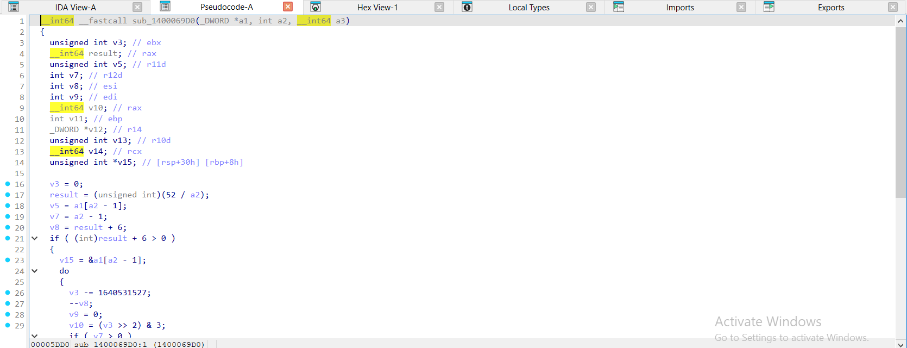

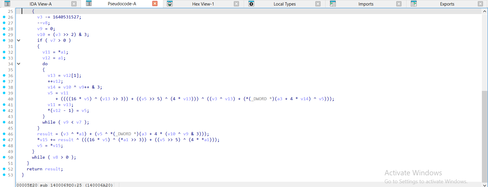

</details>

<details><summary>gcc -O2 – ELF, đã `strip -s` – xxtea_encrypt = <code>sub_30B0</code> – 2 ảnh</summary>

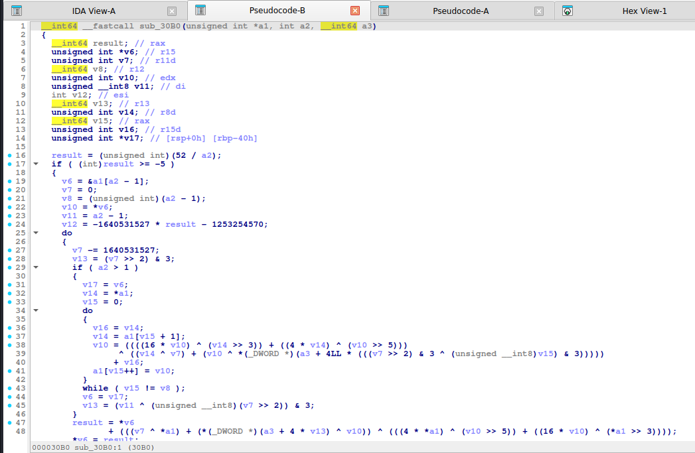

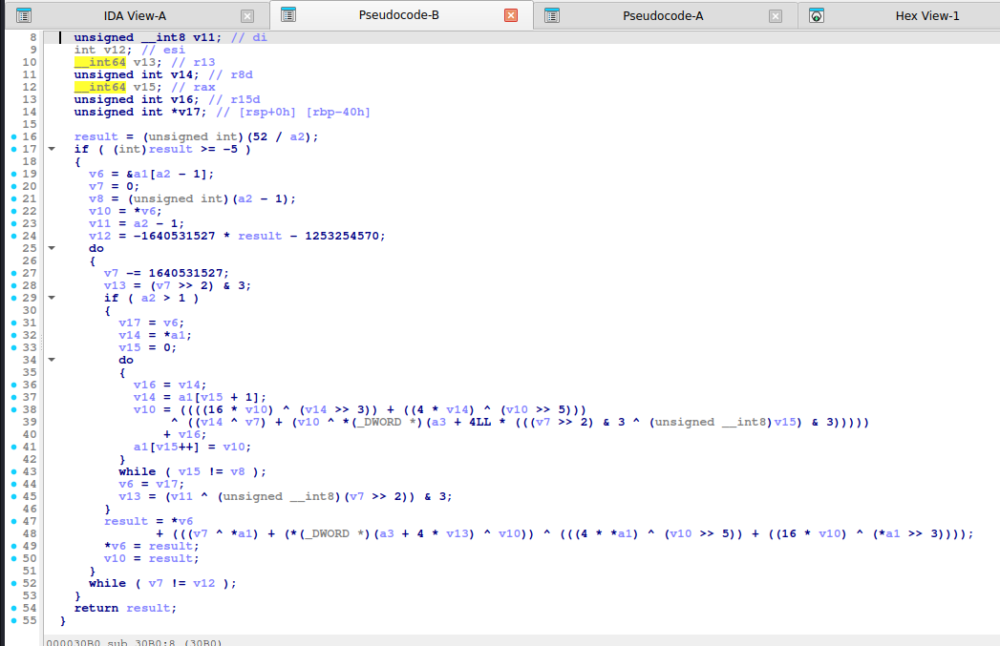

</details>

<details><summary>mingw-w64 -O2 -static – PE, đã `strip -s` – xxtea_encrypt = <code>sub_140002700</code> – 2 ảnh</summary>

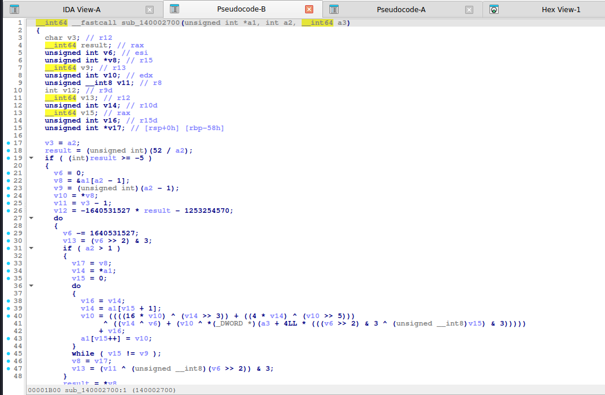

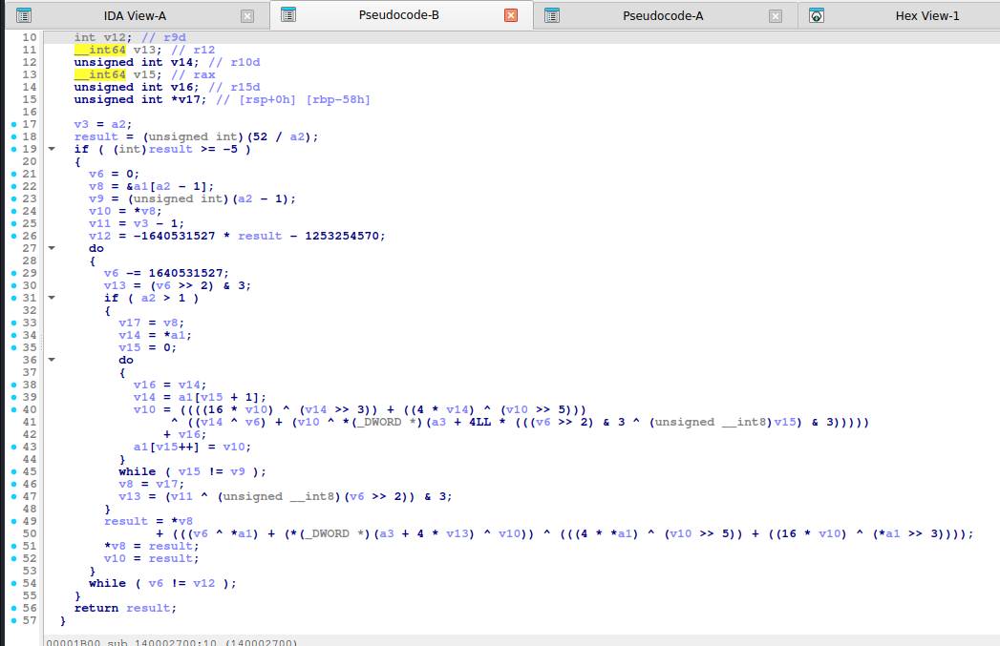

</details>

**xxtea_decrypt:**

<details><summary>MSVC /O2 - PE x64 (có PDB)</summary>

```c
void __fastcall xxtea_decrypt(unsigned int *v, int n, const unsigned int *key)
{
  unsigned int v3; // r9d
  unsigned int *v6; // r14
  int v7; // r13d
  int v8; // eax
  unsigned int v9; // edi
  int v10; // ebx
  __int64 v11; // r11
  unsigned int v12; // ebp
  unsigned int *v13; // rsi
  unsigned int v14; // r10d
  int v15; // edx
  __int64 v16; // rax
  unsigned int v17; // ecx
  unsigned int v18; // r9d
  int v19; // r8d
  int v20; // eax
  int v21; // r9d
  unsigned int v22; // r8d
  int v23; // [rsp+38h] [rbp+10h]

  v3 = *v;
  v6 = &v[n];
  v7 = 52 / n + 6;
  v8 = n - 1;
  v9 = -1640531527 * v7;
  v23 = n - 1;
  do
  {
    v10 = v8;
    v11 = (v9 >> 2) & 3;
    if ( v8 > 0 )
    {
      v12 = *(v6 - 1);
      v13 = v6 - 1;
      do
      {
        v14 = *--v13;
        v15 = ((4 * v3) ^ (v14 >> 5)) + ((v3 >> 3) ^ (16 * v14));
        v16 = v10-- & 3;
        v17 = (v9 ^ v3) + (v14 ^ key[v11 ^ v16]);
        v18 = v12;
        v12 = v14;
        v3 = v18 - (v17 ^ v15);
        v13[1] = v3;
      }
      while ( v10 > 0 );
    }
    v19 = (v3 >> 3) ^ (16 * *(v6 - 1));
    v20 = 4 * v3;
    v21 = v9 ^ v3;
    v9 += 1640531527;
    v22 = (v20 ^ (*(v6 - 1) >> 5)) + v19;
    v8 = v23;
    *v -= (v21 + (*(v6 - 1) ^ key[v11 ^ v10 & 3])) ^ v22;
    v3 = *v;
    --v7;
  }
  while ( v7 != 0 );
}
```

</details>

<details><summary>MSVC /Od - PE x64 (có PDB)</summary>

```c
void __fastcall xxtea_decrypt(unsigned int *v, int n, const unsigned int *key)
{
  unsigned int v3; // eax
  int p; // [rsp+0h] [rbp-38h]
  unsigned int y; // [rsp+4h] [rbp-34h]
  unsigned int z; // [rsp+8h] [rbp-30h]
  unsigned int za; // [rsp+8h] [rbp-30h]
  unsigned int sum; // [rsp+Ch] [rbp-2Ch]
  int rounds; // [rsp+10h] [rbp-28h]
  unsigned int e; // [rsp+18h] [rbp-20h]
  unsigned int v11; // [rsp+1Ch] [rbp-1Ch]

  rounds = 52 / n + 6;
  sum = -1640531527 * rounds;
  y = *v;
  do
  {
    e = (sum >> 2) & 3;
    for ( p = n - 1; p > 0; --p )
    {
      z = v[p - 1];
      v3 = v[p] - (((z ^ key[e ^ p & 3]) + (y ^ sum)) ^ (((16 * z) ^ (y >> 3)) + ((4 * y) ^ (z >> 5))));
      v[p] = v3;
      y = v3;
    }
    za = v[n - 1];
    v11 = *v - (((za ^ key[e ^ p & 3]) + (y ^ sum)) ^ (((16 * za) ^ (y >> 3)) + ((4 * y) ^ (za >> 5))));
    *v = v11;
    y = v11;
    sum += 1640531527;
    --rounds;
  }
  while ( rounds != 0 );
}
```

</details>

<details><summary>gcc -O2 - ELF x86-64 (chưa strip)</summary>

```c
__int64 __fastcall xxtea_decrypt(_DWORD *a1, int a2, __int64 a3)
{
  unsigned int *v6; // rbx
  _DWORD *v7; // rbp
  unsigned int v8; // r8d
  __int64 result; // rax
  int v10; // r13d
  unsigned int v11; // esi
  _DWORD *v12; // rdi
  int v13; // edx
  unsigned int v14; // r12d

  v6 = &a1[a2 - 1];
  v7 = &a1[a2];
  v8 = -1640531527 * (52 / a2 + 6);
  LODWORD(result) = *a1;
  do
  {
    v10 = (v8 >> 2) & 3;
    if ( a2 <= 1 )
    {
      LOBYTE(v13) = a2 - 1;
    }
    else
    {
      v11 = *v6;
      v12 = v7;
      v13 = a2 - 1;
      do
      {
        v14 = v11;
        v11 = *(v12 - 2);
        --v12;
        LODWORD(result) = v14
                        - ((((4 * result) ^ (v11 >> 5)) + ((16 * v11) ^ ((unsigned int)result >> 3)))
                         ^ ((v11 ^ *(_DWORD *)(a3 + 4LL * (((unsigned __int8)v10 ^ (unsigned __int8)v13) & 3)))
                          + (result ^ v8)));
        *v12 = result;
        --v13;
      }
      while ( v13 != 0 );
    }
    result = *a1
           - ((((4 * (_DWORD)result) ^ (*v6 >> 5)) + ((16 * *v6) ^ ((unsigned int)result >> 3)))
            ^ ((*v6 ^ *(_DWORD *)(a3 + 4LL * (((unsigned __int8)v10 ^ (unsigned __int8)v13) & 3)))
             + ((unsigned int)result ^ v8)));
    *a1 = result;
    v8 += 1640531527;
  }
  while ( v8 != 0 );
  return result;
}
```

</details>

<details><summary>gcc -O0 - ELF x86-64 (chưa strip)</summary>

```c
__int64 __fastcall xxtea_decrypt(unsigned int *a1, int a2, __int64 a3)
{
  unsigned int *v3; // rax
  __int64 result; // rax
  unsigned int v5; // [rsp+1Ch] [rbp-1Ch]
  unsigned int v6; // [rsp+1Ch] [rbp-1Ch]
  int v7; // [rsp+20h] [rbp-18h]
  int v8; // [rsp+28h] [rbp-10h]
  int i; // [rsp+2Ch] [rbp-Ch]
  unsigned int v10; // [rsp+30h] [rbp-8h]
  unsigned int v11; // [rsp+34h] [rbp-4h]

  v8 = 52 / a2 + 6;
  v10 = -1640531527 * v8;
  v11 = *a1;
  do
  {
    v7 = (v10 >> 2) & 3;
    for ( i = a2 - 1; i > 0; --i )
    {
      v5 = a1[i - 1];
      v3 = &a1[i];
      *v3 -= ((v11 ^ v10) + (v5 ^ *(_DWORD *)(4LL * (v7 ^ i & 3u) + a3)))
           ^ (((4 * v11) ^ (v5 >> 5)) + ((v11 >> 3) ^ (16 * v5)));
      v11 = *v3;
    }
    v6 = a1[a2 - 1];
    *a1 -= (((4 * v11) ^ (v6 >> 5)) + ((v11 >> 3) ^ (16 * v6)))
         ^ ((v11 ^ v10) + (v6 ^ *(_DWORD *)(4LL * (v7 ^ i & 3u) + a3)));
    v11 = *a1;
    result = 2654435769LL;
    v10 += 1640531527;
    --v8;
  }
  while ( v8 != 0 );
  return result;
}
```

</details>

<details><summary>mingw-w64 gcc -O2 - PE x64 (-static)</summary>

```c
__int64 __fastcall xxtea_decrypt(_DWORD *a1, int a2, __int64 a3)
{
  unsigned int *v4; // rdi
  _DWORD *v5; // rbp
  unsigned int v6; // r11d
  __int64 result; // rax
  int v8; // r13d
  unsigned int v9; // r9d
  _DWORD *v10; // r10
  int v11; // edx
  unsigned int v12; // r12d

  v4 = &a1[a2 - 1];
  v5 = &a1[a2];
  v6 = -1640531527 * (52 / a2 + 6);
  LODWORD(result) = *a1;
  do
  {
    v8 = (v6 >> 2) & 3;
    if ( a2 <= 1 )
    {
      LOBYTE(v11) = a2 - 1;
    }
    else
    {
      v9 = *v4;
      v10 = v5;
      v11 = a2 - 1;
      do
      {
        v12 = v9;
        v9 = *(v10 - 2);
        --v10;
        LODWORD(result) = v12
                        - ((((4 * result) ^ (v9 >> 5)) + ((16 * v9) ^ ((unsigned int)result >> 3)))
                         ^ ((v9 ^ *(_DWORD *)(a3 + 4LL * (((unsigned __int8)v8 ^ (unsigned __int8)v11) & 3)))
                          + (result ^ v6)));
        *v10 = result;
        --v11;
      }
      while ( v11 != 0 );
    }
    result = *a1
           - ((((4 * (_DWORD)result) ^ (*v4 >> 5)) + ((16 * *v4) ^ ((unsigned int)result >> 3)))
            ^ ((*v4 ^ *(_DWORD *)(a3 + 4LL * (((unsigned __int8)v8 ^ (unsigned __int8)v11) & 3)))
             + ((unsigned int)result ^ v6)));
    *a1 = result;
    v6 += 1640531527;
  }
  while ( v6 != 0 );
  return result;
}
```

</details>

<details><summary>mingw-w64 gcc -O0 - PE x64 (-static)</summary>

```c
__int64 __fastcall xxtea_decrypt(unsigned int *a1, int a2, __int64 a3)
{
  unsigned int *v3; // rax
  __int64 result; // rax
  unsigned int v5; // [rsp+4h] [rbp-1Ch]
  unsigned int v6; // [rsp+4h] [rbp-1Ch]
  int v7; // [rsp+8h] [rbp-18h]
  int v8; // [rsp+10h] [rbp-10h]
  int i; // [rsp+14h] [rbp-Ch]
  unsigned int v10; // [rsp+18h] [rbp-8h]
  unsigned int v11; // [rsp+1Ch] [rbp-4h]

  v8 = 52 / a2 + 6;
  v10 = -1640531527 * v8;
  v11 = *a1;
  do
  {
    v7 = (v10 >> 2) & 3;
    for ( i = a2 - 1; i > 0; --i )
    {
      v5 = a1[i - 1];
      v3 = &a1[i];
      *v3 -= ((v11 ^ v10) + (v5 ^ *(_DWORD *)(4LL * (v7 ^ i & 3u) + a3)))
           ^ (((4 * v11) ^ (v5 >> 5)) + ((v11 >> 3) ^ (16 * v5)));
      v11 = *v3;
    }
    v6 = a1[a2 - 1];
    *a1 -= (((4 * v11) ^ (v6 >> 5)) + ((v11 >> 3) ^ (16 * v6)))
         ^ ((v11 ^ v10) + (v6 ^ *(_DWORD *)(4LL * (v7 ^ i & 3u) + a3)));
    v11 = *a1;
    result = 2654435769LL;
    v10 += 1640531527;
    --v8;
  }
  while ( v8 != 0 );
  return result;
}
```

</details>

**Bản strip (không symbol)** – IDA chỉ thấy `sub_XXXX`, `a1`, `a2`, `byte_XXXX`; hàm này tên là MSVC /O2 → `sub_140006890`, gcc -O2 → `sub_31F0`, mingw-w64 -O2 -static → `sub_140002850`:

<details><summary>MSVC /O2 – PE x64, không PDB (strip) – bản STRIP: <code>xxtea_decrypt</code> = <code>sub_140006890</code></summary>

```c
__int64 __fastcall sub_140006890(unsigned int *a1, int a2, __int64 a3)
{
  unsigned int v3; // r9d
  unsigned int *v6; // r14
  int v7; // r13d
  __int64 result; // rax
  unsigned int v9; // edi
  int v10; // ebx
  __int64 v11; // r11
  unsigned int v12; // ebp
  unsigned int *v13; // rsi
  unsigned int v14; // r10d
  int v15; // edx
  __int64 v16; // rax
  int v17; // ecx
  unsigned int v18; // r9d
  int v19; // r8d
  int v20; // eax
  int v21; // r9d
  int v22; // r8d
  unsigned int v23; // [rsp+38h] [rbp+10h]

  v3 = *a1;
  v6 = &a1[a2];
  v7 = 52 / a2 + 6;
  LODWORD(result) = a2 - 1;
  v9 = -1640531527 * v7;
  v23 = a2 - 1;
  do
  {
    v10 = result;
    v11 = (v9 >> 2) & 3;
    if ( (int)result > 0 )
    {
      v12 = *(v6 - 1);
      v13 = v6 - 1;
      do
      {
        v14 = *--v13;
        v15 = ((4 * v3) ^ (v14 >> 5)) + ((v3 >> 3) ^ (16 * v14));
        v16 = v10-- & 3;
        v17 = (v9 ^ v3) + (v14 ^ *(_DWORD *)(a3 + 4 * (v11 ^ v16)));
        v18 = v12;
        v12 = v14;
        v3 = v18 - (v17 ^ v15);
        v13[1] = v3;
      }
      while ( v10 > 0 );
    }
    v19 = (v3 >> 3) ^ (16 * *(v6 - 1));
    v20 = 4 * v3;
    v21 = v9 ^ v3;
    v9 += 1640531527;
    v22 = (v20 ^ (*(v6 - 1) >> 5)) + v19;
    result = v23;
    *a1 -= (v21 + (*(v6 - 1) ^ *(_DWORD *)(a3 + 4 * (v11 ^ v10 & 3)))) ^ v22;
    v3 = *a1;
    --v7;
  }
  while ( v7 != 0 );
  return result;
}
```

</details>

<details><summary>gcc -O2 – ELF, đã `strip -s` – bản STRIP: <code>xxtea_decrypt</code> = <code>sub_31F0</code></summary>

```c
__int64 __fastcall sub_31F0(_DWORD *a1, int a2, __int64 a3)
{
  unsigned int *v6; // rbx
  _DWORD *v7; // rbp
  unsigned int v8; // r8d
  __int64 result; // rax
  int v10; // r13d
  unsigned int v11; // esi
  _DWORD *v12; // rdi
  int v13; // edx
  unsigned int v14; // r12d

  v6 = &a1[a2 - 1];
  v7 = &a1[a2];
  v8 = -1640531527 * (52 / a2 + 6);
  LODWORD(result) = *a1;
  do
  {
    v10 = (v8 >> 2) & 3;
    if ( a2 <= 1 )
    {
      LOBYTE(v13) = a2 - 1;
    }
    else
    {
      v11 = *v6;
      v12 = v7;
      v13 = a2 - 1;
      do
      {
        v14 = v11;
        v11 = *(v12 - 2);
        --v12;
        LODWORD(result) = v14
                        - ((((4 * result) ^ (v11 >> 5)) + ((16 * v11) ^ ((unsigned int)result >> 3)))
                         ^ ((v11 ^ *(_DWORD *)(a3 + 4LL * (((unsigned __int8)v10 ^ (unsigned __int8)v13) & 3)))
                          + (result ^ v8)));
        *v12 = result;
        --v13;
      }
      while ( v13 != 0 );
    }
    result = *a1
           - ((((4 * (_DWORD)result) ^ (*v6 >> 5)) + ((16 * *v6) ^ ((unsigned int)result >> 3)))
            ^ ((*v6 ^ *(_DWORD *)(a3 + 4LL * (((unsigned __int8)v10 ^ (unsigned __int8)v13) & 3)))
             + ((unsigned int)result ^ v8)));
    *a1 = result;
    v8 += 1640531527;
  }
  while ( v8 != 0 );
  return result;
}
```

</details>

<details><summary>mingw-w64 -O2 -static – PE, đã `strip -s` – bản STRIP: <code>xxtea_decrypt</code> = <code>sub_140002850</code></summary>

```c
__int64 __fastcall sub_140002850(_DWORD *a1, int a2, __int64 a3)
{
  unsigned int *v4; // rdi
  _DWORD *v5; // rbp
  unsigned int v6; // r11d
  __int64 result; // rax
  int v8; // r13d
  unsigned int v9; // r9d
  _DWORD *v10; // r10
  int v11; // edx
  unsigned int v12; // r12d

  v4 = &a1[a2 - 1];
  v5 = &a1[a2];
  v6 = -1640531527 * (52 / a2 + 6);
  LODWORD(result) = *a1;
  do
  {
    v8 = (v6 >> 2) & 3;
    if ( a2 <= 1 )
    {
      LOBYTE(v11) = a2 - 1;
    }
    else
    {
      v9 = *v4;
      v10 = v5;
      v11 = a2 - 1;
      do
      {
        v12 = v9;
        v9 = *(v10 - 2);
        --v10;
        LODWORD(result) = v12
                        - ((((4 * result) ^ (v9 >> 5)) + ((16 * v9) ^ ((unsigned int)result >> 3)))
                         ^ ((v9 ^ *(_DWORD *)(a3 + 4LL * (((unsigned __int8)v8 ^ (unsigned __int8)v11) & 3)))
                          + (result ^ v6)));
        *v10 = result;
        --v11;
      }
      while ( v11 != 0 );
    }
    result = *a1
           - ((((4 * (_DWORD)result) ^ (*v4 >> 5)) + ((16 * *v4) ^ ((unsigned int)result >> 3)))
            ^ ((*v4 ^ *(_DWORD *)(a3 + 4LL * (((unsigned __int8)v8 ^ (unsigned __int8)v11) & 3)))
             + ((unsigned int)result ^ v6)));
    *a1 = result;
    v6 += 1640531527;
  }
  while ( v6 != 0 );
  return result;
}
```

</details>

**Ảnh chụp màn hình IDA (bản strip)** – mở từng mục để xem; hàm dài chia thành nhiều trang, mỗi trang là một màn hình IDA:

<details><summary>MSVC /O2 – PE x64, không PDB (strip) – xxtea_decrypt = <code>sub_140006890</code> – 3 ảnh</summary>

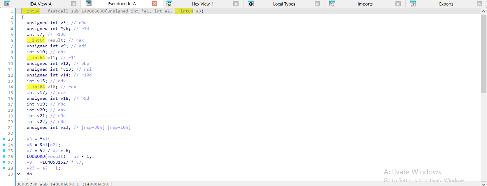

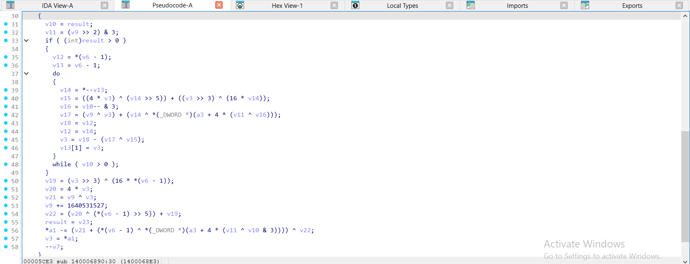

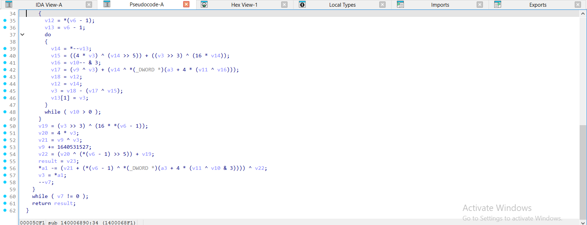

</details>

<details><summary>gcc -O2 – ELF, đã `strip -s` – xxtea_decrypt = <code>sub_31F0</code> – 2 ảnh</summary>

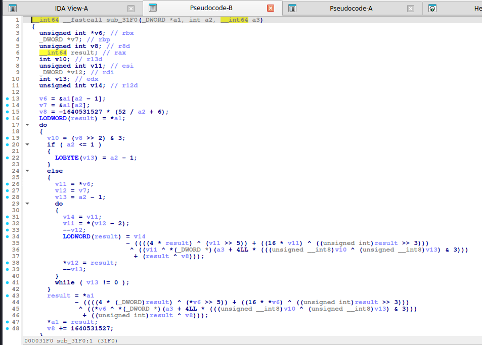

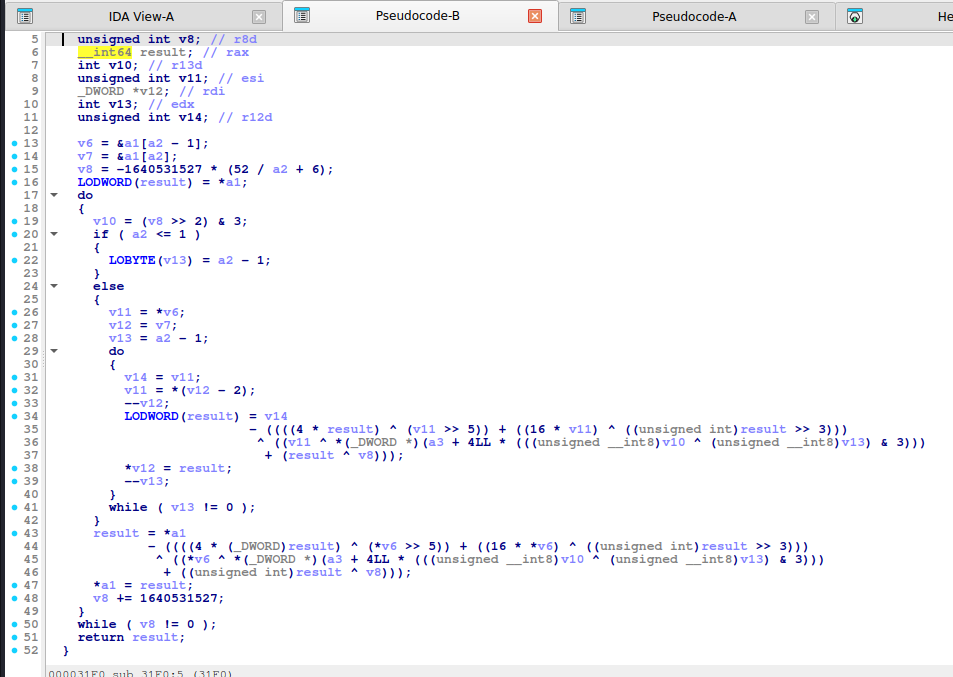

</details>

<details><summary>mingw-w64 -O2 -static – PE, đã `strip -s` – xxtea_decrypt = <code>sub_140002850</code> – 2 ảnh</summary>

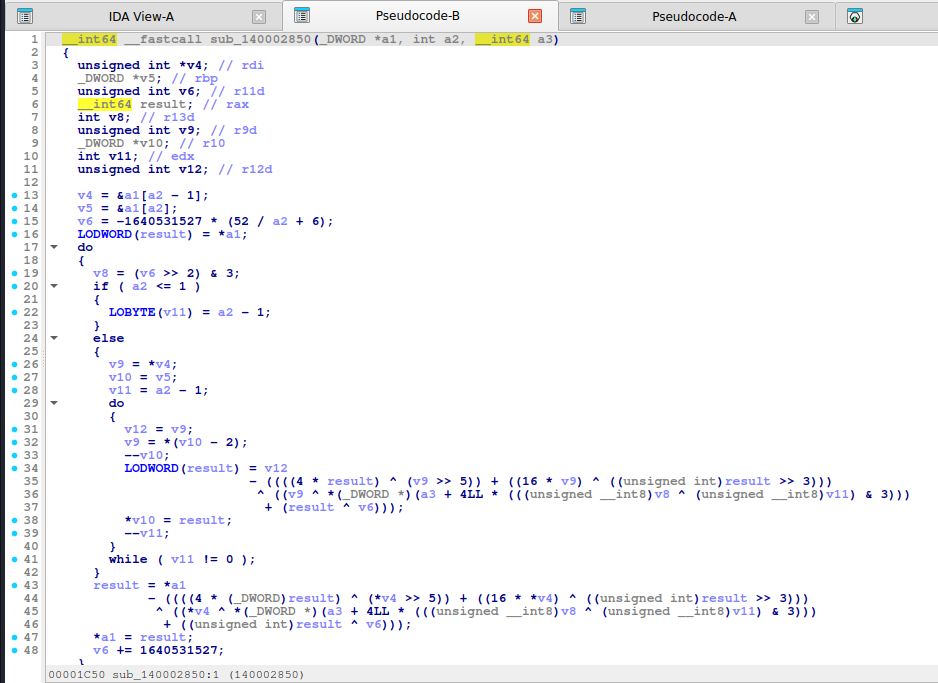

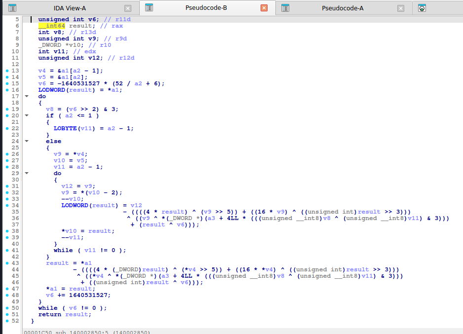

</details>

Nhận xét: `-O2` gcc hiển thị `52 / a2` rồi nhân delta (`-1640531527 * result - 1253254570`) để tính điều kiện dừng; `MX` được trải ra thành biểu thức dài. Nhận diện vẫn dựa vào `(sum >> 2) & 3`, `key[... & 3]`, `4 * y`, `16 * z`.

## 6. Code giải mã

**Python:**

```python
M32 = 0xFFFFFFFF
DELTA = 0x9E3779B9
def _u32(b): return [int.from_bytes(b[i:i + 4], "little") for i in range(0, len(b), 4)]


def _p32(v): return b"".join(x.to_bytes(4, "little") for x in v)


def xxtea_decrypt(data, key4):
    v = _u32(data)
    n = len(v)
    rounds = 6 + 52 // n
    s = (rounds * DELTA) & M32
    y = v[0]

    def mx(y, z, s, p, e):
        return ((((z >> 5) ^ (y << 2)) + ((y >> 3) ^ (z << 4))) ^ ((s ^ y) + (key4[(p & 3) ^ e] ^ z))) & M32

    for _ in range(rounds):
        e = (s >> 2) & 3
        for p in range(n - 1, 0, -1):
            z = v[p - 1]
            v[p] = (v[p] - mx(y, z, s, p, e)) & M32
            y = v[p]
        z = v[n - 1]
        v[0] = (v[0] - mx(y, z, s, 0, e)) & M32
        y = v[0]
        s = (s - DELTA) & M32
    return _p32(v)
```

**C** (macro `CTF_MX` và `CTF_DELTA` được kèm sẵn):

```c
#include <stdint.h>
#include <stddef.h>
#include <string.h>

#define CTF_DELTA 0x9E3779B9u
#define CTF_MX (((z >> 5 ^ y << 2) + (y >> 3 ^ z << 4)) ^ ((sum ^ y) + (key[(p & 3) ^ e] ^ z)))

static inline void ctf_xxtea_decrypt(uint32_t *v, int n, const uint32_t key[4])
{
    uint32_t y, z, sum, e;
    int p, rounds = 6 + 52 / n;
    sum = (uint32_t)rounds * CTF_DELTA;
    y = v[0];
    do {
        e = (sum >> 2) & 3;
        for (p = n - 1; p > 0; p--) { z = v[p - 1]; y = v[p] -= CTF_MX; }
        z = v[n - 1];
        y = v[0] -= CTF_MX;
        sum -= CTF_DELTA;
    } while (--rounds);
}
```

## 7. Biến thể & bẫy

- Số vòng cố định (ví dụ 32) thay vì `6 + 52/n`: đọc pseudo-code.
- Key có thể bị **hash trước** (`MD5`/`SHA1` lấy 16 byte đầu).
- Dữ liệu thường **đệm 0 hoặc PKCS** để thành bội 4/8 byte; kiểm tra đuôi sau giải.
- Thư viện xxtea chuẩn dùng `uint8_t` → `uint32_t` *little-endian*; một số cài đặt PHP/JS dùng big-endian.
