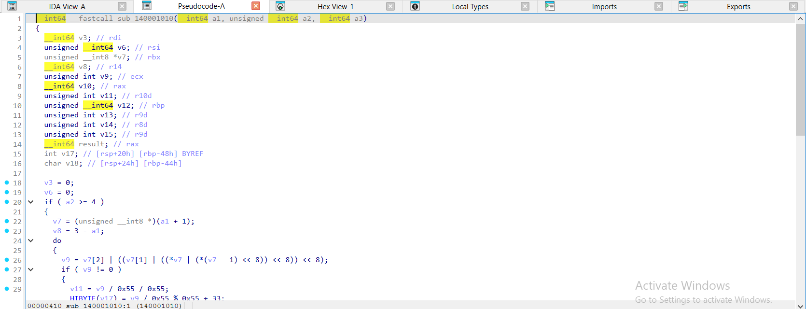
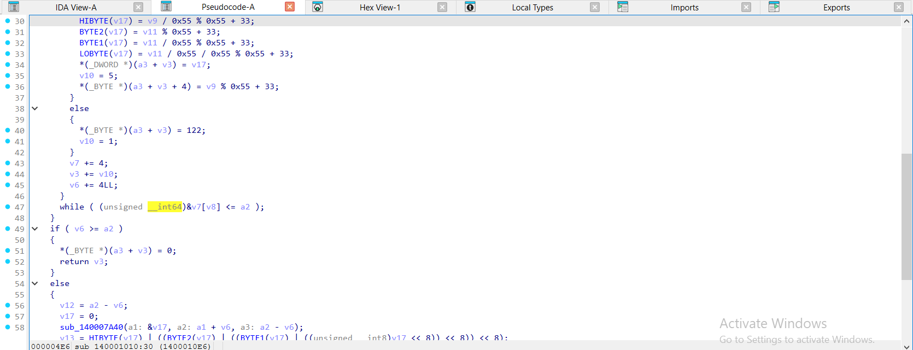
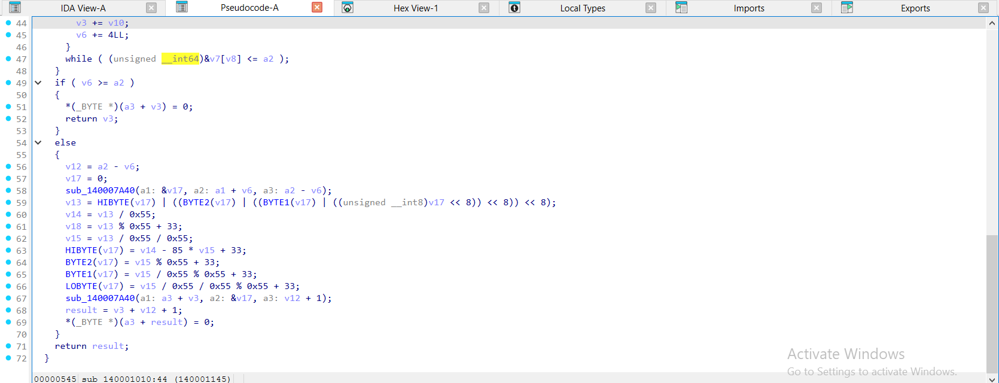
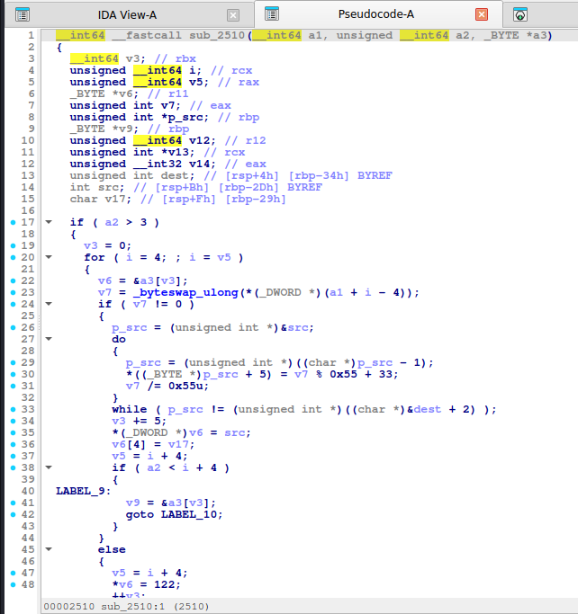
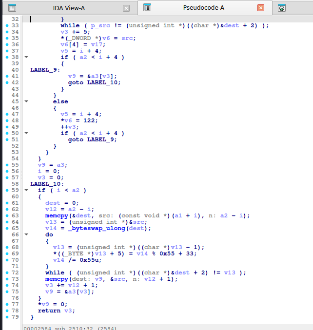
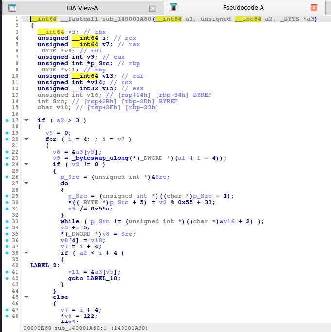
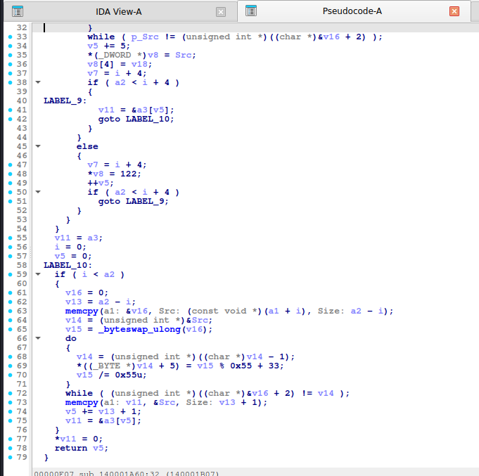

# Ascii85 (Base85)

> 4 byte -> 5 ký tự trong khoảng `!` (33) đến `u` (117) bằng cách chia lặp cho **85**. Nhóm 4 byte `0` rút gọn thành `z`.

## 1. Dấu hiệu nhận biết

- Không cần bảng chữ: ký tự sinh bằng **`% 85 + 33`** (hằng số `85`=`0x55` và `33`=`0x21`).
- Vòng lặp **5 lần** chia `v /= 85` (hoặc nhân số ma thuật), điền ngược từ `t[4]` về `t[0]`.
- Đọc 4 byte thành số 32-bit **big-endian**: trong IDA là `_byteswap_ulong(*(_DWORD *)...)` (gcc) hoặc `(b0 << 24) | (b1 << 16) | ...`.
- Ký tự **`z`** (`122`) khi nhóm 4 byte toàn 0; phần dư `r` byte: đệm 0 rồi chỉ xuất `r + 1` ký tự.
- Output chứa ký tự lạ (`"#$%&'()*+,-./:;<=>?@[\]^_`) nên dễ nhận ra khác Base64.
- Biến thể Adobe: bọc `<~ ... ~>`; Z85 (ZeroMQ) dùng bảng 85 ký tự riêng.

## 2. Thuật toán (mã giả)

```
for nhóm 4 byte (big-endian) -> v:
    nếu v == 0: out += 'z'
    ngược lại:  5 lần: t[k] = chr(v % 85 + 33); v //= 85   # k = 4..0
                out += t
nhóm cuối r byte (r<4): đệm 0 tới đủ 4, mã hóa, lấy r+1 ký tự đầu
```

## 3. Mã hóa / giải mã

Giải mã: mỗi 5 ký tự -> `v = Σ (c-33)·85^k`, rồi ghi 4 byte big-endian; `z` -> 4 byte `0`; nhóm cuối đệm bằng `u` (117) rồi cắt bớt. Python: `base64.a85decode` (và `b85decode` cho bảng RFC 1924 – KHÁC bảng này).

## 4. Mã nguồn gốc (C)

```c
size_t a85_encode(const uint8_t *in, size_t n, char *out)
{
    size_t o = 0, i = 0;
    for (; i + 4 <= n; i += 4) {
        uint32_t v = ((uint32_t)in[i] << 24) | ((uint32_t)in[i + 1] << 16) |
                     ((uint32_t)in[i + 2] << 8) | in[i + 3];
        if (v == 0) {
            out[o++] = 'z';
            continue;
        }
        char t[5];
        for (int k = 4; k >= 0; k--) {
            t[k] = (char)(v % 85 + 33);
            v /= 85;
        }
        memcpy(out + o, t, 5);
        o += 5;
    }
    if (i < n) {
        uint8_t b[4] = {0, 0, 0, 0};
        size_t r = n - i;
        memcpy(b, in + i, r);
        uint32_t v = ((uint32_t)b[0] << 24) | ((uint32_t)b[1] << 16) | ((uint32_t)b[2] << 8) | b[3];
        char t[5];
        for (int k = 4; k >= 0; k--) {
            t[k] = (char)(v % 85 + 33);
            v /= 85;
        }
        memcpy(out + o, t, r + 1);
        o += r + 1;
    }
    out[o] = 0;
    return o;
}
```

## 5. Pseudo-code IDA thực tế

<details><summary>MSVC /O2 - PE x64 (có PDB)</summary>

```c
__int64 __fastcall a85_encode(const unsigned __int8 *in, unsigned __int64 n, char *out)
{
  __int64 v3; // rdi
  unsigned __int64 v6; // rsi
  const unsigned __int8 *v7; // rbx
  __int64 v8; // r14
  unsigned int v9; // ecx
  __int64 v10; // rax
  unsigned int v11; // r10d
  __int64 v12; // rbp
  unsigned int v13; // r9d
  unsigned int v14; // r8d
  unsigned int v15; // r9d
  __int64 result; // rax
  unsigned __int8 b[4]; // [rsp+20h] [rbp-48h] BYREF
  char v18; // [rsp+24h] [rbp-44h]

  v3 = 0;
  v6 = 0;
  if ( n >= 4 )
  {
    v7 = in + 1;
    v8 = 3LL - (_QWORD)in;
    do
    {
      v9 = v7[2] | ((v7[1] | ((*v7 | (*(v7 - 1) << 8)) << 8)) << 8);
      if ( v9 != 0 )
      {
        v11 = v9 / 0x55 / 0x55;
        b[3] = v9 / 0x55 % 0x55 + 33;
        b[2] = v11 % 0x55 + 33;
        b[1] = v11 / 0x55 % 0x55 + 33;
        b[0] = v11 / 0x55 / 0x55 % 0x55 + 33;
        *(_DWORD *)&out[v3] = *(_DWORD *)b;
        v10 = 5;
        out[v3 + 4] = v9 % 0x55 + 33;
      }
      else
      {
        out[v3] = 122;
        v10 = 1;
      }
      v7 += 4;
      v3 += v10;
      v6 += 4LL;
    }
    while ( (unsigned __int64)&v7[v8] <= n );
  }
  if ( v6 >= n )
  {
    out[v3] = 0;
    return v3;
  }
  else
  {
    v12 = n - v6;
    *(_DWORD *)b = 0;
    memmove(a1: b, Src: &in[v6], Size: n - v6);
    v13 = b[3] | ((b[2] | ((b[1] | (b[0] << 8)) << 8)) << 8);
    v14 = v13 / 0x55;
    v18 = v13 % 0x55 + 33;
    v15 = v13 / 0x55 / 0x55;
    b[3] = v14 - 85 * v15 + 33;
    b[2] = v15 % 0x55 + 33;
    b[1] = v15 / 0x55 % 0x55 + 33;
    b[0] = v15 / 0x55 / 0x55 % 0x55 + 33;
    memmove(a1: &out[v3], Src: b, Size: v12 + 1);
    result = v3 + v12 + 1;
    out[result] = 0;
  }
  return result;
}
```

</details>

<details><summary>MSVC /Od - PE x64 (có PDB)</summary>

```c
unsigned __int64 __fastcall a85_encode(const unsigned __int8 *in, unsigned __int64 n, char *out)
{
  unsigned __int8 b[4]; // [rsp+20h] [rbp-58h] BYREF
  unsigned __int64 o; // [rsp+28h] [rbp-50h]
  unsigned __int64 i; // [rsp+30h] [rbp-48h]
  int k; // [rsp+38h] [rbp-40h]
  unsigned int v; // [rsp+3Ch] [rbp-3Ch]
  int j; // [rsp+40h] [rbp-38h]
  unsigned int v10; // [rsp+44h] [rbp-34h]
  unsigned __int64 r; // [rsp+48h] [rbp-30h]
  char t[8]; // [rsp+50h] [rbp-28h] BYREF
  _BYTE Src[8]; // [rsp+58h] [rbp-20h] BYREF

  o = 0;
  for ( i = 0; i + 4 <= n; i += 4LL )
  {
    v = _byteswap_ulong(*(_DWORD *)&in[i]);
    if ( v != 0 )
    {
      for ( k = 4; k >= 0; --k )
      {
        t[k] = v % 0x55 + 33;
        v /= 0x55u;
      }
      memmove(a1: &out[o], Src: t, Size: 5u);
      o += 5LL;
    }
    else
    {
      out[o++] = 122;
    }
  }
  if ( i < n )
  {
    b[0] = 0;
    b[1] = 0;
    b[2] = 0;
    b[3] = 0;
    r = n - i;
    memmove(a1: b, Src: &in[i], Size: n - i);
    v10 = _byteswap_ulong(*(unsigned int *)b);
    for ( j = 4; j >= 0; --j )
    {
      Src[j] = v10 % 0x55 + 33;
      v10 /= 0x55u;
    }
    memmove(a1: &out[o], Src, Size: r + 1);
    o += r + 1;
  }
  out[o] = 0;
  return o;
}
```

</details>

<details><summary>gcc -O2 - ELF x86-64 (chưa strip)</summary>

```c
__int64 __fastcall a85_encode(__int64 a1, unsigned __int64 a2, _BYTE *a3)
{
  __int64 v3; // rbx
  unsigned __int64 i; // rcx
  unsigned __int64 v5; // rax
  _BYTE *v6; // r11
  unsigned int v7; // eax
  unsigned int *p_src; // rbp
  _BYTE *v9; // rbp
  unsigned __int64 v12; // r12
  unsigned int *v13; // rcx
  unsigned __int32 v14; // eax
  unsigned int dest; // [rsp+4h] [rbp-34h] BYREF
  int src; // [rsp+Bh] [rbp-2Dh] BYREF
  char v17; // [rsp+Fh] [rbp-29h]

  if ( a2 > 3 )
  {
    v3 = 0;
    for ( i = 4; ; i = v5 )
    {
      v6 = &a3[v3];
      v7 = _byteswap_ulong(*(_DWORD *)(a1 + i - 4));
      if ( v7 != 0 )
      {
        p_src = (unsigned int *)&src;
        do
        {
          p_src = (unsigned int *)((char *)p_src - 1);
          *((_BYTE *)p_src + 5) = v7 % 0x55 + 33;
          v7 /= 0x55u;
        }
        while ( p_src != (unsigned int *)((char *)&dest + 2) );
        v3 += 5;
        *(_DWORD *)v6 = src;
        v6[4] = v17;
        v5 = i + 4;
        if ( a2 < i + 4 )
        {
LABEL_9:
          v9 = &a3[v3];
          goto LABEL_10;
        }
      }
      else
      {
        v5 = i + 4;
        *v6 = 122;
        ++v3;
        if ( a2 < i + 4 )
          goto LABEL_9;
      }
    }
  }
  v9 = a3;
  i = 0;
  v3 = 0;
LABEL_10:
  if ( i < a2 )
  {
    dest = 0;
    v12 = a2 - i;
    memcpy(&dest, src: (const void *)(a1 + i), n: a2 - i);
    v13 = (unsigned int *)&src;
    v14 = _byteswap_ulong(dest);
    do
    {
      v13 = (unsigned int *)((char *)v13 - 1);
      *((_BYTE *)v13 + 5) = v14 % 0x55 + 33;
      v14 /= 0x55u;
    }
    while ( (unsigned int *)((char *)&dest + 2) != v13 );
    memcpy(dest: v9, &src, n: v12 + 1);
    v3 += v12 + 1;
    v9 = &a3[v3];
  }
  *v9 = 0;
  return v3;
}
```

</details>

<details><summary>gcc -O0 - ELF x86-64 (chưa strip)</summary>

```c
__int64 __fastcall a85_encode(__int64 a1, unsigned __int64 a2, __int64 a3)
{
  __int64 v3; // rax
  __int64 v4; // rax
  _BYTE src[5]; // [rsp+2Ah] [rbp-36h] BYREF
  unsigned int dest; // [rsp+2Fh] [rbp-31h] BYREF
  int v9; // [rsp+33h] [rbp-2Dh]
  char v10; // [rsp+37h] [rbp-29h]
  size_t n; // [rsp+38h] [rbp-28h]
  int k; // [rsp+40h] [rbp-20h]
  unsigned int v13; // [rsp+44h] [rbp-1Ch]
  int j; // [rsp+48h] [rbp-18h]
  unsigned int v15; // [rsp+4Ch] [rbp-14h]
  unsigned __int64 i; // [rsp+50h] [rbp-10h]
  __int64 v17; // [rsp+58h] [rbp-8h]

  v17 = 0;
  for ( i = 0; a2 >= i + 4; i += 4LL )
  {
    v15 = (*(unsigned __int8 *)(i + 2 + a1) << 8)
        | (*(unsigned __int8 *)(i + 1 + a1) << 16)
        | (*(unsigned __int8 *)(a1 + i) << 24)
        | *(unsigned __int8 *)(i + 3 + a1);
    if ( v15 != 0 )
    {
      for ( j = 4; j >= 0; --j )
      {
        *((_BYTE *)&v9 + j) = v15 % 0x55 + 33;
        v15 /= 0x55u;
      }
      v4 = a3 + v17;
      *(_DWORD *)v4 = v9;
      *(_BYTE *)(v4 + 4) = v10;
      v17 += 5;
    }
    else
    {
      v3 = v17++;
      *(_BYTE *)(a3 + v3) = 122;
    }
  }
  if ( i < a2 )
  {
    dest = 0;
    n = a2 - i;
    memcpy(&dest, src: (const void *)(a1 + i), n: a2 - i);
    v13 = _byteswap_ulong(dest);
    for ( k = 4; k >= 0; --k )
    {
      src[k] = v13 % 0x55 + 33;
      v13 /= 0x55u;
    }
    memcpy(dest: (void *)(v17 + a3), src, n: n + 1);
    v17 += n + 1;
  }
  *(_BYTE *)(a3 + v17) = 0;
  return v17;
}
```

</details>

<details><summary>mingw-w64 gcc -O2 - PE x64 (-static)</summary>

```c
__int64 __fastcall a85_encode(__int64 a1, unsigned __int64 a2, _BYTE *a3)
{
  __int64 v5; // rbx
  unsigned __int64 i; // rcx
  unsigned __int64 v7; // rax
  _BYTE *v8; // rdi
  unsigned int v9; // eax
  unsigned int *p_Src; // rbp
  _BYTE *v11; // rbp
  unsigned __int64 v13; // rdi
  unsigned int *v14; // rcx
  unsigned __int32 v15; // eax
  unsigned int v16; // [rsp+24h] [rbp-34h] BYREF
  int Src; // [rsp+2Bh] [rbp-2Dh] BYREF
  char v18; // [rsp+2Fh] [rbp-29h]

  if ( a2 > 3 )
  {
    v5 = 0;
    for ( i = 4; ; i = v7 )
    {
      v8 = &a3[v5];
      v9 = _byteswap_ulong(*(_DWORD *)(a1 + i - 4));
      if ( v9 != 0 )
      {
        p_Src = (unsigned int *)&Src;
        do
        {
          p_Src = (unsigned int *)((char *)p_Src - 1);
          *((_BYTE *)p_Src + 5) = v9 % 0x55 + 33;
          v9 /= 0x55u;
        }
        while ( p_Src != (unsigned int *)((char *)&v16 + 2) );
        v5 += 5;
        *(_DWORD *)v8 = Src;
        v8[4] = v18;
        v7 = i + 4;
        if ( a2 < i + 4 )
        {
LABEL_9:
          v11 = &a3[v5];
          goto LABEL_10;
        }
      }
      else
      {
        v7 = i + 4;
        *v8 = 122;
        ++v5;
        if ( a2 < i + 4 )
          goto LABEL_9;
      }
    }
  }
  v11 = a3;
  i = 0;
  v5 = 0;
LABEL_10:
  if ( i < a2 )
  {
    v16 = 0;
    v13 = a2 - i;
    memcpy_0(a1: &v16, Src: (const void *)(a1 + i), Size: a2 - i);
    v14 = (unsigned int *)&Src;
    v15 = _byteswap_ulong(v16);
    do
    {
      v14 = (unsigned int *)((char *)v14 - 1);
      *((_BYTE *)v14 + 5) = v15 % 0x55 + 33;
      v15 /= 0x55u;
    }
    while ( (unsigned int *)((char *)&v16 + 2) != v14 );
    memcpy_0(a1: v11, &Src, Size: v13 + 1);
    v5 += v13 + 1;
    v11 = &a3[v5];
  }
  *v11 = 0;
  return v5;
}
```

</details>

<details><summary>mingw-w64 gcc -O0 - PE x64 (-static)</summary>

```c
__int64 __fastcall a85_encode(__int64 a1, unsigned __int64 a2, __int64 a3)
{
  __int64 v3; // rax
  __int64 v4; // rax
  _BYTE Src[5]; // [rsp+2Ah] [rbp-36h] BYREF
  unsigned int v7; // [rsp+2Fh] [rbp-31h] BYREF
  int v8; // [rsp+33h] [rbp-2Dh]
  char v9; // [rsp+37h] [rbp-29h]
  size_t Size; // [rsp+38h] [rbp-28h]
  int k; // [rsp+40h] [rbp-20h]
  unsigned int v12; // [rsp+44h] [rbp-1Ch]
  int j; // [rsp+48h] [rbp-18h]
  unsigned int v14; // [rsp+4Ch] [rbp-14h]
  unsigned __int64 i; // [rsp+50h] [rbp-10h]
  __int64 v16; // [rsp+58h] [rbp-8h]

  v16 = 0;
  for ( i = 0; a2 >= i + 4; i += 4LL )
  {
    v14 = (*(unsigned __int8 *)(i + 2 + a1) << 8)
        | (*(unsigned __int8 *)(i + 1 + a1) << 16)
        | (*(unsigned __int8 *)(a1 + i) << 24)
        | *(unsigned __int8 *)(i + 3 + a1);
    if ( v14 != 0 )
    {
      for ( j = 4; j >= 0; --j )
      {
        *((_BYTE *)&v8 + j) = v14 % 0x55 + 33;
        v14 /= 0x55u;
      }
      v4 = a3 + v16;
      *(_DWORD *)v4 = v8;
      *(_BYTE *)(v4 + 4) = v9;
      v16 += 5;
    }
    else
    {
      v3 = v16++;
      *(_BYTE *)(a3 + v3) = 122;
    }
  }
  if ( i < a2 )
  {
    v7 = 0;
    Size = a2 - i;
    memcpy_0(a1: &v7, Src: (const void *)(i + a1), Size: a2 - i);
    v12 = _byteswap_ulong(v7);
    for ( k = 4; k >= 0; --k )
    {
      Src[k] = v12 % 0x55 + 33;
      v12 /= 0x55u;
    }
    memcpy_0(a1: (void *)(a3 + v16), Src, Size: Size + 1);
    v16 += Size + 1;
  }
  *(_BYTE *)(a3 + v16) = 0;
  return v16;
}
```

</details>

**Bản strip (không symbol)** – IDA chỉ thấy `sub_XXXX`, `a1`, `a2`, `byte_XXXX`; hàm này tên là MSVC /O2 → `sub_140001010`, gcc -O2 → `sub_2510`, mingw-w64 -O2 -static → `sub_140001A60`:

<details><summary>MSVC /O2 – PE x64, không PDB (strip) – bản STRIP: <code>a85_encode</code> = <code>sub_140001010</code></summary>

```c
__int64 __fastcall sub_140001010(__int64 a1, unsigned __int64 a2, __int64 a3)
{
  __int64 v3; // rdi
  unsigned __int64 v6; // rsi
  unsigned __int8 *v7; // rbx
  __int64 v8; // r14
  unsigned int v9; // ecx
  __int64 v10; // rax
  unsigned int v11; // r10d
  unsigned __int64 v12; // rbp
  unsigned int v13; // r9d
  unsigned int v14; // r8d
  unsigned int v15; // r9d
  __int64 result; // rax
  int v17; // [rsp+20h] [rbp-48h] BYREF
  char v18; // [rsp+24h] [rbp-44h]

  v3 = 0;
  v6 = 0;
  if ( a2 >= 4 )
  {
    v7 = (unsigned __int8 *)(a1 + 1);
    v8 = 3 - a1;
    do
    {
      v9 = v7[2] | ((v7[1] | ((*v7 | (*(v7 - 1) << 8)) << 8)) << 8);
      if ( v9 != 0 )
      {
        v11 = v9 / 0x55 / 0x55;
        HIBYTE(v17) = v9 / 0x55 % 0x55 + 33;
        BYTE2(v17) = v11 % 0x55 + 33;
        BYTE1(v17) = v11 / 0x55 % 0x55 + 33;
        LOBYTE(v17) = v11 / 0x55 / 0x55 % 0x55 + 33;
        *(_DWORD *)(a3 + v3) = v17;
        v10 = 5;
        *(_BYTE *)(a3 + v3 + 4) = v9 % 0x55 + 33;
      }
      else
      {
        *(_BYTE *)(a3 + v3) = 122;
        v10 = 1;
      }
      v7 += 4;
      v3 += v10;
      v6 += 4LL;
    }
    while ( (unsigned __int64)&v7[v8] <= a2 );
  }
  if ( v6 >= a2 )
  {
    *(_BYTE *)(a3 + v3) = 0;
    return v3;
  }
  else
  {
    v12 = a2 - v6;
    v17 = 0;
    sub_140007A40(a1: &v17, a2: a1 + v6, a3: a2 - v6);
    v13 = HIBYTE(v17) | ((BYTE2(v17) | ((BYTE1(v17) | ((unsigned __int8)v17 << 8)) << 8)) << 8);
    v14 = v13 / 0x55;
    v18 = v13 % 0x55 + 33;
    v15 = v13 / 0x55 / 0x55;
    HIBYTE(v17) = v14 - 85 * v15 + 33;
    BYTE2(v17) = v15 % 0x55 + 33;
    BYTE1(v17) = v15 / 0x55 % 0x55 + 33;
    LOBYTE(v17) = v15 / 0x55 / 0x55 % 0x55 + 33;
    sub_140007A40(a1: a3 + v3, a2: &v17, a3: v12 + 1);
    result = v3 + v12 + 1;
    *(_BYTE *)(a3 + result) = 0;
  }
  return result;
}
```

</details>

<details><summary>gcc -O2 – ELF, đã `strip -s` – bản STRIP: <code>a85_encode</code> = <code>sub_2510</code></summary>

```c
__int64 __fastcall sub_2510(__int64 a1, unsigned __int64 a2, _BYTE *a3)
{
  __int64 v3; // rbx
  unsigned __int64 i; // rcx
  unsigned __int64 v5; // rax
  _BYTE *v6; // r11
  unsigned int v7; // eax
  unsigned int *p_src; // rbp
  _BYTE *v9; // rbp
  unsigned __int64 v12; // r12
  unsigned int *v13; // rcx
  unsigned __int32 v14; // eax
  unsigned int dest; // [rsp+4h] [rbp-34h] BYREF
  int src; // [rsp+Bh] [rbp-2Dh] BYREF
  char v17; // [rsp+Fh] [rbp-29h]

  if ( a2 > 3 )
  {
    v3 = 0;
    for ( i = 4; ; i = v5 )
    {
      v6 = &a3[v3];
      v7 = _byteswap_ulong(*(_DWORD *)(a1 + i - 4));
      if ( v7 != 0 )
      {
        p_src = (unsigned int *)&src;
        do
        {
          p_src = (unsigned int *)((char *)p_src - 1);
          *((_BYTE *)p_src + 5) = v7 % 0x55 + 33;
          v7 /= 0x55u;
        }
        while ( p_src != (unsigned int *)((char *)&dest + 2) );
        v3 += 5;
        *(_DWORD *)v6 = src;
        v6[4] = v17;
        v5 = i + 4;
        if ( a2 < i + 4 )
        {
LABEL_9:
          v9 = &a3[v3];
          goto LABEL_10;
        }
      }
      else
      {
        v5 = i + 4;
        *v6 = 122;
        ++v3;
        if ( a2 < i + 4 )
          goto LABEL_9;
      }
    }
  }
  v9 = a3;
  i = 0;
  v3 = 0;
LABEL_10:
  if ( i < a2 )
  {
    dest = 0;
    v12 = a2 - i;
    memcpy(&dest, src: (const void *)(a1 + i), n: a2 - i);
    v13 = (unsigned int *)&src;
    v14 = _byteswap_ulong(dest);
    do
    {
      v13 = (unsigned int *)((char *)v13 - 1);
      *((_BYTE *)v13 + 5) = v14 % 0x55 + 33;
      v14 /= 0x55u;
    }
    while ( (unsigned int *)((char *)&dest + 2) != v13 );
    memcpy(dest: v9, &src, n: v12 + 1);
    v3 += v12 + 1;
    v9 = &a3[v3];
  }
  *v9 = 0;
  return v3;
}
```

</details>

<details><summary>mingw-w64 -O2 -static – PE, đã `strip -s` – bản STRIP: <code>a85_encode</code> = <code>sub_140001A60</code></summary>

```c
__int64 __fastcall sub_140001A60(__int64 a1, unsigned __int64 a2, _BYTE *a3)
{
  __int64 v5; // rbx
  unsigned __int64 i; // rcx
  unsigned __int64 v7; // rax
  _BYTE *v8; // rdi
  unsigned int v9; // eax
  unsigned int *p_Src; // rbp
  _BYTE *v11; // rbp
  unsigned __int64 v13; // rdi
  unsigned int *v14; // rcx
  unsigned __int32 v15; // eax
  unsigned int v16; // [rsp+24h] [rbp-34h] BYREF
  int Src; // [rsp+2Bh] [rbp-2Dh] BYREF
  char v18; // [rsp+2Fh] [rbp-29h]

  if ( a2 > 3 )
  {
    v5 = 0;
    for ( i = 4; ; i = v7 )
    {
      v8 = &a3[v5];
      v9 = _byteswap_ulong(*(_DWORD *)(a1 + i - 4));
      if ( v9 != 0 )
      {
        p_Src = (unsigned int *)&Src;
        do
        {
          p_Src = (unsigned int *)((char *)p_Src - 1);
          *((_BYTE *)p_Src + 5) = v9 % 0x55 + 33;
          v9 /= 0x55u;
        }
        while ( p_Src != (unsigned int *)((char *)&v16 + 2) );
        v5 += 5;
        *(_DWORD *)v8 = Src;
        v8[4] = v18;
        v7 = i + 4;
        if ( a2 < i + 4 )
        {
LABEL_9:
          v11 = &a3[v5];
          goto LABEL_10;
        }
      }
      else
      {
        v7 = i + 4;
        *v8 = 122;
        ++v5;
        if ( a2 < i + 4 )
          goto LABEL_9;
      }
    }
  }
  v11 = a3;
  i = 0;
  v5 = 0;
LABEL_10:
  if ( i < a2 )
  {
    v16 = 0;
    v13 = a2 - i;
    memcpy(a1: &v16, Src: (const void *)(a1 + i), Size: a2 - i);
    v14 = (unsigned int *)&Src;
    v15 = _byteswap_ulong(v16);
    do
    {
      v14 = (unsigned int *)((char *)v14 - 1);
      *((_BYTE *)v14 + 5) = v15 % 0x55 + 33;
      v15 /= 0x55u;
    }
    while ( (unsigned int *)((char *)&v16 + 2) != v14 );
    memcpy(a1: v11, &Src, Size: v13 + 1);
    v5 += v13 + 1;
    v11 = &a3[v5];
  }
  *v11 = 0;
  return v5;
}
```

</details>

**Ảnh chụp màn hình IDA (bản strip)** – mở từng mục để xem; hàm dài chia thành nhiều trang, mỗi trang là một màn hình IDA:

<details><summary>MSVC /O2 – PE x64, không PDB (strip) – a85_encode = <code>sub_140001010</code> – 3 ảnh</summary>







</details>

<details><summary>gcc -O2 – ELF, đã `strip -s` – a85_encode = <code>sub_2510</code> – 2 ảnh</summary>





</details>

<details><summary>mingw-w64 -O2 -static – PE, đã `strip -s` – a85_encode = <code>sub_140001A60</code> – 2 ảnh</summary>





</details>

Nhận xét: `-O2` đổi `% 85` và `/ 85` thành `v7 % 0x55 + 33` / `v7 /= 0x55u` (gcc giữ nguyên) và dùng `_byteswap_ulong` + `memcpy` cho phần đuôi. Hằng số `0x55`, `33`, `122` là chữ ký.

## 6. Code giải mã

```python
import base64


def a85_decode(s):
    return base64.a85decode(s)
```

```python
a85_decode(b'87cURD_*"uH"(?*;e9B-@;TR!')    # b'Hello, CyberSeaGame!'
```

## 7. Biến thể & bẫy

- `base64.a85decode(s, adobe=True)` khi có `<~ ~>`; thêm `foldspaces=True` cho biến thể btoa.
- **b85** (RFC 1924, Git) và **Z85** dùng bảng khác: nhận bằng việc không có `z` và dùng bảng tra thay vì `+ 33`.
