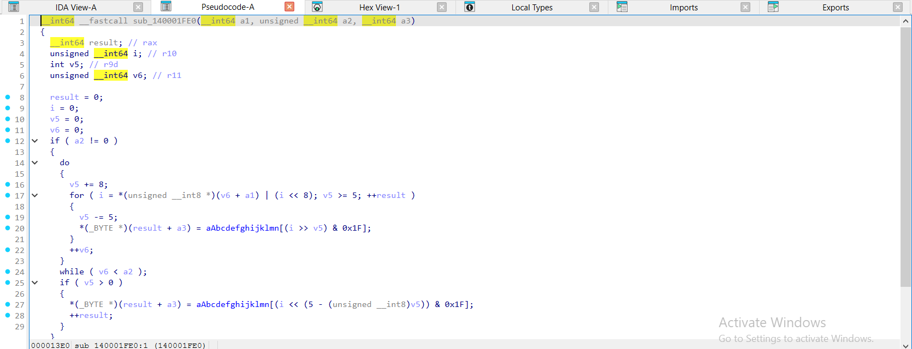
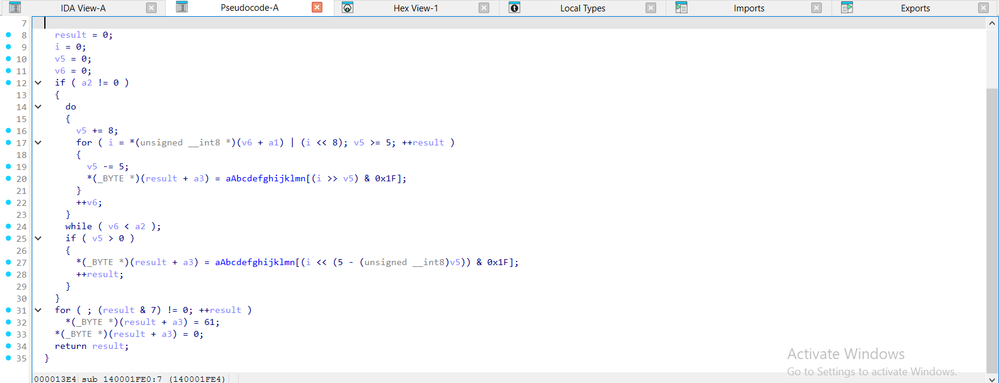
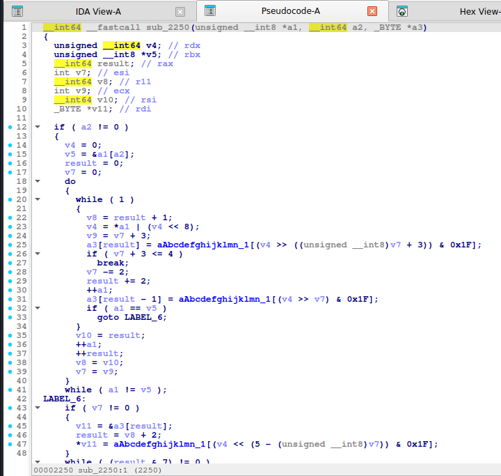
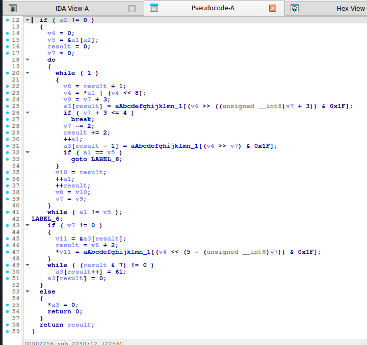
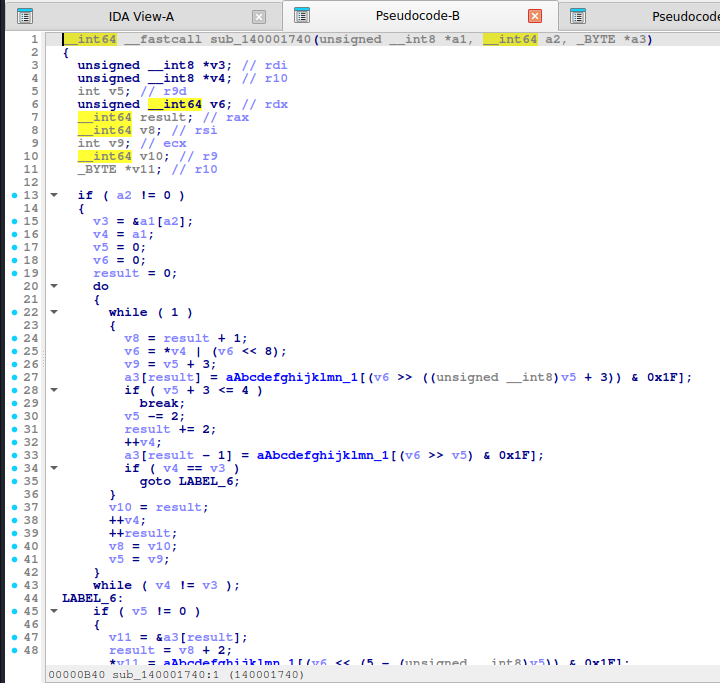
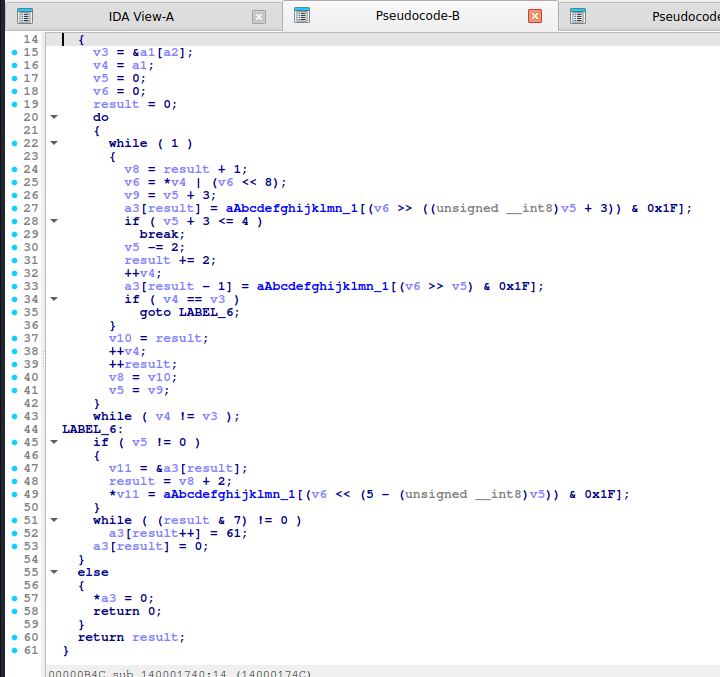

# Base32

> 5 byte (40 bit) -> 8 ký tự 5 bit, bảng `A-Z2-7`, đệm `=` cho đủ bội 8.

## 1. Dấu hiệu nhận biết

- Bảng **32 ký tự**: `ABCDEFGHIJKLMNOPQRSTUVWXYZ234567` (RFC 4648). Biến thể: `0123456789ABCDEFGHIJKLMNOPQRSTUV` (extended hex), Crockford.
- Hằng số `0x1F` (`& 31`), phép dịch **`>> bits`** với `bits` giảm dần theo bước 5, ký tự `61` (`=`) lặp trong `while ((len & 7) != 0)`.
- Cấu trúc: bộ tích lũy (`acc << 8 | byte`), đếm bit (`bits += 8`), `while (bits >= 5)` xuất 1 ký tự.
- Output chỉ gồm chữ HOA + `2`-`7`, độ dài bội 8, đuôi `=` lặp tới 6 lần.
- Hằng số **`(5 - bits)`** ở đoạn flush (`acc << (5 - bits)`) là dấu hiệu đặc trưng.

## 2. Thuật toán (mã giả)

```
acc = 0; bits = 0
for byte in in:
    acc = (acc << 8) | byte;  bits += 8
    while bits >= 5:
        bits -= 5
        out += T[(acc >> bits) & 31]
if bits > 0: out += T[(acc << (5 - bits)) & 31]
while len(out) % 8: out += '='
```

## 3. Mã hóa / giải mã

Giải mã làm ngược: mỗi ký tự cộng 5 bit vào bộ tích lũy, đủ 8 bit thì xuất 1 byte; bỏ `=`. Python có sẵn `base64.b32decode` (chỉ chuẩn RFC 4648; alphabet tuỳ chỉnh thì dịch bảng trước bằng `str.translate`).

## 4. Mã nguồn gốc (C)

```c
size_t b32_encode(const uint8_t *in, size_t n, char *out)
{
    static const char T[] = "ABCDEFGHIJKLMNOPQRSTUVWXYZ234567";
    size_t o = 0;
    uint64_t acc = 0;
    int bits = 0;
    for (size_t i = 0; i < n; i++) {
        acc = (acc << 8) | in[i];
        bits += 8;
        while (bits >= 5) {
            bits -= 5;
            out[o++] = T[(acc >> bits) & 31];
        }
    }
    if (bits > 0) out[o++] = T[(acc << (5 - bits)) & 31];
    while (o % 8) out[o++] = '=';
    out[o] = 0;
    return o;
}
```

## 5. Pseudo-code IDA thực tế

<details><summary>MSVC /O2 - PE x64 (có PDB)</summary>

```c
unsigned __int64 __fastcall b32_encode(const unsigned __int8 *in, unsigned __int64 n, char *out)
{
  unsigned __int64 result; // rax
  unsigned __int64 i; // r10
  int v5; // r9d
  unsigned __int64 v6; // r11

  result = 0;
  i = 0;
  v5 = 0;
  v6 = 0;
  if ( n != 0 )
  {
    do
    {
      v5 += 8;
      for ( i = in[v6] | (i << 8); v5 >= 5; ++result )
      {
        v5 -= 5;
        out[result] = T_1[(i >> v5) & 0x1F];
      }
      ++v6;
    }
    while ( v6 < n );
    if ( v5 > 0 )
      out[result++] = T_1[(i << (5 - (unsigned __int8)v5)) & 0x1F];
  }
  for ( ; (result & 7) != 0; ++result )
    out[result] = 61;
  out[result] = 0;
  return result;
}
```

</details>

<details><summary>MSVC /Od - PE x64 (có PDB)</summary>

```c
unsigned __int64 __fastcall b32_encode(const unsigned __int8 *in, unsigned __int64 n, char *out)
{
  int bits; // [rsp+0h] [rbp-28h]
  unsigned __int64 o; // [rsp+8h] [rbp-20h]
  unsigned __int64 i; // [rsp+10h] [rbp-18h]
  unsigned __int64 acc; // [rsp+18h] [rbp-10h]

  o = 0;
  acc = 0;
  bits = 0;
  for ( i = 0; i < n; ++i )
  {
    acc = in[i] | (acc << 8);
    for ( bits += 8; bits >= 5; out[o++] = T_1[(acc >> bits) & 0x1F] )
      bits -= 5;
  }
  if ( bits > 0 )
    out[o++] = T_1[(acc << (5 - (unsigned __int8)bits)) & 0x1F];
  while ( o % 8 != 0 )
    out[o++] = 61;
  out[o] = 0;
  return o;
}
```

</details>

<details><summary>gcc -O2 - ELF x86-64 (chưa strip)</summary>

```c
__int64 __fastcall b32_encode(unsigned __int8 *a1, __int64 a2, _BYTE *a3)
{
  unsigned __int64 v4; // rdx
  unsigned __int8 *v5; // rbx
  __int64 result; // rax
  int v7; // esi
  __int64 v8; // r11
  int v9; // ecx
  __int64 v10; // rsi
  _BYTE *v11; // rdi

  if ( a2 != 0 )
  {
    v4 = 0;
    v5 = &a1[a2];
    result = 0;
    v7 = 0;
    do
    {
      while ( 1 )
      {
        v8 = result + 1;
        v4 = *a1 | (v4 << 8);
        v9 = v7 + 3;
        a3[result] = T_4[(v4 >> ((unsigned __int8)v7 + 3)) & 0x1F];
        if ( v7 + 3 <= 4 )
          break;
        v7 -= 2;
        result += 2;
        ++a1;
        a3[result - 1] = T_4[(v4 >> v7) & 0x1F];
        if ( a1 == v5 )
          goto LABEL_6;
      }
      v10 = result;
      ++a1;
      ++result;
      v8 = v10;
      v7 = v9;
    }
    while ( a1 != v5 );
LABEL_6:
    if ( v7 != 0 )
    {
      v11 = &a3[result];
      result = v8 + 2;
      *v11 = T_4[(v4 << (5 - (unsigned __int8)v7)) & 0x1F];
    }
    while ( (result & 7) != 0 )
      a3[result++] = 61;
    a3[result] = 0;
  }
  else
  {
    *a3 = 0;
    return 0;
  }
  return result;
}
```

</details>

<details><summary>gcc -O0 - ELF x86-64 (chưa strip)</summary>

```c
__int64 __fastcall b32_encode(__int64 a1, unsigned __int64 a2, __int64 a3)
{
  __int64 v3; // rax
  __int64 v4; // rax
  __int64 v5; // rax
  unsigned __int64 i; // [rsp+18h] [rbp-20h]
  int v8; // [rsp+24h] [rbp-14h]
  unsigned __int64 v9; // [rsp+28h] [rbp-10h]
  __int64 v10; // [rsp+30h] [rbp-8h]

  v10 = 0;
  v9 = 0;
  v8 = 0;
  for ( i = 0; i < a2; ++i )
  {
    v9 = (v9 << 8) | *(unsigned __int8 *)(a1 + i);
    for ( v8 += 8; v8 > 4; *(_BYTE *)(v3 + a3) = T_4[(v9 >> v8) & 0x1F] )
    {
      v8 -= 5;
      v3 = v10++;
    }
  }
  if ( v8 > 0 )
  {
    v4 = v10++;
    *(_BYTE *)(v4 + a3) = T_4[(v9 << (5 - (unsigned __int8)v8)) & 0x1F];
  }
  while ( (v10 & 7) != 0 )
  {
    v5 = v10++;
    *(_BYTE *)(a3 + v5) = 61;
  }
  *(_BYTE *)(a3 + v10) = 0;
  return v10;
}
```

</details>

<details><summary>mingw-w64 gcc -O2 - PE x64 (-static)</summary>

```c
__int64 __fastcall b32_encode(unsigned __int8 *a1, __int64 a2, _BYTE *a3)
{
  unsigned __int8 *v3; // rdi
  unsigned __int8 *v4; // r10
  int v5; // r9d
  unsigned __int64 v6; // rdx
  __int64 result; // rax
  __int64 v8; // rsi
  int v9; // ecx
  __int64 v10; // r9
  _BYTE *v11; // r10

  if ( a2 != 0 )
  {
    v3 = &a1[a2];
    v4 = a1;
    v5 = 0;
    v6 = 0;
    result = 0;
    do
    {
      while ( 1 )
      {
        v8 = result + 1;
        v6 = *v4 | (v6 << 8);
        v9 = v5 + 3;
        a3[result] = T_4[(v6 >> ((unsigned __int8)v5 + 3)) & 0x1F];
        if ( v5 + 3 <= 4 )
          break;
        v5 -= 2;
        result += 2;
        ++v4;
        a3[result - 1] = T_4[(v6 >> v5) & 0x1F];
        if ( v4 == v3 )
          goto LABEL_6;
      }
      v10 = result;
      ++v4;
      ++result;
      v8 = v10;
      v5 = v9;
    }
    while ( v4 != v3 );
LABEL_6:
    if ( v5 != 0 )
    {
      v11 = &a3[result];
      result = v8 + 2;
      *v11 = T_4[(v6 << (5 - (unsigned __int8)v5)) & 0x1F];
    }
    while ( (result & 7) != 0 )
      a3[result++] = 61;
    a3[result] = 0;
  }
  else
  {
    *a3 = 0;
    return 0;
  }
  return result;
}
```

</details>

<details><summary>mingw-w64 gcc -O0 - PE x64 (-static)</summary>

```c
__int64 __fastcall b32_encode(__int64 a1, unsigned __int64 a2, __int64 a3)
{
  __int64 v3; // rax
  __int64 v4; // rax
  __int64 v5; // rax
  unsigned __int64 i; // [rsp+0h] [rbp-20h]
  int v8; // [rsp+Ch] [rbp-14h]
  unsigned __int64 v9; // [rsp+10h] [rbp-10h]
  __int64 v10; // [rsp+18h] [rbp-8h]

  v10 = 0;
  v9 = 0;
  v8 = 0;
  for ( i = 0; i < a2; ++i )
  {
    v9 = (v9 << 8) | *(unsigned __int8 *)(a1 + i);
    for ( v8 += 8; v8 > 4; *(_BYTE *)(v3 + a3) = T_4[(v9 >> v8) & 0x1F] )
    {
      v8 -= 5;
      v3 = v10++;
    }
  }
  if ( v8 > 0 )
  {
    v4 = v10++;
    *(_BYTE *)(v4 + a3) = T_4[(v9 << (5 - (unsigned __int8)v8)) & 0x1F];
  }
  while ( (v10 & 7) != 0 )
  {
    v5 = v10++;
    *(_BYTE *)(a3 + v5) = 61;
  }
  *(_BYTE *)(a3 + v10) = 0;
  return v10;
}
```

</details>

**Bản strip (không symbol)** – IDA chỉ thấy `sub_XXXX`, `a1`, `a2`, `byte_XXXX`; hàm này tên là MSVC /O2 → `sub_140001FE0`, gcc -O2 → `sub_2250`, mingw-w64 -O2 -static → `sub_140001740`:

<details><summary>MSVC /O2 – PE x64, không PDB (strip) – bản STRIP: <code>b32_encode</code> = <code>sub_140001FE0</code></summary>

```c
__int64 __fastcall sub_140001FE0(__int64 a1, unsigned __int64 a2, __int64 a3)
{
  __int64 result; // rax
  unsigned __int64 i; // r10
  int v5; // r9d
  unsigned __int64 v6; // r11

  result = 0;
  i = 0;
  v5 = 0;
  v6 = 0;
  if ( a2 != 0 )
  {
    do
    {
      v5 += 8;
      for ( i = *(unsigned __int8 *)(v6 + a1) | (i << 8); v5 >= 5; ++result )
      {
        v5 -= 5;
        *(_BYTE *)(result + a3) = aAbcdefghijklmn[(i >> v5) & 0x1F];
      }
      ++v6;
    }
    while ( v6 < a2 );
    if ( v5 > 0 )
    {
      *(_BYTE *)(result + a3) = aAbcdefghijklmn[(i << (5 - (unsigned __int8)v5)) & 0x1F];
      ++result;
    }
  }
  for ( ; (result & 7) != 0; ++result )
    *(_BYTE *)(result + a3) = 61;
  *(_BYTE *)(result + a3) = 0;
  return result;
}
```

</details>

<details><summary>gcc -O2 – ELF, đã `strip -s` – bản STRIP: <code>b32_encode</code> = <code>sub_2250</code></summary>

```c
__int64 __fastcall sub_2250(unsigned __int8 *a1, __int64 a2, _BYTE *a3)
{
  unsigned __int64 v4; // rdx
  unsigned __int8 *v5; // rbx
  __int64 result; // rax
  int v7; // esi
  __int64 v8; // r11
  int v9; // ecx
  __int64 v10; // rsi
  _BYTE *v11; // rdi

  if ( a2 != 0 )
  {
    v4 = 0;
    v5 = &a1[a2];
    result = 0;
    v7 = 0;
    do
    {
      while ( 1 )
      {
        v8 = result + 1;
        v4 = *a1 | (v4 << 8);
        v9 = v7 + 3;
        a3[result] = aAbcdefghijklmn_1[(v4 >> ((unsigned __int8)v7 + 3)) & 0x1F];
        if ( v7 + 3 <= 4 )
          break;
        v7 -= 2;
        result += 2;
        ++a1;
        a3[result - 1] = aAbcdefghijklmn_1[(v4 >> v7) & 0x1F];
        if ( a1 == v5 )
          goto LABEL_6;
      }
      v10 = result;
      ++a1;
      ++result;
      v8 = v10;
      v7 = v9;
    }
    while ( a1 != v5 );
LABEL_6:
    if ( v7 != 0 )
    {
      v11 = &a3[result];
      result = v8 + 2;
      *v11 = aAbcdefghijklmn_1[(v4 << (5 - (unsigned __int8)v7)) & 0x1F];
    }
    while ( (result & 7) != 0 )
      a3[result++] = 61;
    a3[result] = 0;
  }
  else
  {
    *a3 = 0;
    return 0;
  }
  return result;
}
```

</details>

<details><summary>mingw-w64 -O2 -static – PE, đã `strip -s` – bản STRIP: <code>b32_encode</code> = <code>sub_140001740</code></summary>

```c
__int64 __fastcall sub_140001740(unsigned __int8 *a1, __int64 a2, _BYTE *a3)
{
  unsigned __int8 *v3; // rdi
  unsigned __int8 *v4; // r10
  int v5; // r9d
  unsigned __int64 v6; // rdx
  __int64 result; // rax
  __int64 v8; // rsi
  int v9; // ecx
  __int64 v10; // r9
  _BYTE *v11; // r10

  if ( a2 != 0 )
  {
    v3 = &a1[a2];
    v4 = a1;
    v5 = 0;
    v6 = 0;
    result = 0;
    do
    {
      while ( 1 )
      {
        v8 = result + 1;
        v6 = *v4 | (v6 << 8);
        v9 = v5 + 3;
        a3[result] = aAbcdefghijklmn_1[(v6 >> ((unsigned __int8)v5 + 3)) & 0x1F];
        if ( v5 + 3 <= 4 )
          break;
        v5 -= 2;
        result += 2;
        ++v4;
        a3[result - 1] = aAbcdefghijklmn_1[(v6 >> v5) & 0x1F];
        if ( v4 == v3 )
          goto LABEL_6;
      }
      v10 = result;
      ++v4;
      ++result;
      v8 = v10;
      v5 = v9;
    }
    while ( v4 != v3 );
LABEL_6:
    if ( v5 != 0 )
    {
      v11 = &a3[result];
      result = v8 + 2;
      *v11 = aAbcdefghijklmn_1[(v6 << (5 - (unsigned __int8)v5)) & 0x1F];
    }
    while ( (result & 7) != 0 )
      a3[result++] = 61;
    a3[result] = 0;
  }
  else
  {
    *a3 = 0;
    return 0;
  }
  return result;
}
```

</details>

**Ảnh chụp màn hình IDA (bản strip)** – mở từng mục để xem; hàm dài chia thành nhiều trang, mỗi trang là một màn hình IDA:

<details><summary>MSVC /O2 – PE x64, không PDB (strip) – b32_encode = <code>sub_140001FE0</code> – 2 ảnh</summary>





</details>

<details><summary>gcc -O2 – ELF, đã `strip -s` – b32_encode = <code>sub_2250</code> – 2 ảnh</summary>





</details>

<details><summary>mingw-w64 -O2 -static – PE, đã `strip -s` – b32_encode = <code>sub_140001740</code> – 2 ảnh</summary>





</details>

Nhận xét: `-O2` bẻ vòng `while (bits >= 5)` thành nhánh `if (v7 + 3 <= 4)` và hai lần tra `T_4[(v4 >> v7) & 0x1F]`. Cứ thấy `& 0x1F` + `61` + `& 7` là nghĩ Base32.

## 6. Code giải mã

**Python:**

```python
import base64
base64.b32decode("JBSWY3DPFQQEG6LCMVZFGZLBI5QW2ZJB")      # chuan RFC 4648
# alphabet tuy chinh: dich ve chuan roi decode
def b32_custom_decode(s, alphabet):
    std = "ABCDEFGHIJKLMNOPQRSTUVWXYZ234567"
    return base64.b32decode(s.translate(str.maketrans(alphabet, std)))
```

```python
import base64


def b32_decode(s):
    return base64.b32decode(s)
```

## 7. Biến thể & bẫy

- Thiếu `=` thì thêm lại cho đủ bội 8 trước khi `b32decode`: `s += "=" * (-len(s) % 8)`.
- Nhầm Base32 với Base64: Base32 không có chữ thường, chỉ `2-7`.
