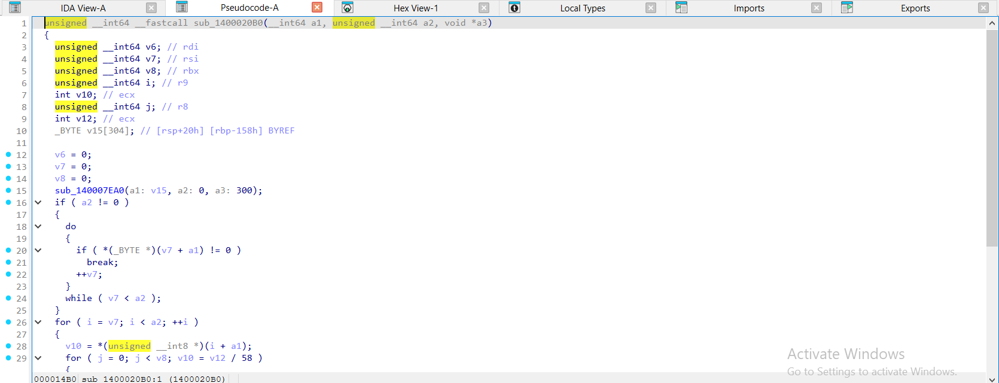
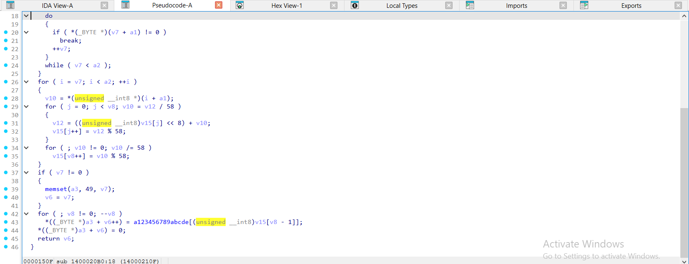
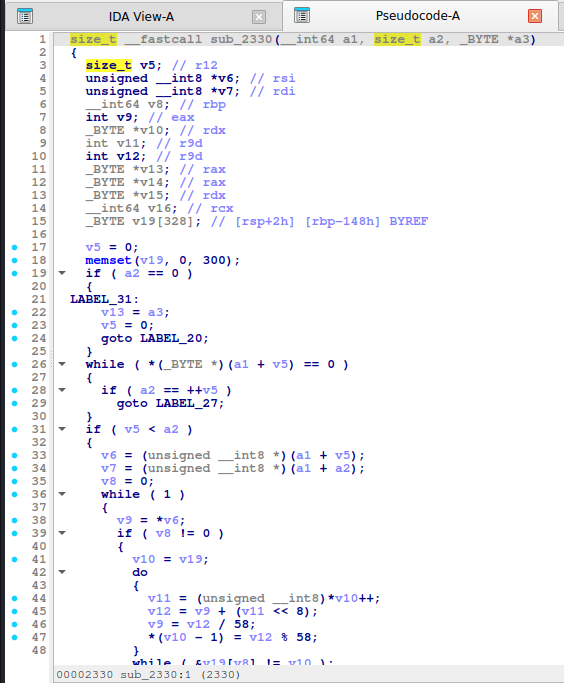
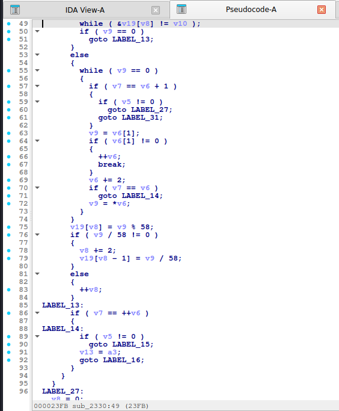
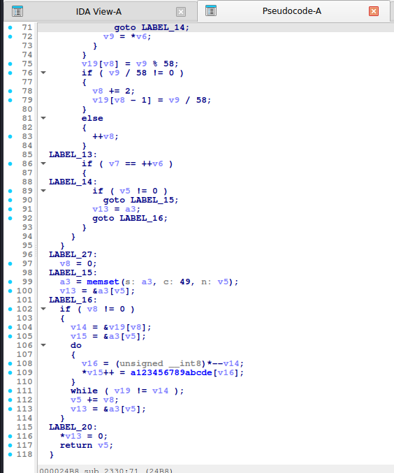
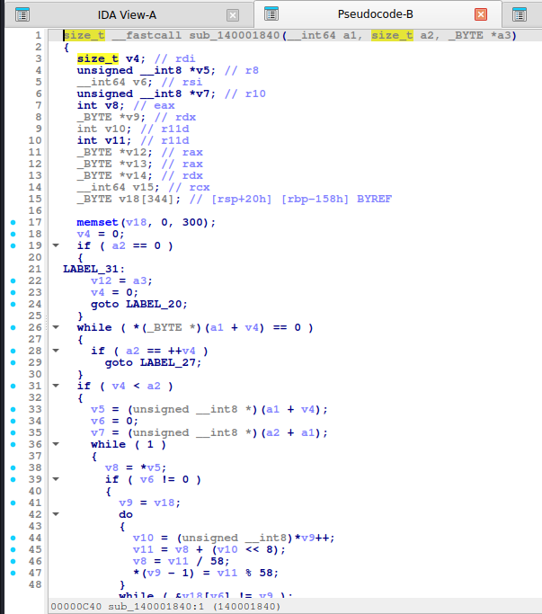
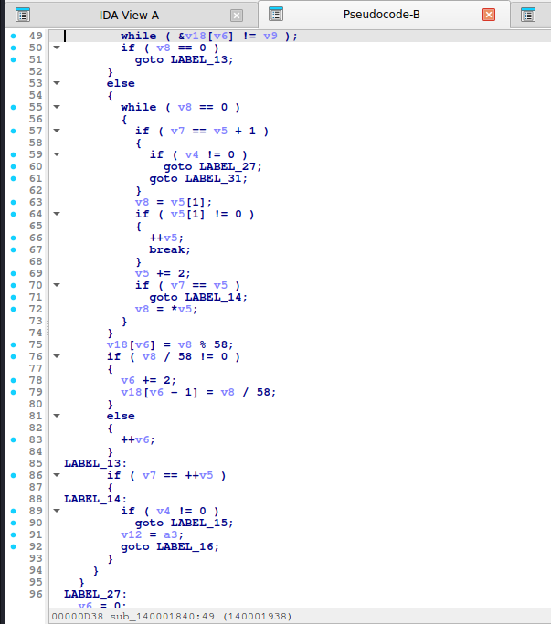
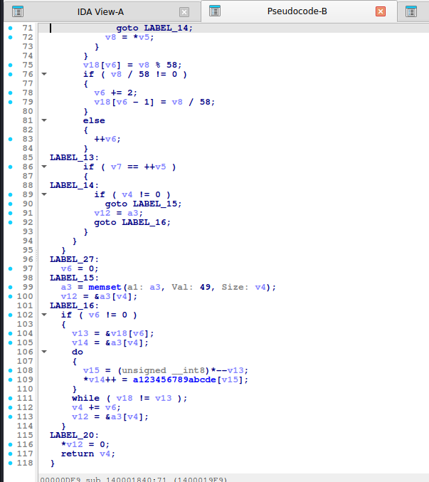

# Base58 (Bitcoin alphabet)

> Chuyển cả mảng byte (coi như một số lớn big-endian) sang **hệ cơ số 58** bằng phép chia lặp; byte `0x00` đầu được đổi thành ký tự `1`. Khác Base64 ở chỗ **không có bước nhóm cố định**.

## 1. Dấu hiệu nhận biết

- Bảng **58 ký tự** `123456789ABCDEFGHJKLMNPQRSTUVWXYZabcdefghijkmnopqrstuvwxyz` (bỏ `0 O I l`). Tìm bằng Strings.
- **Vòng lặp lồng nhau**: ngoài duyệt từng byte vào, trong duyệt mảng chữ số base58 đang xây (`carry`, nhân `256`, chia/lấy dư **`58`**): `carry += buf[j] * 256; buf[j] = carry % 58; carry /= 58`.
- Hằng số **`58`** (`0x3A`) và **`256`** xuất hiện cùng nhau; phép `/ 58` và `% 58`. Ở assembly trình biên dịch đổi chia cho hằng thành *nhân với số ma thuật + dịch bit*, nhưng IDA/Hex-Rays gộp lại và hiện `/ 58`, `% 58` trong pseudo-code (nếu thấy nhân với số lạ rồi `>>` thì thử chia ngược để xem ra số nào).
- Đầu ra: lặp `'1'` (`49`) cho mỗi byte `0` ở đầu, rồi **in ngược** mảng chữ số (`T[buf[--len]]`).
- Chuỗi output dài khoảng `1.37 × n` ký tự, không có `=`, không có `0 O I l`, `+`, `/`.

## 2. Thuật toán (mã giả)

```
zeros = số byte 0x00 đầu vào
buf = []                         # chữ số base58, little-endian
for b in in[zeros:]:
    carry = b
    for j in range(len(buf)):
        carry += buf[j] * 256
        buf[j] = carry % 58
        carry //= 58
    while carry: buf.append(carry % 58); carry //= 58
out = '1' * zeros + ''.join(T[d] for d in reversed(buf))
```

## 3. Mã hóa / giải mã

Giải mã: `num = num*58 + index(ch)` cho từng ký tự rồi đổi `num` ra bytes big-endian, bù lại `zeros` byte `0x00` đầu bằng số ký tự `1` đầu. Python có `int` không giới hạn nên rất gọn.

## 4. Mã nguồn gốc (C)

```c
size_t b58_encode(const uint8_t *in, size_t n, char *out)
{
    static const char T[] = "123456789ABCDEFGHJKLMNPQRSTUVWXYZabcdefghijkmnopqrstuvwxyz";
    uint8_t buf[300];
    size_t zeros = 0, len = 0, o = 0;
    memset(buf, 0, sizeof(buf));
    while (zeros < n && in[zeros] == 0) zeros++;
    for (size_t i = zeros; i < n; i++) {
        int carry = in[i];
        for (size_t j = 0; j < len; j++) {
            carry += buf[j] * 256;
            buf[j] = (uint8_t)(carry % 58);
            carry /= 58;
        }
        while (carry) {
            buf[len++] = (uint8_t)(carry % 58);
            carry /= 58;
        }
    }
    for (size_t i = 0; i < zeros; i++) out[o++] = '1';
    for (size_t i = len; i > 0; i--) out[o++] = T[buf[i - 1]];
    out[o] = 0;
    return o;
}
```

## 5. Pseudo-code IDA thực tế

<details><summary>MSVC /O2 - PE x64 (có PDB)</summary>

```c
unsigned __int64 __fastcall b58_encode(const unsigned __int8 *in, unsigned __int64 n, char *out)
{
  unsigned __int64 v6; // rdi
  unsigned __int64 v7; // rsi
  unsigned __int64 v8; // rbx
  unsigned __int64 i; // r9
  int v10; // ecx
  unsigned __int64 j; // r8
  int v12; // ecx
  unsigned __int8 buf[304]; // [rsp+20h] [rbp-158h] BYREF

  v6 = 0;
  v7 = 0;
  v8 = 0;
  memset(a1: buf, Val: 0, Size: 0x12Cu);
  if ( n != 0 )
  {
    do
    {
      if ( in[v7] != 0 )
        break;
      ++v7;
    }
    while ( v7 < n );
  }
  for ( i = v7; i < n; ++i )
  {
    v10 = in[i];
    for ( j = 0; j < v8; v10 = v12 / 58 )
    {
      v12 = (buf[j] << 8) + v10;
      buf[j++] = v12 % 58;
    }
    for ( ; v10 != 0; v10 /= 58 )
      buf[v8++] = v10 % 58;
  }
  if ( v7 != 0 )
  {
    memset(out, 49, v7);
    v6 = v7;
  }
  for ( ; v8 != 0; --v8 )
    out[v6++] = T_2[buf[v8 - 1]];
  out[v6] = 0;
  return v6;
}
```

</details>

<details><summary>MSVC /Od - PE x64 (có PDB)</summary>

```c
unsigned __int64 __fastcall b58_encode(const unsigned __int8 *in, unsigned __int64 n, char *out)
{
  int carry; // [rsp+20h] [rbp-188h]
  int carrya; // [rsp+20h] [rbp-188h]
  unsigned __int64 o; // [rsp+28h] [rbp-180h]
  unsigned __int64 zeros; // [rsp+30h] [rbp-178h]
  unsigned __int64 j; // [rsp+38h] [rbp-170h]
  unsigned __int64 len; // [rsp+40h] [rbp-168h]
  unsigned __int64 i; // [rsp+48h] [rbp-160h]
  unsigned __int64 m; // [rsp+50h] [rbp-158h]
  unsigned __int64 k; // [rsp+58h] [rbp-150h]
  unsigned __int8 buf[304]; // [rsp+60h] [rbp-148h] BYREF

  zeros = 0;
  len = 0;
  o = 0;
  memset(a1: buf, Val: 0, Size: 0x12Cu);
  while ( zeros < n && in[zeros] == 0 )
    ++zeros;
  for ( i = zeros; i < n; ++i )
  {
    carry = in[i];
    for ( j = 0; j < len; ++j )
    {
      carrya = (buf[j] << 8) + carry;
      buf[j] = carrya % 58;
      carry = carrya / 58;
    }
    while ( carry != 0 )
    {
      buf[len++] = carry % 58;
      carry /= 58;
    }
  }
  for ( k = 0; k < zeros; ++k )
    out[o++] = 49;
  for ( m = len; m != 0; --m )
    out[o++] = T_2[buf[m - 1]];
  out[o] = 0;
  return o;
}
```

</details>

<details><summary>gcc -O2 - ELF x86-64 (chưa strip)</summary>

```c
size_t __fastcall b58_encode(__int64 a1, size_t a2, _BYTE *a3)
{
  size_t v5; // r12
  unsigned __int8 *v6; // rsi
  unsigned __int8 *v7; // rdi
  __int64 v8; // rbp
  int v9; // eax
  _BYTE *v10; // rdx
  int v11; // r9d
  int v12; // r9d
  _BYTE *v13; // rax
  _BYTE *v14; // rax
  _BYTE *v15; // rdx
  __int64 v16; // rcx
  _BYTE v19[328]; // [rsp+2h] [rbp-148h] BYREF

  v5 = 0;
  memset(v19, 0, 300);
  if ( a2 == 0 )
  {
LABEL_31:
    v13 = a3;
    v5 = 0;
    goto LABEL_20;
  }
  while ( *(_BYTE *)(a1 + v5) == 0 )
  {
    if ( a2 == ++v5 )
      goto LABEL_27;
  }
  if ( v5 < a2 )
  {
    v6 = (unsigned __int8 *)(a1 + v5);
    v7 = (unsigned __int8 *)(a1 + a2);
    v8 = 0;
    while ( 1 )
    {
      v9 = *v6;
      if ( v8 != 0 )
      {
        v10 = v19;
        do
        {
          v11 = (unsigned __int8)*v10++;
          v12 = v9 + (v11 << 8);
          v9 = v12 / 58;
          *(v10 - 1) = v12 % 58;
        }
        while ( &v19[v8] != v10 );
        if ( v9 == 0 )
          goto LABEL_13;
      }
      else
      {
        while ( v9 == 0 )
        {
          if ( v7 == v6 + 1 )
          {
            if ( v5 != 0 )
              goto LABEL_27;
            goto LABEL_31;
          }
          v9 = v6[1];
          if ( v6[1] != 0 )
          {
            ++v6;
            break;
          }
          v6 += 2;
          if ( v7 == v6 )
            goto LABEL_14;
          v9 = *v6;
        }
      }
      v19[v8] = v9 % 58;
      if ( v9 / 58 != 0 )
      {
        v8 += 2;
        v19[v8 - 1] = v9 / 58;
      }
      else
      {
        ++v8;
      }
LABEL_13:
      if ( v7 == ++v6 )
      {
LABEL_14:
        if ( v5 != 0 )
          goto LABEL_15;
        v13 = a3;
        goto LABEL_16;
      }
    }
  }
LABEL_27:
  v8 = 0;
LABEL_15:
  a3 = memset(s: a3, c: 49, n: v5);
  v13 = &a3[v5];
LABEL_16:
  if ( v8 != 0 )
  {
    v14 = &v19[v8];
    v15 = &a3[v5];
    do
    {
      v16 = (unsigned __int8)*--v14;
      *v15++ = T_3[v16];
    }
    while ( v19 != v14 );
    v5 += v8;
    v13 = &a3[v5];
  }
LABEL_20:
  *v13 = 0;
  return v5;
}
```

</details>

<details><summary>gcc -O0 - ELF x86-64 (chưa strip)</summary>

```c
__int64 __fastcall b58_encode(__int64 a1, unsigned __int64 a2, __int64 a3)
{
  __int64 v3; // rax
  __int64 v4; // rax
  int v5; // ecx
  __int64 v6; // rax
  __int64 v10; // [rsp+18h] [rbp-178h]
  _BYTE s[304]; // [rsp+20h] [rbp-170h] BYREF
  unsigned __int64 m; // [rsp+150h] [rbp-40h]
  unsigned __int64 k; // [rsp+158h] [rbp-38h]
  unsigned __int64 j; // [rsp+160h] [rbp-30h]
  int v15; // [rsp+16Ch] [rbp-24h]
  unsigned __int64 i; // [rsp+170h] [rbp-20h]
  __int64 v17; // [rsp+178h] [rbp-18h]
  unsigned __int64 v18; // [rsp+180h] [rbp-10h]
  unsigned __int64 v19; // [rsp+188h] [rbp-8h]

  v10 = a1;
  v19 = 0;
  v18 = 0;
  v17 = 0;
  memset(s, c: 0, n: 0x12Cu);
  while ( v19 < a2 && *(_BYTE *)(v10 + v19) == 0 )
    ++v19;
  for ( i = v19; i < a2; ++i )
  {
    v15 = *(unsigned __int8 *)(v10 + i);
    for ( j = 0; j < v18; ++j )
    {
      v15 += (unsigned __int8)s[j] << 8;
      s[j] = v15 % 58;
      v15 /= 58;
    }
    while ( v15 != 0 )
    {
      v3 = v18++;
      s[v3] = v15 % 58;
      v15 /= 58;
    }
  }
  for ( k = 0; k < v19; ++k )
  {
    v4 = v17++;
    *(_BYTE *)(a3 + v4) = 49;
  }
  for ( m = v18; m != 0; --m )
  {
    v5 = (unsigned __int8)s[m - 1];
    v6 = v17++;
    *(_BYTE *)(v6 + a3) = T_3[v5];
  }
  *(_BYTE *)(a3 + v17) = 0;
  return v17;
}
```

</details>

<details><summary>mingw-w64 gcc -O2 - PE x64 (-static)</summary>

```c
size_t __fastcall b58_encode(__int64 a1, size_t a2, _BYTE *a3)
{
  size_t v4; // rdi
  unsigned __int8 *v5; // r8
  __int64 v6; // rsi
  unsigned __int8 *v7; // r10
  int v8; // eax
  _BYTE *v9; // rdx
  int v10; // r11d
  int v11; // r11d
  _BYTE *v12; // rax
  _BYTE *v13; // rax
  _BYTE *v14; // rdx
  __int64 v15; // rcx
  _BYTE v18[344]; // [rsp+20h] [rbp-158h] BYREF

  memset(v18, 0, 300);
  v4 = 0;
  if ( a2 == 0 )
  {
LABEL_31:
    v12 = a3;
    v4 = 0;
    goto LABEL_20;
  }
  while ( *(_BYTE *)(a1 + v4) == 0 )
  {
    if ( a2 == ++v4 )
      goto LABEL_27;
  }
  if ( v4 < a2 )
  {
    v5 = (unsigned __int8 *)(a1 + v4);
    v6 = 0;
    v7 = (unsigned __int8 *)(a2 + a1);
    while ( 1 )
    {
      v8 = *v5;
      if ( v6 != 0 )
      {
        v9 = v18;
        do
        {
          v10 = (unsigned __int8)*v9++;
          v11 = v8 + (v10 << 8);
          v8 = v11 / 58;
          *(v9 - 1) = v11 % 58;
        }
        while ( &v18[v6] != v9 );
        if ( v8 == 0 )
          goto LABEL_13;
      }
      else
      {
        while ( v8 == 0 )
        {
          if ( v7 == v5 + 1 )
          {
            if ( v4 != 0 )
              goto LABEL_27;
            goto LABEL_31;
          }
          v8 = v5[1];
          if ( v5[1] != 0 )
          {
            ++v5;
            break;
          }
          v5 += 2;
          if ( v7 == v5 )
            goto LABEL_14;
          v8 = *v5;
        }
      }
      v18[v6] = v8 % 58;
      if ( v8 / 58 != 0 )
      {
        v6 += 2;
        v18[v6 - 1] = v8 / 58;
      }
      else
      {
        ++v6;
      }
LABEL_13:
      if ( v7 == ++v5 )
      {
LABEL_14:
        if ( v4 != 0 )
          goto LABEL_15;
        v12 = a3;
        goto LABEL_16;
      }
    }
  }
LABEL_27:
  v6 = 0;
LABEL_15:
  a3 = memset(a1: a3, Val: 49, Size: v4);
  v12 = &a3[v4];
LABEL_16:
  if ( v6 != 0 )
  {
    v13 = &v18[v6];
    v14 = &a3[v4];
    do
    {
      v15 = (unsigned __int8)*--v13;
      *v14++ = T_3[v15];
    }
    while ( v18 != v13 );
    v4 += v6;
    v12 = &a3[v4];
  }
LABEL_20:
  *v12 = 0;
  return v4;
}
```

</details>

<details><summary>mingw-w64 gcc -O0 - PE x64 (-static)</summary>

```c
__int64 __fastcall b58_encode(__int64 a1, unsigned __int64 a2, __int64 a3)
{
  __int64 v3; // rax
  __int64 v4; // rax
  int v5; // ecx
  __int64 v6; // rax
  _BYTE v8[304]; // [rsp+20h] [rbp-60h] BYREF
  unsigned __int64 m; // [rsp+150h] [rbp+D0h]
  unsigned __int64 k; // [rsp+158h] [rbp+D8h]
  unsigned __int64 j; // [rsp+160h] [rbp+E0h]
  int v12; // [rsp+16Ch] [rbp+ECh]
  unsigned __int64 i; // [rsp+170h] [rbp+F0h]
  __int64 v14; // [rsp+178h] [rbp+F8h]
  unsigned __int64 v15; // [rsp+180h] [rbp+100h]
  unsigned __int64 v16; // [rsp+188h] [rbp+108h]

  v16 = 0;
  v15 = 0;
  v14 = 0;
  memset(a1: v8, Val: 0, Size: 0x12Cu);
  while ( v16 < a2 && *(_BYTE *)(a1 + v16) == 0 )
    ++v16;
  for ( i = v16; i < a2; ++i )
  {
    v12 = *(unsigned __int8 *)(a1 + i);
    for ( j = 0; j < v15; ++j )
    {
      v12 += (unsigned __int8)v8[j] << 8;
      v8[j] = v12 % 58;
      v12 /= 58;
    }
    while ( v12 != 0 )
    {
      v3 = v15++;
      v8[v3] = v12 % 58;
      v12 /= 58;
    }
  }
  for ( k = 0; k < v16; ++k )
  {
    v4 = v14++;
    *(_BYTE *)(a3 + v4) = 49;
  }
  for ( m = v15; m != 0; --m )
  {
    v5 = (unsigned __int8)v8[m - 1];
    v6 = v14++;
    *(_BYTE *)(v6 + a3) = T_3[v5];
  }
  *(_BYTE *)(a3 + v14) = 0;
  return v14;
}
```

</details>

**Bản strip (không symbol)** – IDA chỉ thấy `sub_XXXX`, `a1`, `a2`, `byte_XXXX`; hàm này tên là MSVC /O2 → `sub_1400020B0`, gcc -O2 → `sub_2330`, mingw-w64 -O2 -static → `sub_140001840`:

<details><summary>MSVC /O2 – PE x64, không PDB (strip) – bản STRIP: <code>b58_encode</code> = <code>sub_1400020B0</code></summary>

```c
unsigned __int64 __fastcall sub_1400020B0(__int64 a1, unsigned __int64 a2, void *a3)
{
  unsigned __int64 v6; // rdi
  unsigned __int64 v7; // rsi
  unsigned __int64 v8; // rbx
  unsigned __int64 i; // r9
  int v10; // ecx
  unsigned __int64 j; // r8
  int v12; // ecx
  _BYTE v15[304]; // [rsp+20h] [rbp-158h] BYREF

  v6 = 0;
  v7 = 0;
  v8 = 0;
  sub_140007EA0(a1: v15, a2: 0, a3: 300);
  if ( a2 != 0 )
  {
    do
    {
      if ( *(_BYTE *)(v7 + a1) != 0 )
        break;
      ++v7;
    }
    while ( v7 < a2 );
  }
  for ( i = v7; i < a2; ++i )
  {
    v10 = *(unsigned __int8 *)(i + a1);
    for ( j = 0; j < v8; v10 = v12 / 58 )
    {
      v12 = ((unsigned __int8)v15[j] << 8) + v10;
      v15[j++] = v12 % 58;
    }
    for ( ; v10 != 0; v10 /= 58 )
      v15[v8++] = v10 % 58;
  }
  if ( v7 != 0 )
  {
    memset(a3, 49, v7);
    v6 = v7;
  }
  for ( ; v8 != 0; --v8 )
    *((_BYTE *)a3 + v6++) = a123456789abcde[(unsigned __int8)v15[v8 - 1]];
  *((_BYTE *)a3 + v6) = 0;
  return v6;
}
```

</details>

<details><summary>gcc -O2 – ELF, đã `strip -s` – bản STRIP: <code>b58_encode</code> = <code>sub_2330</code></summary>

```c
size_t __fastcall sub_2330(__int64 a1, size_t a2, _BYTE *a3)
{
  size_t v5; // r12
  unsigned __int8 *v6; // rsi
  unsigned __int8 *v7; // rdi
  __int64 v8; // rbp
  int v9; // eax
  _BYTE *v10; // rdx
  int v11; // r9d
  int v12; // r9d
  _BYTE *v13; // rax
  _BYTE *v14; // rax
  _BYTE *v15; // rdx
  __int64 v16; // rcx
  _BYTE v19[328]; // [rsp+2h] [rbp-148h] BYREF

  v5 = 0;
  memset(v19, 0, 300);
  if ( a2 == 0 )
  {
LABEL_31:
    v13 = a3;
    v5 = 0;
    goto LABEL_20;
  }
  while ( *(_BYTE *)(a1 + v5) == 0 )
  {
    if ( a2 == ++v5 )
      goto LABEL_27;
  }
  if ( v5 < a2 )
  {
    v6 = (unsigned __int8 *)(a1 + v5);
    v7 = (unsigned __int8 *)(a1 + a2);
    v8 = 0;
    while ( 1 )
    {
      v9 = *v6;
      if ( v8 != 0 )
      {
        v10 = v19;
        do
        {
          v11 = (unsigned __int8)*v10++;
          v12 = v9 + (v11 << 8);
          v9 = v12 / 58;
          *(v10 - 1) = v12 % 58;
        }
        while ( &v19[v8] != v10 );
        if ( v9 == 0 )
          goto LABEL_13;
      }
      else
      {
        while ( v9 == 0 )
        {
          if ( v7 == v6 + 1 )
          {
            if ( v5 != 0 )
              goto LABEL_27;
            goto LABEL_31;
          }
          v9 = v6[1];
          if ( v6[1] != 0 )
          {
            ++v6;
            break;
          }
          v6 += 2;
          if ( v7 == v6 )
            goto LABEL_14;
          v9 = *v6;
        }
      }
      v19[v8] = v9 % 58;
      if ( v9 / 58 != 0 )
      {
        v8 += 2;
        v19[v8 - 1] = v9 / 58;
      }
      else
      {
        ++v8;
      }
LABEL_13:
      if ( v7 == ++v6 )
      {
LABEL_14:
        if ( v5 != 0 )
          goto LABEL_15;
        v13 = a3;
        goto LABEL_16;
      }
    }
  }
LABEL_27:
  v8 = 0;
LABEL_15:
  a3 = memset(s: a3, c: 49, n: v5);
  v13 = &a3[v5];
LABEL_16:
  if ( v8 != 0 )
  {
    v14 = &v19[v8];
    v15 = &a3[v5];
    do
    {
      v16 = (unsigned __int8)*--v14;
      *v15++ = a123456789abcde[v16];
    }
    while ( v19 != v14 );
    v5 += v8;
    v13 = &a3[v5];
  }
LABEL_20:
  *v13 = 0;
  return v5;
}
```

</details>

<details><summary>mingw-w64 -O2 -static – PE, đã `strip -s` – bản STRIP: <code>b58_encode</code> = <code>sub_140001840</code></summary>

```c
size_t __fastcall sub_140001840(__int64 a1, size_t a2, _BYTE *a3)
{
  size_t v4; // rdi
  unsigned __int8 *v5; // r8
  __int64 v6; // rsi
  unsigned __int8 *v7; // r10
  int v8; // eax
  _BYTE *v9; // rdx
  int v10; // r11d
  int v11; // r11d
  _BYTE *v12; // rax
  _BYTE *v13; // rax
  _BYTE *v14; // rdx
  __int64 v15; // rcx
  _BYTE v18[344]; // [rsp+20h] [rbp-158h] BYREF

  memset(v18, 0, 300);
  v4 = 0;
  if ( a2 == 0 )
  {
LABEL_31:
    v12 = a3;
    v4 = 0;
    goto LABEL_20;
  }
  while ( *(_BYTE *)(a1 + v4) == 0 )
  {
    if ( a2 == ++v4 )
      goto LABEL_27;
  }
  if ( v4 < a2 )
  {
    v5 = (unsigned __int8 *)(a1 + v4);
    v6 = 0;
    v7 = (unsigned __int8 *)(a2 + a1);
    while ( 1 )
    {
      v8 = *v5;
      if ( v6 != 0 )
      {
        v9 = v18;
        do
        {
          v10 = (unsigned __int8)*v9++;
          v11 = v8 + (v10 << 8);
          v8 = v11 / 58;
          *(v9 - 1) = v11 % 58;
        }
        while ( &v18[v6] != v9 );
        if ( v8 == 0 )
          goto LABEL_13;
      }
      else
      {
        while ( v8 == 0 )
        {
          if ( v7 == v5 + 1 )
          {
            if ( v4 != 0 )
              goto LABEL_27;
            goto LABEL_31;
          }
          v8 = v5[1];
          if ( v5[1] != 0 )
          {
            ++v5;
            break;
          }
          v5 += 2;
          if ( v7 == v5 )
            goto LABEL_14;
          v8 = *v5;
        }
      }
      v18[v6] = v8 % 58;
      if ( v8 / 58 != 0 )
      {
        v6 += 2;
        v18[v6 - 1] = v8 / 58;
      }
      else
      {
        ++v6;
      }
LABEL_13:
      if ( v7 == ++v5 )
      {
LABEL_14:
        if ( v4 != 0 )
          goto LABEL_15;
        v12 = a3;
        goto LABEL_16;
      }
    }
  }
LABEL_27:
  v6 = 0;
LABEL_15:
  a3 = memset(a1: a3, Val: 49, Size: v4);
  v12 = &a3[v4];
LABEL_16:
  if ( v6 != 0 )
  {
    v13 = &v18[v6];
    v14 = &a3[v4];
    do
    {
      v15 = (unsigned __int8)*--v13;
      *v14++ = a123456789abcde[v15];
    }
    while ( v18 != v13 );
    v4 += v6;
    v12 = &a3[v4];
  }
LABEL_20:
  *v12 = 0;
  return v4;
}
```

</details>

**Ảnh chụp màn hình IDA (bản strip)** – mở từng mục để xem; hàm dài chia thành nhiều trang, mỗi trang là một màn hình IDA:

<details><summary>MSVC /O2 – PE x64, không PDB (strip) – b58_encode = <code>sub_1400020B0</code> – 2 ảnh</summary>





</details>

<details><summary>gcc -O2 – ELF, đã `strip -s` – b58_encode = <code>sub_2330</code> – 3 ảnh</summary>







</details>

<details><summary>mingw-w64 -O2 -static – PE, đã `strip -s` – b58_encode = <code>sub_140001840</code> – 3 ảnh</summary>







</details>

Nhận xét: `-O2` làm vòng lồng khó đọc hơn (nhiều `LABEL_`/`goto`, tách nhánh `v8 != 0`) nhưng vẫn giữ hai phép `/ 58` và `% 58`. Bám theo `buf[j] * 256` (hiện thành `(v11 << 8)`) và `memset(..., 49, n)` (điền `'1'`) là nhận ra.

## 6. Code giải mã

```python
B58_BTC = "123456789ABCDEFGHJKLMNPQRSTUVWXYZabcdefghijkmnopqrstuvwxyz"
def b58_decode(s, alphabet=B58_BTC):
    num = 0
    for ch in s:
        num = num * 58 + alphabet.index(ch)
    raw = num.to_bytes((num.bit_length() + 7) // 8, "big")
    lead = len(s) - len(s.lstrip(alphabet[0]))
    return b"\x00" * lead + raw
```

```python
b58_decode("21Vw54zR9xVRHMe5sgzNn5Tqd56G")   # b'Hello, CyberSeaGame!'
```

## 7. Biến thể & bẫy

- Alphabet khác (Flickr, Ripple) chỉ là hoán vị bảng: truyền `alphabet=`.
- **Base58Check** thêm 4 byte checksum (SHA-256 kép) ở cuối: bỏ 4 byte cuối sau khi decode.
- Dễ nhầm với Base62: Base62 có `0-9A-Za-z` đủ 62 ký tự, không loại ký tự nào.
