# Base64

> 3 byte (24 bit) -> 4 ký tự 6 bit tra trong bảng 64 ký tự, đệm `=`. Đây là "mã hóa" phổ biến nhất trong đề rev: hay bị đổi **bảng chữ cái** (custom alphabet) để chặn decode tự động.

## 1. Dấu hiệu nhận biết

- **Bảng 64 ký tự** trong `.rdata`: `ABCDEFGHIJKLMNOPQRSTUVWXYZabcdefghijklmnopqrstuvwxyz0123456789+/`. Nếu bảng bị xáo/đổi thì vẫn là chuỗi **đúng 64 ký tự khác nhau**. Dùng `Shift+F12` (Strings) tìm chuỗi dài 64.
- Hằng số: `0x3F` (`& 63`), các phép dịch **`>> 18`, `>> 12`, `>> 6`** (encode) hoặc **`<< 6`**, `>> bits` (decode). Ký tự **`61`** (`'='`) được ghi 1–2 lần ở đuôi.
- Vòng lặp **bước 3 byte vào / 4 byte ra** (`i += 3`, `o += 4`); phần đuôi rẽ nhánh theo `n % 3 == 1` / `== 2`.
- Độ dài output = `4 * ceil(n/3)`, kết thúc `=` hoặc `==`. Chuỗi mã hóa gồm chữ/số/`+`/`/`.
- Decode thường dùng `strchr(table, c)` (rồi trừ con trỏ bảng) hoặc **bảng tra ngược 256 byte** (có `-1`/`0xFF` cho ký tự lạ).
- Trong IDA bảng có tên `T_6` (ELF có symbol), `T` (MSVC + PDB) hoặc `byte_XXXX` (strip). Mở bảng, đọc ra alphabet thật.

## 2. Thuật toán (mã giả)

```
encode(in):
  for mỗi nhóm 3 byte b0 b1 b2:
      v = (b0 << 16) | (b1 << 8) | b2
      out += T[v >> 18] T[(v >> 12) & 63] T[(v >> 6) & 63] T[v & 63]
  còn dư 1 byte : v = b0 << 16        -> 2 ký tự + "=="
  còn dư 2 byte : v = b0<<16 | b1<<8  -> 3 ký tự + "="
decode(s):
  acc = 0; bits = 0
  for c in s (bỏ '='):
      acc = (acc << 6) | index_of(c);  bits += 6
      nếu bits >= 8:  bits -= 8; out += (acc >> bits) & 0xFF
```

## 3. Mã hóa / giải mã

- Mã hóa: gom 24 bit rồi cắt 4 lát 6 bit. Giải mã là phép ngược: mỗi ký tự trả 6 bit, đủ 8 bit thì xuất 1 byte.
- **Custom alphabet**: chỉ thay bảng `T`; giải mã bằng cùng thuật toán với bảng mới (hàm Python bên dưới nhận tham số `alphabet`).
- Nếu bị đổi **thứ tự byte** hoặc XOR sau/ trước encode thì phải đảo các bước đó trước/ sau (xem [xor.md](../ops/xor.md)).

## 4. Mã nguồn gốc (C) dùng để sinh binary

```c
size_t b64_encode(const uint8_t *in, size_t n, char *out)
{
    static const char T[] = "ABCDEFGHIJKLMNOPQRSTUVWXYZabcdefghijklmnopqrstuvwxyz0123456789+/";
    size_t i = 0, o = 0;
    for (; i + 2 < n; i += 3) {
        uint32_t v = ((uint32_t)in[i] << 16) | ((uint32_t)in[i + 1] << 8) | in[i + 2];
        out[o++] = T[v >> 18];
        out[o++] = T[(v >> 12) & 63];
        out[o++] = T[(v >> 6) & 63];
        out[o++] = T[v & 63];
    }
    if (n - i == 1) {
        uint32_t v = (uint32_t)in[i] << 16;
        out[o++] = T[v >> 18];
        out[o++] = T[(v >> 12) & 63];
        out[o++] = '=';
        out[o++] = '=';
    } else if (n - i == 2) {
        uint32_t v = ((uint32_t)in[i] << 16) | ((uint32_t)in[i + 1] << 8);
        out[o++] = T[v >> 18];
        out[o++] = T[(v >> 12) & 63];
        out[o++] = T[(v >> 6) & 63];
        out[o++] = '=';
    }
    out[o] = 0;
    return o;
}

size_t b64_decode(const char *in, uint8_t *out)
{
    static const char T[] = "ABCDEFGHIJKLMNOPQRSTUVWXYZabcdefghijklmnopqrstuvwxyz0123456789+/";
    uint32_t acc = 0;
    int bits = 0;
    size_t o = 0;
    for (; *in && *in != '='; in++) {
        const char *p = strchr(T, *in);
        if (!p) continue;
        acc = (acc << 6) | (uint32_t)(p - T);
        bits += 6;
        if (bits >= 8) {
            bits -= 8;
            out[o++] = (uint8_t)(acc >> bits);
        }
    }
    return o;
}
```

## 5. Pseudo-code IDA thực tế

Mở từng khối để so sánh các trình biên dịch/mức tối ưu:

<details><summary>MSVC /O2 - PE x64 (có PDB)</summary>

```c
unsigned __int64 __fastcall b64_encode(const unsigned __int8 *in, unsigned __int64 n, char *out)
{
  __int64 v3; // r10
  unsigned __int64 result; // rax
  const unsigned __int8 *v7; // r11
  __int64 v8; // rbx
  __int64 v9; // rcx
  __int64 v10; // rdx
  unsigned __int64 v11; // rdx
  __int64 v12; // r9
  __int64 v13; // rdx
  unsigned __int64 v14; // rdx

  v3 = 0;
  result = 0;
  if ( n > 2 )
  {
    v7 = in + 1;
    v8 = 1LL - (_QWORD)in;
    do
    {
      v9 = *v7;
      v3 += 3;
      v10 = *(v7 - 1);
      v7 += 3;
      v11 = *(v7 - 2) | ((v9 | (v10 << 8)) << 8);
      out[result] = T[v11 >> 18];
      out[result + 1] = T[(v11 >> 12) & 0x3F];
      out[result + 2] = T[(v11 >> 6) & 0x3F];
      out[result + 3] = T[v11 & 0x3F];
      result += 4LL;
    }
    while ( (unsigned __int64)&v7[v8] < n );
  }
  v12 = n - v3;
  if ( v12 == 1 )
  {
    v13 = (16 * in[v3]) & 0x3F;
    out[result] = T[(unsigned __int64)in[v3] << 16 >> 18];
    out[result + 1] = T[v13];
    *(_WORD *)&out[result + 2] = 15677;
    result += 4LL;
    out[result] = 0;
  }
  else
  {
    if ( v12 == 2 )
    {
      v14 = (in[v3 + 1] | ((unsigned __int64)in[v3] << 8)) << 8;
      out[result] = T[v14 >> 18];
      out[result + 1] = T[(v14 >> 12) & 0x3F];
      out[result + 2] = T[(v14 >> 6) & 0x3F];
      out[result + 3] = 61;
      result += 4LL;
    }
    out[result] = 0;
  }
  return result;
}
```

</details>

<details><summary>MSVC /Od - PE x64 (có PDB)</summary>

```c
unsigned __int64 __fastcall b64_encode(const unsigned __int8 *in, unsigned __int64 n, char *out)
{
  unsigned int v; // [rsp+0h] [rbp-28h]
  unsigned int v5; // [rsp+4h] [rbp-24h]
  unsigned int v6; // [rsp+8h] [rbp-20h]
  unsigned __int64 o; // [rsp+10h] [rbp-18h]
  unsigned __int64 oa; // [rsp+10h] [rbp-18h]
  unsigned __int64 ob; // [rsp+10h] [rbp-18h]
  unsigned __int64 oc; // [rsp+10h] [rbp-18h]
  unsigned __int64 i; // [rsp+18h] [rbp-10h]

  i = 0;
  o = 0;
  while ( i + 2 < n )
  {
    v = in[i + 2] | (in[i + 1] << 8) | (in[i] << 16);
    out[o] = T[(unsigned int)((in[i + 1] << 8) | (in[i] << 16)) >> 18];
    oa = o + 1;
    out[oa] = T[(v >> 12) & 0x3F];
    out[++oa] = T[(v >> 6) & 0x3F];
    out[++oa] = T[v & 0x3F];
    o = oa + 1;
    i += 3LL;
  }
  if ( n - i == 1 )
  {
    v6 = in[i] << 16;
    out[o] = T[in[i] >> 2];
    ob = o + 1;
    out[ob] = T[(v6 >> 12) & 0x3F];
    out[++ob] = 61;
    out[++ob] = 61;
    o = ob + 1;
  }
  else if ( n - i == 2 )
  {
    v5 = (in[i + 1] << 8) | (in[i] << 16);
    out[o] = T[v5 >> 18];
    oc = o + 1;
    out[oc] = T[(v5 >> 12) & 0x3F];
    out[++oc] = T[(v5 >> 6) & 0x3F];
    out[++oc] = 61;
    o = oc + 1;
  }
  out[o] = 0;
  return o;
}
```

</details>

<details><summary>gcc -O2 - ELF x86-64 (chưa strip)</summary>

```c
__int64 __fastcall b64_encode(__int64 a1, unsigned __int64 a2, _BYTE *a3)
{
  unsigned __int64 v4; // r9
  __int64 v6; // rdi
  __int64 v7; // rcx
  unsigned int v8; // eax
  unsigned int v9; // ebx
  unsigned __int64 v10; // rax
  _BYTE *v11; // rax
  int v13; // edx
  unsigned int v14; // ecx
  unsigned int v15; // eax
  __int64 v16; // rax
  unsigned int v17; // edx
  char v18; // al
  __int64 v19; // rax
  __int64 v20; // rdi

  v4 = a2;
  if ( a2 <= 2 )
  {
    v11 = a3;
    v6 = 0;
    v7 = 0;
  }
  else
  {
    v6 = 0;
    v7 = 0;
    do
    {
      v6 += 4;
      v8 = (*(unsigned __int8 *)(a1 + v7 + 1) << 8) | (*(unsigned __int8 *)(a1 + v7) << 16);
      v9 = v8 | *(unsigned __int8 *)(a1 + v7 + 2);
      *(_DWORD *)&a3[v6 - 4] = (unsigned __int8)T_6[v8 >> 18]
                             | (((unsigned __int8)T_6[(v8 >> 12) & 0x3F]
                               | (((unsigned __int8)T_6[(v9 >> 6) & 0x3F] | ((unsigned __int8)T_6[v9 & 0x3F] << 8)) << 8)) << 8);
      v10 = v7 + 5;
      v7 += 3;
    }
    while ( v10 < a2 );
    v4 = a2 - v7;
    v11 = &a3[v6];
  }
  if ( v4 == 1 )
  {
    v17 = *(unsigned __int8 *)(a1 + v7);
    *v11 = T_6[v17 >> 2];
    v18 = T_6[(16 * (_BYTE)v17) & 0x30];
    a3[v6 + 2] = 61;
    a3[v6 + 1] = v18;
    v19 = v6 + 3;
    v20 = v6 + 4;
    a3[v19] = 61;
    a3[v20] = 0;
    return v20;
  }
  else
  {
    if ( v4 == 2 )
    {
      v13 = *(unsigned __int8 *)(a1 + v7 + 1);
      v14 = *(unsigned __int8 *)(a1 + v7) << 16;
      *v11 = T_6[v14 >> 18];
      v15 = v14 | (v13 << 8);
      LOBYTE(v13) = T_6[(v15 >> 6) & 0x3F];
      LOBYTE(v15) = T_6[(v15 >> 12) & 0x3F];
      a3[v6 + 2] = v13;
      a3[v6 + 1] = v15;
      v16 = v6 + 3;
      v6 += 4;
      a3[v16] = 61;
      a3[v6] = 0;
    }
    else
    {
      *v11 = 0;
    }
    return v6;
  }
}
```

</details>

<details><summary>gcc -O0 - ELF x86-64 (chưa strip)</summary>

```c
__int64 __fastcall b64_encode(__int64 a1, unsigned __int64 a2, __int64 a3)
{
  __int64 v3; // rax
  __int64 v4; // rax
  __int64 v5; // rax
  unsigned int v7; // [rsp+1Ch] [rbp-1Ch]
  unsigned int v8; // [rsp+20h] [rbp-18h]
  unsigned int v9; // [rsp+24h] [rbp-14h]
  __int64 v10; // [rsp+28h] [rbp-10h]
  __int64 v11; // [rsp+30h] [rbp-8h]

  v11 = 0;
  v10 = 0;
  while ( v11 + 2 < a2 )
  {
    v7 = (*(unsigned __int8 *)(v11 + 1 + a1) << 8)
       | (*(unsigned __int8 *)(a1 + v11) << 16)
       | *(unsigned __int8 *)(v11 + 2 + a1);
    *(_BYTE *)(v10 + a3) = T_6[(unsigned int)((*(unsigned __int8 *)(v11 + 1 + a1) << 8)
                                            | (*(unsigned __int8 *)(a1 + v11) << 16)) >> 18];
    *(_BYTE *)(v10 + 1 + a3) = T_6[(v7 >> 12) & 0x3F];
    *(_BYTE *)(v10 + 2 + a3) = T_6[(v7 >> 6) & 0x3F];
    v3 = v10 + 3;
    v10 += 4;
    *(_BYTE *)(v3 + a3) = T_6[v7 & 0x3F];
    v11 += 3;
  }
  if ( a2 - v11 == 1 )
  {
    v8 = *(unsigned __int8 *)(a1 + v11) << 16;
    *(_BYTE *)(v10 + a3) = T_6[*(unsigned __int8 *)(a1 + v11) >> 2];
    *(_BYTE *)(v10 + 1 + a3) = T_6[(v8 >> 12) & 0x3F];
    *(_BYTE *)(a3 + v10 + 2) = 61;
    v4 = v10 + 3;
    v10 += 4;
    *(_BYTE *)(a3 + v4) = 61;
  }
  else if ( a2 - v11 == 2 )
  {
    v9 = (*(unsigned __int8 *)(a1 + v11) << 16) | (*(unsigned __int8 *)(v11 + 1 + a1) << 8);
    *(_BYTE *)(v10 + a3) = T_6[v9 >> 18];
    *(_BYTE *)(v10 + 1 + a3) = T_6[(v9 >> 12) & 0x3F];
    *(_BYTE *)(v10 + 2 + a3) = T_6[(v9 >> 6) & 0x3F];
    v5 = v10 + 3;
    v10 += 4;
    *(_BYTE *)(a3 + v5) = 61;
  }
  *(_BYTE *)(a3 + v10) = 0;
  return v10;
}
```

</details>

<details><summary>mingw-w64 gcc -O2 - PE x64 (-static)</summary>

```c
__int64 __fastcall b64_encode(__int64 a1, unsigned __int64 a2, _BYTE *a3)
{
  unsigned __int64 v4; // rbx
  __int64 v5; // r10
  __int64 v6; // rcx
  unsigned int v7; // eax
  unsigned int v8; // edi
  unsigned __int64 v9; // rax
  _BYTE *v10; // rax
  int v12; // edx
  unsigned int v13; // ecx
  unsigned int v14; // eax
  __int64 v15; // rax
  unsigned int v16; // edx
  char v17; // al
  __int64 v18; // rax
  __int64 v19; // r10

  v4 = a2;
  if ( a2 <= 2 )
  {
    v10 = a3;
    v5 = 0;
    v6 = 0;
  }
  else
  {
    v5 = 0;
    v6 = 0;
    do
    {
      v5 += 4;
      v7 = (*(unsigned __int8 *)(a1 + v6 + 1) << 8) | (*(unsigned __int8 *)(a1 + v6) << 16);
      v8 = v7 | *(unsigned __int8 *)(a1 + v6 + 2);
      *(_DWORD *)&a3[v5 - 4] = (unsigned __int8)T_6[v7 >> 18]
                             | (((unsigned __int8)T_6[(v7 >> 12) & 0x3F]
                               | (((unsigned __int8)T_6[(v8 >> 6) & 0x3F] | ((unsigned __int8)T_6[v8 & 0x3F] << 8)) << 8)) << 8);
      v9 = v6 + 5;
      v6 += 3;
    }
    while ( v9 < a2 );
    v4 = a2 - v6;
    v10 = &a3[v5];
  }
  if ( v4 == 1 )
  {
    v16 = *(unsigned __int8 *)(a1 + v6);
    *v10 = T_6[v16 >> 2];
    v17 = T_6[(16 * (_BYTE)v16) & 0x30];
    a3[v5 + 2] = 61;
    a3[v5 + 1] = v17;
    v18 = v5 + 3;
    v19 = v5 + 4;
    a3[v18] = 61;
    a3[v19] = 0;
    return v19;
  }
  else
  {
    if ( v4 == 2 )
    {
      v12 = *(unsigned __int8 *)(a1 + v6 + 1);
      v13 = *(unsigned __int8 *)(a1 + v6) << 16;
      *v10 = T_6[v13 >> 18];
      v14 = v13 | (v12 << 8);
      LOBYTE(v12) = T_6[(v14 >> 6) & 0x3F];
      LOBYTE(v14) = T_6[(v14 >> 12) & 0x3F];
      a3[v5 + 2] = v12;
      a3[v5 + 1] = v14;
      v15 = v5 + 3;
      v5 += 4;
      a3[v15] = 61;
      a3[v5] = 0;
    }
    else
    {
      *v10 = 0;
    }
    return v5;
  }
}
```

</details>

<details><summary>mingw-w64 gcc -O0 - PE x64 (-static)</summary>

```c
__int64 __fastcall b64_encode(__int64 a1, unsigned __int64 a2, __int64 a3)
{
  __int64 v3; // rax
  __int64 v4; // rax
  __int64 v5; // rax
  unsigned int v7; // [rsp+4h] [rbp-1Ch]
  unsigned int v8; // [rsp+8h] [rbp-18h]
  unsigned int v9; // [rsp+Ch] [rbp-14h]
  __int64 v10; // [rsp+10h] [rbp-10h]
  __int64 v11; // [rsp+18h] [rbp-8h]

  v11 = 0;
  v10 = 0;
  while ( v11 + 2 < a2 )
  {
    v7 = (*(unsigned __int8 *)(v11 + 1 + a1) << 8)
       | (*(unsigned __int8 *)(a1 + v11) << 16)
       | *(unsigned __int8 *)(v11 + 2 + a1);
    *(_BYTE *)(v10 + a3) = T_6[(unsigned int)((*(unsigned __int8 *)(v11 + 1 + a1) << 8)
                                            | (*(unsigned __int8 *)(a1 + v11) << 16)) >> 18];
    *(_BYTE *)(v10 + 1 + a3) = T_6[(v7 >> 12) & 0x3F];
    *(_BYTE *)(v10 + 2 + a3) = T_6[(v7 >> 6) & 0x3F];
    v3 = v10 + 3;
    v10 += 4;
    *(_BYTE *)(v3 + a3) = T_6[v7 & 0x3F];
    v11 += 3;
  }
  if ( a2 - v11 == 1 )
  {
    v8 = *(unsigned __int8 *)(a1 + v11) << 16;
    *(_BYTE *)(v10 + a3) = T_6[*(unsigned __int8 *)(a1 + v11) >> 2];
    *(_BYTE *)(v10 + 1 + a3) = T_6[(v8 >> 12) & 0x3F];
    *(_BYTE *)(a3 + v10 + 2) = 61;
    v4 = v10 + 3;
    v10 += 4;
    *(_BYTE *)(a3 + v4) = 61;
  }
  else if ( a2 - v11 == 2 )
  {
    v9 = (*(unsigned __int8 *)(a1 + v11) << 16) | (*(unsigned __int8 *)(v11 + 1 + a1) << 8);
    *(_BYTE *)(v10 + a3) = T_6[v9 >> 18];
    *(_BYTE *)(v10 + 1 + a3) = T_6[(v9 >> 12) & 0x3F];
    *(_BYTE *)(v10 + 2 + a3) = T_6[(v9 >> 6) & 0x3F];
    v5 = v10 + 3;
    v10 += 4;
    *(_BYTE *)(a3 + v5) = 61;
  }
  *(_BYTE *)(a3 + v10) = 0;
  return v10;
}
```

</details>

**Bản strip (không symbol)** – IDA chỉ thấy `sub_XXXX`, `a1`, `a2`, `byte_XXXX`; hàm này tên là MSVC /O2 → `sub_1400022C0`, gcc -O2 → `sub_2020`, mingw-w64 -O2 -static → `sub_140001520`:

<details><summary>MSVC /O2 – PE x64, không PDB (strip) – bản STRIP: <code>b64_encode</code> = <code>sub_1400022C0</code></summary>

```c
__int64 __fastcall sub_1400022C0(__int64 a1, unsigned __int64 a2, __int64 a3)
{
  __int64 v3; // r10
  __int64 result; // rax
  unsigned __int8 *v7; // r11
  __int64 v8; // rbx
  __int64 v9; // rcx
  __int64 v10; // rdx
  unsigned __int64 v11; // rdx
  __int64 v12; // r9
  __int64 v13; // rdx
  unsigned __int64 v14; // rdx

  v3 = 0;
  result = 0;
  if ( a2 > 2 )
  {
    v7 = (unsigned __int8 *)(a1 + 1);
    v8 = 1 - a1;
    do
    {
      v9 = *v7;
      v3 += 3;
      v10 = *(v7 - 1);
      v7 += 3;
      v11 = *(v7 - 2) | ((v9 | (v10 << 8)) << 8);
      *(_BYTE *)(result + a3) = aAbcdefghijklmn_1[v11 >> 18];
      *(_BYTE *)(result + a3 + 1) = aAbcdefghijklmn_1[(v11 >> 12) & 0x3F];
      *(_BYTE *)(result + a3 + 2) = aAbcdefghijklmn_1[(v11 >> 6) & 0x3F];
      *(_BYTE *)(result + a3 + 3) = aAbcdefghijklmn_1[v11 & 0x3F];
      result += 4;
    }
    while ( (unsigned __int64)&v7[v8] < a2 );
  }
  v12 = a2 - v3;
  if ( v12 == 1 )
  {
    v13 = (16 * *(unsigned __int8 *)(v3 + a1)) & 0x3F;
    *(_BYTE *)(result + a3) = aAbcdefghijklmn_1[(unsigned __int64)*(unsigned __int8 *)(v3 + a1) << 16 >> 18];
    *(_BYTE *)(result + a3 + 1) = aAbcdefghijklmn_1[v13];
    *(_WORD *)(result + a3 + 2) = 15677;
    result += 4;
    *(_BYTE *)(result + a3) = 0;
  }
  else
  {
    if ( v12 == 2 )
    {
      v14 = (*(unsigned __int8 *)(v3 + a1 + 1) | ((unsigned __int64)*(unsigned __int8 *)(v3 + a1) << 8)) << 8;
      *(_BYTE *)(result + a3) = aAbcdefghijklmn_1[v14 >> 18];
      *(_BYTE *)(result + a3 + 1) = aAbcdefghijklmn_1[(v14 >> 12) & 0x3F];
      *(_BYTE *)(result + a3 + 2) = aAbcdefghijklmn_1[(v14 >> 6) & 0x3F];
      *(_BYTE *)(result + a3 + 3) = 61;
      result += 4;
    }
    *(_BYTE *)(result + a3) = 0;
  }
  return result;
}
```

</details>

<details><summary>gcc -O2 – ELF, đã `strip -s` – bản STRIP: <code>b64_encode</code> = <code>sub_2020</code></summary>

```c
__int64 __fastcall sub_2020(__int64 a1, unsigned __int64 a2, _BYTE *a3)
{
  unsigned __int64 v4; // r9
  __int64 v6; // rdi
  __int64 v7; // rcx
  unsigned int v8; // eax
  unsigned int v9; // ebx
  unsigned __int64 v10; // rax
  _BYTE *v11; // rax
  int v13; // edx
  unsigned int v14; // ecx
  unsigned int v15; // eax
  __int64 v16; // rax
  unsigned int v17; // edx
  char v18; // al
  __int64 v19; // rax
  __int64 v20; // rdi

  v4 = a2;
  if ( a2 <= 2 )
  {
    v11 = a3;
    v6 = 0;
    v7 = 0;
  }
  else
  {
    v6 = 0;
    v7 = 0;
    do
    {
      v6 += 4;
      v8 = (*(unsigned __int8 *)(a1 + v7 + 1) << 8) | (*(unsigned __int8 *)(a1 + v7) << 16);
      v9 = v8 | *(unsigned __int8 *)(a1 + v7 + 2);
      *(_DWORD *)&a3[v6 - 4] = (unsigned __int8)aAbcdefghijklmn[v8 >> 18]
                             | (((unsigned __int8)aAbcdefghijklmn[(v8 >> 12) & 0x3F]
                               | (((unsigned __int8)aAbcdefghijklmn[(v9 >> 6) & 0x3F]
                                 | ((unsigned __int8)aAbcdefghijklmn[v9 & 0x3F] << 8)) << 8)) << 8);
      v10 = v7 + 5;
      v7 += 3;
    }
    while ( v10 < a2 );
    v4 = a2 - v7;
    v11 = &a3[v6];
  }
  if ( v4 == 1 )
  {
    v17 = *(unsigned __int8 *)(a1 + v7);
    *v11 = aAbcdefghijklmn[v17 >> 2];
    v18 = aAbcdefghijklmn[(16 * (_BYTE)v17) & 0x30];
    a3[v6 + 2] = 61;
    a3[v6 + 1] = v18;
    v19 = v6 + 3;
    v20 = v6 + 4;
    a3[v19] = 61;
    a3[v20] = 0;
    return v20;
  }
  else
  {
    if ( v4 == 2 )
    {
      v13 = *(unsigned __int8 *)(a1 + v7 + 1);
      v14 = *(unsigned __int8 *)(a1 + v7) << 16;
      *v11 = aAbcdefghijklmn[v14 >> 18];
      v15 = v14 | (v13 << 8);
      LOBYTE(v13) = aAbcdefghijklmn[(v15 >> 6) & 0x3F];
      LOBYTE(v15) = aAbcdefghijklmn[(v15 >> 12) & 0x3F];
      a3[v6 + 2] = v13;
      a3[v6 + 1] = v15;
      v16 = v6 + 3;
      v6 += 4;
      a3[v16] = 61;
      a3[v6] = 0;
    }
    else
    {
      *v11 = 0;
    }
    return v6;
  }
}
```

</details>

<details><summary>mingw-w64 -O2 -static – PE, đã `strip -s` – bản STRIP: <code>b64_encode</code> = <code>sub_140001520</code></summary>

```c
__int64 __fastcall sub_140001520(__int64 a1, unsigned __int64 a2, _BYTE *a3)
{
  unsigned __int64 v4; // rbx
  __int64 v5; // r10
  __int64 v6; // rcx
  unsigned int v7; // eax
  unsigned int v8; // edi
  unsigned __int64 v9; // rax
  _BYTE *v10; // rax
  int v12; // edx
  unsigned int v13; // ecx
  unsigned int v14; // eax
  __int64 v15; // rax
  unsigned int v16; // edx
  char v17; // al
  __int64 v18; // rax
  __int64 v19; // r10

  v4 = a2;
  if ( a2 <= 2 )
  {
    v10 = a3;
    v5 = 0;
    v6 = 0;
  }
  else
  {
    v5 = 0;
    v6 = 0;
    do
    {
      v5 += 4;
      v7 = (*(unsigned __int8 *)(a1 + v6 + 1) << 8) | (*(unsigned __int8 *)(a1 + v6) << 16);
      v8 = v7 | *(unsigned __int8 *)(a1 + v6 + 2);
      *(_DWORD *)&a3[v5 - 4] = (unsigned __int8)aAbcdefghijklmn[v7 >> 18]
                             | (((unsigned __int8)aAbcdefghijklmn[(v7 >> 12) & 0x3F]
                               | (((unsigned __int8)aAbcdefghijklmn[(v8 >> 6) & 0x3F]
                                 | ((unsigned __int8)aAbcdefghijklmn[v8 & 0x3F] << 8)) << 8)) << 8);
      v9 = v6 + 5;
      v6 += 3;
    }
    while ( v9 < a2 );
    v4 = a2 - v6;
    v10 = &a3[v5];
  }
  if ( v4 == 1 )
  {
    v16 = *(unsigned __int8 *)(a1 + v6);
    *v10 = aAbcdefghijklmn[v16 >> 2];
    v17 = aAbcdefghijklmn[(16 * (_BYTE)v16) & 0x30];
    a3[v5 + 2] = 61;
    a3[v5 + 1] = v17;
    v18 = v5 + 3;
    v19 = v5 + 4;
    a3[v18] = 61;
    a3[v19] = 0;
    return v19;
  }
  else
  {
    if ( v4 == 2 )
    {
      v12 = *(unsigned __int8 *)(a1 + v6 + 1);
      v13 = *(unsigned __int8 *)(a1 + v6) << 16;
      *v10 = aAbcdefghijklmn[v13 >> 18];
      v14 = v13 | (v12 << 8);
      LOBYTE(v12) = aAbcdefghijklmn[(v14 >> 6) & 0x3F];
      LOBYTE(v14) = aAbcdefghijklmn[(v14 >> 12) & 0x3F];
      a3[v5 + 2] = v12;
      a3[v5 + 1] = v14;
      v15 = v5 + 3;
      v5 += 4;
      a3[v15] = 61;
      a3[v5] = 0;
    }
    else
    {
      *v10 = 0;
    }
    return v5;
  }
}
```

</details>

**Ảnh chụp màn hình IDA (bản strip)** – mở từng mục để xem; hàm dài chia thành nhiều trang, mỗi trang là một màn hình IDA:

<details><summary>MSVC /O2 – PE x64, không PDB (strip) – b64_encode = <code>sub_1400022C0</code> – 3 ảnh</summary>

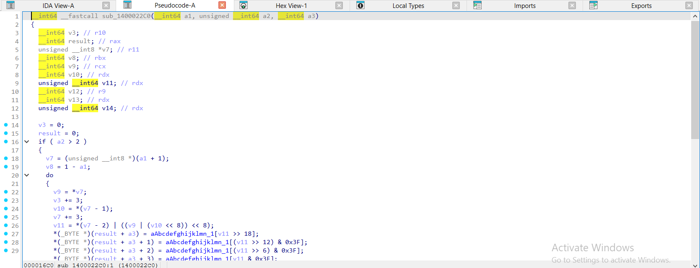

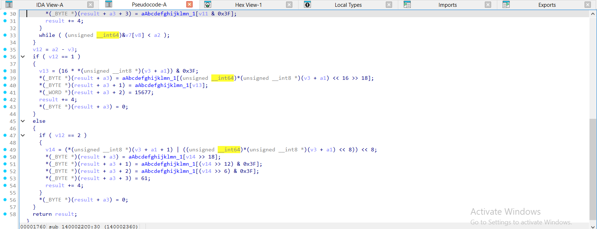

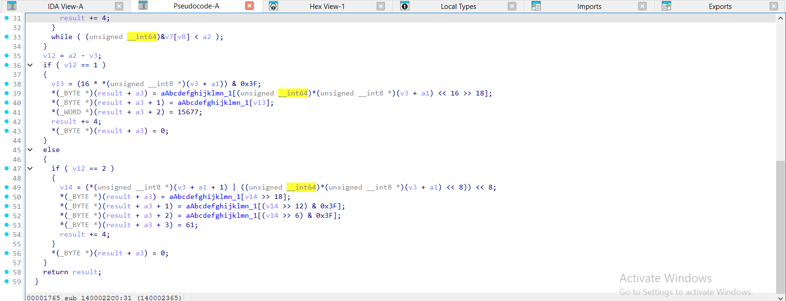

</details>

<details><summary>gcc -O2 – ELF, đã `strip -s` – b64_encode = <code>sub_2020</code> – 2 ảnh</summary>

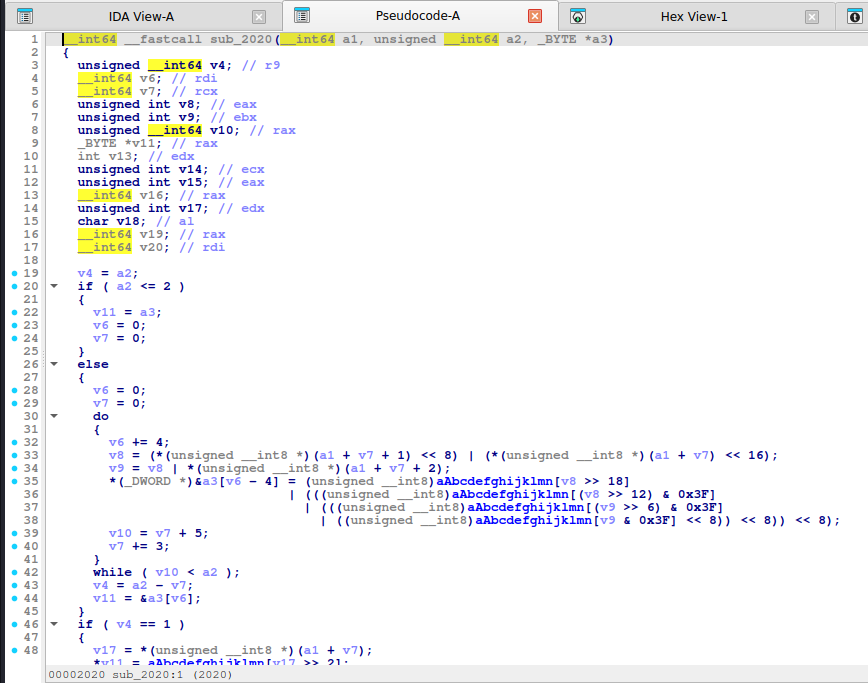

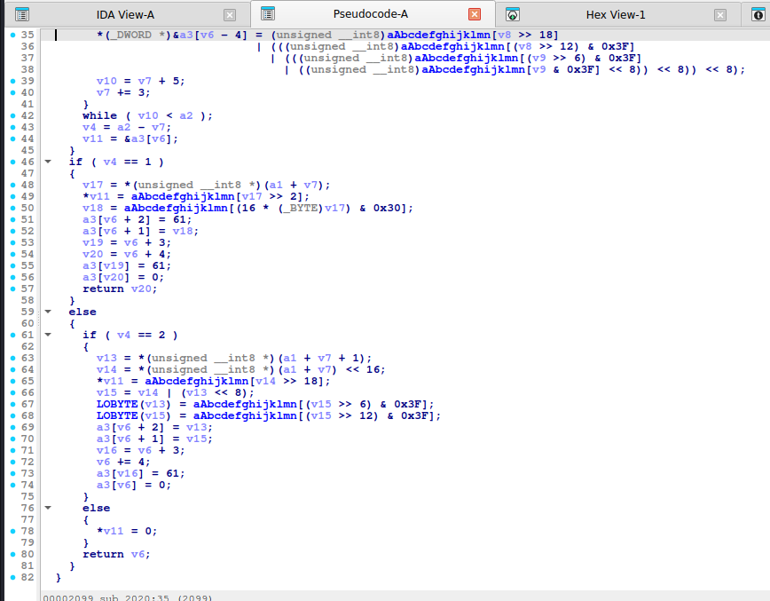

</details>

<details><summary>mingw-w64 -O2 -static – PE, đã `strip -s` – b64_encode = <code>sub_140001520</code> – 2 ảnh</summary>

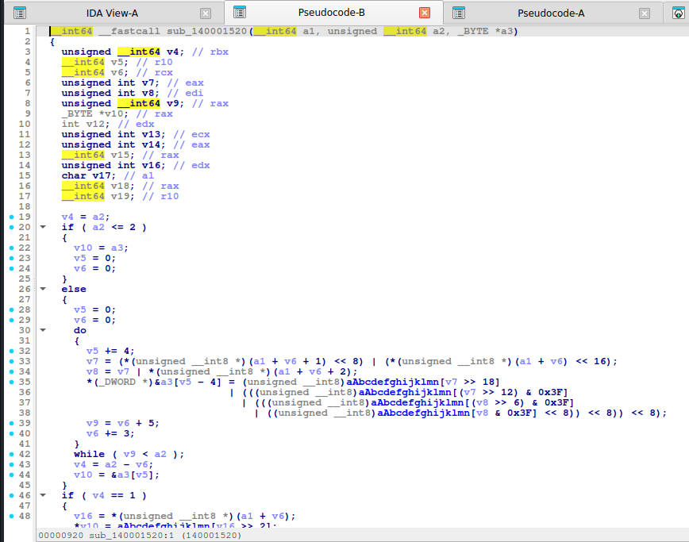

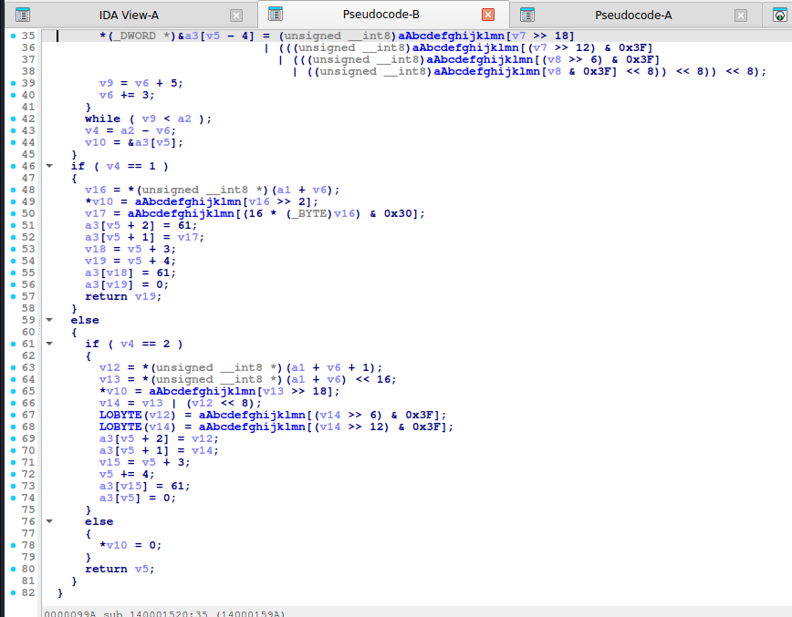

</details>

**Decode:**

<details><summary>MSVC /O2 - PE x64 (có PDB)</summary>

```c
__int64 __fastcall b64_decode(char *in, unsigned __int8 *out)
{
  char v2; // al
  unsigned int v3; // esi
  char *v5; // r14
  int v6; // ebx
  __int64 v7; // rdi
  char *v8; // rax
  unsigned int v9; // eax

  v2 = *in;
  v3 = 0;
  v5 = in;
  v6 = 0;
  v7 = 0;
  if ( *in == 0 )
    return 0;
  do
  {
    if ( v2 == 61 )
      break;
    v8 = strchr(string: "ABCDEFGHIJKLMNOPQRSTUVWXYZabcdefghijklmnopqrstuvwxyz0123456789+/", ch: v2);
    if ( v8 != nullptr )
    {
      v9 = (v3 << 6) | ((_DWORD)v8 - (unsigned int)"ABCDEFGHIJKLMNOPQRSTUVWXYZabcdefghijklmnopqrstuvwxyz0123456789+/");
      v6 += 6;
      v3 = v9;
      if ( v6 >= 8 )
      {
        v6 -= 8;
        out[v7++] = v9 >> v6;
      }
    }
    v2 = *++v5;
  }
  while ( v2 != 0 );
  return v7;
}
```

</details>

<details><summary>MSVC /Od - PE x64 (có PDB)</summary>

```c
unsigned __int64 __fastcall b64_decode(const char *in, unsigned __int8 *out)
{
  int bits; // [rsp+20h] [rbp-28h]
  unsigned int acc; // [rsp+24h] [rbp-24h]
  unsigned __int64 o; // [rsp+28h] [rbp-20h]
  const char *p; // [rsp+30h] [rbp-18h]

  acc = 0;
  bits = 0;
  o = 0;
  while ( *in != 0 && *in != 61 )
  {
    p = strchr(string: "ABCDEFGHIJKLMNOPQRSTUVWXYZabcdefghijklmnopqrstuvwxyz0123456789+/", ch: *in);
    if ( p != nullptr )
    {
      acc = (p - "ABCDEFGHIJKLMNOPQRSTUVWXYZabcdefghijklmnopqrstuvwxyz0123456789+/") | (acc << 6);
      bits += 6;
      if ( bits >= 8 )
      {
        bits -= 8;
        out[o++] = acc >> bits;
      }
    }
    ++in;
  }
  return o;
}
```

</details>

<details><summary>gcc -O2 - ELF x86-64 (chưa strip)</summary>

```c
__int64 __fastcall b64_decode(_BYTE *a1, __int64 a2)
{
  int v3; // esi
  _BYTE *v4; // r14
  __int64 v5; // r12
  int v6; // r15d
  unsigned int v7; // ebx
  char *v8; // rax

  v3 = (char)*a1;
  if ( *a1 != 0 && (_BYTE)v3 != 61 )
  {
    v4 = a1;
    v5 = 0;
    v6 = 0;
    v7 = 0;
    while ( 1 )
    {
      v8 = strchr(s: "ABCDEFGHIJKLMNOPQRSTUVWXYZabcdefghijklmnopqrstuvwxyz0123456789+/", c: v3);
      if ( v8 == nullptr )
        goto LABEL_5;
      v7 = ((_DWORD)v8 - (unsigned int)"ABCDEFGHIJKLMNOPQRSTUVWXYZabcdefghijklmnopqrstuvwxyz0123456789+/") | (v7 << 6);
      if ( v6 + 6 > 7 )
        break;
      v3 = (char)*++v4;
      v6 += 6;
      if ( (_BYTE)v3 == 0 )
        return v5;
LABEL_6:
      if ( (_BYTE)v3 == 61 )
        return v5;
    }
    v6 -= 2;
    *(_BYTE *)(a2 + v5++) = v7 >> v6;
LABEL_5:
    v3 = (char)*++v4;
    if ( (_BYTE)v3 == 0 )
      return v5;
    goto LABEL_6;
  }
  return 0;
}
```

</details>

<details><summary>gcc -O0 - ELF x86-64 (chưa strip)</summary>

```c
__int64 __fastcall b64_decode(_BYTE *a1, __int64 a2)
{
  __int64 v2; // rax
  char *v6; // [rsp+18h] [rbp-18h]
  __int64 v7; // [rsp+20h] [rbp-10h]
  int v8; // [rsp+28h] [rbp-8h]
  unsigned int v9; // [rsp+2Ch] [rbp-4h]

  v9 = 0;
  v8 = 0;
  v7 = 0;
  while ( *a1 != 0 && *a1 != 61 )
  {
    v6 = strchr(s: "ABCDEFGHIJKLMNOPQRSTUVWXYZabcdefghijklmnopqrstuvwxyz0123456789+/", c: (char)*a1);
    if ( v6 != nullptr )
    {
      v9 = (v9 << 6) | (v6 - "ABCDEFGHIJKLMNOPQRSTUVWXYZabcdefghijklmnopqrstuvwxyz0123456789+/");
      v8 += 6;
      if ( v8 > 7 )
      {
        v8 -= 8;
        v2 = v7++;
        *(_BYTE *)(a2 + v2) = v9 >> v8;
      }
    }
    ++a1;
  }
  return v7;
}
```

</details>

<details><summary>mingw-w64 gcc -O2 - PE x64 (-static)</summary>

```c
__int64 __fastcall b64_decode(_BYTE *a1, __int64 a2)
{
  __int64 v2; // rdi
  int v4; // edx
  _BYTE *v5; // r12
  int v6; // r13d
  unsigned int v7; // ebx
  char *v8; // rax

  v2 = 0;
  v4 = (char)*a1;
  v5 = a1;
  if ( *a1 != 0 && (_BYTE)v4 != 61 )
  {
    v6 = 0;
    v7 = 0;
    while ( 1 )
    {
      v8 = strchr(Str: "ABCDEFGHIJKLMNOPQRSTUVWXYZabcdefghijklmnopqrstuvwxyz0123456789+/", Val: v4);
      if ( v8 == nullptr )
        goto LABEL_5;
      v7 = ((_DWORD)v8 - (unsigned int)"ABCDEFGHIJKLMNOPQRSTUVWXYZabcdefghijklmnopqrstuvwxyz0123456789+/") | (v7 << 6);
      if ( v6 + 6 > 7 )
        break;
      v4 = (char)*++v5;
      v6 += 6;
      if ( (_BYTE)v4 == 0 )
        return v2;
LABEL_6:
      if ( (_BYTE)v4 == 61 )
        return v2;
    }
    v6 -= 2;
    *(_BYTE *)(a2 + v2++) = v7 >> v6;
LABEL_5:
    v4 = (char)*++v5;
    if ( (_BYTE)v4 == 0 )
      return v2;
    goto LABEL_6;
  }
  return v2;
}
```

</details>

<details><summary>mingw-w64 gcc -O0 - PE x64 (-static)</summary>

```c
__int64 __fastcall b64_decode(_BYTE *a1, __int64 a2)
{
  __int64 v2; // rax
  char *v4; // [rsp+28h] [rbp-18h]
  __int64 v5; // [rsp+30h] [rbp-10h]
  int v6; // [rsp+38h] [rbp-8h]
  unsigned int v7; // [rsp+3Ch] [rbp-4h]

  v7 = 0;
  v6 = 0;
  v5 = 0;
  while ( *a1 != 0 && *a1 != 61 )
  {
    v4 = strchr(Str: "ABCDEFGHIJKLMNOPQRSTUVWXYZabcdefghijklmnopqrstuvwxyz0123456789+/", Val: (char)*a1);
    if ( v4 != nullptr )
    {
      v7 = (v7 << 6) | (v4 - "ABCDEFGHIJKLMNOPQRSTUVWXYZabcdefghijklmnopqrstuvwxyz0123456789+/");
      v6 += 6;
      if ( v6 > 7 )
      {
        v6 -= 8;
        v2 = v5++;
        *(_BYTE *)(a2 + v2) = v7 >> v6;
      }
    }
    ++a1;
  }
  return v5;
}
```

</details>

**Bản strip (không symbol)** – IDA chỉ thấy `sub_XXXX`, `a1`, `a2`, `byte_XXXX`; hàm này tên là MSVC /O2 → `sub_140002220`, gcc -O2 → `sub_2190`, mingw-w64 -O2 -static → `sub_1400016A0`:

<details><summary>MSVC /O2 – PE x64, không PDB (strip) – bản STRIP: <code>b64_decode</code> = <code>sub_140002220</code></summary>

```c
__int64 __fastcall sub_140002220(_BYTE *a1, __int64 a2)
{
  char v2; // al
  unsigned int v3; // esi
  _BYTE *v5; // r14
  int v6; // ebx
  __int64 v7; // rdi
  char *v8; // rax
  unsigned int v9; // eax

  v2 = *a1;
  v3 = 0;
  v5 = a1;
  v6 = 0;
  v7 = 0;
  if ( *a1 == 0 )
    return 0;
  do
  {
    if ( v2 == 61 )
      break;
    v8 = strchr(Str: "ABCDEFGHIJKLMNOPQRSTUVWXYZabcdefghijklmnopqrstuvwxyz0123456789+/", Val: v2);
    if ( v8 != nullptr )
    {
      v9 = (v3 << 6) | ((_DWORD)v8 - (unsigned int)"ABCDEFGHIJKLMNOPQRSTUVWXYZabcdefghijklmnopqrstuvwxyz0123456789+/");
      v6 += 6;
      v3 = v9;
      if ( v6 >= 8 )
      {
        v6 -= 8;
        *(_BYTE *)(v7 + a2) = v9 >> v6;
        ++v7;
      }
    }
    v2 = *++v5;
  }
  while ( v2 != 0 );
  return v7;
}
```

</details>

<details><summary>gcc -O2 – ELF, đã `strip -s` – bản STRIP: <code>b64_decode</code> = <code>sub_2190</code></summary>

```c
__int64 __fastcall sub_2190(_BYTE *a1, __int64 a2)
{
  int v3; // esi
  _BYTE *v4; // r14
  __int64 v5; // r12
  int v6; // r15d
  unsigned int v7; // ebx
  char *v8; // rax

  v3 = (char)*a1;
  if ( *a1 != 0 && (_BYTE)v3 != 61 )
  {
    v4 = a1;
    v5 = 0;
    v6 = 0;
    v7 = 0;
    while ( 1 )
    {
      v8 = strchr(s: "ABCDEFGHIJKLMNOPQRSTUVWXYZabcdefghijklmnopqrstuvwxyz0123456789+/", c: v3);
      if ( v8 == nullptr )
        goto LABEL_5;
      v7 = ((_DWORD)v8 - (unsigned int)"ABCDEFGHIJKLMNOPQRSTUVWXYZabcdefghijklmnopqrstuvwxyz0123456789+/") | (v7 << 6);
      if ( v6 + 6 > 7 )
        break;
      v3 = (char)*++v4;
      v6 += 6;
      if ( (_BYTE)v3 == 0 )
        return v5;
LABEL_6:
      if ( (_BYTE)v3 == 61 )
        return v5;
    }
    v6 -= 2;
    *(_BYTE *)(a2 + v5++) = v7 >> v6;
LABEL_5:
    v3 = (char)*++v4;
    if ( (_BYTE)v3 == 0 )
      return v5;
    goto LABEL_6;
  }
  return 0;
}
```

</details>

<details><summary>mingw-w64 -O2 -static – PE, đã `strip -s` – bản STRIP: <code>b64_decode</code> = <code>sub_1400016A0</code></summary>

```c
__int64 __fastcall sub_1400016A0(_BYTE *a1, __int64 a2)
{
  __int64 v2; // rdi
  int v4; // edx
  _BYTE *v5; // r12
  int v6; // r13d
  unsigned int v7; // ebx
  char *v8; // rax

  v2 = 0;
  v4 = (char)*a1;
  v5 = a1;
  if ( *a1 != 0 && (_BYTE)v4 != 61 )
  {
    v6 = 0;
    v7 = 0;
    while ( 1 )
    {
      v8 = strchr(Str: "ABCDEFGHIJKLMNOPQRSTUVWXYZabcdefghijklmnopqrstuvwxyz0123456789+/", Val: v4);
      if ( v8 == nullptr )
        goto LABEL_5;
      v7 = ((_DWORD)v8 - (unsigned int)"ABCDEFGHIJKLMNOPQRSTUVWXYZabcdefghijklmnopqrstuvwxyz0123456789+/") | (v7 << 6);
      if ( v6 + 6 > 7 )
        break;
      v4 = (char)*++v5;
      v6 += 6;
      if ( (_BYTE)v4 == 0 )
        return v2;
LABEL_6:
      if ( (_BYTE)v4 == 61 )
        return v2;
    }
    v6 -= 2;
    *(_BYTE *)(a2 + v2++) = v7 >> v6;
LABEL_5:
    v4 = (char)*++v5;
    if ( (_BYTE)v4 == 0 )
      return v2;
    goto LABEL_6;
  }
  return v2;
}
```

</details>

**Ảnh chụp màn hình IDA (bản strip)** – mở từng mục để xem; hàm dài chia thành nhiều trang, mỗi trang là một màn hình IDA:

<details><summary>MSVC /O2 – PE x64, không PDB (strip) – b64_decode = <code>sub_140002220</code> – 2 ảnh</summary>

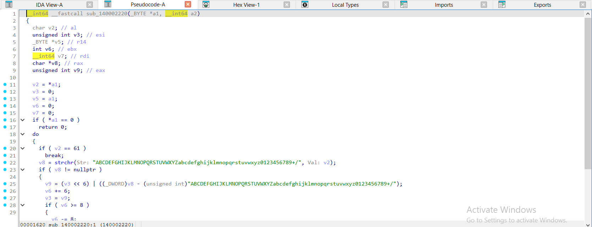

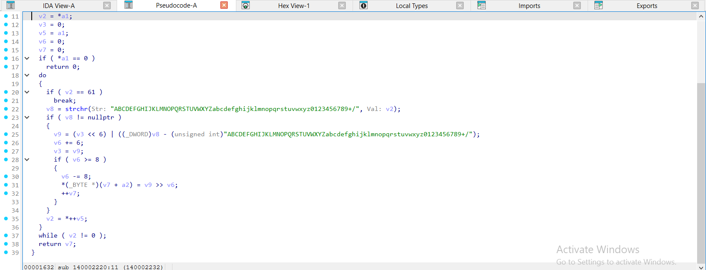

</details>

<details><summary>gcc -O2 – ELF, đã `strip -s` – b64_decode = <code>sub_2190</code> – 1 ảnh</summary>

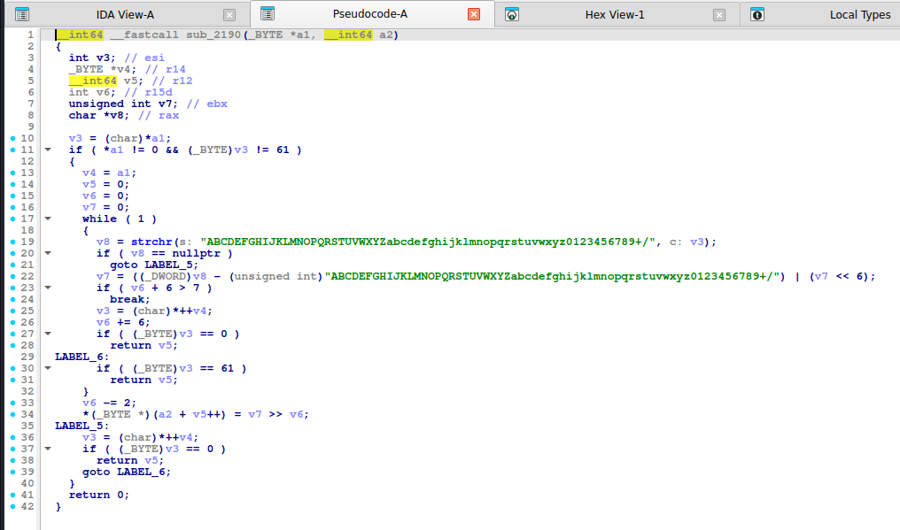

</details>

<details><summary>mingw-w64 -O2 -static – PE, đã `strip -s` – b64_decode = <code>sub_1400016A0</code> – 1 ảnh</summary>

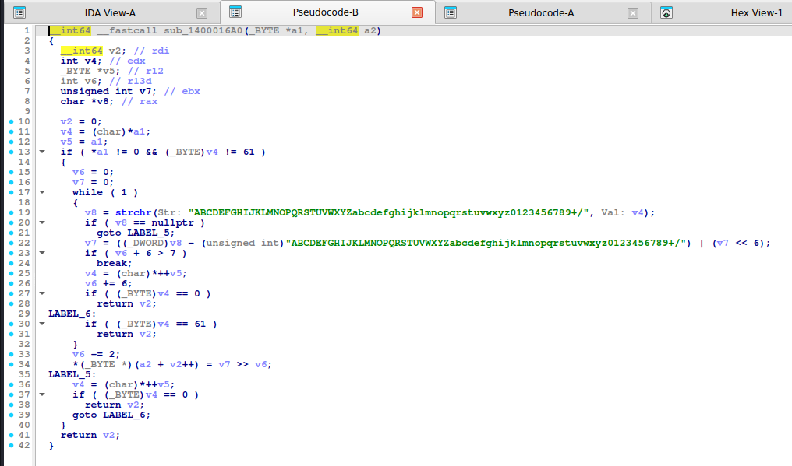

</details>

Nhận xét khi đọc:

- `-O0`: giữ nguyên cấu trúc 4 lần ghi `T[...]` riêng lẻ, dễ nhận ra.
- `-O2` (gcc): gộp 4 byte output thành **một lần ghi 32-bit** (`*(_DWORD *)&a3[...] = T[..] | (T[..] << 8) | ...`), IDA hiện chuỗi `|` và `<< 8` dài. Cứ đếm 4 tra bảng `& 0x3F` là biết Base64.
- Decode gcc `-O2` hiện `strchr(s: "ABC...", c: v3)` kèm chuỗi alphabet ngay trong lời gọi: đọc được luôn alphabet.
- MSVC `/O2` giữ 4 lần ghi riêng `out[result .. result+3] = T[...]` nhưng **gộp hai ký tự `==` thành một hằng WORD**: `*(_WORD *)&out[result + 2] = 15677;` (`15677 = 0x3D3D` = `'=' '='`). Gặp hằng **`15677`** hay **`0x3D3D`** ở cuối hàm encode là padding Base64.
- Ký tự `'='` (`61`/`0x3D`) có thể hiện thành số `61` (`out[...] = 61`) nên đừng bỏ sót khi đọc.

## 6. Code giải mã (đã kiểm chứng với output của binary thật)

**Python** (hỗ trợ custom alphabet):

```python
import base64


B64_STD = "ABCDEFGHIJKLMNOPQRSTUVWXYZabcdefghijklmnopqrstuvwxyz0123456789+/"
def b64_decode(s, alphabet=B64_STD):
    """Base64 voi bang chu cai tuy y (dang custom alphabet rat hay gap)."""
    s = s.rstrip("=")
    acc = bits = 0
    out = bytearray()
    for ch in s:
        acc = (acc << 6) | alphabet.index(ch)
        bits += 6
        if bits >= 8:
            bits -= 8
            out.append((acc >> bits) & 0xFF)
    return bytes(out)


def b64_encode(b, alphabet=B64_STD):
    std = base64.b64encode(b).decode()
    return std.translate(str.maketrans(B64_STD, alphabet))
```

**C** (header-only, xem [`code/ctfdec.h`](../code/ctfdec.h)):

```c
#include <stdint.h>
#include <stddef.h>
#include <string.h>

static inline size_t ctf_b64_decode(const char *in, uint8_t *out, const char *alpha)
{
    uint32_t acc = 0;
    int bits = 0;
    size_t o = 0;
    for (; *in && *in != '='; in++) {
        const char *p = strchr(alpha, *in);
        if (!p) continue;
        acc = (acc << 6) | (uint32_t)(p - alpha);
        bits += 6;
        if (bits >= 8) { bits -= 8; out[o++] = (uint8_t)(acc >> bits); }
    }
    return o;
}
```

## 7. Biến thể & bẫy thường gặp

| Biến thể | Dấu hiệu | Cách xử lý |
|---|---|---|
| Custom alphabet | Bảng 64 ký tự khác chuẩn | Thay `alphabet=` trong `b64_decode` |
| Base64url | `-` `_` thay `+` `/`, không có `=` | `alphabet=B64_STD.replace("+/", "-_")`, bỏ qua padding |
| Không padding | Độ dài không bội 4 | `b64_decode` đã bỏ `=` nên vẫn đúng |
| Nhiều lớp | Output decode vẫn trông như base64 | Lặp decode đến khi ra dữ liệu có nghĩa |
| Đảo/ XOR sau encode | Ký tự lạ ngoài bảng | Đảo bước đó trước rồi mới decode |
