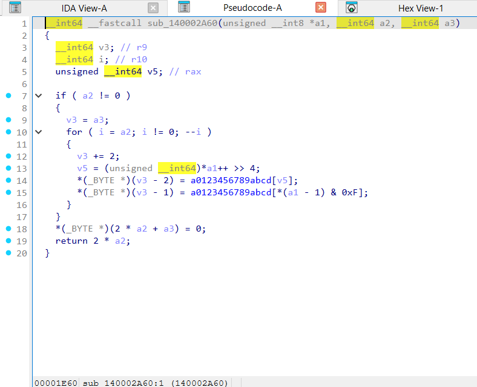
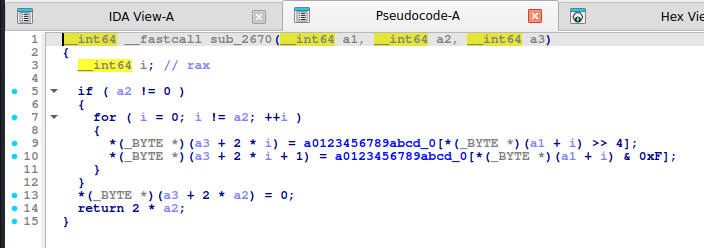
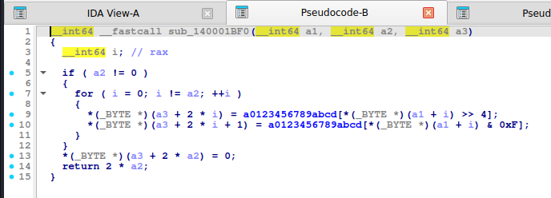

# Hex (base16)

> Mỗi byte -> 2 ký tự hex. Quá đơn giản nhưng hay lẫn trong chuỗi mã hóa nhiều lớp; cần nhận ra để không bỏ sót.

## 1. Dấu hiệu nhận biết

- Bảng `0123456789abcdef` (hoặc `ABCDEF`) và cặp thao tác **`>> 4`** / **`& 0xF`** cho nửa byte cao/thấp.
- Index ghi **`2 * i`** và **`2 * i + 1`**; độ dài output = `2 * n`.
- Cũng có thể là `sprintf("%02x")` / `printf("%02X")` (xem import `sprintf`/`snprintf`).
- Output chỉ gồm `0-9a-f`, độ dài chẵn.

## 2. Thuật toán (mã giả)

```
for b in in:  out += H[b >> 4] + H[b & 15]
```

## 3. Mã hóa / giải mã

Giải mã: ghép từng cặp ký tự thành 1 byte (`int(h[i:i+2], 16)`). Python: `bytes.fromhex(s)`, `binascii.unhexlify(s)`.

## 4. Mã nguồn gốc (C)

```c
size_t hex_encode(const uint8_t *in, size_t n, char *out)
{
    static const char H[] = "0123456789abcdef";
    for (size_t i = 0; i < n; i++) {
        out[2 * i] = H[in[i] >> 4];
        out[2 * i + 1] = H[in[i] & 15];
    }
    out[2 * n] = 0;
    return 2 * n;
}
```

## 5. Pseudo-code IDA thực tế

<details><summary>MSVC /O2 - PE x64 (có PDB)</summary>

```c
unsigned __int64 __fastcall hex_encode(const unsigned __int8 *in, unsigned __int64 n, char *out)
{
  char *v3; // r9
  unsigned __int64 i; // r10
  unsigned __int64 v5; // rax

  if ( n != 0 )
  {
    v3 = out;
    for ( i = n; i != 0; --i )
    {
      v3 += 2;
      v5 = (unsigned __int64)*in++ >> 4;
      *(v3 - 2) = H[v5];
      *(v3 - 1) = H[*(in - 1) & 0xF];
    }
  }
  out[2 * n] = 0;
  return 2 * n;
}
```

</details>

<details><summary>MSVC /Od - PE x64 (có PDB)</summary>

```c
unsigned __int64 __fastcall hex_encode(const unsigned __int8 *in, unsigned __int64 n, char *out)
{
  unsigned __int64 i; // [rsp+0h] [rbp-18h]

  for ( i = 0; i < n; ++i )
  {
    out[2 * i] = H[(int)in[i] >> 4];
    out[2 * i + 1] = H[in[i] & 0xF];
  }
  out[2 * n] = 0;
  return 2 * n;
}
```

</details>

<details><summary>gcc -O2 - ELF x86-64 (chưa strip)</summary>

```c
__int64 __fastcall hex_encode(__int64 a1, __int64 a2, __int64 a3)
{
  __int64 i; // rax

  if ( a2 != 0 )
  {
    for ( i = 0; i != a2; ++i )
    {
      *(_BYTE *)(a3 + 2 * i) = H_2[*(_BYTE *)(a1 + i) >> 4];
      *(_BYTE *)(a3 + 2 * i + 1) = H_2[*(_BYTE *)(a1 + i) & 0xF];
    }
  }
  *(_BYTE *)(a3 + 2 * a2) = 0;
  return 2 * a2;
}
```

</details>

<details><summary>gcc -O0 - ELF x86-64 (chưa strip)</summary>

```c
unsigned __int64 __fastcall hex_encode(__int64 a1, unsigned __int64 a2, __int64 a3)
{
  unsigned __int64 i; // [rsp+20h] [rbp-8h]

  for ( i = 0; i < a2; ++i )
  {
    *(_BYTE *)(2 * i + a3) = H_2[*(_BYTE *)(a1 + i) >> 4];
    *(_BYTE *)(a3 + 2 * i + 1) = H_2[*(_BYTE *)(a1 + i) & 0xF];
  }
  *(_BYTE *)(2 * a2 + a3) = 0;
  return 2 * a2;
}
```

</details>

<details><summary>mingw-w64 gcc -O2 - PE x64 (-static)</summary>

```c
__int64 __fastcall hex_encode(__int64 a1, __int64 a2, __int64 a3)
{
  __int64 i; // rax

  if ( a2 != 0 )
  {
    for ( i = 0; i != a2; ++i )
    {
      *(_BYTE *)(a3 + 2 * i) = H_2[*(_BYTE *)(a1 + i) >> 4];
      *(_BYTE *)(a3 + 2 * i + 1) = H_2[*(_BYTE *)(a1 + i) & 0xF];
    }
  }
  *(_BYTE *)(a3 + 2 * a2) = 0;
  return 2 * a2;
}
```

</details>

<details><summary>mingw-w64 gcc -O0 - PE x64 (-static)</summary>

```c
unsigned __int64 __fastcall hex_encode(__int64 a1, unsigned __int64 a2, __int64 a3)
{
  unsigned __int64 i; // [rsp+8h] [rbp-8h]

  for ( i = 0; i < a2; ++i )
  {
    *(_BYTE *)(2 * i + a3) = H_2[*(_BYTE *)(a1 + i) >> 4];
    *(_BYTE *)(a3 + 2 * i + 1) = H_2[*(_BYTE *)(a1 + i) & 0xF];
  }
  *(_BYTE *)(2 * a2 + a3) = 0;
  return 2 * a2;
}
```

</details>

**Bản strip (không symbol)** – IDA chỉ thấy `sub_XXXX`, `a1`, `a2`, `byte_XXXX`; hàm này tên là MSVC /O2 → `sub_140002A60`, gcc -O2 → `sub_2670`, mingw-w64 -O2 -static → `sub_140001BF0`:

<details><summary>MSVC /O2 – PE x64, không PDB (strip) – bản STRIP: <code>hex_encode</code> = <code>sub_140002A60</code></summary>

```c
__int64 __fastcall sub_140002A60(unsigned __int8 *a1, __int64 a2, __int64 a3)
{
  __int64 v3; // r9
  __int64 i; // r10
  unsigned __int64 v5; // rax

  if ( a2 != 0 )
  {
    v3 = a3;
    for ( i = a2; i != 0; --i )
    {
      v3 += 2;
      v5 = (unsigned __int64)*a1++ >> 4;
      *(_BYTE *)(v3 - 2) = a0123456789abcd[v5];
      *(_BYTE *)(v3 - 1) = a0123456789abcd[*(a1 - 1) & 0xF];
    }
  }
  *(_BYTE *)(2 * a2 + a3) = 0;
  return 2 * a2;
}
```

</details>

<details><summary>gcc -O2 – ELF, đã `strip -s` – bản STRIP: <code>hex_encode</code> = <code>sub_2670</code></summary>

```c
__int64 __fastcall sub_2670(__int64 a1, __int64 a2, __int64 a3)
{
  __int64 i; // rax

  if ( a2 != 0 )
  {
    for ( i = 0; i != a2; ++i )
    {
      *(_BYTE *)(a3 + 2 * i) = a0123456789abcd_0[*(_BYTE *)(a1 + i) >> 4];
      *(_BYTE *)(a3 + 2 * i + 1) = a0123456789abcd_0[*(_BYTE *)(a1 + i) & 0xF];
    }
  }
  *(_BYTE *)(a3 + 2 * a2) = 0;
  return 2 * a2;
}
```

</details>

<details><summary>mingw-w64 -O2 -static – PE, đã `strip -s` – bản STRIP: <code>hex_encode</code> = <code>sub_140001BF0</code></summary>

```c
__int64 __fastcall sub_140001BF0(__int64 a1, __int64 a2, __int64 a3)
{
  __int64 i; // rax

  if ( a2 != 0 )
  {
    for ( i = 0; i != a2; ++i )
    {
      *(_BYTE *)(a3 + 2 * i) = a0123456789abcd[*(_BYTE *)(a1 + i) >> 4];
      *(_BYTE *)(a3 + 2 * i + 1) = a0123456789abcd[*(_BYTE *)(a1 + i) & 0xF];
    }
  }
  *(_BYTE *)(a3 + 2 * a2) = 0;
  return 2 * a2;
}
```

</details>

**Ảnh chụp màn hình IDA (bản strip)** – mở từng mục để xem; hàm dài chia thành nhiều trang, mỗi trang là một màn hình IDA:

<details><summary>MSVC /O2 – PE x64, không PDB (strip) – hex_encode = <code>sub_140002A60</code> – 1 ảnh</summary>



</details>

<details><summary>gcc -O2 – ELF, đã `strip -s` – hex_encode = <code>sub_2670</code> – 1 ảnh</summary>



</details>

<details><summary>mingw-w64 -O2 -static – PE, đã `strip -s` – hex_encode = <code>sub_140001BF0</code> – 1 ảnh</summary>



</details>

## 6. Code giải mã

```python
bytes.fromhex("48656c6c6f2c20437962657253656147616d6521")
# lẫn dấu cách / 0x / \x:
import re
def hex_clean(s): return bytes.fromhex(re.sub(r"(0x|\\x|[^0-9a-fA-F])", "", s))
```

```c
/* C: doc 2 ky tu hex thanh 1 byte */
static int hexval(char c) { return c <= '9' ? c - '0' : (c | 32) - 'a' + 10; }
/* out[i] = hexval(s[2*i]) << 4 | hexval(s[2*i+1]); */
```

## 7. Biến thể & bẫy

- Hex **little-endian** của số nguyên (ví dụ flag nằm trong hằng `0x7b67616c66`): đảo byte khi đổi sang chuỗi (`(0x7b67616c66).to_bytes(5, "little")`).
- Nhiều đề giấu flag dạng mảng `uint32_t` trong `.rdata`: nhớ **little-endian** khi đổi ra chữ.
