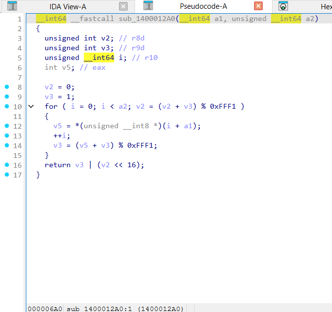
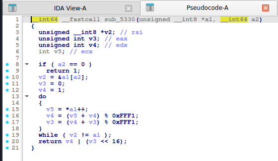
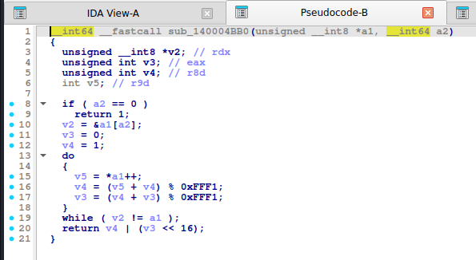
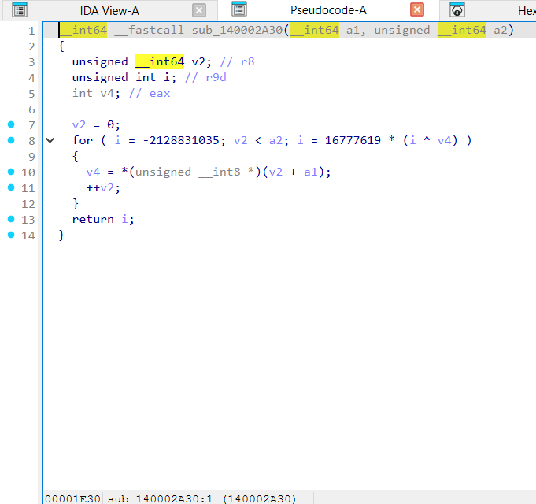
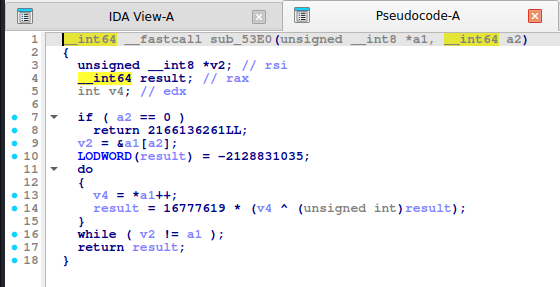
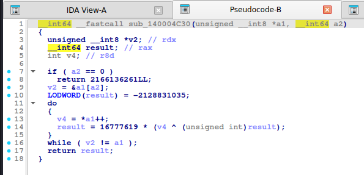
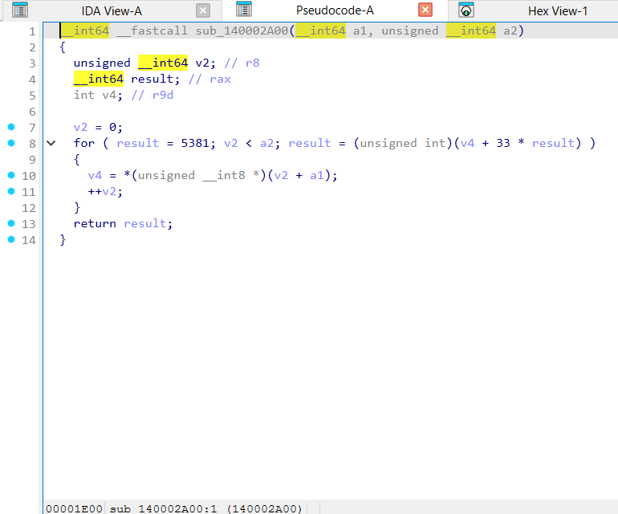
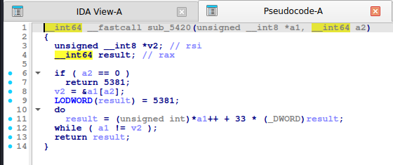
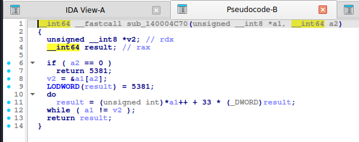

# Hash đơn giản: Adler-32, FNV-1a, djb2

> Ba "hash" 32-bit nhỏ gọn, hay dùng trong check flag tự chế, băm tên API (API hashing trong shellcode/malware), hoặc bảng băm.

## 1. Dấu hiệu nhận biết

| Hash | Hằng số | Mẫu code |
|---|---|---|
| **Adler-32** | `65521` (`0xFFF1`), khởi tạo `a = 1, b = 0` | `a = (a + c) % 65521; b = (b + a) % 65521; return (b << 16) \| a` |
| **FNV-1a 32** | offset `2166136261` (`0x811C9DC5`, IDA: `-2128831035`), prime `16777619` (`0x01000193`) | `h ^= c; h *= 16777619;` (**XOR trước rồi nhân**) |
| **FNV-1 32** | như trên | `h *= 16777619; h ^= c;` (nhân trước) |
| **FNV-1a 64** | `0xCBF29CE484222325`, prime `0x100000001B3` | tương tự với 64-bit |
| **djb2** | khởi tạo `5381` (`0x1505`), nhân `33` | `h = h * 33 + c` hoặc `(h << 5) + h + c` |
| **sdbm** | nhân `65599` | `h = c + (h << 6) + (h << 16) - h` |

- Adler/FNV/djb2 **chỉ gồm một vòng lặp qua từng byte** và vài phép số học, không có bảng.
- IDA ở `-O2` đổi `h * 33` thành `33 * h` hoặc `(h << 5) + h`; hằng `16777619` hiện nguyên.

## 2. Thuật toán (mã giả)

```
adler32: a=1; b=0; for c: a=(a+c)%65521; b=(b+a)%65521;  return (b<<16)|a
fnv1a:   h=0x811C9DC5; for c: h ^= c; h = (h * 0x01000193) mod 2^32
djb2:    h=5381;       for c: h = (h*33 + c) mod 2^32
```

## 3. Mã hóa / giải mã

- **FNV-1a** và **djb2** là các phép **khả nghịch từng bước** khi biết ký tự: `prev = ((h * inv(prime)) ^ c)` (FNV), `prev = (h - c) * inv(33)` (djb2). Dùng để **meet-in-the-middle** (băm nửa đầu xuôi, nửa sau ngược) hoặc dựng ký tự từng bước từ cuối.
- **Adler-32** tuyến tính theo tổng: dễ giải bằng cân bằng tổng (`a = 1 + Σc`).
- Nếu chỉ cần **ngẫu nhiên khớp** hash của chuỗi ngắn: brute force `hash_bruteforce` (tự viết hàm so sánh).

## 4. Mã nguồn gốc (C)

```c
uint32_t adler32_hash(const uint8_t *p, size_t n)
{
    uint32_t a = 1, b = 0;
    for (size_t i = 0; i < n; i++) {
        a = (a + p[i]) % 65521;
        b = (b + a) % 65521;
    }
    return (b << 16) | a;
}

uint32_t fnv1a_hash(const uint8_t *p, size_t n)
{
    uint32_t h = 2166136261u;
    for (size_t i = 0; i < n; i++) {
        h ^= p[i];
        h *= 16777619u;
    }
    return h;
}

uint32_t djb2_hash(const uint8_t *p, size_t n)
{
    uint32_t h = 5381;
    for (size_t i = 0; i < n; i++) h = h * 33 + p[i];
    return h;
}
```

## 5. Pseudo-code IDA thực tế

**Adler-32:**

<details><summary>MSVC /O2 - PE x64 (có PDB)</summary>

```c
__int64 __fastcall adler32_hash(const unsigned __int8 *p, unsigned __int64 n)
{
  unsigned int v2; // r8d
  unsigned int v3; // r9d
  unsigned __int64 i; // r10
  int v5; // eax

  v2 = 0;
  v3 = 1;
  for ( i = 0; i < n; v2 = (v2 + v3) % 0xFFF1 )
  {
    v5 = p[i++];
    v3 = (v5 + v3) % 0xFFF1;
  }
  return v3 | (v2 << 16);
}
```

</details>

<details><summary>MSVC /Od - PE x64 (có PDB)</summary>

```c
__int64 __fastcall adler32_hash(const unsigned __int8 *p, unsigned __int64 n)
{
  unsigned int a; // [rsp+0h] [rbp-18h]
  unsigned int b; // [rsp+4h] [rbp-14h]
  unsigned __int64 i; // [rsp+8h] [rbp-10h]

  a = 1;
  b = 0;
  for ( i = 0; i < n; ++i )
  {
    a = (p[i] + a) % 0xFFF1;
    b = (a + b) % 0xFFF1;
  }
  return a | (b << 16);
}
```

</details>

<details><summary>gcc -O2 - ELF x86-64 (chưa strip)</summary>

```c
__int64 __fastcall adler32_hash(unsigned __int8 *a1, __int64 a2)
{
  unsigned __int8 *v2; // rsi
  unsigned int v3; // eax
  unsigned int v4; // edx
  int v5; // ecx

  if ( a2 == 0 )
    return 1;
  v2 = &a1[a2];
  v3 = 0;
  v4 = 1;
  do
  {
    v5 = *a1++;
    v4 = (v5 + v4) % 0xFFF1;
    v3 = (v4 + v3) % 0xFFF1;
  }
  while ( v2 != a1 );
  return v4 | (v3 << 16);
}
```

</details>

<details><summary>gcc -O0 - ELF x86-64 (chưa strip)</summary>

```c
__int64 __fastcall adler32_hash(__int64 a1, unsigned __int64 a2)
{
  unsigned __int64 i; // [rsp+10h] [rbp-10h]
  unsigned int v4; // [rsp+18h] [rbp-8h]
  unsigned int v5; // [rsp+1Ch] [rbp-4h]

  v5 = 1;
  v4 = 0;
  for ( i = 0; i < a2; ++i )
  {
    v5 = (v5 + *(unsigned __int8 *)(a1 + i)) % 0xFFF1;
    v4 = (v5 + v4) % 0xFFF1;
  }
  return v5 | (v4 << 16);
}
```

</details>

<details><summary>mingw-w64 gcc -O2 - PE x64 (-static)</summary>

```c
__int64 __fastcall adler32_hash(unsigned __int8 *a1, __int64 a2)
{
  unsigned __int8 *v2; // rdx
  unsigned int v3; // eax
  unsigned int v4; // r8d
  int v5; // r9d

  if ( a2 == 0 )
    return 1;
  v2 = &a1[a2];
  v3 = 0;
  v4 = 1;
  do
  {
    v5 = *a1++;
    v4 = (v5 + v4) % 0xFFF1;
    v3 = (v4 + v3) % 0xFFF1;
  }
  while ( v2 != a1 );
  return v4 | (v3 << 16);
}
```

</details>

<details><summary>mingw-w64 gcc -O0 - PE x64 (-static)</summary>

```c
__int64 __fastcall adler32_hash(__int64 a1, unsigned __int64 a2)
{
  unsigned __int64 i; // [rsp+0h] [rbp-10h]
  unsigned int v4; // [rsp+8h] [rbp-8h]
  unsigned int v5; // [rsp+Ch] [rbp-4h]

  v5 = 1;
  v4 = 0;
  for ( i = 0; i < a2; ++i )
  {
    v5 = (v5 + *(unsigned __int8 *)(a1 + i)) % 0xFFF1;
    v4 = (v5 + v4) % 0xFFF1;
  }
  return v5 | (v4 << 16);
}
```

</details>

**Bản strip (không symbol)** – IDA chỉ thấy `sub_XXXX`, `a1`, `a2`, `byte_XXXX`; hàm này tên là MSVC /O2 → `sub_1400012A0`, gcc -O2 → `sub_5330`, mingw-w64 -O2 -static → `sub_140004BB0`:

<details><summary>MSVC /O2 – PE x64, không PDB (strip) – bản STRIP: <code>adler32_hash</code> = <code>sub_1400012A0</code></summary>

```c
__int64 __fastcall sub_1400012A0(__int64 a1, unsigned __int64 a2)
{
  unsigned int v2; // r8d
  unsigned int v3; // r9d
  unsigned __int64 i; // r10
  int v5; // eax

  v2 = 0;
  v3 = 1;
  for ( i = 0; i < a2; v2 = (v2 + v3) % 0xFFF1 )
  {
    v5 = *(unsigned __int8 *)(i + a1);
    ++i;
    v3 = (v5 + v3) % 0xFFF1;
  }
  return v3 | (v2 << 16);
}
```

</details>

<details><summary>gcc -O2 – ELF, đã `strip -s` – bản STRIP: <code>adler32_hash</code> = <code>sub_5330</code></summary>

```c
__int64 __fastcall sub_5330(unsigned __int8 *a1, __int64 a2)
{
  unsigned __int8 *v2; // rsi
  unsigned int v3; // eax
  unsigned int v4; // edx
  int v5; // ecx

  if ( a2 == 0 )
    return 1;
  v2 = &a1[a2];
  v3 = 0;
  v4 = 1;
  do
  {
    v5 = *a1++;
    v4 = (v5 + v4) % 0xFFF1;
    v3 = (v4 + v3) % 0xFFF1;
  }
  while ( v2 != a1 );
  return v4 | (v3 << 16);
}
```

</details>

<details><summary>mingw-w64 -O2 -static – PE, đã `strip -s` – bản STRIP: <code>adler32_hash</code> = <code>sub_140004BB0</code></summary>

```c
__int64 __fastcall sub_140004BB0(unsigned __int8 *a1, __int64 a2)
{
  unsigned __int8 *v2; // rdx
  unsigned int v3; // eax
  unsigned int v4; // r8d
  int v5; // r9d

  if ( a2 == 0 )
    return 1;
  v2 = &a1[a2];
  v3 = 0;
  v4 = 1;
  do
  {
    v5 = *a1++;
    v4 = (v5 + v4) % 0xFFF1;
    v3 = (v4 + v3) % 0xFFF1;
  }
  while ( v2 != a1 );
  return v4 | (v3 << 16);
}
```

</details>

**Ảnh chụp màn hình IDA (bản strip)** – mở từng mục để xem; hàm dài chia thành nhiều trang, mỗi trang là một màn hình IDA:

<details><summary>MSVC /O2 – PE x64, không PDB (strip) – adler32_hash = <code>sub_1400012A0</code> – 1 ảnh</summary>



</details>

<details><summary>gcc -O2 – ELF, đã `strip -s` – adler32_hash = <code>sub_5330</code> – 1 ảnh</summary>



</details>

<details><summary>mingw-w64 -O2 -static – PE, đã `strip -s` – adler32_hash = <code>sub_140004BB0</code> – 1 ảnh</summary>



</details>

**FNV-1a:**

<details><summary>MSVC /O2 - PE x64 (có PDB)</summary>

```c
__int64 __fastcall fnv1a_hash(const unsigned __int8 *p, unsigned __int64 n)
{
  unsigned __int64 v2; // r8
  unsigned int i; // r9d
  int v4; // eax

  v2 = 0;
  for ( i = -2128831035; v2 < n; i = 16777619 * (i ^ v4) )
    v4 = p[v2++];
  return i;
}
```

</details>

<details><summary>MSVC /Od - PE x64 (có PDB)</summary>

```c
__int64 __fastcall fnv1a_hash(const unsigned __int8 *p, unsigned __int64 n)
{
  unsigned int h; // [rsp+0h] [rbp-18h]
  unsigned __int64 i; // [rsp+8h] [rbp-10h]

  h = -2128831035;
  for ( i = 0; i < n; ++i )
    h = 16777619 * (p[i] ^ h);
  return h;
}
```

</details>

<details><summary>gcc -O2 - ELF x86-64 (chưa strip)</summary>

```c
__int64 __fastcall fnv1a_hash(unsigned __int8 *a1, __int64 a2)
{
  unsigned __int8 *v2; // rsi
  __int64 result; // rax
  int v4; // edx

  if ( a2 == 0 )
    return 2166136261LL;
  v2 = &a1[a2];
  LODWORD(result) = -2128831035;
  do
  {
    v4 = *a1++;
    result = 16777619 * (v4 ^ (unsigned int)result);
  }
  while ( v2 != a1 );
  return result;
}
```

</details>

<details><summary>gcc -O0 - ELF x86-64 (chưa strip)</summary>

```c
__int64 __fastcall fnv1a_hash(__int64 a1, unsigned __int64 a2)
{
  unsigned __int64 i; // [rsp+10h] [rbp-10h]
  unsigned int v4; // [rsp+1Ch] [rbp-4h]

  v4 = -2128831035;
  for ( i = 0; i < a2; ++i )
    v4 = 16777619 * (*(unsigned __int8 *)(a1 + i) ^ v4);
  return v4;
}
```

</details>

<details><summary>mingw-w64 gcc -O2 - PE x64 (-static)</summary>

```c
__int64 __fastcall fnv1a_hash(unsigned __int8 *a1, __int64 a2)
{
  unsigned __int8 *v2; // rdx
  __int64 result; // rax
  int v4; // r8d

  if ( a2 == 0 )
    return 2166136261LL;
  v2 = &a1[a2];
  LODWORD(result) = -2128831035;
  do
  {
    v4 = *a1++;
    result = 16777619 * (v4 ^ (unsigned int)result);
  }
  while ( v2 != a1 );
  return result;
}
```

</details>

<details><summary>mingw-w64 gcc -O0 - PE x64 (-static)</summary>

```c
__int64 __fastcall fnv1a_hash(__int64 a1, unsigned __int64 a2)
{
  unsigned __int64 i; // [rsp+0h] [rbp-10h]
  unsigned int v4; // [rsp+Ch] [rbp-4h]

  v4 = -2128831035;
  for ( i = 0; i < a2; ++i )
    v4 = 16777619 * (*(unsigned __int8 *)(a1 + i) ^ v4);
  return v4;
}
```

</details>

**Bản strip (không symbol)** – IDA chỉ thấy `sub_XXXX`, `a1`, `a2`, `byte_XXXX`; hàm này tên là MSVC /O2 → `sub_140002A30`, gcc -O2 → `sub_53E0`, mingw-w64 -O2 -static → `sub_140004C30`:

<details><summary>MSVC /O2 – PE x64, không PDB (strip) – bản STRIP: <code>fnv1a_hash</code> = <code>sub_140002A30</code></summary>

```c
__int64 __fastcall sub_140002A30(__int64 a1, unsigned __int64 a2)
{
  unsigned __int64 v2; // r8
  unsigned int i; // r9d
  int v4; // eax

  v2 = 0;
  for ( i = -2128831035; v2 < a2; i = 16777619 * (i ^ v4) )
  {
    v4 = *(unsigned __int8 *)(v2 + a1);
    ++v2;
  }
  return i;
}
```

</details>

<details><summary>gcc -O2 – ELF, đã `strip -s` – bản STRIP: <code>fnv1a_hash</code> = <code>sub_53E0</code></summary>

```c
__int64 __fastcall sub_53E0(unsigned __int8 *a1, __int64 a2)
{
  unsigned __int8 *v2; // rsi
  __int64 result; // rax
  int v4; // edx

  if ( a2 == 0 )
    return 2166136261LL;
  v2 = &a1[a2];
  LODWORD(result) = -2128831035;
  do
  {
    v4 = *a1++;
    result = 16777619 * (v4 ^ (unsigned int)result);
  }
  while ( v2 != a1 );
  return result;
}
```

</details>

<details><summary>mingw-w64 -O2 -static – PE, đã `strip -s` – bản STRIP: <code>fnv1a_hash</code> = <code>sub_140004C30</code></summary>

```c
__int64 __fastcall sub_140004C30(unsigned __int8 *a1, __int64 a2)
{
  unsigned __int8 *v2; // rdx
  __int64 result; // rax
  int v4; // r8d

  if ( a2 == 0 )
    return 2166136261LL;
  v2 = &a1[a2];
  LODWORD(result) = -2128831035;
  do
  {
    v4 = *a1++;
    result = 16777619 * (v4 ^ (unsigned int)result);
  }
  while ( v2 != a1 );
  return result;
}
```

</details>

**Ảnh chụp màn hình IDA (bản strip)** – mở từng mục để xem; hàm dài chia thành nhiều trang, mỗi trang là một màn hình IDA:

<details><summary>MSVC /O2 – PE x64, không PDB (strip) – fnv1a_hash = <code>sub_140002A30</code> – 1 ảnh</summary>



</details>

<details><summary>gcc -O2 – ELF, đã `strip -s` – fnv1a_hash = <code>sub_53E0</code> – 1 ảnh</summary>



</details>

<details><summary>mingw-w64 -O2 -static – PE, đã `strip -s` – fnv1a_hash = <code>sub_140004C30</code> – 1 ảnh</summary>



</details>

**djb2:**

<details><summary>MSVC /O2 - PE x64 (có PDB)</summary>

```c
__int64 __fastcall djb2_hash(const unsigned __int8 *p, unsigned __int64 n)
{
  unsigned __int64 v2; // r8
  __int64 result; // rax
  int v4; // r9d

  v2 = 0;
  for ( result = 5381; v2 < n; result = (unsigned int)(v4 + 33 * result) )
    v4 = p[v2++];
  return result;
}
```

</details>

<details><summary>MSVC /Od - PE x64 (có PDB)</summary>

```c
__int64 __fastcall djb2_hash(const unsigned __int8 *p, unsigned __int64 n)
{
  unsigned int h; // [rsp+0h] [rbp-18h]
  unsigned __int64 i; // [rsp+8h] [rbp-10h]

  h = 5381;
  for ( i = 0; i < n; ++i )
    h = p[i] + 33 * h;
  return h;
}
```

</details>

<details><summary>gcc -O2 - ELF x86-64 (chưa strip)</summary>

```c
__int64 __fastcall djb2_hash(unsigned __int8 *a1, __int64 a2)
{
  unsigned __int8 *v2; // rsi
  __int64 result; // rax

  if ( a2 == 0 )
    return 5381;
  v2 = &a1[a2];
  LODWORD(result) = 5381;
  do
    result = (unsigned int)*a1++ + 33 * (_DWORD)result;
  while ( a1 != v2 );
  return result;
}
```

</details>

<details><summary>gcc -O0 - ELF x86-64 (chưa strip)</summary>

```c
__int64 __fastcall djb2_hash(__int64 a1, unsigned __int64 a2)
{
  unsigned __int64 i; // [rsp+10h] [rbp-10h]
  unsigned int v4; // [rsp+1Ch] [rbp-4h]

  v4 = 5381;
  for ( i = 0; i < a2; ++i )
    v4 = 33 * v4 + *(unsigned __int8 *)(a1 + i);
  return v4;
}
```

</details>

<details><summary>mingw-w64 gcc -O2 - PE x64 (-static)</summary>

```c
__int64 __fastcall djb2_hash(unsigned __int8 *a1, __int64 a2)
{
  unsigned __int8 *v2; // rdx
  __int64 result; // rax

  if ( a2 == 0 )
    return 5381;
  v2 = &a1[a2];
  LODWORD(result) = 5381;
  do
    result = (unsigned int)*a1++ + 33 * (_DWORD)result;
  while ( a1 != v2 );
  return result;
}
```

</details>

<details><summary>mingw-w64 gcc -O0 - PE x64 (-static)</summary>

```c
__int64 __fastcall djb2_hash(__int64 a1, unsigned __int64 a2)
{
  unsigned __int64 i; // [rsp+0h] [rbp-10h]
  unsigned int v4; // [rsp+Ch] [rbp-4h]

  v4 = 5381;
  for ( i = 0; i < a2; ++i )
    v4 = 33 * v4 + *(unsigned __int8 *)(a1 + i);
  return v4;
}
```

</details>

**Bản strip (không symbol)** – IDA chỉ thấy `sub_XXXX`, `a1`, `a2`, `byte_XXXX`; hàm này tên là MSVC /O2 → `sub_140002A00`, gcc -O2 → `sub_5420`, mingw-w64 -O2 -static → `sub_140004C70`:

<details><summary>MSVC /O2 – PE x64, không PDB (strip) – bản STRIP: <code>djb2_hash</code> = <code>sub_140002A00</code></summary>

```c
__int64 __fastcall sub_140002A00(__int64 a1, unsigned __int64 a2)
{
  unsigned __int64 v2; // r8
  __int64 result; // rax
  int v4; // r9d

  v2 = 0;
  for ( result = 5381; v2 < a2; result = (unsigned int)(v4 + 33 * result) )
  {
    v4 = *(unsigned __int8 *)(v2 + a1);
    ++v2;
  }
  return result;
}
```

</details>

<details><summary>gcc -O2 – ELF, đã `strip -s` – bản STRIP: <code>djb2_hash</code> = <code>sub_5420</code></summary>

```c
__int64 __fastcall sub_5420(unsigned __int8 *a1, __int64 a2)
{
  unsigned __int8 *v2; // rsi
  __int64 result; // rax

  if ( a2 == 0 )
    return 5381;
  v2 = &a1[a2];
  LODWORD(result) = 5381;
  do
    result = (unsigned int)*a1++ + 33 * (_DWORD)result;
  while ( a1 != v2 );
  return result;
}
```

</details>

<details><summary>mingw-w64 -O2 -static – PE, đã `strip -s` – bản STRIP: <code>djb2_hash</code> = <code>sub_140004C70</code></summary>

```c
__int64 __fastcall sub_140004C70(unsigned __int8 *a1, __int64 a2)
{
  unsigned __int8 *v2; // rdx
  __int64 result; // rax

  if ( a2 == 0 )
    return 5381;
  v2 = &a1[a2];
  LODWORD(result) = 5381;
  do
    result = (unsigned int)*a1++ + 33 * (_DWORD)result;
  while ( a1 != v2 );
  return result;
}
```

</details>

**Ảnh chụp màn hình IDA (bản strip)** – mở từng mục để xem; hàm dài chia thành nhiều trang, mỗi trang là một màn hình IDA:

<details><summary>MSVC /O2 – PE x64, không PDB (strip) – djb2_hash = <code>sub_140002A00</code> – 1 ảnh</summary>



</details>

<details><summary>gcc -O2 – ELF, đã `strip -s` – djb2_hash = <code>sub_5420</code> – 1 ảnh</summary>



</details>

<details><summary>mingw-w64 -O2 -static – PE, đã `strip -s` – djb2_hash = <code>sub_140004C70</code> – 1 ảnh</summary>



</details>

Nhận xét: FNV-1a ở gcc `-O2` hiện **`-2128831035`** khởi tạo (`LODWORD(result) = -2128831035`) và **`16777619 * (v4 ^ (unsigned int)result)`**; djb2 hiện **`(unsigned int)*a1++ + 33 * (_DWORD)result`**; Adler hiện **`% 0xFFF1`** hai lần.

## 6. Code khai thác

**Python:**

```python
import zlib


M32 = 0xFFFFFFFF
def fnv1a_32(data):
    h = 2166136261
    for c in data:
        h = ((h ^ c) * 16777619) & M32
    return h


def fnv1a_unstep(h, c):
    """Quay lui 1 buoc FNV-1a khi biet ky tu c vua nap (dung cho meet-in-the-middle)."""
    return ((h * pow(16777619, -1, 1 << 32)) & M32) ^ c


def djb2_32(data):
    h = 5381
    for c in data:
        h = (h * 33 + c) & M32
    return h


def djb2_unstep(h, c):
    return ((h - c) * pow(33, -1, 1 << 32)) & M32


def adler32(data):
    return zlib.adler32(data) & M32
```

```python
h = fnv1a_32(b"Hello, CyberSeaGame!")                 # 0x304fb3d0
assert fnv1a_unstep(h, ord("!")) == fnv1a_32(b"Hello, CyberSeaGame")
```

**C:**

```c
#include <stdint.h>
#include <stddef.h>
#include <string.h>

static inline uint32_t ctf_inv32(uint32_t a)
{ uint32_t x = a; for (int i = 0; i < 5; i++) x *= 2 - a * x; return x; }

static inline uint32_t ctf_fnv1a_unstep(uint32_t h, uint8_t c) { return (h * ctf_inv32(16777619u)) ^ c; }

static inline uint32_t ctf_djb2_unstep(uint32_t h, uint8_t c)  { return (h - c) * ctf_inv32(33u); }
```

## 7. Biến thể & bẫy

- **API hashing** (malware/shellcode): băm tên hàm (`ROR13`, djb2, FNV) rồi so với bảng hash để tìm API: viết lại hàm băm và tính ngược danh sách API (`LoadLibraryA`, `GetProcAddress`…) để đối chiếu.
- Nhớ **mod 2³²** (Python cần `& 0xFFFFFFFF`).
- Khác nhau 1 chi tiết (nhân trước/ XOR trước) cho ra hash khác hẳn: đọc kỹ thứ tự.
