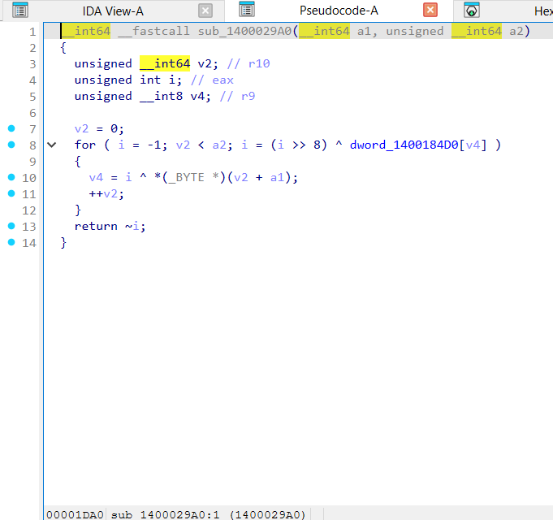
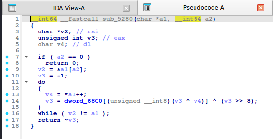
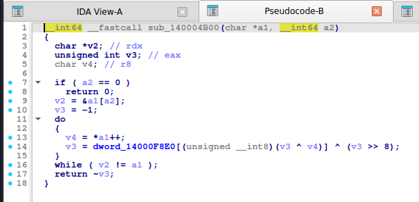
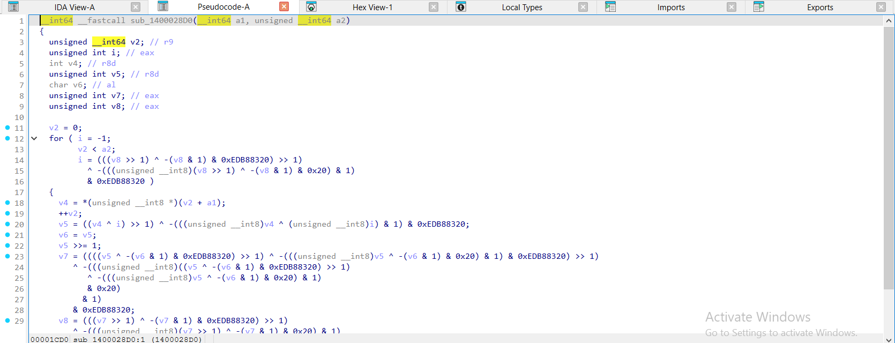
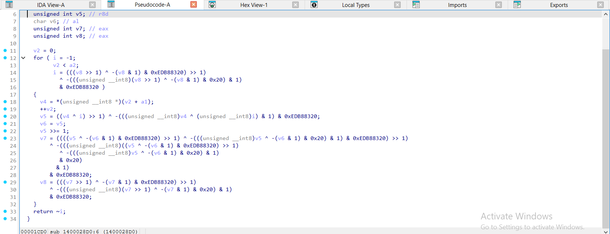
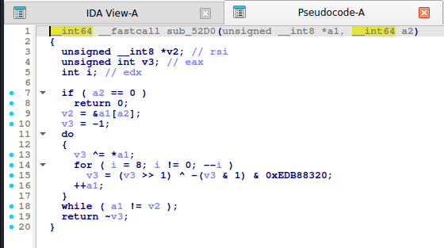
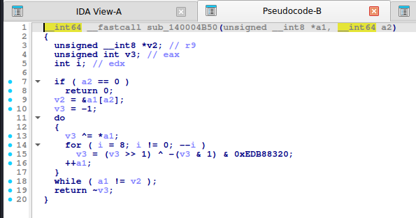

# CRC32

> Checksum 32-bit dựa trên đa thức **`0xEDB88320`** (dạng đảo bit của `0x04C11DB7`). Hai cách cài: **tra bảng 256 từ** hoặc **bit-by-bit**. Tuyến tính trên GF(2) nên **có thể giả mạo** (forge) hoặc giải ngược.

## 1. Dấu hiệu nhận biết

- Hằng **`0xEDB88320`** (`-306674912`). IDA hay hiện dạng `& 0xEDB88320` kèm `-(v & 1)`.
- **Khởi tạo `0xFFFFFFFF`** (hiện `-1`) và **đảo cuối `~crc`**.
- **Dạng tra bảng**: `crc = table[(crc ^ byte) & 0xFF] ^ (crc >> 8)`; bảng 256 từ bắt đầu **`00000000 77073096 EE0E612C 990951BA 076DC419`** (Search bytes `96 30 07 77`). IDA: `CRC32_TAB[(unsigned __int8)(v ^ *p)] ^ (v >> 8)`.
- **Dạng bitwise**: vòng trong 8 lần `crc = (crc >> 1) ^ (0xEDB88320 & -(crc & 1))` (hoặc `if (crc & 1) crc = (crc >> 1) ^ POLY; else crc >>= 1`).
- Biến thể **CRC32C** (Castagnoli) hằng `0x82F63B78`; **CRC32/BZIP2** dùng thuận `0x04C11DB7` và dịch trái.
- Dùng để kiểm tra **độ toàn vẹn** (zlib/gzip/PNG dùng chính CRC32 này). Dùng làm "hash" check flag là đề rất yếu: dễ forge.

## 2. Thuật toán (mã giả)

```
crc = 0xFFFFFFFF
for b in data:
    crc ^= b
    repeat 8: crc = (crc >> 1) ^ (0xEDB88320 if crc & 1 else 0)     # hoặc tra bảng
return ~crc
```

## 3. Mã hóa / giải mã

CRC32 **không phải mã hóa**. Với bài check flag bằng CRC32:

1. **Khớp chính xác** (input ngắn): brute force toàn bộ (ví dụ 4–5 ký tự in được).
2. **Forge 4 byte cuối** (`crc32_forge`): chọn tuỳ ý phần đầu, tính 4 byte đuôi để đạt CRC mong muốn.
3. **Meet-in-the-middle** / **giải hệ GF(2)** khi CRC từng ký tự hoặc nhiều đoạn.
4. CRC tuyến tính: `crc(a ^ b ^ c) = crc(a) ^ crc(b) ^ crc(c)` với độ dài bằng nhau.

## 4. Mã nguồn gốc (C)

```c
uint32_t crc32_table(const uint8_t *p, size_t n)
{
    uint32_t c = 0xFFFFFFFFu;
    for (size_t i = 0; i < n; i++) c = CRC32_TAB[(c ^ p[i]) & 0xFF] ^ (c >> 8);
    return ~c;
}

uint32_t crc32_bitwise(const uint8_t *p, size_t n)
{
    uint32_t c = 0xFFFFFFFFu;
    for (size_t i = 0; i < n; i++) {
        c ^= p[i];
        for (int k = 0; k < 8; k++) c = (c >> 1) ^ (0xEDB88320u & (0u - (c & 1)));
    }
    return ~c;
}
```

## 5. Pseudo-code IDA thực tế

**Dạng bảng:**

<details><summary>MSVC /O2 - PE x64 (có PDB)</summary>

```c
__int64 __fastcall crc32_table(const unsigned __int8 *p, unsigned __int64 n)
{
  unsigned __int64 v2; // r10
  unsigned int i; // eax
  unsigned __int8 v4; // r9

  v2 = 0;
  for ( i = -1; v2 < n; i = (i >> 8) ^ CRC32_TAB[v4] )
    v4 = i ^ p[v2++];
  return ~i;
}
```

</details>

<details><summary>MSVC /Od - PE x64 (có PDB)</summary>

```c
__int64 __fastcall crc32_table(const unsigned __int8 *p, unsigned __int64 n)
{
  unsigned int c; // [rsp+0h] [rbp-18h]
  unsigned __int64 i; // [rsp+8h] [rbp-10h]

  c = -1;
  for ( i = 0; i < n; ++i )
    c = (c >> 8) ^ CRC32_TAB[(unsigned __int8)(p[i] ^ c)];
  return ~c;
}
```

</details>

<details><summary>gcc -O2 - ELF x86-64 (chưa strip)</summary>

```c
__int64 __fastcall crc32_table(char *a1, __int64 a2)
{
  char *v2; // rsi
  unsigned int v3; // eax
  char v4; // dl

  if ( a2 == 0 )
    return 0;
  v2 = &a1[a2];
  v3 = -1;
  do
  {
    v4 = *a1++;
    v3 = CRC32_TAB[(unsigned __int8)(v3 ^ v4)] ^ (v3 >> 8);
  }
  while ( v2 != a1 );
  return ~v3;
}
```

</details>

<details><summary>gcc -O0 - ELF x86-64 (chưa strip)</summary>

```c
__int64 __fastcall crc32_table(__int64 a1, unsigned __int64 a2)
{
  unsigned __int64 i; // [rsp+10h] [rbp-10h]
  unsigned int v4; // [rsp+1Ch] [rbp-4h]

  v4 = -1;
  for ( i = 0; i < a2; ++i )
    v4 = (v4 >> 8) ^ CRC32_TAB[(unsigned __int8)(v4 ^ *(_BYTE *)(a1 + i))];
  return ~v4;
}
```

</details>

<details><summary>mingw-w64 gcc -O2 - PE x64 (-static)</summary>

```c
__int64 __fastcall crc32_table(char *a1, __int64 a2)
{
  char *v2; // rdx
  unsigned int v3; // eax
  char v4; // r8

  if ( a2 == 0 )
    return 0;
  v2 = &a1[a2];
  v3 = -1;
  do
  {
    v4 = *a1++;
    v3 = CRC32_TAB[(unsigned __int8)(v3 ^ v4)] ^ (v3 >> 8);
  }
  while ( v2 != a1 );
  return ~v3;
}
```

</details>

<details><summary>mingw-w64 gcc -O0 - PE x64 (-static)</summary>

```c
__int64 __fastcall crc32_table(__int64 a1, unsigned __int64 a2)
{
  unsigned __int64 i; // [rsp+0h] [rbp-10h]
  unsigned int v4; // [rsp+Ch] [rbp-4h]

  v4 = -1;
  for ( i = 0; i < a2; ++i )
    v4 = (v4 >> 8) ^ CRC32_TAB[(unsigned __int8)(v4 ^ *(_BYTE *)(a1 + i))];
  return ~v4;
}
```

</details>

**Bản strip (không symbol)** – IDA chỉ thấy `sub_XXXX`, `a1`, `a2`, `byte_XXXX`; hàm này tên là MSVC /O2 → `sub_1400029A0`, gcc -O2 → `sub_5280`, mingw-w64 -O2 -static → `sub_140004B00`:

<details><summary>MSVC /O2 – PE x64, không PDB (strip) – bản STRIP: <code>crc32_table</code> = <code>sub_1400029A0</code></summary>

```c
__int64 __fastcall sub_1400029A0(__int64 a1, unsigned __int64 a2)
{
  unsigned __int64 v2; // r10
  unsigned int i; // eax
  unsigned __int8 v4; // r9

  v2 = 0;
  for ( i = -1; v2 < a2; i = (i >> 8) ^ dword_1400184D0[v4] )
  {
    v4 = i ^ *(_BYTE *)(v2 + a1);
    ++v2;
  }
  return ~i;
}
```

</details>

<details><summary>gcc -O2 – ELF, đã `strip -s` – bản STRIP: <code>crc32_table</code> = <code>sub_5280</code></summary>

```c
__int64 __fastcall sub_5280(char *a1, __int64 a2)
{
  char *v2; // rsi
  unsigned int v3; // eax
  char v4; // dl

  if ( a2 == 0 )
    return 0;
  v2 = &a1[a2];
  v3 = -1;
  do
  {
    v4 = *a1++;
    v3 = dword_68C0[(unsigned __int8)(v3 ^ v4)] ^ (v3 >> 8);
  }
  while ( v2 != a1 );
  return ~v3;
}
```

</details>

<details><summary>mingw-w64 -O2 -static – PE, đã `strip -s` – bản STRIP: <code>crc32_table</code> = <code>sub_140004B00</code></summary>

```c
__int64 __fastcall sub_140004B00(char *a1, __int64 a2)
{
  char *v2; // rdx
  unsigned int v3; // eax
  char v4; // r8

  if ( a2 == 0 )
    return 0;
  v2 = &a1[a2];
  v3 = -1;
  do
  {
    v4 = *a1++;
    v3 = dword_14000F8E0[(unsigned __int8)(v3 ^ v4)] ^ (v3 >> 8);
  }
  while ( v2 != a1 );
  return ~v3;
}
```

</details>

**Ảnh chụp màn hình IDA (bản strip)** – mở từng mục để xem; hàm dài chia thành nhiều trang, mỗi trang là một màn hình IDA:

<details><summary>MSVC /O2 – PE x64, không PDB (strip) – crc32_table = <code>sub_1400029A0</code> – 1 ảnh</summary>



</details>

<details><summary>gcc -O2 – ELF, đã `strip -s` – crc32_table = <code>sub_5280</code> – 1 ảnh</summary>



</details>

<details><summary>mingw-w64 -O2 -static – PE, đã `strip -s` – crc32_table = <code>sub_140004B00</code> – 1 ảnh</summary>



</details>

**Dạng bitwise:**

<details><summary>MSVC /O2 - PE x64 (có PDB)</summary>

```c
__int64 __fastcall crc32_bitwise(const unsigned __int8 *p, unsigned __int64 n)
{
  unsigned __int64 v2; // r9
  unsigned int i; // eax
  int v4; // r8d
  unsigned int v5; // r8d
  char v6; // al
  unsigned int v7; // eax
  unsigned int v8; // eax

  v2 = 0;
  for ( i = -1;
        v2 < n;
        i = (((v8 >> 1) ^ -(v8 & 1) & 0xEDB88320) >> 1)
          ^ -(((unsigned __int8)(v8 >> 1) ^ -(v8 & 1) & 0x20) & 1)
          & 0xEDB88320 )
  {
    v4 = p[v2++];
    v5 = ((v4 ^ i) >> 1) ^ -(((unsigned __int8)v4 ^ (unsigned __int8)i) & 1) & 0xEDB88320;
    v6 = v5;
    v5 >>= 1;
    v7 = ((((v5 ^ -(v6 & 1) & 0xEDB88320) >> 1) ^ -(((unsigned __int8)v5 ^ -(v6 & 1) & 0x20) & 1) & 0xEDB88320) >> 1)
       ^ -(((unsigned __int8)((v5 ^ -(v6 & 1) & 0xEDB88320) >> 1)
          ^ -(((unsigned __int8)v5 ^ -(v6 & 1) & 0x20) & 1)
          & 0x20)
         & 1)
       & 0xEDB88320;
    v8 = (((v7 >> 1) ^ -(v7 & 1) & 0xEDB88320) >> 1)
       ^ -(((unsigned __int8)(v7 >> 1) ^ -(v7 & 1) & 0x20) & 1)
       & 0xEDB88320;
  }
  return ~i;
}
```

</details>

<details><summary>MSVC /Od - PE x64 (có PDB)</summary>

```c
__int64 __fastcall crc32_bitwise(const unsigned __int8 *p, unsigned __int64 n)
{
  unsigned int c; // [rsp+0h] [rbp-18h]
  int k; // [rsp+4h] [rbp-14h]
  unsigned __int64 i; // [rsp+8h] [rbp-10h]

  c = -1;
  for ( i = 0; i < n; ++i )
  {
    c ^= p[i];
    for ( k = 0; k < 8; ++k )
      c = -(c & 1) & 0xEDB88320 ^ (c >> 1);
  }
  return ~c;
}
```

</details>

<details><summary>gcc -O2 - ELF x86-64 (chưa strip)</summary>

```c
__int64 __fastcall crc32_bitwise(unsigned __int8 *a1, __int64 a2)
{
  unsigned __int8 *v2; // rsi
  unsigned int v3; // eax
  int i; // edx

  if ( a2 == 0 )
    return 0;
  v2 = &a1[a2];
  v3 = -1;
  do
  {
    v3 ^= *a1;
    for ( i = 8; i != 0; --i )
      v3 = (v3 >> 1) ^ -(v3 & 1) & 0xEDB88320;
    ++a1;
  }
  while ( a1 != v2 );
  return ~v3;
}
```

</details>

<details><summary>gcc -O0 - ELF x86-64 (chưa strip)</summary>

```c
__int64 __fastcall crc32_bitwise(__int64 a1, unsigned __int64 a2)
{
  int j; // [rsp+1Ch] [rbp-14h]
  unsigned __int64 i; // [rsp+20h] [rbp-10h]
  unsigned int v5; // [rsp+2Ch] [rbp-4h]

  v5 = -1;
  for ( i = 0; i < a2; ++i )
  {
    v5 ^= *(unsigned __int8 *)(a1 + i);
    for ( j = 0; j <= 7; ++j )
      v5 = (v5 >> 1) ^ -(v5 & 1) & 0xEDB88320;
  }
  return ~v5;
}
```

</details>

<details><summary>mingw-w64 gcc -O2 - PE x64 (-static)</summary>

```c
__int64 __fastcall crc32_bitwise(unsigned __int8 *a1, __int64 a2)
{
  unsigned __int8 *v2; // r9
  unsigned int v3; // eax
  int i; // edx

  if ( a2 == 0 )
    return 0;
  v2 = &a1[a2];
  v3 = -1;
  do
  {
    v3 ^= *a1;
    for ( i = 8; i != 0; --i )
      v3 = (v3 >> 1) ^ -(v3 & 1) & 0xEDB88320;
    ++a1;
  }
  while ( a1 != v2 );
  return ~v3;
}
```

</details>

<details><summary>mingw-w64 gcc -O0 - PE x64 (-static)</summary>

```c
__int64 __fastcall crc32_bitwise(__int64 a1, unsigned __int64 a2)
{
  int j; // [rsp+Ch] [rbp-14h]
  unsigned __int64 i; // [rsp+10h] [rbp-10h]
  unsigned int v5; // [rsp+1Ch] [rbp-4h]

  v5 = -1;
  for ( i = 0; i < a2; ++i )
  {
    v5 ^= *(unsigned __int8 *)(a1 + i);
    for ( j = 0; j <= 7; ++j )
      v5 = (v5 >> 1) ^ -(v5 & 1) & 0xEDB88320;
  }
  return ~v5;
}
```

</details>

**Bản strip (không symbol)** – IDA chỉ thấy `sub_XXXX`, `a1`, `a2`, `byte_XXXX`; hàm này tên là MSVC /O2 → `sub_1400028D0`, gcc -O2 → `sub_52D0`, mingw-w64 -O2 -static → `sub_140004B50`:

<details><summary>MSVC /O2 – PE x64, không PDB (strip) – bản STRIP: <code>crc32_bitwise</code> = <code>sub_1400028D0</code></summary>

```c
__int64 __fastcall sub_1400028D0(__int64 a1, unsigned __int64 a2)
{
  unsigned __int64 v2; // r9
  unsigned int i; // eax
  int v4; // r8d
  unsigned int v5; // r8d
  char v6; // al
  unsigned int v7; // eax
  unsigned int v8; // eax

  v2 = 0;
  for ( i = -1;
        v2 < a2;
        i = (((v8 >> 1) ^ -(v8 & 1) & 0xEDB88320) >> 1)
          ^ -(((unsigned __int8)(v8 >> 1) ^ -(v8 & 1) & 0x20) & 1)
          & 0xEDB88320 )
  {
    v4 = *(unsigned __int8 *)(v2 + a1);
    ++v2;
    v5 = ((v4 ^ i) >> 1) ^ -(((unsigned __int8)v4 ^ (unsigned __int8)i) & 1) & 0xEDB88320;
    v6 = v5;
    v5 >>= 1;
    v7 = ((((v5 ^ -(v6 & 1) & 0xEDB88320) >> 1) ^ -(((unsigned __int8)v5 ^ -(v6 & 1) & 0x20) & 1) & 0xEDB88320) >> 1)
       ^ -(((unsigned __int8)((v5 ^ -(v6 & 1) & 0xEDB88320) >> 1)
          ^ -(((unsigned __int8)v5 ^ -(v6 & 1) & 0x20) & 1)
          & 0x20)
         & 1)
       & 0xEDB88320;
    v8 = (((v7 >> 1) ^ -(v7 & 1) & 0xEDB88320) >> 1)
       ^ -(((unsigned __int8)(v7 >> 1) ^ -(v7 & 1) & 0x20) & 1)
       & 0xEDB88320;
  }
  return ~i;
}
```

</details>

<details><summary>gcc -O2 – ELF, đã `strip -s` – bản STRIP: <code>crc32_bitwise</code> = <code>sub_52D0</code></summary>

```c
__int64 __fastcall sub_52D0(unsigned __int8 *a1, __int64 a2)
{
  unsigned __int8 *v2; // rsi
  unsigned int v3; // eax
  int i; // edx

  if ( a2 == 0 )
    return 0;
  v2 = &a1[a2];
  v3 = -1;
  do
  {
    v3 ^= *a1;
    for ( i = 8; i != 0; --i )
      v3 = (v3 >> 1) ^ -(v3 & 1) & 0xEDB88320;
    ++a1;
  }
  while ( a1 != v2 );
  return ~v3;
}
```

</details>

<details><summary>mingw-w64 -O2 -static – PE, đã `strip -s` – bản STRIP: <code>crc32_bitwise</code> = <code>sub_140004B50</code></summary>

```c
__int64 __fastcall sub_140004B50(unsigned __int8 *a1, __int64 a2)
{
  unsigned __int8 *v2; // r9
  unsigned int v3; // eax
  int i; // edx

  if ( a2 == 0 )
    return 0;
  v2 = &a1[a2];
  v3 = -1;
  do
  {
    v3 ^= *a1;
    for ( i = 8; i != 0; --i )
      v3 = (v3 >> 1) ^ -(v3 & 1) & 0xEDB88320;
    ++a1;
  }
  while ( a1 != v2 );
  return ~v3;
}
```

</details>

**Ảnh chụp màn hình IDA (bản strip)** – mở từng mục để xem; hàm dài chia thành nhiều trang, mỗi trang là một màn hình IDA:

<details><summary>MSVC /O2 – PE x64, không PDB (strip) – crc32_bitwise = <code>sub_1400028D0</code> – 2 ảnh</summary>





</details>

<details><summary>gcc -O2 – ELF, đã `strip -s` – crc32_bitwise = <code>sub_52D0</code> – 1 ảnh</summary>



</details>

<details><summary>mingw-w64 -O2 -static – PE, đã `strip -s` – crc32_bitwise = <code>sub_140004B50</code> – 1 ảnh</summary>



</details>

## 6. Code giải mã / khai thác

**Python:**

```python
import zlib


M32 = 0xFFFFFFFF
def crc32(data, init=0):
    return zlib.crc32(data, init) & M32


def crc32_forge(prefix, target):
    """Tra ve 4 byte `tail` sao cho crc32(prefix + tail) == target (hoac None).

    CRC32 la anh xa affine tren GF(2): crc(prefix+tail) = L(tail) xor const, voi L tuyen tinh va
    khong suy bien tren 4 byte -> giai he 32 an 32 phuong trinh bang khu Gauss.
    """
    base = crc32(prefix + b"\x00\x00\x00\x00")
    cols = [crc32(prefix + (1 << b).to_bytes(4, "little")) ^ base for b in range(32)]
    basis = []                                   # (vector, to hop bit goc tao ra vector do)
    for b, v in enumerate(cols):
        combo = 1 << b
        for bv, bc in basis:
            if v ^ bv < v:                       # bit cao nhat cua bv dang bat trong v
                v ^= bv
                combo ^= bc
        if v:
            basis.append((v, combo))
            basis.sort(reverse=True)
    v, combo = target ^ base, 0
    for bv, bc in basis:
        if v ^ bv < v:
            v ^= bv
            combo ^= bc
    return combo.to_bytes(4, "little") if v == 0 else None
```

```python
crc32(b"Hello, CyberSeaGame!")                                    # 0xbc6db443
tail = crc32_forge(b"Hello, CyberSea", 0xDEADBEEF)                # 4 byte đuôi
assert crc32(b"Hello, CyberSea" + tail) == 0xDEADBEEF
```

**C:**

```c
#include <stdint.h>
#include <stddef.h>
#include <string.h>

static inline uint32_t ctf_crc32(const uint8_t *p, size_t n)
{
    uint32_t c = 0xFFFFFFFFu;
    for (size_t i = 0; i < n; i++) {
        c ^= p[i];
        for (int k = 0; k < 8; k++) c = (c >> 1) ^ (0xEDB88320u & (0u - (c & 1)));
    }
    return ~c;
}
```

## 7. Biến thể & bẫy

- Nhớ **init `0xFFFFFFFF` và XOR cuối**; nhiều cài đặt đơn giản bỏ một trong hai.
- Bảng CRC có thể **bị sửa** (đa thức khác): dùng bảng/ đa thức đúng như trong binary.
- CRC16 (CCITT `0x1021`, MODBUS `0xA001`), CRC64 (`0xC96C5795D7870F42`) tương tự.
