# MD5

> Hash 128-bit, khối 64 byte, 64 bước chia 4 vòng, **little-endian**. Không đảo ngược được; dùng để **so khớp** (check flag bằng hash) hoặc sinh key.

## 1. Dấu hiệu nhận biết

- **4 hằng khởi tạo** (cũng của SHA-1): `0x67452301`, `0xEFCDAB89`, `0x98BADCFE`, `0x10325476`. IDA hiện **thập phân có dấu**: `1732584193`, `-271733879`, `-1732584194`, `271733878`.
- **Bảng K/T 64 từ** (`floor(abs(sin(i+1)) · 2^32)`): bắt đầu `0xD76AA478` (`-680876936`), `0xE8C7B756`, `0x242070DB`, `0xC1BDCEEE`. Ở bản bung vòng (MSVC `/O2`) 64 hằng này xuất hiện **rời rạc ngay trong code**.
- **Bảng lượng xoay** `7,12,17,22 | 5,9,14,20 | 4,11,16,23 | 6,10,15,21` (mảng `R_1[64]` ở gcc, hoặc `__ROL4__(x, 7)` … khi bung).
- **Bốn hàm vòng**: `F = (B & C) | (~B & D)` (IDA: `v10 ^ v12 & (v10 ^ v11)`), `G = (D & B) | (~D & C)`, `H = B ^ C ^ D`, `I = C ^ (B | ~D)`. Có phép **`~`** ở vòng 4 (`| ~v10`).
- **Chỉ số khối thông điệp** `g`: `i`, `(5*i + 1) & 15`, `(3*i + 5) & 15`, `(7*i) & 15` (hằng `5`, `3`, `7`, `& 15`).
- **Padding**: `0x80` rồi 0…, độ dài **bit** (`8 * n`) ghi **8 byte little-endian** ở cuối khối; tổng độ dài `((n + 8) / 64 + 1) * 64`.
- Đầu ra: 4 từ **little-endian** nối nhau (16 byte), không đảo byte.
- Cả hàm không dùng `bswap` (khác SHA).

## 2. Thuật toán (mã giả)

```
a,b,c,d = 0x67452301, 0xEFCDAB89, 0x98BADCFE, 0x10325476
msg += 0x80; pad 0 đến ≡ 56 (mod 64); msg += len_bits (8 byte LE)
for mỗi khối 64 byte (16 từ LE: M[0..15]):
    A,B,C,D = a,b,c,d
    for i in 0..63:
        i<16:  F=(B&C)|(~B&D);  g=i
        i<32:  F=(D&B)|(~D&C);  g=(5i+1)%16
        i<48:  F=B^C^D;         g=(3i+5)%16
        else:  F=C^(B|~D);      g=7i%16
        F = F + A + K[i] + M[g]
        A=D; D=C; C=B; B = B + rol(F, R[i])
    a+=A; b+=B; c+=C; d+=D
digest = a|b|c|d (mỗi từ little-endian)
```

## 3. Mã hóa / giải mã

Không đảo ngược. Cách "giải" bài dùng MD5:

1. **Tra cứu**: dán hash vào CrackStation/hashcat nếu input ngắn/thường gặp (offline: wordlist `rockyou`).
2. **Brute force có cấu trúc**: nếu biết khuôn (ví dụ `flag{...}` 6 ký tự hex) thì `hash_bruteforce` bên dưới.
3. **Nếu MD5 chỉ dùng để sinh key/IV** (ví dụ `MD5(password)` làm khóa AES): tái hiện hàm sinh key rồi dùng key đó.
4. Collision/length extension chỉ cần khi đề hướng tới tấn công, hiếm gặp trong check flag.

## 4. Mã nguồn gốc (C)

```c
void md5_hash(const uint8_t *msg, size_t n, uint8_t out[16])
{
    static const int R[64] = {7, 12, 17, 22, 7, 12, 17, 22, 7, 12, 17, 22, 7, 12, 17, 22,
                              5, 9, 14, 20, 5, 9, 14, 20, 5, 9, 14, 20, 5, 9, 14, 20,
                              4, 11, 16, 23, 4, 11, 16, 23, 4, 11, 16, 23, 4, 11, 16, 23,
                              6, 10, 15, 21, 6, 10, 15, 21, 6, 10, 15, 21, 6, 10, 15, 21};
    uint8_t buf[320];
    uint32_t a0 = 0x67452301, b0 = 0xefcdab89, c0 = 0x98badcfe, d0 = 0x10325476;
    size_t total = ((n + 8) / 64 + 1) * 64;
    uint64_t bits = (uint64_t)n * 8;
    memset(buf, 0, sizeof(buf));
    memcpy(buf, msg, n);
    buf[n] = 0x80;
    memcpy(buf + total - 8, &bits, 8);
    for (size_t off = 0; off < total; off += 64) {
        uint32_t M[16], A = a0, B = b0, C = c0, D = d0;
        memcpy(M, buf + off, 64);
        for (int i = 0; i < 64; i++) {
            uint32_t F, g;
            if (i < 16)      { F = (B & C) | (~B & D); g = i; }
            else if (i < 32) { F = (D & B) | (~D & C); g = (5 * i + 1) & 15; }
            else if (i < 48) { F = B ^ C ^ D;          g = (3 * i + 5) & 15; }
            else             { F = C ^ (B | ~D);       g = (7 * i) & 15; }
            F = F + A + MD5_K[i] + M[g];
            A = D; D = C; C = B;
            B = B + ROL32(F, R[i]);
        }
        a0 += A; b0 += B; c0 += C; d0 += D;
    }
    memcpy(out, &a0, 4); memcpy(out + 4, &b0, 4);
    memcpy(out + 8, &c0, 4); memcpy(out + 12, &d0, 4);
}
```

## 5. Pseudo-code IDA thực tế

<details><summary>MSVC /O2 - PE x64 (có PDB)</summary>

```c
void __fastcall md5_hash(const unsigned __int8 *msg, size_t n, unsigned __int8 *out)
{
  size_t v5; // r14
  int v6; // r15d
  int v7; // esi
  int v8; // r12d
  int v9; // r13d
  size_t v10; // rbp
  int v11; // r8d
  int v12; // r11d
  __int128 v13; // xmm1
  int v14; // r9d
  int v15; // ebx
  __int128 v16; // xmm0
  int v17; // r10d
  __int64 v18; // r14
  __int128 v19; // xmm1
  int v20; // eax
  __int64 v21; // rcx
  char v22; // cl
  int v23; // esi
  int v24; // edi
  int v25; // r9d
  int v26; // eax
  int v27; // edx
  __int64 v28; // rax
  char v29; // al
  int v30; // r9d
  int v31; // edx
  __int64 v32; // rax
  char v33; // al
  __int64 v34; // rcx
  int v35; // r9d
  int v36; // edx
  char v37; // cl
  int v38; // edx
  int v39; // [rsp+20h] [rbp-1E8h]
  int v40; // [rsp+24h] [rbp-1E4h]
  size_t v41; // [rsp+28h] [rbp-1E0h]
  unsigned int M[16]; // [rsp+40h] [rbp-1C8h]
  unsigned __int8 buf[320]; // [rsp+80h] [rbp-188h] BYREF

  v5 = ((n + 8) & 0xFFFFFFFFFFFFFFC0uLL) + 64;
  v6 = 1732584193;
  v7 = 271733878;
  v41 = v5;
  v39 = 1732584193;
  v40 = 271733878;
  v8 = -271733879;
  v9 = -1732584194;
  memset(a1: buf, Val: 0, Size: sizeof(buf));
  memmove(a1: buf, Src: msg, Size: n);
  v10 = 0;
  buf[n] = 0x80;
  *(_QWORD *)((char *)&M[14] + v5) = 8 * n;
  if ( v5 != 0 )
  {
    do
    {
      v11 = 0;
      v12 = v6;
      v13 = *(_OWORD *)&buf[v10 + 16];
      v14 = v8;
      *(_OWORD *)M = *(_OWORD *)&buf[v10];
      v15 = v9;
      v16 = *(_OWORD *)&buf[v10 + 32];
      v17 = v7;
      v18 = 0;
      *(_OWORD *)&M[4] = v13;
      v19 = *(_OWORD *)&buf[v10 + 48];
      *(_OWORD *)&M[8] = v16;
      *(_OWORD *)&M[12] = v19;
      do
      {
        if ( v11 >= 16 )
        {
          if ( v11 >= 32 )
          {
            if ( v11 >= 48 )
            {
              v20 = v15 ^ (v14 | ~v17);
              v22 = 7 * v11;
            }
            else
            {
              v20 = v14 ^ v15 ^ v17;
              v22 = v11 + 2 * v11 + 5;
            }
          }
          else
          {
            v20 = v14 & v17 | v15 & ~v17;
            v22 = v11 + 4 * v11 + 1;
          }
          v21 = v22 & 0xF;
        }
        else
        {
          v20 = v14 & v15 | v17 & ~v14;
          v21 = (unsigned int)v11;
        }
        v23 = v11 + 2;
        v24 = v14;
        v25 = __ROL4__(v12 + MD5_K[v18] + M[v21] + v20, R[v18]) + v14;
        v26 = v11 + 1;
        if ( v11 + 1 >= 16 )
        {
          if ( v26 >= 32 )
          {
            if ( v26 >= 48 )
            {
              v27 = v24 ^ (v25 | ~v15);
              v29 = 7 * (v11 + 1);
            }
            else
            {
              v27 = v25 ^ v24 ^ v15;
              v29 = v11 + 2 * (v11 - 4);
            }
          }
          else
          {
            v27 = v25 & v15 | v24 & ~v15;
            v29 = v11 + 4 * v11 + 6;
          }
          v28 = v29 & 0xF;
        }
        else
        {
          v27 = v25 & v24 | v15 & ~v25;
          v28 = (unsigned int)(v11 + 1);
        }
        v12 = v25;
        v30 = __ROL4__(v17 + MD5_K[v18 + 1] + M[v28] + v27, R[v18 + 1]) + v25;
        if ( v23 >= 16 )
        {
          if ( v23 >= 32 )
          {
            if ( v23 >= 48 )
            {
              v31 = v12 ^ (v30 | ~v24);
              v33 = 7 * v11 - 2;
            }
            else
            {
              v31 = v30 ^ v12 ^ v24;
              v33 = v11 + 2 * v11 - 5;
            }
          }
          else
          {
            v31 = v30 & v24 | v12 & ~v24;
            v33 = 5 * (v11 - 1);
          }
          v32 = v33 & 0xF;
        }
        else
        {
          v31 = v30 & v12 | v24 & ~v30;
          v32 = (unsigned int)v23;
        }
        v17 = v30;
        v34 = (unsigned int)(v11 + 3);
        v35 = __ROL4__(v15 + MD5_K[v18 + 2] + M[v32] + v31, R[v18 + 2]) + v30;
        if ( (int)v34 >= 16 )
        {
          if ( (int)v34 >= 32 )
          {
            if ( (int)v34 >= 48 )
            {
              v36 = v17 ^ (v35 | ~v12);
              v37 = 7 * v11 + 5;
            }
            else
            {
              v36 = v35 ^ v17 ^ v12;
              v37 = v11 + 2 * (v11 - 1);
            }
          }
          else
          {
            v37 = 5 * v11;
            v36 = v35 & v12 | v17 & ~v12;
          }
          v34 = v37 & 0xF;
        }
        else
        {
          v36 = v35 & v17 | v12 & ~v35;
        }
        v15 = v35;
        v11 += 4;
        v38 = __ROL4__(v24 + MD5_K[v18 + 3] + M[v34] + v36, R[v18 + 3]);
        v18 += 4;
        v14 = v38 + v35;
      }
      while ( v11 < 64 );
      v8 += v14;
      v6 = v12 + v39;
      v7 = v17 + v40;
      v39 += v12;
      v9 += v15;
      v40 += v17;
      v10 += 64LL;
    }
    while ( v10 < v41 );
  }
  *(_DWORD *)out = v6;
  *((_DWORD *)out + 1) = v8;
  *((_DWORD *)out + 2) = v9;
  *((_DWORD *)out + 3) = v7;
}
```

</details>

<details><summary>MSVC /Od - PE x64 (có PDB)</summary>

```c
void __fastcall md5_hash(const unsigned __int8 *msg, size_t n, unsigned __int8 *out)
{
  int i; // [rsp+20h] [rbp-1E8h]
  unsigned int B; // [rsp+24h] [rbp-1E4h]
  unsigned int D; // [rsp+28h] [rbp-1E0h]
  unsigned int F; // [rsp+2Ch] [rbp-1DCh]
  unsigned int Fa; // [rsp+2Ch] [rbp-1DCh]
  unsigned int C; // [rsp+30h] [rbp-1D8h]
  unsigned int g; // [rsp+34h] [rbp-1D4h]
  unsigned int a0; // [rsp+38h] [rbp-1D0h] BYREF
  unsigned int b0; // [rsp+3Ch] [rbp-1CCh] BYREF
  unsigned int c0; // [rsp+40h] [rbp-1C8h] BYREF
  unsigned int d0; // [rsp+44h] [rbp-1C4h] BYREF
  unsigned int A; // [rsp+48h] [rbp-1C0h]
  unsigned __int64 off; // [rsp+50h] [rbp-1B8h]
  unsigned __int64 total; // [rsp+58h] [rbp-1B0h]
  unsigned __int64 bits; // [rsp+60h] [rbp-1A8h] BYREF
  unsigned int M[16]; // [rsp+70h] [rbp-198h] BYREF
  unsigned __int8 buf[320]; // [rsp+B0h] [rbp-158h] BYREF

  a0 = 1732584193;
  b0 = -271733879;
  c0 = -1732584194;
  d0 = 271733878;
  total = ((n + 8) / 0x40 + 1) << 6;
  bits = 8 * n;
  memset(a1: buf, Val: 0, Size: sizeof(buf));
  memmove(a1: buf, Src: msg, Size: n);
  buf[n] = 0x80;
  memmove(a1: (char *)&M[14] + total, Src: &bits, Size: 8u);
  for ( off = 0; off < total; off += 64LL )
  {
    A = a0;
    B = b0;
    C = c0;
    D = d0;
    memmove(a1: M, Src: &buf[off], Size: 0x40u);
    for ( i = 0; i < 64; ++i )
    {
      if ( i >= 16 )
      {
        if ( i >= 32 )
        {
          if ( i >= 48 )
          {
            F = (~D | B) ^ C;
            g = (7 * (_BYTE)i) & 0xF;
          }
          else
          {
            F = D ^ C ^ B;
            g = (3 * (_BYTE)i + 5) & 0xF;
          }
        }
        else
        {
          F = C & ~D | B & D;
          g = (5 * (_BYTE)i + 1) & 0xF;
        }
      }
      else
      {
        F = D & ~B | C & B;
        g = i;
      }
      Fa = M[g] + MD5_K[i] + A + F;
      A = D;
      D = C;
      C = B;
      B += __ROL4__(Fa, R[i]);
    }
    a0 += A;
    b0 += B;
    c0 += C;
    d0 += D;
  }
  memmove(a1: out, Src: &a0, Size: 4u);
  memmove(a1: out + 4, Src: &b0, Size: 4u);
  memmove(a1: out + 8, Src: &c0, Size: 4u);
  memmove(a1: out + 12, Src: &d0, Size: 4u);
}
```

</details>

<details><summary>gcc -O2 - ELF x86-64 (chưa strip)</summary>

```c
__m128i *__fastcall md5_hash(void *src, size_t n, __m128i *a3)
{
  const __m128i *v4; // rbx
  size_t v5; // r15
  unsigned int v6; // r14d
  unsigned int v7; // ebp
  unsigned int v8; // r12d
  unsigned int v9; // r13d
  unsigned int v10; // r9d
  unsigned int v11; // r8d
  unsigned int v12; // edi
  unsigned int v13; // eax
  unsigned __int64 v14; // rsi
  __int64 v15; // rcx
  int v16; // edx
  int v17; // edx
  int v18; // ecx
  unsigned int v19; // edx
  int v20; // ecx
  unsigned int v21; // edx
  size_t v23; // [rsp+0h] [rbp-1C8h]
  _QWORD v25[6]; // [rsp+10h] [rbp-1B8h]
  __m128i si128; // [rsp+40h] [rbp-188h]
  _BYTE dest[376]; // [rsp+50h] [rbp-178h] BYREF

  v4 = (const __m128i *)dest;
  v23 = ((n + 8) & 0xFFFFFFFFFFFFFFC0LL) + 64;
  memset(dest, 0, 0x140u);
  memcpy(dest, src, n);
  dest[n] = 0x80;
  *(__int64 *)((char *)&si128.m128i_i64[1] + v23) = 8 * n;
  if ( v23 == 0 )
  {
    v6 = 271733878;
    v8 = -1732584194;
    v9 = -271733879;
    v7 = 1732584193;
    goto LABEL_14;
  }
  v5 = 0;
  v6 = 271733878;
  v7 = 1732584193;
  v8 = -1732584194;
  v9 = -271733879;
  do
  {
    v10 = v6;
    v11 = v8;
    v12 = v9;
    v13 = v7;
    v14 = 0;
    *(__m128i *)v25 = _mm_load_si128(v4);
    *(__m128i *)&v25[2] = _mm_load_si128(v4 + 1);
    *(__m128i *)&v25[4] = _mm_load_si128(v4 + 2);
    si128 = _mm_load_si128(v4 + 3);
    while ( 1 )
    {
      if ( v14 <= 0xF )
      {
        v15 = (unsigned int)v14;
        v16 = v10 ^ v12 & (v10 ^ v11);
        goto LABEL_6;
      }
      if ( v14 <= 0x1F )
      {
        v15 = (5 * (_BYTE)v14 + 1) & 0xF;
        v16 = v11 ^ v10 & (v11 ^ v12);
        goto LABEL_6;
      }
      if ( v14 <= 0x2F )
      {
        v15 = (3 * (_BYTE)v14 + 5) & 0xF;
        v16 = v10 ^ v11 ^ v12;
LABEL_6:
        v17 = *((_DWORD *)v25 + v15) + MD5_K[v14] + v16;
        v18 = R_1[v14++];
        v19 = v12 + __ROL4__(v13 + v17, v18);
        goto LABEL_7;
      }
      v20 = R_1[v14];
      v21 = v13 + *((_DWORD *)v25 + ((7 * (_BYTE)v14) & 0xF)) + MD5_K[v14] + (v11 ^ (v12 | ~v10));
      ++v14;
      v19 = v12 + __ROL4__(v21, v20);
      if ( v14 == 64 )
        break;
LABEL_7:
      v13 = v10;
      v10 = v11;
      v11 = v12;
      v12 = v19;
    }
    v7 += v10;
    v9 += v19;
    v8 += v12;
    v6 += v11;
    v5 += 64LL;
    v4 += 4;
  }
  while ( v5 < v23 );
LABEL_14:
  *a3 = _mm_unpacklo_epi64(
          _mm_unpacklo_epi32(_mm_cvtsi32_si128(v7), _mm_cvtsi32_si128(v9)),
          _mm_unpacklo_epi32(_mm_cvtsi32_si128(v8), _mm_cvtsi32_si128(v6)));
  return a3;
}
```

</details>

<details><summary>gcc -O0 - ELF x86-64 (chưa strip)</summary>

```c
__int64 __fastcall md5_hash(const void *a1, size_t a2, int *a3)
{
  __int64 result; // rax
  _DWORD dest[18]; // [rsp+20h] [rbp-1D0h] BYREF
  size_t v8; // [rsp+68h] [rbp-188h]
  unsigned int v9; // [rsp+70h] [rbp-180h]
  int v10; // [rsp+74h] [rbp-17Ch]
  int v11; // [rsp+78h] [rbp-178h]
  int v12; // [rsp+7Ch] [rbp-174h]
  _BYTE s[320]; // [rsp+80h] [rbp-170h] BYREF
  size_t v14; // [rsp+1C0h] [rbp-30h]
  int v15; // [rsp+1CCh] [rbp-24h]
  int v16; // [rsp+1D0h] [rbp-20h]
  int j; // [rsp+1D4h] [rbp-1Ch]
  unsigned int v18; // [rsp+1D8h] [rbp-18h]
  int v19; // [rsp+1DCh] [rbp-14h]
  int v20; // [rsp+1E0h] [rbp-10h]
  int v21; // [rsp+1E4h] [rbp-Ch]
  size_t i; // [rsp+1E8h] [rbp-8h]

  v12 = 1732584193;
  v11 = -271733879;
  v10 = -1732584194;
  v9 = 271733878;
  v14 = (((a2 + 8) >> 6) + 1) << 6;
  v8 = 8 * a2;
  memset(s, c: 0, n: sizeof(s));
  memcpy(dest: s, src: a1, n: a2);
  s[a2] = 0x80;
  *(_QWORD *)&s[v14 - 8] = v8;
  for ( i = 0; i < v14; i += 64LL )
  {
    v21 = v12;
    v20 = v11;
    v19 = v10;
    v18 = v9;
    memcpy(dest, src: &s[i], n: 0x40u);
    for ( j = 0; j <= 63; ++j )
    {
      if ( j > 15 )
      {
        if ( j > 31 )
        {
          if ( j > 47 )
          {
            v16 = v19 ^ (v20 | ~v18);
            v15 = (7 * (_BYTE)j) & 0xF;
          }
          else
          {
            v16 = v18 ^ v19 ^ v20;
            v15 = (3 * (_BYTE)j + 5) & 0xF;
          }
        }
        else
        {
          v16 = v20 & v18 | v19 & ~v18;
          v15 = (5 * (_BYTE)j + 1) & 0xF;
        }
      }
      else
      {
        v16 = v19 & v20 | v18 & ~v20;
        v15 = j;
      }
      v16 += v21 + MD5_K[j] + dest[v15];
      v21 = v18;
      v18 = v19;
      v19 = v20;
      v20 += __ROL4__(v16, *(_DWORD *)&R_1[4 * j]);
    }
    v12 += v21;
    v11 += v20;
    v10 += v19;
    v9 += v18;
  }
  *a3 = v12;
  a3[1] = v11;
  a3[2] = v10;
  result = v9;
  a3[3] = v9;
  return result;
}
```

</details>

<details><summary>mingw-w64 gcc -O2 - PE x64 (-static)</summary>

```c
unsigned __int64 __fastcall md5_hash(void *Src, size_t Size, __m128i *a3)
{
  unsigned __int64 result; // rax
  __m128i *v5; // r9
  const __m128i *v6; // rdi
  size_t v7; // r15
  unsigned int v8; // r14d
  unsigned int v9; // r12d
  unsigned int v10; // r13d
  unsigned int v11; // ebp
  __m128i v12; // xmm3
  unsigned int v13; // r11d
  unsigned int v14; // r10d
  __m128i v15; // xmm4
  __m128i v16; // xmm5
  unsigned int v17; // r9d
  unsigned __int64 v18; // r8
  __int64 v19; // rcx
  int v20; // edx
  int v21; // edx
  int v22; // ecx
  unsigned int v23; // edx
  int v24; // ecx
  int v25; // edx
  size_t v26; // [rsp+28h] [rbp-1D0h]
  _QWORD v27[6]; // [rsp+30h] [rbp-1C8h]
  __m128i v28; // [rsp+60h] [rbp-198h]
  _BYTE v29[392]; // [rsp+70h] [rbp-188h] BYREF

  memset(v29, 0, 0x140u);
  v26 = ((Size + 8) & 0xFFFFFFFFFFFFFFC0uLL) + 64;
  result = (unsigned __int64)memcpy_0(a1: v29, Src, Size);
  v29[Size] = 0x80;
  *(_QWORD *)((char *)&v28 + ((Size + 8) & 0xFFFFFFFFFFFFFFC0uLL) + 72) = 8 * Size;
  v5 = a3;
  if ( ((Size + 8) & 0xFFFFFFFFFFFFFFC0uLL) == 0xFFFFFFFFFFFFFFC0uLL )
  {
    v8 = 271733878;
    v9 = -1732584194;
    v10 = -271733879;
    v11 = 1732584193;
    goto LABEL_15;
  }
  v6 = (const __m128i *)result;
  v7 = 0;
  v8 = 271733878;
  v9 = -1732584194;
  v10 = -271733879;
  v11 = 1732584193;
  do
  {
    v12 = _mm_loadu_si128(v6 + 1);
    v13 = v8;
    v14 = v9;
    v15 = _mm_loadu_si128(v6 + 2);
    v16 = _mm_loadu_si128(v6 + 3);
    v17 = v10;
    result = v11;
    *(__m128i *)v27 = _mm_loadu_si128(v6);
    v18 = 0;
    *(__m128i *)&v27[2] = v12;
    *(__m128i *)&v27[4] = v15;
    v28 = v16;
    while ( 1 )
    {
      if ( v18 <= 0xF )
      {
        v19 = (unsigned int)v18;
        v20 = v13 ^ v17 & (v13 ^ v14);
        goto LABEL_6;
      }
      if ( v18 <= 0x1F )
      {
        v19 = (5 * (_BYTE)v18 + 1) & 0xF;
        v20 = v14 ^ v13 & (v14 ^ v17);
        goto LABEL_6;
      }
      if ( v18 <= 0x2F )
      {
        v19 = (3 * (_BYTE)v18 + 5) & 0xF;
        v20 = v13 ^ v14 ^ v17;
LABEL_6:
        v21 = *((_DWORD *)v27 + v19) + MD5_K[v18] + v20;
        v22 = R_1[v18++];
        v23 = v17 + __ROL4__(result + v21, v22);
        goto LABEL_7;
      }
      v24 = R_1[v18];
      v25 = result + *((_DWORD *)v27 + ((7 * (_BYTE)v18) & 0xF)) + MD5_K[v18] + (v14 ^ (v17 | ~v13));
      ++v18;
      v23 = v17 + __ROL4__(v25, v24);
      if ( v18 == 64 )
        break;
LABEL_7:
      result = v13;
      v13 = v14;
      v14 = v17;
      v17 = v23;
    }
    v11 += v13;
    v10 += v23;
    v9 += v17;
    v8 += v14;
    v7 += 64LL;
    v6 += 4;
  }
  while ( v7 < v26 );
  v5 = a3;
LABEL_15:
  *v5 = _mm_unpacklo_epi64(
          _mm_unpacklo_epi32(_mm_cvtsi32_si128(v11), _mm_cvtsi32_si128(v10)),
          _mm_unpacklo_epi32(_mm_cvtsi32_si128(v9), _mm_cvtsi32_si128(v8)));
  return result;
}
```

</details>

<details><summary>mingw-w64 gcc -O0 - PE x64 (-static)</summary>

```c
__int64 __fastcall md5_hash(const void *a1, size_t a2, int *a3)
{
  __int64 result; // rax
  _DWORD v4[18]; // [rsp+20h] [rbp-60h] BYREF
  size_t v5; // [rsp+68h] [rbp-18h]
  unsigned int v6; // [rsp+70h] [rbp-10h]
  int v7; // [rsp+74h] [rbp-Ch]
  int v8; // [rsp+78h] [rbp-8h]
  int v9; // [rsp+7Ch] [rbp-4h]
  _BYTE v10[320]; // [rsp+80h] [rbp+0h] BYREF
  size_t v11; // [rsp+1C0h] [rbp+140h]
  int v12; // [rsp+1CCh] [rbp+14Ch]
  int v13; // [rsp+1D0h] [rbp+150h]
  int j; // [rsp+1D4h] [rbp+154h]
  unsigned int v15; // [rsp+1D8h] [rbp+158h]
  int v16; // [rsp+1DCh] [rbp+15Ch]
  int v17; // [rsp+1E0h] [rbp+160h]
  int v18; // [rsp+1E4h] [rbp+164h]
  size_t i; // [rsp+1E8h] [rbp+168h]

  v9 = 1732584193;
  v8 = -271733879;
  v7 = -1732584194;
  v6 = 271733878;
  v11 = (((a2 + 8) >> 6) + 1) << 6;
  v5 = 8 * a2;
  memset(a1: v10, Val: 0, Size: sizeof(v10));
  memcpy_0(a1: v10, Src: a1, Size: a2);
  v10[a2] = 0x80;
  *(_QWORD *)&v10[v11 - 8] = v5;
  for ( i = 0; i < v11; i += 64LL )
  {
    v18 = v9;
    v17 = v8;
    v16 = v7;
    v15 = v6;
    memcpy_0(a1: v4, Src: &v10[i], Size: 0x40u);
    for ( j = 0; j <= 63; ++j )
    {
      if ( j > 15 )
      {
        if ( j > 31 )
        {
          if ( j > 47 )
          {
            v13 = v16 ^ (v17 | ~v15);
            v12 = (7 * (_BYTE)j) & 0xF;
          }
          else
          {
            v13 = v15 ^ v16 ^ v17;
            v12 = (3 * (_BYTE)j + 5) & 0xF;
          }
        }
        else
        {
          v13 = v17 & v15 | v16 & ~v15;
          v12 = (5 * (_BYTE)j + 1) & 0xF;
        }
      }
      else
      {
        v13 = v16 & v17 | v15 & ~v17;
        v12 = j;
      }
      v13 += v18 + MD5_K[j] + v4[v12];
      v18 = v15;
      v15 = v16;
      v16 = v17;
      v17 += __ROL4__(v13, *(_DWORD *)&R_1[4 * j]);
    }
    v9 += v18;
    v8 += v17;
    v7 += v16;
    v6 += v15;
  }
  *a3 = v9;
  a3[1] = v8;
  a3[2] = v7;
  result = v6;
  a3[3] = v6;
  return result;
}
```

</details>

**Bản strip (không symbol)** – IDA chỉ thấy `sub_XXXX`, `a1`, `a2`, `byte_XXXX`; hàm này tên là MSVC /O2 → `sub_1400039C0`, gcc -O2 → `sub_40C0`, mingw-w64 -O2 -static → `sub_1400037A0`:

<details><summary>MSVC /O2 – PE x64, không PDB (strip) – bản STRIP: <code>md5_hash</code> = <code>sub_1400039C0</code></summary>

```c
int *__fastcall sub_1400039C0(__int64 a1, __int64 a2, int *a3)
{
  unsigned __int64 v5; // r14
  int v6; // r15d
  int v7; // esi
  int v8; // r12d
  int v9; // r13d
  unsigned __int64 v10; // rbp
  int v11; // r8d
  int v12; // r11d
  __int128 v13; // xmm1
  int v14; // r9d
  int v15; // ebx
  __int128 v16; // xmm0
  int v17; // r10d
  __int64 v18; // r14
  __int128 v19; // xmm1
  int v20; // eax
  __int64 v21; // rcx
  char v22; // cl
  int v23; // esi
  int v24; // edi
  int v25; // r9d
  int v26; // eax
  int v27; // edx
  __int64 v28; // rax
  char v29; // al
  int v30; // r9d
  int v31; // edx
  __int64 v32; // rax
  char v33; // al
  __int64 v34; // rcx
  int v35; // r9d
  int v36; // edx
  char v37; // cl
  int v38; // edx
  int v40; // [rsp+20h] [rbp-1E8h]
  int v41; // [rsp+24h] [rbp-1E4h]
  unsigned __int64 v42; // [rsp+28h] [rbp-1E0h]
  _QWORD v44[6]; // [rsp+40h] [rbp-1C8h]
  _QWORD v45[2]; // [rsp+70h] [rbp-198h]
  _QWORD v46[40]; // [rsp+80h] [rbp-188h] BYREF

  v5 = ((a2 + 8) & 0xFFFFFFFFFFFFFFC0uLL) + 64;
  v6 = 1732584193;
  v7 = 271733878;
  v42 = v5;
  v40 = 1732584193;
  v41 = 271733878;
  v8 = -271733879;
  v9 = -1732584194;
  sub_140007EA0(a1: v46, a2: 0, a3: 320);
  sub_140007A40(a1: v46, a2: a1, a3: a2);
  v10 = 0;
  *((_BYTE *)v46 + a2) = 0x80;
  *(_QWORD *)((char *)&v45[1] + v5) = 8 * a2;
  if ( v5 != 0 )
  {
    do
    {
      v11 = 0;
      v12 = v6;
      v13 = *(_OWORD *)&v46[v10 / 8 + 2];
      v14 = v8;
      *(_OWORD *)v44 = *(_OWORD *)&v46[v10 / 8];
      v15 = v9;
      v16 = *(_OWORD *)&v46[v10 / 8 + 4];
      v17 = v7;
      v18 = 0;
      *(_OWORD *)&v44[2] = v13;
      v19 = *(_OWORD *)&v46[v10 / 8 + 6];
      *(_OWORD *)&v44[4] = v16;
      *(_OWORD *)v45 = v19;
      do
      {
        if ( v11 >= 16 )
        {
          if ( v11 >= 32 )
          {
            if ( v11 >= 48 )
            {
              v20 = v15 ^ (v14 | ~v17);
              v22 = 7 * v11;
            }
            else
            {
              v20 = v14 ^ v15 ^ v17;
              v22 = v11 + 2 * v11 + 5;
            }
          }
          else
          {
            v20 = v14 & v17 | v15 & ~v17;
            v22 = v11 + 4 * v11 + 1;
          }
          v21 = v22 & 0xF;
        }
        else
        {
          v20 = v14 & v15 | v17 & ~v14;
          v21 = (unsigned int)v11;
        }
        v23 = v11 + 2;
        v24 = v14;
        v25 = __ROL4__(
                v12 + dword_1400184D0[v18 + 256] + *((_DWORD *)v44 + v21) + v20,
                *(_DWORD *)&asc_140018ED0[v18 * 4])
            + v14;
        v26 = v11 + 1;
        if ( v11 + 1 >= 16 )
        {
          if ( v26 >= 32 )
          {
            if ( v26 >= 48 )
            {
              v27 = v24 ^ (v25 | ~v15);
              v29 = 7 * (v11 + 1);
            }
            else
            {
              v27 = v25 ^ v24 ^ v15;
              v29 = v11 + 2 * (v11 - 4);
            }
          }
          else
          {
            v27 = v25 & v15 | v24 & ~v15;
            v29 = v11 + 4 * v11 + 6;
          }
          v28 = v29 & 0xF;
        }
        else
        {
          v27 = v25 & v24 | v15 & ~v25;
          v28 = (unsigned int)(v11 + 1);
        }
        v12 = v25;
        v30 = __ROL4__(
                v17 + dword_1400184D0[v18 + 257] + *((_DWORD *)v44 + v28) + v27,
                *(_DWORD *)((char *)&unk_140018ED4 + v18 * 4))
            + v25;
        if ( v23 >= 16 )
        {
          if ( v23 >= 32 )
          {
            if ( v23 >= 48 )
            {
              v31 = v12 ^ (v30 | ~v24);
              v33 = 7 * v11 - 2;
            }
            else
            {
              v31 = v30 ^ v12 ^ v24;
              v33 = v11 + 2 * v11 - 5;
            }
          }
          else
          {
            v31 = v30 & v24 | v12 & ~v24;
            v33 = 5 * (v11 - 1);
          }
          v32 = v33 & 0xF;
        }
        else
        {
          v31 = v30 & v12 | v24 & ~v30;
          v32 = (unsigned int)v23;
        }
        v17 = v30;
        v34 = (unsigned int)(v11 + 3);
        v35 = __ROL4__(
                v15 + dword_1400184D0[v18 + 258] + *((_DWORD *)v44 + v32) + v31,
                *(_DWORD *)((char *)&unk_140018ED8 + v18 * 4))
            + v30;
        if ( (int)v34 >= 16 )
        {
          if ( (int)v34 >= 32 )
          {
            if ( (int)v34 >= 48 )
            {
              v36 = v17 ^ (v35 | ~v12);
              v37 = 7 * v11 + 5;
            }
            else
            {
              v36 = v35 ^ v17 ^ v12;
              v37 = v11 + 2 * (v11 - 1);
            }
          }
          else
          {
            v37 = 5 * v11;
            v36 = v35 & v12 | v17 & ~v12;
          }
          v34 = v37 & 0xF;
        }
        else
        {
          v36 = v35 & v17 | v12 & ~v35;
        }
        v15 = v35;
        v11 += 4;
        v38 = __ROL4__(
                v24 + dword_1400184D0[v18 + 259] + *((_DWORD *)v44 + v34) + v36,
                *(_DWORD *)((char *)&unk_140018EDC + v18 * 4));
        v18 += 4;
        v14 = v38 + v35;
      }
      while ( v11 < 64 );
      v8 += v14;
      v6 = v12 + v40;
      v7 = v17 + v41;
      v40 += v12;
      v9 += v15;
      v41 += v17;
      v10 += 64LL;
    }
    while ( v10 < v42 );
  }
  *a3 = v6;
  a3[1] = v8;
  a3[2] = v9;
  a3[3] = v7;
  return a3;
}
```

</details>

<details><summary>gcc -O2 – ELF, đã `strip -s` – bản STRIP: <code>md5_hash</code> = <code>sub_40C0</code></summary>

```c
__m128i *__fastcall sub_40C0(void *src, size_t n, __m128i *a3)
{
  const __m128i *v4; // rbx
  size_t v5; // r15
  unsigned int v6; // r14d
  unsigned int v7; // ebp
  unsigned int v8; // r12d
  unsigned int v9; // r13d
  unsigned int v10; // r9d
  unsigned int v11; // r8d
  unsigned int v12; // edi
  unsigned int v13; // eax
  unsigned __int64 v14; // rsi
  __int64 v15; // rcx
  int v16; // edx
  int v17; // edx
  int v18; // ecx
  unsigned int v19; // edx
  int v20; // ecx
  unsigned int v21; // edx
  size_t v23; // [rsp+0h] [rbp-1C8h]
  _QWORD v25[6]; // [rsp+10h] [rbp-1B8h]
  __m128i si128; // [rsp+40h] [rbp-188h]
  _BYTE dest[376]; // [rsp+50h] [rbp-178h] BYREF

  v4 = (const __m128i *)dest;
  v23 = ((n + 8) & 0xFFFFFFFFFFFFFFC0LL) + 64;
  memset(dest, 0, 0x140u);
  memcpy(dest, src, n);
  dest[n] = 0x80;
  *(__int64 *)((char *)&si128.m128i_i64[1] + v23) = 8 * n;
  if ( v23 == 0 )
  {
    v6 = 271733878;
    v8 = -1732584194;
    v9 = -271733879;
    v7 = 1732584193;
    goto LABEL_14;
  }
  v5 = 0;
  v6 = 271733878;
  v7 = 1732584193;
  v8 = -1732584194;
  v9 = -271733879;
  do
  {
    v10 = v6;
    v11 = v8;
    v12 = v9;
    v13 = v7;
    v14 = 0;
    *(__m128i *)v25 = _mm_load_si128(v4);
    *(__m128i *)&v25[2] = _mm_load_si128(v4 + 1);
    *(__m128i *)&v25[4] = _mm_load_si128(v4 + 2);
    si128 = _mm_load_si128(v4 + 3);
    while ( 1 )
    {
      if ( v14 <= 0xF )
      {
        v15 = (unsigned int)v14;
        v16 = v10 ^ v12 & (v10 ^ v11);
        goto LABEL_6;
      }
      if ( v14 <= 0x1F )
      {
        v15 = (5 * (_BYTE)v14 + 1) & 0xF;
        v16 = v11 ^ v10 & (v11 ^ v12);
        goto LABEL_6;
      }
      if ( v14 <= 0x2F )
      {
        v15 = (3 * (_BYTE)v14 + 5) & 0xF;
        v16 = v10 ^ v11 ^ v12;
LABEL_6:
        v17 = *((_DWORD *)v25 + v15) + dword_67C0[v14] + v16;
        v18 = dword_61E0[v14++];
        v19 = v12 + __ROL4__(v13 + v17, v18);
        goto LABEL_7;
      }
      v20 = dword_61E0[v14];
      v21 = v13 + *((_DWORD *)v25 + ((7 * (_BYTE)v14) & 0xF)) + dword_67C0[v14] + (v11 ^ (v12 | ~v10));
      ++v14;
      v19 = v12 + __ROL4__(v21, v20);
      if ( v14 == 64 )
        break;
LABEL_7:
      v13 = v10;
      v10 = v11;
      v11 = v12;
      v12 = v19;
    }
    v7 += v10;
    v9 += v19;
    v8 += v12;
    v6 += v11;
    v5 += 64LL;
    v4 += 4;
  }
  while ( v5 < v23 );
LABEL_14:
  *a3 = _mm_unpacklo_epi64(
          _mm_unpacklo_epi32(_mm_cvtsi32_si128(v7), _mm_cvtsi32_si128(v9)),
          _mm_unpacklo_epi32(_mm_cvtsi32_si128(v8), _mm_cvtsi32_si128(v6)));
  return a3;
}
```

</details>

<details><summary>mingw-w64 -O2 -static – PE, đã `strip -s` – bản STRIP: <code>md5_hash</code> = <code>sub_1400037A0</code></summary>

```c
const __m128i *__fastcall sub_1400037A0(void *Src, size_t Size, __m128i *a3)
{
  const __m128i *result; // rax
  __m128i *v5; // r9
  const __m128i *v6; // rdi
  size_t v7; // r15
  unsigned int v8; // r14d
  unsigned int v9; // r12d
  unsigned int v10; // r13d
  unsigned int v11; // ebp
  __m128i v12; // xmm3
  unsigned int v13; // r11d
  unsigned int v14; // r10d
  __m128i v15; // xmm4
  __m128i v16; // xmm5
  unsigned int v17; // r9d
  unsigned __int64 v18; // r8
  __int64 v19; // rcx
  int v20; // edx
  int v21; // edx
  int v22; // ecx
  unsigned int v23; // edx
  int v24; // ecx
  unsigned int v25; // edx
  size_t v26; // [rsp+28h] [rbp-1D0h]
  _QWORD v27[6]; // [rsp+30h] [rbp-1C8h]
  __m128i v28; // [rsp+60h] [rbp-198h]
  _BYTE v29[392]; // [rsp+70h] [rbp-188h] BYREF

  memset(v29, 0, 0x140u);
  v26 = ((Size + 8) & 0xFFFFFFFFFFFFFFC0uLL) + 64;
  result = (const __m128i *)memcpy(a1: v29, Src, Size);
  v29[Size] = 0x80;
  *(_QWORD *)((char *)&v28 + ((Size + 8) & 0xFFFFFFFFFFFFFFC0uLL) + 72) = 8 * Size;
  v5 = a3;
  if ( ((Size + 8) & 0xFFFFFFFFFFFFFFC0uLL) == 0xFFFFFFFFFFFFFFC0uLL )
  {
    v8 = 271733878;
    v9 = -1732584194;
    v10 = -271733879;
    v11 = 1732584193;
    goto LABEL_15;
  }
  v6 = result;
  v7 = 0;
  v8 = 271733878;
  v9 = -1732584194;
  v10 = -271733879;
  v11 = 1732584193;
  do
  {
    v12 = _mm_loadu_si128(v6 + 1);
    v13 = v8;
    v14 = v9;
    v15 = _mm_loadu_si128(v6 + 2);
    v16 = _mm_loadu_si128(v6 + 3);
    v17 = v10;
    result = (const __m128i *)v11;
    *(__m128i *)v27 = _mm_loadu_si128(v6);
    v18 = 0;
    *(__m128i *)&v27[2] = v12;
    *(__m128i *)&v27[4] = v15;
    v28 = v16;
    while ( 1 )
    {
      if ( v18 <= 0xF )
      {
        v19 = (unsigned int)v18;
        v20 = v13 ^ v17 & (v13 ^ v14);
        goto LABEL_6;
      }
      if ( v18 <= 0x1F )
      {
        v19 = (5 * (_BYTE)v18 + 1) & 0xF;
        v20 = v14 ^ v13 & (v14 ^ v17);
        goto LABEL_6;
      }
      if ( v18 <= 0x2F )
      {
        v19 = (3 * (_BYTE)v18 + 5) & 0xF;
        v20 = v13 ^ v14 ^ v17;
LABEL_6:
        v21 = *((_DWORD *)v27 + v19) + dword_14000F7E0[v18] + v20;
        v22 = dword_14000F200[v18++];
        v23 = v17 + __ROL4__((_DWORD)result + v21, v22);
        goto LABEL_7;
      }
      v24 = dword_14000F200[v18];
      v25 = (_DWORD)result + *((_DWORD *)v27 + ((7 * (_BYTE)v18) & 0xF)) + dword_14000F7E0[v18] + (v14 ^ (v17 | ~v13));
      ++v18;
      v23 = v17 + __ROL4__(v25, v24);
      if ( v18 == 64 )
        break;
LABEL_7:
      result = (const __m128i *)v13;
      v13 = v14;
      v14 = v17;
      v17 = v23;
    }
    v11 += v13;
    v10 += v23;
    v9 += v17;
    v8 += v14;
    v7 += 64LL;
    v6 += 4;
  }
  while ( v7 < v26 );
  v5 = a3;
LABEL_15:
  *v5 = _mm_unpacklo_epi64(
          _mm_unpacklo_epi32(_mm_cvtsi32_si128(v11), _mm_cvtsi32_si128(v10)),
          _mm_unpacklo_epi32(_mm_cvtsi32_si128(v9), _mm_cvtsi32_si128(v8)));
  return result;
}
```

</details>

**Ảnh chụp màn hình IDA (bản strip)** – mở từng mục để xem; hàm dài chia thành nhiều trang, mỗi trang là một màn hình IDA:

<details><summary>MSVC /O2 – PE x64, không PDB (strip) – md5_hash = <code>sub_1400039C0</code> – 8 ảnh</summary>

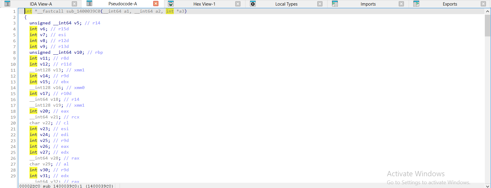

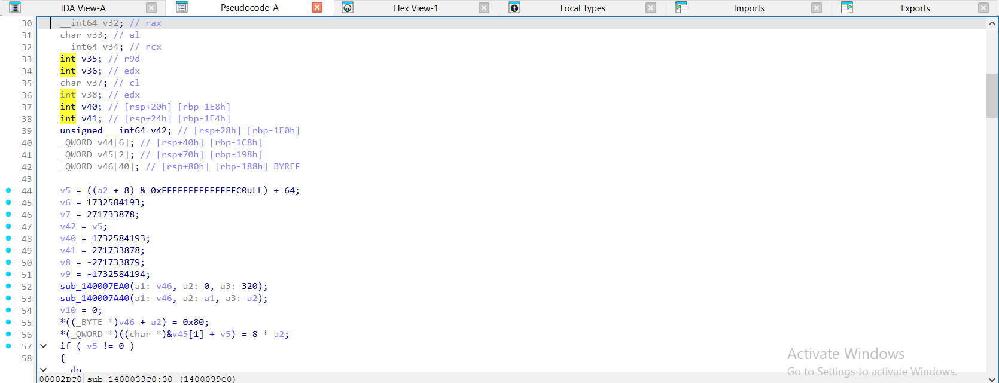

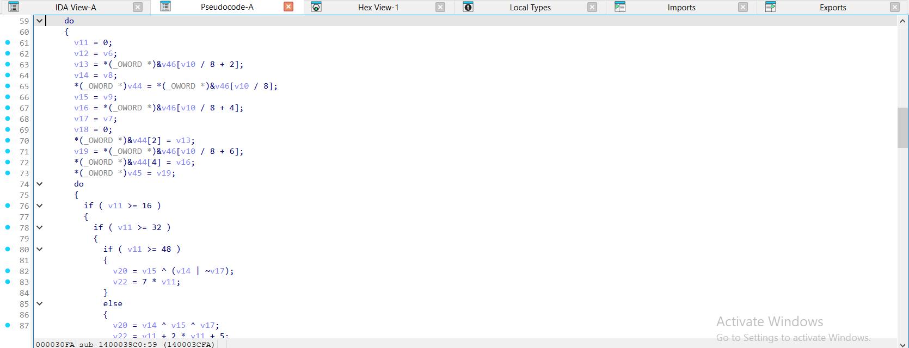

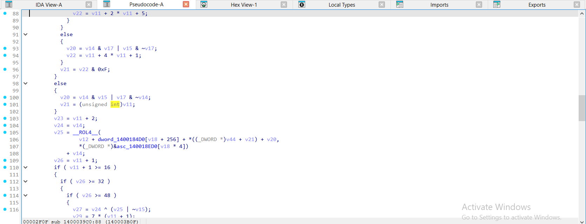

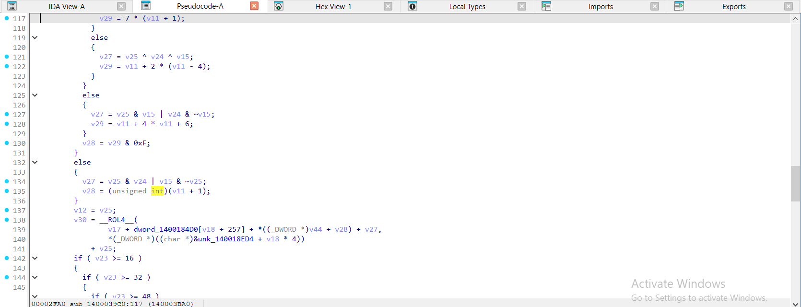

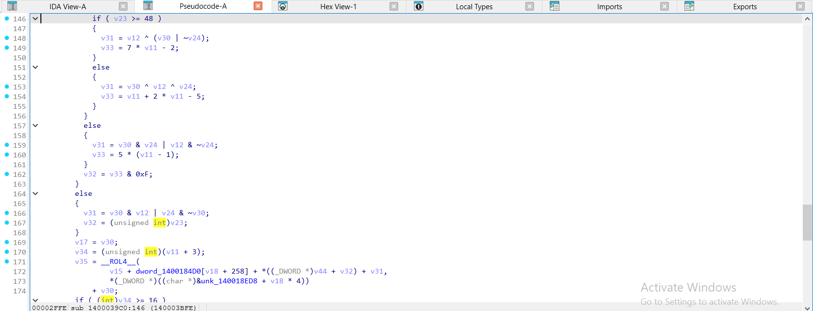

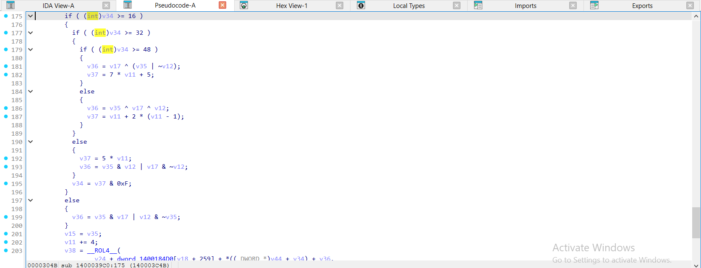

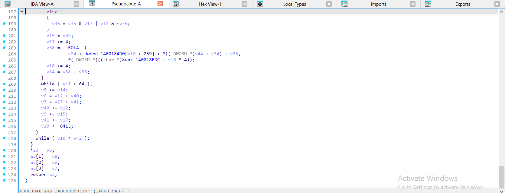

</details>

<details><summary>gcc -O2 – ELF, đã `strip -s` – md5_hash = <code>sub_40C0</code> – 3 ảnh</summary>

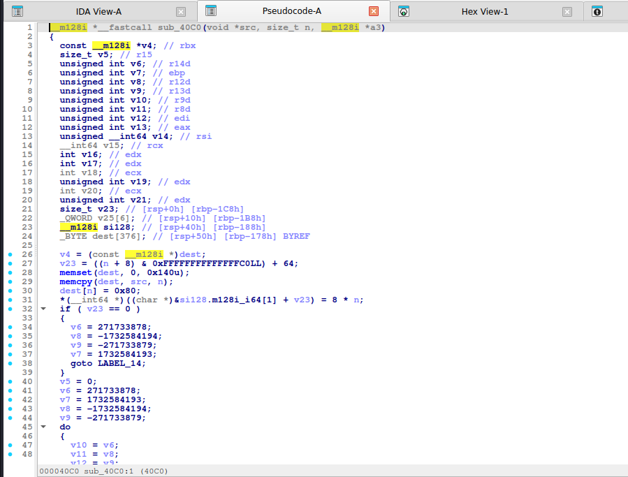

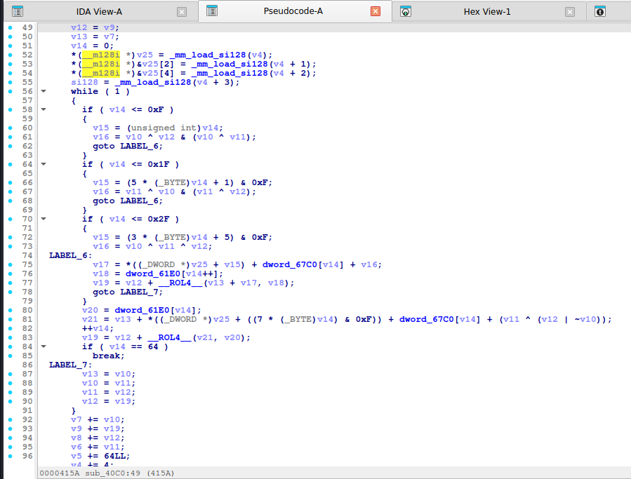

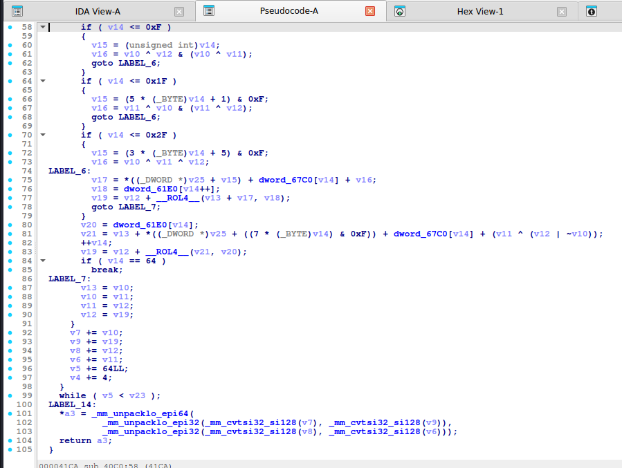

</details>

<details><summary>mingw-w64 -O2 -static – PE, đã `strip -s` – md5_hash = <code>sub_1400037A0</code> – 3 ảnh</summary>

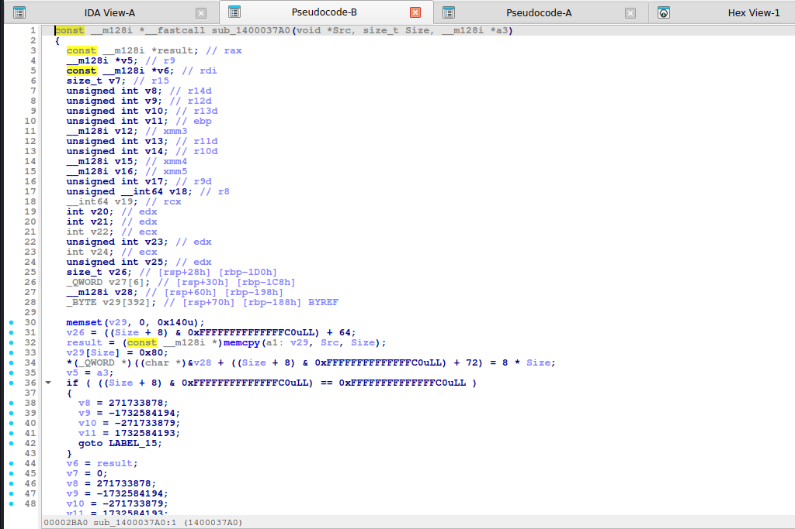

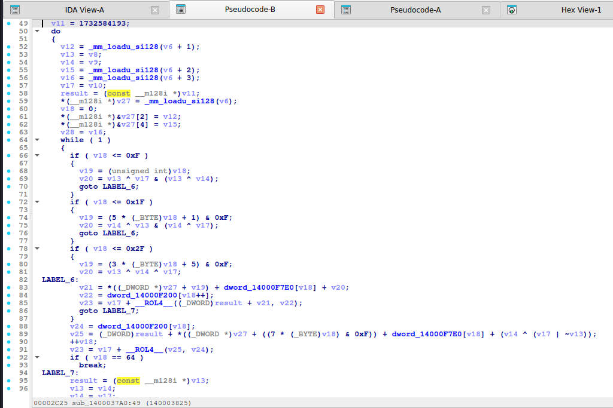

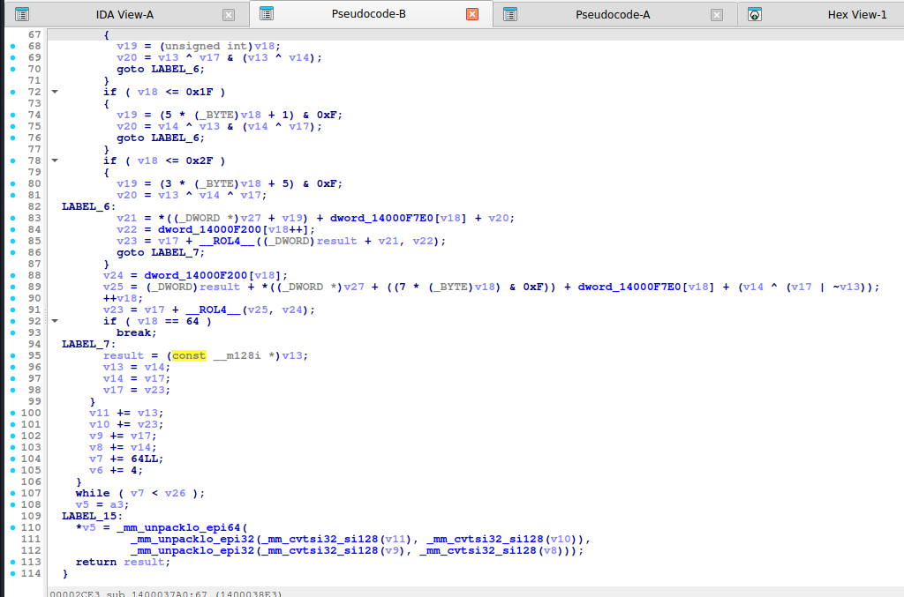

</details>

Nhận xét:

- **gcc (`-O0`, `-O2`), mingw và MSVC `/Od` giữ vòng 64 bước** (không bung) với hai bảng **mảng** `MD5_K[i]`, `R[i]` (gcc `-O2`: `MD5_K[v14]`, `R_1[v14]`). Nhận biết nhờ 4 nhánh theo dải chỉ số: gcc `if ( v14 <= 0xF ) … <= 0x1F … <= 0x2F`, MSVC `if ( i >= 16 ) … >= 32 … >= 48`.
- **MSVC `/O2` (cả bản có PDB lẫn bản strip) bung vòng 4 bước mỗi lần lặp**: khối `if ( v11 >= 16 ) … >= 32 … >= 48` lặp lại 4 lần với `v11`, `v11 + 1`, `v11 + 2`, `v11 + 3`; bảng K tra `MD5_K[v18]`, `MD5_K[v18 + 1]`, `[v18 + 2]`, `[v18 + 3]`, bảng xoay `R[v18 + k]`. Trong bản strip, các bảng đó là `dword_1400184D0[v18 + 256]`, `[v18 + 257]`… và `asc_140018ED0[v18 * 4]`. Lúc đó tổng 64 bước = 16 lần lặp × 4 bước: đừng bị đánh lừa bởi số lần lặp.
- Trong bản strip, `memset`/`memmove` (CRT liên kết tĩnh) hiện thành **`sub_XXXX(a1: buf, a2: 0, a3: 320)`**: nhận ra qua tham số (`0` + kích thước bộ đệm) chứ không có tên hàm.
- Biểu thức chỉ số `(3*i + 5) & 15` có thể hiện thành **`v11 + 2 * v11 + 5`** (MSVC `/O2`) và `(7*i) & 15` thành `7 * v11`; `F` của vòng 4 hiện `(~D | B) ^ C` hoặc `v15 ^ (v14 | ~v17)` – chú ý phép `~` kèm `|`.
- Nếu **gặp bản bung thật** (tác giả tự viết 64 phép liền nhau): mỗi bước là `a = b + __ROL4__(a + F + M[x] + 0xHẰNG, s)`, hằng K nằm ngay trong code. Khi đó đếm 64 bước và nhìn các lượng xoay 7/12/17/22.
- Độ dài/padding: `8 * n` lưu ở cuối bộ đệm, `0x80` sau dữ liệu (`buf[n] = 0x80`); `memset(.., 0, 320)` + `memcpy(.., msg, n)` ở đầu hàm (IDA 9 hiện `memmove(a1: buf, Val: 0, Size: …)`).

## 6. Code giải mã / khai thác

**Python:**

```python
import hashlib
import itertools
import string


def hash_bruteforce(target_hex, algo="md5", charset=string.ascii_lowercase + string.digits,
                    max_len=5, prefix=b"", suffix=b""):
    """Thu moi chuoi do dai 1..max_len. VD hash_bruteforce('...', 'sha256', max_len=4)."""
    target = bytes.fromhex(target_hex)
    for n in range(1, max_len + 1):
        for tup in itertools.product(charset, repeat=n):
            cand = prefix + "".join(tup).encode() + suffix
            if hashlib.new(algo, cand).digest() == target:
                return cand
    return None


def hash_wordlist(target_hex, words, algo="md5"):
    target = bytes.fromhex(target_hex)
    for w in words:
        w = w.encode() if isinstance(w, str) else w
        if hashlib.new(algo, w).digest() == target:
            return w
    return None
```

```python
import hashlib
hashlib.md5(b"Hello, CyberSeaGame!").hexdigest()     # e3d3275e87fc40c9d388dad07d33d0ba
hash_wordlist("e3d3275e87fc40c9d388dad07d33d0ba", ["admin", "Hello, CyberSeaGame!"], "md5")
```

## 7. Biến thể & bẫy

- **MD5 có salt/ lặp nhiều lần** (`md5(md5(x))`, `md5(salt + x)`): đọc hàm gọi.
- **MD4/ MD2**: cấu trúc tương tự nhưng khác hằng và số vòng.
- **Hằng bị sửa** (đề đổi IV hoặc một vài K để chặn tra cứu): hash "gần giống MD5" nhưng ra khác chuẩn → phải tự cài lại đúng bản trong binary để brute force.
- Mã nhận dạng nhanh: tìm hằng `0xD76AA478` hoặc `1732584193` trong Search → Immediate value.
