# SHA-1

> Hash 160-bit, khối 64 byte, 80 bước, **big-endian**. Dùng cùng 4 hằng khởi tạo với MD5 + hằng thứ 5.

## 1. Dấu hiệu nhận biết

- **5 hằng khởi tạo**: `0x67452301`, `0xEFCDAB89`, `0x98BADCFE`, `0x10325476`, **`0xC3D2E1F0`** (`-1009589776`). Có `0xC3D2E1F0` là SHA-1 (MD5 chỉ 4 hằng).
- **4 hằng vòng K**: `0x5A827999` (`1518500249`), `0x6ED9EBA1` (`1859775393`), `0x8F1BBCDC` (`-1894007588`), `0xCA62C1D6` (`-899497514`). Mỗi hằng dùng cho 20 bước (`<= 0x13`, `<= 0x27`, `<= 0x3B`, rồi còn lại).
- **Mở rộng thông điệp**: mảng `w[80]`; `w[i] = ROL1(w[i-3] ^ w[i-8] ^ w[i-14] ^ w[i-16])` với `i = 16..79` (IDA: `__ROL4__(..., 1)` hoặc `(x << 1) | (x >> 31)`).
- Vòng chính: `tmp = ROL5(a) + f + e + k + w[i]; e = d; d = c; c = ROL30(b); b = a; a = tmp`. IDA hiện **`__ROR4__(b, 2)`** (ROL 30 = ROR 2) và **`__ROL4__(a, 5)`**.
- Hàm f theo 4 dải: Ch `(b & c) | (~b & d)`, Parity `b ^ c ^ d`, Maj `(b & c) | (b & d) | (c & d)`, Parity.
- **Big-endian**: đọc từ thông điệp bằng `<< 24 | << 16 | << 8` hoặc `_byteswap_ulong`/`bswap`; ghi output cũng đảo byte.
- Padding: `0x80`, độ dài bit **big-endian 8 byte** ở cuối.

## 2. Thuật toán (mã giả)

```
h = [0x67452301, 0xEFCDAB89, 0x98BADCFE, 0x10325476, 0xC3D2E1F0]
pad: 0x80 ... + len_bits (8 byte BE)
for mỗi khối: w[0..15] = BE words; w[16..79] = rol1(w[i-3]^w[i-8]^w[i-14]^w[i-16])
    a,b,c,d,e = h
    for i in 0..79:
        i<20:  f=(b&c)|(~b&d); k=0x5A827999
        i<40:  f=b^c^d;        k=0x6ED9EBA1
        i<60:  f=(b&c)|(b&d)|(c&d); k=0x8F1BBCDC
        else:  f=b^c^d;        k=0xCA62C1D6
        t = rol(a,5)+f+e+k+w[i]; e=d; d=c; c=rol(b,30); b=a; a=t
    h += (a,b,c,d,e)
digest = h[0..4] big-endian
```

## 3. Mã hóa / giải mã

Không đảo ngược. Như MD5: tra bảng/ brute force có cấu trúc, hoặc sinh key. Lưu ý SHA-1 đã bị **collision (SHAttered)** nhưng chuyện đó ít liên quan check flag.

## 4. Mã nguồn gốc (C)

```c
void sha1_hash(const uint8_t *msg, size_t n, uint8_t out[20])
{
    uint8_t buf[320];
    uint32_t h0 = 0x67452301, h1 = 0xEFCDAB89, h2 = 0x98BADCFE, h3 = 0x10325476, h4 = 0xC3D2E1F0;
    size_t total = ((n + 8) / 64 + 1) * 64;
    uint64_t bits = (uint64_t)n * 8;
    memset(buf, 0, sizeof(buf));
    memcpy(buf, msg, n);
    buf[n] = 0x80;
    for (int i = 0; i < 8; i++) buf[total - 1 - i] = (uint8_t)(bits >> (8 * i));
    for (size_t off = 0; off < total; off += 64) {
        uint32_t w[80];
        for (int i = 0; i < 16; i++)
            w[i] = ((uint32_t)buf[off + 4 * i] << 24) | ((uint32_t)buf[off + 4 * i + 1] << 16) |
                   ((uint32_t)buf[off + 4 * i + 2] << 8) | buf[off + 4 * i + 3];
        for (int i = 16; i < 80; i++) w[i] = ROL32(w[i - 3] ^ w[i - 8] ^ w[i - 14] ^ w[i - 16], 1);
        uint32_t a = h0, b = h1, c = h2, d = h3, e = h4;
        for (int i = 0; i < 80; i++) {
            uint32_t f, k;
            if (i < 20)      { f = (b & c) | (~b & d);          k = 0x5A827999; }
            else if (i < 40) { f = b ^ c ^ d;                   k = 0x6ED9EBA1; }
            else if (i < 60) { f = (b & c) | (b & d) | (c & d); k = 0x8F1BBCDC; }
            else             { f = b ^ c ^ d;                   k = 0xCA62C1D6; }
            uint32_t tmp = ROL32(a, 5) + f + e + k + w[i];
            e = d; d = c; c = ROL32(b, 30); b = a; a = tmp;
        }
        h0 += a; h1 += b; h2 += c; h3 += d; h4 += e;
    }
    uint32_t h[5] = {h0, h1, h2, h3, h4};
    for (int i = 0; i < 5; i++) {
        out[4 * i] = (uint8_t)(h[i] >> 24); out[4 * i + 1] = (uint8_t)(h[i] >> 16);
        out[4 * i + 2] = (uint8_t)(h[i] >> 8); out[4 * i + 3] = (uint8_t)h[i];
    }
}
```

## 5. Pseudo-code IDA thực tế

<details><summary>MSVC /O2 - PE x64 (có PDB)</summary>

```c
void __fastcall sha1_hash(const unsigned __int8 *msg, size_t n, unsigned __int8 *out)
{
  unsigned __int8 *v3; // r14
  size_t v5; // rsi
  int v7; // r15d
  int v8; // r12d
  int v9; // r13d
  size_t v10; // rdx
  int v11; // r14d
  int v12; // eax
  int v13; // ecx
  int v14; // eax
  int v15; // ecx
  int v16; // eax
  int v17; // ecx
  int v18; // eax
  int v19; // ecx
  int v20; // eax
  int v21; // ecx
  int v22; // eax
  int v23; // ecx
  int v24; // eax
  int v25; // ecx
  int v26; // eax
  int v27; // ecx
  int v28; // eax
  int v29; // ecx
  int v30; // eax
  int v31; // ecx
  int v32; // eax
  int v33; // ecx
  int v34; // eax
  int v35; // ecx
  int v36; // eax
  int v37; // ecx
  int v38; // eax
  unsigned int *v39; // rdi
  int v40; // ecx
  __int64 v41; // rsi
  int v42; // eax
  int v43; // edx
  unsigned int v44; // edx
  unsigned int v45; // ecx
  unsigned int v46; // r9d
  int v47; // r9d
  unsigned int v48; // r8d
  int v49; // r8d
  unsigned int v50; // eax
  int v51; // ebx
  int v52; // edi
  int v53; // r8d
  int v54; // edx
  int v55; // r10d
  __int64 v56; // r9
  int v57; // r11d
  int v58; // eax
  unsigned int v59; // ecx
  int v60; // ecx
  int v61; // esi
  int v62; // [rsp+20h] [rbp-E0h]
  int v63; // [rsp+24h] [rbp-DCh]
  size_t v64; // [rsp+28h] [rbp-D8h]
  size_t v65; // [rsp+30h] [rbp-D0h]
  unsigned int w[80]; // [rsp+40h] [rbp-C0h] BYREF
  unsigned __int8 buf[320]; // [rsp+180h] [rbp+80h] BYREF

  v63 = 271733878;
  v62 = -1009589776;
  v3 = out;
  v65 = ((n + 8) & 0xFFFFFFFFFFFFFFC0uLL) + 64;
  v5 = 8 * n;
  v7 = 1732584193;
  v8 = -271733879;
  v9 = -1732584194;
  memset(a1: buf, Val: 0, Size: sizeof(buf));
  memmove(a1: buf, Src: msg, Size: n);
  v10 = 0;
  buf[n] = 0x80;
  v64 = 0;
  *((_BYTE *)&w[79] + v65 + 3) = v5;
  *((_BYTE *)&w[79] + v65 + 2) = BYTE1(v5);
  *((_BYTE *)&w[79] + v65 + 1) = BYTE2(v5);
  *((_BYTE *)&w[79] + v65) = BYTE3(v5);
  *((_BYTE *)&w[78] + v65 + 3) = BYTE4(v5);
  *((_BYTE *)&w[78] + v65 + 2) = BYTE5(v5);
  *((_BYTE *)&w[78] + v65 + 1) = BYTE6(v5);
  *((_BYTE *)&w[78] + v65) = HIBYTE(v5);
  if ( v65 == 0 )
  {
    v61 = -1009589776;
    goto LABEL_18;
  }
  v11 = 271733878;
  do
  {
    v12 = buf[v10 + 5];
    w[0] = buf[v10 + 3] | ((buf[v10 + 2] | ((buf[v10 + 1] | (buf[v10] << 8)) << 8)) << 8);
    v13 = buf[v10 + 7] | ((buf[v10 + 6] | ((v12 | (buf[v10 + 4] << 8)) << 8)) << 8);
    v14 = buf[v10 + 9];
    w[1] = v13;
    v15 = buf[v10 + 11] | ((buf[v10 + 10] | ((v14 | (buf[v10 + 8] << 8)) << 8)) << 8);
    v16 = buf[v10 + 13];
    w[2] = v15;
    v17 = buf[v10 + 15] | ((buf[v10 + 14] | ((v16 | (buf[v10 + 12] << 8)) << 8)) << 8);
    v18 = buf[v10 + 17];
    w[3] = v17;
    v19 = buf[v10 + 19] | ((buf[v10 + 18] | ((v18 | (buf[v10 + 16] << 8)) << 8)) << 8);
    v20 = buf[v10 + 21];
    w[4] = v19;
    v21 = buf[v10 + 23] | ((buf[v10 + 22] | ((v20 | (buf[v10 + 20] << 8)) << 8)) << 8);
    v22 = buf[v10 + 25];
    w[5] = v21;
    v23 = buf[v10 + 27] | ((buf[v10 + 26] | ((v22 | (buf[v10 + 24] << 8)) << 8)) << 8);
    v24 = buf[v10 + 29];
    w[6] = v23;
    v25 = buf[v10 + 31] | ((buf[v10 + 30] | ((v24 | (buf[v10 + 28] << 8)) << 8)) << 8);
    v26 = buf[v10 + 33];
    w[7] = v25;
    v27 = buf[v10 + 35] | ((buf[v10 + 34] | ((v26 | (buf[v10 + 32] << 8)) << 8)) << 8);
    v28 = buf[v10 + 37];
    w[8] = v27;
    v29 = buf[v10 + 39] | ((buf[v10 + 38] | ((v28 | (buf[v10 + 36] << 8)) << 8)) << 8);
    v30 = buf[v10 + 41];
    w[9] = v29;
    v31 = buf[v10 + 43] | ((buf[v10 + 42] | ((v30 | (buf[v10 + 40] << 8)) << 8)) << 8);
    v32 = buf[v10 + 45];
    w[10] = v31;
    v33 = buf[v10 + 47] | ((buf[v10 + 46] | ((v32 | (buf[v10 + 44] << 8)) << 8)) << 8);
    v34 = buf[v10 + 49];
    w[11] = v33;
    v35 = buf[v10 + 51] | ((buf[v10 + 50] | ((v34 | (buf[v10 + 48] << 8)) << 8)) << 8);
    v36 = buf[v10 + 53];
    w[12] = v35;
    v37 = buf[v10 + 55] | ((buf[v10 + 54] | ((v36 | (buf[v10 + 52] << 8)) << 8)) << 8);
    v38 = buf[v10 + 57];
    w[13] = v37;
    v39 = &w[2];
    v40 = buf[v10 + 59] | ((buf[v10 + 58] | ((v38 | (buf[v10 + 56] << 8)) << 8)) << 8);
    v41 = 8;
    v42 = buf[v10 + 61];
    w[14] = v40;
    w[15] = buf[v10 + 63] | ((buf[v10 + 62] | ((v42 | (buf[v10 + 60] << 8)) << 8)) << 8);
    do
    {
      v43 = *v39 ^ v39[6] ^ v39[11] ^ *(v39 - 2);
      v39 += 8;
      v44 = __ROL4__(v43, 1);
      v39[6] = v44;
      v45 = __ROL4__(*(v39 - 1) ^ *(v39 - 7) ^ v39[4] ^ *(v39 - 9), 1);
      v39[7] = v45;
      v46 = __ROL4__(*(v39 - 6) ^ v39[5] ^ *(v39 - 8) ^ *v39, 1);
      v39[8] = v46;
      v47 = v39[3] ^ v46;
      v48 = __ROL4__(*(v39 - 5) ^ *(v39 - 7) ^ v44 ^ v39[1], 1);
      v39[9] = v48;
      v49 = *(v39 - 2) ^ v48;
      v50 = __ROL4__(*(v39 - 6) ^ *(v39 - 4) ^ v45 ^ v39[2], 1);
      v39[10] = v50;
      v39[11] = __ROL4__(*(v39 - 5) ^ *(v39 - 3) ^ v47, 1);
      v39[12] = __ROL4__(v39[4] ^ *(v39 - 4) ^ v49, 1);
      v39[13] = __ROL4__(v39[5] ^ *(v39 - 1) ^ *(v39 - 3) ^ v50, 1);
      --v41;
    }
    while ( v41 != 0 );
    v51 = v7;
    v52 = v62;
    v53 = v8;
    v54 = v9;
    v55 = v11;
    v56 = 0;
    do
    {
      if ( v56 < 20 )
      {
        v57 = 1518500249;
        v58 = v53 & v54 | v55 & ~v53;
        goto LABEL_14;
      }
      if ( v56 >= 40 )
      {
        if ( v56 < 60 )
        {
          v57 = -1894007588;
          v58 = v53 & v54 | v55 & (v53 | v54);
          goto LABEL_14;
        }
        v57 = -899497514;
      }
      else
      {
        v57 = 1859775393;
      }
      v58 = v53 ^ v54 ^ v55;
LABEL_14:
      v59 = w[v56++] + __ROL4__(v51, 5);
      v60 = v52 + v58 + v57 + v59;
      v52 = v55;
      v55 = v54;
      v54 = __ROR4__(v53, 2);
      v53 = v51;
      v51 = v60;
    }
    while ( v56 < 80 );
    v9 += v54;
    v61 = v52 + v62;
    v7 += v60;
    v10 = v64 + 64;
    v62 += v52;
    v8 += v53;
    v64 = v10;
    v11 += v55;
  }
  while ( v10 < v65 );
  v63 = v11;
  v3 = out;
LABEL_18:
  *v3 = HIBYTE(v7);
  v3[1] = BYTE2(v7);
  v3[2] = BYTE1(v7);
  v3[4] = HIBYTE(v8);
  v3[5] = BYTE2(v8);
  v3[6] = BYTE1(v8);
  v3[8] = HIBYTE(v9);
  v3[9] = BYTE2(v9);
  v3[10] = BYTE1(v9);
  v3[12] = HIBYTE(v63);
  v3[13] = BYTE2(v63);
  v3[14] = BYTE1(v63);
  v3[16] = HIBYTE(v61);
  v3[17] = BYTE2(v61);
  v3[18] = BYTE1(v61);
  v3[3] = v7;
  v3[7] = v8;
  v3[11] = v9;
  v3[15] = v63;
  v3[19] = v61;
}
```

</details>

<details><summary>MSVC /Od - PE x64 (có PDB)</summary>

```c
void __fastcall sha1_hash(const unsigned __int8 *msg, size_t n, unsigned __int8 *out)
{
  int m; // [rsp+20h] [rbp-318h]
  int jj; // [rsp+24h] [rbp-314h]
  unsigned int b; // [rsp+28h] [rbp-310h]
  int j; // [rsp+2Ch] [rbp-30Ch]
  unsigned int c; // [rsp+30h] [rbp-308h]
  unsigned int d; // [rsp+34h] [rbp-304h]
  int ii; // [rsp+38h] [rbp-300h]
  int i; // [rsp+3Ch] [rbp-2FCh]
  unsigned int a; // [rsp+40h] [rbp-2F8h]
  unsigned int f; // [rsp+44h] [rbp-2F4h]
  unsigned int k; // [rsp+48h] [rbp-2F0h]
  _BYTE h0[20]; // [rsp+4Ch] [rbp-2ECh]
  unsigned int e; // [rsp+60h] [rbp-2D8h]
  unsigned __int64 off; // [rsp+68h] [rbp-2D0h]
  unsigned int tmp; // [rsp+70h] [rbp-2C8h]
  unsigned __int64 total; // [rsp+78h] [rbp-2C0h]
  unsigned __int64 bits; // [rsp+80h] [rbp-2B8h]
  unsigned int h[6]; // [rsp+88h] [rbp-2B0h]
  unsigned int w[80]; // [rsp+A0h] [rbp-298h]
  unsigned __int8 buf[320]; // [rsp+1E0h] [rbp-158h] BYREF

  *(_DWORD *)h0 = 1732584193;
  *(_DWORD *)&h0[4] = -271733879;
  *(_DWORD *)&h0[8] = -1732584194;
  *(_DWORD *)&h0[12] = 271733878;
  *(_DWORD *)&h0[16] = -1009589776;
  total = ((n + 8) / 0x40 + 1) << 6;
  bits = 8 * n;
  memset(a1: buf, Val: 0, Size: sizeof(buf));
  memmove(a1: buf, Src: msg, Size: n);
  buf[n] = 0x80;
  for ( i = 0; i < 8; ++i )
    buf[total - 1 - i] = bits >> (8 * (unsigned __int8)i);
  for ( off = 0; off < total; off += 64LL )
  {
    for ( j = 0; j < 16; ++j )
      w[j] = buf[4 * j + 3 + off]
           | (buf[4 * j + 2 + off] << 8)
           | (buf[4 * j + 1 + off] << 16)
           | (buf[4 * j + off] << 24);
    for ( m = 16; m < 80; ++m )
      w[m] = ((w[m - 16] ^ w[m - 14] ^ w[m - 8] ^ w[m - 3]) >> 31) | (2 * (w[m - 16] ^ w[m - 14] ^ w[m - 8] ^ w[m - 3]));
    a = *(_DWORD *)h0;
    b = *(_DWORD *)&h0[4];
    c = *(_DWORD *)&h0[8];
    d = *(_DWORD *)&h0[12];
    e = *(_DWORD *)&h0[16];
    for ( ii = 0; ii < 80; ++ii )
    {
      if ( ii >= 20 )
      {
        if ( ii >= 40 )
        {
          if ( ii >= 60 )
          {
            f = d ^ c ^ b;
            k = -899497514;
          }
          else
          {
            f = d & c | d & b | c & b;
            k = -1894007588;
          }
        }
        else
        {
          f = d ^ c ^ b;
          k = 1859775393;
        }
      }
      else
      {
        f = d & ~b | c & b;
        k = 1518500249;
      }
      tmp = w[ii] + k + e + f + ((a >> 27) | (32 * a));
      e = d;
      d = c;
      c = (b >> 2) | (b << 30);
      b = a;
      a = tmp;
    }
    *(_DWORD *)h0 += a;
    *(_DWORD *)&h0[4] += b;
    *(_DWORD *)&h0[8] += c;
    *(_DWORD *)&h0[12] += d;
    *(_DWORD *)&h0[16] += e;
  }
  qmemcpy(h, h0, 20);
  for ( jj = 0; jj < 5; ++jj )
  {
    out[4 * jj] = HIBYTE(h[jj]);
    out[4 * jj + 1] = BYTE2(h[jj]);
    out[4 * jj + 2] = BYTE1(h[jj]);
    out[4 * jj + 3] = h[jj];
  }
}
```

</details>

<details><summary>gcc -O2 - ELF x86-64 (chưa strip)</summary>

```c
__int64 __fastcall sha1_hash(void *src, size_t n, __int64 a3)
{
  size_t v4; // rbp
  size_t v5; // rbx
  const __m128i *v6; // rax
  int v7; // ecx
  const __m128i *v8; // r11
  const __m128i *v9; // rbx
  size_t v10; // rax
  __int32 v11; // r15d
  int v12; // ebp
  int v13; // r12d
  int v14; // r13d
  int v15; // r14d
  __m128i *v16; // rbx
  __int64 v17; // rsi
  __m128i v18; // xmm5
  __m128i si128; // xmm10
  const __m128i *v20; // rax
  __m128i v21; // xmm8
  __m128i v22; // xmm2
  __m128i v23; // xmm0
  __m128i v24; // xmm1
  __m128i v25; // xmm7
  __m128i v26; // xmm9
  __m128i v27; // xmm2
  __m128i v28; // xmm8
  __m128i v29; // xmm0
  __m128i v30; // xmm10
  __m128i v31; // xmm12
  __m128i v32; // xmm11
  __m128i v33; // xmm7
  __m128i v34; // xmm9
  __m128i v35; // xmm12
  __m128i v36; // xmm2
  __m128i v37; // xmm8
  __m128i v38; // xmm1
  __m128i v39; // xmm11
  __m128i v40; // xmm9
  __int64 v41; // rdx
  __m128i v42; // xmm3
  __m128i v43; // xmm0
  __m128i v44; // xmm2
  __int64 v45; // rcx
  __m128i v46; // xmm2
  __m128i v47; // xmm0
  __int32 v48; // r10d
  int v49; // edi
  int v50; // r8d
  int v51; // ecx
  int v52; // r9d
  unsigned __int64 v53; // rdx
  int v54; // r11d
  int v55; // esi
  int v56; // ecx
  __int32 v57; // eax
  int v58; // eax
  __int32 v59; // esi
  int v60; // eax
  __int64 result; // rax
  unsigned int v62; // edx
  unsigned __int64 v63; // [rsp+0h] [rbp-2D8h]
  __int64 v64; // [rsp+8h] [rbp-2D0h]
  const __m128i *v65; // [rsp+8h] [rbp-2D0h]
  unsigned __int64 v66; // [rsp+10h] [rbp-2C8h]
  _BYTE dest[320]; // [rsp+20h] [rbp-2B8h] BYREF
  __m128i v69; // [rsp+160h] [rbp-178h] BYREF
  __m128i v70; // [rsp+170h] [rbp-168h]
  __m128i v71; // [rsp+180h] [rbp-158h]
  __m128i v72; // [rsp+190h] [rbp-148h]
  char v73; // [rsp+1A0h] [rbp-138h] BYREF
  char v74; // [rsp+2A0h] [rbp-38h] BYREF

  v4 = 8 * n;
  v5 = (n + 8) >> 6;
  v64 = (v5 + 1) << 6;
  memset(dest, 0, sizeof(dest));
  v6 = (const __m128i *)memcpy(dest, src, n);
  dest[n] = 0x80;
  v7 = 0;
  v8 = v6;
  v9 = &v6[4 * v5];
  do
  {
    v9 = (const __m128i *)((char *)v9 - 1);
    v10 = v4 >> v7;
    v7 += 8;
    v9[4].m128i_i8[0] = v10;
  }
  while ( v7 != 64 );
  v11 = -1009589776;
  v12 = 271733878;
  v13 = -1732584194;
  v14 = -271733879;
  v15 = 1732584193;
  v16 = &v69;
  if ( v64 != 0 )
  {
    v63 = 0;
    v17 = v64;
    v18 = _mm_srli_epi16((__m128i)-1LL, 8u);
    do
    {
      si128 = _mm_load_si128(v8 + 1);
      v20 = (const __m128i *)&v73;
      v21 = _mm_load_si128(v8 + 3);
      v22 = _mm_load_si128(v8);
      v23 = _mm_load_si128(v8 + 2);
      v24 = _mm_packus_epi16(_mm_and_si128(v22, v18), _mm_and_si128(si128, v18));
      v42 = _mm_packus_epi16(_mm_and_si128(v23, v18), _mm_and_si128(v21, v18));
      v25 = _mm_packus_epi16(_mm_srli_epi16(v22, 8u), _mm_srli_epi16(si128, 8u));
      v26 = _mm_packus_epi16(_mm_srli_epi16(v23, 8u), _mm_srli_epi16(v21, 8u));
      v27 = _mm_packus_epi16(_mm_and_si128(v25, v18), _mm_and_si128(v26, v18));
      v28 = _mm_packus_epi16(_mm_and_si128(v18, v24), _mm_and_si128(v18, v42));
      v29 = _mm_unpacklo_epi8(v27, (__m128i)0LL);
      v30 = _mm_unpacklo_epi8(v28, (__m128i)0LL);
      v31 = _mm_packus_epi16(_mm_srli_epi16(v24, 8u), _mm_srli_epi16(v42, 8u));
      v32 = _mm_unpackhi_epi8(v31, (__m128i)0LL);
      v33 = _mm_packus_epi16(_mm_srli_epi16(v25, 8u), _mm_srli_epi16(v26, 8u));
      v34 = _mm_unpacklo_epi8(v33, (__m128i)0LL);
      v35 = _mm_slli_epi16(_mm_unpacklo_epi8(v31, (__m128i)0LL), 8u);
      v36 = _mm_unpackhi_epi8(v27, (__m128i)0LL);
      v37 = _mm_unpackhi_epi8(v28, (__m128i)0LL);
      v69 = _mm_or_si128(
              _mm_or_si128(
                _mm_slli_epi32(_mm_unpacklo_epi16(v29, (__m128i)0LL), 0x10u),
                _mm_slli_epi32(_mm_unpacklo_epi16(v30, (__m128i)0LL), 0x18u)),
              _mm_or_si128(_mm_unpacklo_epi16(v34, (__m128i)0LL), _mm_unpacklo_epi16(v35, (__m128i)0LL)));
      v38 = _mm_srli_si128(v69, 8);
      v39 = _mm_slli_epi16(v32, 8u);
      v70 = _mm_or_si128(
              _mm_or_si128(
                _mm_slli_epi32(_mm_unpackhi_epi16(v29, (__m128i)0LL), 0x10u),
                _mm_slli_epi32(_mm_unpackhi_epi16(v30, (__m128i)0LL), 0x18u)),
              _mm_or_si128(_mm_unpackhi_epi16(v34, (__m128i)0LL), _mm_unpackhi_epi16(v35, (__m128i)0LL)));
      v40 = _mm_unpackhi_epi8(v33, (__m128i)0LL);
      v41 = v70.m128i_i64[0];
      v42.m128i_i64[0] = _mm_srli_si128(v70, 8).m128i_u64[0];
      v71 = _mm_or_si128(
              _mm_or_si128(
                _mm_slli_epi32(_mm_unpacklo_epi16(v36, (__m128i)0LL), 0x10u),
                _mm_slli_epi32(_mm_unpacklo_epi16(v37, (__m128i)0LL), 0x18u)),
              _mm_or_si128(_mm_unpacklo_epi16(v40, (__m128i)0LL), _mm_unpacklo_epi16(v39, (__m128i)0LL)));
      v72 = _mm_or_si128(
              _mm_or_si128(
                _mm_slli_epi32(_mm_unpackhi_epi16(v36, (__m128i)0LL), 0x10u),
                _mm_slli_epi32(_mm_unpackhi_epi16(v37, (__m128i)0LL), 0x18u)),
              _mm_or_si128(_mm_unpackhi_epi16(v40, (__m128i)0LL), _mm_unpackhi_epi16(v39, (__m128i)0LL)));
      do
      {
        v43 = _mm_loadl_epi64((const __m128i *)((char *)v20 - 12));
        v44 = _mm_loadl_epi64(v20 - 4);
        v45 = v42.m128i_i64[0];
        v20 = (const __m128i *)((char *)v20 + 8);
        v42 = _mm_loadl_epi64((const __m128i *)((char *)v20 - 40));
        v46 = _mm_xor_si128(v44, v38);
        v38 = (__m128i)(unsigned __int64)v41;
        v41 = v45;
        v47 = _mm_xor_si128(v46, _mm_xor_si128(v43, v42));
        v20[-1].m128i_i64[1] = _mm_or_si128(_mm_slli_epi32(v47, 1u), _mm_srli_epi32(v47, 0x1Fu)).m128i_u64[0];
      }
      while ( v20 != (const __m128i *)&v74 );
      v65 = v8;
      v48 = v11;
      v49 = v12;
      v50 = v13;
      v66 = v17;
      v51 = v14;
      v52 = v15;
      v53 = 0;
      while ( 1 )
      {
        if ( v53 <= 0x13 )
        {
          v54 = 1518500249;
          v55 = v49 ^ v51 & (v50 ^ v49);
          goto LABEL_9;
        }
        if ( v53 <= 0x27 )
        {
          v54 = 1859775393;
          v55 = v51 ^ v50 ^ v49;
LABEL_9:
          v56 = __ROR4__(v51, 2);
          v57 = v69.m128i_i32[v53++] + __ROL4__(v52, 5);
          v58 = v48 + v55 + v54 + v57;
          goto LABEL_10;
        }
        if ( v53 <= 0x3B )
        {
          v54 = -1894007588;
          v55 = v50 & v49 | v51 & (v50 | v49);
          goto LABEL_9;
        }
        v59 = v69.m128i_i32[v53++] + __ROL4__(v52, 5);
        v60 = v51 ^ v50 ^ v49;
        v56 = __ROR4__(v51, 2);
        v58 = v48 + v59 + v60 - 899497514;
        if ( v53 == 80 )
          break;
LABEL_10:
        v48 = v49;
        v49 = v50;
        v50 = v56;
        v51 = v52;
        v52 = v58;
      }
      v63 += 64LL;
      v15 += v58;
      v14 += v52;
      v17 = v66;
      v13 += v56;
      v12 += v50;
      v11 += v49;
      v8 = v65 + 4;
    }
    while ( v63 < v66 );
  }
  result = a3;
  v69.m128i_i64[0] = __PAIR64__(v14, v15);
  v69.m128i_i64[1] = __PAIR64__(v12, v13);
  v70.m128i_i32[0] = v11;
  do
  {
    v62 = v16->m128i_i32[0];
    result += 4;
    v16 = (__m128i *)((char *)v16 + 4);
    *(_DWORD *)(result - 4) = _byteswap_ulong(v62);
  }
  while ( a3 + 20 != result );
  return result;
}
```

</details>

<details><summary>gcc -O0 - ELF x86-64 (chưa strip)</summary>

```c
unsigned __int64 __fastcall sha1_hash(const void *a1, size_t a2, __int64 a3)
{
  unsigned __int64 result; // rax
  _DWORD v7[80]; // [rsp+20h] [rbp-310h]
  _DWORD v8[8]; // [rsp+160h] [rbp-1D0h]
  _BYTE s[332]; // [rsp+180h] [rbp-1B0h] BYREF
  int v10; // [rsp+2CCh] [rbp-64h]
  size_t v11; // [rsp+2D0h] [rbp-60h]
  size_t v12; // [rsp+2D8h] [rbp-58h]
  int jj; // [rsp+2E4h] [rbp-4Ch]
  int v14; // [rsp+2E8h] [rbp-48h]
  int v15; // [rsp+2ECh] [rbp-44h]
  int ii; // [rsp+2F0h] [rbp-40h]
  _DWORD v17[3]; // [rsp+2F4h] [rbp-3Ch]
  int v18; // [rsp+300h] [rbp-30h]
  int v19; // [rsp+304h] [rbp-2Ch]
  int m; // [rsp+308h] [rbp-28h]
  int k; // [rsp+30Ch] [rbp-24h]
  size_t j; // [rsp+310h] [rbp-20h]
  int i; // [rsp+318h] [rbp-18h]
  __int64 v24; // [rsp+31Ch] [rbp-14h]
  int v25; // [rsp+324h] [rbp-Ch]
  int v26; // [rsp+328h] [rbp-8h]
  int v27; // [rsp+32Ch] [rbp-4h]

  v27 = 1732584193;
  v26 = -271733879;
  v25 = -1732584194;
  v24 = 0x10325476C3D2E1F0LL;
  v12 = (((a2 + 8) >> 6) + 1) << 6;
  v11 = 8 * a2;
  memset(s, c: 0, n: 0x140u);
  memcpy(dest: s, src: a1, n: a2);
  s[a2] = 0x80;
  for ( i = 0; i <= 7; ++i )
    s[v12 - i - 1] = v11 >> (8 * (unsigned __int8)i);
  for ( j = 0; j < v12; j += 64LL )
  {
    for ( k = 0; k <= 15; ++k )
      v7[k] = (unsigned __int8)s[4 * k + 3 + j]
            | ((unsigned __int8)s[4 * k + 2 + j] << 8)
            | ((unsigned __int8)s[4 * k + 1 + j] << 16)
            | ((unsigned __int8)s[4 * k + j] << 24);
    for ( m = 16; m <= 79; ++m )
      v7[m] = __ROL4__(v7[m - 14] ^ v7[m - 8] ^ v7[m - 3] ^ v7[m - 16], 1);
    v19 = v27;
    v18 = v26;
    v17[2] = v25;
    *(_QWORD *)v17 = v24;
    for ( ii = 0; ii <= 79; ++ii )
    {
      if ( ii > 19 )
      {
        if ( ii > 39 )
        {
          if ( ii > 59 )
          {
            v15 = v17[1] ^ v17[2] ^ v18;
            v14 = -899497514;
          }
          else
          {
            v15 = v18 & (v17[1] | v17[2]) | v17[1] & v17[2];
            v14 = -1894007588;
          }
        }
        else
        {
          v15 = v17[1] ^ v17[2] ^ v18;
          v14 = 1859775393;
        }
      }
      else
      {
        v15 = v17[2] & v18 | v17[1] & ~v18;
        v14 = 1518500249;
      }
      v10 = v14 + v17[0] + v15 + __ROL4__(v19, 5) + v7[ii];
      v17[0] = v17[1];
      v17[1] = v17[2];
      v17[2] = __ROR4__(v18, 2);
      v18 = v19;
      v19 = v10;
    }
    v27 += v19;
    v26 += v18;
    v25 += v17[2];
    HIDWORD(v24) += v17[1];
    LODWORD(v24) = v17[0] + v24;
  }
  v8[0] = v27;
  v8[1] = v26;
  v8[2] = v25;
  v8[3] = HIDWORD(v24);
  result = (unsigned int)v24;
  v8[4] = v24;
  for ( jj = 0; jj <= 4; ++jj )
  {
    *(_BYTE *)(4 * jj + a3) = HIBYTE(v8[jj]);
    *(_BYTE *)(4 * jj + 1LL + a3) = BYTE2(v8[jj]);
    *(_BYTE *)(4 * jj + 2LL + a3) = BYTE1(v8[jj]);
    result = 4 * jj + 3LL + a3;
    *(_BYTE *)result = v8[jj];
  }
  return result;
}
```

</details>

<details><summary>mingw-w64 gcc -O2 - PE x64 (-static)</summary>

```c
__int64 __fastcall sha1_hash(void *Src, size_t Size, __int64 a3)
{
  const __m128i *v3; // rsi
  size_t v5; // rbp
  size_t v7; // rax
  size_t v8; // r12
  _BYTE *v9; // rbp
  int i; // ecx
  size_t v11; // rax
  __int32 v12; // r15d
  int v13; // ebp
  int v14; // r12d
  int v15; // r13d
  int v16; // r14d
  __m128i *v17; // rdi
  __int64 v18; // r8
  __m128i v19; // xmm5
  __m128i v20; // xmm10
  __int128 *v21; // rax
  __m128i v22; // xmm8
  __m128i v23; // xmm2
  __m128i v24; // xmm0
  __m128i v25; // xmm1
  __m128i v26; // xmm7
  __m128i v27; // xmm9
  __m128i v28; // xmm2
  __m128i v29; // xmm8
  __m128i v30; // xmm0
  __m128i v31; // xmm10
  __m128i v32; // xmm12
  __m128i v33; // xmm11
  __m128i v34; // xmm7
  __m128i v35; // xmm9
  __m128i v36; // xmm12
  __m128i v37; // xmm2
  __m128i v38; // xmm8
  __m128i v39; // xmm1
  __m128i v40; // xmm11
  __m128i v41; // xmm9
  __int64 v42; // rdx
  __m128i v43; // xmm3
  __m128i v44; // xmm0
  __m128i v45; // xmm2
  __int64 v46; // rcx
  __m128i v47; // xmm2
  __m128i v48; // xmm0
  __int32 v49; // ebx
  int v50; // r9d
  int v51; // r10d
  int v52; // ecx
  int v53; // r11d
  unsigned __int64 v54; // rdx
  int v55; // r14d
  int v56; // esi
  int v57; // ecx
  __int32 v58; // eax
  int v59; // eax
  __int32 v60; // esi
  int v61; // eax
  __int64 v62; // rdx
  unsigned int v63; // eax
  __int64 result; // rax
  size_t v65; // [rsp+20h] [rbp-368h]
  const __m128i *v66; // [rsp+28h] [rbp-360h]
  int v67; // [rsp+34h] [rbp-354h]
  size_t v68; // [rsp+38h] [rbp-350h]
  _BYTE v69[320]; // [rsp+40h] [rbp-348h] BYREF
  __m128i v70; // [rsp+180h] [rbp-208h] BYREF
  __m128i v71; // [rsp+190h] [rbp-1F8h]
  __m128i v72; // [rsp+1A0h] [rbp-1E8h]
  __m128i v73; // [rsp+1B0h] [rbp-1D8h]
  char v74; // [rsp+1C0h] [rbp-1C8h] BYREF
  __int128 v75; // [rsp+2C0h] [rbp-C8h] BYREF

  v3 = (const __m128i *)v69;
  v5 = (Size + 8) >> 6;
  v7 = v5 + 1;
  v8 = 8 * Size;
  v9 = &v69[64 * v5];
  v68 = v7 << 6;
  memset(v69, 0, sizeof(v69));
  memcpy_0(a1: v69, Src, Size);
  v69[Size] = 0x80;
  for ( i = 0; i != 64; i += 8 )
  {
    --v9;
    v11 = v8 >> i;
    v9[64] = v11;
  }
  v12 = -1009589776;
  v13 = 271733878;
  v14 = -1732584194;
  v15 = -271733879;
  v16 = 1732584193;
  v17 = &v70;
  if ( v68 != 0 )
  {
    v18 = a3;
    v65 = 0;
    v19 = _mm_srli_epi16((__m128i)-1LL, 8u);
    while ( 1 )
    {
      v20 = _mm_loadu_si128(v3 + 1);
      v21 = (__int128 *)&v74;
      v22 = _mm_loadu_si128(v3 + 3);
      v23 = _mm_loadu_si128(v3);
      v24 = _mm_loadu_si128(v3 + 2);
      v25 = _mm_packus_epi16(_mm_and_si128(v23, v19), _mm_and_si128(v20, v19));
      v43 = _mm_packus_epi16(_mm_and_si128(v24, v19), _mm_and_si128(v22, v19));
      v26 = _mm_packus_epi16(_mm_srli_epi16(v23, 8u), _mm_srli_epi16(v20, 8u));
      v27 = _mm_packus_epi16(_mm_srli_epi16(v24, 8u), _mm_srli_epi16(v22, 8u));
      v28 = _mm_packus_epi16(_mm_and_si128(v26, v19), _mm_and_si128(v27, v19));
      v29 = _mm_packus_epi16(_mm_and_si128(v19, v25), _mm_and_si128(v19, v43));
      v30 = _mm_unpacklo_epi8(v28, (__m128i)0LL);
      v31 = _mm_unpacklo_epi8(v29, (__m128i)0LL);
      v32 = _mm_packus_epi16(_mm_srli_epi16(v25, 8u), _mm_srli_epi16(v43, 8u));
      v33 = _mm_unpackhi_epi8(v32, (__m128i)0LL);
      v34 = _mm_packus_epi16(_mm_srli_epi16(v26, 8u), _mm_srli_epi16(v27, 8u));
      v35 = _mm_unpacklo_epi8(v34, (__m128i)0LL);
      v36 = _mm_slli_epi16(_mm_unpacklo_epi8(v32, (__m128i)0LL), 8u);
      v37 = _mm_unpackhi_epi8(v28, (__m128i)0LL);
      v38 = _mm_unpackhi_epi8(v29, (__m128i)0LL);
      v70 = _mm_or_si128(
              _mm_or_si128(
                _mm_slli_epi32(_mm_unpacklo_epi16(v30, (__m128i)0LL), 0x10u),
                _mm_slli_epi32(_mm_unpacklo_epi16(v31, (__m128i)0LL), 0x18u)),
              _mm_or_si128(_mm_unpacklo_epi16(v35, (__m128i)0LL), _mm_unpacklo_epi16(v36, (__m128i)0LL)));
      v39 = _mm_srli_si128(v70, 8);
      v40 = _mm_slli_epi16(v33, 8u);
      v71 = _mm_or_si128(
              _mm_or_si128(
                _mm_slli_epi32(_mm_unpackhi_epi16(v30, (__m128i)0LL), 0x10u),
                _mm_slli_epi32(_mm_unpackhi_epi16(v31, (__m128i)0LL), 0x18u)),
              _mm_or_si128(_mm_unpackhi_epi16(v35, (__m128i)0LL), _mm_unpackhi_epi16(v36, (__m128i)0LL)));
      v41 = _mm_unpackhi_epi8(v34, (__m128i)0LL);
      v42 = v71.m128i_i64[0];
      v43.m128i_i64[0] = _mm_srli_si128(v71, 8).m128i_u64[0];
      v72 = _mm_or_si128(
              _mm_or_si128(
                _mm_slli_epi32(_mm_unpacklo_epi16(v37, (__m128i)0LL), 0x10u),
                _mm_slli_epi32(_mm_unpacklo_epi16(v38, (__m128i)0LL), 0x18u)),
              _mm_or_si128(_mm_unpacklo_epi16(v41, (__m128i)0LL), _mm_unpacklo_epi16(v40, (__m128i)0LL)));
      v73 = _mm_or_si128(
              _mm_or_si128(
                _mm_slli_epi32(_mm_unpackhi_epi16(v37, (__m128i)0LL), 0x10u),
                _mm_slli_epi32(_mm_unpackhi_epi16(v38, (__m128i)0LL), 0x18u)),
              _mm_or_si128(_mm_unpackhi_epi16(v41, (__m128i)0LL), _mm_unpackhi_epi16(v40, (__m128i)0LL)));
      do
      {
        v44 = _mm_loadl_epi64((const __m128i *)((char *)v21 - 12));
        v45 = _mm_loadl_epi64((const __m128i *)v21 - 4);
        v46 = v43.m128i_i64[0];
        v21 = (__int128 *)((char *)v21 + 8);
        v43 = _mm_loadl_epi64((const __m128i *)((char *)v21 - 40));
        v47 = _mm_xor_si128(v45, v39);
        v39 = (__m128i)(unsigned __int64)v42;
        v42 = v46;
        v48 = _mm_xor_si128(v47, _mm_xor_si128(v44, v43));
        *((_QWORD *)v21 - 1) = _mm_or_si128(_mm_slli_epi32(v48, 1u), _mm_srli_epi32(v48, 0x1Fu)).m128i_u64[0];
      }
      while ( v21 != &v75 );
      v66 = v3;
      v49 = v12;
      v50 = v13;
      v51 = v14;
      v67 = v16;
      v52 = v15;
      v53 = v16;
      v54 = 0;
      while ( 1 )
      {
        if ( v54 <= 0x13 )
        {
          v55 = 1518500249;
          v56 = v50 ^ v52 & (v51 ^ v50);
          goto LABEL_9;
        }
        if ( v54 <= 0x27 )
        {
          v55 = 1859775393;
          v56 = v52 ^ v51 ^ v50;
LABEL_9:
          v57 = __ROR4__(v52, 2);
          v58 = v70.m128i_i32[v54++] + __ROL4__(v53, 5);
          v59 = v49 + v56 + v55 + v58;
          goto LABEL_10;
        }
        if ( v54 <= 0x3B )
        {
          v55 = -1894007588;
          v56 = v51 & v50 | v52 & (v51 | v50);
          goto LABEL_9;
        }
        v60 = v70.m128i_i32[v54++] + __ROL4__(v53, 5);
        v61 = v52 ^ v51 ^ v50;
        v57 = __ROR4__(v52, 2);
        v59 = v49 + v60 + v61 - 899497514;
        if ( v54 == 80 )
          break;
LABEL_10:
        v49 = v50;
        v50 = v51;
        v51 = v57;
        v52 = v53;
        v53 = v59;
      }
      v15 += v53;
      v14 += v57;
      v65 += 64LL;
      v13 += v51;
      v12 += v50;
      v16 = v59 + v67;
      v3 = v66 + 4;
      if ( v65 >= v68 )
      {
        a3 = v18;
        break;
      }
    }
  }
  v70.m128i_i64[0] = __PAIR64__(v15, v16);
  v62 = a3 + 20;
  v70.m128i_i64[1] = __PAIR64__(v13, v14);
  v71.m128i_i32[0] = v12;
  do
  {
    v63 = v17->m128i_i32[0];
    a3 += 4;
    v17 = (__m128i *)((char *)v17 + 4);
    result = _byteswap_ulong(v63);
    *(_DWORD *)(a3 - 4) = result;
  }
  while ( v62 != a3 );
  return result;
}
```

</details>

<details><summary>mingw-w64 gcc -O0 - PE x64 (-static)</summary>

```c
unsigned __int64 __fastcall sha1_hash(const void *a1, size_t a2, __int64 a3)
{
  unsigned __int64 result; // rax
  _DWORD v4[80]; // [rsp+20h] [rbp-60h]
  _DWORD v5[8]; // [rsp+160h] [rbp+E0h]
  _BYTE v6[332]; // [rsp+180h] [rbp+100h] BYREF
  int v7; // [rsp+2CCh] [rbp+24Ch]
  size_t v8; // [rsp+2D0h] [rbp+250h]
  size_t v9; // [rsp+2D8h] [rbp+258h]
  int ii; // [rsp+2E4h] [rbp+264h]
  int v11; // [rsp+2E8h] [rbp+268h]
  int v12; // [rsp+2ECh] [rbp+26Ch]
  int n; // [rsp+2F0h] [rbp+270h]
  _DWORD v14[3]; // [rsp+2F4h] [rbp+274h]
  int v15; // [rsp+300h] [rbp+280h]
  int v16; // [rsp+304h] [rbp+284h]
  int m; // [rsp+308h] [rbp+288h]
  int k; // [rsp+30Ch] [rbp+28Ch]
  size_t j; // [rsp+310h] [rbp+290h]
  int i; // [rsp+318h] [rbp+298h]
  __int64 v21; // [rsp+31Ch] [rbp+29Ch]
  int v22; // [rsp+324h] [rbp+2A4h]
  int v23; // [rsp+328h] [rbp+2A8h]
  int v24; // [rsp+32Ch] [rbp+2ACh]

  v24 = 1732584193;
  v23 = -271733879;
  v22 = -1732584194;
  v21 = 0x10325476C3D2E1F0LL;
  v9 = (((a2 + 8) >> 6) + 1) << 6;
  v8 = 8 * a2;
  memset(a1: v6, Val: 0, Size: 0x140u);
  memcpy_0(a1: v6, Src: a1, Size: a2);
  v6[a2] = 0x80;
  for ( i = 0; i <= 7; ++i )
    v6[v9 - i - 1] = v8 >> (8 * (unsigned __int8)i);
  for ( j = 0; j < v9; j += 64LL )
  {
    for ( k = 0; k <= 15; ++k )
      v4[k] = (unsigned __int8)v6[4 * k + 3 + j]
            | ((unsigned __int8)v6[4 * k + 2 + j] << 8)
            | ((unsigned __int8)v6[4 * k + 1 + j] << 16)
            | ((unsigned __int8)v6[4 * k + j] << 24);
    for ( m = 16; m <= 79; ++m )
      v4[m] = __ROL4__(v4[m - 14] ^ v4[m - 8] ^ v4[m - 3] ^ v4[m - 16], 1);
    v16 = v24;
    v15 = v23;
    v14[2] = v22;
    *(_QWORD *)v14 = v21;
    for ( n = 0; n <= 79; ++n )
    {
      if ( n > 19 )
      {
        if ( n > 39 )
        {
          if ( n > 59 )
          {
            v12 = v14[1] ^ v14[2] ^ v15;
            v11 = -899497514;
          }
          else
          {
            v12 = v15 & (v14[1] | v14[2]) | v14[1] & v14[2];
            v11 = -1894007588;
          }
        }
        else
        {
          v12 = v14[1] ^ v14[2] ^ v15;
          v11 = 1859775393;
        }
      }
      else
      {
        v12 = v14[2] & v15 | v14[1] & ~v15;
        v11 = 1518500249;
      }
      v7 = v11 + v14[0] + v12 + __ROL4__(v16, 5) + v4[n];
      v14[0] = v14[1];
      v14[1] = v14[2];
      v14[2] = __ROR4__(v15, 2);
      v15 = v16;
      v16 = v7;
    }
    v24 += v16;
    v23 += v15;
    v22 += v14[2];
    HIDWORD(v21) += v14[1];
    LODWORD(v21) = v14[0] + v21;
  }
  v5[0] = v24;
  v5[1] = v23;
  v5[2] = v22;
  v5[3] = HIDWORD(v21);
  result = (unsigned int)v21;
  v5[4] = v21;
  for ( ii = 0; ii <= 4; ++ii )
  {
    *(_BYTE *)(4 * ii + a3) = HIBYTE(v5[ii]);
    *(_BYTE *)(4 * ii + 1LL + a3) = BYTE2(v5[ii]);
    *(_BYTE *)(4 * ii + 2LL + a3) = BYTE1(v5[ii]);
    result = 4 * ii + 3LL + a3;
    *(_BYTE *)result = v5[ii];
  }
  return result;
}
```

</details>

**Bản strip (không symbol)** – IDA chỉ thấy `sub_XXXX`, `a1`, `a2`, `byte_XXXX`; hàm này tên là MSVC /O2 → `sub_140004720`, gcc -O2 → `sub_42B0`, mingw-w64 -O2 -static → `sub_1400039B0`:

<details><summary>MSVC /O2 – PE x64, không PDB (strip) – bản STRIP: <code>sha1_hash</code> = <code>sub_140004720</code></summary>

```c
__int64 __fastcall sub_140004720(__int64 a1, __int64 a2, _BYTE *a3)
{
  _BYTE *v3; // r14
  __int64 v5; // rsi
  int v7; // r15d
  int v8; // r12d
  int v9; // r13d
  unsigned __int64 v10; // rdx
  int v11; // r14d
  int v12; // eax
  int v13; // ecx
  int v14; // eax
  int v15; // ecx
  int v16; // eax
  int v17; // ecx
  int v18; // eax
  int v19; // ecx
  int v20; // eax
  int v21; // ecx
  int v22; // eax
  int v23; // ecx
  int v24; // eax
  int v25; // ecx
  int v26; // eax
  int v27; // ecx
  int v28; // eax
  int v29; // ecx
  int v30; // eax
  int v31; // ecx
  int v32; // eax
  int v33; // ecx
  int v34; // eax
  int v35; // ecx
  int v36; // eax
  int v37; // ecx
  int v38; // eax
  _DWORD *v39; // rdi
  int v40; // ecx
  __int64 v41; // rsi
  int v42; // eax
  int v43; // edx
  int v44; // edx
  int v45; // ecx
  int v46; // r9d
  int v47; // r9d
  int v48; // r8d
  int v49; // r8d
  int v50; // eax
  int v51; // ebx
  int v52; // edi
  int v53; // r8d
  int v54; // edx
  int v55; // r10d
  __int64 v56; // r9
  int v57; // r11d
  int v58; // eax
  int v59; // ecx
  int v60; // ecx
  unsigned int v61; // esi
  int v63; // [rsp+20h] [rbp-E0h]
  int v64; // [rsp+24h] [rbp-DCh]
  unsigned __int64 v65; // [rsp+28h] [rbp-D8h]
  unsigned __int64 v66; // [rsp+30h] [rbp-D0h]
  _DWORD v68[2]; // [rsp+40h] [rbp-C0h]
  _DWORD v69[78]; // [rsp+48h] [rbp-B8h] BYREF
  _BYTE v70[320]; // [rsp+180h] [rbp+80h] BYREF

  v64 = 271733878;
  v63 = -1009589776;
  v3 = a3;
  v66 = ((a2 + 8) & 0xFFFFFFFFFFFFFFC0uLL) + 64;
  v5 = 8 * a2;
  v7 = 1732584193;
  v8 = -271733879;
  v9 = -1732584194;
  sub_140007EA0(a1: v70, a2: 0, a3: 320);
  sub_140007A40(a1: v70, a2: a1, a3: a2);
  v10 = 0;
  v70[a2] = 0x80;
  v65 = 0;
  *((_BYTE *)&v69[77] + v66 + 3) = v5;
  *((_BYTE *)&v69[77] + v66 + 2) = BYTE1(v5);
  *((_BYTE *)&v69[77] + v66 + 1) = BYTE2(v5);
  *((_BYTE *)&v69[77] + v66) = BYTE3(v5);
  *((_BYTE *)&v69[76] + v66 + 3) = BYTE4(v5);
  *((_BYTE *)&v69[76] + v66 + 2) = BYTE5(v5);
  *((_BYTE *)&v69[76] + v66 + 1) = BYTE6(v5);
  *((_BYTE *)&v69[76] + v66) = HIBYTE(v5);
  if ( v66 == 0 )
  {
    v61 = -1009589776;
    goto LABEL_18;
  }
  v11 = 271733878;
  do
  {
    v12 = (unsigned __int8)v70[v10 + 5];
    v68[0] = (unsigned __int8)v70[v10 + 3]
           | (((unsigned __int8)v70[v10 + 2] | (((unsigned __int8)v70[v10 + 1] | ((unsigned __int8)v70[v10] << 8)) << 8)) << 8);
    v13 = (unsigned __int8)v70[v10 + 7]
        | (((unsigned __int8)v70[v10 + 6] | ((v12 | ((unsigned __int8)v70[v10 + 4] << 8)) << 8)) << 8);
    v14 = (unsigned __int8)v70[v10 + 9];
    v68[1] = v13;
    v15 = (unsigned __int8)v70[v10 + 11]
        | (((unsigned __int8)v70[v10 + 10] | ((v14 | ((unsigned __int8)v70[v10 + 8] << 8)) << 8)) << 8);
    v16 = (unsigned __int8)v70[v10 + 13];
    v69[0] = v15;
    v17 = (unsigned __int8)v70[v10 + 15]
        | (((unsigned __int8)v70[v10 + 14] | ((v16 | ((unsigned __int8)v70[v10 + 12] << 8)) << 8)) << 8);
    v18 = (unsigned __int8)v70[v10 + 17];
    v69[1] = v17;
    v19 = (unsigned __int8)v70[v10 + 19]
        | (((unsigned __int8)v70[v10 + 18] | ((v18 | ((unsigned __int8)v70[v10 + 16] << 8)) << 8)) << 8);
    v20 = (unsigned __int8)v70[v10 + 21];
    v69[2] = v19;
    v21 = (unsigned __int8)v70[v10 + 23]
        | (((unsigned __int8)v70[v10 + 22] | ((v20 | ((unsigned __int8)v70[v10 + 20] << 8)) << 8)) << 8);
    v22 = (unsigned __int8)v70[v10 + 25];
    v69[3] = v21;
    v23 = (unsigned __int8)v70[v10 + 27]
        | (((unsigned __int8)v70[v10 + 26] | ((v22 | ((unsigned __int8)v70[v10 + 24] << 8)) << 8)) << 8);
    v24 = (unsigned __int8)v70[v10 + 29];
    v69[4] = v23;
    v25 = (unsigned __int8)v70[v10 + 31]
        | (((unsigned __int8)v70[v10 + 30] | ((v24 | ((unsigned __int8)v70[v10 + 28] << 8)) << 8)) << 8);
    v26 = (unsigned __int8)v70[v10 + 33];
    v69[5] = v25;
    v27 = (unsigned __int8)v70[v10 + 35]
        | (((unsigned __int8)v70[v10 + 34] | ((v26 | ((unsigned __int8)v70[v10 + 32] << 8)) << 8)) << 8);
    v28 = (unsigned __int8)v70[v10 + 37];
    v69[6] = v27;
    v29 = (unsigned __int8)v70[v10 + 39]
        | (((unsigned __int8)v70[v10 + 38] | ((v28 | ((unsigned __int8)v70[v10 + 36] << 8)) << 8)) << 8);
    v30 = (unsigned __int8)v70[v10 + 41];
    v69[7] = v29;
    v31 = (unsigned __int8)v70[v10 + 43]
        | (((unsigned __int8)v70[v10 + 42] | ((v30 | ((unsigned __int8)v70[v10 + 40] << 8)) << 8)) << 8);
    v32 = (unsigned __int8)v70[v10 + 45];
    v69[8] = v31;
    v33 = (unsigned __int8)v70[v10 + 47]
        | (((unsigned __int8)v70[v10 + 46] | ((v32 | ((unsigned __int8)v70[v10 + 44] << 8)) << 8)) << 8);
    v34 = (unsigned __int8)v70[v10 + 49];
    v69[9] = v33;
    v35 = (unsigned __int8)v70[v10 + 51]
        | (((unsigned __int8)v70[v10 + 50] | ((v34 | ((unsigned __int8)v70[v10 + 48] << 8)) << 8)) << 8);
    v36 = (unsigned __int8)v70[v10 + 53];
    v69[10] = v35;
    v37 = (unsigned __int8)v70[v10 + 55]
        | (((unsigned __int8)v70[v10 + 54] | ((v36 | ((unsigned __int8)v70[v10 + 52] << 8)) << 8)) << 8);
    v38 = (unsigned __int8)v70[v10 + 57];
    v69[11] = v37;
    v39 = v69;
    v40 = (unsigned __int8)v70[v10 + 59]
        | (((unsigned __int8)v70[v10 + 58] | ((v38 | ((unsigned __int8)v70[v10 + 56] << 8)) << 8)) << 8);
    v41 = 8;
    v42 = (unsigned __int8)v70[v10 + 61];
    v69[12] = v40;
    v69[13] = (unsigned __int8)v70[v10 + 63]
            | (((unsigned __int8)v70[v10 + 62] | ((v42 | ((unsigned __int8)v70[v10 + 60] << 8)) << 8)) << 8);
    do
    {
      v43 = *v39 ^ v39[6] ^ v39[11] ^ *(v39 - 2);
      v39 += 8;
      v44 = __ROL4__(v43, 1);
      v39[6] = v44;
      v45 = __ROL4__(*(v39 - 1) ^ *(v39 - 7) ^ v39[4] ^ *(v39 - 9), 1);
      v39[7] = v45;
      v46 = __ROL4__(*(v39 - 6) ^ v39[5] ^ *(v39 - 8) ^ *v39, 1);
      v39[8] = v46;
      v47 = v39[3] ^ v46;
      v48 = __ROL4__(*(v39 - 5) ^ *(v39 - 7) ^ v44 ^ v39[1], 1);
      v39[9] = v48;
      v49 = *(v39 - 2) ^ v48;
      v50 = __ROL4__(*(v39 - 6) ^ *(v39 - 4) ^ v45 ^ v39[2], 1);
      v39[10] = v50;
      v39[11] = __ROL4__(*(v39 - 5) ^ *(v39 - 3) ^ v47, 1);
      v39[12] = __ROL4__(v39[4] ^ *(v39 - 4) ^ v49, 1);
      v39[13] = __ROL4__(v39[5] ^ *(v39 - 1) ^ *(v39 - 3) ^ v50, 1);
      --v41;
    }
    while ( v41 != 0 );
    v51 = v7;
    v52 = v63;
    v53 = v8;
    v54 = v9;
    v55 = v11;
    v56 = 0;
    do
    {
      if ( v56 < 20 )
      {
        v57 = 1518500249;
        v58 = v53 & v54 | v55 & ~v53;
        goto LABEL_14;
      }
      if ( v56 >= 40 )
      {
        if ( v56 < 60 )
        {
          v57 = -1894007588;
          v58 = v53 & v54 | v55 & (v53 | v54);
          goto LABEL_14;
        }
        v57 = -899497514;
      }
      else
      {
        v57 = 1859775393;
      }
      v58 = v53 ^ v54 ^ v55;
LABEL_14:
      v59 = v68[v56++] + __ROL4__(v51, 5);
      v60 = v52 + v58 + v57 + v59;
      v52 = v55;
      v55 = v54;
      v54 = __ROR4__(v53, 2);
      v53 = v51;
      v51 = v60;
    }
    while ( v56 < 80 );
    v9 += v54;
    v61 = v52 + v63;
    v7 += v60;
    v10 = v65 + 64;
    v63 += v52;
    v8 += v53;
    v65 = v10;
    v11 += v55;
  }
  while ( v10 < v66 );
  v64 = v11;
  v3 = a3;
LABEL_18:
  *v3 = HIBYTE(v7);
  v3[1] = BYTE2(v7);
  v3[2] = BYTE1(v7);
  v3[4] = HIBYTE(v8);
  v3[5] = BYTE2(v8);
  v3[6] = BYTE1(v8);
  v3[8] = HIBYTE(v9);
  v3[9] = BYTE2(v9);
  v3[10] = BYTE1(v9);
  v3[12] = HIBYTE(v64);
  v3[13] = BYTE2(v64);
  v3[14] = BYTE1(v64);
  v3[16] = HIBYTE(v61);
  v3[17] = BYTE2(v61);
  v3[18] = BYTE1(v61);
  v3[3] = v7;
  v3[7] = v8;
  v3[11] = v9;
  v3[15] = v64;
  v3[19] = v61;
  return v61 >> 8;
}
```

</details>

<details><summary>gcc -O2 – ELF, đã `strip -s` – bản STRIP: <code>sha1_hash</code> = <code>sub_42B0</code></summary>

```c
__int64 __fastcall sub_42B0(void *src, size_t n, __int64 a3)
{
  size_t v4; // rbp
  size_t v5; // rbx
  const __m128i *v6; // rax
  int v7; // ecx
  const __m128i *v8; // r11
  const __m128i *v9; // rbx
  size_t v10; // rax
  __int32 v11; // r15d
  int v12; // ebp
  int v13; // r12d
  int v14; // r13d
  int v15; // r14d
  __m128i *v16; // rbx
  __int64 v17; // rsi
  __m128i v18; // xmm5
  __m128i si128; // xmm10
  const __m128i *v20; // rax
  __m128i v21; // xmm8
  __m128i v22; // xmm2
  __m128i v23; // xmm0
  __m128i v24; // xmm1
  __m128i v25; // xmm7
  __m128i v26; // xmm9
  __m128i v27; // xmm2
  __m128i v28; // xmm8
  __m128i v29; // xmm0
  __m128i v30; // xmm10
  __m128i v31; // xmm12
  __m128i v32; // xmm11
  __m128i v33; // xmm7
  __m128i v34; // xmm9
  __m128i v35; // xmm12
  __m128i v36; // xmm2
  __m128i v37; // xmm8
  __m128i v38; // xmm1
  __m128i v39; // xmm11
  __m128i v40; // xmm9
  __int64 v41; // rdx
  __m128i v42; // xmm3
  __m128i v43; // xmm0
  __m128i v44; // xmm2
  __int64 v45; // rcx
  __m128i v46; // xmm2
  __m128i v47; // xmm0
  __int32 v48; // r10d
  int v49; // edi
  int v50; // r8d
  int v51; // ecx
  int v52; // r9d
  unsigned __int64 v53; // rdx
  int v54; // r11d
  int v55; // esi
  int v56; // ecx
  __int32 v57; // eax
  int v58; // eax
  __int32 v59; // esi
  int v60; // eax
  __int64 result; // rax
  unsigned int v62; // edx
  unsigned __int64 v63; // [rsp+0h] [rbp-2D8h]
  __int64 v64; // [rsp+8h] [rbp-2D0h]
  const __m128i *v65; // [rsp+8h] [rbp-2D0h]
  unsigned __int64 v66; // [rsp+10h] [rbp-2C8h]
  _BYTE dest[320]; // [rsp+20h] [rbp-2B8h] BYREF
  __m128i v69; // [rsp+160h] [rbp-178h] BYREF
  __m128i v70; // [rsp+170h] [rbp-168h]
  __m128i v71; // [rsp+180h] [rbp-158h]
  __m128i v72; // [rsp+190h] [rbp-148h]
  char v73; // [rsp+1A0h] [rbp-138h] BYREF
  char v74; // [rsp+2A0h] [rbp-38h] BYREF

  v4 = 8 * n;
  v5 = (n + 8) >> 6;
  v64 = (v5 + 1) << 6;
  memset(dest, 0, sizeof(dest));
  v6 = (const __m128i *)memcpy(dest, src, n);
  dest[n] = 0x80;
  v7 = 0;
  v8 = v6;
  v9 = &v6[4 * v5];
  do
  {
    v9 = (const __m128i *)((char *)v9 - 1);
    v10 = v4 >> v7;
    v7 += 8;
    v9[4].m128i_i8[0] = v10;
  }
  while ( v7 != 64 );
  v11 = -1009589776;
  v12 = 271733878;
  v13 = -1732584194;
  v14 = -271733879;
  v15 = 1732584193;
  v16 = &v69;
  if ( v64 != 0 )
  {
    v63 = 0;
    v17 = v64;
    v18 = _mm_srli_epi16((__m128i)-1LL, 8u);
    do
    {
      si128 = _mm_load_si128(v8 + 1);
      v20 = (const __m128i *)&v73;
      v21 = _mm_load_si128(v8 + 3);
      v22 = _mm_load_si128(v8);
      v23 = _mm_load_si128(v8 + 2);
      v24 = _mm_packus_epi16(_mm_and_si128(v22, v18), _mm_and_si128(si128, v18));
      v42 = _mm_packus_epi16(_mm_and_si128(v23, v18), _mm_and_si128(v21, v18));
      v25 = _mm_packus_epi16(_mm_srli_epi16(v22, 8u), _mm_srli_epi16(si128, 8u));
      v26 = _mm_packus_epi16(_mm_srli_epi16(v23, 8u), _mm_srli_epi16(v21, 8u));
      v27 = _mm_packus_epi16(_mm_and_si128(v25, v18), _mm_and_si128(v26, v18));
      v28 = _mm_packus_epi16(_mm_and_si128(v18, v24), _mm_and_si128(v18, v42));
      v29 = _mm_unpacklo_epi8(v27, (__m128i)0LL);
      v30 = _mm_unpacklo_epi8(v28, (__m128i)0LL);
      v31 = _mm_packus_epi16(_mm_srli_epi16(v24, 8u), _mm_srli_epi16(v42, 8u));
      v32 = _mm_unpackhi_epi8(v31, (__m128i)0LL);
      v33 = _mm_packus_epi16(_mm_srli_epi16(v25, 8u), _mm_srli_epi16(v26, 8u));
      v34 = _mm_unpacklo_epi8(v33, (__m128i)0LL);
      v35 = _mm_slli_epi16(_mm_unpacklo_epi8(v31, (__m128i)0LL), 8u);
      v36 = _mm_unpackhi_epi8(v27, (__m128i)0LL);
      v37 = _mm_unpackhi_epi8(v28, (__m128i)0LL);
      v69 = _mm_or_si128(
              _mm_or_si128(
                _mm_slli_epi32(_mm_unpacklo_epi16(v29, (__m128i)0LL), 0x10u),
                _mm_slli_epi32(_mm_unpacklo_epi16(v30, (__m128i)0LL), 0x18u)),
              _mm_or_si128(_mm_unpacklo_epi16(v34, (__m128i)0LL), _mm_unpacklo_epi16(v35, (__m128i)0LL)));
      v38 = _mm_srli_si128(v69, 8);
      v39 = _mm_slli_epi16(v32, 8u);
      v70 = _mm_or_si128(
              _mm_or_si128(
                _mm_slli_epi32(_mm_unpackhi_epi16(v29, (__m128i)0LL), 0x10u),
                _mm_slli_epi32(_mm_unpackhi_epi16(v30, (__m128i)0LL), 0x18u)),
              _mm_or_si128(_mm_unpackhi_epi16(v34, (__m128i)0LL), _mm_unpackhi_epi16(v35, (__m128i)0LL)));
      v40 = _mm_unpackhi_epi8(v33, (__m128i)0LL);
      v41 = v70.m128i_i64[0];
      v42.m128i_i64[0] = _mm_srli_si128(v70, 8).m128i_u64[0];
      v71 = _mm_or_si128(
              _mm_or_si128(
                _mm_slli_epi32(_mm_unpacklo_epi16(v36, (__m128i)0LL), 0x10u),
                _mm_slli_epi32(_mm_unpacklo_epi16(v37, (__m128i)0LL), 0x18u)),
              _mm_or_si128(_mm_unpacklo_epi16(v40, (__m128i)0LL), _mm_unpacklo_epi16(v39, (__m128i)0LL)));
      v72 = _mm_or_si128(
              _mm_or_si128(
                _mm_slli_epi32(_mm_unpackhi_epi16(v36, (__m128i)0LL), 0x10u),
                _mm_slli_epi32(_mm_unpackhi_epi16(v37, (__m128i)0LL), 0x18u)),
              _mm_or_si128(_mm_unpackhi_epi16(v40, (__m128i)0LL), _mm_unpackhi_epi16(v39, (__m128i)0LL)));
      do
      {
        v43 = _mm_loadl_epi64((const __m128i *)((char *)v20 - 12));
        v44 = _mm_loadl_epi64(v20 - 4);
        v45 = v42.m128i_i64[0];
        v20 = (const __m128i *)((char *)v20 + 8);
        v42 = _mm_loadl_epi64((const __m128i *)((char *)v20 - 40));
        v46 = _mm_xor_si128(v44, v38);
        v38 = (__m128i)(unsigned __int64)v41;
        v41 = v45;
        v47 = _mm_xor_si128(v46, _mm_xor_si128(v43, v42));
        v20[-1].m128i_i64[1] = _mm_or_si128(_mm_slli_epi32(v47, 1u), _mm_srli_epi32(v47, 0x1Fu)).m128i_u64[0];
      }
      while ( v20 != (const __m128i *)&v74 );
      v65 = v8;
      v48 = v11;
      v49 = v12;
      v50 = v13;
      v66 = v17;
      v51 = v14;
      v52 = v15;
      v53 = 0;
      while ( 1 )
      {
        if ( v53 <= 0x13 )
        {
          v54 = 1518500249;
          v55 = v49 ^ v51 & (v50 ^ v49);
          goto LABEL_9;
        }
        if ( v53 <= 0x27 )
        {
          v54 = 1859775393;
          v55 = v51 ^ v50 ^ v49;
LABEL_9:
          v56 = __ROR4__(v51, 2);
          v57 = v69.m128i_i32[v53++] + __ROL4__(v52, 5);
          v58 = v48 + v55 + v54 + v57;
          goto LABEL_10;
        }
        if ( v53 <= 0x3B )
        {
          v54 = -1894007588;
          v55 = v50 & v49 | v51 & (v50 | v49);
          goto LABEL_9;
        }
        v59 = v69.m128i_i32[v53++] + __ROL4__(v52, 5);
        v60 = v51 ^ v50 ^ v49;
        v56 = __ROR4__(v51, 2);
        v58 = v48 + v59 + v60 - 899497514;
        if ( v53 == 80 )
          break;
LABEL_10:
        v48 = v49;
        v49 = v50;
        v50 = v56;
        v51 = v52;
        v52 = v58;
      }
      v63 += 64LL;
      v15 += v58;
      v14 += v52;
      v17 = v66;
      v13 += v56;
      v12 += v50;
      v11 += v49;
      v8 = v65 + 4;
    }
    while ( v63 < v66 );
  }
  result = a3;
  v69.m128i_i64[0] = __PAIR64__(v14, v15);
  v69.m128i_i64[1] = __PAIR64__(v12, v13);
  v70.m128i_i32[0] = v11;
  do
  {
    v62 = v16->m128i_i32[0];
    result += 4;
    v16 = (__m128i *)((char *)v16 + 4);
    *(_DWORD *)(result - 4) = _byteswap_ulong(v62);
  }
  while ( a3 + 20 != result );
  return result;
}
```

</details>

<details><summary>mingw-w64 -O2 -static – PE, đã `strip -s` – bản STRIP: <code>sha1_hash</code> = <code>sub_1400039B0</code></summary>

```c
__int64 __fastcall sub_1400039B0(void *Src, size_t Size, __int64 a3)
{
  const __m128i *v3; // rsi
  size_t v5; // rbp
  size_t v7; // rax
  size_t v8; // r12
  _BYTE *v9; // rbp
  int i; // ecx
  size_t v11; // rax
  __int32 v12; // r15d
  int v13; // ebp
  int v14; // r12d
  int v15; // r13d
  int v16; // r14d
  __m128i *v17; // rdi
  __int64 v18; // r8
  __m128i v19; // xmm5
  __m128i v20; // xmm10
  __int128 *v21; // rax
  __m128i v22; // xmm8
  __m128i v23; // xmm2
  __m128i v24; // xmm0
  __m128i v25; // xmm1
  __m128i v26; // xmm7
  __m128i v27; // xmm9
  __m128i v28; // xmm2
  __m128i v29; // xmm8
  __m128i v30; // xmm0
  __m128i v31; // xmm10
  __m128i v32; // xmm12
  __m128i v33; // xmm11
  __m128i v34; // xmm7
  __m128i v35; // xmm9
  __m128i v36; // xmm12
  __m128i v37; // xmm2
  __m128i v38; // xmm8
  __m128i v39; // xmm1
  __m128i v40; // xmm11
  __m128i v41; // xmm9
  __int64 v42; // rdx
  __m128i v43; // xmm3
  __m128i v44; // xmm0
  __m128i v45; // xmm2
  __int64 v46; // rcx
  __m128i v47; // xmm2
  __m128i v48; // xmm0
  __int32 v49; // ebx
  int v50; // r9d
  int v51; // r10d
  int v52; // ecx
  int v53; // r11d
  unsigned __int64 v54; // rdx
  int v55; // r14d
  int v56; // esi
  int v57; // ecx
  __int32 v58; // eax
  int v59; // eax
  __int32 v60; // esi
  int v61; // eax
  __int64 v62; // rdx
  unsigned int v63; // eax
  __int64 result; // rax
  size_t v65; // [rsp+20h] [rbp-368h]
  const __m128i *v66; // [rsp+28h] [rbp-360h]
  int v67; // [rsp+34h] [rbp-354h]
  size_t v68; // [rsp+38h] [rbp-350h]
  _BYTE v69[320]; // [rsp+40h] [rbp-348h] BYREF
  __m128i v70; // [rsp+180h] [rbp-208h] BYREF
  __m128i v71; // [rsp+190h] [rbp-1F8h]
  __m128i v72; // [rsp+1A0h] [rbp-1E8h]
  __m128i v73; // [rsp+1B0h] [rbp-1D8h]
  char v74; // [rsp+1C0h] [rbp-1C8h] BYREF
  __int128 v75; // [rsp+2C0h] [rbp-C8h] BYREF

  v3 = (const __m128i *)v69;
  v5 = (Size + 8) >> 6;
  v7 = v5 + 1;
  v8 = 8 * Size;
  v9 = &v69[64 * v5];
  v68 = v7 << 6;
  memset(v69, 0, sizeof(v69));
  memcpy(a1: v69, Src, Size);
  v69[Size] = 0x80;
  for ( i = 0; i != 64; i += 8 )
  {
    --v9;
    v11 = v8 >> i;
    v9[64] = v11;
  }
  v12 = -1009589776;
  v13 = 271733878;
  v14 = -1732584194;
  v15 = -271733879;
  v16 = 1732584193;
  v17 = &v70;
  if ( v68 != 0 )
  {
    v18 = a3;
    v65 = 0;
    v19 = _mm_srli_epi16((__m128i)-1LL, 8u);
    while ( 1 )
    {
      v20 = _mm_loadu_si128(v3 + 1);
      v21 = (__int128 *)&v74;
      v22 = _mm_loadu_si128(v3 + 3);
      v23 = _mm_loadu_si128(v3);
      v24 = _mm_loadu_si128(v3 + 2);
      v25 = _mm_packus_epi16(_mm_and_si128(v23, v19), _mm_and_si128(v20, v19));
      v43 = _mm_packus_epi16(_mm_and_si128(v24, v19), _mm_and_si128(v22, v19));
      v26 = _mm_packus_epi16(_mm_srli_epi16(v23, 8u), _mm_srli_epi16(v20, 8u));
      v27 = _mm_packus_epi16(_mm_srli_epi16(v24, 8u), _mm_srli_epi16(v22, 8u));
      v28 = _mm_packus_epi16(_mm_and_si128(v26, v19), _mm_and_si128(v27, v19));
      v29 = _mm_packus_epi16(_mm_and_si128(v19, v25), _mm_and_si128(v19, v43));
      v30 = _mm_unpacklo_epi8(v28, (__m128i)0LL);
      v31 = _mm_unpacklo_epi8(v29, (__m128i)0LL);
      v32 = _mm_packus_epi16(_mm_srli_epi16(v25, 8u), _mm_srli_epi16(v43, 8u));
      v33 = _mm_unpackhi_epi8(v32, (__m128i)0LL);
      v34 = _mm_packus_epi16(_mm_srli_epi16(v26, 8u), _mm_srli_epi16(v27, 8u));
      v35 = _mm_unpacklo_epi8(v34, (__m128i)0LL);
      v36 = _mm_slli_epi16(_mm_unpacklo_epi8(v32, (__m128i)0LL), 8u);
      v37 = _mm_unpackhi_epi8(v28, (__m128i)0LL);
      v38 = _mm_unpackhi_epi8(v29, (__m128i)0LL);
      v70 = _mm_or_si128(
              _mm_or_si128(
                _mm_slli_epi32(_mm_unpacklo_epi16(v30, (__m128i)0LL), 0x10u),
                _mm_slli_epi32(_mm_unpacklo_epi16(v31, (__m128i)0LL), 0x18u)),
              _mm_or_si128(_mm_unpacklo_epi16(v35, (__m128i)0LL), _mm_unpacklo_epi16(v36, (__m128i)0LL)));
      v39 = _mm_srli_si128(v70, 8);
      v40 = _mm_slli_epi16(v33, 8u);
      v71 = _mm_or_si128(
              _mm_or_si128(
                _mm_slli_epi32(_mm_unpackhi_epi16(v30, (__m128i)0LL), 0x10u),
                _mm_slli_epi32(_mm_unpackhi_epi16(v31, (__m128i)0LL), 0x18u)),
              _mm_or_si128(_mm_unpackhi_epi16(v35, (__m128i)0LL), _mm_unpackhi_epi16(v36, (__m128i)0LL)));
      v41 = _mm_unpackhi_epi8(v34, (__m128i)0LL);
      v42 = v71.m128i_i64[0];
      v43.m128i_i64[0] = _mm_srli_si128(v71, 8).m128i_u64[0];
      v72 = _mm_or_si128(
              _mm_or_si128(
                _mm_slli_epi32(_mm_unpacklo_epi16(v37, (__m128i)0LL), 0x10u),
                _mm_slli_epi32(_mm_unpacklo_epi16(v38, (__m128i)0LL), 0x18u)),
              _mm_or_si128(_mm_unpacklo_epi16(v41, (__m128i)0LL), _mm_unpacklo_epi16(v40, (__m128i)0LL)));
      v73 = _mm_or_si128(
              _mm_or_si128(
                _mm_slli_epi32(_mm_unpackhi_epi16(v37, (__m128i)0LL), 0x10u),
                _mm_slli_epi32(_mm_unpackhi_epi16(v38, (__m128i)0LL), 0x18u)),
              _mm_or_si128(_mm_unpackhi_epi16(v41, (__m128i)0LL), _mm_unpackhi_epi16(v40, (__m128i)0LL)));
      do
      {
        v44 = _mm_loadl_epi64((const __m128i *)((char *)v21 - 12));
        v45 = _mm_loadl_epi64((const __m128i *)v21 - 4);
        v46 = v43.m128i_i64[0];
        v21 = (__int128 *)((char *)v21 + 8);
        v43 = _mm_loadl_epi64((const __m128i *)((char *)v21 - 40));
        v47 = _mm_xor_si128(v45, v39);
        v39 = (__m128i)(unsigned __int64)v42;
        v42 = v46;
        v48 = _mm_xor_si128(v47, _mm_xor_si128(v44, v43));
        *((_QWORD *)v21 - 1) = _mm_or_si128(_mm_slli_epi32(v48, 1u), _mm_srli_epi32(v48, 0x1Fu)).m128i_u64[0];
      }
      while ( v21 != &v75 );
      v66 = v3;
      v49 = v12;
      v50 = v13;
      v51 = v14;
      v67 = v16;
      v52 = v15;
      v53 = v16;
      v54 = 0;
      while ( 1 )
      {
        if ( v54 <= 0x13 )
        {
          v55 = 1518500249;
          v56 = v50 ^ v52 & (v51 ^ v50);
          goto LABEL_9;
        }
        if ( v54 <= 0x27 )
        {
          v55 = 1859775393;
          v56 = v52 ^ v51 ^ v50;
LABEL_9:
          v57 = __ROR4__(v52, 2);
          v58 = v70.m128i_i32[v54++] + __ROL4__(v53, 5);
          v59 = v49 + v56 + v55 + v58;
          goto LABEL_10;
        }
        if ( v54 <= 0x3B )
        {
          v55 = -1894007588;
          v56 = v51 & v50 | v52 & (v51 | v50);
          goto LABEL_9;
        }
        v60 = v70.m128i_i32[v54++] + __ROL4__(v53, 5);
        v61 = v52 ^ v51 ^ v50;
        v57 = __ROR4__(v52, 2);
        v59 = v49 + v60 + v61 - 899497514;
        if ( v54 == 80 )
          break;
LABEL_10:
        v49 = v50;
        v50 = v51;
        v51 = v57;
        v52 = v53;
        v53 = v59;
      }
      v15 += v53;
      v14 += v57;
      v65 += 64LL;
      v13 += v51;
      v12 += v50;
      v16 = v59 + v67;
      v3 = v66 + 4;
      if ( v65 >= v68 )
      {
        a3 = v18;
        break;
      }
    }
  }
  v70.m128i_i64[0] = __PAIR64__(v15, v16);
  v62 = a3 + 20;
  v70.m128i_i64[1] = __PAIR64__(v13, v14);
  v71.m128i_i32[0] = v12;
  do
  {
    v63 = v17->m128i_i32[0];
    a3 += 4;
    v17 = (__m128i *)((char *)v17 + 4);
    result = _byteswap_ulong(v63);
    *(_DWORD *)(a3 - 4) = result;
  }
  while ( v62 != a3 );
  return result;
}
```

</details>

**Ảnh chụp màn hình IDA (bản strip)** – mở từng mục để xem; hàm dài chia thành nhiều trang, mỗi trang là một màn hình IDA:

<details><summary>MSVC /O2 – PE x64, không PDB (strip) – sha1_hash = <code>sub_140004720</code> – 9 ảnh</summary>

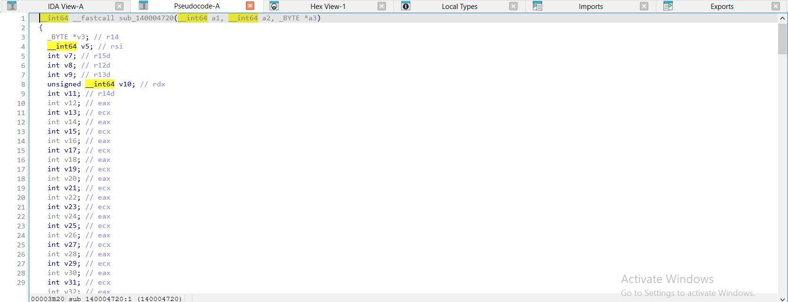

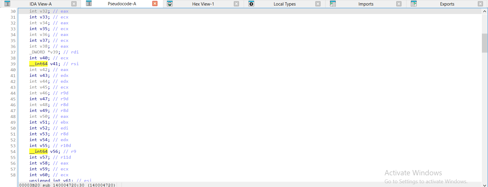

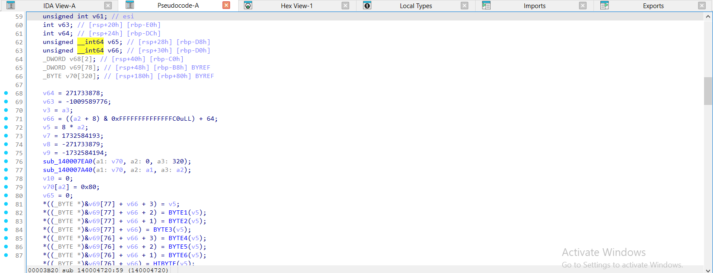

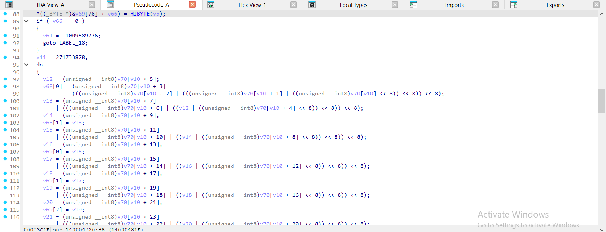

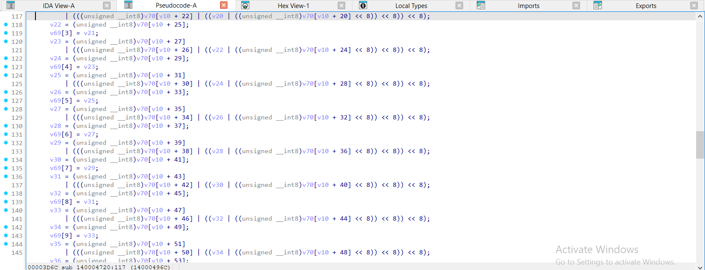

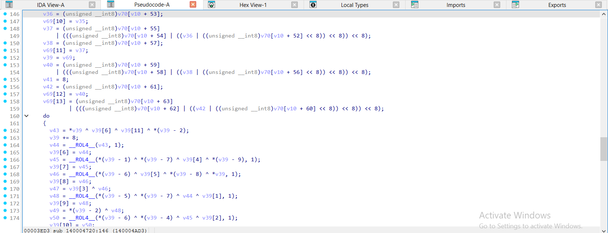

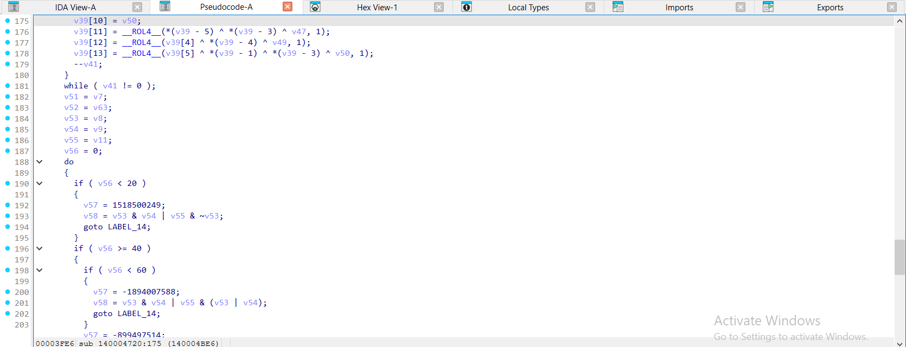

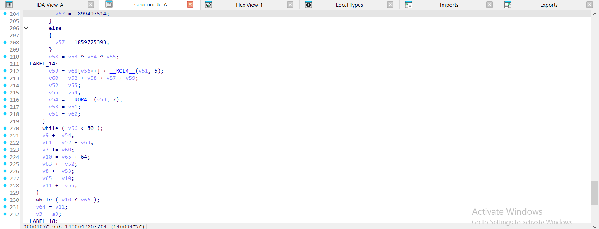

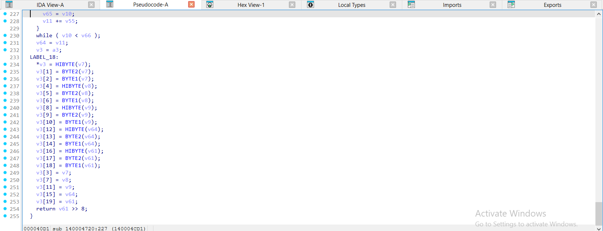

</details>

<details><summary>gcc -O2 – ELF, đã `strip -s` – sha1_hash = <code>sub_42B0</code> – 5 ảnh</summary>

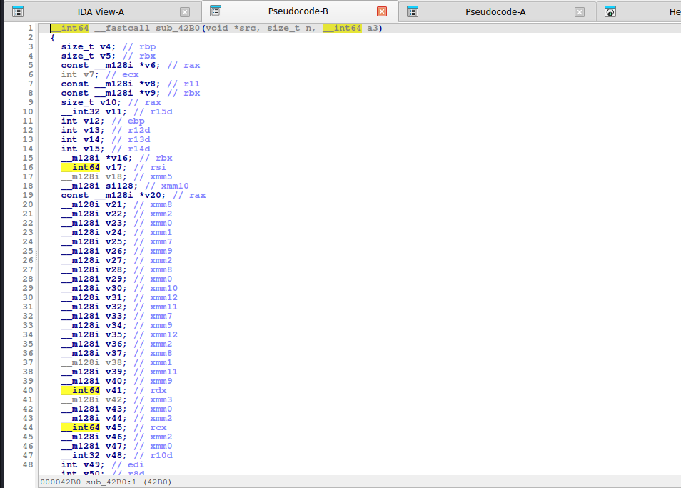

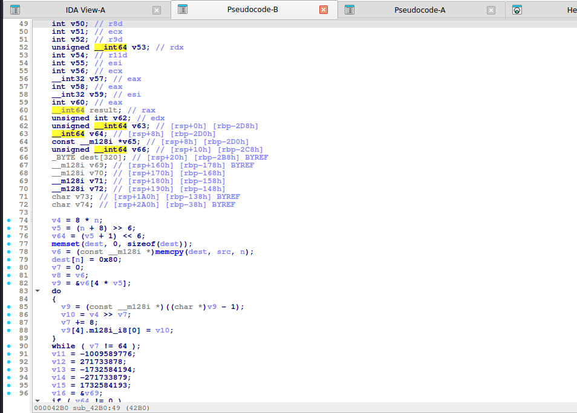

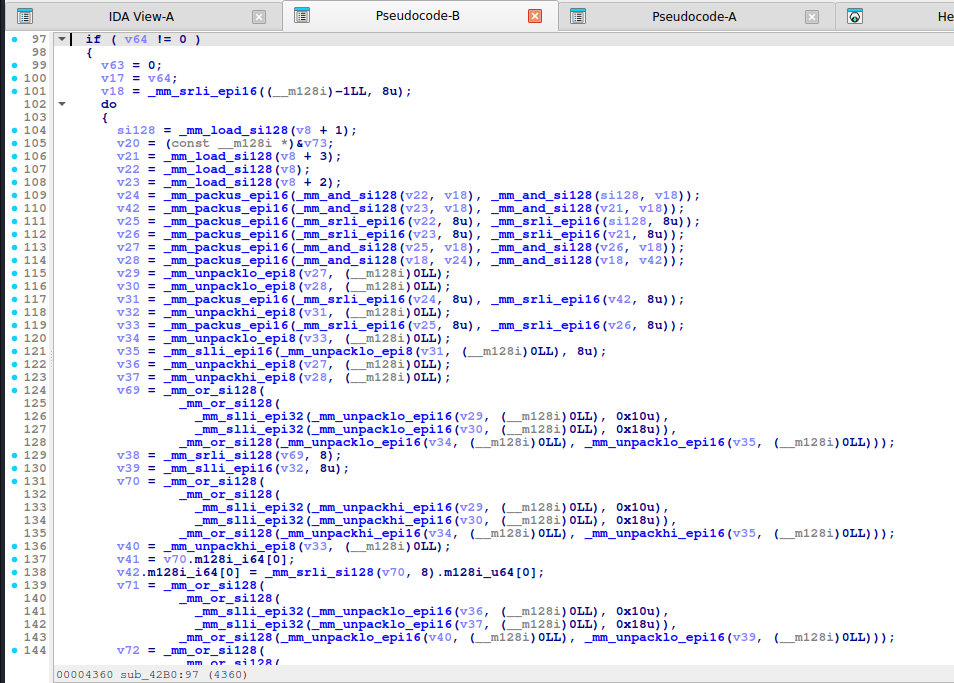

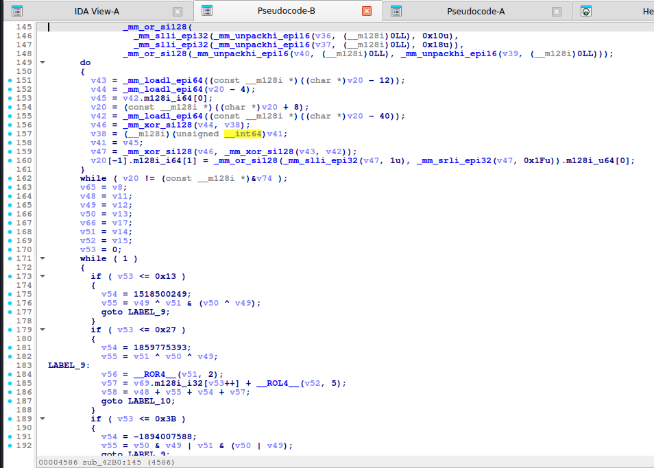

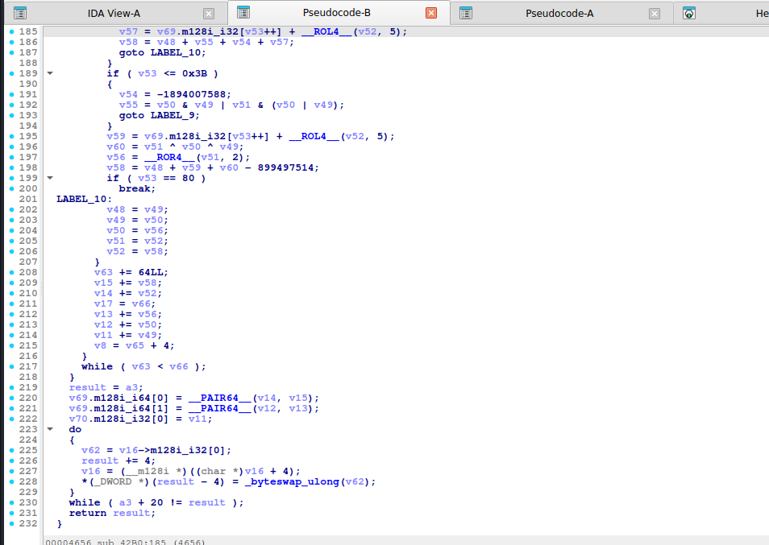

</details>

<details><summary>mingw-w64 -O2 -static – PE, đã `strip -s` – sha1_hash = <code>sub_1400039B0</code> – 5 ảnh</summary>

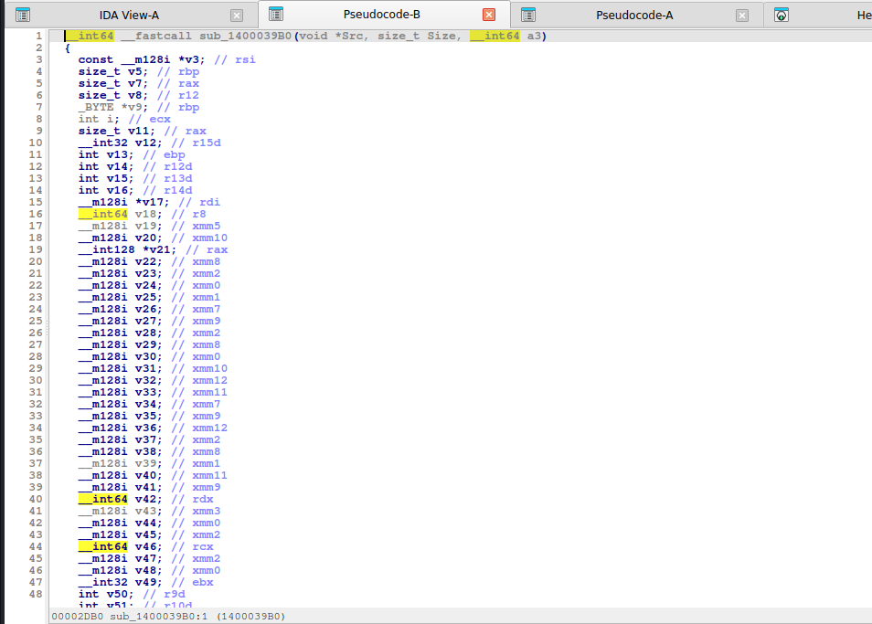

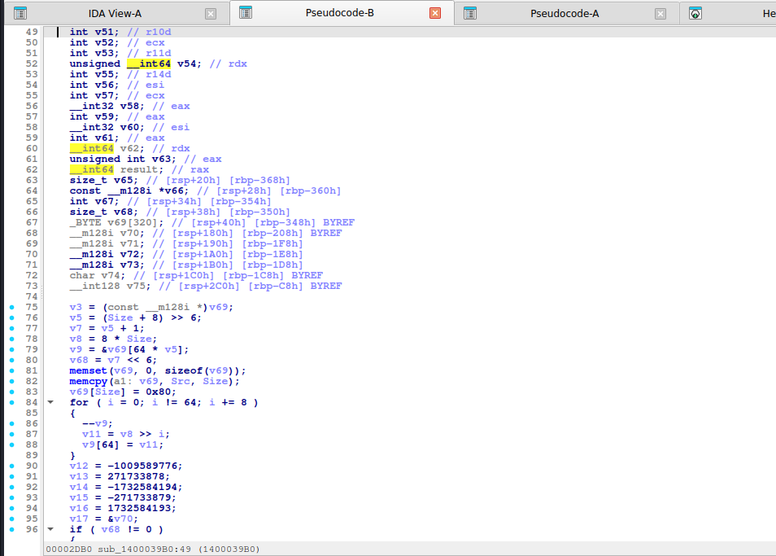

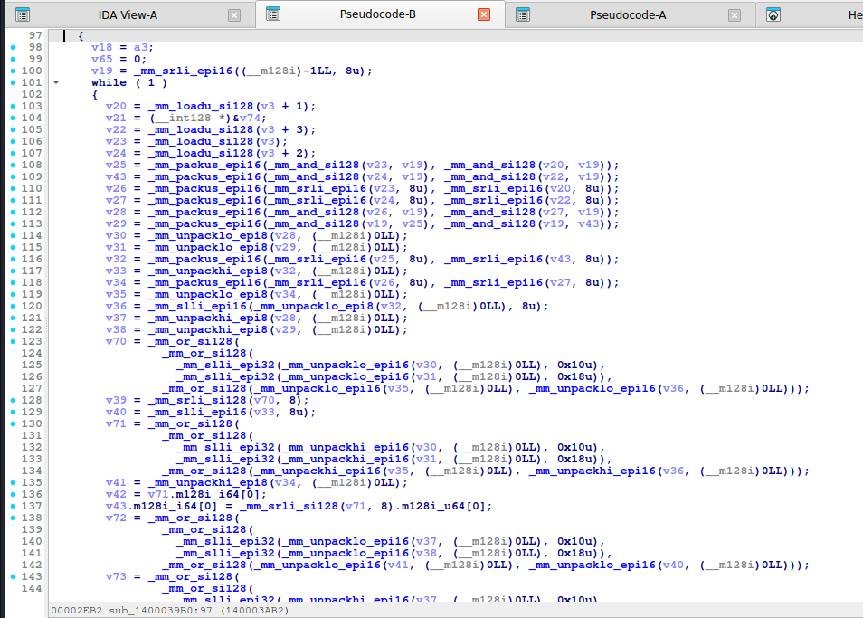

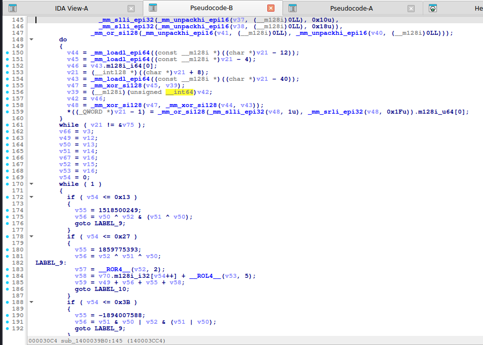

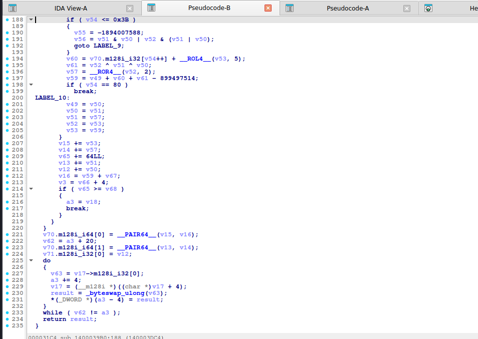

</details>

Nhận xét: ở các bản không tối ưu (MSVC `/Od`, gcc `-O0`) phép xoay hiện **bằng hai phép dịch**: `ROL1` thành `(x >> 31) | (2 * x)` và `ROL5` thành `(a >> 27) | (32 * a)` (tổng hai lượng dịch = 32); mảng `w[80]` và `w[m] = … w[m - 16] ^ w[m - 14] ^ w[m - 8] ^ w[m - 3]` nằm ngay trong code. Ở MSVC `/O2` độ dài bit ghi **từng byte** (`BYTE1(v5)`, `BYTE2(v5)`, … `HIBYTE(v5)`) để tạo trường độ dài big-endian. gcc `-O2` vector hóa việc đọc 16 từ big-endian (khối `_mm_packus_epi16`, `_mm_slli_epi32`, `_mm_unpack*` rất dài – chỉ là "đảo byte 16 từ") rồi mở rộng thông điệp; phần lõi là **vòng 80 bước chia 4 nhánh** với 4 hằng K. `-O0`/MSVC cho thấy mảng `w[80]` và vòng `for (i = 16; i < 80; ++i)`.

## 6. Code giải mã / khai thác

```python
import hashlib
hashlib.sha1(b"Hello, CyberSeaGame!").hexdigest()      # 4238dd7c40d26b4560bb32e57f471e9cea44612e
```

(`hash_wordlist` / `hash_bruteforce` xem [md5.md](md5.md), dùng `algo="sha1"`.)

## 7. Biến thể & bẫy

- Bản gốc **SHA-0** khác ở chỗ không có `ROL1` trong mở rộng thông điệp.
- HMAC-SHA1, PBKDF2: có hai vòng hash với `0x36`/`0x5C` (ipad/opad).
- Hằng K sửa đổi → hash tuỳ biến, phải cài lại đúng để brute force.
