# SHA-512

> Hash 512-bit, khối **128 byte**, 80 vòng, từ **64-bit**, big-endian. Cùng khung SHA-256 nhưng hằng và lượng xoay khác.

## 1. Dấu hiệu nhận biết

- Từ **64-bit** (`unsigned __int64`, hằng `…LL`), khối 128 byte (`& 0x7F`, `+ 16) / 128`).
- **Khởi tạo**: `0x6A09E667F3BCC908`, `0xBB67AE8584CAA73B`, … (8 hằng 64-bit).
- **Bảng K 80 từ 64-bit** bắt đầu `0x428A2F98D728AE22`, `0x7137449123EF65CD`, `0xB5C0FBCFEC4D3B2F`.
- **Lượng xoay**: `σ0 = ROR(x,1) ^ ROR(x,8) ^ (x >> 7)`, `σ1 = ROR(x,19) ^ ROR(x,61) ^ (x >> 6)`, `Σ0(a) = ROR(a,28) ^ ROR(a,34) ^ ROR(a,39)`, `Σ1(e) = ROR(e,14) ^ ROR(e,18) ^ ROR(e,41)`. Bộ số **`1, 8, 7` / `19, 61, 6` / `28, 34, 39` / `14, 18, 41`** là chữ ký (IDA: `__ROR8__`, `_rotr64`).
- 80 vòng, mảng `w[80]` kiểu 64-bit; 16 từ đầu ghép từ 8 byte **big-endian** (`(v << 8) | byte` hoặc `_byteswap_uint64`).
- Padding: `0x80`, độ dài **128-bit** (đề này chỉ ghi 64-bit thấp); đầu ra 8 từ 64-bit big-endian (64 byte).

## 2. Thuật toán (mã giả)

Giống SHA-256 với `w[i]` 64-bit, 80 vòng, hằng K[80], và các lượng xoay ở trên.

```
for i in 16..79: w[i] = w[i-16] + σ0(w[i-15]) + w[i-7] + σ1(w[i-2])
for i in 0..79:  t1 = h + Σ1(e) + Ch(e,f,g) + K[i] + w[i];  t2 = Σ0(a) + Maj(a,b,c)
                 h=g; g=f; f=e; e=d+t1; d=c; c=b; b=a; a=t1+t2
```

## 3. Mã hóa / giải mã

Không đảo ngược. Hay dùng làm KDF (`SHA512(password)[:32]` làm key), so sánh hash 64 byte.

## 4. Mã nguồn gốc (C)

```c
void sha512_hash(const uint8_t *msg, size_t n, uint8_t out[64])
{
    uint8_t buf[384];
    uint64_t H[8];
    size_t total = ((n + 16) / 128 + 1) * 128;
    uint64_t bits = (uint64_t)n * 8;
    for (int i = 0; i < 8; i++) H[i] = SHA512_H0[i];
    memset(buf, 0, sizeof(buf));
    memcpy(buf, msg, n);
    buf[n] = 0x80;
    for (int i = 0; i < 8; i++) buf[total - 1 - i] = (uint8_t)(bits >> (8 * i));
    for (size_t off = 0; off < total; off += 128) {
        uint64_t w[80];
        for (int i = 0; i < 16; i++) {
            uint64_t v = 0;
            for (int j = 0; j < 8; j++) v = (v << 8) | buf[off + 8 * i + j];
            w[i] = v;
        }
        for (int i = 16; i < 80; i++) {
            uint64_t s0 = ROR64(w[i - 15], 1) ^ ROR64(w[i - 15], 8) ^ (w[i - 15] >> 7);
            uint64_t s1 = ROR64(w[i - 2], 19) ^ ROR64(w[i - 2], 61) ^ (w[i - 2] >> 6);
            w[i] = w[i - 16] + s0 + w[i - 7] + s1;
        }
        uint64_t a = H[0], b = H[1], c = H[2], d = H[3], e = H[4], f = H[5], g = H[6], h = H[7];
        for (int i = 0; i < 80; i++) {
            uint64_t S1 = ROR64(e, 14) ^ ROR64(e, 18) ^ ROR64(e, 41);
            uint64_t ch = (e & f) ^ (~e & g);
            uint64_t t1 = h + S1 + ch + SHA512_K[i] + w[i];
            uint64_t S0 = ROR64(a, 28) ^ ROR64(a, 34) ^ ROR64(a, 39);
            uint64_t maj = (a & b) ^ (a & c) ^ (b & c);
            uint64_t t2 = S0 + maj;
            h = g; g = f; f = e; e = d + t1; d = c; c = b; b = a; a = t1 + t2;
        }
        H[0] += a; H[1] += b; H[2] += c; H[3] += d; H[4] += e; H[5] += f; H[6] += g; H[7] += h;
    }
    for (int i = 0; i < 8; i++)
        for (int j = 0; j < 8; j++) out[8 * i + j] = (uint8_t)(H[i] >> (56 - 8 * j));
}
```

## 5. Pseudo-code IDA thực tế

<details><summary>MSVC /O2 - PE x64 (có PDB)</summary>

```c
void __fastcall sha512_hash(const unsigned __int8 *msg, size_t n, unsigned __int8 *out)
{
  size_t v3; // rsi
  size_t v6; // r15
  unsigned __int64 v7; // r14
  unsigned __int64 v8; // r12
  unsigned __int64 v9; // r13
  __int64 v10; // r15
  size_t v11; // rax
  __int64 v12; // r9
  unsigned __int8 *v13; // rax
  __int64 i; // r8
  __int64 v15; // rcx
  __int64 v16; // rdx
  unsigned __int64 v17; // rbx
  unsigned __int64 *v18; // r11
  __int64 j; // rdi
  unsigned __int64 v20; // r10
  unsigned __int64 v21; // r9
  unsigned __int64 v22; // r10
  unsigned __int64 v23; // r10
  unsigned __int64 v24; // r9
  unsigned __int64 v25; // r14
  unsigned __int64 v26; // rbx
  unsigned __int64 v27; // r12
  unsigned __int64 v28; // rdi
  unsigned __int64 v29; // r13
  __int64 v30; // r11
  unsigned __int64 v31; // rsi
  unsigned __int64 v32; // r8
  unsigned __int64 v33; // rdx
  unsigned __int64 v34; // rdx
  size_t v35; // [rsp+20h] [rbp-E0h]
  __int64 v36; // [rsp+28h] [rbp-D8h]
  size_t v37; // [rsp+30h] [rbp-D0h]
  unsigned __int64 H[8]; // [rsp+40h] [rbp-C0h]
  unsigned __int64 w[80]; // [rsp+80h] [rbp-80h] BYREF
  unsigned __int8 buf[384]; // [rsp+300h] [rbp+200h] BYREF

  v3 = 8 * n;
  H[3] = 0xA54FF53A5F1D36F1uLL;
  H[4] = 0x510E527FADE682D1LL;
  H[5] = 0x9B05688C2B3E6C1FuLL;
  v6 = ((n + 16) & 0xFFFFFFFFFFFFFF80uLL) + 128;
  v37 = v6;
  H[6] = 0x1F83D9ABFB41BD6BLL;
  v7 = 0x6A09E667F3BCC908LL;
  H[0] = 0x6A09E667F3BCC908LL;
  v8 = 0xBB67AE8584CAA73BuLL;
  H[7] = 0x5BE0CD19137E2179LL;
  v9 = 0x3C6EF372FE94F82BLL;
  H[1] = 0xBB67AE8584CAA73BuLL;
  H[2] = 0x3C6EF372FE94F82BLL;
  memset(a1: buf, Val: 0, Size: sizeof(buf));
  memmove(a1: buf, Src: msg, Size: n);
  buf[n] = 0x80;
  *((_BYTE *)&w[79] + v6 + 7) = v3;
  *((_BYTE *)&w[79] + v6 + 6) = BYTE1(v3);
  *((_BYTE *)&w[79] + v6 + 5) = BYTE2(v3);
  *((_BYTE *)&w[79] + v6 + 4) = BYTE3(v3);
  *((_BYTE *)&w[79] + v6 + 3) = BYTE4(v3);
  *((_BYTE *)&w[79] + v6 + 2) = BYTE5(v3);
  *((_BYTE *)&w[79] + v6 + 1) = BYTE6(v3);
  *((_BYTE *)&w[79] + v6) = HIBYTE(v3);
  v10 = 0;
  v11 = 0;
  v35 = 0;
  if ( v37 != 0 )
  {
    v12 = -641;
    v36 = -641;
    do
    {
      v13 = &buf[v11 + 1];
      for ( i = 16; i != 0; --i )
      {
        v15 = *v13;
        v16 = *(v13 - 1);
        v13 += 8;
        *(_QWORD *)&v13[v12 - 8] = *(v13 - 2)
                                 | ((*(v13 - 3)
                                   | ((*(v13 - 4)
                                     | ((*(v13 - 5)
                                       | ((*(v13 - 6) | ((*(v13 - 7) | ((v15 | (v16 << 8)) << 8)) << 8)) << 8)) << 8)) << 8)) << 8);
      }
      v17 = w[14];
      v18 = &w[14];
      for ( j = 16; j != 0; --j )
      {
        v20 = *(v18 - 13);
        v18 += 4;
        v21 = *(v18 - 9)
            + *(v18 - 18)
            + ((v20 >> 7) ^ __ROR8__(v20, 1) ^ __ROR8__(v20, 8))
            + ((v17 >> 6) ^ __ROL8__(v17, 3) ^ __ROR8__(v17, 19));
        *(v18 - 2) = v21;
        v22 = *(v18 - 8)
            + ((*(v18 - 16) >> 7) ^ __ROR8__(*(v18 - 16), 1) ^ __ROR8__(*(v18 - 16), 8))
            + ((*(v18 - 3) >> 6) ^ __ROL8__(*(v18 - 3), 3) ^ __ROR8__(*(v18 - 3), 19))
            + v20;
        *(v18 - 1) = v22;
        v17 = *(v18 - 16)
            + *(v18 - 7)
            + ((*(v18 - 15) >> 7) ^ __ROR8__(*(v18 - 15), 1) ^ __ROR8__(*(v18 - 15), 8))
            + ((v21 >> 6) ^ __ROL8__(v21, 3) ^ __ROR8__(v21, 19));
        *v18 = v17;
        v18[1] = *(v18 - 15)
               + *(v18 - 6)
               + ((*(v18 - 14) >> 7) ^ __ROR8__(*(v18 - 14), 1) ^ __ROR8__(*(v18 - 14), 8))
               + ((v22 >> 6) ^ __ROL8__(v22, 3) ^ __ROR8__(v22, 19));
      }
      v23 = H[4];
      v24 = v7;
      v25 = H[6];
      v26 = v8;
      v27 = H[3];
      v28 = v9;
      v29 = H[7];
      v30 = 0;
      v31 = H[5];
      do
      {
        v32 = v29
            + w[v30]
            + SHA512_K[v30]
            + (v23 & v31 ^ v25 & ~v23)
            + (__ROR8__(v23, 14) ^ __ROR8__(v23, 18) ^ __ROL8__(v23, 23));
        v29 = v25;
        v33 = (v24 & v26 ^ v28 & (v24 ^ v26)) + (__ROL8__(v24, 25) ^ __ROR8__(v24, 28) ^ __ROL8__(v24, 30));
        v25 = v31;
        v31 = v23;
        ++v30;
        v23 = v32 + v27;
        v27 = v28;
        v28 = v26;
        v26 = v24;
        v24 = v33 + v32;
      }
      while ( v30 < 80 );
      H[0] += v24;
      v10 = 0;
      v12 = v36 - 128;
      H[1] += v26;
      v11 = v35 + 128;
      H[2] += v28;
      H[3] += v27;
      H[6] += v25;
      H[7] += v29;
      H[4] += v23;
      H[5] += v31;
      v7 = H[0];
      v8 = H[1];
      v9 = H[2];
      v35 = v11;
      v36 -= 128;
    }
    while ( v11 < v37 );
  }
  do
  {
    v34 = H[(unsigned __int64)v10 / 8];
    out[v10 + 7] = v34;
    out[v10] = HIBYTE(v34);
    out[v10 + 1] = BYTE6(v34);
    out[v10 + 2] = BYTE5(v34);
    out[v10 + 3] = BYTE4(v34);
    out[v10 + 4] = BYTE3(v34);
    out[v10 + 5] = BYTE2(v34);
    out[v10 + 6] = BYTE1(v34);
    v10 += 8;
  }
  while ( v10 < 64 );
}
```

</details>

<details><summary>MSVC /Od - PE x64 (có PDB)</summary>

```c
void __fastcall sha512_hash(const unsigned __int8 *msg, size_t n, unsigned __int8 *out)
{
  int ii; // [rsp+20h] [rbp-528h]
  int i; // [rsp+24h] [rbp-524h]
  int k; // [rsp+28h] [rbp-520h]
  int m; // [rsp+2Ch] [rbp-51Ch]
  int jj; // [rsp+30h] [rbp-518h]
  int mm; // [rsp+34h] [rbp-514h]
  int kk; // [rsp+38h] [rbp-510h]
  unsigned __int64 a; // [rsp+40h] [rbp-508h]
  unsigned __int64 e; // [rsp+48h] [rbp-500h]
  int j; // [rsp+50h] [rbp-4F8h]
  unsigned __int64 b; // [rsp+58h] [rbp-4F0h]
  unsigned __int64 c; // [rsp+60h] [rbp-4E8h]
  unsigned __int64 off; // [rsp+68h] [rbp-4E0h]
  unsigned __int64 f; // [rsp+70h] [rbp-4D8h]
  unsigned __int64 g; // [rsp+78h] [rbp-4D0h]
  unsigned __int64 v; // [rsp+80h] [rbp-4C8h]
  unsigned __int64 d; // [rsp+88h] [rbp-4C0h]
  unsigned __int64 h; // [rsp+90h] [rbp-4B8h]
  unsigned __int64 total; // [rsp+98h] [rbp-4B0h]
  unsigned __int64 t1; // [rsp+A0h] [rbp-4A8h]
  unsigned __int64 bits; // [rsp+A8h] [rbp-4A0h]
  unsigned __int64 t2; // [rsp+E0h] [rbp-468h]
  unsigned __int64 H[8]; // [rsp+F0h] [rbp-458h]
  unsigned __int64 w[80]; // [rsp+130h] [rbp-418h]
  unsigned __int8 buf[384]; // [rsp+3B0h] [rbp-198h] BYREF

  total = ((n + 16) / 0x80 + 1) << 7;
  bits = 8 * n;
  for ( i = 0; i < 8; ++i )
    H[i] = SHA512_H0[i];
  memset(a1: buf, Val: 0, Size: sizeof(buf));
  memmove(a1: buf, Src: msg, Size: n);
  buf[n] = 0x80;
  for ( k = 0; k < 8; ++k )
    buf[total - 1 - k] = bits >> (8 * (unsigned __int8)k);
  for ( off = 0; off < total; off += 128LL )
  {
    for ( m = 0; m < 16; ++m )
    {
      v = 0;
      for ( j = 0; j < 8; ++j )
        v = buf[8 * m + j + off] | (v << 8);
      w[m] = v;
    }
    for ( ii = 16; ii < 80; ++ii )
      w[ii] = ((w[ii - 2] >> 6) ^ ((8 * w[ii - 2]) | (w[ii - 2] >> 61)) ^ ((w[ii - 2] << 45) | (w[ii - 2] >> 19)))
            + w[ii - 7]
            + ((w[ii - 15] >> 7) ^ ((w[ii - 15] << 56) | (w[ii - 15] >> 8)) ^ ((w[ii - 15] << 63) | (w[ii - 15] >> 1)))
            + w[ii - 16];
    a = H[0];
    b = H[1];
    c = H[2];
    d = H[3];
    e = H[4];
    f = H[5];
    g = H[6];
    h = H[7];
    for ( jj = 0; jj < 80; ++jj )
    {
      t1 = w[jj]
         + SHA512_K[jj]
         + (g & ~e ^ f & e)
         + (((e << 23) | (e >> 41)) ^ ((e << 46) | (e >> 18)) ^ ((e << 50) | (e >> 14)))
         + h;
      t2 = (c & b ^ c & a ^ b & a) + (((a << 25) | (a >> 39)) ^ ((a << 30) | (a >> 34)) ^ ((a << 36) | (a >> 28)));
      h = g;
      g = f;
      f = e;
      e = t1 + d;
      d = c;
      c = b;
      b = a;
      a = t2 + t1;
    }
    H[0] += a;
    H[1] += b;
    H[2] += c;
    H[3] += d;
    H[4] += e;
    H[5] += f;
    H[6] += g;
    H[7] += h;
  }
  for ( kk = 0; kk < 8; ++kk )
  {
    for ( mm = 0; mm < 8; ++mm )
      out[8 * kk + mm] = H[kk] >> (56 - 8 * (unsigned __int8)mm);
  }
}
```

</details>

<details><summary>gcc -O2 - ELF x86-64 (chưa strip)</summary>

```c
__int64 __fastcall sha512_hash(void *src, size_t n, __int64 a3)
{
  size_t v4; // r12
  size_t v5; // rbp
  char *v7; // rax
  int v8; // ecx
  char *v9; // r8
  char *v10; // rbp
  size_t v11; // rax
  unsigned __int64 v12; // rcx
  unsigned __int64 v13; // r13
  _BYTE *v14; // rsi
  unsigned __int8 *v15; // rdx
  unsigned __int8 *v16; // rdi
  __int64 v17; // rax
  __int64 v18; // r8
  _BYTE *v19; // r10
  __m128i v20; // xmm0
  __m128i *v21; // rax
  __m128i v22; // xmm2
  __int64 v23; // rdx
  __int64 v24; // r11
  _QWORD *v25; // rdi
  __m128i v26; // rcx
  unsigned __int64 v27; // rbp
  __int64 v28; // r8
  __int64 v29; // r9
  __int64 i; // rsi
  __int64 v31; // rax
  __int64 v32; // r14
  __int64 v33; // rax
  __m128i *p_si128; // r8
  __int64 j; // rdi
  unsigned __int64 v36; // rsi
  __int64 result; // rax
  int k; // ecx
  unsigned __int64 v39; // rdx
  unsigned __int64 v40; // [rsp+0h] [rbp-4D8h]
  __m128i v41; // [rsp+8h] [rbp-4D0h]
  __int64 v42; // [rsp+18h] [rbp-4C0h]
  __m128i v43; // [rsp+20h] [rbp-4B8h]
  __m128i v44; // [rsp+30h] [rbp-4A8h]
  unsigned __int64 v45; // [rsp+40h] [rbp-498h]
  char *v46; // [rsp+50h] [rbp-488h]
  __int64 v47; // [rsp+58h] [rbp-480h]
  __m128i si128; // [rsp+60h] [rbp-478h] BYREF
  __m128i v49; // [rsp+70h] [rbp-468h]
  __m128i v50; // [rsp+80h] [rbp-458h]
  __m128i v51; // [rsp+90h] [rbp-448h]
  _BYTE dest[384]; // [rsp+A0h] [rbp-438h] BYREF
  _BYTE v53[112]; // [rsp+220h] [rbp-2B8h] BYREF
  __m128i v54; // [rsp+290h] [rbp-248h] BYREF
  char v55; // [rsp+2A0h] [rbp-238h] BYREF
  char v56; // [rsp+4A0h] [rbp-38h] BYREF

  v4 = 8 * n;
  v5 = (n + 16) >> 7;
  v45 = (v5 + 1) << 7;
  memset(dest, 0, sizeof(dest));
  si128 = _mm_load_si128((const __m128i *)&xmmword_6F00);
  v49 = _mm_load_si128((const __m128i *)&xmmword_6F10);
  v50 = _mm_load_si128((const __m128i *)&xmmword_6F20);
  v51 = _mm_load_si128((const __m128i *)&xmmword_6F30);
  v7 = (char *)memcpy(dest, src, n);
  v8 = 0;
  dest[n] = 0x80;
  v9 = v7;
  v10 = &v7[128 * v5];
  do
  {
    --v10;
    v11 = v4 >> v8;
    v8 += 8;
    v10[128] = v11;
  }
  while ( v8 != 64 );
  if ( v45 != 0 )
  {
    v47 = a3;
    v12 = 0;
    v44.m128i_i64[1] = 0x5BE0CD19137E2179LL;
    v44.m128i_i64[0] = 0x1F83D9ABFB41BD6BLL;
    v43.m128i_i64[1] = 0x9B05688C2B3E6C1FLL;
    v43.m128i_i64[0] = 0x510E527FADE682D1LL;
    v40 = 0xA54FF53A5F1D36F1LL;
    v42 = 0x3C6EF372FE94F82BLL;
    v41.m128i_i64[1] = 0xBB67AE8584CAA73BLL;
    v41.m128i_i64[0] = 0x6A09E667F3BCC908LL;
    v46 = v9 + 8;
    while ( 1 )
    {
      v13 = v12 + 128;
      v14 = &v53[-v12];
      v15 = (unsigned __int8 *)&v46[v12];
      do
      {
        v16 = v15 - 8;
        v17 = 0;
        do
        {
          v18 = *v16++;
          v17 = v18 | (v17 << 8);
        }
        while ( v15 != v16 );
        *(_QWORD *)&v14[v12] = v17;
        v12 += 8LL;
        v19 = v53;
        v15 += 8;
      }
      while ( v12 != v13 );
      v20 = _mm_load_si128(&v54);
      v21 = (__m128i *)&v55;
      do
      {
        v22 = _mm_loadu_si128((__m128i *)((char *)++v21 - 136));
        v20 = _mm_add_epi64(
                _mm_add_epi64(_mm_loadu_si128((__m128i *)((char *)v21 - 72)), v21[-9]),
                _mm_add_epi64(
                  _mm_xor_si128(
                    _mm_xor_si128(
                      _mm_or_si128(_mm_slli_epi64(v20, 3u), _mm_srli_epi64(v20, 0x3Du)),
                      _mm_or_si128(_mm_slli_epi64(v20, 0x2Du), _mm_srli_epi64(v20, 0x13u))),
                    _mm_srli_epi64(v20, 6u)),
                  _mm_xor_si128(
                    _mm_xor_si128(
                      _mm_or_si128(_mm_slli_epi64(v22, 0x38u), _mm_srli_epi64(v22, 8u)),
                      _mm_or_si128(_mm_slli_epi64(v22, 0x3Fu), _mm_srli_epi64(v22, 1u))),
                    _mm_srli_epi64(v22, 7u))));
        v21[-1] = v20;
      }
      while ( v21 != (__m128i *)&v56 );
      v23 = v44.m128i_i64[1];
      v24 = v44.m128i_i64[0];
      v25 = &SHA512_K;
      v26 = v43;
      v27 = v40;
      v28 = v42;
      v29 = v41.m128i_i64[1];
      for ( i = v41.m128i_i64[0]; ; i = v33 )
      {
        ++v25;
        v19 += 8;
        v31 = v23
            + (v26.m128i_i64[1] & v26.m128i_i64[0] ^ v24 & ~v26.m128i_i64[0])
            + *(v25 - 1)
            + *((_QWORD *)v19 - 1)
            + (__ROL8__(v26.m128i_i64[0], 23) ^ __ROR8__(v26.m128i_i64[0], 18) ^ __ROR8__(v26.m128i_i64[0], 14));
        v32 = v31 + v27;
        v27 = v28;
        v33 = (v28 & v29 ^ i & (v28 ^ v29)) + (__ROL8__(i, 25) ^ __ROL8__(i, 30) ^ __ROR8__(i, 28)) + v31;
        v23 = v24;
        if ( v25 == (_QWORD *)&SHA256_K )
          break;
        v24 = v26.m128i_i64[1];
        v28 = v29;
        v26.m128i_i64[1] = v26.m128i_i64[0];
        v29 = i;
        v26.m128i_i64[0] = v32;
      }
      v41.m128i_i64[0] += v33;
      v41.m128i_i64[1] += i;
      v42 += v29;
      v40 += v28;
      v43.m128i_i64[0] += v32;
      v43.m128i_i64[1] += v26.m128i_i64[0];
      v44.m128i_i64[0] += v26.m128i_i64[1];
      v44.m128i_i64[1] += v24;
      if ( v13 >= v45 )
        break;
      v12 = v13;
    }
    a3 = v47;
    si128 = v41;
    v49.m128i_i64[0] = v42;
    v49.m128i_i64[1] = v40;
    v50 = v43;
    v51 = v44;
  }
  p_si128 = &si128;
  for ( j = 0; j != 64; j += 8 )
  {
    v36 = p_si128->m128i_i64[0];
    result = a3 + j;
    for ( k = 56; k != -8; k -= 8 )
    {
      ++result;
      v39 = v36 >> k;
      *(_BYTE *)(result - 1) = v39;
    }
    p_si128 = (__m128i *)((char *)p_si128 + 8);
  }
  return result;
}
```

</details>

<details><summary>gcc -O0 - ELF x86-64 (chưa strip)</summary>

```c
_BYTE *__fastcall sha512_hash(const void *a1, size_t a2, __int64 a3)
{
  _BYTE *result; // rax
  _QWORD v7[80]; // [rsp+20h] [rbp-510h]
  __int64 v8; // [rsp+2A0h] [rbp-290h]
  __int64 v9; // [rsp+2A8h] [rbp-288h]
  __int64 v10; // [rsp+2B0h] [rbp-280h]
  __int64 v11; // [rsp+2B8h] [rbp-278h]
  __int64 v12; // [rsp+2C0h] [rbp-270h]
  __int64 v13; // [rsp+2C8h] [rbp-268h]
  __int64 v14; // [rsp+2D0h] [rbp-260h]
  __int64 v15; // [rsp+2D8h] [rbp-258h]
  _BYTE s[392]; // [rsp+2E0h] [rbp-250h] BYREF
  __int64 v17; // [rsp+468h] [rbp-C8h]
  __int64 v18; // [rsp+470h] [rbp-C0h]
  __int64 v19; // [rsp+478h] [rbp-B8h]
  __int64 v20; // [rsp+480h] [rbp-B0h]
  __int64 v21; // [rsp+488h] [rbp-A8h]
  __int64 v22; // [rsp+490h] [rbp-A0h]
  __int64 v23; // [rsp+498h] [rbp-98h]
  __int64 v24; // [rsp+4A0h] [rbp-90h]
  size_t v25; // [rsp+4A8h] [rbp-88h]
  size_t v26; // [rsp+4B0h] [rbp-80h]
  int nn; // [rsp+4BCh] [rbp-74h]
  int mm; // [rsp+4C0h] [rbp-70h]
  int kk; // [rsp+4C4h] [rbp-6Ch]
  __int64 v30; // [rsp+4C8h] [rbp-68h]
  __int64 v31; // [rsp+4D0h] [rbp-60h]
  __int64 v32; // [rsp+4D8h] [rbp-58h]
  __int64 v33; // [rsp+4E0h] [rbp-50h]
  __int64 v34; // [rsp+4E8h] [rbp-48h]
  __int64 v35; // [rsp+4F0h] [rbp-40h]
  __int64 v36; // [rsp+4F8h] [rbp-38h]
  __int64 v37; // [rsp+500h] [rbp-30h]
  int jj; // [rsp+508h] [rbp-28h]
  int ii; // [rsp+50Ch] [rbp-24h]
  __int64 v40; // [rsp+510h] [rbp-20h]
  int m; // [rsp+51Ch] [rbp-14h]
  _BYTE *k; // [rsp+520h] [rbp-10h]
  int j; // [rsp+528h] [rbp-8h]
  int i; // [rsp+52Ch] [rbp-4h]

  v26 = (((a2 + 16) >> 7) + 1) << 7;
  v25 = 8 * a2;
  for ( i = 0; i <= 7; ++i )
    *(&v8 + i) = SHA512_H0[i];
  memset(s, c: 0, n: 0x180u);
  memcpy(dest: s, src: a1, n: a2);
  s[a2] = 0x80;
  for ( j = 0; j <= 7; ++j )
    s[v26 - j - 1] = v25 >> (8 * (unsigned __int8)j);
  for ( k = nullptr; ; k += 128 )
  {
    result = k;
    if ( (unsigned __int64)k >= v26 )
      break;
    for ( m = 0; m <= 15; ++m )
    {
      v40 = 0;
      for ( ii = 0; ii <= 7; ++ii )
        v40 = (v40 << 8) | (unsigned __int8)s[(_QWORD)&k[8 * m + ii]];
      v7[m] = v40;
    }
    for ( jj = 16; jj <= 79; ++jj )
    {
      v18 = __ROR8__(v7[jj - 15], 8) ^ __ROR8__(v7[jj - 15], 1) ^ (v7[jj - 15] >> 7);
      v17 = __ROL8__(v7[jj - 2], 3) ^ __ROR8__(v7[jj - 2], 19) ^ (v7[jj - 2] >> 6);
      v7[jj] = v17 + v7[jj - 7] + v18 + v7[jj - 16];
    }
    v37 = v8;
    v36 = v9;
    v35 = v10;
    v34 = v11;
    v33 = v12;
    v32 = v13;
    v31 = v14;
    v30 = v15;
    for ( kk = 0; kk <= 79; ++kk )
    {
      v24 = __ROR8__(v33, 18) ^ __ROR8__(v33, 14) ^ __ROL8__(v33, 23);
      v23 = v32 & v33 ^ v31 & ~v33;
      v22 = v24 + v30 + v23 + SHA512_K[kk] + v7[kk];
      v21 = __ROL8__(v37, 30) ^ __ROR8__(v37, 28) ^ __ROL8__(v37, 25);
      v20 = v37 & (v35 ^ v36) ^ v35 & v36;
      v19 = v21 + v20;
      v30 = v31;
      v31 = v32;
      v32 = v33;
      v33 = v34 + v22;
      v34 = v35;
      v35 = v36;
      v36 = v37;
      v37 = v22 + v21 + v20;
    }
    v8 += v37;
    v9 += v36;
    v10 += v35;
    v11 += v34;
    v12 += v33;
    v13 += v32;
    v14 += v31;
    v15 += v30;
  }
  for ( mm = 0; mm <= 7; ++mm )
  {
    for ( nn = 0; nn <= 7; ++nn )
    {
      result = (_BYTE *)(8 * mm + nn + a3);
      *result = (unsigned __int64)*(&v8 + mm) >> (8 * (7 - (unsigned __int8)nn));
    }
  }
  return result;
}
```

</details>

<details><summary>mingw-w64 gcc -O2 - PE x64 (-static)</summary>

```c
__int64 __fastcall sha512_hash(void *Src, size_t Size, __int64 a3)
{
  size_t v4; // rsi
  size_t v6; // rbp
  char *v7; // rax
  int v8; // ecx
  char *v9; // r9
  char *v10; // rsi
  size_t v11; // rax
  unsigned __int64 v12; // rcx
  unsigned __int64 v13; // r13
  _BYTE *v14; // r8
  unsigned __int8 *v15; // rdx
  unsigned __int8 *v16; // r9
  __int64 v17; // rax
  __int64 v18; // r10
  _BYTE *v19; // rbx
  __m128i v20; // xmm0
  __m128i *v21; // rax
  __m128i v22; // xmm2
  __int64 v23; // rdx
  __int64 v24; // rsi
  _QWORD *v25; // r9
  __int64 v26; // rdi
  __int64 v27; // rcx
  unsigned __int64 v28; // rbp
  __int64 v29; // r10
  __int64 v30; // r11
  __int64 i; // r8
  __int64 v32; // rax
  __int64 v33; // r14
  __int64 v34; // rax
  __m128i *v35; // r10
  __int64 j; // r9
  unsigned __int64 v37; // r8
  __int64 result; // rax
  int k; // ecx
  unsigned __int64 v40; // rdx
  unsigned __int64 v41; // [rsp+28h] [rbp-4E0h]
  __m128i v42; // [rsp+30h] [rbp-4D8h]
  __int64 v43; // [rsp+40h] [rbp-4C8h]
  __m128i v44; // [rsp+48h] [rbp-4C0h]
  __m128i v45; // [rsp+58h] [rbp-4B0h]
  unsigned __int64 v46; // [rsp+68h] [rbp-4A0h]
  char *v47; // [rsp+78h] [rbp-490h]
  __m128i v48; // [rsp+80h] [rbp-488h] BYREF
  __m128i v49; // [rsp+90h] [rbp-478h]
  __m128i v50; // [rsp+A0h] [rbp-468h]
  __m128i v51; // [rsp+B0h] [rbp-458h]
  _BYTE v52[384]; // [rsp+C0h] [rbp-448h] BYREF
  _BYTE v53[112]; // [rsp+240h] [rbp-2C8h] BYREF
  __m128i v54; // [rsp+2B0h] [rbp-258h] BYREF
  char v55; // [rsp+2C0h] [rbp-248h] BYREF
  char v56; // [rsp+4C0h] [rbp-48h] BYREF
  __int64 v57; // [rsp+520h] [rbp+18h]

  v48 = _mm_loadu_si128((const __m128i *)&xmmword_14000FF30);
  v4 = (Size + 16) >> 7;
  v49 = _mm_loadu_si128((const __m128i *)&xmmword_14000FF40);
  v6 = 8 * Size;
  v46 = (v4 + 1) << 7;
  memset(v52, 0, sizeof(v52));
  v50 = _mm_loadu_si128((const __m128i *)&xmmword_14000FF50);
  v51 = _mm_loadu_si128((const __m128i *)&xmmword_14000FF60);
  v7 = (char *)memcpy_0(a1: v52, Src, Size);
  v8 = 0;
  v52[Size] = 0x80;
  v9 = v7;
  v10 = &v7[128 * v4];
  do
  {
    --v10;
    v11 = v6 >> v8;
    v8 += 8;
    v10[128] = v11;
  }
  while ( v8 != 64 );
  if ( v46 != 0 )
  {
    v12 = 0;
    v57 = a3;
    v45.m128i_i64[1] = 0x5BE0CD19137E2179LL;
    v45.m128i_i64[0] = 0x1F83D9ABFB41BD6BLL;
    v44.m128i_i64[1] = 0x9B05688C2B3E6C1FuLL;
    v44.m128i_i64[0] = 0x510E527FADE682D1LL;
    v41 = 0xA54FF53A5F1D36F1uLL;
    v43 = 0x3C6EF372FE94F82BLL;
    v42.m128i_i64[1] = 0xBB67AE8584CAA73BuLL;
    v42.m128i_i64[0] = 0x6A09E667F3BCC908LL;
    v47 = v9 + 8;
    while ( 1 )
    {
      v13 = v12 + 128;
      v14 = &v53[-v12];
      v15 = (unsigned __int8 *)&v47[v12];
      do
      {
        v16 = v15 - 8;
        v17 = 0;
        do
        {
          v18 = *v16++;
          v17 = v18 | (v17 << 8);
        }
        while ( v15 != v16 );
        *(_QWORD *)&v14[v12] = v17;
        v12 += 8LL;
        v19 = v53;
        v15 += 8;
      }
      while ( v12 != v13 );
      v20 = _mm_loadu_si128(&v54);
      v21 = (__m128i *)&v55;
      do
      {
        v22 = _mm_loadu_si128((__m128i *)((char *)++v21 - 136));
        v20 = _mm_add_epi64(
                _mm_add_epi64(_mm_loadu_si128((__m128i *)((char *)v21 - 72)), v21[-9]),
                _mm_add_epi64(
                  _mm_xor_si128(
                    _mm_xor_si128(
                      _mm_or_si128(_mm_slli_epi64(v20, 3u), _mm_srli_epi64(v20, 0x3Du)),
                      _mm_or_si128(_mm_slli_epi64(v20, 0x2Du), _mm_srli_epi64(v20, 0x13u))),
                    _mm_srli_epi64(v20, 6u)),
                  _mm_xor_si128(
                    _mm_xor_si128(
                      _mm_or_si128(_mm_slli_epi64(v22, 0x38u), _mm_srli_epi64(v22, 8u)),
                      _mm_or_si128(_mm_slli_epi64(v22, 0x3Fu), _mm_srli_epi64(v22, 1u))),
                    _mm_srli_epi64(v22, 7u))));
        v21[-1] = v20;
      }
      while ( v21 != (__m128i *)&v56 );
      v23 = v45.m128i_i64[1];
      v24 = v45.m128i_i64[0];
      v25 = &SHA512_K;
      v26 = v44.m128i_i64[1];
      v27 = v44.m128i_i64[0];
      v28 = v41;
      v29 = v43;
      v30 = v42.m128i_i64[1];
      for ( i = v42.m128i_i64[0]; ; i = v34 )
      {
        ++v25;
        v19 += 8;
        v32 = v23
            + (v26 & v27 ^ v24 & ~v27)
            + *(v25 - 1)
            + *((_QWORD *)v19 - 1)
            + (__ROL8__(v27, 23) ^ __ROR8__(v27, 18) ^ __ROR8__(v27, 14));
        v33 = v32 + v28;
        v28 = v29;
        v34 = (v29 & v30 ^ i & (v29 ^ v30)) + (__ROL8__(i, 25) ^ __ROL8__(i, 30) ^ __ROR8__(i, 28)) + v32;
        v23 = v24;
        if ( v25 == (_QWORD *)&SHA256_K )
          break;
        v24 = v26;
        v29 = v30;
        v26 = v27;
        v30 = i;
        v27 = v33;
      }
      v42.m128i_i64[0] += v34;
      v42.m128i_i64[1] += i;
      v43 += v30;
      v41 += v29;
      v44.m128i_i64[0] += v33;
      v44.m128i_i64[1] += v27;
      v45.m128i_i64[0] += v26;
      v45.m128i_i64[1] += v24;
      if ( v13 >= v46 )
        break;
      v12 = v13;
    }
    a3 = v57;
    v48 = v42;
    v49.m128i_i64[0] = v43;
    v49.m128i_i64[1] = v41;
    v50 = v44;
    v51 = v45;
  }
  v35 = &v48;
  for ( j = 0; j != 64; j += 8 )
  {
    v37 = v35->m128i_i64[0];
    result = a3 + j;
    for ( k = 56; k != -8; k -= 8 )
    {
      ++result;
      v40 = v37 >> k;
      *(_BYTE *)(result - 1) = v40;
    }
    v35 = (__m128i *)((char *)v35 + 8);
  }
  return result;
}
```

</details>

<details><summary>mingw-w64 gcc -O0 - PE x64 (-static)</summary>

```c
_BYTE *__fastcall sha512_hash(const void *a1, size_t a2, __int64 a3)
{
  _BYTE *result; // rax
  _QWORD v4[80]; // [rsp+20h] [rbp-60h]
  __int64 v5; // [rsp+2A0h] [rbp+220h]
  __int64 v6; // [rsp+2A8h] [rbp+228h]
  __int64 v7; // [rsp+2B0h] [rbp+230h]
  __int64 v8; // [rsp+2B8h] [rbp+238h]
  __int64 v9; // [rsp+2C0h] [rbp+240h]
  __int64 v10; // [rsp+2C8h] [rbp+248h]
  __int64 v11; // [rsp+2D0h] [rbp+250h]
  __int64 v12; // [rsp+2D8h] [rbp+258h]
  _BYTE v13[392]; // [rsp+2E0h] [rbp+260h] BYREF
  __int64 v14; // [rsp+468h] [rbp+3E8h]
  __int64 v15; // [rsp+470h] [rbp+3F0h]
  __int64 v16; // [rsp+478h] [rbp+3F8h]
  __int64 v17; // [rsp+480h] [rbp+400h]
  __int64 v18; // [rsp+488h] [rbp+408h]
  __int64 v19; // [rsp+490h] [rbp+410h]
  __int64 v20; // [rsp+498h] [rbp+418h]
  __int64 v21; // [rsp+4A0h] [rbp+420h]
  size_t v22; // [rsp+4A8h] [rbp+428h]
  size_t v23; // [rsp+4B0h] [rbp+430h]
  int mm; // [rsp+4BCh] [rbp+43Ch]
  int kk; // [rsp+4C0h] [rbp+440h]
  int jj; // [rsp+4C4h] [rbp+444h]
  __int64 v27; // [rsp+4C8h] [rbp+448h]
  __int64 v28; // [rsp+4D0h] [rbp+450h]
  __int64 v29; // [rsp+4D8h] [rbp+458h]
  __int64 v30; // [rsp+4E0h] [rbp+460h]
  __int64 v31; // [rsp+4E8h] [rbp+468h]
  __int64 v32; // [rsp+4F0h] [rbp+470h]
  __int64 v33; // [rsp+4F8h] [rbp+478h]
  __int64 v34; // [rsp+500h] [rbp+480h]
  int ii; // [rsp+508h] [rbp+488h]
  int n; // [rsp+50Ch] [rbp+48Ch]
  __int64 v37; // [rsp+510h] [rbp+490h]
  int m; // [rsp+51Ch] [rbp+49Ch]
  _BYTE *k; // [rsp+520h] [rbp+4A0h]
  int j; // [rsp+528h] [rbp+4A8h]
  int i; // [rsp+52Ch] [rbp+4ACh]

  v23 = (((a2 + 16) >> 7) + 1) << 7;
  v22 = 8 * a2;
  for ( i = 0; i <= 7; ++i )
    *(&v5 + i) = SHA512_H0[i];
  memset(a1: v13, Val: 0, Size: 0x180u);
  memcpy_0(a1: v13, Src: a1, Size: a2);
  v13[a2] = 0x80;
  for ( j = 0; j <= 7; ++j )
    v13[v23 - j - 1] = v22 >> (8 * (unsigned __int8)j);
  for ( k = nullptr; ; k += 128 )
  {
    result = k;
    if ( (unsigned __int64)k >= v23 )
      break;
    for ( m = 0; m <= 15; ++m )
    {
      v37 = 0;
      for ( n = 0; n <= 7; ++n )
        v37 = (v37 << 8) | (unsigned __int8)v13[(_QWORD)&k[8 * m + n]];
      v4[m] = v37;
    }
    for ( ii = 16; ii <= 79; ++ii )
    {
      v15 = __ROR8__(v4[ii - 15], 8) ^ __ROR8__(v4[ii - 15], 1) ^ (v4[ii - 15] >> 7);
      v14 = __ROL8__(v4[ii - 2], 3) ^ __ROR8__(v4[ii - 2], 19) ^ (v4[ii - 2] >> 6);
      v4[ii] = v14 + v4[ii - 7] + v15 + v4[ii - 16];
    }
    v34 = v5;
    v33 = v6;
    v32 = v7;
    v31 = v8;
    v30 = v9;
    v29 = v10;
    v28 = v11;
    v27 = v12;
    for ( jj = 0; jj <= 79; ++jj )
    {
      v21 = __ROR8__(v30, 18) ^ __ROR8__(v30, 14) ^ __ROL8__(v30, 23);
      v20 = v29 & v30 ^ v28 & ~v30;
      v19 = v21 + v27 + v20 + SHA512_K[jj] + v4[jj];
      v18 = __ROL8__(v34, 30) ^ __ROR8__(v34, 28) ^ __ROL8__(v34, 25);
      v17 = v34 & (v32 ^ v33) ^ v32 & v33;
      v16 = v18 + v17;
      v27 = v28;
      v28 = v29;
      v29 = v30;
      v30 = v31 + v19;
      v31 = v32;
      v32 = v33;
      v33 = v34;
      v34 = v19 + v18 + v17;
    }
    v5 += v34;
    v6 += v33;
    v7 += v32;
    v8 += v31;
    v9 += v30;
    v10 += v29;
    v11 += v28;
    v12 += v27;
  }
  for ( kk = 0; kk <= 7; ++kk )
  {
    for ( mm = 0; mm <= 7; ++mm )
    {
      result = (_BYTE *)(8 * kk + mm + a3);
      *result = (unsigned __int64)*(&v5 + kk) >> (8 * (7 - (unsigned __int8)mm));
    }
  }
  return result;
}
```

</details>

**Bản strip (không symbol)** – IDA chỉ thấy `sub_XXXX`, `a1`, `a2`, `byte_XXXX`; hàm này tên là MSVC /O2 → `sub_1400056C0`, gcc -O2 → `sub_4E30`, mingw-w64 -O2 -static → `sub_140004670`:

<details><summary>MSVC /O2 – PE x64, không PDB (strip) – bản STRIP: <code>sha512_hash</code> = <code>sub_1400056C0</code></summary>

```c
unsigned __int64 __fastcall sub_1400056C0(__int64 a1, __int64 a2, __int64 a3)
{
  __int64 v3; // rsi
  unsigned __int64 v6; // r15
  __int64 v7; // r14
  unsigned __int64 v8; // r12
  __int64 v9; // r13
  __int64 v10; // r15
  unsigned __int64 v11; // rax
  __int64 v12; // r9
  unsigned __int8 *v13; // rax
  __int64 i; // r8
  __int64 v15; // rcx
  __int64 v16; // rdx
  unsigned __int64 v17; // rbx
  unsigned __int64 *v18; // r11
  __int64 j; // rdi
  unsigned __int64 v20; // r10
  unsigned __int64 v21; // r9
  unsigned __int64 v22; // r10
  __int64 v23; // r10
  __int64 v24; // r9
  __int64 v25; // r14
  unsigned __int64 v26; // rbx
  unsigned __int64 v27; // r12
  __int64 v28; // rdi
  __int64 v29; // r13
  __int64 v30; // r11
  unsigned __int64 v31; // rsi
  unsigned __int64 v32; // r8
  unsigned __int64 v33; // rdx
  unsigned __int64 v34; // rdx
  unsigned __int64 result; // rax
  unsigned __int64 v36; // [rsp+20h] [rbp-E0h]
  __int64 v37; // [rsp+28h] [rbp-D8h]
  unsigned __int64 v38; // [rsp+30h] [rbp-D0h]
  __int64 v40; // [rsp+40h] [rbp-C0h]
  unsigned __int64 v41; // [rsp+48h] [rbp-B8h]
  __int64 v42; // [rsp+50h] [rbp-B0h]
  unsigned __int64 v43; // [rsp+58h] [rbp-A8h]
  __int64 v44; // [rsp+60h] [rbp-A0h]
  unsigned __int64 v45; // [rsp+68h] [rbp-98h]
  __int64 v46; // [rsp+70h] [rbp-90h]
  __int64 v47; // [rsp+78h] [rbp-88h]
  _QWORD v48[14]; // [rsp+80h] [rbp-80h]
  _QWORD v49[66]; // [rsp+F0h] [rbp-10h] BYREF
  _BYTE v50[384]; // [rsp+300h] [rbp+200h] BYREF

  v3 = 8 * a2;
  v43 = 0xA54FF53A5F1D36F1uLL;
  v44 = 0x510E527FADE682D1LL;
  v45 = 0x9B05688C2B3E6C1FuLL;
  v6 = ((a2 + 16) & 0xFFFFFFFFFFFFFF80uLL) + 128;
  v38 = v6;
  v46 = 0x1F83D9ABFB41BD6BLL;
  v7 = 0x6A09E667F3BCC908LL;
  v40 = 0x6A09E667F3BCC908LL;
  v8 = 0xBB67AE8584CAA73BuLL;
  v47 = 0x5BE0CD19137E2179LL;
  v9 = 0x3C6EF372FE94F82BLL;
  v41 = 0xBB67AE8584CAA73BuLL;
  v42 = 0x3C6EF372FE94F82BLL;
  sub_140007EA0(a1: v50, a2: 0, a3: 384);
  sub_140007A40(a1: v50, a2: a1, a3: a2);
  v50[a2] = 0x80;
  *((_BYTE *)&v49[65] + v6 + 7) = v3;
  *((_BYTE *)&v49[65] + v6 + 6) = BYTE1(v3);
  *((_BYTE *)&v49[65] + v6 + 5) = BYTE2(v3);
  *((_BYTE *)&v49[65] + v6 + 4) = BYTE3(v3);
  *((_BYTE *)&v49[65] + v6 + 3) = BYTE4(v3);
  *((_BYTE *)&v49[65] + v6 + 2) = BYTE5(v3);
  *((_BYTE *)&v49[65] + v6 + 1) = BYTE6(v3);
  *((_BYTE *)&v49[65] + v6) = HIBYTE(v3);
  v10 = 0;
  v11 = 0;
  v36 = 0;
  if ( v38 != 0 )
  {
    v12 = -641;
    v37 = -641;
    do
    {
      v13 = &v50[v11 + 1];
      for ( i = 16; i != 0; --i )
      {
        v15 = *v13;
        v16 = *(v13 - 1);
        v13 += 8;
        *(_QWORD *)&v13[v12 - 8] = *(v13 - 2)
                                 | ((*(v13 - 3)
                                   | ((*(v13 - 4)
                                     | ((*(v13 - 5)
                                       | ((*(v13 - 6) | ((*(v13 - 7) | ((v15 | (v16 << 8)) << 8)) << 8)) << 8)) << 8)) << 8)) << 8);
      }
      v17 = v49[0];
      v18 = v49;
      for ( j = 16; j != 0; --j )
      {
        v20 = *(v18 - 13);
        v18 += 4;
        v21 = *(v18 - 9)
            + *(v18 - 18)
            + ((v20 >> 7) ^ __ROR8__(v20, 1) ^ __ROR8__(v20, 8))
            + ((v17 >> 6) ^ __ROL8__(v17, 3) ^ __ROR8__(v17, 19));
        *(v18 - 2) = v21;
        v22 = *(v18 - 8)
            + ((*(v18 - 16) >> 7) ^ __ROR8__(*(v18 - 16), 1) ^ __ROR8__(*(v18 - 16), 8))
            + ((*(v18 - 3) >> 6) ^ __ROL8__(*(v18 - 3), 3) ^ __ROR8__(*(v18 - 3), 19))
            + v20;
        *(v18 - 1) = v22;
        v17 = *(v18 - 16)
            + *(v18 - 7)
            + ((*(v18 - 15) >> 7) ^ __ROR8__(*(v18 - 15), 1) ^ __ROR8__(*(v18 - 15), 8))
            + ((v21 >> 6) ^ __ROL8__(v21, 3) ^ __ROR8__(v21, 19));
        *v18 = v17;
        v18[1] = *(v18 - 15)
               + *(v18 - 6)
               + ((*(v18 - 14) >> 7) ^ __ROR8__(*(v18 - 14), 1) ^ __ROR8__(*(v18 - 14), 8))
               + ((v22 >> 6) ^ __ROL8__(v22, 3) ^ __ROR8__(v22, 19));
      }
      v23 = v44;
      v24 = v7;
      v25 = v46;
      v26 = v8;
      v27 = v43;
      v28 = v9;
      v29 = v47;
      v30 = 0;
      v31 = v45;
      do
      {
        v32 = v29
            + v48[v30]
            + *(_QWORD *)((char *)&unk_140018AF0 + v30 * 8)
            + (v23 & v31 ^ v25 & ~v23)
            + (__ROR8__(v23, 14) ^ __ROR8__(v23, 18) ^ __ROL8__(v23, 23));
        v29 = v25;
        v33 = (v24 & v26 ^ v28 & (v24 ^ v26)) + (__ROL8__(v24, 25) ^ __ROR8__(v24, 28) ^ __ROL8__(v24, 30));
        v25 = v31;
        v31 = v23;
        ++v30;
        v23 = v32 + v27;
        v27 = v28;
        v28 = v26;
        v26 = v24;
        v24 = v33 + v32;
      }
      while ( v30 < 80 );
      v40 += v24;
      v10 = 0;
      v12 = v37 - 128;
      v41 += v26;
      v11 = v36 + 128;
      v42 += v28;
      v43 += v27;
      v46 += v25;
      v47 += v29;
      v44 += v23;
      v45 += v31;
      v7 = v40;
      v8 = v41;
      v9 = v42;
      v36 = v11;
      v37 -= 128;
    }
    while ( v11 < v38 );
  }
  do
  {
    v34 = *(__int64 *)((char *)&v40 + v10);
    *(_BYTE *)(a3 + v10 + 7) = v34;
    *(_BYTE *)(v10 + a3) = HIBYTE(v34);
    *(_BYTE *)(a3 + v10 + 1) = BYTE6(v34);
    *(_BYTE *)(a3 + v10 + 2) = BYTE5(v34);
    *(_BYTE *)(a3 + v10 + 3) = BYTE4(v34);
    *(_BYTE *)(a3 + v10 + 4) = BYTE3(v34);
    *(_BYTE *)(a3 + v10 + 5) = BYTE2(v34);
    result = v34 >> 8;
    *(_BYTE *)(a3 + v10 + 6) = BYTE1(v34);
    v10 += 8;
  }
  while ( v10 < 64 );
  return result;
}
```

</details>

<details><summary>gcc -O2 – ELF, đã `strip -s` – bản STRIP: <code>sha512_hash</code> = <code>sub_4E30</code></summary>

```c
__int64 __fastcall sub_4E30(void *src, size_t n, __int64 a3)
{
  size_t v4; // r12
  size_t v5; // rbp
  char *v7; // rax
  int v8; // ecx
  char *v9; // r8
  char *v10; // rbp
  size_t v11; // rax
  unsigned __int64 v12; // rcx
  unsigned __int64 v13; // r13
  _BYTE *v14; // rsi
  unsigned __int8 *v15; // rdx
  unsigned __int8 *v16; // rdi
  __int64 v17; // rax
  __int64 v18; // r8
  _BYTE *v19; // r10
  __m128i v20; // xmm0
  __m128i *v21; // rax
  __m128i v22; // xmm2
  __int64 v23; // rdx
  __int64 v24; // r11
  _QWORD *v25; // rdi
  __m128i v26; // rcx
  unsigned __int64 v27; // rbp
  __int64 v28; // r8
  __int64 v29; // r9
  __int64 i; // rsi
  __int64 v31; // rax
  __int64 v32; // r14
  __int64 v33; // rax
  __m128i *p_si128; // r8
  __int64 j; // rdi
  unsigned __int64 v36; // rsi
  __int64 result; // rax
  int k; // ecx
  unsigned __int64 v39; // rdx
  unsigned __int64 v40; // [rsp+0h] [rbp-4D8h]
  __m128i v41; // [rsp+8h] [rbp-4D0h]
  __int64 v42; // [rsp+18h] [rbp-4C0h]
  __m128i v43; // [rsp+20h] [rbp-4B8h]
  __m128i v44; // [rsp+30h] [rbp-4A8h]
  unsigned __int64 v45; // [rsp+40h] [rbp-498h]
  char *v46; // [rsp+50h] [rbp-488h]
  __int64 v47; // [rsp+58h] [rbp-480h]
  __m128i si128; // [rsp+60h] [rbp-478h] BYREF
  __m128i v49; // [rsp+70h] [rbp-468h]
  __m128i v50; // [rsp+80h] [rbp-458h]
  __m128i v51; // [rsp+90h] [rbp-448h]
  _BYTE dest[384]; // [rsp+A0h] [rbp-438h] BYREF
  _BYTE v53[112]; // [rsp+220h] [rbp-2B8h] BYREF
  __m128i v54; // [rsp+290h] [rbp-248h] BYREF
  char v55; // [rsp+2A0h] [rbp-238h] BYREF
  char v56; // [rsp+4A0h] [rbp-38h] BYREF

  v4 = 8 * n;
  v5 = (n + 16) >> 7;
  v45 = (v5 + 1) << 7;
  memset(dest, 0, sizeof(dest));
  si128 = _mm_load_si128((const __m128i *)&xmmword_6F00);
  v49 = _mm_load_si128((const __m128i *)&xmmword_6F10);
  v50 = _mm_load_si128((const __m128i *)&xmmword_6F20);
  v51 = _mm_load_si128((const __m128i *)&xmmword_6F30);
  v7 = (char *)memcpy(dest, src, n);
  v8 = 0;
  dest[n] = 0x80;
  v9 = v7;
  v10 = &v7[128 * v5];
  do
  {
    --v10;
    v11 = v4 >> v8;
    v8 += 8;
    v10[128] = v11;
  }
  while ( v8 != 64 );
  if ( v45 != 0 )
  {
    v47 = a3;
    v12 = 0;
    v44.m128i_i64[1] = 0x5BE0CD19137E2179LL;
    v44.m128i_i64[0] = 0x1F83D9ABFB41BD6BLL;
    v43.m128i_i64[1] = 0x9B05688C2B3E6C1FLL;
    v43.m128i_i64[0] = 0x510E527FADE682D1LL;
    v40 = 0xA54FF53A5F1D36F1LL;
    v42 = 0x3C6EF372FE94F82BLL;
    v41.m128i_i64[1] = 0xBB67AE8584CAA73BLL;
    v41.m128i_i64[0] = 0x6A09E667F3BCC908LL;
    v46 = v9 + 8;
    while ( 1 )
    {
      v13 = v12 + 128;
      v14 = &v53[-v12];
      v15 = (unsigned __int8 *)&v46[v12];
      do
      {
        v16 = v15 - 8;
        v17 = 0;
        do
        {
          v18 = *v16++;
          v17 = v18 | (v17 << 8);
        }
        while ( v15 != v16 );
        *(_QWORD *)&v14[v12] = v17;
        v12 += 8LL;
        v19 = v53;
        v15 += 8;
      }
      while ( v12 != v13 );
      v20 = _mm_load_si128(&v54);
      v21 = (__m128i *)&v55;
      do
      {
        v22 = _mm_loadu_si128((__m128i *)((char *)++v21 - 136));
        v20 = _mm_add_epi64(
                _mm_add_epi64(_mm_loadu_si128((__m128i *)((char *)v21 - 72)), v21[-9]),
                _mm_add_epi64(
                  _mm_xor_si128(
                    _mm_xor_si128(
                      _mm_or_si128(_mm_slli_epi64(v20, 3u), _mm_srli_epi64(v20, 0x3Du)),
                      _mm_or_si128(_mm_slli_epi64(v20, 0x2Du), _mm_srli_epi64(v20, 0x13u))),
                    _mm_srli_epi64(v20, 6u)),
                  _mm_xor_si128(
                    _mm_xor_si128(
                      _mm_or_si128(_mm_slli_epi64(v22, 0x38u), _mm_srli_epi64(v22, 8u)),
                      _mm_or_si128(_mm_slli_epi64(v22, 0x3Fu), _mm_srli_epi64(v22, 1u))),
                    _mm_srli_epi64(v22, 7u))));
        v21[-1] = v20;
      }
      while ( v21 != (__m128i *)&v56 );
      v23 = v44.m128i_i64[1];
      v24 = v44.m128i_i64[0];
      v25 = &unk_6440;
      v26 = v43;
      v27 = v40;
      v28 = v42;
      v29 = v41.m128i_i64[1];
      for ( i = v41.m128i_i64[0]; ; i = v33 )
      {
        ++v25;
        v19 += 8;
        v31 = v23
            + (v26.m128i_i64[1] & v26.m128i_i64[0] ^ v24 & ~v26.m128i_i64[0])
            + *(v25 - 1)
            + *((_QWORD *)v19 - 1)
            + (__ROL8__(v26.m128i_i64[0], 23) ^ __ROR8__(v26.m128i_i64[0], 18) ^ __ROR8__(v26.m128i_i64[0], 14));
        v32 = v31 + v27;
        v27 = v28;
        v33 = (v28 & v29 ^ i & (v28 ^ v29)) + (__ROL8__(i, 25) ^ __ROL8__(i, 30) ^ __ROR8__(i, 28)) + v31;
        v23 = v24;
        if ( v25 == (_QWORD *)&unk_66C0 )
          break;
        v24 = v26.m128i_i64[1];
        v28 = v29;
        v26.m128i_i64[1] = v26.m128i_i64[0];
        v29 = i;
        v26.m128i_i64[0] = v32;
      }
      v41.m128i_i64[0] += v33;
      v41.m128i_i64[1] += i;
      v42 += v29;
      v40 += v28;
      v43.m128i_i64[0] += v32;
      v43.m128i_i64[1] += v26.m128i_i64[0];
      v44.m128i_i64[0] += v26.m128i_i64[1];
      v44.m128i_i64[1] += v24;
      if ( v13 >= v45 )
        break;
      v12 = v13;
    }
    a3 = v47;
    si128 = v41;
    v49.m128i_i64[0] = v42;
    v49.m128i_i64[1] = v40;
    v50 = v43;
    v51 = v44;
  }
  p_si128 = &si128;
  for ( j = 0; j != 64; j += 8 )
  {
    v36 = p_si128->m128i_i64[0];
    result = a3 + j;
    for ( k = 56; k != -8; k -= 8 )
    {
      ++result;
      v39 = v36 >> k;
      *(_BYTE *)(result - 1) = v39;
    }
    p_si128 = (__m128i *)((char *)p_si128 + 8);
  }
  return result;
}
```

</details>

<details><summary>mingw-w64 -O2 -static – PE, đã `strip -s` – bản STRIP: <code>sha512_hash</code> = <code>sub_140004670</code></summary>

```c
__int64 __fastcall sub_140004670(void *Src, size_t Size, __int64 a3)
{
  size_t v4; // rsi
  size_t v6; // rbp
  char *v7; // rax
  int v8; // ecx
  char *v9; // r9
  char *v10; // rsi
  size_t v11; // rax
  unsigned __int64 v12; // rcx
  unsigned __int64 v13; // r13
  _BYTE *v14; // r8
  unsigned __int8 *v15; // rdx
  unsigned __int8 *v16; // r9
  __int64 v17; // rax
  __int64 v18; // r10
  _BYTE *v19; // rbx
  __m128i v20; // xmm0
  __m128i *v21; // rax
  __m128i v22; // xmm2
  __int64 v23; // rdx
  __int64 v24; // rsi
  _QWORD *v25; // r9
  __int64 v26; // rdi
  __int64 v27; // rcx
  unsigned __int64 v28; // rbp
  __int64 v29; // r10
  __int64 v30; // r11
  __int64 i; // r8
  __int64 v32; // rax
  __int64 v33; // r14
  __int64 v34; // rax
  __m128i *v35; // r10
  __int64 j; // r9
  unsigned __int64 v37; // r8
  __int64 result; // rax
  int k; // ecx
  unsigned __int64 v40; // rdx
  unsigned __int64 v41; // [rsp+28h] [rbp-4E0h]
  __m128i v42; // [rsp+30h] [rbp-4D8h]
  __int64 v43; // [rsp+40h] [rbp-4C8h]
  __m128i v44; // [rsp+48h] [rbp-4C0h]
  __m128i v45; // [rsp+58h] [rbp-4B0h]
  unsigned __int64 v46; // [rsp+68h] [rbp-4A0h]
  char *v47; // [rsp+78h] [rbp-490h]
  __m128i v48; // [rsp+80h] [rbp-488h] BYREF
  __m128i v49; // [rsp+90h] [rbp-478h]
  __m128i v50; // [rsp+A0h] [rbp-468h]
  __m128i v51; // [rsp+B0h] [rbp-458h]
  _BYTE v52[384]; // [rsp+C0h] [rbp-448h] BYREF
  _BYTE v53[112]; // [rsp+240h] [rbp-2C8h] BYREF
  __m128i v54; // [rsp+2B0h] [rbp-258h] BYREF
  char v55; // [rsp+2C0h] [rbp-248h] BYREF
  char v56; // [rsp+4C0h] [rbp-48h] BYREF
  __int64 v57; // [rsp+520h] [rbp+18h]

  v48 = _mm_loadu_si128((const __m128i *)&xmmword_14000FF30);
  v4 = (Size + 16) >> 7;
  v49 = _mm_loadu_si128((const __m128i *)&xmmword_14000FF40);
  v6 = 8 * Size;
  v46 = (v4 + 1) << 7;
  memset(v52, 0, sizeof(v52));
  v50 = _mm_loadu_si128((const __m128i *)&xmmword_14000FF50);
  v51 = _mm_loadu_si128((const __m128i *)&xmmword_14000FF60);
  v7 = (char *)memcpy(a1: v52, Src, Size);
  v8 = 0;
  v52[Size] = 0x80;
  v9 = v7;
  v10 = &v7[128 * v4];
  do
  {
    --v10;
    v11 = v6 >> v8;
    v8 += 8;
    v10[128] = v11;
  }
  while ( v8 != 64 );
  if ( v46 != 0 )
  {
    v12 = 0;
    v57 = a3;
    v45.m128i_i64[1] = 0x5BE0CD19137E2179LL;
    v45.m128i_i64[0] = 0x1F83D9ABFB41BD6BLL;
    v44.m128i_i64[1] = 0x9B05688C2B3E6C1FuLL;
    v44.m128i_i64[0] = 0x510E527FADE682D1LL;
    v41 = 0xA54FF53A5F1D36F1uLL;
    v43 = 0x3C6EF372FE94F82BLL;
    v42.m128i_i64[1] = 0xBB67AE8584CAA73BuLL;
    v42.m128i_i64[0] = 0x6A09E667F3BCC908LL;
    v47 = v9 + 8;
    while ( 1 )
    {
      v13 = v12 + 128;
      v14 = &v53[-v12];
      v15 = (unsigned __int8 *)&v47[v12];
      do
      {
        v16 = v15 - 8;
        v17 = 0;
        do
        {
          v18 = *v16++;
          v17 = v18 | (v17 << 8);
        }
        while ( v15 != v16 );
        *(_QWORD *)&v14[v12] = v17;
        v12 += 8LL;
        v19 = v53;
        v15 += 8;
      }
      while ( v12 != v13 );
      v20 = _mm_loadu_si128(&v54);
      v21 = (__m128i *)&v55;
      do
      {
        v22 = _mm_loadu_si128((__m128i *)((char *)++v21 - 136));
        v20 = _mm_add_epi64(
                _mm_add_epi64(_mm_loadu_si128((__m128i *)((char *)v21 - 72)), v21[-9]),
                _mm_add_epi64(
                  _mm_xor_si128(
                    _mm_xor_si128(
                      _mm_or_si128(_mm_slli_epi64(v20, 3u), _mm_srli_epi64(v20, 0x3Du)),
                      _mm_or_si128(_mm_slli_epi64(v20, 0x2Du), _mm_srli_epi64(v20, 0x13u))),
                    _mm_srli_epi64(v20, 6u)),
                  _mm_xor_si128(
                    _mm_xor_si128(
                      _mm_or_si128(_mm_slli_epi64(v22, 0x38u), _mm_srli_epi64(v22, 8u)),
                      _mm_or_si128(_mm_slli_epi64(v22, 0x3Fu), _mm_srli_epi64(v22, 1u))),
                    _mm_srli_epi64(v22, 7u))));
        v21[-1] = v20;
      }
      while ( v21 != (__m128i *)&v56 );
      v23 = v45.m128i_i64[1];
      v24 = v45.m128i_i64[0];
      v25 = &unk_14000F460;
      v26 = v44.m128i_i64[1];
      v27 = v44.m128i_i64[0];
      v28 = v41;
      v29 = v43;
      v30 = v42.m128i_i64[1];
      for ( i = v42.m128i_i64[0]; ; i = v34 )
      {
        ++v25;
        v19 += 8;
        v32 = v23
            + (v26 & v27 ^ v24 & ~v27)
            + *(v25 - 1)
            + *((_QWORD *)v19 - 1)
            + (__ROL8__(v27, 23) ^ __ROR8__(v27, 18) ^ __ROR8__(v27, 14));
        v33 = v32 + v28;
        v28 = v29;
        v34 = (v29 & v30 ^ i & (v29 ^ v30)) + (__ROL8__(i, 25) ^ __ROL8__(i, 30) ^ __ROR8__(i, 28)) + v32;
        v23 = v24;
        if ( v25 == (_QWORD *)&unk_14000F6E0 )
          break;
        v24 = v26;
        v29 = v30;
        v26 = v27;
        v30 = i;
        v27 = v33;
      }
      v42.m128i_i64[0] += v34;
      v42.m128i_i64[1] += i;
      v43 += v30;
      v41 += v29;
      v44.m128i_i64[0] += v33;
      v44.m128i_i64[1] += v27;
      v45.m128i_i64[0] += v26;
      v45.m128i_i64[1] += v24;
      if ( v13 >= v46 )
        break;
      v12 = v13;
    }
    a3 = v57;
    v48 = v42;
    v49.m128i_i64[0] = v43;
    v49.m128i_i64[1] = v41;
    v50 = v44;
    v51 = v45;
  }
  v35 = &v48;
  for ( j = 0; j != 64; j += 8 )
  {
    v37 = v35->m128i_i64[0];
    result = a3 + j;
    for ( k = 56; k != -8; k -= 8 )
    {
      ++result;
      v40 = v37 >> k;
      *(_BYTE *)(result - 1) = v40;
    }
    v35 = (__m128i *)((char *)v35 + 8);
  }
  return result;
}
```

</details>

**Ảnh chụp màn hình IDA (bản strip)** – mở từng mục để xem; hàm dài chia thành nhiều trang, mỗi trang là một màn hình IDA:

<details><summary>MSVC /O2 – PE x64, không PDB (strip) – sha512_hash = <code>sub_1400056C0</code> – 7 ảnh</summary>

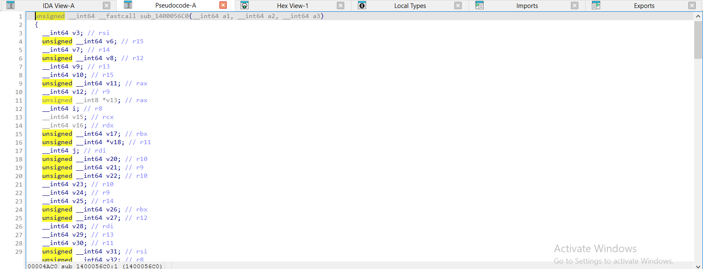

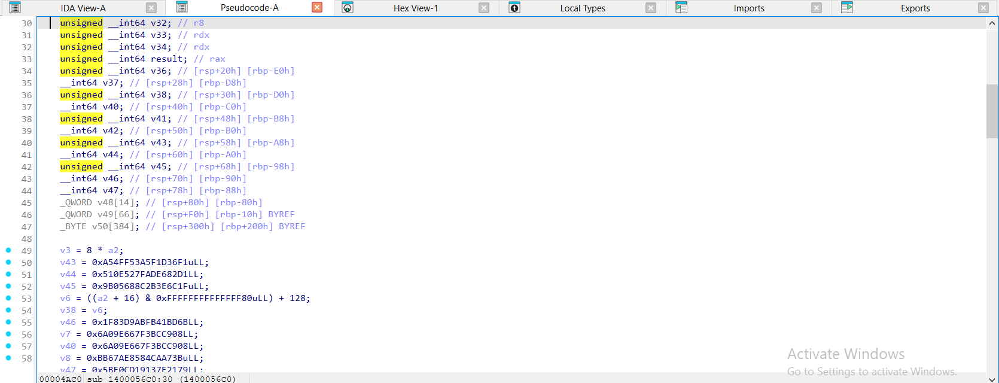

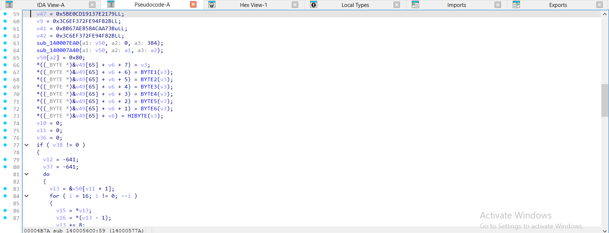

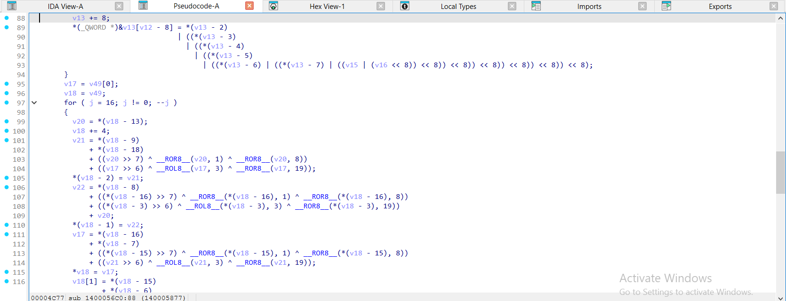

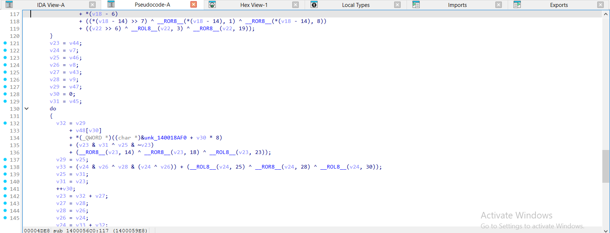

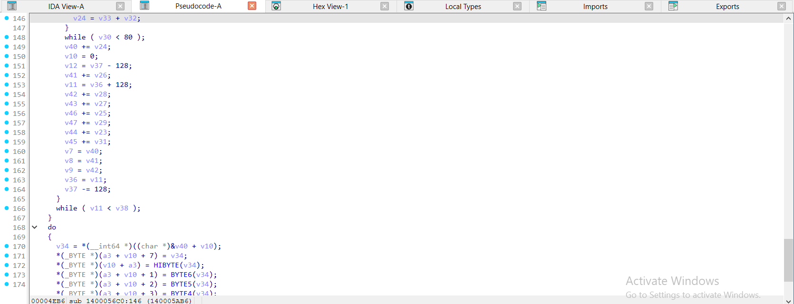

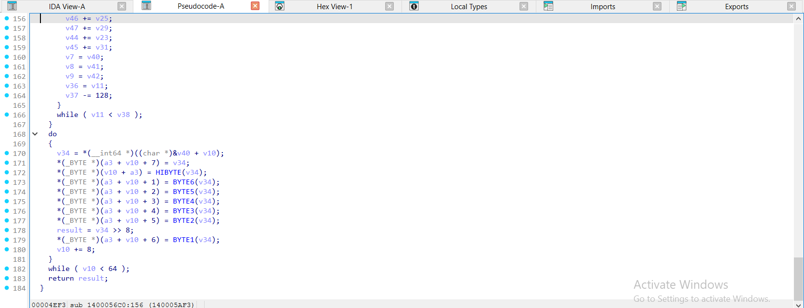

</details>

<details><summary>gcc -O2 – ELF, đã `strip -s` – sha512_hash = <code>sub_4E30</code> – 5 ảnh</summary>

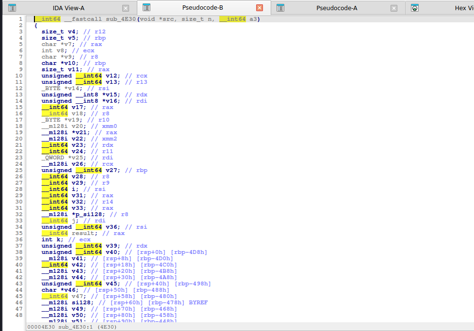

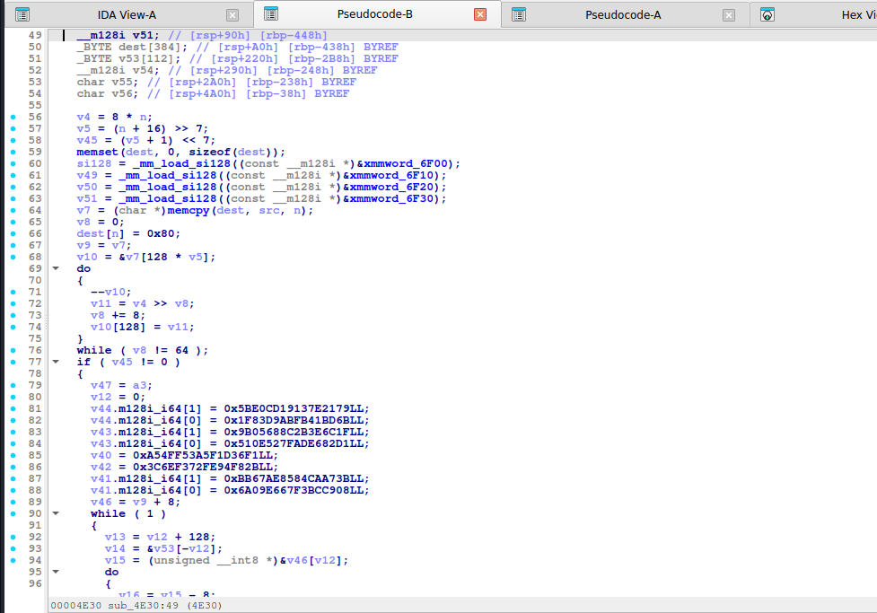

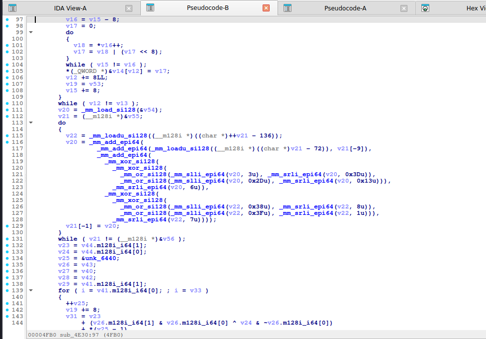

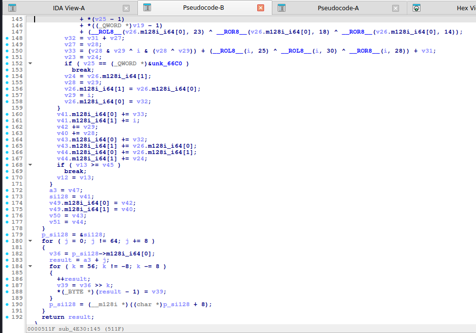

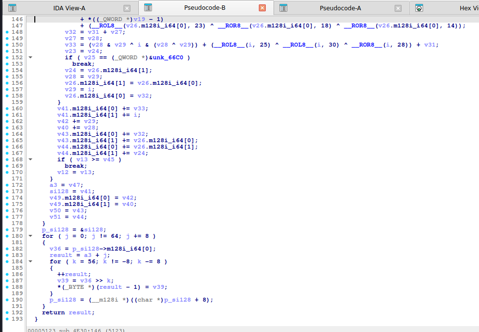

</details>

<details><summary>mingw-w64 -O2 -static – PE, đã `strip -s` – sha512_hash = <code>sub_140004670</code> – 5 ảnh</summary>

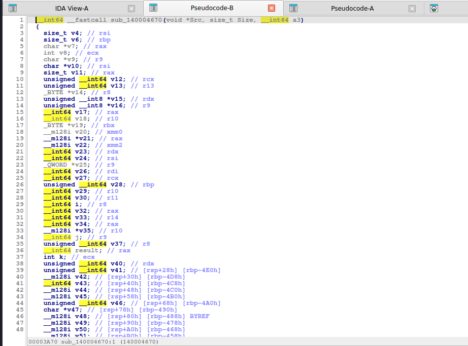

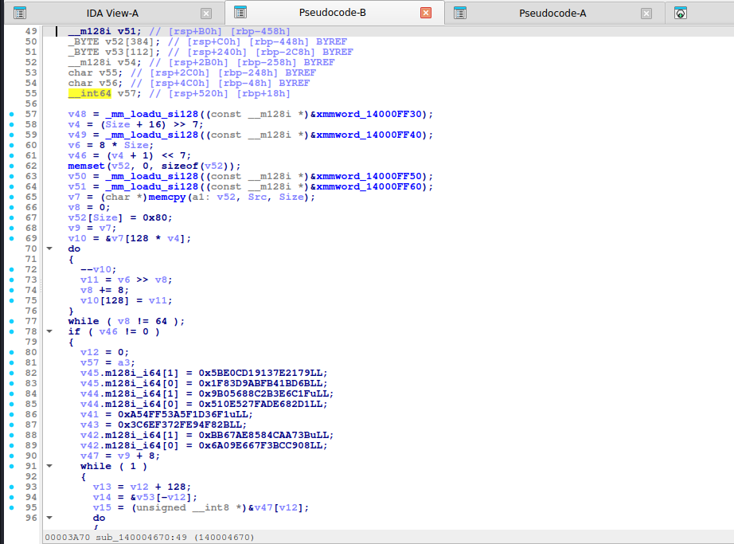

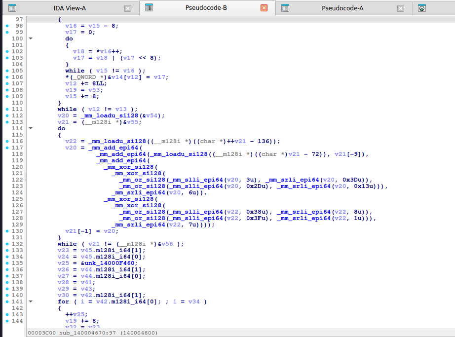

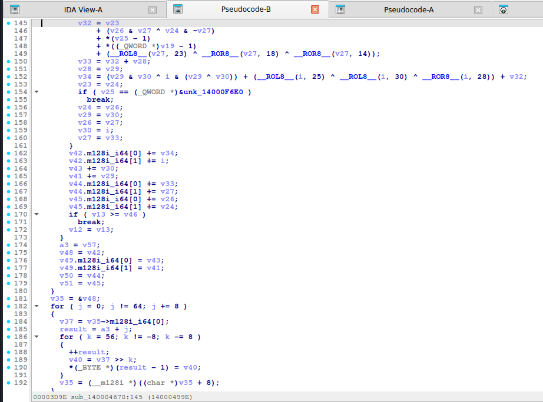

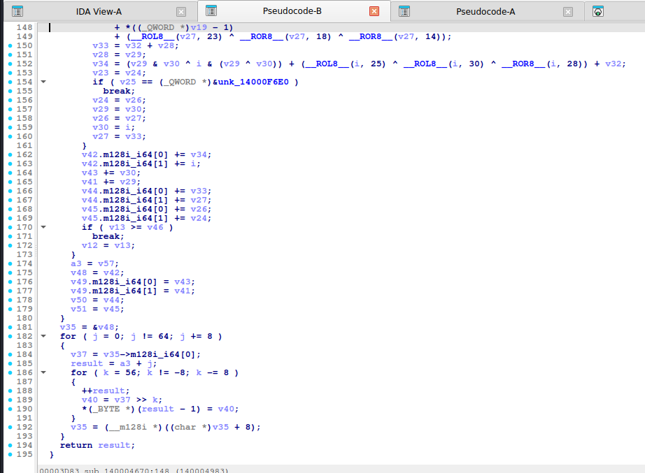

</details>

Nhận xét: tìm `SHA512_K[...]`, bộ `__ROR8__/ROR 28,34,39` và `14,18,41`. Ở **MSVC `/Od`** phép xoay hiện thành cặp dịch 64-bit (`(x >> 28) | (x << 36)`…), tổng hai lượng dịch bằng 64. Khác SHA-256 ở kiểu 64-bit (`unsigned __int64`) và vòng 80.

## 6. Code khai thác

```python
import hashlib
hashlib.sha512(b"Hello, CyberSeaGame!").hexdigest()
# 62cd06bfcb7793e2...b69
```

(`hash_wordlist` / `hash_bruteforce` xem [md5.md](md5.md), `algo="sha512"`.)

## 7. Biến thể & bẫy

- **SHA-384**: hằng khởi tạo khác, cắt 48 byte. **SHA-512/256**, **SHA-512/224** tương tự.
- Dễ nhầm với **SHA-256** khi chỉ nhìn code đã bung: kiểm tra kiểu 64-bit và số `80`.
