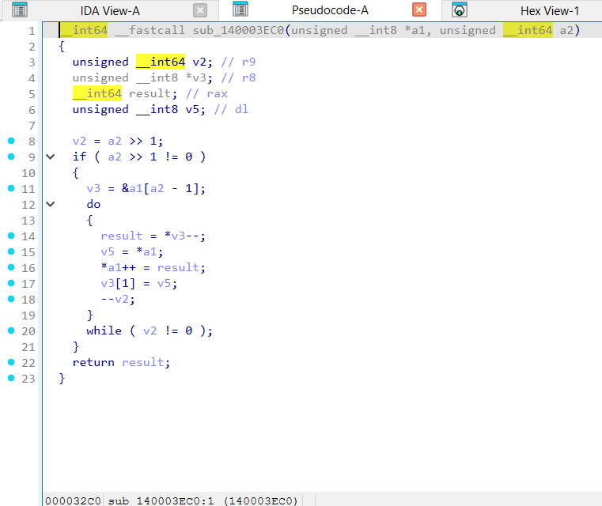
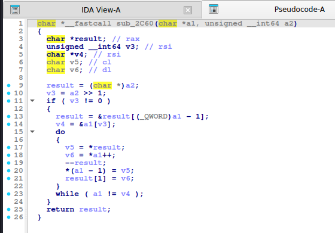
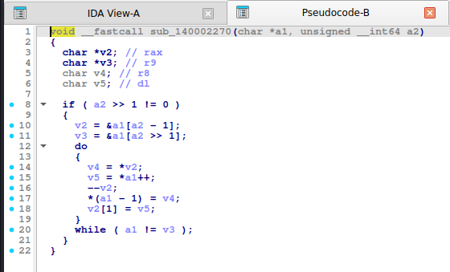
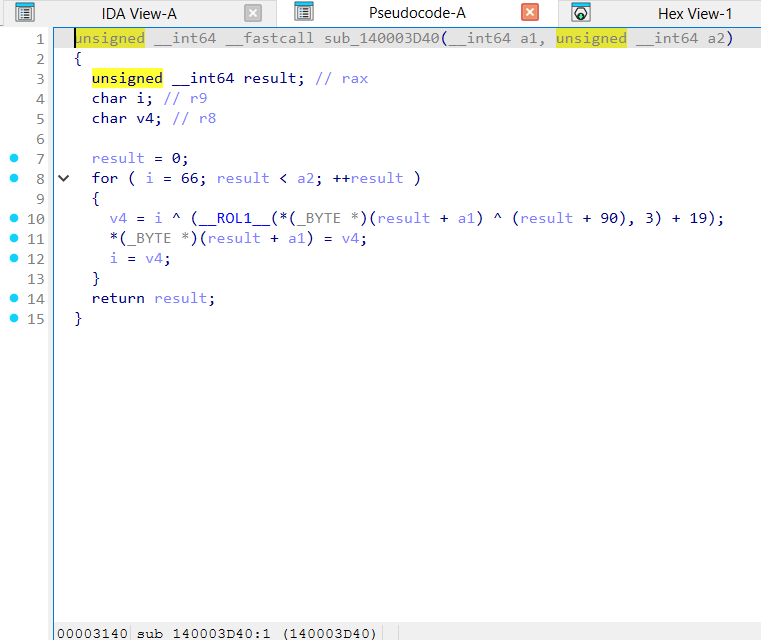
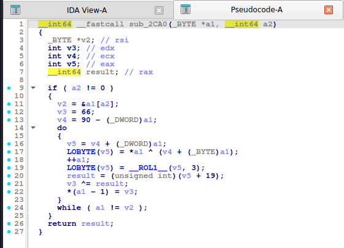
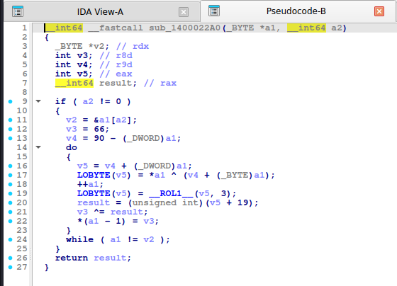

# Đảo mảng và "chuỗi biến đổi" kiểu check flag

> Đa số đề rev nhỏ ghép **nhiều phép đơn giản** (XOR chỉ số, ROL, cộng hằng, XOR dây chuyền…) rồi so với mảng hằng. Bài toán là **đảo ngược từng bước theo thứ tự ngược**.

## 1. Dấu hiệu nhận biết

**Đảo mảng**: hoán vị `b[i] <-> b[n-1-i]` với vòng `i < n/2`; IDA hiện `n >> 1` (`a2 >> 1`), hai con trỏ chạy ngược chiều (`result--`).

**Chuỗi biến đổi (`mix_chain` trong thí nghiệm này)**: một vòng lặp, mỗi phần tử qua nhiều bước:

```
c = b[i] ^ (0x5A + i)       # XOR với chỉ số (+ hằng)
c = rol(c, 3)               # xoay
c = c + 0x13                # cộng hằng
c ^= prev                   # XOR dây chuyền với ĐẦU RA phần tử trước
prev = c ; b[i] = c
```

- Chữ ký: **biến trạng thái `prev`** sống qua các vòng lặp, khởi tạo bằng hằng (`66` = `0x42`), và **được cập nhật bằng chính đầu ra**.
- Hằng khởi tạo + hằng cộng (`19` = `0x13`, `90` = `0x5A`) thường nhỏ, gần ký tự in được.
- `ptr += 19`, `^ v6[i % 4]`... giống bài `chall` trong handout (XOR key 4 byte rồi cộng 19).

## 2. Cách đảo ngược một chuỗi

1. Chép lại **thứ tự các phép** từ pseudo-code (đừng đoán).
2. Viết hàm xuôi (`encrypt`) bằng Python; kiểm tra với 1 cặp vào/ra (hoặc chạy chương trình thật).
3. Viết hàm ngược bằng cách **lật thứ tự** và đảo từng phép:

| Xuôi | Ngược |
|---|---|
| `c = b ^ (K + i)` | `b = c ^ (K + i)` |
| `c = rol(c, 3)` | `c = ror(c, 3)` |
| `c = c + 0x13` | `c = c - 0x13` |
| `c ^= prev` (prev = đầu ra trước) | `c = out[i] ^ out[i-1]` (dùng **đầu ra** đã cho, không phải kết quả vừa giải) |

4. Kiểm tra `decrypt(encrypt(x)) == x` rồi mới áp vào dữ liệu thật.

> Bẫy: ở bước XOR dây chuyền, `prev` là **ciphertext** của phần tử trước. Khi giải, `prev` lấy từ mảng đầu vào (ciphertext) chứ không phải plaintext vừa giải.

## 3. Mã nguồn gốc (C)

```c
void op_reverse(uint8_t *b, size_t n)
{
    for (size_t i = 0; i < n / 2; i++) {
        uint8_t t = b[i];
        b[i] = b[n - 1 - i];
        b[n - 1 - i] = t;
    }
}

void mix_chain(uint8_t *b, size_t n)
{
    uint8_t prev = 0x42;
    for (size_t i = 0; i < n; i++) {
        uint8_t c = (uint8_t)(b[i] ^ (0x5A + i));
        c = (uint8_t)((c << 3) | (c >> 5));
        c = (uint8_t)(c + 0x13);
        c ^= prev;
        prev = c;
        b[i] = c;
    }
}
```

## 4. Pseudo-code IDA thực tế

**op_reverse:**

<details><summary>MSVC /O2 - PE x64 (có PDB)</summary>

```c
void __fastcall op_reverse(unsigned __int8 *b, unsigned __int64 n)
{
  unsigned __int64 v2; // r9
  unsigned __int8 *v3; // r8
  unsigned __int8 v4; // al
  unsigned __int8 v5; // dl

  v2 = n >> 1;
  if ( n >> 1 != 0 )
  {
    v3 = &b[n - 1];
    do
    {
      v4 = *v3--;
      v5 = *b;
      *b++ = v4;
      v3[1] = v5;
      --v2;
    }
    while ( v2 != 0 );
  }
}
```

</details>

<details><summary>MSVC /Od - PE x64 (có PDB)</summary>

```c
void __fastcall op_reverse(unsigned __int8 *b, unsigned __int64 n)
{
  unsigned __int8 t; // [rsp+0h] [rbp-18h]
  unsigned __int64 i; // [rsp+8h] [rbp-10h]

  for ( i = 0; i < n / 2; ++i )
  {
    t = b[i];
    b[i] = b[n - 1 - i];
    b[n - 1 - i] = t;
  }
}
```

</details>

<details><summary>gcc -O2 - ELF x86-64 (chưa strip)</summary>

```c
char *__fastcall op_reverse(char *a1, char *a2)
{
  char *result; // rax
  unsigned __int64 v3; // rsi
  char *v4; // rsi
  char v5; // cl
  char v6; // dl

  result = a2;
  v3 = (unsigned __int64)a2 >> 1;
  if ( v3 != 0 )
  {
    result = &result[(_QWORD)a1 - 1];
    v4 = &a1[v3];
    do
    {
      v5 = *result;
      v6 = *a1++;
      --result;
      *(a1 - 1) = v5;
      result[1] = v6;
    }
    while ( a1 != v4 );
  }
  return result;
}
```

</details>

<details><summary>gcc -O0 - ELF x86-64 (chưa strip)</summary>

```c
unsigned __int64 __fastcall op_reverse(__int64 a1, unsigned __int64 a2)
{
  unsigned __int64 result; // rax
  char v3; // [rsp+17h] [rbp-9h]
  unsigned __int64 i; // [rsp+18h] [rbp-8h]

  for ( i = 0; ; ++i )
  {
    result = a2 >> 1;
    if ( i >= a2 >> 1 )
      break;
    v3 = *(_BYTE *)(a1 + i);
    *(_BYTE *)(a1 + i) = *(_BYTE *)(a2 - i - 1 + a1);
    *(_BYTE *)(a1 + a2 - i - 1) = v3;
  }
  return result;
}
```

</details>

<details><summary>mingw-w64 gcc -O2 - PE x64 (-static)</summary>

```c
void __fastcall op_reverse(char *a1, unsigned __int64 a2)
{
  char *v2; // rax
  char *v3; // r9
  char v4; // r8
  char v5; // dl

  if ( a2 >> 1 != 0 )
  {
    v2 = &a1[a2 - 1];
    v3 = &a1[a2 >> 1];
    do
    {
      v4 = *v2;
      v5 = *a1++;
      --v2;
      *(a1 - 1) = v4;
      v2[1] = v5;
    }
    while ( a1 != v3 );
  }
}
```

</details>

<details><summary>mingw-w64 gcc -O0 - PE x64 (-static)</summary>

```c
unsigned __int64 __fastcall op_reverse(__int64 a1, unsigned __int64 a2)
{
  unsigned __int64 result; // rax
  char v3; // [rsp+7h] [rbp-9h]
  unsigned __int64 i; // [rsp+8h] [rbp-8h]

  for ( i = 0; ; ++i )
  {
    result = a2 >> 1;
    if ( i >= a2 >> 1 )
      break;
    v3 = *(_BYTE *)(a1 + i);
    *(_BYTE *)(a1 + i) = *(_BYTE *)(a2 - i - 1 + a1);
    *(_BYTE *)(a1 + a2 - i - 1) = v3;
  }
  return result;
}
```

</details>

**Bản strip (không symbol)** – IDA chỉ thấy `sub_XXXX`, `a1`, `a2`, `byte_XXXX`; hàm này tên là MSVC /O2 → `sub_140003EC0`, gcc -O2 → `sub_2C60`, mingw-w64 -O2 -static → `sub_140002270`:

<details><summary>MSVC /O2 – PE x64, không PDB (strip) – bản STRIP: <code>op_reverse</code> = <code>sub_140003EC0</code></summary>

```c
__int64 __fastcall sub_140003EC0(unsigned __int8 *a1, unsigned __int64 a2)
{
  unsigned __int64 v2; // r9
  unsigned __int8 *v3; // r8
  __int64 result; // rax
  unsigned __int8 v5; // dl

  v2 = a2 >> 1;
  if ( a2 >> 1 != 0 )
  {
    v3 = &a1[a2 - 1];
    do
    {
      result = *v3--;
      v5 = *a1;
      *a1++ = result;
      v3[1] = v5;
      --v2;
    }
    while ( v2 != 0 );
  }
  return result;
}
```

</details>

<details><summary>gcc -O2 – ELF, đã `strip -s` – bản STRIP: <code>op_reverse</code> = <code>sub_2C60</code></summary>

```c
char *__fastcall sub_2C60(char *a1, unsigned __int64 a2)
{
  char *result; // rax
  unsigned __int64 v3; // rsi
  char *v4; // rsi
  char v5; // cl
  char v6; // dl

  result = (char *)a2;
  v3 = a2 >> 1;
  if ( v3 != 0 )
  {
    result = &result[(_QWORD)a1 - 1];
    v4 = &a1[v3];
    do
    {
      v5 = *result;
      v6 = *a1++;
      --result;
      *(a1 - 1) = v5;
      result[1] = v6;
    }
    while ( a1 != v4 );
  }
  return result;
}
```

</details>

<details><summary>mingw-w64 -O2 -static – PE, đã `strip -s` – bản STRIP: <code>op_reverse</code> = <code>sub_140002270</code></summary>

```c
void __fastcall sub_140002270(char *a1, unsigned __int64 a2)
{
  char *v2; // rax
  char *v3; // r9
  char v4; // r8
  char v5; // dl

  if ( a2 >> 1 != 0 )
  {
    v2 = &a1[a2 - 1];
    v3 = &a1[a2 >> 1];
    do
    {
      v4 = *v2;
      v5 = *a1++;
      --v2;
      *(a1 - 1) = v4;
      v2[1] = v5;
    }
    while ( a1 != v3 );
  }
}
```

</details>

**Ảnh chụp màn hình IDA (bản strip)** – mở từng mục để xem; hàm dài chia thành nhiều trang, mỗi trang là một màn hình IDA:

<details><summary>MSVC /O2 – PE x64, không PDB (strip) – op_reverse = <code>sub_140003EC0</code> – 1 ảnh</summary>



</details>

<details><summary>gcc -O2 – ELF, đã `strip -s` – op_reverse = <code>sub_2C60</code> – 1 ảnh</summary>



</details>

<details><summary>mingw-w64 -O2 -static – PE, đã `strip -s` – op_reverse = <code>sub_140002270</code> – 1 ảnh</summary>



</details>

**mix_chain:**

<details><summary>MSVC /O2 - PE x64 (có PDB)</summary>

```c
void __fastcall mix_chain(unsigned __int8 *b, unsigned __int64 n)
{
  unsigned __int64 v2; // rax
  char i; // r9
  unsigned __int8 v4; // r8

  v2 = 0;
  for ( i = 66; v2 < n; ++v2 )
  {
    v4 = i ^ (__ROL1__(b[v2] ^ (v2 + 90), 3) + 19);
    b[v2] = v4;
    i = v4;
  }
}
```

</details>

<details><summary>MSVC /Od - PE x64 (có PDB)</summary>

```c
void __fastcall mix_chain(unsigned __int8 *b, unsigned __int64 n)
{
  unsigned __int8 prev; // [rsp+1h] [rbp-17h]
  unsigned __int64 i; // [rsp+8h] [rbp-10h]

  prev = 66;
  for ( i = 0; i < n; ++i )
  {
    prev ^= (((int)(unsigned __int8)((i + 90) ^ b[i]) >> 5) | (8 * ((i + 90) ^ b[i]))) + 19;
    b[i] = prev;
  }
}
```

</details>

<details><summary>gcc -O2 - ELF x86-64 (chưa strip)</summary>

```c
__int64 __fastcall mix_chain(_BYTE *a1, __int64 a2)
{
  _BYTE *v2; // rsi
  int v3; // edx
  int v4; // ecx
  int v5; // eax
  __int64 result; // rax

  if ( a2 != 0 )
  {
    v2 = &a1[a2];
    v3 = 66;
    v4 = 90 - (_DWORD)a1;
    do
    {
      v5 = v4 + (_DWORD)a1;
      LOBYTE(v5) = *a1 ^ (v4 + (_BYTE)a1);
      ++a1;
      LOBYTE(v5) = __ROL1__(v5, 3);
      result = (unsigned int)(v5 + 19);
      v3 ^= result;
      *(a1 - 1) = v3;
    }
    while ( a1 != v2 );
  }
  return result;
}
```

</details>

<details><summary>gcc -O0 - ELF x86-64 (chưa strip)</summary>

```c
unsigned __int64 __fastcall mix_chain(__int64 a1, unsigned __int64 a2)
{
  unsigned __int64 result; // rax
  unsigned __int64 i; // [rsp+20h] [rbp-10h]
  char v4; // [rsp+2Fh] [rbp-1h]

  v4 = 66;
  for ( i = 0; ; ++i )
  {
    result = i;
    if ( i >= a2 )
      break;
    v4 ^= ((8 * ((i + 90) ^ *(_BYTE *)(a1 + i))) | ((unsigned __int8)((i + 90) ^ *(_BYTE *)(a1 + i)) >> 5)) + 19;
    *(_BYTE *)(i + a1) = v4;
  }
  return result;
}
```

</details>

<details><summary>mingw-w64 gcc -O2 - PE x64 (-static)</summary>

```c
__int64 __fastcall mix_chain(_BYTE *a1, __int64 a2)
{
  _BYTE *v2; // rdx
  int v3; // r8d
  int v4; // r9d
  int v5; // eax
  __int64 result; // rax

  if ( a2 != 0 )
  {
    v2 = &a1[a2];
    v3 = 66;
    v4 = 90 - (_DWORD)a1;
    do
    {
      v5 = v4 + (_DWORD)a1;
      LOBYTE(v5) = *a1 ^ (v4 + (_BYTE)a1);
      ++a1;
      LOBYTE(v5) = __ROL1__(v5, 3);
      result = (unsigned int)(v5 + 19);
      v3 ^= result;
      *(a1 - 1) = v3;
    }
    while ( a1 != v2 );
  }
  return result;
}
```

</details>

<details><summary>mingw-w64 gcc -O0 - PE x64 (-static)</summary>

```c
unsigned __int64 __fastcall mix_chain(__int64 a1, unsigned __int64 a2)
{
  unsigned __int64 result; // rax
  unsigned __int64 i; // [rsp+10h] [rbp-10h]
  char v4; // [rsp+1Fh] [rbp-1h]

  v4 = 66;
  for ( i = 0; ; ++i )
  {
    result = i;
    if ( i >= a2 )
      break;
    v4 ^= ((8 * ((i + 90) ^ *(_BYTE *)(a1 + i))) | ((unsigned __int8)((i + 90) ^ *(_BYTE *)(a1 + i)) >> 5)) + 19;
    *(_BYTE *)(i + a1) = v4;
  }
  return result;
}
```

</details>

**Bản strip (không symbol)** – IDA chỉ thấy `sub_XXXX`, `a1`, `a2`, `byte_XXXX`; hàm này tên là MSVC /O2 → `sub_140003D40`, gcc -O2 → `sub_2CA0`, mingw-w64 -O2 -static → `sub_1400022A0`:

<details><summary>MSVC /O2 – PE x64, không PDB (strip) – bản STRIP: <code>mix_chain</code> = <code>sub_140003D40</code></summary>

```c
unsigned __int64 __fastcall sub_140003D40(__int64 a1, unsigned __int64 a2)
{
  unsigned __int64 result; // rax
  char i; // r9
  char v4; // r8

  result = 0;
  for ( i = 66; result < a2; ++result )
  {
    v4 = i ^ (__ROL1__(*(_BYTE *)(result + a1) ^ (result + 90), 3) + 19);
    *(_BYTE *)(result + a1) = v4;
    i = v4;
  }
  return result;
}
```

</details>

<details><summary>gcc -O2 – ELF, đã `strip -s` – bản STRIP: <code>mix_chain</code> = <code>sub_2CA0</code></summary>

```c
__int64 __fastcall sub_2CA0(_BYTE *a1, __int64 a2)
{
  _BYTE *v2; // rsi
  int v3; // edx
  int v4; // ecx
  int v5; // eax
  __int64 result; // rax

  if ( a2 != 0 )
  {
    v2 = &a1[a2];
    v3 = 66;
    v4 = 90 - (_DWORD)a1;
    do
    {
      v5 = v4 + (_DWORD)a1;
      LOBYTE(v5) = *a1 ^ (v4 + (_BYTE)a1);
      ++a1;
      LOBYTE(v5) = __ROL1__(v5, 3);
      result = (unsigned int)(v5 + 19);
      v3 ^= result;
      *(a1 - 1) = v3;
    }
    while ( a1 != v2 );
  }
  return result;
}
```

</details>

<details><summary>mingw-w64 -O2 -static – PE, đã `strip -s` – bản STRIP: <code>mix_chain</code> = <code>sub_1400022A0</code></summary>

```c
__int64 __fastcall sub_1400022A0(_BYTE *a1, __int64 a2)
{
  _BYTE *v2; // rdx
  int v3; // r8d
  int v4; // r9d
  int v5; // eax
  __int64 result; // rax

  if ( a2 != 0 )
  {
    v2 = &a1[a2];
    v3 = 66;
    v4 = 90 - (_DWORD)a1;
    do
    {
      v5 = v4 + (_DWORD)a1;
      LOBYTE(v5) = *a1 ^ (v4 + (_BYTE)a1);
      ++a1;
      LOBYTE(v5) = __ROL1__(v5, 3);
      result = (unsigned int)(v5 + 19);
      v3 ^= result;
      *(a1 - 1) = v3;
    }
    while ( a1 != v2 );
  }
  return result;
}
```

</details>

**Ảnh chụp màn hình IDA (bản strip)** – mở từng mục để xem; hàm dài chia thành nhiều trang, mỗi trang là một màn hình IDA:

<details><summary>MSVC /O2 – PE x64, không PDB (strip) – mix_chain = <code>sub_140003D40</code> – 1 ảnh</summary>



</details>

<details><summary>gcc -O2 – ELF, đã `strip -s` – mix_chain = <code>sub_2CA0</code> – 1 ảnh</summary>



</details>

<details><summary>mingw-w64 -O2 -static – PE, đã `strip -s` – mix_chain = <code>sub_1400022A0</code> – 1 ảnh</summary>



</details>

Nhận xét: gcc `-O2` đưa `0x5A + i` thành biến `v4 = 90 - a1` rồi cộng lại với con trỏ đang tăng (`v4 + (_BYTE)a1`), nên chỉ số `i` ẩn dưới dạng "địa chỉ con trỏ". Nếu thấy một hằng trừ đi con trỏ rồi cộng lại với con trỏ, đó là **chỉ số vòng lặp**.

## 5. Code giải mã

**Python:**

```python
def rol8(x, k): return ((x << k) | (x >> (8 - k))) & 0xFF


def ror8(x, k): return ((x >> k) | (x << (8 - k))) & 0xFF


def mix_chain_encrypt(data):
    """c=b^(0x5A+i); c=rol3(c); c+=0x13; c^=prev; prev=c (giong ham mix_chain trong algos.c)."""
    out, prev = bytearray(), 0x42
    for i, b in enumerate(data):
        c = b ^ ((0x5A + i) & 0xFF)
        c = rol8(c, 3)
        c = (c + 0x13) & 0xFF
        c ^= prev
        prev = c
        out.append(c)
    return bytes(out)


def mix_chain_decrypt(data):
    """Dao nguoc tung buoc: xor prev -> tru 0x13 -> ror3 -> xor (0x5A+i). Day la cach dao ham 'chain'."""
    out, prev = bytearray(), 0x42
    for i, c in enumerate(data):
        t = c ^ prev
        prev = c
        t = (t - 0x13) & 0xFF
        t = ror8(t, 3)
        out.append(t ^ ((0x5A + i) & 0xFF))
    return bytes(out)
```

**C:**

```c
#include <stdint.h>
#include <stddef.h>
#include <string.h>

#define ROR8(x, n)  ((uint8_t)(((x) >> (n)) | ((x) << (8 - (n)))))

static inline void ctf_mix_chain_decrypt(uint8_t *b, size_t n)
{
    uint8_t prev = 0x42;
    for (size_t i = 0; i < n; i++) {
        uint8_t c = b[i], t = (uint8_t)(c ^ prev);
        prev = c;
        t = (uint8_t)(t - 0x13);
        t = ROR8(t, 3);
        b[i] = (uint8_t)(t ^ (uint8_t)(0x5A + i));
    }
}
```

## 6. Mẹo

- Nếu các bước khó đảo (mất thông tin, ví dụ `>>` hoặc `&` đơn thuần), **dùng z3**: khai báo từng byte flag là biến 8-bit, mã hóa lại bằng biểu thức z3 và đặt bằng mảng đích (template z3 nằm ở phần sau của bộ ghi chú).
- Brute force từng byte: nếu mỗi byte output chỉ phụ thuộc `i`, `prev` và byte input thì thử 256 giá trị cho từng vị trí (O(256·n)).
