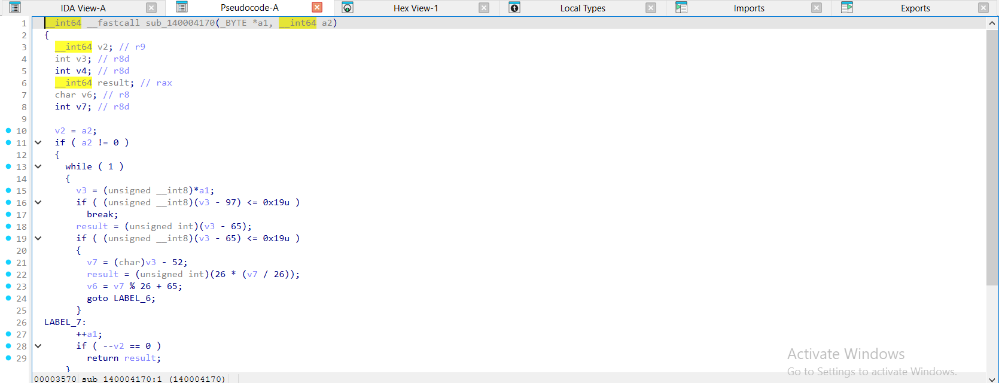
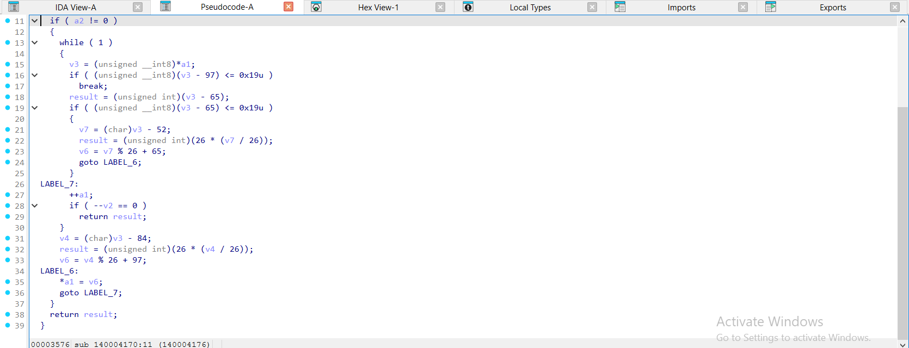
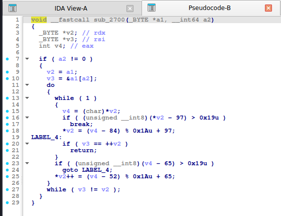

# ROT13 / Caesar

> Dịch chữ cái cố định (13 vị trí cho ROT13). Chỉ đổi chữ cái, giữ nguyên chữ số và ký tự khác. ROT13 tự nghịch đảo.

## 1. Dấu hiệu nhận biết

- Hai nhánh theo dải ký tự: **`'a'..'z'`** (`97..122`) và **`'A'..'Z'`** (`65..90`).
- Biểu thức `(c - 'a' + 13) % 26 + 'a'`. IDA đã rút gọn hằng số: `(v3 - 84) % 26 + 97` (vì `-97 + 13 = -84`) và `(v3 - 52) % 26 + 65` (vì `-65 + 13 = -52`). **Hằng số `84` / `52` / `26` đi cùng nhau là chữ ký của ROT13**.
- `-O2` biến so sánh dải thành `(unsigned __int8)(c - 97) > 0x19u` (`0x19` = 25) và `% 0x1Au`.
- Caesar tổng quát: số `13` thay bằng `k` (khóa), có thể là `k % 26` hoặc `+ k` rồi `- 26` nếu vượt.

## 2. Thuật toán (mã giả)

```
nếu 'a' <= c <= 'z': c = (c - 'a' + 13) % 26 + 'a'
nếu 'A' <= c <= 'Z': c = (c - 'A' + 13) % 26 + 'A'
```

## 3. Mã hóa / giải mã

ROT13: áp dụng **hai lần** là về bản gốc. Caesar khóa `k`: giải mã bằng `26 - k` (hoặc thử cả 25 khóa nếu không biết `k`).

## 4. Mã nguồn gốc (C)

```c
void rot13(char *s, size_t n)
{
    for (size_t i = 0; i < n; i++) {
        char c = s[i];
        if (c >= 'a' && c <= 'z') s[i] = (char)((c - 'a' + 13) % 26 + 'a');
        else if (c >= 'A' && c <= 'Z') s[i] = (char)((c - 'A' + 13) % 26 + 'A');
    }
}
```

## 5. Pseudo-code IDA thực tế

<details><summary>MSVC /O2 - PE x64 (có PDB)</summary>

```c
void __fastcall rot13(char *s, unsigned __int64 n)
{
  unsigned __int64 v2; // r9
  char v3; // r8
  char v4; // r8

  v2 = n;
  if ( n != 0 )
  {
    while ( 1 )
    {
      v3 = *s;
      if ( (unsigned __int8)(*s - 97) <= 0x19u )
        break;
      if ( (unsigned __int8)(v3 - 65) <= 0x19u )
      {
        v4 = (v3 - 52) % 26 + 65;
        goto LABEL_6;
      }
LABEL_7:
      ++s;
      if ( --v2 == 0 )
        return;
    }
    v4 = (v3 - 84) % 26 + 97;
LABEL_6:
    *s = v4;
    goto LABEL_7;
  }
}
```

</details>

<details><summary>MSVC /Od - PE x64 (có PDB)</summary>

```c
void __fastcall rot13(char *s, unsigned __int64 n)
{
  char c; // [rsp+0h] [rbp-18h]
  unsigned __int64 i; // [rsp+8h] [rbp-10h]

  for ( i = 0; i < n; ++i )
  {
    c = s[i];
    if ( c < 97 || c > 122 )
    {
      if ( c >= 65 && c <= 90 )
        s[i] = (c - 52) % 26 + 65;
    }
    else
    {
      s[i] = (c - 84) % 26 + 97;
    }
  }
}
```

</details>

<details><summary>gcc -O2 - ELF x86-64 (chưa strip)</summary>

```c
void __fastcall rot13(_BYTE *a1, __int64 a2)
{
  _BYTE *v2; // rdx
  _BYTE *v3; // rsi
  int v4; // eax

  if ( a2 != 0 )
  {
    v2 = a1;
    v3 = &a1[a2];
    do
    {
      while ( 1 )
      {
        v4 = (char)*v2;
        if ( (unsigned __int8)(*v2 - 97) > 0x19u )
          break;
        *v2 = (v4 - 84) % 0x1Au + 97;
LABEL_4:
        if ( v3 == ++v2 )
          return;
      }
      if ( (unsigned __int8)(v4 - 65) > 0x19u )
        goto LABEL_4;
      *v2++ = (v4 - 52) % 0x1Au + 65;
    }
    while ( v3 != v2 );
  }
}
```

</details>

<details><summary>gcc -O0 - ELF x86-64 (chưa strip)</summary>

```c
unsigned __int64 __fastcall rot13(__int64 a1, unsigned __int64 a2)
{
  unsigned __int64 result; // rax
  char v3; // [rsp+17h] [rbp-9h]
  unsigned __int64 i; // [rsp+18h] [rbp-8h]

  for ( i = 0; ; ++i )
  {
    result = i;
    if ( i >= a2 )
      break;
    v3 = *(_BYTE *)(a1 + i);
    if ( v3 <= 96 || v3 > 122 )
    {
      if ( v3 > 64 && v3 <= 90 )
        *(_BYTE *)(a1 + i) = (v3 - 52) % 26 + 65;
    }
    else
    {
      *(_BYTE *)(a1 + i) = (v3 - 84) % 26 + 97;
    }
  }
  return result;
}
```

</details>

<details><summary>mingw-w64 gcc -O2 - PE x64 (-static)</summary>

```c
void __fastcall rot13(_BYTE *a1, __int64 a2)
{
  _BYTE *v3; // rdx
  _BYTE *v4; // r8
  int v5; // eax

  if ( a2 != 0 )
  {
    v3 = a1;
    v4 = &a1[a2];
    do
    {
      while ( 1 )
      {
        v5 = (char)*v3;
        if ( (unsigned __int8)(*v3 - 97) > 0x19u )
          break;
        *v3 = (v5 - 84) % 0x1Au + 97;
LABEL_4:
        if ( v4 == ++v3 )
          return;
      }
      if ( (unsigned __int8)(v5 - 65) > 0x19u )
        goto LABEL_4;
      *v3++ = (v5 - 52) % 0x1Au + 65;
    }
    while ( v4 != v3 );
  }
}
```

</details>

<details><summary>mingw-w64 gcc -O0 - PE x64 (-static)</summary>

```c
unsigned __int64 __fastcall rot13(__int64 a1, unsigned __int64 a2)
{
  unsigned __int64 result; // rax
  char v3; // [rsp+7h] [rbp-9h]
  unsigned __int64 i; // [rsp+8h] [rbp-8h]

  for ( i = 0; ; ++i )
  {
    result = i;
    if ( i >= a2 )
      break;
    v3 = *(_BYTE *)(a1 + i);
    if ( v3 <= 96 || v3 > 122 )
    {
      if ( v3 > 64 && v3 <= 90 )
        *(_BYTE *)(a1 + i) = (v3 - 52) % 26 + 65;
    }
    else
    {
      *(_BYTE *)(a1 + i) = (v3 - 84) % 26 + 97;
    }
  }
  return result;
}
```

</details>

**Bản strip (không symbol)** – IDA chỉ thấy `sub_XXXX`, `a1`, `a2`, `byte_XXXX`; hàm này tên là MSVC /O2 → `sub_140004170`, gcc -O2 → `sub_2700`, mingw-w64 -O2 -static → `sub_140001C40`:

<details><summary>MSVC /O2 – PE x64, không PDB (strip) – bản STRIP: <code>rot13</code> = <code>sub_140004170</code></summary>

```c
__int64 __fastcall sub_140004170(_BYTE *a1, __int64 a2)
{
  __int64 v2; // r9
  int v3; // r8d
  int v4; // r8d
  __int64 result; // rax
  char v6; // r8
  int v7; // r8d

  v2 = a2;
  if ( a2 != 0 )
  {
    while ( 1 )
    {
      v3 = (unsigned __int8)*a1;
      if ( (unsigned __int8)(v3 - 97) <= 0x19u )
        break;
      result = (unsigned int)(v3 - 65);
      if ( (unsigned __int8)(v3 - 65) <= 0x19u )
      {
        v7 = (char)v3 - 52;
        result = (unsigned int)(26 * (v7 / 26));
        v6 = v7 % 26 + 65;
        goto LABEL_6;
      }
LABEL_7:
      ++a1;
      if ( --v2 == 0 )
        return result;
    }
    v4 = (char)v3 - 84;
    result = (unsigned int)(26 * (v4 / 26));
    v6 = v4 % 26 + 97;
LABEL_6:
    *a1 = v6;
    goto LABEL_7;
  }
  return result;
}
```

</details>

<details><summary>gcc -O2 – ELF, đã `strip -s` – bản STRIP: <code>rot13</code> = <code>sub_2700</code></summary>

```c
void __fastcall sub_2700(_BYTE *a1, __int64 a2)
{
  _BYTE *v2; // rdx
  _BYTE *v3; // rsi
  int v4; // eax

  if ( a2 != 0 )
  {
    v2 = a1;
    v3 = &a1[a2];
    do
    {
      while ( 1 )
      {
        v4 = (char)*v2;
        if ( (unsigned __int8)(*v2 - 97) > 0x19u )
          break;
        *v2 = (v4 - 84) % 0x1Au + 97;
LABEL_4:
        if ( v3 == ++v2 )
          return;
      }
      if ( (unsigned __int8)(v4 - 65) > 0x19u )
        goto LABEL_4;
      *v2++ = (v4 - 52) % 0x1Au + 65;
    }
    while ( v3 != v2 );
  }
}
```

</details>

<details><summary>mingw-w64 -O2 -static – PE, đã `strip -s` – bản STRIP: <code>rot13</code> = <code>sub_140001C40</code></summary>

```c
void __fastcall sub_140001C40(_BYTE *a1, __int64 a2)
{
  _BYTE *v3; // rdx
  _BYTE *v4; // r8
  int v5; // eax

  if ( a2 != 0 )
  {
    v3 = a1;
    v4 = &a1[a2];
    do
    {
      while ( 1 )
      {
        v5 = (char)*v3;
        if ( (unsigned __int8)(*v3 - 97) > 0x19u )
          break;
        *v3 = (v5 - 84) % 0x1Au + 97;
LABEL_4:
        if ( v4 == ++v3 )
          return;
      }
      if ( (unsigned __int8)(v5 - 65) > 0x19u )
        goto LABEL_4;
      *v3++ = (v5 - 52) % 0x1Au + 65;
    }
    while ( v4 != v3 );
  }
}
```

</details>

**Ảnh chụp màn hình IDA (bản strip)** – mở từng mục để xem; hàm dài chia thành nhiều trang, mỗi trang là một màn hình IDA:

<details><summary>MSVC /O2 – PE x64, không PDB (strip) – rot13 = <code>sub_140004170</code> – 2 ảnh</summary>





</details>

<details><summary>gcc -O2 – ELF, đã `strip -s` – rot13 = <code>sub_2700</code> – 1 ảnh</summary>



</details>

<details><summary>mingw-w64 -O2 -static – PE, đã `strip -s` – rot13 = <code>sub_140001C40</code> – 1 ảnh</summary>


</details>

## 6. Code giải mã

```python
import codecs
codecs.decode("Uryyb, PlorfFrnTnzr!", "rot13")        # ROT13
def caesar(s, k):                                      # Caesar tong quat, giai ma: caesar(s, -k)
    out = []
    for ch in s:
        if ch.isalpha():
            base = ord('a') if ch.islower() else ord('A')
            ch = chr((ord(ch) - base + k) % 26 + base)
        out.append(ch)
    return "".join(out)
```

```c
/* C: giai ma Caesar khoa k (ROT13: k = 13) */
static void caesar_dec(char *s, int k)
{
    for (; *s; s++) {
        if (*s >= 'a' && *s <= 'z') *s = (char)((*s - 'a' - k + 26) % 26 + 'a');
        else if (*s >= 'A' && *s <= 'Z') *s = (char)((*s - 'A' - k + 26) % 26 + 'A');
    }
}
```

## 7. Biến thể & bẫy

- ROT47 (dải `33..126`, `+47 % 94`): cùng ý tưởng nhưng hằng `47`, `94`, `33`.
- Chữ số bị dịch riêng (`ROT5`) khi đề đổi cả `0-9`.
