# ROL / ROR, ADD / SUB, NOT (phép toán từng byte & từng từ)

> Các "mắt xích" nhỏ nối nhau tạo thành hàm biến đổi flag. Mỗi phép đều **khả nghịch**: ROL <-> ROR, ADD <-> SUB, NOT <-> NOT.

## 1. Dấu hiệu nhận biết

| Phép | Mã C | IDA hay hiện | Ghi chú |
|---|---|---|---|
| ROL 8-bit | `(x << k) \| (x >> (8-k))` | `__ROL1__(x, k)` hoặc `(x << 3) \| (x >> 5)` | ở **`-O0` (gcc) và `/Od` (MSVC)** hiện **nguyên công thức** `(x >> (8 - k)) \| (x << k)`; ở **`-O2`/`/O2`** cả gcc và MSVC gom về **`__ROL1__(x, k)`** |
| ROR 8-bit | `(x >> k) \| (x << (8-k))` | `__ROR1__(x, k)` | |
| ROL/ROR 32-bit | `ROL32(x, n)` | `__ROL4__(x, n)`, `__ROR4__(x, n)` | Quan sát được ở **cả 6 build** khi lượng xoay là biến (hàm bọc `op_rol32` hiện `return (unsigned int)__ROL4__(x, k);`). Khi lượng xoay là **hằng số** ở MSVC `/Od`/gcc `-O0` có thể hiện thành cặp dịch `(x >> 25) \| (x << 7)`. Binary dùng intrinsic `_rotl`/`_rotr` của MSVC thì IDA thường nhận lại thành `__ROL4__`/`__ROR4__` |
| ROL 64-bit | | `__ROL8__`, `__ROR8__`, `_rotl64` | |
| ADD/SUB 8-bit | `b[i] += k` | `*(_BYTE *)(a1 + i) += a3` | `-O2`: `_mm_add_epi8` / `_mm_sub_epi8` |
| NOT | `~b[i]` | `~*(_BYTE *)(...)` hoặc `^ 0xFF` | `-O2`: `_mm_xor_si128(v, (__m128i)-1LL)` |

- ROL `n` bit 32-bit bằng ROR `32-n` bit: ví dụ Salsa20 dùng ROL 18 nhưng IDA có thể hiện **`__ROR4__(x, 14)`**.
- Trong assembly: `rol`/`ror` (rotate), `add`/`sub`, `not`, `xor reg, 0FFh`.
- Khi dịch bit mà không xoay: `shl`/`shr`/`sar` (mất bit) -> **không đảo ngược được trực tiếp**, phải brute force/ giải phương trình.

## 2. Thuật toán (mã giả)

```
rol8(x,k) = ((x << k) | (x >> (8-k))) & 0xFF
ror8(x,k) = ((x >> k) | (x << (8-k))) & 0xFF
add(b,k)  = (b + k) & 0xFF         sub(b,k) = (b - k) & 0xFF
not(b)    = b ^ 0xFF
```

## 3. Mã hóa / giải mã

| Đã áp dụng | Cách đảo |
|---|---|
| `b = rol8(b, k)` | `b = ror8(b, k)` |
| `b = ror8(b, k)` | `b = rol8(b, k)` |
| `b = (b + k) & 0xFF` | `b = (b - k) & 0xFF` |
| `b = (b - k) & 0xFF` | `b = (b + k) & 0xFF` |
| `b = ~b` | `b = ~b` |
| chuỗi nhiều phép | đảo **theo thứ tự ngược lại** |

## 4. Mã nguồn gốc (C)

```c
void op_add(uint8_t *b, size_t n, uint8_t k)
{
    for (size_t i = 0; i < n; i++) b[i] = (uint8_t)(b[i] + k);
}

void op_sub(uint8_t *b, size_t n, uint8_t k)
{
    for (size_t i = 0; i < n; i++) b[i] = (uint8_t)(b[i] - k);
}

void op_not(uint8_t *b, size_t n)
{
    for (size_t i = 0; i < n; i++) b[i] = (uint8_t)~b[i];
}

void op_rol8(uint8_t *b, size_t n, int k)
{
    for (size_t i = 0; i < n; i++) b[i] = (uint8_t)((b[i] << k) | (b[i] >> (8 - k)));
}

void op_ror8(uint8_t *b, size_t n, int k)
{
    for (size_t i = 0; i < n; i++) b[i] = (uint8_t)((b[i] >> k) | (b[i] << (8 - k)));
}

uint32_t op_rol32(uint32_t x, int k) { return ROL32(x, k); }

uint32_t op_ror32(uint32_t x, int k) { return ROR32(x, k); }
```

## 5. Pseudo-code IDA thực tế

**ROL 8-bit trên mảng:**

<details><summary>MSVC /O2 - PE x64 (có PDB)</summary>

```c
void __fastcall op_rol8(char *b, unsigned __int64 n, char k)
{
  char v4; // r9

  for ( ; n != 0; --n )
  {
    v4 = *b++;
    *(b - 1) = __ROL1__(v4, k);
  }
}
```

</details>

<details><summary>MSVC /Od - PE x64 (có PDB)</summary>

```c
void __fastcall op_rol8(unsigned __int8 *b, unsigned __int64 n, char k)
{
  unsigned __int64 i; // [rsp+8h] [rbp-10h]

  for ( i = 0; i < n; ++i )
    b[i] = ((int)b[i] >> (8 - k)) | (b[i] << k);
}
```

</details>

<details><summary>gcc -O2 - ELF x86-64 (chưa strip)</summary>

```c
void __fastcall op_rol8(const __m128i *a1, unsigned __int64 a2, char a3)
{
  int v4; // ecx
  unsigned __int64 v5; // rsi
  const __m128i *v6; // rax
  __m128i v7; // xmm7
  __m128i v8; // xmm3
  __m128i v9; // xmm0
  __m128i v10; // xmm1
  __m128i v11; // xmm0
  __m128i v12; // xmm1
  char v13; // al
  unsigned __int64 v14; // rsi
  char v15; // al

  if ( a2 != 0 )
  {
    v4 = a3 & 7;
    if ( a2 - 1 <= 0xE )
    {
      v5 = 0;
    }
    else
    {
      v5 = a2 & 0xFFFFFFFFFFFFFFF0LL;
      v6 = a1;
      v7 = _mm_cvtsi32_si128(v4);
      v8 = _mm_srli_epi16((__m128i)-1LL, 8u);
      do
      {
        v9 = _mm_loadu_si128(v6++);
        v10 = v9;
        v11 = _mm_unpackhi_epi8(v9, (__m128i)0LL);
        v12 = _mm_unpacklo_epi8(v10, (__m128i)0LL);
        v6[-1] = _mm_or_si128(
                   _mm_packus_epi16(
                     _mm_and_si128(_mm_sll_epi16(v12, v7), v8),
                     _mm_and_si128(_mm_sll_epi16(v11, v7), v8)),
                   _mm_packus_epi16(
                     _mm_and_si128(_mm_srl_epi16(v12, (__m128i)(-(char)v4 & 7)), v8),
                     _mm_and_si128(_mm_srl_epi16(v11, (__m128i)(-(char)v4 & 7)), v8)));
      }
      while ( v6 != (const __m128i *)&a1->m128i_i8[v5] );
      if ( a2 == v5 )
        return;
    }
    v13 = v5;
    a1->m128i_i8[v5] = __ROL1__(a1->m128i_i8[v5], v4);
    v14 = v5 + 1;
    v15 = a2 + ~v13;
    if ( v14 < a2 )
    {
      if ( (v15 & 1) == 0 || (a1->m128i_i8[v14] = __ROL1__(a1->m128i_i8[v14], v4), ++v14, v14 < a2) )
      {
        do
        {
          a1->m128i_i8[v14] = __ROL1__(a1->m128i_i8[v14], v4);
          a1->m128i_i8[v14 + 1] = __ROL1__(a1->m128i_i8[v14 + 1], v4);
          v14 += 2LL;
        }
        while ( v14 < a2 );
      }
    }
  }
}
```

</details>

<details><summary>gcc -O0 - ELF x86-64 (chưa strip)</summary>

```c
unsigned __int64 __fastcall op_rol8(__int64 a1, unsigned __int64 a2, char a3)
{
  unsigned __int64 result; // rax
  unsigned __int64 i; // [rsp+1Ch] [rbp-8h]

  for ( i = 0; ; ++i )
  {
    result = i;
    if ( i >= a2 )
      break;
    *(_BYTE *)(a1 + i) = ((int)*(unsigned __int8 *)(a1 + i) >> (8 - a3)) | (*(_BYTE *)(a1 + i) << a3);
  }
  return result;
}
```

</details>

<details><summary>mingw-w64 gcc -O2 - PE x64 (-static)</summary>

```c
void __fastcall op_rol8(const __m128i *a1, unsigned __int64 a2, char a3)
{
  int v4; // ecx
  const __m128i *v5; // rax
  __m128i v6; // xmm7
  unsigned __int64 v7; // r9
  __m128i v8; // xmm3
  __m128i v9; // xmm0
  __m128i v10; // xmm1
  __m128i v11; // xmm0
  __m128i v12; // xmm1
  char v13; // al
  unsigned __int64 v14; // r9
  char v15; // al

  if ( a2 != 0 )
  {
    v4 = a3 & 7;
    if ( a2 - 1 <= 0xE )
    {
      v7 = 0;
    }
    else
    {
      v5 = a1;
      v6 = _mm_cvtsi32_si128(v4);
      v7 = a2 & 0xFFFFFFFFFFFFFFF0uLL;
      v8 = _mm_srli_epi16((__m128i)-1LL, 8u);
      do
      {
        v9 = _mm_loadu_si128(v5++);
        v10 = v9;
        v11 = _mm_unpackhi_epi8(v9, (__m128i)0LL);
        v12 = _mm_unpacklo_epi8(v10, (__m128i)0LL);
        v5[-1] = _mm_or_si128(
                   _mm_packus_epi16(
                     _mm_and_si128(_mm_sll_epi16(v12, v6), v8),
                     _mm_and_si128(_mm_sll_epi16(v11, v6), v8)),
                   _mm_packus_epi16(
                     _mm_and_si128(_mm_srl_epi16(v12, (__m128i)(-(char)v4 & 7)), v8),
                     _mm_and_si128(_mm_srl_epi16(v11, (__m128i)(-(char)v4 & 7)), v8)));
      }
      while ( v5 != (const __m128i *)&a1->m128i_i8[a2 & 0xFFFFFFFFFFFFFFF0uLL] );
      if ( a2 == v7 )
        return;
    }
    v13 = v7;
    a1->m128i_i8[v7] = __ROL1__(a1->m128i_i8[v7], v4);
    v14 = v7 + 1;
    v15 = a2 + ~v13;
    if ( v14 < a2 )
    {
      if ( (v15 & 1) == 0 || (a1->m128i_i8[v14] = __ROL1__(a1->m128i_i8[v14], v4), ++v14, v14 < a2) )
      {
        do
        {
          a1->m128i_i8[v14] = __ROL1__(a1->m128i_i8[v14], v4);
          a1->m128i_i8[v14 + 1] = __ROL1__(a1->m128i_i8[v14 + 1], v4);
          v14 += 2LL;
        }
        while ( v14 < a2 );
      }
    }
  }
}
```

</details>

<details><summary>mingw-w64 gcc -O0 - PE x64 (-static)</summary>

```c
unsigned __int64 __fastcall op_rol8(__int64 a1, unsigned __int64 a2, char a3)
{
  unsigned __int64 result; // rax
  unsigned __int64 i; // [rsp+8h] [rbp-8h]

  for ( i = 0; ; ++i )
  {
    result = i;
    if ( i >= a2 )
      break;
    *(_BYTE *)(a1 + i) = ((int)*(unsigned __int8 *)(a1 + i) >> (8 - a3)) | (*(_BYTE *)(a1 + i) << a3);
  }
  return result;
}
```

</details>

**Bản strip (không symbol)** – IDA chỉ thấy `sub_XXXX`, `a1`, `a2`, `byte_XXXX`; hàm này tên là MSVC /O2 → `sub_140003F00`, gcc -O2 → `sub_2A60`, mingw-w64 -O2 -static → `sub_140002020`:

<details><summary>MSVC /O2 – PE x64, không PDB (strip) – bản STRIP: <code>op_rol8</code> = <code>sub_140003F00</code></summary>

```c
char *__fastcall sub_140003F00(char *a1, __int64 a2, char a3)
{
  char *result; // rax
  char v4; // r9

  for ( result = a1; a2 != 0; --a2 )
  {
    v4 = *result++;
    *(result - 1) = __ROL1__(v4, a3);
  }
  return result;
}
```

</details>

<details><summary>gcc -O2 – ELF, đã `strip -s` – bản STRIP: <code>op_rol8</code> = <code>sub_2A60</code></summary>

```c
void __fastcall sub_2A60(const __m128i *a1, unsigned __int64 a2, char a3)
{
  int v4; // ecx
  unsigned __int64 v5; // rsi
  const __m128i *v6; // rax
  __m128i v7; // xmm7
  __m128i v8; // xmm3
  __m128i v9; // xmm0
  __m128i v10; // xmm1
  __m128i v11; // xmm0
  __m128i v12; // xmm1
  char v13; // al
  unsigned __int64 v14; // rsi
  char v15; // al

  if ( a2 != 0 )
  {
    v4 = a3 & 7;
    if ( a2 - 1 <= 0xE )
    {
      v5 = 0;
    }
    else
    {
      v5 = a2 & 0xFFFFFFFFFFFFFFF0LL;
      v6 = a1;
      v7 = _mm_cvtsi32_si128(v4);
      v8 = _mm_srli_epi16((__m128i)-1LL, 8u);
      do
      {
        v9 = _mm_loadu_si128(v6++);
        v10 = v9;
        v11 = _mm_unpackhi_epi8(v9, (__m128i)0LL);
        v12 = _mm_unpacklo_epi8(v10, (__m128i)0LL);
        v6[-1] = _mm_or_si128(
                   _mm_packus_epi16(
                     _mm_and_si128(_mm_sll_epi16(v12, v7), v8),
                     _mm_and_si128(_mm_sll_epi16(v11, v7), v8)),
                   _mm_packus_epi16(
                     _mm_and_si128(_mm_srl_epi16(v12, (__m128i)(-(char)v4 & 7)), v8),
                     _mm_and_si128(_mm_srl_epi16(v11, (__m128i)(-(char)v4 & 7)), v8)));
      }
      while ( v6 != (const __m128i *)&a1->m128i_i8[v5] );
      if ( a2 == v5 )
        return;
    }
    v13 = v5;
    a1->m128i_i8[v5] = __ROL1__(a1->m128i_i8[v5], v4);
    v14 = v5 + 1;
    v15 = a2 + ~v13;
    if ( v14 < a2 )
    {
      if ( (v15 & 1) == 0 || (a1->m128i_i8[v14] = __ROL1__(a1->m128i_i8[v14], v4), ++v14, v14 < a2) )
      {
        do
        {
          a1->m128i_i8[v14] = __ROL1__(a1->m128i_i8[v14], v4);
          a1->m128i_i8[v14 + 1] = __ROL1__(a1->m128i_i8[v14 + 1], v4);
          v14 += 2LL;
        }
        while ( v14 < a2 );
      }
    }
  }
}
```

</details>

<details><summary>mingw-w64 -O2 -static – PE, đã `strip -s` – bản STRIP: <code>op_rol8</code> = <code>sub_140002020</code></summary>

```c
void __fastcall sub_140002020(const __m128i *a1, unsigned __int64 a2, char a3)
{
  int v4; // ecx
  const __m128i *v5; // rax
  __m128i v6; // xmm7
  unsigned __int64 v7; // r9
  __m128i v8; // xmm3
  __m128i v9; // xmm0
  __m128i v10; // xmm1
  __m128i v11; // xmm0
  __m128i v12; // xmm1
  char v13; // al
  unsigned __int64 v14; // r9
  char v15; // al

  if ( a2 != 0 )
  {
    v4 = a3 & 7;
    if ( a2 - 1 <= 0xE )
    {
      v7 = 0;
    }
    else
    {
      v5 = a1;
      v6 = _mm_cvtsi32_si128(v4);
      v7 = a2 & 0xFFFFFFFFFFFFFFF0uLL;
      v8 = _mm_srli_epi16((__m128i)-1LL, 8u);
      do
      {
        v9 = _mm_loadu_si128(v5++);
        v10 = v9;
        v11 = _mm_unpackhi_epi8(v9, (__m128i)0LL);
        v12 = _mm_unpacklo_epi8(v10, (__m128i)0LL);
        v5[-1] = _mm_or_si128(
                   _mm_packus_epi16(
                     _mm_and_si128(_mm_sll_epi16(v12, v6), v8),
                     _mm_and_si128(_mm_sll_epi16(v11, v6), v8)),
                   _mm_packus_epi16(
                     _mm_and_si128(_mm_srl_epi16(v12, (__m128i)(-(char)v4 & 7)), v8),
                     _mm_and_si128(_mm_srl_epi16(v11, (__m128i)(-(char)v4 & 7)), v8)));
      }
      while ( v5 != (const __m128i *)&a1->m128i_i8[a2 & 0xFFFFFFFFFFFFFFF0uLL] );
      if ( a2 == v7 )
        return;
    }
    v13 = v7;
    a1->m128i_i8[v7] = __ROL1__(a1->m128i_i8[v7], v4);
    v14 = v7 + 1;
    v15 = a2 + ~v13;
    if ( v14 < a2 )
    {
      if ( (v15 & 1) == 0 || (a1->m128i_i8[v14] = __ROL1__(a1->m128i_i8[v14], v4), ++v14, v14 < a2) )
      {
        do
        {
          a1->m128i_i8[v14] = __ROL1__(a1->m128i_i8[v14], v4);
          a1->m128i_i8[v14 + 1] = __ROL1__(a1->m128i_i8[v14 + 1], v4);
          v14 += 2LL;
        }
        while ( v14 < a2 );
      }
    }
  }
}
```

</details>

**Ảnh chụp màn hình IDA (bản strip)** – mở từng mục để xem; hàm dài chia thành nhiều trang, mỗi trang là một màn hình IDA:

<details><summary>MSVC /O2 – PE x64, không PDB (strip) – op_rol8 = <code>sub_140003F00</code> – 1 ảnh</summary>

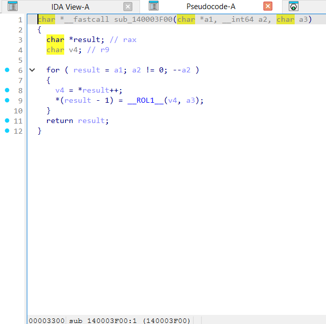

</details>

<details><summary>gcc -O2 – ELF, đã `strip -s` – op_rol8 = <code>sub_2A60</code> – 2 ảnh</summary>

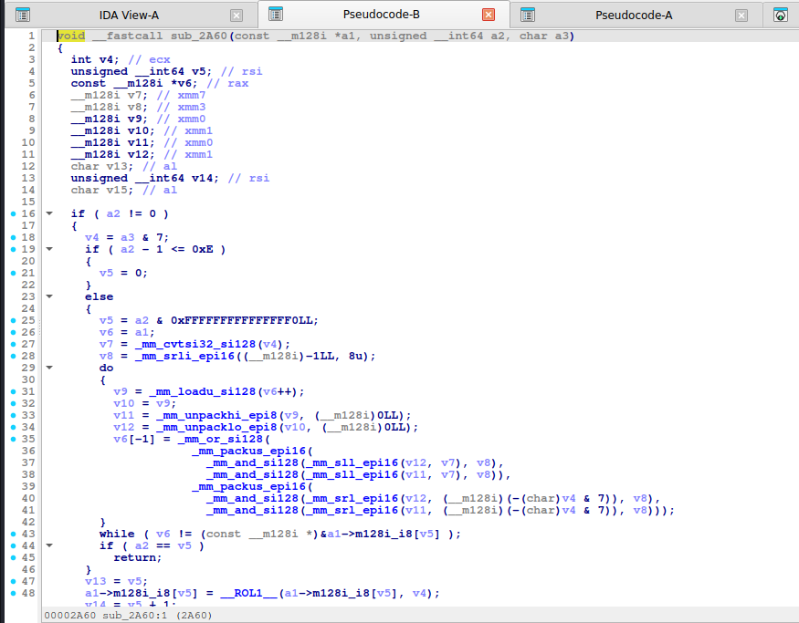

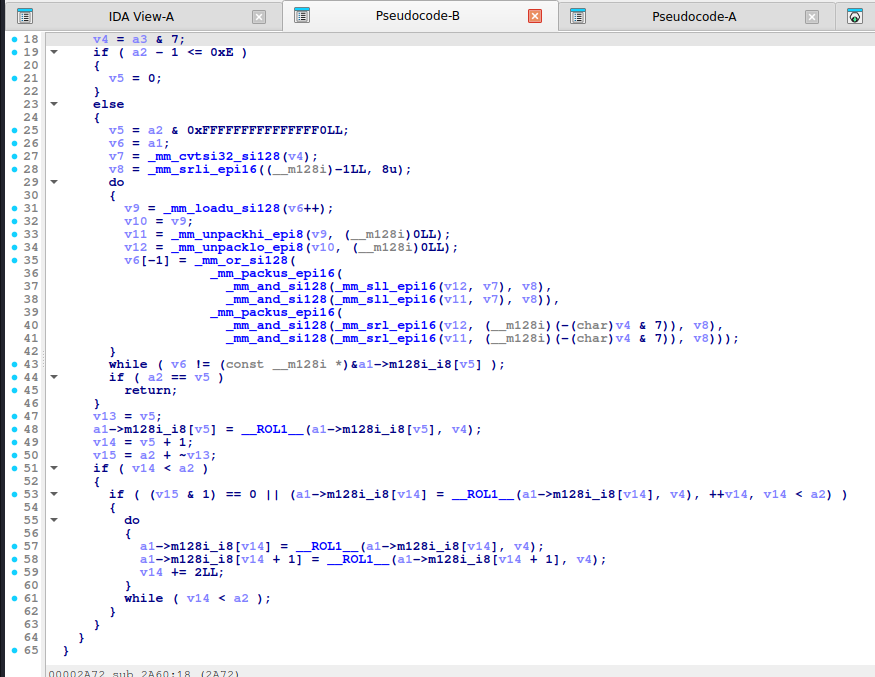

</details>

<details><summary>mingw-w64 -O2 -static – PE, đã `strip -s` – op_rol8 = <code>sub_140002020</code> – 2 ảnh</summary>

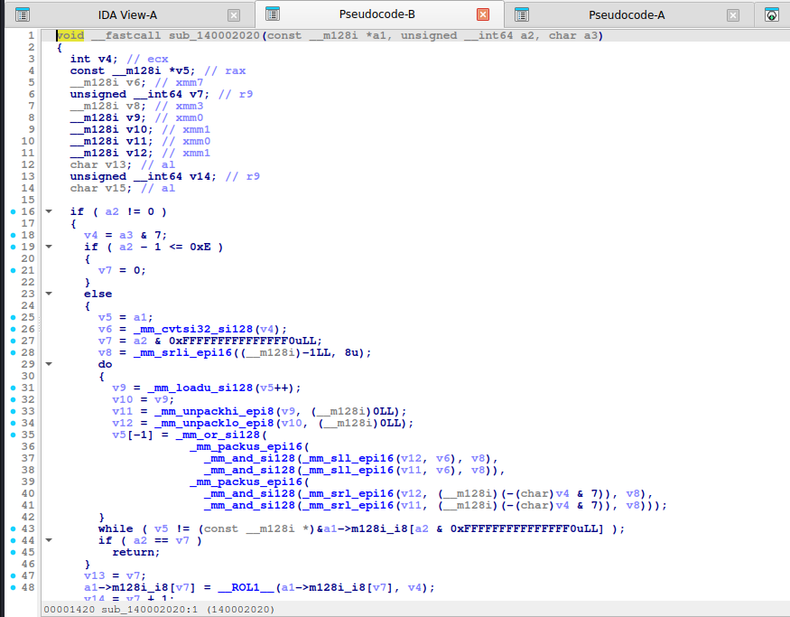

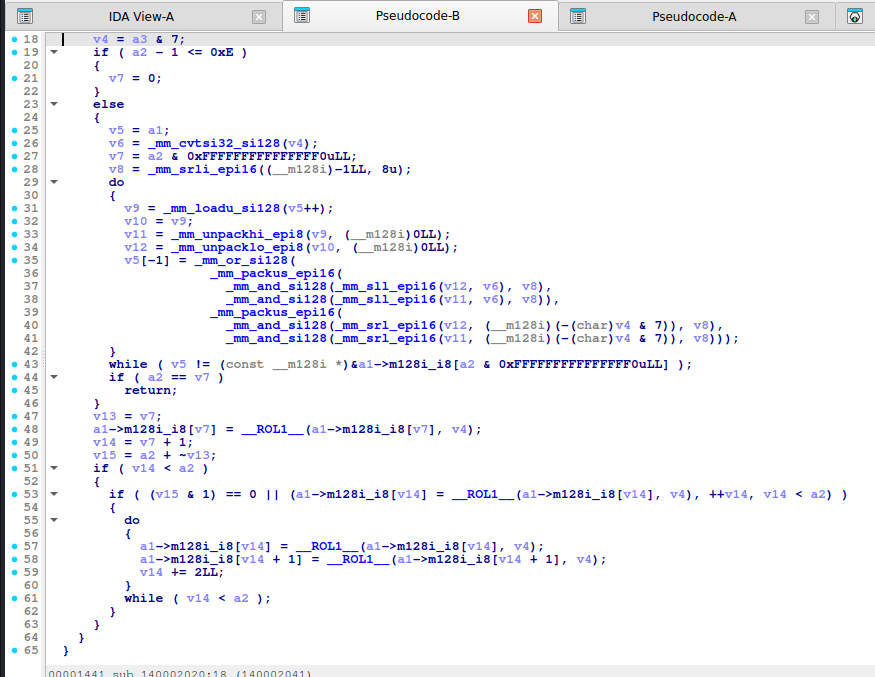

</details>

**ROL 32-bit (một giá trị):**

<details><summary>MSVC /O2 - PE x64 (có PDB)</summary>

```c
__int64 __fastcall op_rol32(unsigned int x, char k)
{
  return (unsigned int)__ROL4__(x, k);
}
```

</details>

<details><summary>MSVC /Od - PE x64 (có PDB)</summary>

```c
__int64 __fastcall op_rol32(unsigned int x, char k)
{
  return (unsigned int)__ROL4__(x, k);
}
```

</details>

<details><summary>gcc -O2 - ELF x86-64 (chưa strip)</summary>

```c
__int64 __fastcall op_rol32(int a1, char a2)
{
  return (unsigned int)__ROL4__(a1, a2);
}
```

</details>

<details><summary>gcc -O0 - ELF x86-64 (chưa strip)</summary>

```c
__int64 __fastcall op_rol32(int a1, char a2)
{
  return (unsigned int)__ROL4__(a1, a2);
}
```

</details>

<details><summary>mingw-w64 gcc -O2 - PE x64 (-static)</summary>

```c
__int64 __fastcall op_rol32(int a1, char a2)
{
  return (unsigned int)__ROL4__(a1, a2);
}
```

</details>

<details><summary>mingw-w64 gcc -O0 - PE x64 (-static)</summary>

```c
__int64 __fastcall op_rol32(int a1, char a2)
{
  return (unsigned int)__ROL4__(a1, a2);
}
```

</details>

**Bản strip (không symbol)** – IDA chỉ thấy `sub_XXXX`, `a1`, `a2`, `byte_XXXX`; hàm này tên là MSVC /O2 → `sub_140003EF0`, gcc -O2 → `sub_2C40`, mingw-w64 -O2 -static → `sub_140002250`:

<details><summary>MSVC /O2 – PE x64, không PDB (strip) – bản STRIP: <code>op_rol32</code> = <code>sub_140003EF0</code></summary>

```c
__int64 __fastcall sub_140003EF0(int a1, char a2)
{
  return (unsigned int)__ROL4__(a1, a2);
}
```

</details>

<details><summary>gcc -O2 – ELF, đã `strip -s` – bản STRIP: <code>op_rol32</code> = <code>sub_2C40</code></summary>

```c
__int64 __fastcall sub_2C40(int a1, char a2)
{
  return (unsigned int)__ROL4__(a1, a2);
}
```

</details>

<details><summary>mingw-w64 -O2 -static – PE, đã `strip -s` – bản STRIP: <code>op_rol32</code> = <code>sub_140002250</code></summary>

```c
__int64 __fastcall sub_140002250(int a1, char a2)
{
  return (unsigned int)__ROL4__(a1, a2);
}
```

</details>

**Ảnh chụp màn hình IDA (bản strip)** – mở từng mục để xem; hàm dài chia thành nhiều trang, mỗi trang là một màn hình IDA:

<details><summary>MSVC /O2 – PE x64, không PDB (strip) – op_rol32 = <code>sub_140003EF0</code> – 1 ảnh</summary>

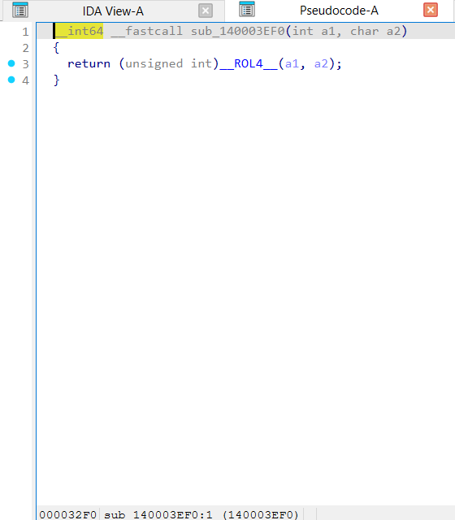

</details>

<details><summary>gcc -O2 – ELF, đã `strip -s` – op_rol32 = <code>sub_2C40</code> – 1 ảnh</summary>

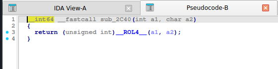

</details>

<details><summary>mingw-w64 -O2 -static – PE, đã `strip -s` – op_rol32 = <code>sub_140002250</code> – 1 ảnh</summary>

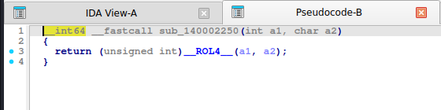

</details>

**ADD:**

<details><summary>MSVC /O2 - PE x64 (có PDB)</summary>

```c
void __fastcall op_add(unsigned __int8 *b, unsigned __int64 n, char k)
{
  unsigned __int64 v3; // r9
  __m128i v4; // xmm1
  __m128i v5; // xmm1
  __m128i v6; // xmm1
  unsigned __int8 *v7; // rax
  __int64 v8; // rdx

  v3 = 0;
  v4 = _mm_cvtsi32_si128(k);
  v5 = _mm_unpacklo_epi8(v4, v4);
  v6 = _mm_shuffle_epi32(_mm_unpacklo_epi16(v5, v5), 0);
  if ( n != 0 )
  {
    if ( n >= 0x40 )
    {
      do
      {
        *(__m128i *)&b[v3] = _mm_add_epi8(_mm_loadu_si128((const __m128i *)&b[v3]), v6);
        *(__m128i *)&b[v3 + 16] = _mm_add_epi8(_mm_loadu_si128((const __m128i *)&b[v3 + 16]), v6);
        *(__m128i *)&b[v3 + 32] = _mm_add_epi8(_mm_loadu_si128((const __m128i *)&b[v3 + 32]), v6);
        *(__m128i *)&b[v3 + 48] = _mm_add_epi8(_mm_loadu_si128((const __m128i *)&b[v3 + 48]), v6);
        v3 += 64LL;
      }
      while ( v3 < (n & 0xFFFFFFFFFFFFFFC0uLL) );
    }
    if ( v3 < n )
    {
      v7 = &b[v3];
      v8 = n - v3;
      do
      {
        *v7++ += k;
        --v8;
      }
      while ( v8 != 0 );
    }
  }
}
```

</details>

<details><summary>MSVC /Od - PE x64 (có PDB)</summary>

```c
void __fastcall op_add(unsigned __int8 *b, unsigned __int64 n, unsigned __int8 k)
{
  unsigned __int64 i; // [rsp+0h] [rbp-18h]

  for ( i = 0; i < n; ++i )
    b[i] += k;
}
```

</details>

<details><summary>gcc -O2 - ELF x86-64 (chưa strip)</summary>

```c
void __fastcall op_add(const __m128i *a1, unsigned __int64 a2, char a3)
{
  __m128i v4; // xmm1
  const __m128i *v5; // rax
  __m128i v6; // xmm1
  unsigned __int64 v7; // rdx
  __m128i v8; // xmm1
  __m128i v9; // xmm0
  char v10; // al
  unsigned __int64 v11; // rdx
  char v12; // al

  if ( a2 != 0 )
  {
    if ( a2 - 1 <= 0xE )
    {
      v7 = 0;
    }
    else
    {
      v4 = _mm_cvtsi32_si128(a3);
      v5 = a1;
      v6 = _mm_unpacklo_epi8(v4, v4);
      v7 = a2 & 0xFFFFFFFFFFFFFFF0LL;
      v8 = _mm_shuffle_epi32(_mm_unpacklo_epi16(v6, v6), 0);
      do
      {
        v9 = _mm_loadu_si128(v5++);
        v5[-1] = _mm_add_epi8(v9, v8);
      }
      while ( v5 != (const __m128i *)&a1->m128i_i8[a2 & 0xFFFFFFFFFFFFFFF0LL] );
      if ( a2 == v7 )
        return;
    }
    v10 = v7;
    a1->m128i_i8[v7] += a3;
    v11 = v7 + 1;
    v12 = a2 + ~v10;
    if ( v11 < a2 )
    {
      if ( (v12 & 1) == 0 || (a1->m128i_i8[v11] += a3, ++v11, v11 < a2) )
      {
        do
        {
          a1->m128i_i8[v11] += a3;
          a1->m128i_i8[v11 + 1] += a3;
          v11 += 2LL;
        }
        while ( v11 < a2 );
      }
    }
  }
}
```

</details>

<details><summary>gcc -O0 - ELF x86-64 (chưa strip)</summary>

```c
unsigned __int64 __fastcall op_add(__int64 a1, unsigned __int64 a2, char a3)
{
  unsigned __int64 result; // rax
  unsigned __int64 i; // [rsp+1Ch] [rbp-8h]

  for ( i = 0; ; ++i )
  {
    result = i;
    if ( i >= a2 )
      break;
    *(_BYTE *)(a1 + i) += a3;
  }
  return result;
}
```

</details>

<details><summary>mingw-w64 gcc -O2 - PE x64 (-static)</summary>

```c
void __fastcall op_add(const __m128i *a1, unsigned __int64 a2, char a3)
{
  __m128i v3; // xmm1
  const __m128i *v4; // rax
  __m128i v5; // xmm1
  unsigned __int64 v6; // r9
  __m128i v7; // xmm1
  __m128i v8; // xmm0
  char v9; // al
  unsigned __int64 v10; // r9
  char v11; // al

  if ( a2 != 0 )
  {
    if ( a2 - 1 <= 0xE )
    {
      v6 = 0;
    }
    else
    {
      v3 = _mm_cvtsi32_si128(a3);
      v4 = a1;
      v5 = _mm_unpacklo_epi8(v3, v3);
      v6 = a2 & 0xFFFFFFFFFFFFFFF0uLL;
      v7 = _mm_shuffle_epi32(_mm_unpacklo_epi16(v5, v5), 0);
      do
      {
        v8 = _mm_loadu_si128(v4++);
        v4[-1] = _mm_add_epi8(v8, v7);
      }
      while ( v4 != (const __m128i *)&a1->m128i_i8[a2 & 0xFFFFFFFFFFFFFFF0uLL] );
      if ( a2 == v6 )
        return;
    }
    v9 = v6;
    a1->m128i_i8[v6] += a3;
    v10 = v6 + 1;
    v11 = a2 + ~v9;
    if ( v10 < a2 )
    {
      if ( (v11 & 1) == 0 || (a1->m128i_i8[v10] += a3, ++v10, v10 < a2) )
      {
        do
        {
          a1->m128i_i8[v10] += a3;
          a1->m128i_i8[v10 + 1] += a3;
          v10 += 2LL;
        }
        while ( v10 < a2 );
      }
    }
  }
}
```

</details>

<details><summary>mingw-w64 gcc -O0 - PE x64 (-static)</summary>

```c
unsigned __int64 __fastcall op_add(__int64 a1, unsigned __int64 a2, char a3)
{
  unsigned __int64 result; // rax
  unsigned __int64 i; // [rsp+8h] [rbp-8h]

  for ( i = 0; ; ++i )
  {
    result = i;
    if ( i >= a2 )
      break;
    *(_BYTE *)(a1 + i) += a3;
  }
  return result;
}
```

</details>

**Bản strip (không symbol)** – IDA chỉ thấy `sub_XXXX`, `a1`, `a2`, `byte_XXXX`; hàm này tên là MSVC /O2 → `sub_140003D80`, gcc -O2 → `sub_2880`, mingw-w64 -O2 -static → `sub_140001DE0`:

<details><summary>MSVC /O2 – PE x64, không PDB (strip) – bản STRIP: <code>op_add</code> = <code>sub_140003D80</code></summary>

```c
unsigned __int64 __fastcall sub_140003D80(__int64 a1, unsigned __int64 a2, char a3)
{
  unsigned __int64 result; // rax
  unsigned __int64 v4; // r9
  __m128i v5; // xmm1
  __m128i v6; // xmm1
  __m128i v7; // xmm1
  unsigned __int64 v8; // rdx

  result = (unsigned int)a3;
  v4 = 0;
  v5 = _mm_cvtsi32_si128(result);
  v6 = _mm_unpacklo_epi8(v5, v5);
  v7 = _mm_shuffle_epi32(_mm_unpacklo_epi16(v6, v6), 0);
  if ( a2 != 0 )
  {
    if ( a2 >= 0x40 )
    {
      result = a2 & 0xFFFFFFFFFFFFFFC0uLL;
      do
      {
        *(__m128i *)(a1 + v4) = _mm_add_epi8(_mm_loadu_si128((const __m128i *)(a1 + v4)), v7);
        *(__m128i *)(a1 + v4 + 16) = _mm_add_epi8(_mm_loadu_si128((const __m128i *)(a1 + v4 + 16)), v7);
        *(__m128i *)(a1 + v4 + 32) = _mm_add_epi8(_mm_loadu_si128((const __m128i *)(a1 + v4 + 32)), v7);
        *(__m128i *)(a1 + v4 + 48) = _mm_add_epi8(_mm_loadu_si128((const __m128i *)(a1 + v4 + 48)), v7);
        v4 += 64LL;
      }
      while ( v4 < result );
    }
    if ( v4 < a2 )
    {
      result = v4 + a1;
      v8 = a2 - v4;
      do
      {
        *(_BYTE *)result++ += a3;
        --v8;
      }
      while ( v8 != 0 );
    }
  }
  return result;
}
```

</details>

<details><summary>gcc -O2 – ELF, đã `strip -s` – bản STRIP: <code>op_add</code> = <code>sub_2880</code></summary>

```c
void __fastcall sub_2880(const __m128i *a1, unsigned __int64 a2, char a3)
{
  __m128i v4; // xmm1
  const __m128i *v5; // rax
  __m128i v6; // xmm1
  unsigned __int64 v7; // rdx
  __m128i v8; // xmm1
  __m128i v9; // xmm0
  char v10; // al
  unsigned __int64 v11; // rdx
  char v12; // al

  if ( a2 != 0 )
  {
    if ( a2 - 1 <= 0xE )
    {
      v7 = 0;
    }
    else
    {
      v4 = _mm_cvtsi32_si128(a3);
      v5 = a1;
      v6 = _mm_unpacklo_epi8(v4, v4);
      v7 = a2 & 0xFFFFFFFFFFFFFFF0LL;
      v8 = _mm_shuffle_epi32(_mm_unpacklo_epi16(v6, v6), 0);
      do
      {
        v9 = _mm_loadu_si128(v5++);
        v5[-1] = _mm_add_epi8(v9, v8);
      }
      while ( v5 != (const __m128i *)&a1->m128i_i8[a2 & 0xFFFFFFFFFFFFFFF0LL] );
      if ( a2 == v7 )
        return;
    }
    v10 = v7;
    a1->m128i_i8[v7] += a3;
    v11 = v7 + 1;
    v12 = a2 + ~v10;
    if ( v11 < a2 )
    {
      if ( (v12 & 1) == 0 || (a1->m128i_i8[v11] += a3, ++v11, v11 < a2) )
      {
        do
        {
          a1->m128i_i8[v11] += a3;
          a1->m128i_i8[v11 + 1] += a3;
          v11 += 2LL;
        }
        while ( v11 < a2 );
      }
    }
  }
}
```

</details>

<details><summary>mingw-w64 -O2 -static – PE, đã `strip -s` – bản STRIP: <code>op_add</code> = <code>sub_140001DE0</code></summary>

```c
void __fastcall sub_140001DE0(const __m128i *a1, unsigned __int64 a2, char a3)
{
  __m128i v3; // xmm1
  const __m128i *v4; // rax
  __m128i v5; // xmm1
  unsigned __int64 v6; // r9
  __m128i v7; // xmm1
  __m128i v8; // xmm0
  char v9; // al
  unsigned __int64 v10; // r9
  char v11; // al

  if ( a2 != 0 )
  {
    if ( a2 - 1 <= 0xE )
    {
      v6 = 0;
    }
    else
    {
      v3 = _mm_cvtsi32_si128(a3);
      v4 = a1;
      v5 = _mm_unpacklo_epi8(v3, v3);
      v6 = a2 & 0xFFFFFFFFFFFFFFF0uLL;
      v7 = _mm_shuffle_epi32(_mm_unpacklo_epi16(v5, v5), 0);
      do
      {
        v8 = _mm_loadu_si128(v4++);
        v4[-1] = _mm_add_epi8(v8, v7);
      }
      while ( v4 != (const __m128i *)&a1->m128i_i8[a2 & 0xFFFFFFFFFFFFFFF0uLL] );
      if ( a2 == v6 )
        return;
    }
    v9 = v6;
    a1->m128i_i8[v6] += a3;
    v10 = v6 + 1;
    v11 = a2 + ~v9;
    if ( v10 < a2 )
    {
      if ( (v11 & 1) == 0 || (a1->m128i_i8[v10] += a3, ++v10, v10 < a2) )
      {
        do
        {
          a1->m128i_i8[v10] += a3;
          a1->m128i_i8[v10 + 1] += a3;
          v10 += 2LL;
        }
        while ( v10 < a2 );
      }
    }
  }
}
```

</details>

**Ảnh chụp màn hình IDA (bản strip)** – mở từng mục để xem; hàm dài chia thành nhiều trang, mỗi trang là một màn hình IDA:

<details><summary>MSVC /O2 – PE x64, không PDB (strip) – op_add = <code>sub_140003D80</code> – 2 ảnh</summary>

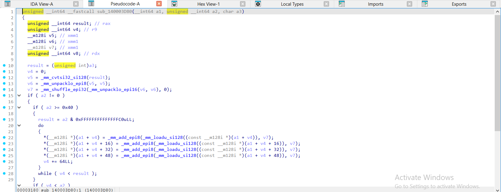

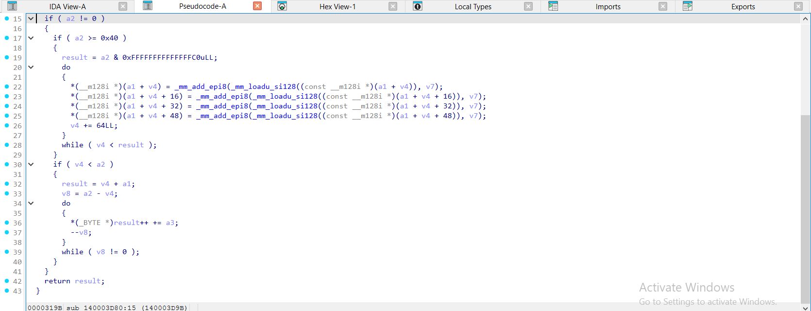

</details>

<details><summary>gcc -O2 – ELF, đã `strip -s` – op_add = <code>sub_2880</code> – 2 ảnh</summary>

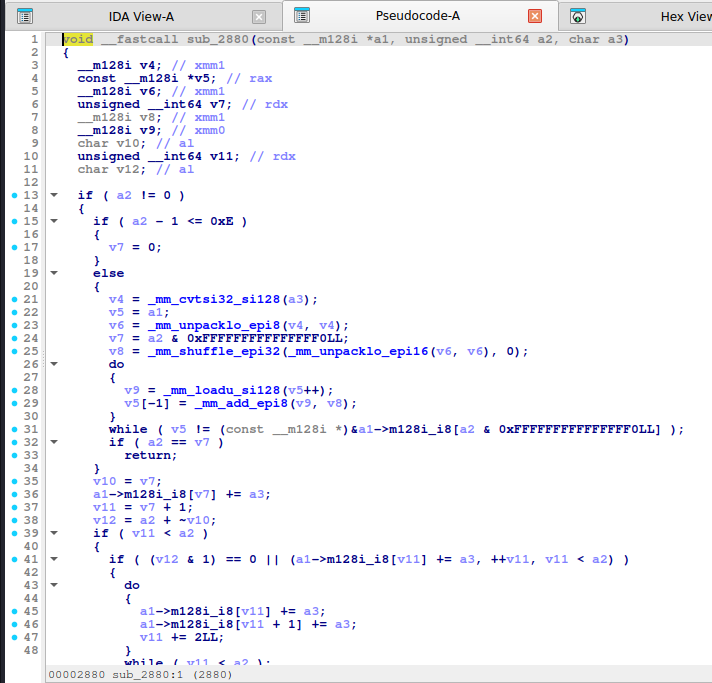

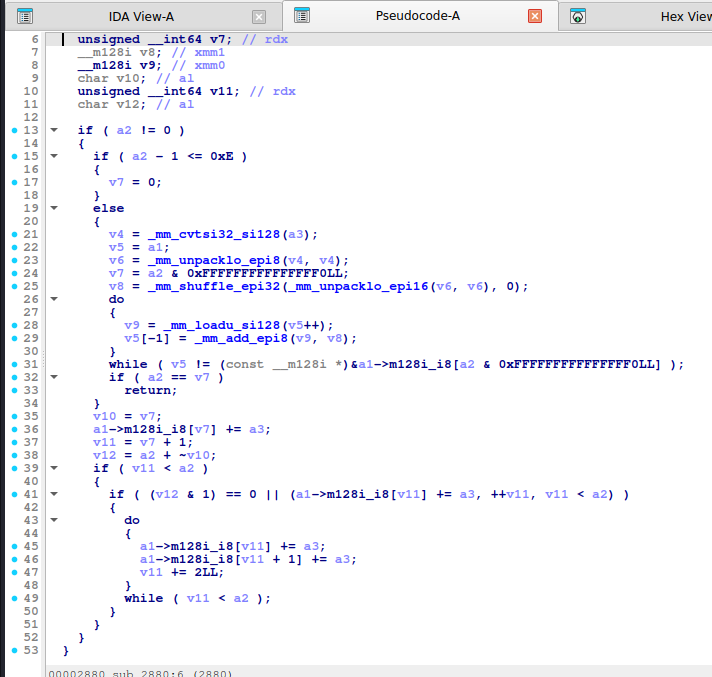

</details>

<details><summary>mingw-w64 -O2 -static – PE, đã `strip -s` – op_add = <code>sub_140001DE0</code> – 2 ảnh</summary>

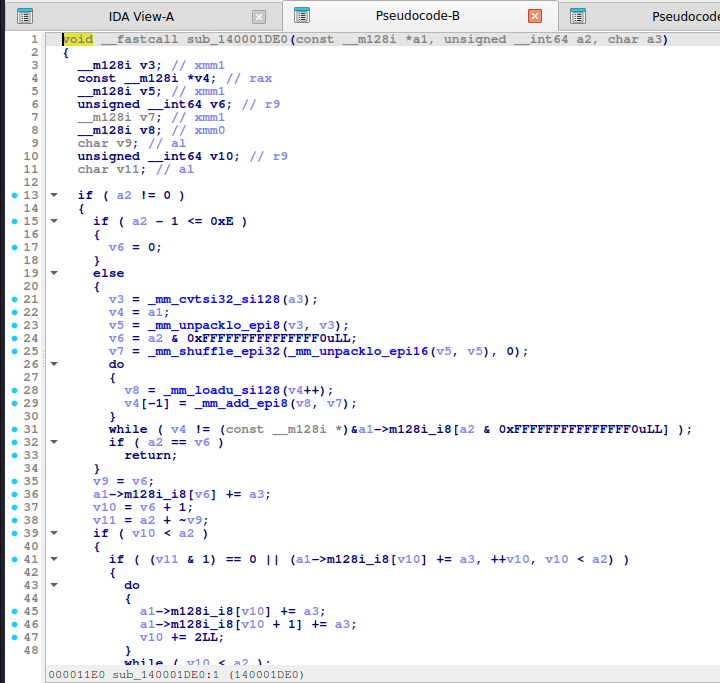


</details>

**NOT:**

<details><summary>MSVC /O2 - PE x64 (có PDB)</summary>

```c
void __fastcall op_not(unsigned __int8 *b, unsigned __int64 n)
{
  unsigned __int64 v2; // r8
  __m128i si128; // xmm1
  unsigned __int8 *v4; // rax
  __int64 v5; // rdx

  v2 = 0;
  if ( n != 0 )
  {
    if ( n >= 0x40 )
    {
      si128 = _mm_load_si128((const __m128i *)&_xmm_ffffffffffffffffffffffffffffffff);
      do
      {
        *(__m128i *)&b[v2] = _mm_andnot_si128(_mm_loadu_si128((const __m128i *)&b[v2]), si128);
        *(__m128i *)&b[v2 + 16] = _mm_andnot_si128(_mm_loadu_si128((const __m128i *)&b[v2 + 16]), si128);
        *(__m128i *)&b[v2 + 32] = _mm_andnot_si128(_mm_loadu_si128((const __m128i *)&b[v2 + 32]), si128);
        *(__m128i *)&b[v2 + 48] = _mm_andnot_si128(_mm_loadu_si128((const __m128i *)&b[v2 + 48]), si128);
        v2 += 64LL;
      }
      while ( v2 < (n & 0xFFFFFFFFFFFFFFC0uLL) );
    }
    if ( v2 < n )
    {
      v4 = &b[v2];
      v5 = n - v2;
      do
      {
        *v4 = ~*v4;
        ++v4;
        --v5;
      }
      while ( v5 != 0 );
    }
  }
}
```

</details>

<details><summary>MSVC /Od - PE x64 (có PDB)</summary>

```c
void __fastcall op_not(unsigned __int8 *b, unsigned __int64 n)
{
  unsigned __int64 i; // [rsp+0h] [rbp-18h]

  for ( i = 0; i < n; ++i )
    b[i] = ~b[i];
}
```

</details>

<details><summary>gcc -O2 - ELF x86-64 (chưa strip)</summary>

```c
void __fastcall op_not(const __m128i *a1, unsigned __int64 a2)
{
  const __m128i *v2; // rax
  unsigned __int64 v3; // rdx
  __m128i v4; // xmm0
  char v5; // al
  unsigned __int64 v6; // rdx
  char v7; // al

  if ( a2 != 0 )
  {
    if ( a2 - 1 <= 0xE )
    {
      v3 = 0;
    }
    else
    {
      v2 = a1;
      v3 = a2 & 0xFFFFFFFFFFFFFFF0LL;
      do
      {
        v4 = _mm_loadu_si128(v2++);
        v2[-1] = _mm_xor_si128(v4, (__m128i)-1LL);
      }
      while ( v2 != (const __m128i *)&a1->m128i_i8[a2 & 0xFFFFFFFFFFFFFFF0LL] );
      if ( a2 == v3 )
        return;
    }
    v5 = v3;
    a1->m128i_i8[v3] = ~a1->m128i_i8[v3];
    v6 = v3 + 1;
    v7 = a2 + ~v5;
    if ( v6 < a2 )
    {
      if ( (v7 & 1) == 0 || (a1->m128i_i8[v6] = ~a1->m128i_i8[v6], ++v6, v6 < a2) )
      {
        do
        {
          a1->m128i_i8[v6] = ~a1->m128i_i8[v6];
          a1->m128i_i8[v6 + 1] = ~a1->m128i_i8[v6 + 1];
          v6 += 2LL;
        }
        while ( v6 < a2 );
      }
    }
  }
}
```

</details>

<details><summary>gcc -O0 - ELF x86-64 (chưa strip)</summary>

```c
unsigned __int64 __fastcall op_not(__int64 a1, unsigned __int64 a2)
{
  unsigned __int64 result; // rax
  unsigned __int64 i; // [rsp+18h] [rbp-8h]

  for ( i = 0; ; ++i )
  {
    result = i;
    if ( i >= a2 )
      break;
    *(_BYTE *)(a1 + i) = ~*(_BYTE *)(a1 + i);
  }
  return result;
}
```

</details>

<details><summary>mingw-w64 gcc -O2 - PE x64 (-static)</summary>

```c
void __fastcall op_not(const __m128i *a1, unsigned __int64 a2)
{
  const __m128i *v2; // rax
  unsigned __int64 v3; // r8
  __m128i v4; // xmm0
  char v5; // al
  unsigned __int64 v6; // r8
  char v7; // al

  if ( a2 != 0 )
  {
    if ( a2 - 1 <= 0xE )
    {
      v3 = 0;
    }
    else
    {
      v2 = a1;
      v3 = a2 & 0xFFFFFFFFFFFFFFF0uLL;
      do
      {
        v4 = _mm_loadu_si128(v2++);
        v2[-1] = _mm_xor_si128(v4, (__m128i)-1LL);
      }
      while ( v2 != (const __m128i *)&a1->m128i_i8[a2 & 0xFFFFFFFFFFFFFFF0uLL] );
      if ( a2 == v3 )
        return;
    }
    v5 = v3;
    a1->m128i_i8[v3] = ~a1->m128i_i8[v3];
    v6 = v3 + 1;
    v7 = a2 + ~v5;
    if ( v6 < a2 )
    {
      if ( (v7 & 1) == 0 || (a1->m128i_i8[v6] = ~a1->m128i_i8[v6], ++v6, v6 < a2) )
      {
        do
        {
          a1->m128i_i8[v6] = ~a1->m128i_i8[v6];
          a1->m128i_i8[v6 + 1] = ~a1->m128i_i8[v6 + 1];
          v6 += 2LL;
        }
        while ( v6 < a2 );
      }
    }
  }
}
```

</details>

<details><summary>mingw-w64 gcc -O0 - PE x64 (-static)</summary>

```c
unsigned __int64 __fastcall op_not(__int64 a1, unsigned __int64 a2)
{
  unsigned __int64 result; // rax
  unsigned __int64 i; // [rsp+8h] [rbp-8h]

  for ( i = 0; ; ++i )
  {
    result = i;
    if ( i >= a2 )
      break;
    *(_BYTE *)(a1 + i) = ~*(_BYTE *)(a1 + i);
  }
  return result;
}
```

</details>

**Bản strip (không symbol)** – IDA chỉ thấy `sub_XXXX`, `a1`, `a2`, `byte_XXXX`; hàm này tên là MSVC /O2 → `sub_140003E20`, gcc -O2 → `sub_29C0`, mingw-w64 -O2 -static → `sub_140001F60`:

<details><summary>MSVC /O2 – PE x64, không PDB (strip) – bản STRIP: <code>op_not</code> = <code>sub_140003E20</code></summary>

```c
void __fastcall sub_140003E20(__int64 a1, unsigned __int64 a2)
{
  unsigned __int64 v2; // r8
  __m128i si128; // xmm1
  _BYTE *v4; // rax
  unsigned __int64 v5; // rdx

  v2 = 0;
  if ( a2 != 0 )
  {
    if ( a2 >= 0x40 )
    {
      si128 = _mm_load_si128((const __m128i *)&xmmword_1400192C0);
      do
      {
        *(__m128i *)(a1 + v2) = _mm_andnot_si128(_mm_loadu_si128((const __m128i *)(a1 + v2)), si128);
        *(__m128i *)(a1 + v2 + 16) = _mm_andnot_si128(_mm_loadu_si128((const __m128i *)(a1 + v2 + 16)), si128);
        *(__m128i *)(a1 + v2 + 32) = _mm_andnot_si128(_mm_loadu_si128((const __m128i *)(a1 + v2 + 32)), si128);
        *(__m128i *)(a1 + v2 + 48) = _mm_andnot_si128(_mm_loadu_si128((const __m128i *)(a1 + v2 + 48)), si128);
        v2 += 64LL;
      }
      while ( v2 < (a2 & 0xFFFFFFFFFFFFFFC0uLL) );
    }
    if ( v2 < a2 )
    {
      v4 = (_BYTE *)(v2 + a1);
      v5 = a2 - v2;
      do
      {
        *v4 = ~*v4;
        ++v4;
        --v5;
      }
      while ( v5 != 0 );
    }
  }
}
```

</details>

<details><summary>gcc -O2 – ELF, đã `strip -s` – bản STRIP: <code>op_not</code> = <code>sub_29C0</code></summary>

```c
void __fastcall sub_29C0(const __m128i *a1, unsigned __int64 a2)
{
  const __m128i *v2; // rax
  unsigned __int64 v3; // rdx
  __m128i v4; // xmm0
  char v5; // al
  unsigned __int64 v6; // rdx
  char v7; // al

  if ( a2 != 0 )
  {
    if ( a2 - 1 <= 0xE )
    {
      v3 = 0;
    }
    else
    {
      v2 = a1;
      v3 = a2 & 0xFFFFFFFFFFFFFFF0LL;
      do
      {
        v4 = _mm_loadu_si128(v2++);
        v2[-1] = _mm_xor_si128(v4, (__m128i)-1LL);
      }
      while ( v2 != (const __m128i *)&a1->m128i_i8[a2 & 0xFFFFFFFFFFFFFFF0LL] );
      if ( a2 == v3 )
        return;
    }
    v5 = v3;
    a1->m128i_i8[v3] = ~a1->m128i_i8[v3];
    v6 = v3 + 1;
    v7 = a2 + ~v5;
    if ( v6 < a2 )
    {
      if ( (v7 & 1) == 0 || (a1->m128i_i8[v6] = ~a1->m128i_i8[v6], ++v6, v6 < a2) )
      {
        do
        {
          a1->m128i_i8[v6] = ~a1->m128i_i8[v6];
          a1->m128i_i8[v6 + 1] = ~a1->m128i_i8[v6 + 1];
          v6 += 2LL;
        }
        while ( v6 < a2 );
      }
    }
  }
}
```

</details>

<details><summary>mingw-w64 -O2 -static – PE, đã `strip -s` – bản STRIP: <code>op_not</code> = <code>sub_140001F60</code></summary>

```c
void __fastcall sub_140001F60(const __m128i *a1, unsigned __int64 a2)
{
  const __m128i *v2; // rax
  unsigned __int64 v3; // r8
  __m128i v4; // xmm0
  char v5; // al
  unsigned __int64 v6; // r8
  char v7; // al

  if ( a2 != 0 )
  {
    if ( a2 - 1 <= 0xE )
    {
      v3 = 0;
    }
    else
    {
      v2 = a1;
      v3 = a2 & 0xFFFFFFFFFFFFFFF0uLL;
      do
      {
        v4 = _mm_loadu_si128(v2++);
        v2[-1] = _mm_xor_si128(v4, (__m128i)-1LL);
      }
      while ( v2 != (const __m128i *)&a1->m128i_i8[a2 & 0xFFFFFFFFFFFFFFF0uLL] );
      if ( a2 == v3 )
        return;
    }
    v5 = v3;
    a1->m128i_i8[v3] = ~a1->m128i_i8[v3];
    v6 = v3 + 1;
    v7 = a2 + ~v5;
    if ( v6 < a2 )
    {
      if ( (v7 & 1) == 0 || (a1->m128i_i8[v6] = ~a1->m128i_i8[v6], ++v6, v6 < a2) )
      {
        do
        {
          a1->m128i_i8[v6] = ~a1->m128i_i8[v6];
          a1->m128i_i8[v6 + 1] = ~a1->m128i_i8[v6 + 1];
          v6 += 2LL;
        }
        while ( v6 < a2 );
      }
    }
  }
}
```

</details>

**Ảnh chụp màn hình IDA (bản strip)** – mở từng mục để xem; hàm dài chia thành nhiều trang, mỗi trang là một màn hình IDA:

<details><summary>MSVC /O2 – PE x64, không PDB (strip) – op_not = <code>sub_140003E20</code> – 2 ảnh</summary>

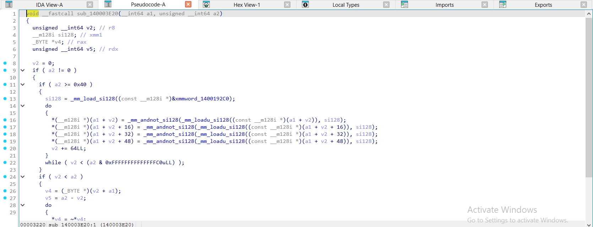

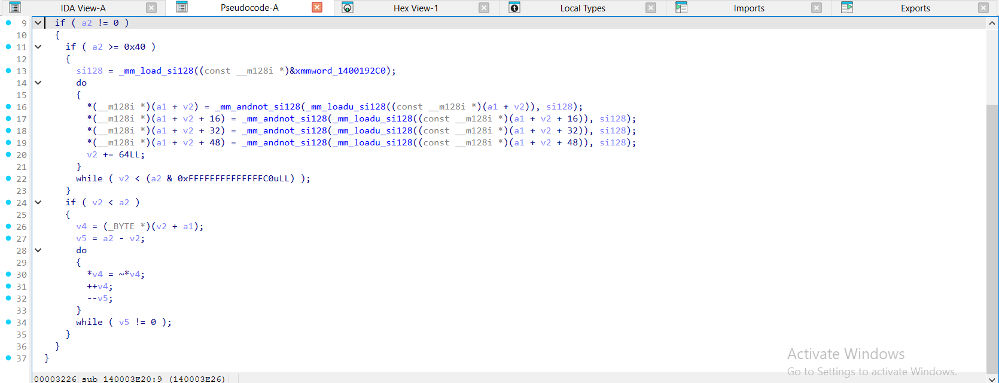

</details>

<details><summary>gcc -O2 – ELF, đã `strip -s` – op_not = <code>sub_29C0</code> – 1 ảnh</summary>

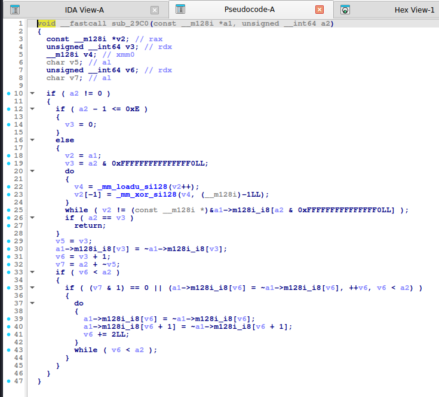

</details>

<details><summary>mingw-w64 -O2 -static – PE, đã `strip -s` – op_not = <code>sub_140001F60</code> – 1 ảnh</summary>

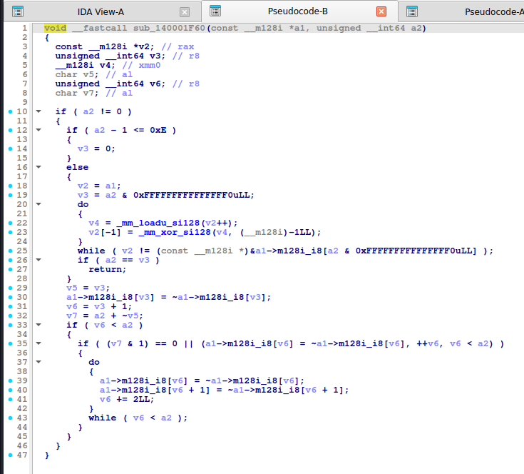

</details>

Nhận xét: với `-O0` thấy rõ `(x >> (8 - a3)) | (x << a3)`; `-O2` gcc có thể vector hóa cả ROL (khối `_mm_sll_epi16`, `_mm_srl_epi16`, `_mm_packus_epi16`, rất dài nhưng chỉ là "ROL 16 byte một lần").

## 6. Code giải mã

**Python:**

```python
M32 = 0xFFFFFFFF
def rol8(x, k): return ((x << k) | (x >> (8 - k))) & 0xFF


def ror8(x, k): return ((x >> k) | (x << (8 - k))) & 0xFF


def rol32(x, k): return ((x << k) | (x >> (32 - k))) & M32


def ror32(x, k): return ((x >> k) | (x << (32 - k))) & M32


def rol64(x, k): return ((x << k) | (x >> (64 - k))) & 0xFFFFFFFFFFFFFFFF


def ror64(x, k): return ((x >> k) | (x << (64 - k))) & 0xFFFFFFFFFFFFFFFF


def op_add(data, k): return bytes((c + k) & 0xFF for c in data)


def op_sub(data, k): return bytes((c - k) & 0xFF for c in data)


def op_not(data): return bytes(~c & 0xFF for c in data)


def op_rol8(data, k): return bytes(rol8(c, k) for c in data)


def op_ror8(data, k): return bytes(ror8(c, k) for c in data)
```

**C:**

```c
#define ROL8(x, n)  ((uint8_t)(((x) << (n)) | ((x) >> (8 - (n)))))
#define ROR8(x, n)  ((uint8_t)(((x) >> (n)) | ((x) << (8 - (n)))))
#define ROL32(x, n) (((x) << (n)) | ((x) >> (32 - (n))))
#define ROR32(x, n) (((x) >> (n)) | ((x) << (32 - (n))))
#define ROL64(x, n) (((x) << (n)) | ((x) >> (64 - (n))))
#define ROR64(x, n) (((x) >> (n)) | ((x) << (64 - (n))))
```

```c
#include <stdint.h>
#include <stddef.h>
#include <string.h>

#define ROL8(x, n)  ((uint8_t)(((x) << (n)) | ((x) >> (8 - (n)))))
#define ROR8(x, n)  ((uint8_t)(((x) >> (n)) | ((x) << (8 - (n)))))

static inline void ctf_undo_add(uint8_t *b, size_t n, uint8_t k) { for (size_t i = 0; i < n; i++) b[i] = (uint8_t)(b[i] - k); }

static inline void ctf_undo_sub(uint8_t *b, size_t n, uint8_t k) { for (size_t i = 0; i < n; i++) b[i] = (uint8_t)(b[i] + k); }

static inline void ctf_undo_not(uint8_t *b, size_t n)            { for (size_t i = 0; i < n; i++) b[i] = (uint8_t)~b[i]; }

static inline void ctf_undo_rol8(uint8_t *b, size_t n, int k)    { for (size_t i = 0; i < n; i++) b[i] = ROR8(b[i], k); }

static inline void ctf_undo_ror8(uint8_t *b, size_t n, int k)    { for (size_t i = 0; i < n; i++) b[i] = ROL8(b[i], k); }
```

## 7. Biến thể & bẫy

- **ROL theo cả từ**: xoay 32-bit toàn cục (`ROL32`) khác xoay từng byte 4 lần. Kiểm tra kiểu dữ liệu của biến (`_BYTE` hay `_DWORD`).
- Xoay `k` bit khi `k` là biến: nhớ `k & 7` (8-bit), `k & 31` (32-bit) – IDA có thể hiện `a3 & 7` ở đầu hàm (`v4 = a3 & 7`).
- Chuỗi biến đổi kèm XOR chỉ số: xem [reverse-and-chain.md](reverse-and-chain.md).
