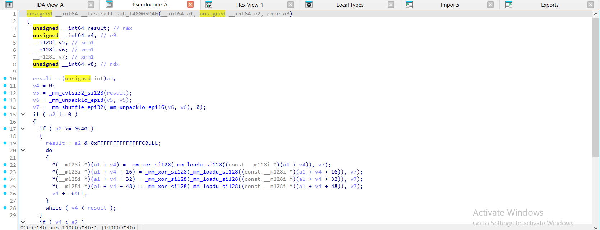
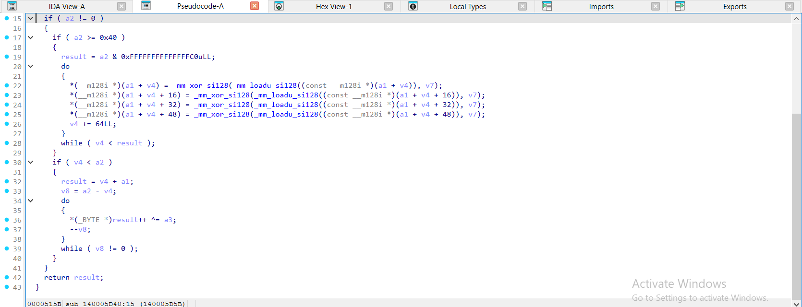
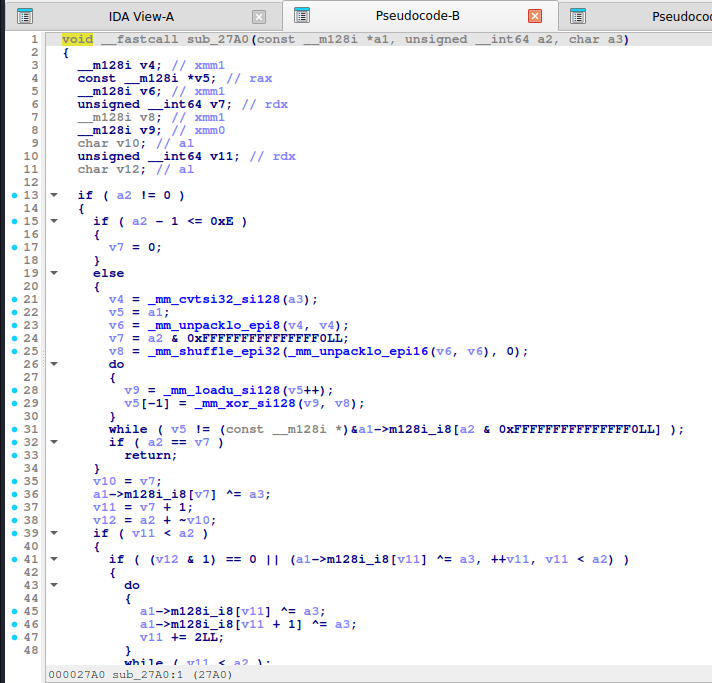
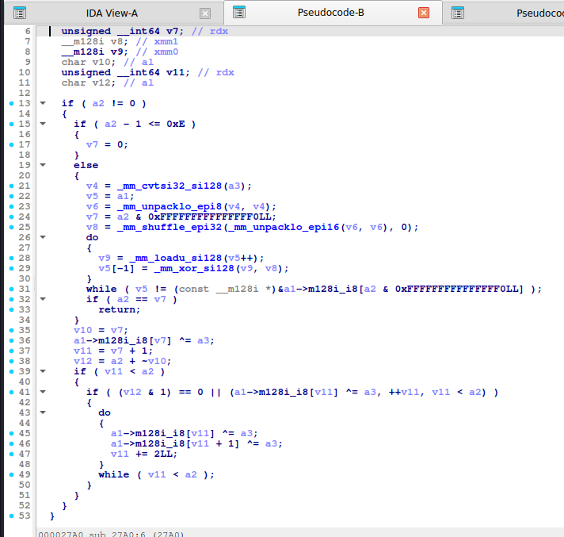
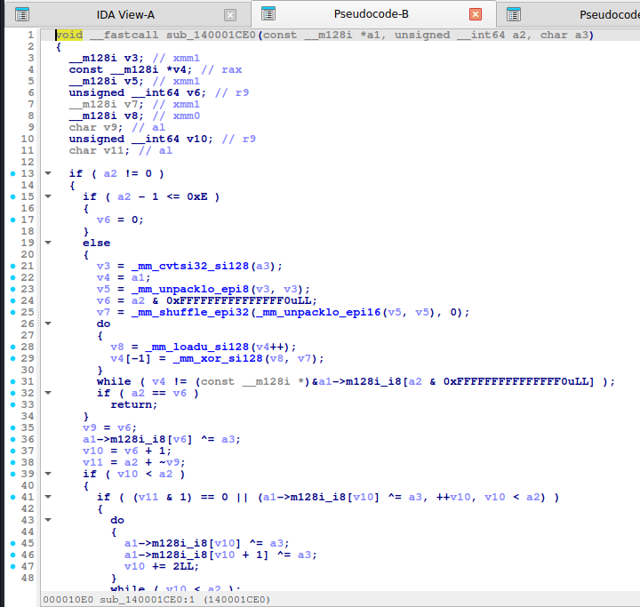
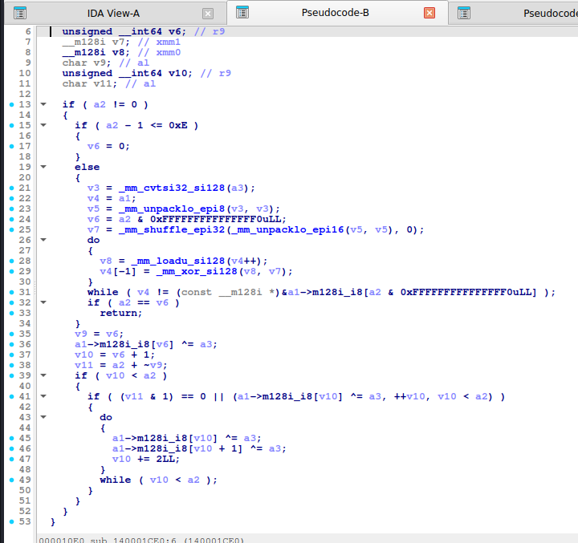
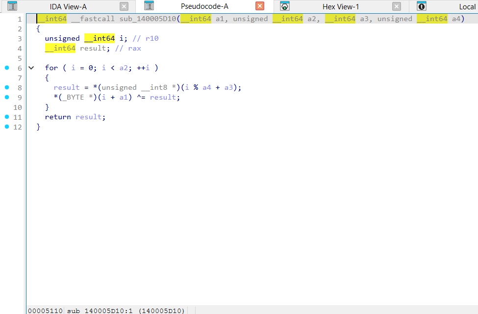
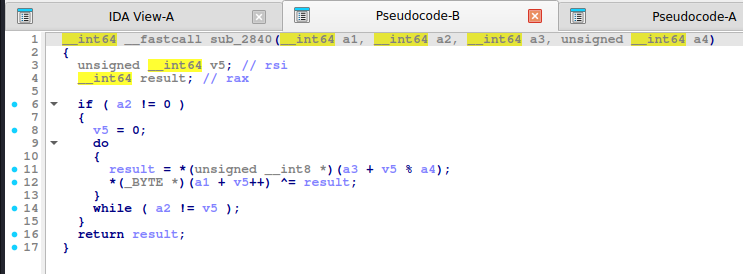
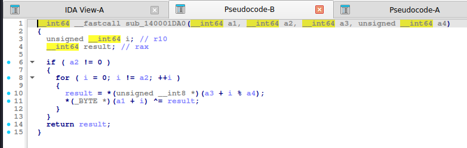

# XOR (1 byte và key lặp)

> Phép "mã hóa" phổ biến nhất trong rev. Tự đảo ngược: `(p ^ k) ^ k = p`. Có crib (đoạn plaintext đã biết như `flag{`) là ra key.

## 1. Dấu hiệu nhận biết

- **XOR 1 byte**: `b[i] ^= k` với `k` là hằng/tham số. `-O2` (gcc) biến vòng thành **SSE**: `_mm_xor_si128`, `_mm_loadu_si128`, `_mm_unpacklo_epi8` (nhân bản `k` ra 16 byte) kèm vòng đuôi xử lý lẻ.
- **XOR key lặp**: `b[i] ^= key[i % keylen]`, chữ ký là phép **`%`** theo độ dài key trong vòng lặp (`v5 % a4`).
- **XOR với chỉ số**: `b[i] ^ (i + 0x5A)` hoặc `^ i`: key thay đổi theo vị trí.
- **XOR dây chuyền** (CBC thô): `c = b ^ prev; prev = c` (xem [mix_chain](reverse-and-chain.md)).
- Hằng key hay thấy: `0x5A`, `0xAA`, `0xFF`, `0x37`, chuỗi `"KEY"`, `"key"`, `"secret"`.
- Dữ liệu bị XOR thường nằm trong `.data`/`.rdata` dưới dạng mảng byte rồi được XOR **tại runtime**: tìm vòng lặp có `^=` ngay trước khi so sánh/in.

## 2. Thuật toán (mã giả)

```
xor_single(b, k):   for i: b[i] ^= k
xor_repeat(b, key): for i: b[i] ^= key[i % len(key)]
```

## 3. Mã hóa / giải mã

Mã hóa và giải mã **giống hệt nhau**. Cách tìm key khi chưa biết:

1. **XOR 1 byte**: thử 256 giá trị, giữ kết quả chứa `flag` / ký tự in được.
2. **Key lặp, biết crib**: `key[i] = cipher[i] ^ crib[i]`, nếu crib dài hơn key sẽ thấy key lặp lại.
3. **Key lặp, không crib**: đoán độ dài key (Hamming/ Kasiski), mỗi cột (`i % L`) là XOR 1 byte -> chấm điểm tần suất chữ cái.
4. Plaintext có nhiều `0x00`: ciphertext tại các vị trí đó **chính là key**.

## 4. Mã nguồn gốc (C)

```c
void xor_single(uint8_t *b, size_t n, uint8_t k)
{
    for (size_t i = 0; i < n; i++) b[i] ^= k;
}

void xor_repeat(uint8_t *b, size_t n, const uint8_t *key, size_t kl)
{
    for (size_t i = 0; i < n; i++) b[i] ^= key[i % kl];
}
```

## 5. Pseudo-code IDA thực tế

**xor_single:**

<details><summary>MSVC /O2 - PE x64 (có PDB)</summary>

```c
void __fastcall xor_single(unsigned __int8 *b, unsigned __int64 n, char k)
{
  unsigned __int64 v3; // r9
  __m128i v4; // xmm1
  __m128i v5; // xmm1
  __m128i v6; // xmm1
  unsigned __int8 *v7; // rax
  __int64 v8; // rdx

  v3 = 0;
  v4 = _mm_cvtsi32_si128(k);
  v5 = _mm_unpacklo_epi8(v4, v4);
  v6 = _mm_shuffle_epi32(_mm_unpacklo_epi16(v5, v5), 0);
  if ( n != 0 )
  {
    if ( n >= 0x40 )
    {
      do
      {
        *(__m128i *)&b[v3] = _mm_xor_si128(_mm_loadu_si128((const __m128i *)&b[v3]), v6);
        *(__m128i *)&b[v3 + 16] = _mm_xor_si128(_mm_loadu_si128((const __m128i *)&b[v3 + 16]), v6);
        *(__m128i *)&b[v3 + 32] = _mm_xor_si128(_mm_loadu_si128((const __m128i *)&b[v3 + 32]), v6);
        *(__m128i *)&b[v3 + 48] = _mm_xor_si128(_mm_loadu_si128((const __m128i *)&b[v3 + 48]), v6);
        v3 += 64LL;
      }
      while ( v3 < (n & 0xFFFFFFFFFFFFFFC0uLL) );
    }
    if ( v3 < n )
    {
      v7 = &b[v3];
      v8 = n - v3;
      do
      {
        *v7++ ^= k;
        --v8;
      }
      while ( v8 != 0 );
    }
  }
}
```

</details>

<details><summary>MSVC /Od - PE x64 (có PDB)</summary>

```c
void __fastcall xor_single(unsigned __int8 *b, unsigned __int64 n, unsigned __int8 k)
{
  unsigned __int64 i; // [rsp+0h] [rbp-18h]

  for ( i = 0; i < n; ++i )
    b[i] ^= k;
}
```

</details>

<details><summary>gcc -O2 - ELF x86-64 (chưa strip)</summary>

```c
void __fastcall xor_single(const __m128i *a1, unsigned __int64 a2, char a3)
{
  __m128i v4; // xmm1
  const __m128i *v5; // rax
  __m128i v6; // xmm1
  unsigned __int64 v7; // rdx
  __m128i v8; // xmm1
  __m128i v9; // xmm0
  char v10; // al
  unsigned __int64 v11; // rdx
  char v12; // al

  if ( a2 != 0 )
  {
    if ( a2 - 1 <= 0xE )
    {
      v7 = 0;
    }
    else
    {
      v4 = _mm_cvtsi32_si128(a3);
      v5 = a1;
      v6 = _mm_unpacklo_epi8(v4, v4);
      v7 = a2 & 0xFFFFFFFFFFFFFFF0LL;
      v8 = _mm_shuffle_epi32(_mm_unpacklo_epi16(v6, v6), 0);
      do
      {
        v9 = _mm_loadu_si128(v5++);
        v5[-1] = _mm_xor_si128(v9, v8);
      }
      while ( v5 != (const __m128i *)&a1->m128i_i8[a2 & 0xFFFFFFFFFFFFFFF0LL] );
      if ( a2 == v7 )
        return;
    }
    v10 = v7;
    a1->m128i_i8[v7] ^= a3;
    v11 = v7 + 1;
    v12 = a2 + ~v10;
    if ( v11 < a2 )
    {
      if ( (v12 & 1) == 0 || (a1->m128i_i8[v11] ^= a3, ++v11, v11 < a2) )
      {
        do
        {
          a1->m128i_i8[v11] ^= a3;
          a1->m128i_i8[v11 + 1] ^= a3;
          v11 += 2LL;
        }
        while ( v11 < a2 );
      }
    }
  }
}
```

</details>

<details><summary>gcc -O0 - ELF x86-64 (chưa strip)</summary>

```c
unsigned __int64 __fastcall xor_single(__int64 a1, unsigned __int64 a2, char a3)
{
  unsigned __int64 result; // rax
  unsigned __int64 i; // [rsp+1Ch] [rbp-8h]

  for ( i = 0; ; ++i )
  {
    result = i;
    if ( i >= a2 )
      break;
    *(_BYTE *)(a1 + i) ^= a3;
  }
  return result;
}
```

</details>

<details><summary>mingw-w64 gcc -O2 - PE x64 (-static)</summary>

```c
void __fastcall xor_single(const __m128i *a1, unsigned __int64 a2, char a3)
{
  __m128i v3; // xmm1
  const __m128i *v4; // rax
  __m128i v5; // xmm1
  unsigned __int64 v6; // r9
  __m128i v7; // xmm1
  __m128i v8; // xmm0
  char v9; // al
  unsigned __int64 v10; // r9
  char v11; // al

  if ( a2 != 0 )
  {
    if ( a2 - 1 <= 0xE )
    {
      v6 = 0;
    }
    else
    {
      v3 = _mm_cvtsi32_si128(a3);
      v4 = a1;
      v5 = _mm_unpacklo_epi8(v3, v3);
      v6 = a2 & 0xFFFFFFFFFFFFFFF0uLL;
      v7 = _mm_shuffle_epi32(_mm_unpacklo_epi16(v5, v5), 0);
      do
      {
        v8 = _mm_loadu_si128(v4++);
        v4[-1] = _mm_xor_si128(v8, v7);
      }
      while ( v4 != (const __m128i *)&a1->m128i_i8[a2 & 0xFFFFFFFFFFFFFFF0uLL] );
      if ( a2 == v6 )
        return;
    }
    v9 = v6;
    a1->m128i_i8[v6] ^= a3;
    v10 = v6 + 1;
    v11 = a2 + ~v9;
    if ( v10 < a2 )
    {
      if ( (v11 & 1) == 0 || (a1->m128i_i8[v10] ^= a3, ++v10, v10 < a2) )
      {
        do
        {
          a1->m128i_i8[v10] ^= a3;
          a1->m128i_i8[v10 + 1] ^= a3;
          v10 += 2LL;
        }
        while ( v10 < a2 );
      }
    }
  }
}
```

</details>

<details><summary>mingw-w64 gcc -O0 - PE x64 (-static)</summary>

```c
unsigned __int64 __fastcall xor_single(__int64 a1, unsigned __int64 a2, char a3)
{
  unsigned __int64 result; // rax
  unsigned __int64 i; // [rsp+8h] [rbp-8h]

  for ( i = 0; ; ++i )
  {
    result = i;
    if ( i >= a2 )
      break;
    *(_BYTE *)(a1 + i) ^= a3;
  }
  return result;
}
```

</details>

**Bản strip (không symbol)** – IDA chỉ thấy `sub_XXXX`, `a1`, `a2`, `byte_XXXX`; hàm này tên là MSVC /O2 → `sub_140005D40`, gcc -O2 → `sub_27A0`, mingw-w64 -O2 -static → `sub_140001CE0`:

<details><summary>MSVC /O2 – PE x64, không PDB (strip) – bản STRIP: <code>xor_single</code> = <code>sub_140005D40</code></summary>

```c
unsigned __int64 __fastcall sub_140005D40(__int64 a1, unsigned __int64 a2, char a3)
{
  unsigned __int64 result; // rax
  unsigned __int64 v4; // r9
  __m128i v5; // xmm1
  __m128i v6; // xmm1
  __m128i v7; // xmm1
  unsigned __int64 v8; // rdx

  result = (unsigned int)a3;
  v4 = 0;
  v5 = _mm_cvtsi32_si128(result);
  v6 = _mm_unpacklo_epi8(v5, v5);
  v7 = _mm_shuffle_epi32(_mm_unpacklo_epi16(v6, v6), 0);
  if ( a2 != 0 )
  {
    if ( a2 >= 0x40 )
    {
      result = a2 & 0xFFFFFFFFFFFFFFC0uLL;
      do
      {
        *(__m128i *)(a1 + v4) = _mm_xor_si128(_mm_loadu_si128((const __m128i *)(a1 + v4)), v7);
        *(__m128i *)(a1 + v4 + 16) = _mm_xor_si128(_mm_loadu_si128((const __m128i *)(a1 + v4 + 16)), v7);
        *(__m128i *)(a1 + v4 + 32) = _mm_xor_si128(_mm_loadu_si128((const __m128i *)(a1 + v4 + 32)), v7);
        *(__m128i *)(a1 + v4 + 48) = _mm_xor_si128(_mm_loadu_si128((const __m128i *)(a1 + v4 + 48)), v7);
        v4 += 64LL;
      }
      while ( v4 < result );
    }
    if ( v4 < a2 )
    {
      result = v4 + a1;
      v8 = a2 - v4;
      do
      {
        *(_BYTE *)result++ ^= a3;
        --v8;
      }
      while ( v8 != 0 );
    }
  }
  return result;
}
```

</details>

<details><summary>gcc -O2 – ELF, đã `strip -s` – bản STRIP: <code>xor_single</code> = <code>sub_27A0</code></summary>

```c
void __fastcall sub_27A0(const __m128i *a1, unsigned __int64 a2, char a3)
{
  __m128i v4; // xmm1
  const __m128i *v5; // rax
  __m128i v6; // xmm1
  unsigned __int64 v7; // rdx
  __m128i v8; // xmm1
  __m128i v9; // xmm0
  char v10; // al
  unsigned __int64 v11; // rdx
  char v12; // al

  if ( a2 != 0 )
  {
    if ( a2 - 1 <= 0xE )
    {
      v7 = 0;
    }
    else
    {
      v4 = _mm_cvtsi32_si128(a3);
      v5 = a1;
      v6 = _mm_unpacklo_epi8(v4, v4);
      v7 = a2 & 0xFFFFFFFFFFFFFFF0LL;
      v8 = _mm_shuffle_epi32(_mm_unpacklo_epi16(v6, v6), 0);
      do
      {
        v9 = _mm_loadu_si128(v5++);
        v5[-1] = _mm_xor_si128(v9, v8);
      }
      while ( v5 != (const __m128i *)&a1->m128i_i8[a2 & 0xFFFFFFFFFFFFFFF0LL] );
      if ( a2 == v7 )
        return;
    }
    v10 = v7;
    a1->m128i_i8[v7] ^= a3;
    v11 = v7 + 1;
    v12 = a2 + ~v10;
    if ( v11 < a2 )
    {
      if ( (v12 & 1) == 0 || (a1->m128i_i8[v11] ^= a3, ++v11, v11 < a2) )
      {
        do
        {
          a1->m128i_i8[v11] ^= a3;
          a1->m128i_i8[v11 + 1] ^= a3;
          v11 += 2LL;
        }
        while ( v11 < a2 );
      }
    }
  }
}
```

</details>

<details><summary>mingw-w64 -O2 -static – PE, đã `strip -s` – bản STRIP: <code>xor_single</code> = <code>sub_140001CE0</code></summary>

```c
void __fastcall sub_140001CE0(const __m128i *a1, unsigned __int64 a2, char a3)
{
  __m128i v3; // xmm1
  const __m128i *v4; // rax
  __m128i v5; // xmm1
  unsigned __int64 v6; // r9
  __m128i v7; // xmm1
  __m128i v8; // xmm0
  char v9; // al
  unsigned __int64 v10; // r9
  char v11; // al

  if ( a2 != 0 )
  {
    if ( a2 - 1 <= 0xE )
    {
      v6 = 0;
    }
    else
    {
      v3 = _mm_cvtsi32_si128(a3);
      v4 = a1;
      v5 = _mm_unpacklo_epi8(v3, v3);
      v6 = a2 & 0xFFFFFFFFFFFFFFF0uLL;
      v7 = _mm_shuffle_epi32(_mm_unpacklo_epi16(v5, v5), 0);
      do
      {
        v8 = _mm_loadu_si128(v4++);
        v4[-1] = _mm_xor_si128(v8, v7);
      }
      while ( v4 != (const __m128i *)&a1->m128i_i8[a2 & 0xFFFFFFFFFFFFFFF0uLL] );
      if ( a2 == v6 )
        return;
    }
    v9 = v6;
    a1->m128i_i8[v6] ^= a3;
    v10 = v6 + 1;
    v11 = a2 + ~v9;
    if ( v10 < a2 )
    {
      if ( (v11 & 1) == 0 || (a1->m128i_i8[v10] ^= a3, ++v10, v10 < a2) )
      {
        do
        {
          a1->m128i_i8[v10] ^= a3;
          a1->m128i_i8[v10 + 1] ^= a3;
          v10 += 2LL;
        }
        while ( v10 < a2 );
      }
    }
  }
}
```

</details>

**Ảnh chụp màn hình IDA (bản strip)** – mở từng mục để xem; hàm dài chia thành nhiều trang, mỗi trang là một màn hình IDA:

<details><summary>MSVC /O2 – PE x64, không PDB (strip) – xor_single = <code>sub_140005D40</code> – 2 ảnh</summary>





</details>

<details><summary>gcc -O2 – ELF, đã `strip -s` – xor_single = <code>sub_27A0</code> – 2 ảnh</summary>





</details>

<details><summary>mingw-w64 -O2 -static – PE, đã `strip -s` – xor_single = <code>sub_140001CE0</code> – 2 ảnh</summary>





</details>

**xor_repeat:**

<details><summary>MSVC /O2 - PE x64 (có PDB)</summary>

```c
void __fastcall xor_repeat(unsigned __int8 *b, unsigned __int64 n, const unsigned __int8 *key, unsigned __int64 kl)
{
  unsigned __int64 i; // r10

  for ( i = 0; i < n; ++i )
    b[i] ^= key[i % kl];
}
```

</details>

<details><summary>MSVC /Od - PE x64 (có PDB)</summary>

```c
void __fastcall xor_repeat(unsigned __int8 *b, unsigned __int64 n, const unsigned __int8 *key, unsigned __int64 kl)
{
  unsigned __int64 i; // [rsp+0h] [rbp-18h]

  for ( i = 0; i < n; ++i )
    b[i] ^= key[i % kl];
}
```

</details>

<details><summary>gcc -O2 - ELF x86-64 (chưa strip)</summary>

```c
__int64 __fastcall xor_repeat(__int64 a1, __int64 a2, __int64 a3, unsigned __int64 a4)
{
  unsigned __int64 v5; // rsi
  __int64 result; // rax

  if ( a2 != 0 )
  {
    v5 = 0;
    do
    {
      result = *(unsigned __int8 *)(a3 + v5 % a4);
      *(_BYTE *)(a1 + v5++) ^= result;
    }
    while ( a2 != v5 );
  }
  return result;
}
```

</details>

<details><summary>gcc -O0 - ELF x86-64 (chưa strip)</summary>

```c
unsigned __int64 __fastcall xor_repeat(__int64 a1, unsigned __int64 a2, __int64 a3, unsigned __int64 a4)
{
  unsigned __int64 result; // rax
  unsigned __int64 i; // [rsp+28h] [rbp-8h]

  for ( i = 0; ; ++i )
  {
    result = i;
    if ( i >= a2 )
      break;
    *(_BYTE *)(a1 + i) ^= *(_BYTE *)(i % a4 + a3);
  }
  return result;
}
```

</details>

<details><summary>mingw-w64 gcc -O2 - PE x64 (-static)</summary>

```c
__int64 __fastcall xor_repeat(__int64 a1, __int64 a2, __int64 a3, unsigned __int64 a4)
{
  unsigned __int64 i; // r10
  __int64 result; // rax

  if ( a2 != 0 )
  {
    for ( i = 0; i != a2; ++i )
    {
      result = *(unsigned __int8 *)(a3 + i % a4);
      *(_BYTE *)(a1 + i) ^= result;
    }
  }
  return result;
}
```

</details>

<details><summary>mingw-w64 gcc -O0 - PE x64 (-static)</summary>

```c
unsigned __int64 __fastcall xor_repeat(__int64 a1, unsigned __int64 a2, __int64 a3, unsigned __int64 a4)
{
  unsigned __int64 result; // rax
  unsigned __int64 i; // [rsp+8h] [rbp-8h]

  for ( i = 0; ; ++i )
  {
    result = i;
    if ( i >= a2 )
      break;
    *(_BYTE *)(a1 + i) ^= *(_BYTE *)(i % a4 + a3);
  }
  return result;
}
```

</details>

**Bản strip (không symbol)** – IDA chỉ thấy `sub_XXXX`, `a1`, `a2`, `byte_XXXX`; hàm này tên là MSVC /O2 → `sub_140005D10`, gcc -O2 → `sub_2840`, mingw-w64 -O2 -static → `sub_140001DA0`:

<details><summary>MSVC /O2 – PE x64, không PDB (strip) – bản STRIP: <code>xor_repeat</code> = <code>sub_140005D10</code></summary>

```c
__int64 __fastcall sub_140005D10(__int64 a1, unsigned __int64 a2, __int64 a3, unsigned __int64 a4)
{
  unsigned __int64 i; // r10
  __int64 result; // rax

  for ( i = 0; i < a2; ++i )
  {
    result = *(unsigned __int8 *)(i % a4 + a3);
    *(_BYTE *)(i + a1) ^= result;
  }
  return result;
}
```

</details>

<details><summary>gcc -O2 – ELF, đã `strip -s` – bản STRIP: <code>xor_repeat</code> = <code>sub_2840</code></summary>

```c
__int64 __fastcall sub_2840(__int64 a1, __int64 a2, __int64 a3, unsigned __int64 a4)
{
  unsigned __int64 v5; // rsi
  __int64 result; // rax

  if ( a2 != 0 )
  {
    v5 = 0;
    do
    {
      result = *(unsigned __int8 *)(a3 + v5 % a4);
      *(_BYTE *)(a1 + v5++) ^= result;
    }
    while ( a2 != v5 );
  }
  return result;
}
```

</details>

<details><summary>mingw-w64 -O2 -static – PE, đã `strip -s` – bản STRIP: <code>xor_repeat</code> = <code>sub_140001DA0</code></summary>

```c
__int64 __fastcall sub_140001DA0(__int64 a1, __int64 a2, __int64 a3, unsigned __int64 a4)
{
  unsigned __int64 i; // r10
  __int64 result; // rax

  if ( a2 != 0 )
  {
    for ( i = 0; i != a2; ++i )
    {
      result = *(unsigned __int8 *)(a3 + i % a4);
      *(_BYTE *)(a1 + i) ^= result;
    }
  }
  return result;
}
```

</details>

**Ảnh chụp màn hình IDA (bản strip)** – mở từng mục để xem; hàm dài chia thành nhiều trang, mỗi trang là một màn hình IDA:

<details><summary>MSVC /O2 – PE x64, không PDB (strip) – xor_repeat = <code>sub_140005D10</code> – 1 ảnh</summary>



</details>

<details><summary>gcc -O2 – ELF, đã `strip -s` – xor_repeat = <code>sub_2840</code> – 1 ảnh</summary>



</details>

<details><summary>mingw-w64 -O2 -static – PE, đã `strip -s` – xor_repeat = <code>sub_140001DA0</code> – 1 ảnh</summary>



</details>

Nhận xét: ở `-O0` là vòng `for` đơn giản. Ở `-O2` **cả gcc lẫn MSVC vector hóa** `xor_single`: gcc xử lý 16 byte/lần (`_mm_loadu_si128`, `_mm_xor_si128`), MSVC `/O2` bung thành **4 × 16 = 64 byte mỗi lần lặp** (`if ( n >= 0x40 )`). Phần giữa chỉ là "XOR nhiều byte một lúc" với `k` nhân bản ra 16 byte (`_mm_unpacklo_epi8`, `_mm_shuffle_epi32`), phần cuối là vòng đuôi giống bản thường (`*v7++ ^= k`). `xor_repeat` (key lặp, `% kl`) **không** vector hóa nên vẫn là vòng đơn giản.

## 6. Code giải mã

**Python:**

```python
def xor_repeat(data, key):
    """XOR voi key lap lai (key 1 byte = XOR don)."""
    if isinstance(key, int):
        key = bytes([key])
    return bytes(c ^ key[i % len(key)] for i, c in enumerate(data))


def xor_known_plaintext(cipher, crib=b"flag{"):
    """Tim key XOR bang doan plaintext da biet (crib). Tra ve key (toi da len(crib) byte)."""
    return bytes(c ^ p for c, p in zip(cipher, crib))


def xor_single_bruteforce(cipher, must_contain=b"flag"):
    """Thu 256 key 1 byte, tra ve cac ung vien chua `must_contain`."""
    return [(k, xor_repeat(cipher, k)) for k in range(256) if must_contain in xor_repeat(cipher, k)]
```

**C:**

```c
#include <stdint.h>
#include <stddef.h>
#include <string.h>

static inline void ctf_xor_repeat(uint8_t *b, size_t n, const uint8_t *key, size_t kl)
{ for (size_t i = 0; i < n; i++) b[i] ^= key[i % kl]; }
```

## 7. Biến thể & bẫy

- Key là `uint32_t` đọc từng 4 byte: XOR theo **từ 32-bit little-endian** (đọc `*(uint32_t*)`), không phải 4 lần XOR 1 byte *độc lập* nếu key thay đổi theo từng từ.
- Key sinh từ hàm (LCG/`rand()`): tái tạo bằng cùng hạt giống; xem nhóm PRNG khi có.
- XOR **sau** RC4/AES chỉ là lớp ngoài: gỡ lớp XOR trước.
